<h1 align="center">&nbsp;Codebase Explorer</h1>
<p align="center">Codebase Explorer turns a source repository into a one-page module map and per-module explanations that people and coding agents can read and query.</p>
<p align="center"><b>English</b> | <a href="README.zh-CN.md">简体中文</a></p>
<p align="center">
<a href="LICENSE"></a>
<a href="pyproject.toml"></a>
<a href="https://github.com/zlxdengtianhei/codebase-explorer/actions/workflows/wheel-install.yml"></a>
</p>

<p align="center"></p>

<p align="center">34 seconds: units, links, modules, map, one module page, then the source.<br><a href="https://zlxdengtianhei.github.io/codebase-explorer/?data=flask">Try the interactive map</a> · <a href="https://zlxdengtianhei.github.io/codebase-explorer/film.html">▶ Watch the 2-minute narrated walkthrough</a></p>

A file tree shows where files are, not what each part is for. CBE (Codebase Explorer) reads a repository and writes what the tree lacks: one page that lists the whole module tree with a line on what each module is responsible for, and a page per module that explains each function and class and links to the exact source lines. You read it. A coding agent can look things up in it with three commands.

**To try it:** `uv tool install git+https://github.com/zlxdengtianhei/codebase-explorer` (Python 3.12 or 3.13). Then generate inside Claude Code on your own subscription, or from the command line with any OpenAI-compatible endpoint (you name the model with `--model`). The steps are in [Quickstart](#quickstart).

## What you get

- **A one-page map.** `docs/INDEX.md` shows the whole module tree, one line per module. Its size is capped at the larger of 2,000 tokens and 3% of the source's token count.
- **A tree without gaps, the same every time.** A program builds it: units that call or import each other, sit close together and use similar words are grouped. The same input gives the same tree. There are no empty nodes and no duplicate modules.
- **A page per module.** Each unit has its signature, a source link, and an explanation written by a model. The explanations are written for people to read.
- **Facts from commands, not from the model.** Signatures, calls and source lines come from `cbe find`, `cbe query` and `cbe source`. `cbe source` prints from the frozen snapshot and checks each file's SHA-256 against the digest recorded at freeze time before printing anything.

The start of a real `docs/INDEX.md`, generated for flask (unedited):

```markdown
## Modules

- [**Request Serving Application Runtime**](nodes/request-serving-application-runtime.md) — Combines the concrete WSGI Flask application with request and response wrappers, templating, context lifecycle, and view-facing helpers needed to serve live requests. (136 units; `flask/app.py`, `helpers.py`, `wrappers.py`)
  - [**Request Helper Utilities and Tests**](nodes/request-helper-utilities-and-tests.md) — Provides view-facing helpers for files, flashing, redirects, streaming, and URL building, plus proxy globals and signal definitions, with focused behavioral tests. (42 units; `helpers.py`, `test_helpers.py`, `flask/blueprints.py`)
    - [**Helpers, globals, and signals**](nodes/helpers-globals-and-signals.md) — Provides view-facing helpers for sending files, flashing messages, redirecting, streaming, and URL building, plus proxy globals and Flask's blinker signal definitions. (26 units; `helpers.py`, `flask/blueprints.py`, `globals.py`)
    - [**Helper behavior tests**](nodes/helper-behavior-tests.md) — Verifies aborter selection and dispatch, app redirect delegation, open_resource read modes and encoding, and context-free redirect fallback behavior. (11 units; `test_helpers.py`)
    - [**File and URL tests**](nodes/file-and-url-tests.md) — Tests custom URL converters, send_file family behavior with path-like objects, stream_with_context lifetime, and url_for inside request contexts. (5 units; `test_helpers.py`, `test_converters.py`)
  - [**WSGI Request Dispatch Core**](nodes/wsgi-request-dispatch-core.md) — Implements the WSGI-callable Flask class and its pipeline: request entry, URL-to-view matching, response finalization, error handler resolution, and test and async wiring. (35 units; `flask/app.py`, `test_async.py`, `sansio/app.py`)
```

Full example: [flask](examples/flask/docs/INDEX.md). More in [Examples and docs](#examples-and-docs).

## Quickstart

CBE is not on PyPI. It needs Python 3.12 or 3.13. There are two ways to run it. Both end in the same `docs/` folder. The usual one is A: your coding agent loads the skill and does the work on your own subscription. B is for scripts and batch runs.

**A. The usual way: inside your coding agent, on your own subscription.** The steps below use Claude Code; the skill makes its subagents write the explanations.

1. Install CBE: `uv tool install git+https://github.com/zlxdengtianhei/codebase-explorer` (or `pipx install git+https://github.com/zlxdengtianhei/codebase-explorer`).
2. Optional, for the call graph: `cbe graph setup` downloads Joern and a Java runtime into your user cache directory (about 1.9 GB; Linux x86_64 and macOS).
3. In your project, install the skill: `cbe-install install --host claude-code`.
4. Start Claude Code there and ask: "Use the codebase-explorer skill to generate documentation for this repository."
5. The agent prints the planned file, token, module and task counts, runs the subagents, and verifies the result.
6. Open `<run_dir>/docs/INDEX.md`. The agent reports `run_dir`.

Other agents load the same skill: `cbe-install install --host` takes `claude-code`, `opencode`, `pi`, `codex` and `dsh`. What has run end to end: Claude Code (see [What it costs](#what-it-costs)); OpenCode and Pi, once each on a 22-file sample repository (in the Pi run the tasks were handed to separate Pi sessions by a dispatch skill on our machine; Pi has no subagents of its own). `codex` and `dsh` install the skill, and we have not run them end to end. Details: [docs/running.md](docs/running.md#generate-through-a-host-agent).

**B. For scripts and batch runs: from the command line, with any OpenAI-compatible endpoint.** There is no default model: you must pass `--model`.

1. Install CBE as in step 1 above.
2. Put the key in an environment variable: `export CBE_API_KEY=...`
3. Optional: build the call graph (`cbe graph setup`, then `cbe graph build /abs/repo --output /abs/graph.json`).
4. Generate. Paths must be absolute:

   ```sh
   cbe generate /abs/repo --model MODEL --base-url https://your-endpoint.example/v1 \
     --api-key-env CBE_API_KEY --graph /abs/graph.json --run-dir /abs/run
   ```

5. Open `/abs/run/docs/INDEX.md`. Drop `--graph` to run without a call graph.

Then look things up. `RUN` is the absolute run directory, and the ID is the second column of the `find` output:

```sh
cbe find   --run-dir "$RUN" --term url_for
cbe query  --run-dir "$RUN" --id 'src/flask/helpers.py::function::url_for::6511'
cbe source --run-dir "$RUN" --id 'src/flask/helpers.py::function::url_for::6511' --context 2
```

Every other command and option is in [docs/reference.md](docs/reference.md).

## How it works

```mermaid
flowchart LR
  A["Freeze the source"] --> B["Tree-sitter splits it at syntax boundaries"]
  B --> C["Joern builds call and import graph (optional)"]
  C --> D["Model explains each code unit"]
  D --> E["Program groups units into a module tree"]
  E --> F["Model names each module"]
  F --> G["Render INDEX.md, module pages, catalog.json"]
  classDef program fill:#dff7f3,stroke:#0f9b8e,color:#0f1b2d
  classDef model fill:#fff0cc,stroke:#c98a00,color:#0f1b2d
  class A,B,C,E,G program
  class D,F model
```



Teal steps are ordinary code and make no model call. Amber steps are model calls.

- **Freeze.** CBE keeps a hashed copy of the source, so every line number and quote can be checked later.
- **Split.** Tree-sitter cuts each file at syntax boundaries. Every byte lands in some chunk.
- **Explain.** The model writes the explanations batch by batch. It names symbols by the short numbers in a list, so it cannot invent an ID. The program asks again only for the symbols the model skipped.
- **Check.** A second model reads one batch's source and checks its explanations against it: wrong behaviour, a wrong condition or error, or an explanation of the wrong symbol. It does not judge style. Findings are sent back for one rewrite. `--review` chooses how many batches are read: `none`; `sample` (the default: the largest batch, and every batch if that one has any finding); or `all`. On flask a sampled review was 14% of the run's input tokens; reading every batch adds about 80%. A clean sample leaves the other batches unread, so use `--review all` for a repository that matters. `RUN.md` says which batches were read and what was found.
- **Group.** The program, not the model, builds the module tree from calls and imports, location, and wording. The same input gives the same tree.
- **Name.** The model gives each module a name, one line on what it is responsible for, and two or three sentences on how to read it. It cannot add, drop or move a node.
- **Render.** The program writes `docs/INDEX.md`, one page per module, `DEPENDENCIES.md` and `RUN.md`, and the `catalog.json` that `find`, `query` and `source` read.

## Code graph

Without a graph, CBE still works. With one, the explanation tasks and the dependency view also get static import, call and control-flow evidence. The graph comes from [Joern](https://joern.io/), which needs Java 21 or newer. `cbe graph setup` downloads the pinned Joern and, if no suitable Java is found, a Java runtime into your user cache directory (about 1.9 GB in total). `cbe graph setup --check` downloads nothing and reports what is installed. `cbe graph build` then writes the graph file that `--graph` takes. It does not export dataflow unless you pass `--with-dataflow`, because a generation run does not read it and it was over half of the graph file on flask (23 of 41 MB). To install Joern by hand, see [docs/reference.md](docs/reference.md#optional-graph-analyzers).

| Status | Languages | Conditions |
|---|---|---|
| Works on real repositories | C, C++, Python, JavaScript, TypeScript, Java, Go, Ruby | Python imports use Grimp (the `graphs` extra); JavaScript and TypeScript imports use dependency-cruiser (Node.js). Go calls across packages can stay unresolved. Ruby's dynamic dispatch can bind a call to a method of the same name on another class: CBE marks such calls ambiguous, and some wrong bindings remain. |
| Needs an extra tool | Rust, PHP | Rust needs `cargo` and a Cargo project layout. PHP needs `php` (7 or later). |
| Builds, calls not resolved | C# | On a 55-file repository the graph builds (declarations, control flow, imports), but none of its 2,322 calls resolve to a method in the repository: 246 point outside it, the rest stay unresolved. |
| Fails on real repositories | Kotlin | Joern 4.0.654 failed on a 146-file Kotlin repository. Two-file examples work, so small inputs may succeed. |
| Not tested | Swift, TSX | |

`cbe languages` prints the same status for each language as `call_graph`. Source parsing and chunking work for every language in the table whatever the call-graph status is. Tree-sitter grammars for 13 languages come with the default install and two extras. More on analyzers and graph options: [docs/reference.md](docs/reference.md#optional-graph-analyzers).

## What it costs

Measured on flask, tests included: 65 files, 125k tokens. Model: GLM-5.3-Flash, called through `cbe generate`. One run to completion.

| Measure | Reading |
|---|---|
| Prompt tokens | 3.2–3.4 times the source tokens |
| Output tokens | about 0.9 times the source tokens |
| Explanation text the model wrote | about 30% of the source tokens |
| Prompt tokens spent on re-asks after a rejected answer | about 22% (43% before the answer-format change; that earlier run also stopped midway on upstream rate limiting) |

These readings come from calls through an OpenAI-compatible gateway to GLM-5.3-Flash. CBE ships default settings (for example `reasoning_effort: low`) only for model names it knows. For any other model name, pass the settings you need with `--config`; [docs/running.md](docs/running.md#api-configuration-keys) lists every key.

The host-agent path, measured once on flask's `src/` (24 files, about 75k tokens) with headless Claude Code (`claude -p`) and Sonnet subagents:

| Measure | Reading |
|---|---|
| Subagent tasks | 8: 4 explanation batches, 1 sampled review, 2 tree-naming tasks, 1 overview. All were accepted on the first answer |
| Wall clock | 293 seconds |
| `cbe host verify` | all 15 checks passed |
| Tokens | not collected for this run |

Each table is one repository and one run. A host-agent run uses your subscription instead of an API key. Building the graph makes no model call. An older cost table for repositories up to 1.7 million tokens is in [docs/running.md](docs/running.md#what-a-run-costs-the-earlier-table); it was measured before the answer-format change, so do not compare it with the table above.

## How well does it work

What we measured, and what it shows. Everything here has conditions; the files in [`evaluation/tree/results/`](evaluation/tree/results/) hold the tables.

The page you read first got smaller. Size of that page in `o200k_base` tokens, on three full runs (the earlier version's tree is in the "before" column):

| Repository | Before | Now | Empty tree nodes before / now |
|---|---:|---:|---:|
| flask | 16,076 | 3,078 | 22 / 0 |
| ruby_llm | 15,938 | 2,074 | 8 / 0 |
| gson | 12,643 | 2,514 | 16 / 0 |

- **Tree structure.** The new trees have no empty nodes and no duplicate modules on the three repositories above. The earlier trees had 22, 8 and 16 empty nodes.
- **Call labels.** In seven repositories we took 10 edges of each status and checked them back against the source. For example, all 307 "unresolved" calls in cJSON were macros; they are no longer counted as calls. In fmt, "external" calls fell from 2,748 to 22.
- **Does the tree help find the code to read?** We took 30 real commits from each of five repositories and asked three models which three modules to look at for the change. The new tree and the earlier tree could not be told apart. Against a plain directory listing, the module tree made no clear difference in repositories whose directories already have levels. It narrowed the reading only where directories are flat (flask, fmt): the three chosen modules held about 40% of the source and about 0.75–0.8 of the changed lines.
- **How far to trust that ruler.** It is noisy: asked the same question again, the model gave an identical answer in only 9 to 23 of 30 cases.
- **Earlier question-answering rounds** (CBE before the program-built tree). On flask and pytest (48 questions each), an agent with CBE documents and commands scored no differently from a source-only agent, and rarely ran the commands. One exploratory reading on curl scored higher with CBE (+5.60 rubric points, interval [+0.90, +10.82]) and comes with caveats listed in [evaluation/README.md](evaluation/README.md).

What we do not claim: that grouping by function lets an agent locate code more accurately than a directory tree does, or that CBE improves an agent's answers. The measurements above do not show either.

## Known limitations

- The call graph needs Joern and Java 21 or newer. `cbe graph setup` downloads both (about 1.9 GB).
- C# graphs build on real repositories, but their calls are not resolved to methods in the repository. Kotlin graphs fail on real repositories under the pinned Joern version; two-file examples work.
- Ruby's dynamic dispatch can bind a call to the wrong class's method. CBE marks many of these as ambiguous, and some wrong bindings remain.
- C and C++ files are not preprocessed. A header with many macros is cut into coarse chunks, and a macro can be taken for a function name.
- A model writes the explanations. `cbe host verify` passing shows that the structure and references are consistent. It does not show that an explanation is correct. Check explanations against the source (`cbe source`).
- There are no incremental updates: when the source changes, generate again.
- CBE is not on PyPI.

## Examples and docs

- Generated documents: [flask](examples/flask/docs/INDEX.md), [cJSON](examples/cjson/), [fmt](examples/fmt/), [gson](examples/gson/), [ruby_llm](examples/ruby_llm/), [tsdown](examples/tsdown/), [polyglot](examples/polyglot/). Each example's README names the CBE commit that generated it; most were generated by an earlier version.
- [docs/reference.md](docs/reference.md): install options, languages, graph analyzers, `find`, `query`, `source`, named declaration coverage.
- [docs/running.md](docs/running.md): host-agent and API runs, the run directory, resume and verify, cost details, troubleshooting.
- [docs/videos.md](docs/videos.md): walkthrough videos.
- [evaluation/README.md](evaluation/README.md) and [CHANGELOG.md](CHANGELOG.md).

## Development and license

```sh
uv sync --python 3.13 --group dev
uv run pytest -q
```

Tests that need a real analyzer need that analyzer configured. The product license is [MIT](LICENSE); external analyzers and grammar packages keep their own licenses.
