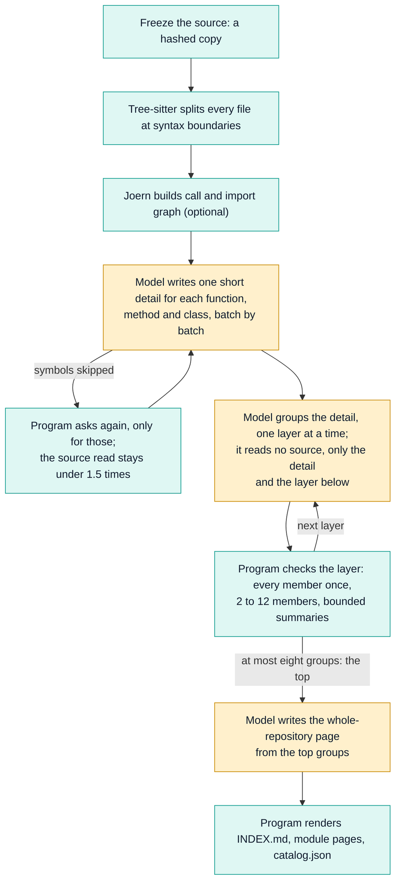
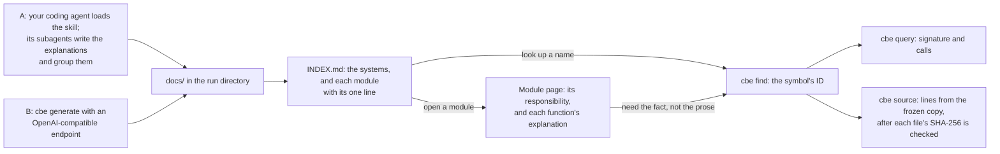

<h1 align="center">&nbsp;Codebase Explorer</h1>
<p align="center">Codebase Explorer turns a repository into a layered module map: a document people read top down and coding agents look things up in.</p>
<p align="center"><b>English</b> | <a href="README.zh-CN.md">简体中文</a></p>
<p align="center">
<a href="LICENSE"></a>
<a href="pyproject.toml"></a>
<a href="https://github.com/zlxdengtianhei/codebase-explorer/actions/workflows/wheel-install.yml"></a>
</p>

<!-- The 3.0 film. The release asset is uploaded when this README is published; the file is walkthrough-tsdown-3.0.mp4. -->
https://github.com/zlxdengtianhei/codebase-explorer/releases/download/walkthrough-3.0.0.dev0/walkthrough-tsdown-3.0.mp4

<p align="center">2 minutes 25 seconds, narrated, made by one command and no model call: the map of tsdown from its explanations, its six systems, one module taken down to two of its functions, then <code>cbe find</code>, <code>cbe query</code> and <code>cbe source</code>.<br><a href="https://zlxdengtianhei.github.io/codebase-explorer/?data=flask">Try the interactive map</a> · <a href="docs/videos.md">All films and how each is made</a></p>

A file tree shows where files are, not what each part is for. CBE reads a repository once, writes one short explanation for every function, method and class, and then groups those explanations into a tree, one layer at a time: what the repository is for, its systems, their modules, and the functions under them. The pages hold prose. Signatures, call edges and source lines are looked up with three commands, so the pages stay short and the facts stay exact. A person reads the map from the top. A coding agent starts at `docs/INDEX.md` and looks up names.

**To try it:** `uv tool install git+https://github.com/zlxdengtianhei/codebase-explorer` for 3.0 (Python 3.12 or 3.13); PyPI still carries 2.3.0. Then generate inside Claude Code on your own subscription, or from the command line with any OpenAI-compatible endpoint (you name the model with `--model`). The steps are in [Quickstart](#quickstart).

## What you get

- **A map you can read in one sitting.** `docs/INDEX.md` lists every system, and under it each module with one line on what it is responsible for. The page keeps to about 1,500 tokens; when two levels would pass that, it lists the top level only and says so.
- **A page per module, prose only.** Each module page carries its responsibility line, a short summary, its children, and on a leaf page one paragraph per function, method and class. A leaf page also names the files its members live in, on one line under the title, most members first: after a 3.0 experiment, a model that read pages without paths guessed a wrong file path.
- **A tree built from the explanations, layer by layer.** A model groups the detail, not the source; the program checks every answer. How many layers exist follows from the answers: a layer with at most eight groups is the top.
- **Facts from commands, not from the model.** `cbe find`, `cbe query` and `cbe source` resolve names from the pages. `cbe source` prints from the frozen snapshot and checks each file's SHA-256 against the digest recorded at freeze time before printing anything.
- **A narrated film in one command.** `cbe video` turns a finished run into a two-to-three-minute film with voice and slides. The program assembles the script from the map's own text, so the film calls no model and the same run gives the same film.

The `Modules` section of a real `docs/INDEX.md`, generated for tsdown by the final 3.0 run (unedited):

```markdown
## Modules

- [**Build execution and output**](nodes/build-execution-and-output.md) — Coordinates build orchestration, hooks, option and plugin assembly, output naming and addons, reports, and executable packaging workflows.
- [**Configuration resolution and types**](nodes/configuration-resolution-and-types.md) — Resolves user and workspace configuration, loads files, merges defaults, and defines public and resolved configuration models.
- [**Package dependencies and validation**](nodes/package-dependencies-and-validation.md) — Classifies dependency externalization, coordinates package bundles, generates exports, reads metadata, and runs lint and type validation.
- [**Filesystem and asset pipeline**](nodes/filesystem-and-asset-pipeline.md) — Handles entry resolution, watch-mode chunks, output cleaning, shared filesystem helpers, and asset copy rules.
- [**Shared utilities and logging**](nodes/shared-utilities-and-logging.md) — Provides reusable general helpers, shared utility types, and logger construction, formatting, and output behavior.
- [**Command and interactive UI**](nodes/command-and-interactive-ui.md) — Exposes command-line entry and debug controls, starts the optional devtools UI, and handles watch-interface shortcuts.
```

That page stops at the top level and says why: two levels would take about 2,014 tokens, over its 1,500-token budget. When two levels fit, the page lists each module under its system; each module page lists its own children.

Full example: [flask](examples/flask/docs/INDEX.md). More in [Examples and docs](#examples-and-docs).

## Quickstart

CBE is on PyPI as `codebase-explorer`, and the newest release there is 2.3.0. 3.0 is not on PyPI yet: step 1 installs it from GitHub. CBE needs Python 3.12 or 3.13. There are two ways to run it. Both end in the same `docs/` folder. The usual one is A: your coding agent loads the skill and does the work on your own subscription. B is for scripts and batch runs.

**A. The usual way: inside your coding agent, on your own subscription.** The steps below use Claude Code; the skill makes its subagents write the explanations at the lowest reasoning effort their host offers, with thinking off where the host allows it. The layer and overview tasks decide something (the tree, the whole-repository page), so they get the host's low level instead of thinking off.

1. Install CBE. For the 3.0 map and `cbe video`, install from GitHub: `uv tool install git+https://github.com/zlxdengtianhei/codebase-explorer` (or `pipx install git+https://github.com/zlxdengtianhei/codebase-explorer`). `uv tool install codebase-explorer` (`pipx install codebase-explorer`) gives 2.3.0, which has no `cbe video`. A relative `--run-dir` for `find`, `query` and `source`, and `cbe stale`, need 2.3.0 or newer.
2. Optional, for the call graph: `cbe graph setup` downloads Joern and a Java runtime into your user cache directory (about 1.9 GB; tested on Linux x86_64, not yet on macOS).
3. In your project, install the skill: `cbe-install install --host claude-code`.
4. Start Claude Code there and ask: "Use the codebase-explorer skill to generate documentation for this repository."
5. The agent prints the planned file, token, module and task counts, runs the subagents, and verifies the result.
6. Open `<run_dir>/docs/INDEX.md`. The agent reports `run_dir`.
7. The agent offers to add three lines (2.3.0 or newer) to the repository's `AGENTS.md` or `CLAUDE.md`. With them, later agents in the repository read `INDEX.md` first (three fresh Claude Code sessions did so; see [docs/running.md](docs/running.md#use-the-generated-docs-from-an-agent)).

Other agents load the same skill: `cbe-install install --host` takes `claude-code`, `opencode`, `pi`, `codex` and `dsh`. What has run end to end: Claude Code (see [What it costs](#what-it-costs)); OpenCode and Pi, once each on a 22-file sample repository (in the Pi run the tasks were handed to separate Pi sessions by a dispatch skill on our machine; Pi has no subagents of its own); OpenCode also ran the 3.0 comparison in [How well it works](#how-well-it-works). `codex` and `dsh` install the skill, and we have not run them end to end. Details: [docs/running.md](docs/running.md#generate-through-a-host-agent).

**B. For scripts and batch runs: from the command line, with any OpenAI-compatible endpoint.** There is no default model: you must pass `--model`.

1. Install CBE as in step 1 above.
2. Put the key in an environment variable: `export CBE_API_KEY=...`
3. Optional: build the call graph (`cbe graph setup`, then `cbe graph build /abs/repo --output /abs/graph.json`).
4. Generate. Paths must be absolute:

   ```sh
   cbe generate /abs/repo --model MODEL --base-url https://your-endpoint.example/v1 \
     --api-key-env CBE_API_KEY --graph /abs/graph.json --run-dir /abs/run
   ```

5. Open `/abs/run/docs/INDEX.md`. Drop `--graph` to run without a call graph.

Then look things up. `RUN` is the absolute run directory, and the ID is the second column of the `find` output:

```sh
cbe find   --run-dir "$RUN" --term url_for
cbe query  --run-dir "$RUN" --id 'src/flask/helpers.py::function::url_for::6511'
cbe source --run-dir "$RUN" --id 'src/flask/helpers.py::function::url_for::6511' --context 2
```

Every other command and option is in [docs/reference.md](docs/reference.md).

## How it works



Teal steps are ordinary code and make no model call. Amber steps are model calls.

- **Freeze.** CBE keeps a hashed copy of the source, so every line number and quote can be checked later.
- **Split.** Tree-sitter cuts each file at syntax boundaries. Every byte lands in some chunk.
- **Explain.** This is the only step that reads source. The model writes one detail for each function, method and class: one to three sentences, about 25 to 60 tokens. It names symbols by the short numbers in a list, so it cannot invent an ID. The program asks again only for the symbols the model skipped. A run stops asking for gaps once the embedded source would pass 1.5 times the source; the rest is listed as unexplained.
- **Group.** The model reads the detail, never the source, and groups it into modules: each group gets a two-to-six-word title, one line of responsibility and a two-to-three-sentence summary. It also sees a candidate grouping and call counts from the program, and may split, merge or move candidates. The next layer groups those modules the same way, and so on. The program checks every answer: each member in exactly one group, 2 to 12 members, bounded summaries. A group above twelve members is asked again once; when the answer comes back wrong again the program cuts it along its candidate grouping and marks the result. A layer with at most eight groups is the top.
- **Sum up.** The model writes the whole-repository page from the top groups: who uses the code, what it solves, and where to start reading.
- **Render.** The program writes `docs/INDEX.md`, one page per module, `DEPENDENCIES.md` and `RUN.md`, and the `catalog.json` that `find`, `query` and `source` read. `RUN.md` lists the layers, every cut and merge the program made, and the read budget.

Reviewing the explanations is optional and off by default: `--review` (bare = a sample of the largest batch, every batch if that one has a finding) or `--review all` asks a second model to check explanations against the source and rewrites each flagged batch once. On flask a sampled review was 14% of the run's input tokens, and reading every batch adds about 80% (both measured on 2.3.0; the review code did not change). `RUN.md` says which batches were read and what was found.

After a run, a person or a coding agent reads the result like this:



## Make a narrated film

```sh
cbe video --run-dir "$RUN" --out /abs/film [--modules 2] [--seconds 175] [--plan-only]
```

The film follows the map's reading path: the overall purpose, then every system, then up to two modules taken down to their functions, then one page for the three look-up commands. It reads one finished run and nothing else; the script is assembled from that run's own text, so no model is called and the same run with the same options gives the same film. Slides are one HTML page shot by headless Chrome; the voice is Kokoro-82M, and ffmpeg encodes the result. `--plan-only` stops after the script and the slides. Options for model files, browser and ffmpeg, and what each output is: [docs/videos.md](docs/videos.md).

The film at the top of this page is tsdown's final run: 12 lines of narration, 2 minutes 25 seconds, 2.98 MB, and no model call.

## What it costs

Two runs through the API path, `cbe generate` with DeepSeek V4.1 Flash, one run each and no review:

| Measure | tsdown (43 files, 38.7k source tokens) | cJSON (4 files, 34.4k source tokens) |
|---|---:|---:|
| Model input tokens ÷ source tokens (the program's count) | 1.61 | 1.51 |
| Source tokens read by the model ÷ source tokens (the source is read once) | 1.00 | 1.00 |
| Page tokens ÷ source tokens | 0.45 | 0.45 |
| Wall clock | 239 s | 191 s |

On this path the model sees only what CBE sends, so `read_ratio` is the whole input. The provider's own receipt, a second reading from a different tokenizer, puts the same runs at 1.68 and 1.60 times the source. Both runs finished `complete` with the deterministic checks passing. The 1.5-times-sources cap on embedded source was never reached.

Against 2.3.0, on flask and tsdown through OpenCode with DeepSeek V4.1 Flash (the same model for both versions, subagents at the host's default effort, no call graph):

| Measure | 2.3.0, flask / tsdown | 3.0.0.dev0, flask / tsdown |
|---|---|---|
| Wall clock, plan to last page | 2,765 s / 1,986 s | 888 s / 662 s |
| Subagent tasks | 19 / 15 | 10 / 8 |
| Prompt tokens the host recorded (main session + all subagents) | 8.92 M / 4.80 M | 3.77 M / 2.78 M |
| Page tokens ÷ source tokens | 0.59 / 0.75 | 0.37 / 0.47 |

The 3.0 column comes from the 3.0 build before its last round of fixes; that comparison was not re-run on the final build. It shows a build about three times faster, about half the host-side prompt tokens, and pages about half the size of the source. The `cbe host verify` checks passed on all four runs. Prompt tokens count cache reads again on every turn, so compare them within this table, not with the API table above.

Building the graph makes no model call. An older cost table for repositories up to 1.7 million tokens and the 2.3.0 numbers are in [docs/running.md](docs/running.md#what-a-run-costs-the-earlier-table) and [CHANGELOG.md](CHANGELOG.md).

## How well it works

Everything here was measured on this machine; the tables are in the task records of the 3.0 round and the older ones in [`evaluation/tree/results/`](evaluation/tree/results/).

- **The tree.** Both 3.0 runs above finished with no empty nodes and no duplicate page titles, each tree 2 layers deep with 6 groups at the top. Layer count is not a target: it follows from how many groups the model makes and stops at eight or fewer.
- **Finding the functions to change.** 10 real questions per repository ("where does X happen"), answerable with `cbe find`, `cbe query` and `cbe source`, asked in one clean session each for 2.3.0 and for 3.0.0.dev0 on the same model (the 3.0 session ran on the build before its last round of fixes). Hits: 3.0 found 25 of 29 expected functions on flask and 27 of 27 on tsdown; 2.3.0 found 23 of 29 and 25 of 27. The 3.0 answers also listed more related functions (45 vs 32, 43 vs 34), so they hit more and are less precise. Reading tokens: 3.0 used half on flask and 2.5 times as much on tsdown. The two repositories point in opposite directions, so **we cannot tell the two versions apart on either hits or tokens**. One measured cost of prose-only pages: one 3.0 answer guessed a wrong file path, which one `cbe find` would have corrected.
- **From 2.3.0, unchanged this round.** The 2.3.0 trees had no empty nodes on the three repositories measured then; sampled call-labelled edges matched the source; and 30 real commits per repository did not show that the program-built tree finds the code better than a plain directory listing except where directories are flat. Those readings, with their conditions, are in [evaluation/README.md](evaluation/README.md).

What we do not claim: that grouping by function lets an agent locate code better than a directory tree does, or that CBE improves an agent's answers. The measurements above do not show either.

## Code graph

Without a graph, CBE still works. With one, the explanation tasks and the dependency view also get static import, call and control-flow evidence. The graph comes from [Joern](https://joern.io/), which needs Java 21 or newer. `cbe graph setup` downloads the pinned Joern and, if no suitable Java is found, a Java runtime into your user cache directory (about 1.9 GB in total). `cbe graph setup --check` downloads nothing and reports what is installed. `cbe graph build` then writes the graph file that `--graph` takes. It does not export dataflow unless you pass `--with-dataflow`, because a generation run does not read it and it was over half of the graph file on flask (23 of 41 MB). To install Joern by hand, see [docs/reference.md](docs/reference.md#optional-graph-analyzers).

| Status | Languages | Conditions |
|---|---|---|
| Works on real repositories | C, C++, Python, JavaScript, TypeScript, Java, Go, Ruby | Python imports use Grimp (the `graphs` extra); JavaScript and TypeScript imports use dependency-cruiser (Node.js). Go calls across packages can stay unresolved. Ruby's dynamic dispatch can bind a call to a method of the same name on another class: CBE marks such calls ambiguous, and some wrong bindings remain. |
| Needs an extra tool | Rust, PHP | Rust needs `cargo` and a Cargo project layout. PHP needs `php` (7 or later). |
| Builds, calls partly resolved | C# | On a 55-file repository the graph builds (declarations, control flow, imports). Of its 2,322 calls, 689 resolve to one repository method and 394 to a set of overloads (Joern's C# frontend does not type arguments well enough to pick the overload); 246 point outside the repository and 993 stay unresolved. |
| Fails on real repositories | Kotlin | Joern 4.0.654 failed on a 146-file Kotlin repository. Two-file examples work, so small inputs may succeed. |
| Not tested | Swift, TSX | |

`cbe languages` prints the same status for each language as `call_graph`. Source parsing and chunking work for every language in the table whatever the call-graph status is. Tree-sitter grammars for 13 languages come with the default install and two extras. More on analyzers and graph options: [docs/reference.md](docs/reference.md#optional-graph-analyzers). What code graphs are, which ones CBE uses and why, and where each language is known to be wrong: [docs/code-graphs.md](docs/code-graphs.md).

## Known limitations

- **The host path reads source twice.** Through a coding agent, the subagents read the source files themselves to write the detail, and CBE counts only its own prompts; the 1.61 and 1.51 above are API-path readings. The 3.0 host runs wrote no `source_read_tokens` for that reason. The host-side prompt total is the honest number there, and it halved against 2.3.0.
- **We cannot tell 3.0 from 2.3.0 on locating code.** 10 questions per repository, one session each, two repositories, two versions: the hits differ by two functions and the reading tokens disagree between the repositories. More runs are needed.
- **The effect of thinking off on explanation quality is not measured.** 3.0 writes detail at the lowest reasoning effort the host offers, with thinking off where the host allows it, and its layer and overview tasks get the host's low level. We have no A/B reading of detail quality with thinking on.
- The call graph needs Joern and Java 21 or newer. `cbe graph setup` downloads both (about 1.9 GB).
- C# calls to overloaded methods resolve only to the set of overloads. On GuardClauses, 993 of 2,322 calls are marked unresolved; about 955 of those are calls to methods outside the repository, `nameof` or constructor calls, and 14 are calls inside the repository that CBE cannot link. A second repository (MediatR) was spot-checked: 10 sampled call pairs were right. Kotlin graphs fail on real repositories under the pinned Joern version; two-file examples work.
- Ruby's dynamic dispatch can bind a call to the wrong class's method. CBE marks many of these as ambiguous, and some wrong bindings remain.
- C and C++ files are not preprocessed. A header with many macros is cut into coarse chunks, and a macro can be taken for a function name.
- A model writes the explanations. `cbe host verify` passing shows that the structure and references are consistent. It does not show that an explanation is correct. Check explanations against the source (`cbe source`).
- There are no incremental updates. When the source changes, `cbe stale` lists the units and module pages that describe changed files (judged per file); to refresh them, generate again.
- `cbe video` needs headless Chrome, the Kokoro-82M model and its voices file, and ffmpeg. The script is assembled from the map's text rather than rewritten, so its wording is only as good as the map's.

## Examples and docs

- Generated documents: [flask](examples/flask/docs/INDEX.md), [cJSON](examples/cjson/), [fmt](examples/fmt/), [gson](examples/gson/), [ruby_llm](examples/ruby_llm/), [tsdown](examples/tsdown/), [polyglot](examples/polyglot/). Each example's README names the CBE commit that generated it; most were generated by an earlier version.
- [docs/reference.md](docs/reference.md): install options, languages, graph analyzers, `find`, `query`, `source`, named declaration coverage.
- [docs/running.md](docs/running.md): host-agent and API runs, the run directory, resume and verify, cost details, troubleshooting.
- [docs/videos.md](docs/videos.md): the films, and how `cbe video` makes one.
- [evaluation/README.md](evaluation/README.md) and [CHANGELOG.md](CHANGELOG.md).

## Development and license

```sh
uv sync --python 3.13 --group dev
uv run pytest -q
```

Tests that need a real analyzer need that analyzer configured. The product license is [MIT](LICENSE); external analyzers and grammar packages keep their own licenses.
