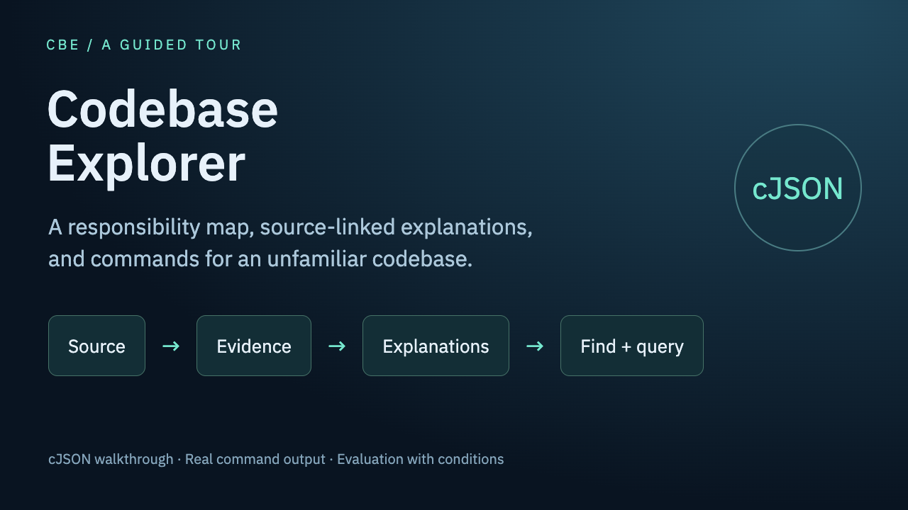

# Codebase Explorer

Codebase Explorer (CBE) turns source code and code graphs into structured explanations, a semantic module tree, and a searchable documentation index. It freezes the source, splits it at syntax boundaries, and supplies the relevant code and graph evidence to the model. The same generation state supports host-agent subagents and an OpenAI-compatible API. [Evaluation](#evaluation) summarizes what six evaluation rounds measured and the conditions each result holds under.

This checkout contains **2.2.0.dev0**. It is a development version; see [CHANGELOG.md](CHANGELOG.md) for the changes from 2.1.1. Python 3.12 or 3.13 is required.

## Quickstart

This path documents the four core files of [cJSON](https://github.com/DaveGamble/cJSON) at commit `6d9f244`, the same input as the cJSON example in the evaluation. Steps 1–4 run locally and make no model call. Step 5 needs a model. CBE has no PyPI package; install it from a checkout of this repository.

1. Install CBE and check the grammars:

   ```sh
   uv tool install --python 3.13 /path/to/codebase-explorer
   cbe --version    # prints: python -m cbe 2.2.0.dev0
   cbe languages    # c, cpp, python, javascript, typescript, tsx, java and go show "available": true
   ```

2. Get the input:

   ```sh
   git clone https://github.com/DaveGamble/cJSON.git "$HOME/cbe-demo/cJSON"
   mkdir -p "$HOME/cbe-demo/cjson"
   git -C "$HOME/cbe-demo/cJSON" archive 6d9f2443ab071f86e5d9b43025a40929ec41c46c \
     cJSON.c cJSON.h cJSON_Utils.c cJSON_Utils.h | tar -x -C "$HOME/cbe-demo/cjson"
   ```

3. Check how CBE reads the source. This takes under a second here:

   ```sh
   cbe context build "$HOME/cbe-demo/cjson" --output "$HOME/cbe-demo/context.json"
   ```

   ```text
   {
     "output": "<HOME>/cbe-demo/context.json",
     "schema": "cbe-context/1",
     "files": 4,
     "chunks": 326,
     "diagnostics": [
       {
         "path": "cJSON.c",
         "code": "syntax_error",
         "message": "tree contains an ERROR node near line 1; chunk coverage is preserved"
       },
       {
         "path": "cJSON.h",
         "code": "ambiguous_language",
         "message": "'.h' is valid in c, cpp; parsed with c. Register a mapping or use a unique extension to remove the ambiguity."
       },
       ...
     ]
   }
   ```

   The full output lists five diagnostics: `syntax_error` for `cJSON.c`, `cJSON.h` and `cJSON_Utils.h`, and `ambiguous_language` for both headers. The `syntax_error` entries come from cJSON's macros; see [Known limitations and troubleshooting](#known-limitations-and-troubleshooting). Generation does not need this file, because `generate` and `host plan` freeze their own copy. Use it to see the file list, chunk count and diagnostics before you spend model calls.

4. Optional: build a code graph with Joern ([Optional graph analyzers](#optional-graph-analyzers) says how to install it). This took 28 seconds here and makes no model call:

   ```sh
   cbe graph build "$HOME/cbe-demo/cjson" --output "$HOME/cbe-demo/graph.json" \
     --joern-home /path/to/joern-cli
   cbe graph capabilities --graph "$HOME/cbe-demo/graph.json"
   ```

   The graph has 21,106 nodes and 33,164 edges. `capabilities` reports C imports `resolved` (3 resolved, 17 external), calls `partial` (350 resolved, 307 unresolved, 84 external), and CFG and dataflow `resolved`.

5. Generate the documents. This needs one of the following:

   - **A host agent with subagents (Claude Code or Codex).** The subagents run on your own subscription. Run `cbe-install install --host claude-code` (or `--host codex`) in `$HOME/cbe-demo/cjson`, start the agent there, and ask: "Use the codebase-explorer skill to generate documentation for this repository." The agent plans the run first; for these four files `cbe host plan` prints `"modules": 4` and `"tasks": 8`, and each review finding adds one repair task later. See [Generate through a host agent](#generate-through-a-host-agent).
   - **An OpenAI-compatible endpoint, an API key and a model ID.** Pass `--host api`; without it, `cbe generate` drives a signed-in OpenCode CLI instead.

     ```sh
     cbe generate "$HOME/cbe-demo/cjson" --host api \
       --base-url https://your-endpoint.example/v1 --api-key-env CBE_API_KEY \
       --model your-model-id --graph "$HOME/cbe-demo/graph.json" \
       --run-dir "$HOME/cbe-demo/run" --review sample
     ```

     In the evaluation, this input with `zai/glm-5.3-flash` took 13 gateway requests and 0.084977 USD by the gateway's own price table, and the first pass completed. [What a run costs](#what-a-run-costs) lists larger repositories.

6. Read the result. Open `$HOME/cbe-demo/run/docs/INDEX.md`, then look up a symbol:

   ```sh
   cbe find --run-dir "$HOME/cbe-demo/run" --term cJSON_Parse --limit 3
   cbe query --run-dir "$HOME/cbe-demo/run" --id 'cJSON.c::function::cJSON_Parse::33515'
   ```

   [Find and query](#find-and-query) shows the output from the evaluation's cJSON run. Inventory IDs such as `cJSON.c::function::cJSON_Parse::33515` come from the source, so the same four files give the same IDs. Summaries, explanations and `grp:` group IDs come from the model, so yours will differ.

## Install and inspect a repository

CBE is not published on PyPI. Install it from this checkout:

```sh
uv tool install --python 3.13 .
cbe --version
cbe languages
```

`cbe --version` prints `cbe 2.2.0.dev0`. When `cbe` runs from a source tree without installed package metadata, it prints `cbe source` instead.

The standard installation includes Tree-sitter grammars for C, C++, Python, JavaScript, TypeScript/TSX, Java, and Go. The `languages` extra adds Ruby, Rust, PHP, and C#; `languages-community` adds the community grammars for Kotlin and Swift:

```sh
uv tool install --python 3.13 '.[graphs,languages,languages-community]'
cbe languages
```

All use the same context interface. `cbe languages` reports extensions, grammar versions, provenance, availability, and plugin errors. Missing grammars and parse errors remain visible in diagnostics. ABAP, Jimple bytecode, and Ghidra output do not currently have a matching source grammar in this interface. A `.h` file defaults to C with an ambiguity diagnostic. Pass `--header-language cpp` to `context build`, `graph build`, `host plan`, or `generate` for C++ headers (`c` also selects C explicitly). A resumed run keeps its original language choice.

Build a source context without making a model call:

```sh
cbe context build /absolute/path/to/repo --output /absolute/path/to/context.json
cbe context query --context /absolute/path/to/context.json --path src/example.py
```

Chunks have stable identifiers within a snapshot, original byte and line ranges, source text, hashes, and declaration context. Nested declarations do not duplicate their parent's source. Joining a file's chunks in byte order reconstructs that file. Large declarations are segmented at syntax boundaries; indivisible large tokens and unsupported inputs are reported explicitly.

### Optional graph analyzers

Context building and generation work without any analyzer. A graph adds static import, call, control-flow and dataflow evidence to the detail tasks and to the dependency view. Without a graph, the run records that no graph was supplied, and no dependency pair can be graph-confirmed.

| Analyzer | What it adds | How to install | How CBE finds it |
|---|---|---|---|
| Joern 4.0.654 and a JDK | Calls, CFG and dataflow; include and import declarations. The next section lists the languages and their conditions. | Download the `joern-cli-<os>-<arch>.zip` asset for your platform (for example `joern-cli-macos-arm64.zip`) from the [Joern v4.0.654 release](https://github.com/joernio/joern/releases/tag/v4.0.654) and unzip it. Joern's [installation page](https://docs.joern.io/installation/) asks for JDK 19 and says newer JDKs might work; the graph in this README was built on JDK 21.0.9. | `--joern-home DIR`, then the `CBE_JOERN_HOME` environment variable, then `joern` on `PATH`. `DIR` is the directory that holds `joern` and `joern-parse`; CBE also looks in `DIR/joern-cli`. |
| dependency-cruiser 16 and Node.js | JavaScript and TypeScript import graph | `npm install dependency-cruiser@16` in a tools directory. Tested with 16.10.4 on Node.js 22.20.0. | `--depcruise-bin PATH` (for example `.../node_modules/.bin/depcruise`), then `CBE_DEPCRUISE_BIN`, then `depcruise` on `PATH` |
| Grimp 3.17 | Python import graph | `uv tool install --python 3.13 '.[graphs]'` | Imported from the CBE environment |

Check what ran with `cbe graph capabilities --graph /absolute/path/to/graph.json`. The `backend.components` list names each analyzer and its version, and every `capabilities` row gives a language, a graph kind and a status, for example `resolved`, `partial`, `empty`, `failed` or `unavailable`. The Quickstart graph reports:

```text
"backend": {"name": "joern", "version": "4.0.654", "components": [{"name": "joern", "version": "4.0.654"}]}
```

What a missing analyzer costs:

- **No Joern:** no calls, CFG or dataflow for any language. `graph build` records `backend_unavailable` ("Joern CLI not found; call/cfg/dataflow skipped"). When no other analyzer covers the requested languages, as for the C-only Quickstart input, `graph build` exits 2 with `no graph backend was available for the requested languages`.
- **No dependency-cruiser:** the JavaScript and TypeScript import graph is skipped with `backend_unavailable`. If Joern ran, it still records import declarations, but these do not establish a resolved file dependency.
- **No Grimp:** the Python import graph is skipped with `backend_unavailable` ("grimp is not installed; Python import graph skipped (install the 'graphs' extra)").

## Generate and query code graphs

Tree-sitter provides syntax and code boundaries. Import resolution, calls, control flow, and data flow come from external analyzers. Each graph records the backend version, input hashes, capabilities, unresolved targets, and analysis conditions. A graph that does not match the current source is rejected when building a context.

The graph adapters use [Joern](https://joern.io/), [Grimp](https://grimp.readthedocs.io/), and [dependency-cruiser](https://github.com/sverweij/dependency-cruiser) according to the language and graph type. The selected integration versions are Joern 4.0.654, Grimp 3.17, and dependency-cruiser 16. Install the `graphs` extra for Grimp (`uv tool install --python 3.13 '.[graphs]'`). Joern and dependency-cruiser are separate installations. The CBE package does not include Joern, a JDK, or Node dependencies.

| Source language | Import backend | Call / CFG / local definition-use backend | Relevant conditions |
|---|---|---|---|
| C / C++ | Joern include declarations | Joern | Include paths, macros and compilation settings affect results; virtual calls may bind to a static base target. |
| Python | Grimp, plus Joern declarations | Joern | Package layout affects imports; dynamic and external calls can remain unresolved. |
| JavaScript / TypeScript / TSX | dependency-cruiser, plus Joern declarations | Joern | Dynamic imports, CommonJS and external targets may remain partial. |
| Java | Joern declarations | Joern | Project types and dependencies affect resolution. |
| Go | Joern declarations | Joern | Cross-package calls may remain unresolved or external. |
| Ruby | Joern declarations | Joern | The frontend excludes `test`, `tests` and `spec` paths by default. |
| Rust | Joern declarations | Joern | The frontend requires a Cargo project layout; a flat source directory can fail. |
| PHP | Joern declarations | Joern | An external PHP runtime (7 or later) is required. The local trial without it reported a failed analysis. |
| C# | Joern declarations | Joern | Namespace and project layout affect resolution; the bundled AST generator must run on the host platform. |
| Kotlin | Joern declarations | Joern | Project dependencies and build conditions affect resolution. |
| Swift | Joern declarations | Joern | The frontend parses per file; the tested cross-file call remained external. |

Joern import declarations do not establish a resolved file dependency. Capabilities describe the actual run, including frontend failures; a registered source language alone does not establish semantic graph coverage. Use an installed Joern distribution and, when needed, a local dependency-cruiser executable:

```sh
cbe graph build /absolute/path/to/repo \
  --output /absolute/path/to/graph.json \
  --joern-home /absolute/path/to/joern-cli \
  --depcruise-bin /absolute/path/to/node_modules/.bin/depcruise
cbe graph capabilities --graph /absolute/path/to/graph.json
cbe graph query --graph /absolute/path/to/graph.json --path src/example.py --kind call
cbe context build /absolute/path/to/repo \
  --graph /absolute/path/to/graph.json --output /absolute/path/to/context.json
```

`--language` can limit analysis to a language. `--max-methods` limits only CFG export per frontend (default: unlimited); method identities and calls remain complete, diagnostics report the exact omitted method count, and CFG capability is `partial` when methods are omitted. `--max-reaching-defs` bounds reaching-definition edges; `--dataflow-path-method` opts into sampled value-flow paths. `--joern-heap 8g` sets the Joern JVM maximum heap through `JAVA_TOOL_OPTIONS`, preserving other JVM options; without it, JVM settings are inherited. Backend failures retain their cause in graph diagnostics and print a line to stderr. Partial builds succeed when another backend completes; if every backend fails, the command exits nonzero and retains a diagnostic graph when possible. Joern JSON is written compactly to a writer to avoid an extra whole-document string and byte array. `graph query` accepts `import`, `call`, `cfg`, or `dataflow`, a node ID, and an edge direction (`in`, `out`, or `both`). A local query retains boundary endpoints and identifies omitted scope. It can read the graph embedded in a generation run's frozen `context.json` for manual inspection of the evidence used at planning. Host detail tasks receive a bounded excerpt and a separate complete evidence file when the batch has graph nodes. The full graph stays in the output file; `graph build` prints a compact result and capability report.

The graph's `quality` audit reports edge status counts, integrity issues, and incomplete capabilities; `cbe graph capabilities --graph /absolute/path/to/graph.json --repo /absolute/path/to/repo` refreshes the audit against current repository files.

Graphs produced by CBE record the registered source set and recognized repository configuration files. Context building and generation check their hashes and reject additions, removals, edits, or unstable builds. These checks run before and after analysis of the repository; they do not create an isolated filesystem snapshot. External graphs without configuration provenance retain source-manifest validation, with configuration identity unknown.

Graph kinds have different meanings:

- **Import** edges identify static module, package, or include dependencies according to the selected resolver.
- **Call** edges are static analysis results. Dynamic dispatch, reflection, unresolved imports, and external code can leave targets unknown or conditional.
- **CFG** edges describe the analyzer's control-flow nodes. They are not a runtime execution trace.
- **Dataflow** edges or paths describe the analyzer's definition/use or value-flow analysis, with its stated scope and library models. A local definition/use graph does not prove complete interprocedural data flow.

C/C++ include paths, macros, build configuration, and generated sources affect analysis. Dynamic languages also require explicit uncertainty. Consult the generated `capabilities` and `diagnostics` instead of treating a nonempty graph as complete coverage.

## Generate through a host agent

Install the bundled skill in the project where the agent will run:

```sh
cbe-install install --host claude-code   # or --host codex
```

For Claude Code this installs two things: the skill in `.claude/skills/` and the `cbe-writer` subagent in `.claude/agents/` (Read and Write tools only, so the subagents that write results cannot run shell commands). `--scope user` installs both under `~/.claude/`. `cbe-install` never overwrites a skill or agent file that it did not install, and `cbe-install uninstall` removes what it installed.

For Codex the skill goes to `.agents/skills/codebase-explorer/` in the project, or to `~/.agents/skills/` with `--scope user`. Codex finds skills in `.agents/skills` from the working directory up to the repository root and in `~/.agents/skills`. Invoke it with `$codebase-explorer`, or let Codex select it. No subagent file is installed for Codex.

Both installs write the absolute path of the Python that runs CBE into the installed `SKILL.md`, so the agent does not need `cbe` on `PATH`. Run `cbe-install upgrade` after you move or reinstall the tool environment. `cbe-install doctor --host claude-code` (or `--host codex`) checks an install. In a scratch project:

```text
$ cbe-install install --host claude-code
installed /path/to/project/.claude/skills/codebase-explorer
installed /path/to/project/.claude/agents/cbe-writer.md
runtime cbe: /path/to/tool-environment/bin/python -m cbe
$ cbe-install install --host codex
installed /path/to/project/.agents/skills/codebase-explorer
runtime cbe: /path/to/tool-environment/bin/python -m cbe
```

Then ask the agent in that project, for example: "Use the codebase-explorer skill to generate documentation for this repository." The agent tells you the planned file, token, module and task counts, dispatches one subagent per task, and reports usage and cost at the end. So far the Claude Code path has run end to end on a small C repository (Claude Code 2.1.301 with Sonnet subagents). The Codex instructions have not been run end to end.

The host uses its existing subagent facility and subscription. It drives the CLI's durable task loop:

```sh
cbe host plan /absolute/path/to/repo --graph /absolute/path/to/graph.json \
  --run-dir /absolute/path/to/run --review sample --jobs 4 --host claude-code
cbe host next --run-dir /absolute/path/to/run
# Dispatch the returned task instructions to a subagent, then submit its JSON result.
cbe host submit --run-dir /absolute/path/to/run --task TASK
cbe host verify --run-dir /absolute/path/to/run
```

The skill describes the complete loop and the result contracts. `host plan` accepts `.` or any path for the repository; `--run-dir`, `--repo`, and `--graph` need absolute paths. The skill's commands avoid quoted shell variables, because Claude Code asks for confirmation before it runs a command with quoted text it cannot check, even when `cbe` is on the allow list. The `tasks` count that `plan` prints covers the planned tasks only; each review finding adds one repair task later. `next` leases every task it returns, including the re-ask of a rejected task, so each one needs a subagent; attempts at one task share a label and their usage adds up. `submit` prints one JSON object and exits 0 whether it accepts or rejects: `accepted: true` carries `normalized` and `flags`, and `accepted: false` carries `error`, `attempts`, and `task_status` (`pending` for a queued re-ask, `failed` when the attempts are used up). `progress.log` records both.

Detail authors receive their assigned frozen source chunks and local graph evidence. The tree stage receives responsibility summaries, source locations and counted unit edges; it assigns each unit one primary place in a semantic tree. Static resolved edges retain their analyzer kind. Detail authors' relations are a separate `kind=relation` category with `provenance=model_inferred`; they do not become static call evidence. Reports count the categories separately. A directory or a dense set of import edges does not by itself define a module's responsibility.

Large trees use program-selected candidate regions, one `tree_region-*` task per region, then a `tree` merge that attaches their accepted subtrees. Set `CBE_TREE_MAX_UNITS` and `CBE_TREE_MAX_TOKENS` before the first tree dispatch to configure the region limits; defaults are defined in `cbe.aggregation.Limits`. The plan records the chosen limits and each region's initial completion input tokens in `host/state.json`. Files are indivisible; a unit spanning multiple files joins those files into one block. Unit count is a packing target that an indivisible block may exceed, while the token ceiling is strict. Regions are balanced using incremental summary and edge weights, directory locality and import affinity, then their complete prompts are measured. A file block larger than the token budget produces an explicit planning error with the configuration remedy. Region tasks wait for detail review and repair to settle, including reviews whose source module failed; small runs keep one tree task.

Region node ids use compact prefixes (`r1-`, `r2-`, …). A region submission whose prefixed id exceeds 64 characters is rejected with the allowed length. A failed region gets a mechanical subtree. A failed merge retains all accepted region subtrees beneath a mechanical upper tree, and INDEX distinguishes these two failures. The merge completion input is also measured: if it exceeds the configured budget, the merge fails explicitly and the system overview can still finish from the retained tree. The current implementation does not introduce another merge layer automatically; increase the budget and make a new plan after inspecting this error.

The defaults are 300 units and 64,000 input tokens. The token ceiling leaves room for whole files and inferred relations: an offline replay of accepted Flask answers measured 42,870 tokens for 254 units and 49,971 for 294 units, so both remain single-tree runs. At an explicit 32,000 ceiling the 294-unit snapshot splits into 171 and 123 units (26,677 and 20,250 tokens), with no file split. On celery's 12,106 synthetic units the largest indivisible file needs 44,422 tokens; the old 32,000 ceiling cannot hold it. At the defaults, 41 regions fit (largest 53,503 tokens), and the synthetic merge needs about 50,600 tokens. These are measured input sizes, not a guarantee of model context capacity or semantic grouping quality; configure the limits for the chosen model. Detail records are cached by accepted-answer content, with cache integrity checked before reuse; unchanged `next` calls skip rebuilding records and planning. Caches over 10 MB are compressed.

The dependency view labels pairs as **graph-confirmed** (tree and resolved call/import edges), **model-inferred** (tree only), or **graph-only** (graph only). The first two count edges between subtrees; graph-only counts direct node owners. **Containment** rows show resolved edges between ancestor direct units and a descendant subtree as `→ N / ← M`, relative to the listed pair. **Within containment** rows list direct owner pairs separately. Both containment categories stay out of Mermaid and the three dependency totals. Graph-only and within containment each keep their own top 40 pairs by edge count and report their own omitted count. `summary.json` records the full within containment count in `within_containment`. Key flows link unit ids; when the model supplies none, the report labels the first five paths **Program candidates, not selected by the model**. Program labels and navigation use English; model prose keeps its original language.

P1–P7 diagnostics appear in `summary.json` and at the end of INDEX. They are advisory and never request a rewrite. Set `CBE_TREE_MIN_GRAIN`, `CBE_TREE_MAX_GRAIN`, and `CBE_TREE_SHARED_MIN_EDGES` to adjust granularity and shared-utility reporting. P5 reports dependency signals even when a utility already has its own module. Product P7 compares the prior rendering within this run for identical detail input: it says `re-render identical` or `re-render changed`, with no stability pass. Its first observation is `not_checked`. Cross-run id/title stability is assessed only by replay scripts that supply a previous report from another run with the same detail fingerprint; repeated rendering does not test a fresh model completion.

`--graph` is optional. Without it the context explicitly records that no analyzed graph was supplied. The model must not invent missing relations. `--review` selects `none`, `sample`, or `all`. Operational completion, structural validity, and semantic review are separate results.

## Use the generated docs from an agent

Give an answering agent the documents as a map and the source as the authority, and tell it the order to use them in. Having the commands is not enough: in the evaluation, the agent that had CBE's documents and commands issued `find`/`query` in only 7 of 48 flask questions, executed them in 2 of 48 pytest questions, and ran them in 9 of 40 curl questions ([Q-A: flask](evaluation/README.md#q-a-flask-e2), [Q-A: pytest](evaluation/README.md#q-a-pytest-e3), [Q-A: curl](evaluation/README.md#q-a-curl-e5)). A prompt such as this one states the order:

```text
The repository is at /absolute/path/to/repo. CBE documentation for it is in
/absolute/path/to/run/docs, and the CBE run directory is /absolute/path/to/run.

1. Read /absolute/path/to/run/docs/INDEX.md first. Choose the responsibility
   node that matches the question and open its page in docs/nodes/.
2. To locate a symbol, run
     cbe find --run-dir /absolute/path/to/run --term NAME
   and copy an id from the second column. Then run
     cbe query --run-dir /absolute/path/to/run --id ID
   Always write --term and --id. A bare argument fails with exit code 2.
3. Before you answer, read the source lines that the page or query cites:
     cbe source --run-dir /absolute/path/to/run --id ID --context 2
   or open the file. The explanations are written by a model. Where they
   disagree with the source, the source is right.
4. Cite file paths and line ranges in the answer.
```

This prompt was not part of the evaluation, so it is a suggestion, not a measured improvement. With the skill installed, the skill's "Read and query the result" section gives a Claude Code or Codex agent the same commands. You can ask, for example: "Use the codebase-explorer skill and the run at /absolute/path/to/run to answer: where does cJSON free a partially parsed tree?"

## Generate through an API

Use any configured OpenAI-compatible chat-completions endpoint:

```sh
# Supply the credential through the named environment variable using your normal secret setup.
cbe generate /absolute/path/to/repo --host api \
  --base-url https://your-endpoint.example/v1 --api-key-env CBE_API_KEY \
  --model your-model-id --graph /absolute/path/to/graph.json \
  --run-dir /absolute/path/to/run --review sample
```

`--config /absolute/path/to/config.json` provides host configuration. API credentials stay in environment variables or the supported credential-file reference. If no credential is configured, CBE omits the Authorization header for endpoints that allow unauthenticated requests. Do not put credentials in a URL. The API client records returned usage and preserves unknown values when usage is absent. Failed completions retain a bounded, redacted provider response, available usage, and finish reason before text extraction; truncation is explicit. A response with only reasoning and no answer remains a failed attempt. Reported token counts are transport/accounting evidence; they do not prove that a model understood the code.

For `--host api`, exact model `zai/glm-5.3-flash` selects resource defaults from
`cbe/model_settings.py`: 1,800 seconds per call, `output_max_tokens: 49152` (including
reasoning), `reasoning_effort: "low"`, JSON object response mode, and reading-batch target/max of
8,000/10,000 source tokens. Whole files stay intact; a single file may exceed
the batch maximum up to the existing 60,000-token file limit. Other API model
IDs retain 420 seconds, no explicit output/reasoning limit, and the original
20,000/25,000 batch sizes. OpenCode and Devin keep their existing defaults.

Set API resource values with `--config`; explicit `--timeout` takes precedence
over the config, which takes precedence over model defaults. For example:

```json
{
  "timeout": 1800,
  "output_max_tokens": 60000,
  "reasoning_effort": "low",
  "response_format": {"type": "json_object"},
  "batch_target_tokens": 8000,
  "batch_max_tokens": 10000
}
```

The endpoint must support the configured request fields. Batch limits apply to
new plans; `--resume` keeps the frozen batches. A response ending with `length`
(or `max_tokens`/`max_output_tokens`) fails with `output_limit`, even if its JSON
parses. Module and repair detail tasks allow 3 answers; other tasks allow 2.
Each rejection includes the error; on the final invalid answer the driver
normalizes usable content. For module and repair details it tries answers from
newest to oldest within the current round, accepting the first normalized answer
that passes the same strict checks, or fails the task for resume if none passes. Truncated attempts
cannot be accepted by final normalization. Increase
`output_max_tokens` for resume or start a fresh run with smaller batch limits if needed.
`output_max_tokens` caps API output (sent as the provider's `max_tokens` field);
`batch_max_tokens` caps source input per reading batch.
CLI help reads the model defaults table directly.

API config is parsed and validated before planning or sending model requests.
Malformed JSON or invalid resource settings exit 2 without a generated summary.
Timeout and token limits must be positive integers (numeric strings and zero are
rejected); prices must be three finite nonnegative numbers. An explicit batch
target must not exceed its maximum. For models without a default batch target,
setting only `batch_max_tokens` lowers the fallback target to that maximum when
necessary; unspecified limits use the constants from `batching`.

Timeouts and provider failures remain visible as their own errors. Only a
source-bearing response whose reported input is too small is marked
`source_not_delivered`. The rejected answer is not published; the status names
failed tasks and suggests fixing the cause, then using `--resume`.

API `summary.json` sums observed input/output tokens, including returned failed
calls. The observed-total and missing-call conventions also apply to OpenCode
and Devin summaries. Missing-call counters and `usage_complete: false` identify an incomplete
sum; absent usage is never estimated. Cache totals remain unknown when any
cache counter is missing, with the known portion in `observed_cache_tokens`.
API price is unknown (`priced_usd: null`) unless config supplies
`"price_per_million": [INPUT, OUTPUT, CACHE]` in USD per million tokens; missing
usage still prevents pricing. The raw API record includes `actual_model` from
the provider response so gateway fallback can be distinguished from the
requested model.

The signed-in OpenCode and Devin drivers remain available:

```sh
cbe generate /absolute/path/to/repo --host opencode --model provider/model
cbe generate /absolute/path/to/repo --host devin --model your-supported-model
```

Choose a model that your own account can use. CBE does not promise that a provider, model, or subscription is free.

### What a run costs

The rows below are copied from the [Generation runs](evaluation/README.md#generation-runs) table of the evaluation. All runs used `zai/glm-5.3-flash` through `--host api` and the Magpie gateway. `cost_usd` comes from the gateway's own price table, not from a provider's public price list; re-price with a dated public price list before you compare it with other reports. Request and token counts do not depend on prices.

| Repository | Source tokens (o200k) | Gateway requests | `cost_usd` (gateway price table) | First pass complete | Resumes |
|---|---:|---:|---:|---|---:|
| cJSON (4 files) | 34,364 | 13 | 0.084977 | yes | 0 |
| flask | 125,125 | 33 | 0.250453 | yes | 0 |
| svelte r1 / r2 / r3 | 531,705 | 128 / 136 / 144 | 0.828273 / 0.843545 / 1.018638 | no / no / no | 1 / 1 / 1 |
| pytest | 752,827 | 194 | 1.660272 | no | 2 |
| curl | 1,741,311 | 341 (1 HTTP 429) | 2.116713 | no (stopped by HTTP 429) | 2 |

Read the table with these conditions:

- One model, with CBE's defaults for that exact model ID (see above). With another model the counts and costs may differ.
- The figures include the resumes. Most incomplete first passes came from malformed module answers: `schema_error` in 46 / 52 / 57 of 128 / 136 / 144 calls on svelte, 78 of 194 on pytest, and 112 of 341 on curl. The resumes used the same settings, with no code change and no manual repair.
- flask ran at CBE commit `9c6499e`; the other rows at `a87674d`.
- Building the graph makes no model calls and is not in these figures.
- Wall clock was recorded only, on a heavily loaded machine through a shared gateway. For example, the three svelte runs took 2.32, 2.69 and 3.18 hours ([Q-C](evaluation/README.md#q-c-cost-and-size-e4b-e4c)).
- The evaluation measured only the API path. A host-agent run spends your subscription instead; `cbe host import-usage` and `cbe host cost` report its usage afterwards.

## Read, resume, and verify

Open the `index` path in the generation result, `RUN/docs/INDEX.md`, where `RUN` is the run directory. The output includes the semantic navigation tree, detail explanations with source anchors, and a machine-readable catalogue.

### Run directory layout

Start at `docs/INDEX.md`; the files outside `docs/` serve the commands and scripts. The sizes are from the evaluation's cJSON run (4 files, 34,364 source tokens) and, where stated, from its svelte runs (440 files, 531,705 source tokens; [Q-C](evaluation/README.md#q-c-cost-and-size-e4b-e4c)).

| Path in `RUN` | What it is | Size |
|---|---|---|
| `docs/INDEX.md` | Start here. How to read the report, the responsibility tree with one line per unit, reading stats, graph coverage, the system overview, maintenance navigation, the dependency view and list, key flows, generation notes, and the P1–P7 checks. | 22 KB |
| `docs/nodes/<node>.md` | One page per responsibility node: its capability, what it depends on, then each unit with its signature, a program-derived source link, the explanation and its relations. The footer gives `find`, `query` and `source` commands. | 14 pages; `docs/` holds 114 KB |
| `catalog.json` | The machine-readable catalogue that `find` and `query` read: units, every inventory symbol with its disposition (`unit`, `grouped` or `index_only`), files, tree nodes, node dependencies, key flows, and one shared table of call and import edges. | 1.1 MB; svelte about 27 MB |
| `context.json` | The frozen source snapshot: every chunk's text, byte and line range and hash, plus the analyzed graph when the run had one. `source`, `query --edges` and verification read it. | 17.9 MB with the Joern graph (0.4 MB without); svelte about 250 MB |
| `summary.json` | Status and counts for scripts: `status`, `deterministic_checks_ok`, `pending`, `failed`, unit and page counts, token usage (`input_tokens`, `output_tokens`, `usage_complete`, `priced_usd`), and the token ratios in `layers`. | 13 KB |
| `STATUS.md` | One table row per task with its state, attempts, seconds and output, plus lists of normalized, ID-corrected and `index_only`-filled answers. | 1.4 KB |
| `progress.log` | One line per plan, claim, acceptance, re-ask, failure, retry and render, with timestamps. | 5 KB |
| `host/`, `raw/`, `calls.csv` | Run state (`host/state.json`), task instructions, accepted results and verification; raw model responses; one row per API call. You do not need these to read the documents. | — |

### Find and query

`find` searches the catalogue and `query` returns one entry by exact ID. Both read only `catalog.json`, so they work on any rendered run, complete or partial, without a model call. Both need an absolute `--run-dir`.

`cbe find --run-dir RUN --term TEXT [--limit N] [--json]` matches TEXT, ignoring case, against every catalogue field of each symbol: its ID, name, explanation, signatures, relations and graph edges. Exact name or ID matches come first; the other rows keep catalogue order. `--limit` defaults to 25. A search without a match prints nothing and exits 0. On the evaluation's cJSON run:

```text
$ cbe find --run-dir /absolute/path/to/run --term cJSON_Parse --limit 3
cJSON_Parse | cJSON.c::function::cJSON_Parse::33515 | function | cJSON.c:L1227-L1230 | Convenience wrappers: cJSON_Parse parses a NUL-terminated string with no return_parse_end and no null-termination requirement; cJSON_ParseWithLength parses exactly buffer_length bytes with the same defaults. | match: id,explain,members,summary,signatures,signature,folded_members,outgoing,name,reason,display_name
cJSON_New_Item | cJSON.c::function::cJSON_New_Item::6059 | function | cJSON.c:L241-L250 | Allocates one cJSON node via the given hooks and memsets it to zero, so type is cJSON_Invalid and all pointers are NULL. | match: incoming
cJSON_Delete | cJSON.c::function::cJSON_Delete::6306 | function | cJSON.c:L253-L276 | Frees an item and its entire ->next sibling chain. | match: incoming
```

Each line is `name | id | kind | location | summary | match: fields`. Only the first row is `cJSON_Parse` itself. `cJSON_New_Item` and `cJSON_Delete` match only in `incoming`: the parser calls them, so they are neighbors, not the symbol you searched for. A row that ends with `ID corrected; may be inaccurate (see query)` belongs to a unit whose ID CBE corrected. `--json` prints the same rows as objects with `id`, `name`, `kind`, `location`, `summary` and `matched_fields`.

`cbe query --run-dir RUN --id ID [--json] [--edges all|import,call,cfg,dataflow]` takes an exact ID: an inventory symbol ID or unit ID from `find`, a `grp:` group ID, a file path, or a responsibility-node ID (the node page name without `.md`, for example `core-parsing`). The text view prints the explanation once, then one line per relation or edge:

```text
$ cbe query --run-dir /absolute/path/to/run --id 'cJSON.c::function::cJSON_Parse::33515'
cJSON_Parse  cJSON.c::function::cJSON_Parse::33515
signature: CJSON_PUBLIC(cJSON *) cJSON_Parse(const char *value)
signatures: {"id": "cJSON.c::function::cJSON_Parse::33515", "signature": "CJSON_PUBLIC(cJSON *) cJSON_Parse(const char *value)"}
signatures: {"id": "cJSON.c::function::cJSON_ParseWithLength::33618", "signature": "CJSON_PUBLIC(cJSON *) cJSON_ParseWithLength(const char *value, size_t buffer_length)"}
ranges: cJSON.c:L1227-L1230
explain: Convenience wrappers: cJSON_Parse parses a NUL-terminated string with no return_parse_end and no null-termination requirement; cJSON_ParseWithLength parses exactly buffer_length bytes with the same defaults. Both forward to cJSON_ParseWithLengthOpts and inherit its failure semantics.
folded_members: "cJSON.c::function::cJSON_Parse::33515"
folded_members: "cJSON.c::function::cJSON_ParseWithLength::33618"
internal_edge_counts: {'cfg': 4, 'dataflow': 10}
outgoing: call cJSON_ParseWithOpts cJSON.c::function::cJSON_ParseWithOpts::31069 [resolved] cJSON.c:L1229 id=cpg:c/call/30064772040
```

Calls and imports keep their analyzer status (`resolved`, `unresolved`, `external`, `ambiguous`). CFG and dataflow edges inside the unit are only counted in `internal_edge_counts`; `--edges cfg,dataflow` or `--edges all` lists them from the frozen graph in `context.json`.

**Grouped symbols.** The text view does not print a symbol's disposition, owning unit or page. Here `cJSON_Parse` has no unit of its own: the model folded it with `cJSON_ParseWithLength` into a group. `--json` shows this (excerpt):

```text
"node": "core-parsing",
"page": "nodes/core-parsing.md",
"anchor": "#u-0d57b2c47d88",
"how": "grouped",
"unit": "grp:cJSON.c-parse-entrypoints",
"reason": "One-line wrapper folded with cJSON_ParseWithLength.",
"unit_id": "grp:cJSON.c-parse-entrypoints",
```

Query the `unit_id` to get the whole group, with both members' ranges (`cJSON.c:L1227-L1230, cJSON.c:L1232-L1235`) and both outgoing calls. `grp:` IDs also appear in `find` results.

**Index-only symbols.** A symbol with `"how": "index_only"` has no explanation page. The model judged it to have no behavior worth prose and recorded a reason. The text view prints that reason as `explain:`, and the JSON view has `"page": null` and the same `reason`:

```text
$ cbe query --run-dir /absolute/path/to/run --id 'cJSON.c::function::cast_away_const::54779'
cast_away_const  cJSON.c::function::cast_away_const::54779
signature: static void* cast_away_const(const void* string)
ranges: cJSON.c:L2073-L2076
explain: One-expression const cast helper, no behavior worth prose.
internal_edge_counts: {'cfg': 3, 'dataflow': 9}
incoming: call add_item_to_object cJSON.c::function::add_item_to_object::55010 [resolved] cJSON.c:L2094 id=cpg:c/call/30064773003
...
```

`STATUS.md` and `summary.json` list separately the `index_only` entries that CBE filled in during normalization (`index_only_filled`), so you can tell them from the model's own choices.

**Common mistakes.** Each of these exits 2 and prints the error on stderr:

| You wrote | Error | Write instead |
|---|---|---|
| `cbe find --run-dir RUN cJSON_Parse` | `python -m cbe find: error: the following arguments are required: --term` | `cbe find --run-dir RUN --term cJSON_Parse` |
| `cbe query --run-dir RUN 'cJSON.c::function::cJSON_Parse::33515'` | `python -m cbe query: error: the following arguments are required: --id` | `cbe query --run-dir RUN --id 'cJSON.c::function::cJSON_Parse::33515'` |
| `cbe query --run-dir RUN --id cJSON_Parse` | `unknown unit, symbol or file: cJSON_Parse` | Run `find` first and copy the ID from its second column. |
| `cbe find --run-dir runs/cjson/run --term x` | `python -m cbe find: error: argument --run-dir: expected an absolute path, got runs/cjson/run` | Give the absolute run directory. |

In the curl evaluation, all 5 failed `find`/`query` commands of the answering agent returned 2: 4 passed the search term or unit ID as a positional argument, and 1 named an unknown unit ([Q-A: curl](evaluation/README.md#q-a-curl-e5)).

`cbe source --run-dir RUN --id ID [--context N]` prints the frozen source behind an ID. It checks each file's SHA-256 against the snapshot before it prints any line:

```text
$ cbe source --run-dir /absolute/path/to/run --id 'cJSON.c::function::cJSON_Parse::33515'
# cJSON.c:L1227-L1230
1227: CJSON_PUBLIC(cJSON *) cJSON_Parse(const char *value)
1228: {
1229:     return cJSON_ParseWithOpts(value, 0, 0);
1230: }
```

### Resume and verify

`cbe host status --run-dir /absolute/path/to/run` prints every task's state, attempts, timing, output and the next action.

Run state, task leases, attempts, accepted results, and the frozen context live inside the run directory. `STATUS.md` and `progress.log` expose progress. A failed task does not discard completed work. Continue after an interruption with:

```sh
cbe host resume --run-dir /absolute/path/to/run
# Or use the same script driver and configuration:
cbe generate /absolute/path/to/repo --host api --model your-model-id \
  --base-url https://your-endpoint.example/v1 --api-key-env CBE_API_KEY \
  --run-dir /absolute/path/to/run --resume
```

Source or graph drift is a reason to make a new plan. An old graph cannot silently become evidence for a new source revision. Verification checks the structure, coverage, source references, catalogue navigation to actual page anchors, and recorded review state; independent semantic review remains responsible for whether the explanations are correct and useful.

`cbe host verify --run-dir /absolute/path/to/run` prints JSON and exits 0 only
when `ok` is true; failed checks exit 3. Scripts can use the exit code or inspect
`ok`. Verification updates `summary.json` (`deterministic_checks_ok` and `status`)
and `STATUS.md`; a finished run with failed checks is `partial`, with failing
check names in the status document. `cbe generate` likewise exits 3 for a partial
run. Fix the reported cause and verify again; source drift requires a new plan.

Detail answers may use inventory IDs from their own batch or `grp:` IDs for
model-defined groups. Normalization must pass the same strict checks before an
answer is published; unrepaired answers stay failed for resume. Model prose that
looks like an inline Markdown link is rendered as literal text, including code
such as `environ['werkzeug.debug.preserve_context'](ctx)`. Code spans and fenced
code remain verbatim; source and navigation links are generated by CBE.

When a detail ID uniquely matches a batch inventory entry by path, kind and
qualified name, final normalization can correct the ID (including suffixes such
as `_full`). A corrected unit definition has a notice beside its body: CBE shows
the original and inventory IDs and warns that the model wrote the body under the
wrong ID, so it may be inaccurate. Reference-only corrections do not add a unit
notice. The same notice is stored in each corrected catalog unit's
`id_corrections` and returned by `query` in text and JSON; `find` marks the row
and directs the reader to `query`. Notices count as program-written `node_text`, not `model_body`, in the
Markdown token breakdown. `STATUS.md` lists `id_corrected` separately from shape
normalization; `summary.json` contains `id_corrected_count` and `id_corrected`
rows with `task`, `original`, `corrected` and `location`. The existing `normalized`
task list remains available. If an extra disposition key corrects to an existing
key, CBE keeps the existing disposition, drops the extra key and records flags.

Automatic `index_only` coverage repair is bounded: a partially supplied detail
answer may need one inventory disposition filled, or two when its batch has at
least 40 inventory symbols. Missing dispositions and entries with invalid `how`
share this allowance; an answer requiring every disposition to be filled is
rejected. Retry diagnostics name missing or invalid IDs and the repair count.
If the final answer still fails any check, CBE tries earlier answers from newest
to oldest in the current round, applying the same identity corrections, coverage
allowance and strict checks. The first passing answer is accepted; if none passes,
the task fails and the run stays partial for resume. A fallback is flagged as
`answer_fallback: attempt N (final attempt M)`. `STATUS.md` and INDEX list the
selected attempt separately from `id_corrected`; `summary.json` adds
`answer_fallback_count` and `answer_fallback` rows with `task`, `attempt` and
`final_attempt` when a fallback occurs. Explicit model-authored `index_only`
choices and complete group dispositions are unaffected.

`STATUS.md` and `summary.json` list `index_only_filled` separately from
`id_corrected`; JSON includes `index_only_filled_count` and rows with `task`,
`symbol`, and `reason` (`missing` or `invalid`). These count only entries made
by normalization and exclude the model's own
`index_only` choices. INDEX notes identify the affected active module/repair;
the note counts as program-written `index` text, outside `model_body`.

Usage reports distinguish known counters, estimates, and missing values. Host-agent usage can be imported where the harness provides the corresponding session records. Unknown model prices remain `null` in JSON and `unknown` in the cost report, even when token counts are exact. `cbe host cost --price INPUT,OUTPUT,CACHE_WRITE,CACHE_READ` accepts supplied rates in USD per million tokens. `cbe host cost` prices exact rows by the model recorded in each transcript; `--model MODEL` prices only the rows that are still estimates, which `import-usage` lists as `tasks_without_exact_usage`. In Claude Code, subagents run in the background and their usage arrives only in a later notification, so the skill submits each task when its `DONE` hand-back arrives, without usage; `import-usage` then adds exact usage from the subagent transcripts. Price equivalents are not subscription invoices.

## Known limitations and troubleshooting

Each item below happened in the evaluation runs. The link after it names the section of [evaluation/README.md](evaluation/README.md) that records it.

- **C and C++ macros produce `syntax_error`.** Tree-sitter parses each file without running the preprocessor. CBE still puts every byte of the file into some chunk, but a macro-heavy region can become one coarse chunk, and a macro can be taken for a name. In curl, 153 of the 485 source files (31.5%) reported `syntax_error` ([Q-A: curl](evaluation/README.md#q-a-curl-e5)). In cJSON, 3 files reported it, and `internal_malloc` and `internal_realloc` were registered as `function::CJSON_CDECL`, the calling-convention macro. In fmt, 19 files reported it, and the empty macro `FMT_END_EXPORT` was registered as a function that covers lines 928–1755 ([Showcase](evaluation/README.md#showcase-e6)). Read the `diagnostics` of `cbe context build` before you generate. For C++ headers, pass `--header-language cpp`.
- **A run can stay `partial` after resumes.** fmt stayed partial after two resumes. Both resumes exited 2 with the task still leased, and the root cause was not located. `format.h` and `core.h` (39.663% of the source) have no published unit. After the resumes, 28 node pages lost their dependency notes, and `summary.json` under-counts 6 requests. The first-pass answer for `format.h` had been cut at the 49,152-token output limit ([Showcase](evaluation/README.md#showcase-e6)). `cbe host status --run-dir RUN` shows which task is leased or failed. The finished parts stay readable, and INDEX names the pending work.
- **First passes are often incomplete.** With `zai/glm-5.3-flash`, the first passes on svelte, pytest and curl ended incomplete, mostly because of malformed module answers (`schema_error`). The resumes used the same settings ([Showcase](evaluation/README.md#showcase-e6)). Every svelte run completed within one resume ([Q-C](evaluation/README.md#q-c-cost-and-size-e4b-e4c)). Continue with `cbe host resume` or `cbe generate ... --resume`.
- **A provider rate limit stops a run.** The curl first pass stopped on an HTTP 429 response ([Generation runs](evaluation/README.md#generation-runs)). Resume when the limit allows.
- **A missing optional grammar turns a file into one whole-file chunk.** During the evaluation, the Python environment was rebuilt without all of the optional grammar packages. The polyglot example then had 7 whole-file fallbacks; with the grammars present it had 1 (`src/q.sql`, because CBE has no SQL grammar) ([Showcase](evaluation/README.md#showcase-e6), [Limitations](evaluation/README.md#limitations)). `cbe languages` shows each missing grammar as `"available": false` with its import error, and `context build` names each affected file, as here for a Ruby file without the `languages` extra:

  ```text
  {
    "path": "greeter.rb",
    "code": "grammar_unavailable",
    "message": "grammar tree_sitter_ruby is not importable: No module named 'tree_sitter_ruby'"
  },
  {
    "path": "greeter.rb",
    "code": "context_fallback",
    "reason": "grammar_unavailable",
    "message": "grammar_unavailable: grammar tree_sitter_ruby is not importable: No module named 'tree_sitter_ruby'; froze one whole-file source chunk; declaration-level detail is unavailable"
  }
  ```

  Reinstall with the extras that you need, for example `uv tool install --python 3.13 --reinstall '.[graphs,languages,languages-community]'`, and run `cbe languages` again.
- **Graph limits omit edges.** Reaching definitions stop at `--max-reaching-defs` (default 50,000): ruby_llm omitted 38,310 edges, and the curl graph omitted 486,150. ruby_llm's import graph was empty (0 resolved; 46 imports without a path) ([Showcase](evaluation/README.md#showcase-e6), [Q-A: curl](evaluation/README.md#q-a-curl-e5)). The dataflow row of `cbe graph capabilities` reports `reaching_defs_truncated` and `edges_omitted`. Raise `--max-reaching-defs` when you need the omitted edges.

## Evaluation

We evaluated CBE 2.2.0.dev0 in six rounds with one answering model (`zai/glm-5.3-flash`), one judge model family (`codex/gpt-6.1-sol`) and `o200k_base` token counts; [evaluation/README.md](evaluation/README.md) gives the input scope of each repository, every condition, the data and how to rerun it.

- **Question answering, flask and pytest (48 SWE-QA questions each):** an agent given CBE documents and commands showed no difference detected against a source-only agent (C − S −0.46 [−3.08, +2.10] and −0.06 [−3.12, +3.15]); nearly all answers hit the 10-step limit, so this holds only at that limit, and the agent with commands rarely ran them, so it behaved close to the documents-only agent ([Q-A: flask](evaluation/README.md#q-a-flask-e2), [Q-A: pytest](evaluation/README.md#q-a-pytest-e3)).
- **Question answering, curl (40 self-authored questions):** in this exploratory reading, the agent with CBE documents and commands scored 5.60 rubric points higher than the source-only agent, interval [+0.90, +10.82]. It is a single exploratory secondary reading: the lower end is close enough to 0 that one answer's scoring can pull it below 0, the five-dimension score showed no difference detected, the 25-step point estimate had the opposite sign (both intervals contain 0), the subgraph cards used to write the questions share an origin with CBE's dependency lines, only 9 of 40 questions in that arm ran `find` or `query`, and 15 of 96 subgroup intervals exclude 0 (about 4.8 by chance), with no conclusion drawn from them ([Q-A: curl](evaluation/README.md#q-a-curl-e5)).
- **Coverage, svelte:** under one judge and the CodeWikiBench rubric, CBE and CodeWiki documents received identical verdicts (94/96 leaves each); no difference detected, and the input had no `.svelte` files ([Q-B](evaluation/README.md#q-b-coverage-e4q)).
- **Generation cost, svelte, same input and model id:** CBE used 13.3%–18.0% of CodeWiki's gateway requests and 8.4%–11.4% of its prompt tokens; CBE 3 runs and CodeWiki 2, one repository, each tool on its own settings, costs from the gateway price table ([Q-C](evaluation/README.md#q-c-cost-and-size-e4b-e4c)).
- **Showcase:** 5 of 6 small repositories (TypeScript, Ruby, C, C++, Java, a polyglot fixture) completed and passed `cbe host verify`; fmt stayed partial. Passing verify does not mean the explanations are correct ([Showcase](evaluation/README.md#showcase-e6)).

The generated documents for the six showcase repositories are in [`examples/`](examples/). Each directory has a README that says how to read the documents and how to run `cbe find` and `cbe query` on them.

## Walkthrough video

A narrated walkthrough in English, with subtitles, follows CBE on cJSON: the generated map, `cbe find` and `cbe query`, how a run works, how to install and use CBE, and what the evaluation measured, with its conditions.

[](https://github.com/zlxdengtianhei/codebase-explorer/releases/tag/walkthrough-v2.2.0.dev0)

- Overview, chapters 0–2 (2:48): [cbe-overview.mp4](https://github.com/zlxdengtianhei/codebase-explorer/releases/download/walkthrough-v2.2.0.dev0/cbe-overview.mp4)
- Full walkthrough (18:54): [cbe-walkthrough.mp4](https://github.com/zlxdengtianhei/codebase-explorer/releases/download/walkthrough-v2.2.0.dev0/cbe-walkthrough.mp4), subtitles [cbe-walkthrough.srt](https://github.com/zlxdengtianhei/codebase-explorer/releases/download/walkthrough-v2.2.0.dev0/cbe-walkthrough.srt)
- Chapters: 00:00 Find the answer · 00:33 What CBE is · 02:02 How it works · 04:19 Walk through cJSON · 08:15 Use CBE · 12:51 Scope and languages · 14:27 Evaluation, with conditions · 17:42 Limits and next steps

The evaluation chapter shows only results that come with their conditions; the curl reading is in [evaluation/README.md](evaluation/README.md#q-a-curl-e5). The narration uses the Kokoro-82M voice model (Apache-2.0); the release notes list all credits and licenses. One shorter video per language (flask, tsdown, ruby_llm, gson) is listed in [Walkthrough videos by language](#walkthrough-videos-by-language).

## Development

```sh
uv sync --python 3.13 --group dev
uv run pytest -q
```

The external graph tools are optional at installation time. Tests that require a real analyzer need that analyzer configured; ordinary package tests also exercise missing backends and invalid inputs. Platform support must be assessed for both CBE and the chosen analyzer.

The generated files can be consumed by other tools through explicit paths. CBE does not require a shared database or a second task scheduler. To remove the isolated command, run `uv tool uninstall codebase-explorer`. The product license is [MIT](LICENSE); external analyzers and grammar packages retain their own licenses.

## Walkthrough videos by language

Shorter walkthroughs, one repository per language, show the generated map and real `cbe find` and `cbe query` output on the published examples, followed by that run's readings with their conditions. They are in the same release as the cJSON walkthrough.

| Language | Repository | Video | Subtitles | Length |
|---|---|---|---|---|
| Python | flask | [cbe-flask.mp4](https://github.com/zlxdengtianhei/codebase-explorer/releases/download/walkthrough-v2.2.0.dev0/cbe-flask.mp4) | [cbe-flask.srt](https://github.com/zlxdengtianhei/codebase-explorer/releases/download/walkthrough-v2.2.0.dev0/cbe-flask.srt) | 6:37 |
| TypeScript | tsdown | [cbe-tsdown.mp4](https://github.com/zlxdengtianhei/codebase-explorer/releases/download/walkthrough-v2.2.0.dev0/cbe-tsdown.mp4) | [cbe-tsdown.srt](https://github.com/zlxdengtianhei/codebase-explorer/releases/download/walkthrough-v2.2.0.dev0/cbe-tsdown.srt) | 6:33 |
| Ruby | ruby_llm | [cbe-ruby_llm.mp4](https://github.com/zlxdengtianhei/codebase-explorer/releases/download/walkthrough-v2.2.0.dev0/cbe-ruby_llm.mp4) | [cbe-ruby_llm.srt](https://github.com/zlxdengtianhei/codebase-explorer/releases/download/walkthrough-v2.2.0.dev0/cbe-ruby_llm.srt) | 7:06 |
| Java | gson | [cbe-gson.mp4](https://github.com/zlxdengtianhei/codebase-explorer/releases/download/walkthrough-v2.2.0.dev0/cbe-gson.mp4) | [cbe-gson.srt](https://github.com/zlxdengtianhei/codebase-explorer/releases/download/walkthrough-v2.2.0.dev0/cbe-gson.srt) | 7:05 |

The flask video uses the catalog in `evaluation/e2-flask/cbe-docs/catalog.json.gz`; the others use `examples/<repo>/catalog.json.gz`. Decompress a catalog with `gzip -dk` before running the commands. fmt (C++) has no video because its generation stayed partial.

## Command and resume details

`cbe find --run-dir "$RUN" LIMIT` accepts the same search term as `--term LIMIT`.
`cbe query --run-dir "$RUN" "$ID"` accepts the same ID as `--id "$ID"`.
The flag forms and JSON output remain compatible. If both forms are supplied,
their values must match; omitting both is an error. An unknown query ID suggests
using `cbe find` first.

For script generation, `summary.json` records `wall_seconds` as the cumulative
running time of all process segments, excluding idle time between segments.
Each plan and resume appends a record to `runtime_environments` in
`host/state.json`: UTC time, Python version, platform, CBE version, and installed
versions of the runtime dependencies declared by the package, including extras.
An optional dependency that is not installed has a null version.
`cbe --version` prints `cbe <version>`.

A resumed detail answer can introduce a grouped unit before the responsibility
tree has been rebuilt. Flow steps for these units link to the catalog and say
`not assigned to a node`; resume the tree/system tasks to complete navigation.
Until a new system answer is accepted, rendering keeps the last accepted overview,
dependency descriptions and key flows. INDEX notes that this overview predates
some completed modules and will update when the resumed system task completes.
Without an accepted system answer, rendering uses a mechanical overview.
Joern nodes with filenames outside the source manifest retain their identity
and relations but have an unknown location, with `unknown_node_location`
diagnostics. A graph whose capabilities all failed is reported as failed unless
a component explicitly records successful completion.

## Named declaration coverage

Newly built source contexts index these declarations as `module_region` candidates, so `cbe find` can locate their names, `cbe query` can inspect their ids and ranges, and `cbe source` can read their frozen source:

| Language | Additional named declarations |
|---|---|
| C / C++ | Object and function macros, including continuations and conditional branches; file and namespace variables (`static`, `extern`, globals, `constexpr`); C/C++ `typedef` and C++ `using` aliases |
| Go | Every name in grouped `type` declarations; package `var` and `const`, including groups |
| JavaScript / TypeScript / TSX | Ordinary top-level `const`, `let` and `var`, including exports |
| Java | Class fields and interface constants |
| Ruby | Constant assignments at file, module and class scope |

Adjacent value declarations of the same category and scope share one region when only whitespace or comments separate them. The region's name, qualified name and canonical id use the first declared name and its anchor; the other names remain searchable through the existing signature metadata, without repeating a name list in the prompt inventory. Querying the shared id returns the run's source. A declaration with several variable names also exposes every name. Type aliases are not coalesced with adjacent declarations. A typedef enclosing a struct, union or enum definition adds its alias names to that existing type unit's searchable signature instead of creating a separate region. The type keeps its original id and full byte range, including for `typedef struct { int x; } Point;`. Typedefs without a definition, such as `typedef unsigned long Size;` or `typedef struct Foo Foo;`, remain separate named regions.

Macros are indexed as written: CBE does not expand them, evaluate conditions or synthesize calls. Function-local variables (including local `static` variables), C/C++ function prototypes, C/C++ struct fields and enum members do not become additional named regions. Python assignment behavior is unchanged. A mixed JavaScript declaration such as `export const value=1, helper=()=>2` keeps the existing function unit's id and range; `value` is searchable through that unit's signature rather than receiving a separate region. New child regions can change a containing namespace/class/module's exclusive source ranges and segment ids; existing declaration canonical ids and full spans remain stable when rebuilding the same source.
