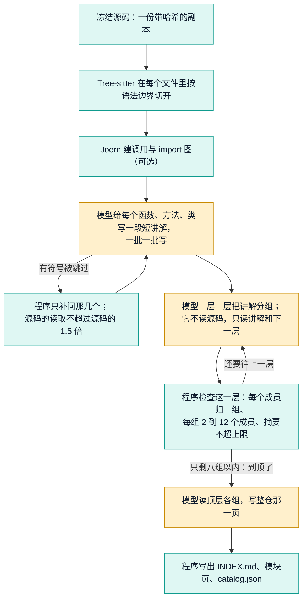
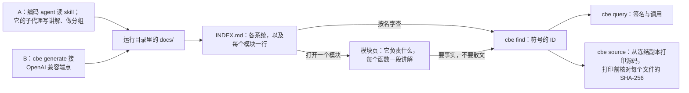

<h1 align="center">&nbsp;Codebase Explorer</h1>
<p align="center">Codebase Explorer 把一个源码仓变成分层的模块地图：人从上往下读得进去，编码 agent 在里面查得到东西。</p>
<p align="center"><a href="README.md">English</a> | <b>简体中文</b></p>
<p align="center">
<a href="LICENSE"></a>
<a href="pyproject.toml"></a>
<a href="https://github.com/zlxdengtianhei/codebase-explorer/actions/workflows/wheel-install.yml"></a>
</p>

<!-- 3.0 的片子。发布本 README 时把文件 walkthrough-tsdown-3.0.mp4 传到该 release。 -->
https://github.com/zlxdengtianhei/codebase-explorer/releases/download/walkthrough-3.0.0.dev0/walkthrough-tsdown-3.0.mp4

<p align="center">2 分 55 秒、带配音，一条命令生成、不调模型：tsdown 的地图从它的讲解里长出来，三个系统，两个模块一路讲到函数，最后是 <code>cbe find</code>、<code>cbe query</code> 和 <code>cbe source</code>。<br><a href="https://zlxdengtianhei.github.io/codebase-explorer/?data=flask">打开可交互的地图</a> · <a href="docs/videos.md">全部片子与各自的生成方法</a></p>

文件树只告诉你文件在哪，不告诉你每一块是干什么的。CBE 把仓库读一遍，给每个函数、方法和类写一段短讲解，再只拿这些讲解、一层一层聚成树：整个仓是干什么的、有哪几个系统、每个系统里的模块、模块里的函数。页面上放的是文字；签名、调用边和源码行用三条命令查，所以页面短，事实准。人从顶往下读这张地图；编码 agent 从 `docs/INDEX.md` 起，按名字查。

**想试一下：** `uv tool install codebase-explorer`（需要 Python 3.12 或 3.13）。然后二选一：在 Claude Code 里用你自己的订阅生成；或在命令行接任意 OpenAI 兼容的端点生成（模型用 `--model` 指定）。步骤见[快速上手](#快速上手)。

## 能得到什么

- **一次读得完的地图。** `docs/INDEX.md` 先列每个系统，下面缩进列它的模块，每个一行说明它负责什么。整页控制在约 1,500 token；两层放不下时只列顶层，并在页上说明原因。
- **每个模块一页，只有文字。** 模块页写它负责什么、一段摘要、有哪些孩子；叶子页再给每个函数、方法和类一段讲解。叶子页标题下还写一行成员所在的文件，按成员多少排：3.0 的实验里，模型读没写路径的页面时猜错过文件路径。
- **树从讲解里长出来，一层一层。** 模型聚的是讲解，不是源码；每一层由程序检查。有几层由模型的回答决定：某层不超过八组，就是顶层。
- **事实来自命令，不来自模型。** `cbe find`、`cbe query` 和 `cbe source` 按页面上的名字查。`cbe source` 从冻结的快照打印，打印前核对每个文件的 SHA-256 是否与冻结时记下的一致。
- **一条命令生成讲解视频。** `cbe video` 把一次跑完的结果变成两三分钟带画面和配音的片子。讲稿由程序从地图自己的文字拼出来，所以不调模型，同一份结果每次得到同一支片子。

下面是真实生成的 `docs/INDEX.md` 开头（tsdown，未改动）：

```markdown
## Modules

- [**Build execution and lifecycle**](nodes/build-execution-and-lifecycle.md) — Runs resolved configs through build pipelines, coordinating cleaning, watching, restarts, and bundle disposal.
  - [**Build execution and lifecycle \(Build orchestration\)**](nodes/build-execution-and-lifecycle-build-orchestratio.md) — Runs resolved configs through build pipelines, coordinating cleaning, watching, restarts, and bundle disposal.
  - [**Legacy warning and shortcuts**](nodes/legacy-warning-and-shortcuts.md) — Warns about legacy CommonJS usage and handles interactive keyboard shortcuts with guarded action execution.
- [**Filesystem and copy operations**](nodes/filesystem-and-copy-operations.md) — Provides shared filesystem helpers and resolves and executes copy rules with glob expansion and destination computation.
  - [**Filesystem and copy operations \(Filesystem utilities\)**](nodes/filesystem-and-copy-operations-filesystem-utilit.md) — Provides shared filesystem helpers and resolves and executes copy rules with glob expansion and destination computation.
  - [**Entry and target resolution**](nodes/entry-and-target-resolution.md) — Normalizes build entries and resolves targets and tsconfig files from options or package metadata.
```

完整示例：[flask](examples/flask/docs/INDEX.md)。更多见[示例与文档](#示例与文档)。

## 快速上手

CBE 在 PyPI 上叫 `codebase-explorer`，需要 Python 3.12 或 3.13。有两种跑法，结果都是同一个 `docs/` 目录。常用的是 A：编码 agent 读 skill，用你自己的订阅干完活。B 给脚本和批量跑用。

**A. 常用：在编码 agent 里，用你自己的订阅。** 下面以 Claude Code 为例；skill 让子代理用它所在宿主能开的最低思考强度写讲解。

1. 安装：`uv tool install codebase-explorer`（或 `pipx install codebase-explorer`）。`find`、`query`、`source` 用相对 `--run-dir`，以及 `cbe stale`，需要 2.3.0 或更新；3.0 多了 `cbe video`。
2. 可选，要调用图才需要：`cbe graph setup` 把 Joern 和 Java 运行时下载到你的用户缓存目录（约 1.9 GB；在 Linux x86_64 上测过，macOS 还没测）。
3. 在项目里装 skill：`cbe-install install --host claude-code`。
4. 在那里启动 Claude Code，说：“Use the codebase-explorer skill to generate documentation for this repository.”
5. agent 先报这次计划的文件数、token 数、模块数和任务数，再跑子代理，最后核验结果。
6. 打开 `<run_dir>/docs/INDEX.md`。`run_dir` 由 agent 报出。
7. agent 会问要不要往仓库的 `AGENTS.md` 或 `CLAUDE.md` 加三行（2.3.0 或更新）。加了以后，之后在这个仓里干活的 agent 会先读 `INDEX.md`（三个新开的 Claude Code 会话这样做过；见 [docs/running.md](docs/running.md#use-the-generated-docs-from-an-agent)）。

别的 agent 装同一个 skill：`cbe-install install --host` 接受 `claude-code`、`opencode`、`pi`、`codex` 和 `dsh`。端到端跑过的：Claude Code（见[成本](#成本)）；OpenCode 和 Pi 各在一个 22 文件的样本仓上跑过一次（Pi 那次的任务由我们机器上的派发 skill 交给独立的 Pi 会话，Pi 自己没有子代理）；OpenCode 还跑了[效果怎样](#效果怎样)里的 3.0 对比。`codex` 和 `dsh` 能装 skill，我们没端到端跑过。细节见 [docs/running.md](docs/running.md#generate-through-a-host-agent)。

**B. 给脚本和批量跑：在命令行接任意 OpenAI 兼容的端点。** 没有缺省模型：必须用 `--model` 指定。

1. 按上面第 1 步安装。
2. 把 key 放进环境变量：`export CBE_API_KEY=...`
3. 可选：建调用图（`cbe graph setup`，再 `cbe graph build /abs/repo --output /abs/graph.json`）。
4. 生成。路径要用绝对路径：

   ```sh
   cbe generate /abs/repo --model MODEL --base-url https://your-endpoint.example/v1 \
     --api-key-env CBE_API_KEY --graph /abs/graph.json --run-dir /abs/run
   ```

5. 打开 `/abs/run/docs/INDEX.md`。去掉 `--graph` 就是不建调用图跑。

然后按名字查。`RUN` 是运行目录的绝对路径，ID 是 `find` 输出的第二列：

```sh
cbe find   --run-dir "$RUN" --term url_for
cbe query  --run-dir "$RUN" --id 'src/flask/helpers.py::function::url_for::6511'
cbe source --run-dir "$RUN" --id 'src/flask/helpers.py::function::url_for::6511' --context 2
```

其余命令和选项见 [docs/reference.md](docs/reference.md)。

## 怎样工作



青色步骤是普通程序，不调模型。黄色步骤调模型。

- **冻结。** CBE 留一份带哈希的源码副本，之后每个行号、每句引用都能核。
- **切分。** Tree-sitter 按语法边界切每个文件。每个字节都落在某一块里。
- **讲解。** 只有这一步读源码。模型给每个函数、方法和类写一段讲解：一到三句，约 25 到 60 token。符号用清单里的短编号点名，它造不出 ID。模型跳过的符号，程序只补问那几个。运行中嵌入的源码要超过源码的 1.5 倍时不再补问，缺的列为“未讲”。
- **分组。** 模型读讲解、从不读源码，把讲解聚成模块：每组一个两到六词的标题、一句负责什么、两三句摘要。它还拿到程序给的候选分组和调用次数，可以拆、并、挪。再往上一层，把那些模块按同样办法聚。每层答完由程序检查：每个成员恰好归一组、每组 2 到 12 个成员、摘要不超上限。超过十二个成员的组先退回一次；再错，程序按候选分组切开并标注结果。某层只剩八组以内，就是顶层。
- **收顶。** 模型读顶层各组，写整仓那一页：谁在用这些代码、它解决什么、从哪读起。
- **渲染。** 程序写出 `docs/INDEX.md`、每个模块一页、`DEPENDENCIES.md` 和 `RUN.md`，以及 `find`、`query`、`source` 读的 `catalog.json`。`RUN.md` 写明有哪几层、程序切过并过什么、读了预算。

复查讲解是可选项，缺省关掉：`--review`（单写 = 抽最大的一批看，那批有问题就全看）或 `--review all` 让第二个模型对着源码检查讲解，被点出的批整批重写一次。在 flask 上抽查一次是这次输入 token 的 14%，全看要多约 80%（两个数都是 2.3.0 量的，复查代码这轮没改）。哪几批看过、看到什么，写在 `RUN.md` 里。

跑完之后，人或编码 agent 这样读结果：



## 生成讲解视频

```sh
cbe video --run-dir "$RUN" --out /abs/film [--modules 2] [--seconds 175] [--plan-only]
```

片子照地图的阅读顺序走：先整体用途，再逐个系统，再挑两个模块一路讲到函数，最后一页讲三条查代码的命令。它只读一次跑完的结果，讲稿从这次结果自己的文字拼出来，所以不调模型，同一份结果加同样的参数每次得到同一支片子。画面是一页 HTML 由无头 Chrome 逐条截图；声音是 Kokoro-82M；最后由 ffmpeg 编码。`--plan-only` 只写讲稿和画面，不截图、不配音。模型文件、浏览器、ffmpeg 的选项与每样产物：见 [docs/videos.md](docs/videos.md)。

本页顶部那支是 tsdown 的：14 条讲稿、2 分 55 秒、3.4 MB，没调一次模型。

## 成本

下面是 API 路两次运行，`cbe generate` 配 DeepSeek V4.1 Flash，每仓各跑一次，不开复查：

| 读数 | tsdown（43 个文件，源码 38.7k token） | cJSON（4 个文件，源码 34.4k token） |
|---|---:|---:|
| 模型输入 token ÷ 源码 token | 1.93 | 1.84 |
| 模型读的源码 token ÷ 源码 token（源码只读一遍） | 1.00 | 1.00 |
| 页面 token ÷ 源码 token | 0.49 | 0.46 |
| 墙钟 | 155 秒 | 132 秒 |

这条路上模型只看到 CBE 发的东西，所以 `read_ratio` 就是全部输入。两次都跑完（`complete`），程序检查全过，嵌入源码 1.5 倍源码的上限一次没碰到。

对 2.3.0，flask 与 tsdown 在 OpenCode 上用 DeepSeek V4.1 Flash（两版同一模型，子代理用宿主缺省强度，都不建调用图）：

| 读数 | 2.3.0，flask / tsdown | 3.0.0.dev0，flask / tsdown |
|---|---|---|
| 墙钟，从计划到最后一次出页 | 2,765 秒 / 1,986 秒 | 888 秒 / 662 秒 |
| 子代理任务数 | 19 / 15 | 10 / 8 |
| 宿主记下的提示词 token（主会话 + 全部子代理） | 8.92 M / 4.80 M | 3.77 M / 2.78 M |
| 页面 token ÷ 源码 token | 0.59 / 0.75 | 0.37 / 0.47 |

也就是快约三倍、宿主侧提示词约少一半、页面约为源码的一半。四次运行的 `cbe host verify` 全过。提示词 token 把每轮的缓存读取重复计入，所以这张表内部的数可以比，不要和上面 API 那张比。

建调用图不调模型。更早的、到 170 万 token 仓的成本表和 2.3.0 的读数在 [docs/running.md](docs/running.md#what-a-run-costs-the-earlier-table) 与 [CHANGELOG.md](CHANGELOG.md)。

## 效果怎样

这里的数都是本机量的；本轮的表在 3.0 那次任务的记录里，更早的在 [`evaluation/tree/results/`](evaluation/tree/results/)。

- **树。** 上面两次 3.0 运行都没有空节点、没有同级重名模块，tsdown 3 层、cJSON 2 层。层数不是目标：它由模型分出的组数决定，到八组以内为止。
- **找要改的函数。** 每仓 10 道真题（“某件事在哪儿做”），用 `cbe find`、`cbe query`、`cbe source` 就能答；同一模型下，2.3.0 与 3.0.0.dev0 各在一个干净会话里答一次。命中：3.0 在 flask 答中 29 个里的 25 个、tsdown 27 个里的 27 个；2.3.0 是 23/29 与 25/27。3.0 的答案还顺带列出更多相关函数（45 对 32、43 对 34），所以命中更多、精度更低。读的 token：3.0 在 flask 上少一半，在 tsdown 上多 2.5 倍。两个仓方向相反，所以**两版在命中与 token 上都分不出高下**。纯文字页面量到的一个代价：3.0 的一份答案猜错了一个文件路径，一次 `cbe find` 就能改对。
- **2.3.0 的、本轮没重测。** 那轮在三个仓上测的树也没有空节点；抽样核对的调用标签与源码一致；每仓 30 个真实提交的问法没有显示“程序建的树”比普通目录列表更能找到要改的代码，只有在目录很平的仓里有收窄。这些读数与条件在 [evaluation/README.md](evaluation/README.md)。

我们不声称的：按功能聚合让 agent 定位更准；CBE 让 agent 的回答更好。上面的读数都没显示这两点。

## 调用图

不建图 CBE 也能用。建了图，讲解任务和依赖视图还会拿到静态的 import、call、控制流证据。图由 [Joern](https://joern.io/) 建，需要 Java 21 或更新。`cbe graph setup` 把固定版本的 Joern 下载到你的用户缓存目录；找不到合适的 Java 时连 Java 运行时一起下（合计约 1.9 GB）。`cbe graph setup --check` 不下载，只报装了哪些。`cbe graph build` 写出 `--graph` 收的图文件。它缺省不导出 dataflow，因为生成时不读，而在 flask 上它占图文件一多半（41 MB 里 23 MB）；要导出加 `--with-dataflow`。手工装 Joern 见 [docs/reference.md](docs/reference.md#optional-graph-analyzers)。

| 状态 | 语言 | 条件 |
|---|---|---|
| 在真实仓上能用 | C、C++、Python、JavaScript、TypeScript、Java、Go、Ruby | Python 的 import 用 Grimp（`graphs` 额外依赖）；JavaScript 与 TypeScript 的 import 用 dependency-cruiser（需要 Node.js）。Go 跨包的调用可能解析不出。Ruby 的动态派发可能把调用绑到另一个类的同名方法上：CBE 把这类调用标成 ambiguous，仍有绑错的。 |
| 要另装工具 | Rust、PHP | Rust 要 `cargo` 和 Cargo 项目布局。PHP 要 `php`（7 或更新）。 |
| 能建图，调用只解析一部分 | C# | 在一个 55 文件的仓上建成了图（声明、控制流、import）。2,322 个调用里，689 个解析到一个仓内方法、394 个解析到一组重载（Joern 的 C# 前端类型信息不够，挑不出是哪个重载）；246 个指向仓外，993 个仍未解析。 |
| 在真实仓上失败 | Kotlin | Joern 4.0.654 在一个 146 文件的 Kotlin 仓上失败。两文件的例子能成，所以小输入可能成功。 |
| 没测 | Swift、TSX | |

`cbe languages` 按语言打印与 `call_graph` 列相同的状态。不管调用图状态如何，上表每种语言的源码解析和切分都能用。13 种语言的 tree-sitter 语法随缺省安装，另有两种在额外依赖里。分析器与图选项见 [docs/reference.md](docs/reference.md#optional-graph-analyzers)。调用图是什么、CBE 用哪些、为什么，以及每种语言已知错在哪：见 [docs/code-graphs.md](docs/code-graphs.md)。

## 已知限制

- **宿主路会把源码读两遍。** 在编码 agent 里，子代理为了写讲解自己读源码文件，CBE 只数自己发的提示词；上面 1.93 与 1.84 是 API 路的读数。3.0 的宿主运行因此没有 `source_read_tokens`。那边诚实的数是宿主记的提示词总量，它比 2.3.0 少一半。
- **3.0 与 2.3.0 在“找代码”上分不出。** 每仓 10 道题、各一个会话、两个仓、两版：命中只差两个函数，读的 token 在两个仓上方向相反。要更多轮才能说清。
- **关掉思考对讲解质量的影响没测。** 3.0 让子代理用宿主能开的最低思考强度，API 路上把 DeepSeek 的思考关掉。开思考时讲解质量怎样，我们没有 A/B 读数。
- 调用图要 Joern 和 Java 21 或更新。`cbe graph setup` 两者都下（约 1.9 GB）。
- C# 对重载方法的调用只解析到一组重载。在 GuardClauses 上，2,322 个调用里 993 个标为未解析；其中约 955 个是调仓外方法、`nameof` 或构造函数，14 个是仓内 CBE 连不上的调用。另抽一个仓（MediatR）核过：抽 10 对调用，全对。Kotlin 在固定版本的 Joern 下在真实仓上失败；两文件的例子能成。
- Ruby 的动态派发可能把调用绑到错的类的方法上。CBE 把许多这类标成 ambiguous，仍有绑错的。
- C 与 C++ 文件不做预处理。宏多的头文件会被切成粗块，宏可能被当成函数名。
- 讲解由模型写。`cbe host verify` 通过只说明结构与引用自洽，不说明讲解正确。要对着源码核讲解（`cbe source`）。
- 没有增量更新。源码变了，`cbe stale` 列出受影响的单元和模块页（按文件判）；要刷新就重新生成。
- `cbe video` 要无头 Chrome、Kokoro-82M 模型与 voices 文件、ffmpeg。讲稿是从地图文字拼的，不是改写的，所以行文好坏取决于地图本身。

## 示例与文档

- 生成好的文档：[flask](examples/flask/docs/INDEX.md)、[cJSON](examples/cjson/)、[fmt](examples/fmt/)、[gson](examples/gson/)、[ruby_llm](examples/ruby_llm/)、[tsdown](examples/tsdown/)、[polyglot](examples/polyglot/)。每个示例的 README 写明由哪个 CBE 提交生成；多数是更早的版本。
- [docs/reference.md](docs/reference.md)：安装选项、语言、图分析器、`find`、`query`、`source`、具名声明的覆盖。
- [docs/running.md](docs/running.md)：宿主路与 API 路、运行目录、续跑与核验、成本细节、排查。
- [docs/videos.md](docs/videos.md)：有哪些片子，`cbe video` 怎样做一支。
- [evaluation/README.md](evaluation/README.md) 与 [CHANGELOG.md](CHANGELOG.md)。

## 开发与许可

```sh
uv sync --python 3.13 --group dev
uv run pytest -q
```

要真分析器的测试需要先配好那个分析器。产品许可是 [MIT](LICENSE)；外部分析器与语法包各用自己的许可。
