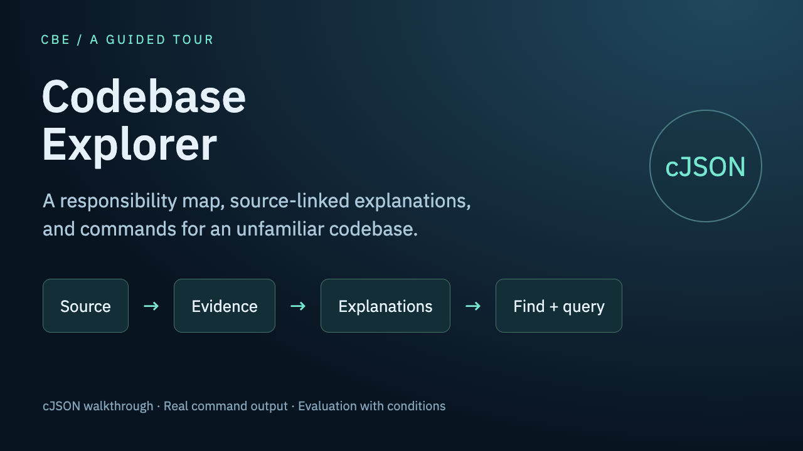

# Walkthrough videos

These videos were recorded on the examples generated at CBE commit `a87674d`, before the module tree became program-built. The commands they show (`cbe find`, `cbe query`, `cbe source`) work the same way; the map and the module names on screen come from the earlier model-built tree, and the evaluation chapter reports the earlier rounds. A new video for the current version is planned.

## Walkthrough, cJSON

A narrated walkthrough in English, with subtitles, follows CBE on cJSON: the generated map, `cbe find` and `cbe query`, how a run works, how to install and use CBE, and what the evaluation measured, with its conditions.

- Overview, chapters 0–2 (2:48): [cbe-overview.mp4](https://github.com/zlxdengtianhei/codebase-explorer/releases/download/walkthrough-v2.2.0.dev0/cbe-overview.mp4)
- Full walkthrough (18:54): [cbe-walkthrough.mp4](https://github.com/zlxdengtianhei/codebase-explorer/releases/download/walkthrough-v2.2.0.dev0/cbe-walkthrough.mp4), subtitles [cbe-walkthrough.srt](https://github.com/zlxdengtianhei/codebase-explorer/releases/download/walkthrough-v2.2.0.dev0/cbe-walkthrough.srt)
- Chapters: 00:00 Find the answer · 00:33 What CBE is · 02:02 How it works · 04:19 Walk through cJSON · 08:15 Use CBE · 12:51 Scope and languages · 14:27 Evaluation, with conditions · 17:42 Limits and next steps

The evaluation chapter shows only results that come with their conditions; the curl reading is in [evaluation/README.md](../evaluation/README.md#q-a-curl-e5). The narration uses the Kokoro-82M voice model (Apache-2.0); the release notes list all credits and licenses. One shorter video per language (flask, tsdown, ruby_llm, gson) is listed in [Walkthrough videos by language](#walkthrough-videos-by-language).

## Walkthrough videos by language

Shorter walkthroughs, one repository per language, show the generated map and real `cbe find` and `cbe query` output on the published examples, followed by that run's readings with their conditions. They are in the same release as the cJSON walkthrough.

| Language | Repository | Video | Subtitles | Length |
|---|---|---|---|---|
| Python | flask | [cbe-flask.mp4](https://github.com/zlxdengtianhei/codebase-explorer/releases/download/walkthrough-v2.2.0.dev0/cbe-flask.mp4) | [cbe-flask.srt](https://github.com/zlxdengtianhei/codebase-explorer/releases/download/walkthrough-v2.2.0.dev0/cbe-flask.srt) | 6:37 |
| TypeScript | tsdown | [cbe-tsdown.mp4](https://github.com/zlxdengtianhei/codebase-explorer/releases/download/walkthrough-v2.2.0.dev0/cbe-tsdown.mp4) | [cbe-tsdown.srt](https://github.com/zlxdengtianhei/codebase-explorer/releases/download/walkthrough-v2.2.0.dev0/cbe-tsdown.srt) | 6:33 |
| Ruby | ruby_llm | [cbe-ruby_llm.mp4](https://github.com/zlxdengtianhei/codebase-explorer/releases/download/walkthrough-v2.2.0.dev0/cbe-ruby_llm.mp4) | [cbe-ruby_llm.srt](https://github.com/zlxdengtianhei/codebase-explorer/releases/download/walkthrough-v2.2.0.dev0/cbe-ruby_llm.srt) | 7:06 |
| Java | gson | [cbe-gson.mp4](https://github.com/zlxdengtianhei/codebase-explorer/releases/download/walkthrough-v2.2.0.dev0/cbe-gson.mp4) | [cbe-gson.srt](https://github.com/zlxdengtianhei/codebase-explorer/releases/download/walkthrough-v2.2.0.dev0/cbe-gson.srt) | 7:05 |

The flask video uses the catalog in `evaluation/e2-flask/cbe-docs/catalog.json.gz`; the others use `examples/<repo>/catalog.json.gz`. Decompress a catalog with `gzip -dk` before running the commands. fmt (C++) has no video because its generation stayed partial.
