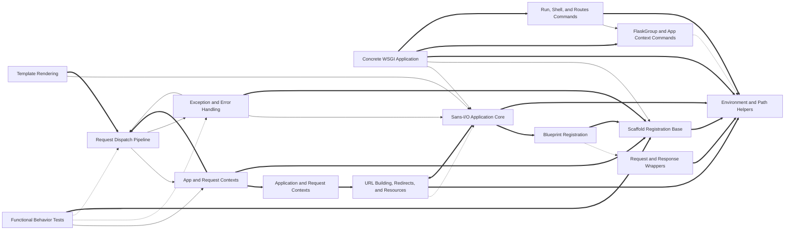

# Codebase Explorer

## How to read this report

Start with the responsibility tree in INDEX. Open a node page for your maintenance question, then choose a unit.
Node pages explain responsibilities. `catalog.json` stores full signatures, source ranges, folded members, relation evidence, and graph edges.
Set `RUN` to the absolute path of this run directory. Find an id, then read its explanation or frozen source.

```sh
cbe find --run-dir "$RUN" --term "SEARCH_TERM"
cbe query --run-dir "$RUN" --id "$ID"
cbe source --run-dir "$RUN" --id "$ID" --context 2
```

`ID` can be a unit id, symbol id, or file path. Commands return the content directly.
`source` reads frozen source and verifies its digest first.
The catalog also stores reverse graph edges, statuses, and raw evidence.

## Responsibility tree

- [Flask Framework](nodes/flask-framework.md) (0 units)
  - [Flask App Region](nodes/flask-app-region.md) (0 units)
    - [Flask Framework](nodes/r1-flask-framework.md) (2 units)
      - [App.logger](nodes/r1-flask-framework.md#u-c935356c3924) · Cached logging.Logger for the app, created by delegating to flask.logging.create_logger(self).
      - [Sans-I/O Application Core](nodes/r1-core-app-model.md) (12 units)
        - [App](nodes/r1-core-app-model.md#u-c945a7570d6a) · App is the sansio core of the Flask application: a central registry for URL rules, blueprints, template hooks, error handlers, and configuration, with concrete request handling and environment construction left to subclasses.
        - [Scaffold Registration Base](nodes/r1-scaffold-shared-base.md) (16 units)
          - [Scaffold](nodes/r1-scaffold-shared-base.md#u-2ed8d6dfaa9a) · Common base shared by Flask apps and blueprints: it stores the import name, root path, static/template folder configuration, and the registries (view functions, error handlers, request hooks, template context processors, URL helpers) that route registration and request handling populate.
      - [Concrete WSGI Application](nodes/r1-concrete-app.md) (6 units)
        - [Flask](nodes/r1-concrete-app.md#u-42109b968e96) · Concrete WSGI application extending the sansio App: it adds a Click CLI group, serves the static folder, and implements request dispatch, error handling, response conversion, context teardown, and URL building.
        - [Request Dispatch Pipeline](nodes/r1-request-dispatch.md) (12 units)
          - [Flask.__call__](nodes/r1-request-dispatch.md#u-c4752569664d) · WSGI-server entry point; delegates directly to wsgi_app so middlewares wrapping wsgi_app keep the app object intact.
        - [Exception and Error Handling](nodes/r1-error-handling.md) (7 units)
          - [Flask.handle_user_exception](nodes/r1-error-handling.md#u-fae95c7207e9) · Handle an exception raised during dispatch.
        - [App and Request Contexts](nodes/r1-contexts-teardown.md) (6 units)
          - [Flask.app_context](nodes/r1-contexts-teardown.md#u-2e69ab7b3042) · Create (not push) an AppContext bound to this app; pushing it with a with block makes current_app point here and runs the app-context teardowns on pop.
        - [URL Building, Redirects, and Resources](nodes/r1-url-building-resources.md) (10 units)
          - [Flask.url_for](nodes/r1-url-building-resources.md#u-f591687825aa) · Build a URL for an endpoint.
        - [CLI Entry and Test Support](nodes/r1-app-test-support.md) (3 units)
          - [__main__.py module code (L1–L3)](nodes/r1-app-test-support.md#u-d0221469d015) · Entry point that imports main from flask.cli and calls it unconditionally at import time, so ``python -m flask`` dispatches to the Click command group.
      - [Template Rendering](nodes/r1-templating.md) (16 units)
        - [Environment](nodes/r1-templating.md#u-4d36739b53d0) · A Jinja2 Environment subclass aware of Flask's app/blueprint template layout.
      - [JSON Serialization](nodes/r1-json-support.md) (11 units)
        - [dumps](nodes/r1-json-support.md#u-8ad36294fdd0) · Serialize an object to a JSON string, delegating to the active app's JSON provider when one exists.
      - [Session Support](nodes/r1-sessions.md) (6 units)
        - [SessionInterface](nodes/r1-sessions.md#u-6ec6a05f1ca6) · Base interface for session backends; subclasses must implement `open_session` and `save_session` (both raise NotImplementedError here), while cookie-attribute helpers provide config-driven defaults.
      - [Application Logging](nodes/r1-logging.md) (4 units)
        - [create_logger](nodes/r1-logging.md#u-185f96e08a34) · Returns the app's standard logger, named after app.name, configuring it only when needed.
      - [Blinker Signals](nodes/r1-signals.md) (1 units)
        - [signals.py module code (L1–L17)](nodes/r1-signals.md#u-2c78c6c4455c) · No behavioral logic: creates a private blinker Namespace for Flask's own signals and defines ten named signals (template_rendered, before_render_template, request_started, request_finished, request_tearing_down, got_request_exception, appcontext_tearing_down, appcontext_pushed, appcontext_popped, message_flashed) via _signals.signal(...).
      - [Diagnostics and Debug Errors](nodes/r1-debug-helpers.md) (5 units)
        - [FormDataRoutingRedirect](nodes/r1-debug-helpers.md#u-8135e71c270a) · An AssertionError raised in debug mode when a routing redirect would make a browser drop form data.
      - [Test Suites and Fixture Apps](nodes/r1-tests.md) (0 units)
        - [Functional Behavior Tests](nodes/r1-tests-functional.md) (19 units)
          - [test-basic-py-url-mapping-and-routing](nodes/r1-tests-functional.md#u-d529fc3aa421) · Tests URL rule registration, dispatch, and view lookup.
        - [Helper and Resource Tests](nodes/r1-tests-helpers.md) (15 units)
          - [test_helpers.py-testsendfile](nodes/r1-tests-helpers.md#u-cafd7bd7bb4c) · Covers send_file, send_static_file, and send_from_directory.
        - [Configuration Tests](nodes/r1-tests-config.md) (19 units)
          - [test_config.py module code (L1–L12)](nodes/r1-tests-config.md#u-cc9fdc626eab) · Imports json, os, pytest, flask and defines module-level TEST_KEY and SECRET_KEY constants, which from_pyfile/from_object tests load into app config.
        - [Test Client Behavior Tests](nodes/r1-tests-client.md) (25 units)
          - [test_testing.py-test-environ-defaults-from-config](nodes/r1-tests-client.md#u-11b224e9c82f) · SERVER_NAME and APPLICATION_ROOT config feed the test client and test_request_context: both the context's request.url and a client GET response report http://example.com:1234/foo/, showing environ defaults derive from app config.
        - [Fixture Applications](nodes/r1-tests-fixture-apps.md) (20 units)
          - [__init__.py module code (L1–L9)](nodes/r1-tests-fixture-apps.md#u-5776fc52332f) · Builds the blueprintapp test application: creates a Flask app with DEBUG enabled, imports the admin and frontend blueprints (imports deferred after app creation, hence noqa E402), and registers both so their routes are mounted at import time of this package.
    - [Sans-I/O Application Core](nodes/core-app-model.md) (0 units)
    - [Concrete WSGI Application](nodes/concrete-app.md) (0 units)
    - [Template Rendering](nodes/templating.md) (0 units)
    - [JSON Serialization](nodes/json-support.md) (0 units)
    - [Session Support](nodes/sessions.md) (0 units)
    - [Application Logging](nodes/logging.md) (0 units)
    - [Blinker Signals](nodes/signals.md) (0 units)
    - [Diagnostics and Debug Errors](nodes/debug-helpers.md) (0 units)
    - [Test Suites and Fixture Apps](nodes/tests.md) (0 units)
  - [Flask Capabilities Region](nodes/flask-capabilities-region.md) (0 units)
    - [Flask Framework](nodes/r2-flask-framework.md) (1 units)
      - [Blueprint.add_url_rule](nodes/r2-flask-framework.md#u-115c8d08d2f5) · Defers registration of a URL rule on the blueprint.
      - [Application and Request Contexts](nodes/r2-app-context-and-globals.md) (8 units)
        - [AppContext](nodes/r2-app-context-and-globals.md#u-9b040980ce77) · Holds application-scoped state for one app context: the app, its URL adapter, a fresh `g` namespace, and a token stack for contextvars rebinding.
        - [Context and Signal Tests](nodes/r2-context-lifecycle-tests.md) (10 units)
          - [test_appcontext_signals](nodes/r2-context-lifecycle-tests.md#u-e470bc6fa0dc) · appcontext_pushed and appcontext_popped fire around a request: one 'push' record before the response and one 'pop' after, in that order.
      - [Command-Line Interface](nodes/r2-cli-system.md) (0 units)
        - [App Discovery and Loading](nodes/r2-cli-app-discovery.md) (8 units)
          - [NoAppException](nodes/r2-cli-app-discovery.md#u-68b618421e9e) · Usage error signaling that a Flask application could not be found or loaded; it subclasses click.UsageError so CLI dispatch renders it as a user-facing message rather than a traceback.
        - [FlaskGroup and App Context Commands](nodes/r2-cli-command-group.md) (9 units)
          - [AppGroup](nodes/r2-cli-command-group.md#u-75aed86ad24c) · Click Group subclass whose command decorator wraps callbacks in with_appcontext by default, so commands registered on it always run in an app context.
        - [Run, Shell, and Routes Commands](nodes/r2-cli-server-commands.md) (8 units)
          - [run_command](nodes/r2-cli-server-commands.md#u-507bfc125783) · Implements 'flask run', the development-server command decorated with host, port, cert, key, reload, debugger, threads, extra-files, and exclude-patterns options.
        - [CLI Test Suite](nodes/r2-cli-tests.md) (30 units)
          - [test_cli.py-test-app-cli-has-app-context](nodes/r2-cli-tests.md#u-b9fddcf86425) · Verifies current_app is available inside Click parameter callbacks and matches the app loaded by FlaskGroup.
      - [Configuration Loading](nodes/r2-configuration.md) (10 units)
        - [config.py-configattribute](nodes/r2-configuration.md#u-ac0761560ac0) · A generic descriptor that forwards attribute access on an App to its config dictionary.
      - [Blueprint System](nodes/r2-blueprint-system.md) (0 units)
        - [Blueprint Deferred Setup](nodes/r2-sansio-blueprint-core.md) (9 units)
          - [blueprints-py-module-header](nodes/r2-sansio-blueprint-core.md#u-4d2993c6ddda) · Module header of the sansio blueprint module: imports and type aliases forming the deferred-setup vocabulary.
        - [Blueprint Registration](nodes/r2-blueprint-registration.md) (5 units)
          - [BlueprintSetupState](nodes/r2-blueprint-registration.md#u-b4e76012bbf2) · Holds the temporary registration context created by Blueprint.make_setup_state and passed to every deferred setup callback when a blueprint registers on an app.
        - [App-Scope Blueprint Hooks](nodes/r2-blueprint-app-integrations.md) (13 units)
          - [Blueprint.before_app_request](nodes/r2-blueprint-app-integrations.md#u-d35d0ef58088) · App-scope before-request hook: records via record_once a lambda appending f to s.app.before_request_funcs under the None (app-wide) key with setdefault(None, []).append, so the function runs before every request regardless of blueprint and is not duplicated on re-registration.
        - [Concrete Blueprint Runtime](nodes/r2-blueprint-runtime.md) (5 units)
          - [Blueprint](nodes/r2-blueprint-runtime.md#u-340cf74dd862) · Concrete blueprint class extending the sansio blueprint with runtime helpers for static files, resources, and CLI.
        - [Blueprint Test Suite](nodes/r2-blueprint-tests.md) (18 units)
          - [test-blueprints-context-processing](nodes/r2-blueprint-tests.md#u-0a599a4fdcef) · test_context_processing distinguishes blueprint-local and app-wide context processors.
      - [Request and Response Wrappers](nodes/r2-request-response-objects.md) (14 units)
        - [Request](nodes/r2-request-response-objects.md#u-000b3c1e5029) · Flask's default request class, a Werkzeug RequestBase subclass that remembers the matched URL rule, view args, and routing exception as instance attributes (all defaulting to None).
      - [Class-Based Views](nodes/r2-view-system.md) (0 units)
        - [View and MethodView Core](nodes/r2-view-core.md) (5 units)
          - [View](nodes/r2-view-core.md#u-9c7d9676c296) · Base class for class-based views; subclasses override dispatch_request and register as_view(name)'s generated function for a route.
        - [View and Async Dispatch Tests](nodes/r2-view-tests.md) (16 units)
          - [test_views.py module code (L1–L6)](nodes/r2-view-tests.md#u-ebd07ac0c149) · Imports pytest, werkzeug.http.parse_set_header, and flask.views used by the tests.
      - [Shared Helpers](nodes/r2-helpers-utilities.md) (0 units)
        - [File Serving Helpers](nodes/r2-file-serving-helpers.md) (3 units)
          - [send_file](nodes/r2-file-serving-helpers.md#u-93a20210ed51) · Sends a file path or binary file object to the client by delegating to werkzeug.utils.send_file with Flask defaults merged in via _prepare_send_file_kwargs (environ, USE_X_SENDFILE, response class, root path, and per-app max_age when none given).
        - [stream\_with\_context](nodes/r2-streaming-helpers.md) (7 units)
          - [src/flask/helpers.py:stream_with_context (2)](nodes/r2-streaming-helpers.md#u-22c67a9b00e0) · Keeps the request context alive while a streaming generator runs.
        - [Request and Response Helpers](nodes/r2-request-response-helpers.md) (7 units)
          - [url_for](nodes/r2-request-response-helpers.md#u-221362c3f2fb) · Thin wrapper generating a URL for an endpoint, forwarding endpoint plus _anchor, _method, _scheme, _external, and all keyword values to current_app.url_for, so apps can override URL building.
        - [Environment and Path Helpers](nodes/r2-environment-helpers.md) (4 units)
          - [get_debug_flag](nodes/r2-environment-helpers.md#u-88884dd6c1eb) · Reads FLASK_DEBUG from the environment and returns whether debug mode should be on.
      - [Testing Support](nodes/r2-testing-support.md) (5 units)
        - [EnvironBuilder](nodes/r2-testing-support.md#u-84a78615434e) · Werkzeug EnvironBuilder subclass that derives WSGI environ defaults from a Flask app.
      - [JSON Test Suite](nodes/r2-json-tests.md) (7 units)
        - [test_json.py-json-behavior](nodes/r2-json-tests.md#u-41d788804a96) · Tests for flask.json serialization, jsonify responses, and JSON provider customization.
      - [Templating Test Suite](nodes/r2-templating-tests.md) (11 units)
        - [test-templating-context-and-rendering](nodes/r2-templating-tests.md#u-24527f9376de) · These tests cover rendering context and streaming.
      - [Logging Test Suite](nodes/r2-logging-tests.md) (8 units)
        - [test_logging.py module code (L1–L11)](nodes/r2-logging-tests.md#u-01322c27912b) · Imports logging, sys, StringIO, pytest, and Flask logging helpers default_handler, has_level_handler, and wsgi_errors_stream used by the tests.
      - [Error Handler Tests](nodes/r2-error-handling-tests.md) (1 units)
        - [test_user_error_handler.py-error-dispatch](nodes/r2-error-handling-tests.md#u-2fa158c13689) · Tests for Flask's error-handler resolution and registration validation.
      - [Type-Checking Fixtures](nodes/r2-type-check-fixtures.md) (4 units)
        - [typing_app_decorators-before-and-after-request-and-teardown-hooks](nodes/r2-type-check-fixtures.md#u-7775d9463af3) · Type-checking fixtures registering Flask request hooks on a module-level app, covering sync and async variants.
    - [Application and Request Contexts](nodes/app-context-and-globals.md) (0 units)
    - [Command-Line Interface](nodes/cli-system.md) (0 units)
    - [Configuration Loading](nodes/configuration.md) (0 units)
    - [Blueprint System](nodes/blueprint-system.md) (0 units)
    - [Request and Response Wrappers](nodes/request-response-objects.md) (0 units)
    - [Class-Based Views](nodes/view-system.md) (0 units)
    - [Shared Helpers](nodes/helpers-utilities.md) (0 units)
    - [Testing Support](nodes/testing-support.md) (0 units)
    - [JSON Test Suite](nodes/json-tests.md) (0 units)
    - [Templating Test Suite](nodes/templating-tests.md) (0 units)
    - [Logging Test Suite](nodes/logging-tests.md) (0 units)
    - [Error Handler Tests](nodes/error-handling-tests.md) (0 units)
    - [Type-Checking Fixtures](nodes/type-check-fixtures.md) (0 units)

## Reading stats

- units: 441 · semantic nodes: 76 · dispositioned inventory ids: 1939
- source ranges are program-derived from the inventory, never model-written

## Graph coverage

Source: static analysis graph. Resolved relations are graph-confirmed; this does not guarantee semantic correctness. External targets are outside the repository; ambiguous targets have multiple candidates. Unresolved or unsupported relations, and languages or relation kinds without coverage, rely on model inference and may be inaccurate.
Import and call status ratios use the edge count of each kind. CFG and dataflow are structural edges; only their counts are shown, without status ratios.
python import: resolved 155/483 (32%), external 328/483 (68%) · python call: resolved 909/5630 (16%), ambiguous 117/5630 (2%), unresolved 2966/5630 (53%), external 1638/5630 (29%).
python structural edges: cfg=60657, dataflow=50000.
Incomplete capabilities: python/call partial; python/dataflow partial.
Program checks: dangling edges 0; nodes outside manifest 0; nodes with missing files 0.

## Overview

This repository is the Flask WSGI micro-framework. It is organized as a root node (flask-framework) with two merged region subtrees: flask-app-region (the sans-I/O application core, the concrete WSGI app, and per-concern subsystems: templating, JSON, sessions, logging, signals, diagnostics, plus their tests and fixture apps) and flask-capabilities-region (runtime contexts, CLI, configuration, blueprints, request/response wrappers, views, shared helpers, testing support, and their test suites).

The architecture is layered. The sans-I/O core (r1-core-app-model and its child r1-scaffold-shared-base) owns registration: route/endpoint/verb-shortcut decorators, error-handler registration, request hooks, and the setupmethod lock that freezes registration after setup. Flask.__init__ forwards parameters to the sansio App (r1-concrete-app depends on r1-core-app-model), and the concrete app (r1-concrete-app) executes what was registered at request time via children: the dispatch pipeline (r1-request-dispatch: wsgi_app, full_dispatch_request, dispatch_request, finalize_request), error handling (r1-error-handling, which resolves handlers through Scaffold's _get_exc_class_and_code and logs via the app logger), contexts and teardown (r1-contexts-teardown), and URL building/resources (r1-url-building-resources, whose url_for feeds app url-defaults and build-error hooks).

In the capabilities region, the context machinery (r2-app-context-and-globals: AppContext, RequestContext, g, and ContextVar proxies) makes app/request state visible to everything else. The blueprint system (r2-blueprint-system) defers setup in the sansio core (r2-sansio-blueprint-core) and applies it during register (r2-blueprint-registration, which namespaces endpoints as 'name.key'); app-scope hooks (r2-blueprint-app-integrations) inject blueprint code into app-wide registries implemented on Scaffold. The CLI (r2-cli-system) discovers the app via ScriptInfo (r2-cli-app-discovery) and wraps commands in app contexts (r2-cli-command-group), with concrete run/shell/routes commands (r2-cli-server-commands) and environment flag/dotenv helpers (r2-environment-helpers).

Cross-cutting shared helpers (r2-helpers-utilities, including file serving in r2-file-serving-helpers, streaming in r2-streaming-helpers, and request/response helpers in r2-request-response-helpers) are consumed by the wrappers (r2-request-response-objects, e.g. Request.blueprints uses _split_blueprint_path), the pipeline (process_response saves the session via r1-sessions; jsonify delegates to r1-json-support providers), and views (r2-view-system). Testing support (r2-testing-support) supplies the EnvironBuilder, FlaskClient, and FlaskCliRunner used by Flask.test_client and by every test suite, which serve as the behavioral specification: functional tests (r1-tests-functional), helper/config/client tests, blueprint tests (r2-blueprint-tests), CLI tests (r2-cli-tests), context tests (r2-context-lifecycle-tests), JSON/templating/logging/view/error-handler tests.

## Maintenance navigation

Navigation by maintenance question:

- 'How does a route decorator become a stored view?': open r1-scaffold-shared-base (route, add_url_rule contract, setupmethod lock), then r1-concrete-app for the concrete add_url_rule; the flow Scaffold.route -> add_url_rule -> setupmethod is traced in key flows.
- 'What happens between an incoming environ and the response?': open r1-request-dispatch and read top-down (wsgi_app -> full_dispatch_request -> dispatch_request -> finalize_request); r1-error-handling for which handler runs for an exception; r1-contexts-teardown for context push/pop and teardown timing.
- 'Why is a template not found / how do templates resolve?': open r1-templating (DispatchingJinjaLoader, context processors, streaming); the explained-failure diagnostic lives in r1-debug-helpers (explain_template_loading_attempts). Blueprint template merging behavior is pinned in r2-templating-tests and exercised by the blueprintapp fixture in r1-tests-fixture-apps.
- 'Session cookie behavior or swapping session backends': open r1-sessions; the pipeline hook is process_response in r1-request-dispatch; lossless cookie payloads use the tagged serializer in r1-json-support.
- 'Custom JSON serialization': open r1-json-support (JSONProvider, TaggedJSONSerializer); expected behavior in r2-json-tests.
- 'Blueprint registration, endpoint naming, app-scope hooks': open r2-blueprint-system; specifically r2-sansio-blueprint-core (deferred setup), r2-blueprint-registration (register/namespacing), r2-blueprint-app-integrations (app-wide hooks via record_once), r2-blueprint-runtime (static files delegating to helpers.send_from_directory), and r2-blueprint-tests for pinned scoping/naming semantics.
- 'CLI fails to find the app or --app/--debug/dotenv misbehaves': open r2-cli-app-discovery (ScriptInfo), r2-cli-command-group (FlaskGroup, with_appcontext, option callbacks), r2-cli-server-commands (run/shell/routes), and r2-environment-helpers for the flags; behavior pinned in r2-cli-tests.
- 'App/request state, g, or teardown ordering': open r2-app-context-and-globals (AppContext, RequestContext, g, proxies) and r1-contexts-teardown (creation and teardown machinery); r2-context-lifecycle-tests pin signal ordering.
- 'Request limits, blueprint chain metadata': open r2-request-response-objects; it uses helpers._split_blueprint_path from r2-environment-helpers.
- 'File serving/streaming helpers': open r2-file-serving-helpers (both entry points funnel through _prepare_send_file_kwargs) and r2-streaming-helpers (stream_with_context re-entering the request context).
- 'Handler lookup precedence for errors': open r1-error-handling plus r2-error-handling-tests (registration validation) and r2-blueprint-tests (blueprint-scoped handlers).
- 'Where is a behavior pinned before changing source?': r1-tests-functional (routing, sessions, hooks, contexts, regressions), r1-tests-helpers (file serving, url_for, abort), r1-tests-config, r1-tests-client, r2-view-tests, and the test suites under the capabilities region; fixture apps in r1-tests-fixture-apps are test data, not behavior.

Note the reciprocal relationship between the app-model subtree and the pipeline: r1-concrete-app consumes registration from r1-core-app-model, while scaffolding decorators on Scaffold are defined in the core-model subtree and consumed by blueprint integrations, so registration changes require reading both sides. Relationships labelled model-inferred in the dependency table (e.g. sessions-to-JSON tag serializer, context tests-to-context machinery) are weaker evidence than resolved-call relationships; treat them as leads rather than confirmed runtime behavior.

## Dependency view

Arrows point from a user to its dependency. Containment is structural, not a dependency. Graph-confirmed pairs appear in both the tree and resolved call/import edges. Model-inferred pairs appear only in the tree. Graph-only pairs appear only in the graph.
Graph-confirmed and model-inferred pairs count edges between two subtrees. Graph-only pairs count edges between direct node owners. Containment rows show resolved edges between ancestor direct units and a descendant subtree in both directions. Within containment rows count direct owner pairs separately. Neither kind of containment row appears in Mermaid or the three dependency totals.



Selected 15 nodes by connection count. Legend: `-->` graph-confirmed; `-.->` model-inferred; `==>` graph-only.

## Dependency list

- [Flask App Region](nodes/flask-app-region.md) → [Flask Capabilities Region](nodes/flask-capabilities-region.md) · graph-confirmed · 14 edge(s) · The app region calls into the capabilities region for shared capabilities such as contexts, helpers, and testing support used by the pipeline.
- [Flask Capabilities Region](nodes/flask-capabilities-region.md) → [Flask App Region](nodes/flask-app-region.md) · graph-confirmed · 56 edge(s) · The capabilities region calls back into the app region for the application model and pipeline services (a reciprocal cross-region cycle).
- [Logging Test Suite](nodes/logging-tests.md) → [Application Logging](nodes/logging.md) · model-inferred · 0 edge(s)
- [Concrete WSGI Application](nodes/r1-concrete-app.md) → [Sans-I/O Application Core](nodes/r1-core-app-model.md) · graph-confirmed · 2 edge(s) · Flask.__init__ forwards constructor parameters to the sansio App, extending the registration-only core into a runnable application.
- [Concrete WSGI Application](nodes/r1-concrete-app.md) → [Scaffold Registration Base](nodes/r1-scaffold-shared-base.md) · graph-confirmed · 2 edge(s) · Route/template-filter registration decorators call setupmethod, the shared Scaffold guard for mutating registration.
- [Sans-I/O Application Core](nodes/r1-core-app-model.md) → [Application Logging](nodes/r1-logging.md) · model-inferred · 0 edge(s) · App.logger obtains its logger through flask.logging.create_logger.
- [Exception and Error Handling](nodes/r1-error-handling.md) → [Sans-I/O Application Core](nodes/r1-core-app-model.md) · graph-confirmed · 1 edge(s) · Handler resolution calls Scaffold._get_exc_class_and_code to normalize exception keys during lookup.
- [Exception and Error Handling](nodes/r1-error-handling.md) → [Application Logging](nodes/r1-logging.md) · model-inferred · 0 edge(s)
- [Exception and Error Handling](nodes/r1-error-handling.md) → [Request Dispatch Pipeline](nodes/r1-request-dispatch.md) · graph-confirmed · 4 edge(s) · handle_exception calls finalize_request so even unhandled errors produce a response, forming a pipeline cycle with dispatch.
- [Request Dispatch Pipeline](nodes/r1-request-dispatch.md) → [App and Request Contexts](nodes/r1-contexts-teardown.md) · graph-confirmed · 1 edge(s) · wsgi_app calls request_context to create the request context that scopes dispatch.
- [Request Dispatch Pipeline](nodes/r1-request-dispatch.md) → [Diagnostics and Debug Errors](nodes/r1-debug-helpers.md) · graph-confirmed · 1 edge(s) · raise_routing_exception raises FormDataRoutingRedirect to give clear assertions for form-routing mistakes.
- [Request Dispatch Pipeline](nodes/r1-request-dispatch.md) → [Exception and Error Handling](nodes/r1-error-handling.md) · graph-confirmed · 3 edge(s)
- [Request Dispatch Pipeline](nodes/r1-request-dispatch.md) → [JSON Serialization](nodes/r1-json-support.md) · model-inferred · 0 edge(s) · jsonify delegates to the current app's JSONProvider for response serialization.
- [Request Dispatch Pipeline](nodes/r1-request-dispatch.md) → [Session Support](nodes/r1-sessions.md) · graph-confirmed · 1 edge(s) · process_response invokes the session interface to save the session into the outgoing response.
- [Session Support](nodes/r1-sessions.md) → [JSON Serialization](nodes/r1-json-support.md) · model-inferred · 0 edge(s)
- [Template Rendering](nodes/r1-templating.md) → [Sans-I/O Application Core](nodes/r1-core-app-model.md) · graph-confirmed · 1 edge(s) · create_global_jinja_loader constructs the DispatchingJinjaLoader, and jinja_env drives environment creation off the app.
- [Template Rendering](nodes/r1-templating.md) → [Diagnostics and Debug Errors](nodes/r1-debug-helpers.md) · graph-confirmed · 1 edge(s) · The loader's explained-failure path calls explain_template_loading_attempts for template-loading diagnostics.
- [Test Client Behavior Tests](nodes/r1-tests-client.md) → [CLI Entry and Test Support](nodes/r1-app-test-support.md) · model-inferred · 0 edge(s)
- [Fixture Applications](nodes/r1-tests-fixture-apps.md) → [Template Rendering](nodes/r1-templating.md) · model-inferred · 0 edge(s)
- [Functional Behavior Tests](nodes/r1-tests-functional.md) → [App and Request Contexts](nodes/r1-contexts-teardown.md) · graph-confirmed · 3 edge(s)
- [Functional Behavior Tests](nodes/r1-tests-functional.md) → [Exception and Error Handling](nodes/r1-error-handling.md) · model-inferred · 0 edge(s)
- [Functional Behavior Tests](nodes/r1-tests-functional.md) → [Request Dispatch Pipeline](nodes/r1-request-dispatch.md) · model-inferred · 0 edge(s)
- [Helper and Resource Tests](nodes/r1-tests-helpers.md) → [Request Dispatch Pipeline](nodes/r1-request-dispatch.md) · model-inferred · 0 edge(s)
- [URL Building, Redirects, and Resources](nodes/r1-url-building-resources.md) → [Sans-I/O Application Core](nodes/r1-core-app-model.md) · model-inferred · 0 edge(s) · url_for calls the app's inject_url_defaults and handle_url_build_error hooks defined in the core model.
- [Application and Request Contexts](nodes/r2-app-context-and-globals.md) → [Flask Framework](nodes/r2-flask-framework.md) · containment · → 0 / ← 0 edge(s) (ancestor direct units and descendant subtree; → follows ` r2-app-context-and-globals ` → ` r2-flask-framework `)
- [Blueprint Registration](nodes/r2-blueprint-registration.md) → [Request and Response Wrappers](nodes/r2-request-response-objects.md) · model-inferred · 0 edge(s)
- [Blueprint Registration](nodes/r2-blueprint-registration.md) → [Blueprint Deferred Setup](nodes/r2-sansio-blueprint-core.md) · graph-confirmed · 1 edge(s) · register consumes the deferred setup functions recorded by the sansio blueprint core.
- [Concrete Blueprint Runtime](nodes/r2-blueprint-runtime.md) → [File Serving Helpers](nodes/r2-file-serving-helpers.md) · graph-confirmed · 1 edge(s) · Blueprint.send_static_file delegates static file delivery to send_from_directory.
- [Concrete Blueprint Runtime](nodes/r2-blueprint-runtime.md) → [Blueprint Deferred Setup](nodes/r2-sansio-blueprint-core.md) · model-inferred · 0 edge(s)
- [Blueprint Test Suite](nodes/r2-blueprint-tests.md) → [App-Scope Blueprint Hooks](nodes/r2-blueprint-app-integrations.md) · model-inferred · 0 edge(s)
- [Blueprint Test Suite](nodes/r2-blueprint-tests.md) → [Blueprint Registration](nodes/r2-blueprint-registration.md) · model-inferred · 0 edge(s)
- [Blueprint Test Suite](nodes/r2-blueprint-tests.md) → [Concrete Blueprint Runtime](nodes/r2-blueprint-runtime.md) · model-inferred · 0 edge(s)
- [Blueprint Test Suite](nodes/r2-blueprint-tests.md) → [Testing Support](nodes/r2-testing-support.md) · model-inferred · 0 edge(s)
- [FlaskGroup and App Context Commands](nodes/r2-cli-command-group.md) → [App Discovery and Loading](nodes/r2-cli-app-discovery.md) · graph-confirmed · 3 edge(s) · FlaskGroup resolves the target app through ScriptInfo, the shared discovery and caching point.
- [FlaskGroup and App Context Commands](nodes/r2-cli-command-group.md) → [Environment and Path Helpers](nodes/r2-environment-helpers.md) · model-inferred · 0 edge(s)
- [Run, Shell, and Routes Commands](nodes/r2-cli-server-commands.md) → [App Discovery and Loading](nodes/r2-cli-app-discovery.md) · graph-confirmed · 1 edge(s)
- [Run, Shell, and Routes Commands](nodes/r2-cli-server-commands.md) → [FlaskGroup and App Context Commands](nodes/r2-cli-command-group.md) · graph-confirmed · 2 edge(s) · The shell and routes commands wrap their execution in with_appcontext.
- [CLI Test Suite](nodes/r2-cli-tests.md) → [App Discovery and Loading](nodes/r2-cli-app-discovery.md) · model-inferred · 0 edge(s)
- [CLI Test Suite](nodes/r2-cli-tests.md) → [FlaskGroup and App Context Commands](nodes/r2-cli-command-group.md) · model-inferred · 0 edge(s)
- [CLI Test Suite](nodes/r2-cli-tests.md) → [Run, Shell, and Routes Commands](nodes/r2-cli-server-commands.md) · model-inferred · 0 edge(s)
- [CLI Test Suite](nodes/r2-cli-tests.md) → [Configuration Loading](nodes/r2-configuration.md) · model-inferred · 0 edge(s)
- [Configuration Loading](nodes/r2-configuration.md) → [Testing Support](nodes/r2-testing-support.md) · graph-confirmed · 7 edge(s) · Instance-path configuration tests rely on shared conftest fixtures.
- [Context and Signal Tests](nodes/r2-context-lifecycle-tests.md) → [Application and Request Contexts](nodes/r2-app-context-and-globals.md) · containment · → 0 / ← 0 edge(s) (ancestor direct units and descendant subtree; → follows ` r2-context-lifecycle-tests ` → ` r2-app-context-and-globals `)
- [File Serving Helpers](nodes/r2-file-serving-helpers.md) → [Request and Response Wrappers](nodes/r2-request-response-objects.md) · model-inferred · 0 edge(s)
- [Shared Helpers](nodes/r2-helpers-utilities.md) → [Application and Request Contexts](nodes/r2-app-context-and-globals.md) · model-inferred · 0 edge(s)
- [JSON Test Suite](nodes/r2-json-tests.md) → [Configuration Loading](nodes/r2-configuration.md) · model-inferred · 0 edge(s)
- [Logging Test Suite](nodes/r2-logging-tests.md) → [Request and Response Wrappers](nodes/r2-request-response-objects.md) · model-inferred · 0 edge(s)
- [Request and Response Helpers](nodes/r2-request-response-helpers.md) → [Application and Request Contexts](nodes/r2-app-context-and-globals.md) · model-inferred · 0 edge(s)
- [Request and Response Wrappers](nodes/r2-request-response-objects.md) → [Shared Helpers](nodes/r2-helpers-utilities.md) · graph-confirmed · 1 edge(s) · Request.blueprints uses helpers._split_blueprint_path to expand the blueprint parent chain.
- [stream\_with\_context](nodes/r2-streaming-helpers.md) → [Application and Request Contexts](nodes/r2-app-context-and-globals.md) · model-inferred · 0 edge(s)
- [Templating Test Suite](nodes/r2-templating-tests.md) → [Blueprint System](nodes/r2-blueprint-system.md) · model-inferred · 0 edge(s)
- [View and Async Dispatch Tests](nodes/r2-view-tests.md) → [Request and Response Helpers](nodes/r2-request-response-helpers.md) · model-inferred · 0 edge(s)
- [View and Async Dispatch Tests](nodes/r2-view-tests.md) → [Testing Support](nodes/r2-testing-support.md) · graph-confirmed · 2 edge(s)
- [View and Async Dispatch Tests](nodes/r2-view-tests.md) → [View and MethodView Core](nodes/r2-view-core.md) · model-inferred · 0 edge(s)
- [Request and Response Wrappers](nodes/request-response-objects.md) → [Shared Helpers](nodes/helpers-utilities.md) · model-inferred · 0 edge(s)
- [Template Rendering](nodes/templating.md) → [Diagnostics and Debug Errors](nodes/debug-helpers.md) · model-inferred · 0 edge(s)
- [App-Scope Blueprint Hooks](nodes/r2-blueprint-app-integrations.md) → [Scaffold Registration Base](nodes/r1-scaffold-shared-base.md) · graph-only · 13 edge(s)
- [Context and Signal Tests](nodes/r2-context-lifecycle-tests.md) → [App and Request Contexts](nodes/r1-contexts-teardown.md) · graph-only · 11 edge(s)
- [JSON Test Suite](nodes/r2-json-tests.md) → [Scaffold Registration Base](nodes/r1-scaffold-shared-base.md) · graph-only · 11 edge(s)
- [App-Scope Blueprint Hooks](nodes/r2-blueprint-app-integrations.md) → [Blueprint Deferred Setup](nodes/r2-sansio-blueprint-core.md) · graph-only · 10 edge(s)
- [Context and Signal Tests](nodes/r2-context-lifecycle-tests.md) → [Scaffold Registration Base](nodes/r1-scaffold-shared-base.md) · graph-only · 5 edge(s)
- [Functional Behavior Tests](nodes/r1-tests-functional.md) → [Scaffold Registration Base](nodes/r1-scaffold-shared-base.md) · graph-only · 4 edge(s)
- [Helper and Resource Tests](nodes/r1-tests-helpers.md) → [Functional Behavior Tests](nodes/r1-tests-functional.md) · graph-only · 3 edge(s)
- [Blueprint Deferred Setup](nodes/r2-sansio-blueprint-core.md) → [Scaffold Registration Base](nodes/r1-scaffold-shared-base.md) · graph-only · 3 edge(s)
- [Concrete WSGI Application](nodes/r1-concrete-app.md) → [Environment and Path Helpers](nodes/r2-environment-helpers.md) · graph-only · 2 edge(s)
- [App and Request Contexts](nodes/r1-contexts-teardown.md) → [Request Dispatch Pipeline](nodes/r1-request-dispatch.md) · graph-only · 2 edge(s)
- [App and Request Contexts](nodes/r1-contexts-teardown.md) → [Application and Request Contexts](nodes/r2-app-context-and-globals.md) · graph-only · 2 edge(s)
- [Functional Behavior Tests](nodes/r1-tests-functional.md) → [CLI Entry and Test Support](nodes/r1-app-test-support.md) · graph-only · 2 edge(s)
- [Application and Request Contexts](nodes/r2-app-context-and-globals.md) → [URL Building, Redirects, and Resources](nodes/r1-url-building-resources.md) · graph-only · 2 edge(s)
- [App Discovery and Loading](nodes/r2-cli-app-discovery.md) → [Environment and Path Helpers](nodes/r2-environment-helpers.md) · graph-only · 2 edge(s)
- [Logging Test Suite](nodes/r2-logging-tests.md) → [Scaffold Registration Base](nodes/r1-scaffold-shared-base.md) · graph-only · 2 edge(s)
- [View and Async Dispatch Tests](nodes/r2-view-tests.md) → [CLI Entry and Test Support](nodes/r1-app-test-support.md) · graph-only · 2 edge(s)
- [CLI Entry and Test Support](nodes/r1-app-test-support.md) → [FlaskGroup and App Context Commands](nodes/r2-cli-command-group.md) · graph-only · 1 edge(s)
- [Concrete WSGI Application](nodes/r1-concrete-app.md) → [FlaskGroup and App Context Commands](nodes/r2-cli-command-group.md) · graph-only · 1 edge(s)
- [Concrete WSGI Application](nodes/r1-concrete-app.md) → [Run, Shell, and Routes Commands](nodes/r2-cli-server-commands.md) · graph-only · 1 edge(s)
- [App and Request Contexts](nodes/r1-contexts-teardown.md) → [Scaffold Registration Base](nodes/r1-scaffold-shared-base.md) · graph-only · 1 edge(s)
- [App and Request Contexts](nodes/r1-contexts-teardown.md) → [Testing Support](nodes/r2-testing-support.md) · graph-only · 1 edge(s)
- [Sans-I/O Application Core](nodes/r1-core-app-model.md) → [URL Building, Redirects, and Resources](nodes/r1-url-building-resources.md) · graph-only · 1 edge(s)
- [Sans-I/O Application Core](nodes/r1-core-app-model.md) → [Blueprint Registration](nodes/r2-blueprint-registration.md) · graph-only · 1 edge(s)
- [Sans-I/O Application Core](nodes/r1-core-app-model.md) → [Environment and Path Helpers](nodes/r2-environment-helpers.md) · graph-only · 1 edge(s)
- [Exception and Error Handling](nodes/r1-error-handling.md) → [Scaffold Registration Base](nodes/r1-scaffold-shared-base.md) · graph-only · 1 edge(s)
- [JSON Serialization](nodes/r1-json-support.md) → [Functional Behavior Tests](nodes/r1-tests-functional.md) · graph-only · 1 edge(s)
- [Scaffold Registration Base](nodes/r1-scaffold-shared-base.md) → [Environment and Path Helpers](nodes/r2-environment-helpers.md) · graph-only · 1 edge(s)
- [Template Rendering](nodes/r1-templating.md) → [Request Dispatch Pipeline](nodes/r1-request-dispatch.md) · graph-only · 1 edge(s)
- [Template Rendering](nodes/r1-templating.md) → [stream\_with\_context](nodes/r2-streaming-helpers.md) · graph-only · 1 edge(s)
- [Functional Behavior Tests](nodes/r1-tests-functional.md) → [Helper and Resource Tests](nodes/r1-tests-helpers.md) · graph-only · 1 edge(s)
- [URL Building, Redirects, and Resources](nodes/r1-url-building-resources.md) → [Environment and Path Helpers](nodes/r2-environment-helpers.md) · graph-only · 1 edge(s)
- [URL Building, Redirects, and Resources](nodes/r1-url-building-resources.md) → [File Serving Helpers](nodes/r2-file-serving-helpers.md) · graph-only · 1 edge(s)
- [Blueprint Registration](nodes/r2-blueprint-registration.md) → [Scaffold Registration Base](nodes/r1-scaffold-shared-base.md) · graph-only · 1 edge(s)
- [Run, Shell, and Routes Commands](nodes/r2-cli-server-commands.md) → [Environment and Path Helpers](nodes/r2-environment-helpers.md) · graph-only · 1 edge(s)
- [Configuration Loading](nodes/r2-configuration.md) → [Functional Behavior Tests](nodes/r1-tests-functional.md) · graph-only · 1 edge(s)
- [Flask Framework](nodes/r2-flask-framework.md) → [Scaffold Registration Base](nodes/r1-scaffold-shared-base.md) · graph-only · 1 edge(s)
- [Logging Test Suite](nodes/r2-logging-tests.md) → [App and Request Contexts](nodes/r1-contexts-teardown.md) · graph-only · 1 edge(s)
- [Request and Response Wrappers](nodes/r2-request-response-objects.md) → [Diagnostics and Debug Errors](nodes/r1-debug-helpers.md) · graph-only · 1 edge(s)
- [Request and Response Wrappers](nodes/r2-request-response-objects.md) → [Environment and Path Helpers](nodes/r2-environment-helpers.md) · graph-only · 1 edge(s)
- [Blueprint Deferred Setup](nodes/r2-sansio-blueprint-core.md) → [Blueprint Registration](nodes/r2-blueprint-registration.md) · graph-only · 1 edge(s)

Graph-only pairs are ranked by edge count; 3 omitted.

### Within containment

- [Sans-I/O Application Core](nodes/r1-core-app-model.md) → [Scaffold Registration Base](nodes/r1-scaffold-shared-base.md) · within containment · 10 edge(s)
- [Flask Framework](nodes/r1-flask-framework.md) → [Application Logging](nodes/r1-logging.md) · within containment · 1 edge(s)
- [Flask Framework](nodes/r1-flask-framework.md) → [Scaffold Registration Base](nodes/r1-scaffold-shared-base.md) · within containment · 1 edge(s)
- [Flask Framework](nodes/r2-flask-framework.md) → [Blueprint Registration](nodes/r2-blueprint-registration.md) · within containment · 1 edge(s)

Within containment: 4 pairs, ranked by edge count; 0 omitted. Each graph list keeps at most 40 pairs independently.

## Key flows

- **Route registration path** · A route decorator call becomes a stored URL rule through the setupmethod-guarded registration on Scaffold.
  [test\_appctx.py-app-context](nodes/r2-context-lifecycle-tests.md#u-d465f22b9252) → [Scaffold.route](nodes/r1-scaffold-shared-base.md#u-d7424e65b32f) → [Scaffold.add\_url\_rule](nodes/r1-scaffold-shared-base.md#u-bc031014d4da) → [setupmethod](nodes/r1-scaffold-shared-base.md#u-81ccd06c4290) → [Scaffold](nodes/r1-scaffold-shared-base.md#u-2ed8d6dfaa9a)
- **Error handler registration** · errorhandler normalizes the exception key and records the handler via register_error_handler.
  [test\_appctx.py-app-context](nodes/r2-context-lifecycle-tests.md#u-d465f22b9252) → [Scaffold.errorhandler](nodes/r1-scaffold-shared-base.md#u-1d2cd6d2d565) → [Scaffold.register\_error\_handler](nodes/r1-scaffold-shared-base.md#u-62e789484fe6) → [Scaffold.\_get\_exc\_class\_and\_code](nodes/r1-scaffold-shared-base.md#u-9b269dc0fdb3)
- **Test request context** · test_request_context builds a synthetic environ and pushes RequestContext with a URL adapter and g namespace.
  [test\_appctx.py-app-context](nodes/r2-context-lifecycle-tests.md#u-d465f22b9252) → [Flask.test\_request\_context](nodes/r1-contexts-teardown.md#u-0f74641220cd) → [Flask.request\_context](nodes/r1-contexts-teardown.md#u-da4ac8a4efb0) → [RequestContext](nodes/r2-app-context-and-globals.md#u-29aec47ecf61) → [Flask.create\_url\_adapter](nodes/r1-url-building-resources.md#u-6afa91f86588)
- **App context lifecycle** · app_context creates the AppContext carrying the g namespace used during handling and teardown.
  [test\_appctx.py-app-context](nodes/r2-context-lifecycle-tests.md#u-d465f22b9252) → [Flask.app\_context](nodes/r1-contexts-teardown.md#u-2e69ab7b3042) → [AppContext](nodes/r2-app-context-and-globals.md#u-9b040980ce77) → [\_AppCtxGlobals](nodes/r2-app-context-and-globals.md#u-0fcc88751f58)
- **Abort/redirect regression coverage** · Regression tests drive routing and error handling through a real test client against registered views and handlers.
  [test\_regression.py-abort-redirect](nodes/r1-tests-functional.md#u-aaf5baa695cb) → [Flask.test\_client](nodes/r1-app-test-support.md#u-b8a91912b6a5) → (model-inferred) → [Scaffold.route](nodes/r1-scaffold-shared-base.md#u-d7424e65b32f) → (model-inferred) → [Scaffold.errorhandler](nodes/r1-scaffold-shared-base.md#u-1d2cd6d2d565)
- **Helper test chain** · Send-file tests build on streaming tests, which in turn exercise url_for in request contexts.
  [test\_helpers.py-testsendfile](nodes/r1-tests-helpers.md#u-cafd7bd7bb4c) → [test\_helpers.py-teststreaming](nodes/r1-tests-helpers.md#u-f86b89444bfa) → [test\_helpers.py-testurlfor](nodes/r1-tests-helpers.md#u-37e039aa3eab)

## Generation notes

- Known-empty files (no source text, no inventory id, no unit, no model call): tests/test_apps/blueprintapp/apps/__init__.py, tests/test_apps/cliapp/__init__.py, tests/test_apps/cliapp/inner1/inner2/__init__.py.
- Normalized after the final invalid answer (facts kept, shape fixed): tree_region-0001, tree_region-0002.

## Aggregation principle checks

Program diagnostics only; they do not prove semantic correctness or trigger rewrites.

### P1 · observe

```json
{"empty_or_duplicate_capabilities": ["r1-core-app-model", "core-app-model", "r2-app-context-and-globals", "r2-cli-system", "r2-configuration", "r2-blueprint-system", "r2-request-response-objects", "r2-view-system", "r2-helpers-utilities", "r2-testing-support", "r2-json-tests", "r2-templating-tests", "r2-logging-tests", "r2-error-handling-tests", "r2-type-check-fixtures", "app-context-and-globals", "cli-system", "configuration", "blueprint-system", "request-response-objects", "view-system", "helpers-utilities", "testing-support", "json-tests", "templating-tests", "logging-tests", "error-handling-tests", "type-check-fixtures"], "ok": false, "principle": "P1"}
```

### P2 · observe

```json
{"modules": {"app-context-and-globals": {"external": 0, "internal": 0, "internal_external_ratio": null}, "blueprint-system": {"external": 0, "internal": 0, "internal_external_ratio": null}, "cli-system": {"external": 0, "internal": 0, "internal_external_ratio": null}, "concrete-app": {"external": 0, "internal": 0, "internal_external_ratio": null}, "configuration": {"external": 0, "internal": 0, "internal_external_ratio": null}, "core-app-model": {"external": 0, "internal": 0, "internal_external_ratio": null}, "debug-helpers": {"external": 0, "internal": 0, "internal_external_ratio": null}, "error-handling-tests": {"external": 0, "internal": 0, "internal_external_ratio": null}, "flask-app-region": {"external": 0, "internal": 0, "internal_external_ratio": null}, "flask-capabilities-region": {"external": 0, "internal": 0, "internal_external_ratio": null}, "flask-framework": {"external": 0, "internal": 0, "internal_external_ratio": null}, "helpers-utilities": {"external": 0, "internal": 0, "internal_external_ratio": null}, "json-support": {"external": 0, "internal": 0, "internal_external_ratio": null}, "json-tests": {"external": 0, "internal": 0, "internal_external_ratio": null}, "logging": {"external": 0, "internal": 0, "internal_external_ratio": null}, "logging-tests": {"external": 0, "internal": 0, "internal_external_ratio": null}, "r1-app-test-support": {"external": 6, "internal": 0, "internal_external_ratio": 0.0}, "r1-concrete-app": {"external": 9, "internal": 0, "internal_external_ratio": 0.0}, "r1-contexts-teardown": {"external": 31, "internal": 2, "internal_external_ratio": 0.06451612903225806}, "r1-core-app-model": {"external": 24, "internal": 6, "internal_external_ratio": 0.25}, "r1-debug-helpers": {"external": 6, "internal": 4, "internal_external_ratio": 0.6666666666666666}, "r1-error-handling": {"external": 13, "internal": 12, "internal_external_ratio": 0.9230769230769231}, "r1-flask-framework": {"external": 4, "internal": 0, "internal_external_ratio": 0.0}, "r1-json-support": {"external": 1, "internal": 10, "internal_external_ratio": 10.0}, "r1-logging": {"external": 2, "internal": 2, "internal_external_ratio": 1.0}, "r1-request-dispatch": {"external": 19, "internal": 24, "internal_external_ratio": 1.263157894736842}, "r1-scaffold-shared-base": {"external": 65, "internal": 28, "internal_external_ratio": 0.4307692307692308}, "r1-sessions": {"external": 2, "internal": 15, "internal_external_ratio": 7.5}, "r1-signals": {"external": 0, "internal": 0, "internal_external_ratio": null}, "r1-templating": {"external": 8, "internal": 18, "internal_external_ratio": 2.25}, "r1-tests": {"external": 0, "internal": 0, "internal_external_ratio": null}, "r1-tests-client": {"external": 0, "internal": 0, "internal_external_ratio": null}, "r1-tests-config": {"external": 0, "internal": 18, "internal_external_ratio": null}, "r1-tests-fixture-apps": {"external": 0, "internal": 7, "internal_external_ratio": null}, "r1-tests-functional": {"external": 17, "internal": 1, "internal_external_ratio": 0.058823529411764705}, "r1-tests-helpers": {"external": 5, "internal": 14, "internal_external_ratio": 2.8}, "r1-url-building-resources": {"external": 15, "internal": 8, "internal_external_ratio": 0.5333333333333333}, "r2-app-context-and-globals": {"external": 14, "internal": 13, "internal_external_ratio": 0.9285714285714286}, "r2-blueprint-app-integrations": {"external": 23, "internal": 3, "internal_external_ratio": 0.13043478260869565}, "r2-blueprint-registration": {"external": 10, "internal": 11, "internal_external_ratio": 1.1}, "r2-blueprint-runtime": {"external": 2, "internal": 6, "internal_external_ratio": 3.0}, "r2-blueprint-system": {"external": 0, "internal": 0, "internal_external_ratio": null}, "r2-blueprint-tests": {"external": 1, "internal": 3, "internal_external_ratio": 3.0}, "r2-cli-app-discovery": {"external": 10, "internal": 18, "internal_external_ratio": 1.8}, "r2-cli-command-group": {"external": 13, "internal": 6, "internal_external_ratio": 0.46153846153846156}, "r2-cli-server-commands": {"external": 10, "internal": 5, "internal_external_ratio": 0.5}, "r2-cli-system": {"external": 0, "internal": 0, "internal_external_ratio": null}, "r2-cli-tests": {"external": 0, "internal": 1, "internal_external_ratio": null}, "r2-configuration": {"external": 9, "internal": 9, "internal_external_ratio": 1.0}, "r2-context-lifecycle-tests": {"external": 18, "internal": 0, "internal_external_ratio": 0.0}, "r2-environment-helpers": {"external": 16, "internal": 0, "internal_external_ratio": 0.0}, "r2-error-handling-tests": {"external": 0, "internal": 0, "internal_external_ratio": null}, "r2-file-serving-helpers": {"external": 4, "internal": 4, "internal_external_ratio": 1.0}, "r2-flask-framework": {"external": 3, "internal": 0, "internal_external_ratio": 0.0}, "r2-helpers-utilities": {"external": 0, "internal": 0, "internal_external_ratio": null}, "r2-json-tests": {"external": 11, "internal": 0, "internal_external_ratio": 0.0}, "r2-logging-tests": {"external": 3, "internal": 1, "internal_external_ratio": 0.3333333333333333}, "r2-request-response-helpers": {"external": 2, "internal": 0, "internal_external_ratio": 0.0}, "r2-request-response-objects": {"external": 4, "internal": 9, "internal_external_ratio": 2.25}, "r2-sansio-blueprint-core": {"external": 18, "internal": 1, "internal_external_ratio": 0.05555555555555555}, "r2-streaming-helpers": {"external": 3, "internal": 1, "internal_external_ratio": 0.3333333333333333}, "r2-templating-tests": {"external": 0, "internal": 1, "internal_external_ratio": null}, "r2-testing-support": {"external": 17, "internal": 5, "internal_external_ratio": 0.29411764705882354}, "r2-type-check-fixtures": {"external": 0, "internal": 1, "internal_external_ratio": null}, "r2-view-core": {"external": 0, "internal": 3, "internal_external_ratio": null}, "r2-view-system": {"external": 0, "internal": 0, "internal_external_ratio": null}, "r2-view-tests": {"external": 4, "internal": 10, "internal_external_ratio": 2.5}, "request-response-objects": {"external": 0, "internal": 0, "internal_external_ratio": null}, "sessions": {"external": 0, "internal": 0, "internal_external_ratio": null}, "signals": {"external": 0, "internal": 0, "internal_external_ratio": null}, "templating": {"external": 0, "internal": 0, "internal_external_ratio": null}, "templating-tests": {"external": 0, "internal": 0, "internal_external_ratio": null}, "testing-support": {"external": 0, "internal": 0, "internal_external_ratio": null}, "tests": {"external": 0, "internal": 0, "internal_external_ratio": null}, "type-check-fixtures": {"external": 0, "internal": 0, "internal_external_ratio": null}, "view-system": {"external": 0, "internal": 0, "internal_external_ratio": null}}, "ok": false, "principle": "P2", "scope": "direct primary ownership; incident cross-module edges counted at each endpoint"}
```

### P3 · observe

```json
{"bounds": [5, 30], "ok": false, "out_of_bounds": {"r1-app-test-support": 3, "r1-flask-framework": 2, "r1-logging": 4, "r1-signals": 1, "r2-environment-helpers": 4, "r2-error-handling-tests": 1, "r2-file-serving-helpers": 3, "r2-flask-framework": 1, "r2-type-check-fixtures": 4}, "principle": "P3", "scope": "nodes with directly owned units; structural ancestors excluded"}
```

### P4 · pass

```json
{"ok": true, "ownership_violations": {}, "principle": "P4"}
```

### P5 · observe

```json
{"min_dependent_modules": 2, "min_edges_per_dependent_module": 3, "note": "dependency signal only, including utilities already separated; no automatic reassignment", "ok": false, "principle": "P5", "shared_units": {"src/flask/app.py::method::Flask.app_context::55804": {"r1-tests-functional": 3, "r2-context-lifecycle-tests": 11}, "src/flask/sansio/scaffold.py::function::setupmethod::1379::s0": {"r1-contexts-teardown": 2, "r1-core-app-model": 11, "r1-flask-framework": 2, "r2-blueprint-app-integrations": 13, "r2-flask-framework": 1, "r2-sansio-blueprint-core": 4}, "src/flask/sansio/scaffold.py::method::Scaffold.route::12610::s0": {"r1-tests-functional": 3, "r2-context-lifecycle-tests": 4, "r2-json-tests": 11, "r2-logging-tests": 2}}}
```

### P6 · pass

```json
{"modules": {"app-context-and-globals": {}, "blueprint-system": {}, "cli-system": {}, "concrete-app": {}, "configuration": {}, "core-app-model": {}, "debug-helpers": {}, "error-handling-tests": {}, "flask-app-region": {}, "flask-capabilities-region": {}, "flask-framework": {}, "helpers-utilities": {}, "json-support": {}, "json-tests": {}, "logging": {}, "logging-tests": {}, "r1-app-test-support": {"python": 3}, "r1-concrete-app": {"python": 6}, "r1-contexts-teardown": {"python": 6}, "r1-core-app-model": {"python": 12}, "r1-debug-helpers": {"python": 5}, "r1-error-handling": {"python": 7}, "r1-flask-framework": {"python": 2}, "r1-json-support": {"python": 11}, "r1-logging": {"python": 4}, "r1-request-dispatch": {"python": 12}, "r1-scaffold-shared-base": {"python": 16}, "r1-sessions": {"python": 6}, "r1-signals": {"python": 1}, "r1-templating": {"python": 16}, "r1-tests": {}, "r1-tests-client": {"python": 25}, "r1-tests-config": {"python": 19}, "r1-tests-fixture-apps": {"python": 20}, "r1-tests-functional": {"python": 19}, "r1-tests-helpers": {"python": 15}, "r1-url-building-resources": {"python": 10}, "r2-app-context-and-globals": {"python": 8}, "r2-blueprint-app-integrations": {"python": 13}, "r2-blueprint-registration": {"python": 5}, "r2-blueprint-runtime": {"python": 5}, "r2-blueprint-system": {}, "r2-blueprint-tests": {"python": 18}, "r2-cli-app-discovery": {"python": 8}, "r2-cli-command-group": {"python": 9}, "r2-cli-server-commands": {"python": 8}, "r2-cli-system": {}, "r2-cli-tests": {"python": 30}, "r2-configuration": {"python": 10}, "r2-context-lifecycle-tests": {"python": 10}, "r2-environment-helpers": {"python": 4}, "r2-error-handling-tests": {"python": 1}, "r2-file-serving-helpers": {"python": 3}, "r2-flask-framework": {"python": 1}, "r2-helpers-utilities": {}, "r2-json-tests": {"python": 7}, "r2-logging-tests": {"python": 8}, "r2-request-response-helpers": {"python": 7}, "r2-request-response-objects": {"python": 14}, "r2-sansio-blueprint-core": {"python": 9}, "r2-streaming-helpers": {"python": 7}, "r2-templating-tests": {"python": 11}, "r2-testing-support": {"python": 5}, "r2-type-check-fixtures": {"python": 4}, "r2-view-core": {"python": 5}, "r2-view-system": {}, "r2-view-tests": {"python": 16}, "request-response-objects": {}, "sessions": {}, "signals": {}, "templating": {}, "templating-tests": {}, "testing-support": {}, "tests": {}, "type-check-fixtures": {}, "view-system": {}}, "ok": true, "principle": "P6", "scope": "unit counts by language; a multi-language unit contributes once per language"}
```

### P7 · not_checked

```json
{"ok": null, "principle": "P7", "reason": "no prior tree for the same detail input", "status": "not_checked"}
```

Hierarchy and introduction length:

```json
{"hierarchy": {"ok": true, "requires_intermediate_above_units": 30}, "introduction_length": {"ok": false, "overlong": {"core-app-model": {"introduction_chars": 600, "detail_chars": 0}, "concrete-app": {"introduction_chars": 495, "detail_chars": 0}, "templating": {"introduction_chars": 494, "detail_chars": 0}, "json-support": {"introduction_chars": 481, "detail_chars": 0}, "sessions": {"introduction_chars": 535, "detail_chars": 0}, "logging": {"introduction_chars": 386, "detail_chars": 0}, "signals": {"introduction_chars": 323, "detail_chars": 0}, "debug-helpers": {"introduction_chars": 448, "detail_chars": 0}, "tests": {"introduction_chars": 450, "detail_chars": 0}, "app-context-and-globals": {"introduction_chars": 433, "detail_chars": 0}, "cli-system": {"introduction_chars": 353, "detail_chars": 0}, "configuration": {"introduction_chars": 385, "detail_chars": 0}, "blueprint-system": {"introduction_chars": 453, "detail_chars": 0}, "request-response-objects": {"introduction_chars": 475, "detail_chars": 0}, "view-system": {"introduction_chars": 374, "detail_chars": 0}, "helpers-utilities": {"introduction_chars": 326, "detail_chars": 0}, "testing-support": {"introduction_chars": 379, "detail_chars": 0}, "json-tests": {"introduction_chars": 354, "detail_chars": 0}, "templating-tests": {"introduction_chars": 421, "detail_chars": 0}, "logging-tests": {"introduction_chars": 397, "detail_chars": 0}, "error-handling-tests": {"introduction_chars": 347, "detail_chars": 0}, "type-check-fixtures": {"introduction_chars": 380, "detail_chars": 0}}, "scope": "capability+summary characters versus descendant explain characters"}}
```
