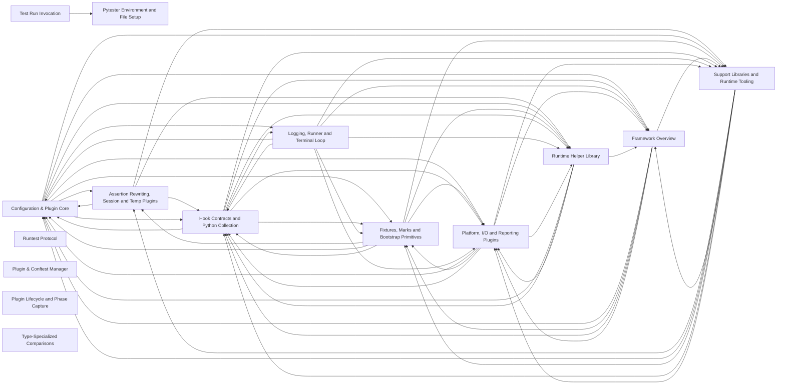

# Codebase Explorer

## How to read this report

Start with the responsibility tree in INDEX. Open a node page for your maintenance question, then choose a unit.
Node pages explain responsibilities. `catalog.json` stores full signatures, source ranges, folded members, relation evidence, and graph edges.
Set `RUN` to the absolute path of this run directory. Find an id, then read its explanation or frozen source.

```sh
cbe find --run-dir "$RUN" --term "SEARCH_TERM"
cbe query --run-dir "$RUN" --id "$ID"
cbe source --run-dir "$RUN" --id "$ID" --context 2
```

`ID` can be a unit id, symbol id, or file path. Commands return the content directly.
`source` reads frozen source and verifies its digest first.
The catalog also stores reverse graph edges, statuses, and raw evidence.

## Responsibility tree

- [pytest Codebase](nodes/pytest.md) (0 units)
  - [Framework Core](nodes/framework-core.md) (0 units)
    - [Configuration & Plugin Core](nodes/config-plugin-core.md) (0 units)
      - [Pytest Codebase](nodes/r2-pytest-root.md) (39 units)
        - [collect_pytest_prefix-conftest](nodes/r2-pytest-root.md#u-553e5ce7b807) · conftest defining an empty class named pytest_something, probing pytest's name-based collection rules: classes matching the test prefix in a conftest module should not be collected as tests.
        - [Package Version Metadata](nodes/r2-pkg-version.md) (1 units)
          - [__init__.py module code (L1–L13)](nodes/r2-pkg-version.md#u-a88d8133ca89) · Publishes the package version.
        - [Configuration & Plugin Core](nodes/r2-config-core.md) (0 units)
          - [CLI Entry & Bootstrap](nodes/r2-config-cli-entry.md) (11 units)
            - [console_main](nodes/r2-config-cli-entry.md#u-b420848647de) · CLI entry point: calls main(), flushes stdout, returns the code; on BrokenPipeError redirects stdout to os.devnull so the exit-time flush cannot raise again, and returns 1.
          - [Config Object & Parse Lifecycle](nodes/r2-config-lifecycle.md) (24 units)
            - [Config](nodes/r2-config-lifecycle.md#u-ee2b09815a27) · Provides access to configuration values, the pluginmanager, and plugin hooks for one pytest invocation.
          - [Ini & Option Value Access](nodes/r2-config-ini-options.md) (14 units)
            - [Config.getini](nodes/r2-config-ini-options.md#u-22f06e7bb7ce) · Returns an ini value, caching per name in _inicache; a cache miss resolves via _getini.
          - [Plugin & Conftest Manager](nodes/r2-config-plugin-manager.md) (24 units)
            - [PytestPluginManager](nodes/r2-config-plugin-manager.md#u-ef8f6a30432d) · pluggy PluginManager with pytest-specific behavior: loading plugins from command line, PYTEST_PLUGINS env var, and pytest_plugins globals; startup conftest.py loading and per-directory conftest caching.
          - [Config Warnings & Assertion-Rewrite Setup](nodes/r2-config-warnings-rewrite.md) (14 units)
            - [_iter_rewritable_modules](nodes/r2-config-warnings-rewrite.md#u-55491e05d47c) · Yields module/package names from a distribution's file list that should be marked for assertion rewriting.
        - [Cross-Session Cache Provider](nodes/r2-cache-provider.md) (19 units)
          - [Cache](nodes/r2-cache-provider.md#u-c7b89217c764) · Cache is the object behind the `cache` fixture, persisting JSON values under a cache directory across pytest sessions.
        - [Filesystem & Import Path Utilities](nodes/r2-path-utils.md) (0 units)
          - [Module Import by Path](nodes/r2-path-import-machinery.md) (12 units)
            - [ImportPathMismatchError](nodes/r2-path-import-machinery.md#u-d7adbe2f03f9) · ImportError subclass raised by import_path when the imported module's __file__ differs from the requested path — e.g. two different files with the same basename in packages, such as /tests1/test_foo.py versus /tests2/test_foo.py.
          - [Numbered Directory Creation & Cleanup](nodes/r2-path-numbered-dir-cleanup.md) (14 units)
            - [make_numbered_dir](nodes/r2-path-numbered-dir-cleanup.md#u-bbca0cd1c315) · Creates root/<prefix><N> where N is one greater than the highest existing numbered suffix (parse_num over find_suffixes, default -1 for none).
          - [General Path Helpers](nodes/r2-path-general-helpers.md) (13 units)
            - [rm_rf](nodes/r2-path-general-helpers.md#u-679a90fd83e0) · Recursively removes a path even if entries are read-only.
        - [Assertion Failure Reporting](nodes/r2-assertion-reporting.md) (0 units)
          - [Type-Specialized Comparisons](nodes/r2-comparison-strategies.md) (9 units)
            - [_compare_eq_any](nodes/r2-comparison-strategies.md#u-ff4132716b63) · Chooses a specialised '==' explanation by operand type.
          - [Explanation Summary & Formatting](nodes/r2-explanation-formatting.md) (5 units)
            - [assertrepr_compare](nodes/r2-explanation-formatting.md#u-28eb36a31d2c) · Produces the summary and specialised explanation for a failed comparison `left op right`, or None when no specialised explanation applies.
          - [Explanation Truncation](nodes/r2-explanation-truncation.md) (4 units)
            - [truncate_if_required](nodes/r2-explanation-truncation.md#u-e0d4157994e6) · Entry point deciding whether an assertion explanation is truncated.
        - [Terminal I/O & CLI Integration Plugins](nodes/r2-io-cli-plugins.md) (0 units)
          - [Terminal Character Width](nodes/r2-wcwidth-helpers.md) (2 units)
            - [wcwidth](nodes/r2-wcwidth-helpers.md#u-fc9075a0e801) · Return the terminal column count for one character, cached with lru_cache(100).
          - [Argcomplete Shell Completion](nodes/r2-shell-completion.md) (3 units)
            - [_argcomplete.py module code (L1–L73)](nodes/r2-shell-completion.md#u-f2cf3a219b89) · Module setup: imports argparse, glob.glob, os, sys, typing; defines FastFilesCompleter; then, at import time, branches on the `_ARGCOMPLETE` environment variable to install either the real argcomplete hook or no-ops.
          - [Pastebin Report Plugin](nodes/r2-pastebin-plugin.md) (5 units)
            - [src/_pytest/pastebin.py:pytest_addoption](nodes/r2-pastebin-plugin.md#u-4c47a1375e34) · Register the --pastebin option in the 'terminal reporting' group.
        - [Test Corpus](nodes/r2-test-suite.md) (0 units)
          - [Fixture Semantics Suite](nodes/r2-fixture-tests.md) (0 units)
          - [Fixture Example Scripts](nodes/r2-fixture-example-scripts.md) (1 units)
            - [arg1](nodes/r2-fixture-example-scripts.md#u-f667c5867ec1) · Fixture arg1 proves that a sibling-directory fixture is not visible.
          - [Collection & Performance Examples](nodes/r2-collection-example-scripts.md) (0 units)
          - [Assertion, Warning & Unittest Examples](nodes/r2-behavior-example-scripts.md) (0 units)
          - [Output Helper Tests](nodes/r2-io-tests.md) (14 units)
            - [test_consistent_pretty_printer](nodes/r2-io-tests.md#u-5ce812740252) · Verifies the project's PrettyPrinter renders every supported container shape with one consistent style.
          - [Frozen Executable Tooling](nodes/r2-freeze-tooling.md) (0 units)
      - [Configuration & Plugin Core](nodes/config-plugin-core-unit.md) (0 units)
    - [Fixtures, Marks and Bootstrap Primitives](nodes/fixtures-marks-bootstrap.md) (0 units)
      - [pytest codebase](nodes/r5-pytest-codebase.md) (0 units)
        - [Fixture machinery](nodes/r5-fixture-machinery.md) (0 units)
          - [Fixture declaration API](nodes/r5-fixture-declaration.md) (5 units)
            - [src/_pytest/fixtures.py:fixture (2)](nodes/r5-fixture-declaration.md#u-dea499384199) · Implementation of the @pytest.fixture decorator, usable bare or with keyword arguments.
          - [Fixture setup, execution and teardown](nodes/r5-fixture-lifecycle.md) (7 units)
            - [FixtureDef](nodes/r5-fixture-lifecycle.md#u-9674c75d4866) · Container for one fixture definition: its factory function, visibility, scope, parametrization, cached result, and finalizers.
          - [Request objects and scoping context](nodes/r5-fixture-request-context.md) (5 units)
            - [FixtureRequest](nodes/r5-fixture-request-context.md#u-e8edbc928469) · Abstract base of the ``request`` fixture, giving fixtures and tests access to the requesting context and dynamic fixture resolution.
          - [Fixture registry and requirement closure](nodes/r5-fixture-registry.md) (16 units)
            - [FixtureManager](nodes/r5-fixture-registry.md#u-f0f45a635631) · Registry and lookup hub for fixture definitions in a session.
          - [Item reordering for high-scope fixtures](nodes/r5-fixture-ordering.md) (3 units)
            - [reorder_items](nodes/r5-fixture-ordering.md#u-ae43a2b63b8b) · Reorder collected items to minimize high-scope fixture setup/teardown churn.
          - [Fixture listing from the command line](nodes/r5-fixture-introspection.md) (8 units)
            - [src/_pytest/fixtures.py:pytest_addoption](nodes/r5-fixture-introspection.md#u-2cd4df91f8be) · Register this module's configuration.
          - [Fixture lookup error reporting](nodes/r5-fixture-lookup-errors.md) (2 units)
            - [FixtureLookupError](nodes/r5-fixture-lookup-errors.md#u-3dd83deedbc8) · LookupError raised when a requested fixture cannot be resolved.
        - [Mark data model](nodes/r5-mark-model.md) (8 units)
          - [structures.py-helpers](nodes/r5-mark-model.md#u-b39c04a261b5) · Module-level constants and small helpers.
        - [Configuration bootstrapping](nodes/r5-config-bootstrapping.md) (0 units)
          - [Rootdir and config-file discovery](nodes/r5-config-findpaths.md) (9 units)
            - [determine_setup](nodes/r5-config-findpaths.md#u-4c6e4cc79376) · Determines rootdir, inifile and ini config from command-line data, returning (rootdir, inipath, inicfg).
          - [Config exceptions and private-API guards](nodes/r5-config-api-guards.md) (4 units)
            - [UsageError](nodes/r5-config-api-guards.md#u-4e183a5c29b3) · Final Exception subclass marking errors in pytest usage or invocation; adds no behavior or state.
          - [Legacy path hook compatibility](nodes/r5-config-legacy-path-compat.md) (3 units)
            - [PathAwareHookProxy](nodes/r5-config-legacy-path-compat.md#u-2b2f77636d4c) · Wraps a pluggy HookRelay so that attribute access returns hook callers, replacing a fixed set of legacy hooks (per imply_paths_hooks) with wrappers that accept both pathlib and legacy path arguments.
        - [Runtime diagnostics and shared primitives](nodes/r5-runtime-diagnostics.md) (0 units)
          - [Faulthandler plugin](nodes/r5-faulthandler-plugin.md) (9 units)
            - [src/_pytest/faulthandler.py:pytest_configure](nodes/r5-faulthandler-plugin.md#u-652dd4fea7ba) · Enables the faulthandler module against a duplicated stderr descriptor stashed on the Config for later restoration.
          - [Timing and scope primitives](nodes/r5-time-scope-primitives.md) (4 units)
            - [Instant](nodes/r5-time-scope-primitives.md#u-313e6e0ed7df) · Frozen dataclass representing a point in time with two internally initialized fields: wall-clock time via time.time() and a perf_counter tick.
          - [Fixture setup display plugin](nodes/r5-setuponly-display.md) (5 units)
            - [src/_pytest/setuponly.py:pytest_addoption](nodes/r5-setuponly-display.md#u-16258c8e75e1) · Registers two boolean flags in the 'debugconfig' parser group: --setuponly/--setup-only (store_true, 'Only setup fixtures, do not execute tests') and --setupshow/--setup-show (store_true, 'Show setup of fixtures while executing tests').
        - [unittest integration bridge](nodes/r5-unittest-bridge.md) (0 units)
          - [TestCase collection](nodes/r5-unittest-collection.md) (6 units)
            - [src/_pytest/unittest.py:pytest_pycollect_makeitem](nodes/r5-unittest-collection.md#u-b830e7213ecf) · Collection hook that turns unittest.TestCase subclasses into UnitTestCase collectors.
          - [TestCaseFunction item and setup fixtures](nodes/r5-unittest-case-item.md) (16 units)
            - [TestCaseFunction](nodes/r5-unittest-case-item.md#u-6f70ff8af141) · Function item representing a single unittest test method; nofuncargs=True like UnitTestCase, and holds _excinfo, a list of collected ExceptionInfos.
          - [unittest result-to-report translation](nodes/r5-unittest-result-bridge.md) (7 units)
            - [TestCaseFunction._addexcinfo](nodes/r5-unittest-result-bridge.md#u-d684f59e0671) · Converts a raw unittest exc-info tuple into a pytest ExceptionInfo and appends it to the item's _excinfo list (created via __dict__.setdefault).
          - [Twisted trial workarounds](nodes/r5-unittest-twisted-workarounds.md) (7 units)
            - [TwistedVersion](nodes/r5-unittest-twisted-workarounds.md#u-a0864216fcae) · Enum of the installed Twisted trial relevance: Version24 (Twisted 24 or prior), Version25 (25 or later), and NotInstalled.
        - [pytest's own test suites](nodes/r5-test-suites.md) (0 units)
          - [Pytester self-tests](nodes/r5-pytester-selftests.md) (27 units)
            - [test_pytester.py-make-hook-recorder](nodes/r5-pytester-selftests.md#u-3bd8e2dc9ef5) · Exercises HookRecorder failure and collect bookkeeping built on an item's pluginmanager via Pytester.make_hook_recorder.
          - [JUnit XML reporting tests](nodes/r5-junitxml-tests.md) (12 units)
            - [schema](nodes/r5-junitxml-tests.md#u-420a07f27eb9) · Session-scoped fixture returning an xmlschema.XMLSchema built from the bundled junit-10.xsd file.
          - [Argcomplete tests](nodes/r5-argcomplete-tests.md) (4 units)
            - [test_argcomplete-tests](nodes/r5-argcomplete-tests.md#u-3123e3d4823d) · Bash-comparison tests for the fast argcomplete completer, both skipped on win32 and darwin.
          - [Cache provider tests](nodes/r5-cacheprovider-tests.md) (7 units)
            - [test_cacheprovider-module-residual](nodes/r5-cacheprovider-tests.md#u-4bd101f4d101) · File-level imports (enum, os, pathlib, shutil, typing, pytest internals) and the pytest_plugins = ('pytester',) registration enabling the pytester fixture used throughout; no executable behavior beyond that declaration.
          - [Conftest loading tests](nodes/r5-conftest-tests.md) (11 units)
            - [test_conftest.py module code (L1–L19)](nodes/r5-conftest-tests.md#u-a6ce7c20145f) · Module header: imports (os, pathlib, textwrap, typing.cast, collections.abc, ExitCode, PytestPluginManager, MonkeyPatch, symlink_or_skip, Pytester, TempPathFactory, pytest) and the mypy pragma; no behavior of its own.
          - [unittest integration tests](nodes/r5-unittest-integration-tests.md) (38 units)
            - [test_unittest.py module code (L1–L11)](nodes/r5-unittest-integration-tests.md#u-b861e062464c) · File header of the unittest-integration test module: it imports sys, ExitCode, MonkeyPatch, Pytester, and pytest, and enables untyped defs for mypy.
    - [Hook Contracts and Python Collection](nodes/hooks-collection-python.md) (0 units)
      - [pytest Codebase](nodes/r7-pytest-codebase.md) (1 units)
        - [test_python_path.py module code (L1–L10)](nodes/r7-pytest-codebase.md#u-9aae69c079e3) · Import header region with no behavioral content.
        - [Hook Specifications](nodes/r7-core-hook-contracts.md) (6 units)
          - [hookspec-initialization-hooks](nodes/r7-core-hook-contracts.md#u-ffa36da07d4e) · Hook specifications for plugin registration and early configuration, all declared with the pytest hookspec marker.
        - [Collection Tree Core \(nodes.py\)](nodes/r7-collection-tree-core.md) (0 units)
          - [Node Base and Lifecycle](nodes/r7-node-base-lifecycle.md) (15 units)
            - [Node](nodes/r7-node-base-lifecycle.md#u-fadcae42d5de) · Abstract base of the collection tree: Collectors are internal nodes, Items are leaves.
          - [Collector and Item Types](nodes/r7-item-collector-types.md) (4 units)
            - [Collector](nodes/r7-item-collector-types.md#u-f40d9f019e2b) · Abstract base for tree-building nodes whose ``collect()`` returns child Items/Collectors; ``collect`` is abstract and raises NotImplementedError.
        - [Python Test Collection and Execution](nodes/r7-python-collection.md) (0 units)
          - [Discovery Rules and Collect Hooks](nodes/r7-py-collector-discovery.md) (29 units)
            - [PyobjMixin](nodes/r7-py-collector-discovery.md#u-135afe275fff) · Mixin giving collected nodes Python-object access.
          - [Module, Class, and Package Collectors](nodes/r7-py-module-class-package.md) (28 units)
            - [Module](nodes/r7-py-module-class-package.md#u-ff2e44fe1b77) · File collector for a Python test module.
          - [Function Item and Execution](nodes/r7-py-function-item.md) (18 units)
            - [Function](nodes/r7-py-function-item.md#u-06f14dc6ae2f) · Item that sets up and runs one Python test function.
          - [Parametrization Machinery](nodes/r7-py-parametrization.md) (29 units)
            - [Metafunc](nodes/r7-py-parametrization.md#u-33958e9ec072) · Object handed to pytest_generate_tests hooks; exposes definition, config, module, function, fixturenames (fixture closure) and cls, with _calls holding the resulting CallSpec2 list and _params_directness tracking each arg as direct/indirect.
        - [JUnit XML Reporting](nodes/r7-junit-xml-reporting.md) (13 units)
          - [src/_pytest/junitxml.py:pytest_addoption](nodes/r7-junit-xml-reporting.md#u-18079b7c231f) · Declares the junitxml CLI and ini options: --junitxml/--junit-xml storing the report path (validated by filename_arg) and --junitprefix/--junit-prefix for classname prefixes, plus ini entries junit_suite_name (default 'pytest'), junit_logging (no|log|system-out|system-err|out-err|all, default 'no'), junit_log_passing_tests (bool, default True), junit_duration_report (total|call, default 'total'), and junit_family (legacy|xunit1|xunit2, default 'xunit2').
        - [pytest's Own Test Suites](nodes/r7-internal-test-suites.md) (0 units)
          - [Python Collection Tests](nodes/r7-collect-tests.md) (7 units)
            - [collect.py module code (L1–L19)](nodes/r7-collect-tests.md#u-83e0b596aac7) · Module-level imports and typing directives only; no executable test logic in lines 1-19.
          - [Session Run Control Tests](nodes/r7-session-tests.md) (29 units)
            - [test_session.py module code (L1–L9)](nodes/r7-session-tests.md#u-be6db9ad013f) · Imports only (ExitCode, MonkeyPatch, Pytester, pytest); no behavior of its own.
          - [PDB and Breakpoint Tests](nodes/r7-pdb-tests.md) (15 units)
            - [test_debugging.py module code (L1–L12)](nodes/r7-pdb-tests.md#u-e1ec1020b3ce) · Module header: mypy pragma, future annotations import, and imports of sys, _pytest._code, _validate_usepdb_cls, MonkeyPatch, Pytester, and pytest used by the fixtures and tests below.
          - [Warning Handling Tests](nodes/r7-warnings-tests.md) (14 units)
            - [test_warnings.py-warnings-summary](nodes/r7-warnings-tests.md#u-5c28f5557ee0) · The pyfile_with_warnings fixture creates a test importing a module (named from the test function) whose foo() warns UserWarning and RuntimeWarning, and inserts it on sys.path.
          - [Terminal Writer Tests](nodes/r7-terminalwriter-tests.md) (12 units)
            - [test_terminal_width_COLUMNS](nodes/r7-terminalwriter-tests.md#u-32164d24961d) · Checks get_terminal_width honors the COLUMNS environment variable: after setting COLUMNS=42 the reported width is 42; the variable is then removed (raising=False so absence is tolerated).
          - [Plugin and Utility Unit Tests](nodes/r7-misc-unit-tests.md) (16 units)
            - [test_parseopt-Parser-argument-and-group](nodes/r7-misc-unit-tests.md#u-3e4dcda29d96) · Covers parseopt.Argument and OptionGroup/Parser group registration.
        - [Example Scripts and Packaging Harness](nodes/r7-example-scripts.md) (0 units)
          - [Fixture Behavior Examples](nodes/r7-fixture-examples.md) (8 units)
            - [spam](nodes/r7-fixture-examples.md#u-73e0a8364a50) · Base fixture returning the string 'spam'.
          - [Collection and Assertion Payload Examples](nodes/r7-misc-examples.md) (9 units)
            - [collect_init_tests-tests-init](nodes/r7-misc-examples.md#u-6dde8633637e) · Package __init__ defining one trivially passing test_init; used to verify that pytest collects tests declared inside package __init__ files.
          - [Frozen Binary Harness](nodes/r7-freeze-harness.md) (1 units)
            - [tox_run-py](nodes/r7-freeze-harness.md#u-5776beb66415) · Invoked by tox after the executable is built: computes dist/runtests_script/runtests_script under the current directory, appends '.exe' when sys.platform starts with 'win', then runs '<executable> tests' via os.system and exits with that command's status.
    - [Assertion Rewriting, Session and Temp Plugins](nodes/assertion-session-tmp.md) (0 units)
      - [Pytest Framework and Test Suite](nodes/r8-pytest-root.md) (1 units)
        - [AssertionRewriter.is_rewrite_disabled](nodes/r8-pytest-root.md#u-33f578a38ccd) · Static check: rewriting is disabled when the docstring contains the substring 'PYTEST_DONT_REWRITE'.
        - [Assertion Rewriting](nodes/r8-assertion-rewriting.md) (0 units)
          - [Assertion Plugin Hooks and Session Wiring](nodes/r8-assertion-plugin-hooks.md) (12 units)
            - [init-py-module-residual](nodes/r8-assertion-plugin-hooks.md#u-f60db21dd8b6) · Module-level scaffolding of the assertion package __init__: the package docstring, __future__ annotation import, stdlib imports (collections.abc.Generator, sys, typing.Any/Protocol/TYPE_CHECKING), a TYPE_CHECKING-only import of Session from _pytest.main, and imports of the rewrite, truncate, and util submodules plus assertstate_key, Config, hookimpl, Parser, and Item.
          - [Rewrite Import Hook and pyc Cache](nodes/r8-rewrite-import-hook.md) (20 units)
            - [AssertionRewritingHook](nodes/r8-rewrite-import-hook.md#u-8ba94a79882d) · Import hook (meta-path finder and loader) that rewrites assert statements in test modules as they are imported during a pytest session.
          - [AssertionRewriter AST Transformation and Runtime Helpers](nodes/r8-assert-rewriter-ast.md) (35 units)
            - [AssertionRewriter](nodes/r8-assert-rewriter-ast.md#u-b99fa849110b) · AST NodeVisitor that rewrites assert statements into equivalent statements that capture intermediate values and raise AssertionError with detailed explanations.
        - [Legacy py.path Compatibility Layer](nodes/r8-legacy-path-compat.md) (18 units)
          - [legacypath.py-testdir](nodes/r8-legacy-path-compat.md#u-ebfe3b2ae7f6) · Provides a legacy-path facade over Pytester: a Testdir instance wraps an internal Pytester and forwards nearly every method to it, converting Path results to legacy_path objects where applicable, so tests written against the old py.path-style API keep working.
        - [Command-Line Entry and Session Lifecycle](nodes/r8-session-lifecycle.md) (10 units)
          - [_main](nodes/r8-session-lifecycle.md#u-a08bda8be952) · Default session body run by wrap_session: fires the `pytest_collection` hook (populating session.items), then the `pytest_runtestloop` hook (running tests).
        - [Collection Tree Construction](nodes/r8-collection-tree.md) (17 units)
          - [CollectionArgument](nodes/r8-collection-tree.md#u-64f8023599e4) · Frozen dataclass holding a resolved collection argument: `path` (the absolute filesystem path), `parts` (the `::`-separated node-name selection parts after the path), and `module_name` (the original dotted name when the argument was resolved via --pyargs, else None).
        - [Typed Stash Infrastructure](nodes/r8-typed-stash.md) (2 units)
          - [Stash](nodes/r8-typed-stash.md#u-3436b55c6fc2) · A type-safe heterogeneous mutable mapping keyed by StashKey objects, backed by a private dict.
        - [Stepwise Run Resumption](nodes/r8-stepwise-plugin.md) (9 units)
          - [StepwiseCacheInfo](nodes/r8-stepwise-plugin.md#u-7a5564869417) · Dataclass describing the persisted stepwise state: `last_failed` nodeid, `last_test_count` used to invalidate stale caches, and a string timestamp that is informational.
        - [Temporary Directory Management](nodes/r8-tmp-path-management.md) (14 units)
          - [TempPathFactory](nodes/r8-tmp-path-management.md#u-bfe642169624) · Factory for per-session temporary directories under a common base temp directory.
          - [tmpdir and pathlib Helper Tests](nodes/r8-tmpdir-tests.md) (10 units)
            - [test_tmpdir-py-fixture-and-user-tests](nodes/r8-tmpdir-tests.md#u-e0615c2e893f) · Module-level tests of the tmp_path fixture and user resolution.
        - [pathlib and Import Mechanism Tests](nodes/r8-pathlib-tests.md) (11 units)
          - [test_pathlib.py-fnmatcher](nodes/r8-pathlib-tests.md#u-7301bee28452) · Tests the pytest port of py.common.FNMatcher (fnmatch_ex).
        - [Example Script Scenarios](nodes/r8-example-scripts-suite.md) (15 units)
          - [custom_item-conftest](nodes/r8-example-scripts-suite.md#u-554a833bf9e8) · Defines a custom Item/File collector pair.
        - [Python Feature Integration Tests](nodes/r8-python-integration-tests.md) (10 units)
          - [integration.py-testmockdecoration](nodes/r8-python-integration-tests.md#u-80c9b6aec34d) · Integration tests for pytest's handling of mock-decorated tests.
        - [caplog Fixture Tests](nodes/r8-caplog-fixture-tests.md) (10 units)
          - [test_fixture-py-config-level-tests](nodes/r8-caplog-fixture-tests.md#u-1e5e309cd863) · Pytester-based tests of how the ini log_level interacts with caplog overrides and failure reporting.
        - [Fixture Setup Reporting Tests](nodes/r8-fixture-output-reporting-tests.md) (5 units)
          - [test-setuponly-setup-reporting](nodes/r8-fixture-output-reporting-tests.md#u-44bdf4422648) · Tests --setup-only, --setup-plan and --setup-show fixture lifecycle reporting via the shared 'mode' fixture parametrized over the three flags.
        - [Skipping and xfail Tests](nodes/r8-skipping-tests.md) (8 units)
          - [test_skipping-item-and-api-tests](nodes/r8-skipping-tests.md#u-04e3161d1c73) · Tests for skip/xfail support on non-Python items and outcome API details.
        - [wcwidth Tests](nodes/r8-wcwidth-tests.md) (2 units)
          - [test_wcswidth](nodes/r8-wcwidth-tests.md#u-9ccb567f5b31) · Parametrized string-width table for wcswidth: empty string is 0, ASCII strings count 1 per char (13 and 10), a trailing '\n' makes the whole string -1, Hebrew 'שלום, עולם!' is 11, the fully pointed 'שְבֻעָיים' is 6 (combining points add no width), and three 🉐 are 6.
        - [RaisesGroup Typing Tests](nodes/r8-raises-group-typing-tests.md) (14 units)
          - [typing_raises_group.py-narrowing](nodes/r8-raises-group-typing-tests.md#u-d72bc2e418bf) · Two functions checking RaisesGroup's check-argument and container type narrowing.
    - [Logging, Runner and Terminal Loop](nodes/logging-runner-terminal.md) (0 units)
      - [pytest Core](nodes/r9-pytest-core.md) (0 units)
        - [Logging Plugin](nodes/r9-logging-plugin.md) (0 units)
          - [Plugin Lifecycle and Phase Capture](nodes/r9-logging-plugin-core.md) (10 units)
            - [LoggingPlugin](nodes/r9-logging-plugin-core.md#u-a9c07f26da5f) · Plugin that wires pytest into the logging module: it builds a shared report formatter, in-memory caplog/report handlers, an optional file handler, and a live-logging handler, and installs/removes them around session phases and each test phase.
          - [Log Formatters](nodes/r9-logging-formatters.md) (8 units)
            - [ColoredLevelFormatter](nodes/r9-logging-formatters.md#u-ffc6c97076c3) · A DatetimeFormatter that colorizes only the %(levelname)..s portion of the format, leaving the rest of each record uncolored.
          - [caplog Capture Fixture](nodes/r9-logging-capture-fixtures.md) (8 units)
            - [LogCaptureFixture](nodes/r9-logging-capture-fixtures.md#u-7c2a746b7051) · The caplog fixture object, constructed only via the _ispytest keyword gate (check_ispytest).
          - [Live and File Handlers](nodes/r9-logging-live-file-handlers.md) (4 units)
            - [_LiveLoggingStreamHandler](nodes/r9-logging-live-file-handlers.md#u-f39c2e7e81cb) · StreamHandler for live logging that writes to a TerminalReporter (forced into the stream attribute despite the IO[str] typing) and temporarily disables capture while emitting.
          - [Logging Configuration](nodes/r9-logging-config-options.md) (3 units)
            - [logging-pytest-addoption](nodes/r9-logging-config-options.md#u-8977db55e641) · Registers all logging command-line options and ini settings on the 'logging' option group.
        - [Test Runner](nodes/r9-test-runner.md) (0 units)
          - [Runtest Protocol](nodes/r9-runner-protocol.md) (10 units)
            - [src/_pytest/runner.py:pytest_runtest_protocol](nodes/r9-runner-protocol.md#u-f0c22eb857e2) · Runs the full runtest protocol for one item: emits logstart, delegates to runtestprotocol, emits logfinish, and returns True.
          - [CallInfo and Collection](nodes/r9-runner-callinfo-collect.md) (4 units)
            - [CallInfo](nodes/r9-runner-callinfo-collect.md#u-58f50349ae1a) · Final dataclass holding result/exception info of one invocation ('collect', 'setup', 'call' or 'teardown'), with start/stop epoch times and duration.
          - [Session SetupState](nodes/r9-runner-setupstate.md) (5 units)
            - [SetupState](nodes/r9-runner-setupstate.md#u-29aa083e6978) · Shared per-session state managing setup/teardown of collectors along the item chain as an ordered stack (dict in insertion order).
          - [Runner Options and Status Defaults](nodes/r9-runner-config-durations.md) (3 units)
            - [src/_pytest/runner.py:pytest_addoption](nodes/r9-runner-config-durations.md#u-918d8a594ec4) · Registers the --durations (int) and --durations-min (float) options in a 'terminal reporting' group placed after 'general'; both default to None.
        - [Terminal Reporting](nodes/r9-terminal-reporting.md) (0 units)
          - [Reporter Lifecycle and Collection Output](nodes/r9-terminal-reporter-core.md) (14 units)
            - [TerminalReporter](nodes/r9-terminal-reporter-core.md#u-8d4b8f445ae8) · Final plugin class owning all terminal output of a pytest session: header, per-test progress, collection reporting and end-of-session summaries.
          - [Per-Test Progress Output](nodes/r9-terminal-progress.md) (14 units)
            - [TerminalReporter.pytest_runtest_logstart](nodes/r9-terminal-progress.md#u-6c9c7f77cb50) · Hook called before a test runs, ensuring the location is printed first.
          - [Summary Sections](nodes/r9-terminal-summaries.md) (19 units)
            - [TerminalReporter.pytest_terminal_summary](nodes/r9-terminal-summaries.md#u-c31ec4abdfa2) · Wrapper hook ordering the summary sections: errors, failures, xfailures, warnings, passes, xpasses, then yielding to other plugins, and in a finally block printing the short test summary and a second summary_warnings pass that shows only warnings recorded after the first pass (teardown warnings).
          - [Terminal Options and Status Hook](nodes/r9-terminal-config.md) (4 units)
            - [src/_pytest/terminal.py:pytest_addoption](nodes/r9-terminal-config.md#u-bb387fa2e224) · Registers the terminal-reporting CLI options and ini settings.
        - [Logging Reporting Test Suite](nodes/r9-tests-logging-reporting.md) (0 units)
          - [Live Logging Tests](nodes/r9-tests-logging-live-cli.md) (10 units)
            - [test_reporting-captured-log-sections](nodes/r9-tests-logging-live-cli.md#u-2da400d7d9a1) · Verifies that pytest captures and reports logging separately per test phase, alongside stdout/stderr.
          - [Log File and Format Tests](nodes/r9-tests-logging-file-config.md) (12 units)
            - [test_reporting-collection-logging](nodes/r9-tests-logging-file-config.md#u-c5df41cc648b) · Covers logging during collection.
        - [Runner Test Suite](nodes/r9-tests-runner.md) (0 units)
          - [SetupState Tests](nodes/r9-tests-runner-setupstate.md) (10 units)
            - [TestSetupState](nodes/r9-tests-runner-setupstate.md#u-8bf7f1ab68c6) · Holds unit tests for the session SetupState, covering setup, finalizer registration, teardown_exact stack semantics, cached setup failures, and grouped finalizer errors across scopes.
          - [Runtest Protocol Functional Tests](nodes/r9-tests-runner-protocol.md) (20 units)
            - [BaseFunctionalTests.test_passfunction](nodes/r9-tests-runner-protocol.md#u-aaa64dac507f) · Runs a trivially passing item via pytester.runitem; reports[1] (call) must be passed, not failed, with outcome 'passed' and no longrepr.
          - [Outcome, Exit and Skip Tests](nodes/r9-tests-runner-outcome-skip.md) (29 units)
            - [test_outcomeexception_exceptionattributes](nodes/r9-tests-runner-outcome-skip.md#u-5d01c1ab384a) · OutcomeException('test') stores its message so args[0] equals the msg attribute.
          - [Report and CallInfo Tests](nodes/r9-tests-runner-reports.md) (14 units)
            - [test-runner-test_callinfo](nodes/r9-tests-runner-reports.md#u-5cd72a65ec75) · CallInfo.from_call behavior: a successful call stores result and when ('collect'), repr/str equal '<CallInfo when='collect' result: 0>'; a raising call has no result attribute, exposes excinfo, and repr embeds excinfo with newlines escaped (asserting message 'assert_msg' produces no newline in repr).
        - [Doctest Plugin Test Suite](nodes/r9-tests-doctest.md) (8 units)
          - [test_doctest-py-issetup-and-main-helpers](nodes/r9-tests-doctest.md#u-ad0423dfdc29) · Direct unit tests for two private helpers from _pytest.doctest.
        - [Warning Capture Test Suite](nodes/r9-tests-recwarn.md) (6 units)
          - [test_recwarn-py-top-level-tests](nodes/r9-tests-recwarn.md#u-45bafe519ab0) · Covers the module-level test functions of test_recwarn.py, which exercise recwarn, pytest.warns input validation, and DeprecationWarning capture.
        - [Node API Test Suite](nodes/r9-tests-nodes.md) (4 units)
          - [test_nodes-node-construction-and-warning-tests](nodes/r9-tests-nodes.md#u-8ca075670726) · Tests of Node construction rules and warning APIs.
        - [Mark Expression Test Suite](nodes/r9-tests-mark-expression.md) (3 units)
          - [test_mark_expression-tests](nodes/r9-tests-mark-expression.md#u-ae6a8bc4d9db) · Parametrized tests of mark-expression parsing and evaluation, all through the evaluate helper.
        - [Pastebin Test Suite](nodes/r9-tests-pastebin.md) (2 units)
          - [test-pastebin-paste-capture](nodes/r9-tests-pastebin.md#u-17f41615e1b1) · Tests the --pastebin failure-report integration.
  - [Framework Overview](nodes/framework-overview.md) (0 units)
    - [pytest codebase](nodes/r1-pytest-codebase.md) (0 units)
      - [Python code inspection & exception rendering](nodes/r1-code-inspection.md) (1 units)
        - [__init__.py module code (L1–L26)](nodes/r1-code-inspection.md#u-60fec36890d2) · Package facade re-exporting the python inspection API: it imports Code, ExceptionInfo, filter_traceback, Frame, getfslineno, Traceback, TracebackEntry from .code and getrawcode, Source from .source, then lists nine of them in __all__.
        - [Code / Frame / Traceback model](nodes/r1-code-core-model.md) (4 units)
          - [code-py-code](nodes/r1-code-core-model.md#u-b2fce7cd03e4) · Wraps a Python code object to expose its identity, name, path, and source.
        - [ExceptionInfo API](nodes/r1-code-exception-info.md) (9 units)
          - [ExceptionInfo](nodes/r1-code-exception-info.md#u-d7c3de7f5226) · Immutable-style holder of an (type, value, tb) triple (or None when unfilled), created only via classmethods because __init__ enforces a private _ispytest flag via check_ispytest.
        - [TerminalRepr data model](nodes/r1-code-terminal-repr.md) (10 units)
          - [code-py-terminalrepr](nodes/r1-code-terminal-repr.md#u-833c08748a67) · Abstract base for printable terminal objects.
        - [Traceback formatting engine](nodes/r1-code-traceback-formatting.md) (12 units)
          - [FormattedExcinfo](nodes/r1-code-traceback-formatting.md#u-b28da5170157) · Dataclass holding all traceback-formatting options (showlocals, style, abspath, tbfilter, funcargs, truncate_locals, truncate_args, chain, plus a per-instance astcache) and turning ExceptionInfo data into TerminalRepr trees.
      - [Compatibility & introspection utilities](nodes/r1-pytest-compat.md) (9 units)
        - [signature](nodes/r1-pytest-compat.md#u-c5291bdc0788) · Return a callable's inspect.Signature without evaluating its annotations.
      - [Doctest plugin](nodes/r1-doctest-plugin.md) (1 units)
        - [src/_pytest/doctest.py:pytest_addoption](nodes/r1-doctest-plugin.md#u-88899184f9cb) · Register the doctest configuration surface.
        - [Doctest runner & checker infrastructure](nodes/r1-doctest-runner-infra.md) (11 units)
          - [doctest-py-flag-registration](nodes/r1-doctest-runner-infra.md#u-42d837a5ffe4) · Three thin wrappers that register pytest's custom doctest option flags and return their integer values: _get_allow_unicode_flag, _get_allow_bytes_flag, and _get_number_flag each import doctest lazily and return doctest.register_optionflag for 'ALLOW_UNICODE', 'ALLOW_BYTES', and 'NUMBER' respectively.
        - [Doctest collection & item execution](nodes/r1-doctest-collection.md) (11 units)
          - [pytest_collect_file](nodes/r1-doctest-collection.md#u-c8e3285f6b0f) · Hook deciding whether a file becomes a doctest collector.
      - [Approximate comparison \(pytest.approx\)](nodes/r1-python-approx.md) (0 units)
        - [Approx comparison classes](nodes/r1-approx-classes.md) (6 units)
          - [python_api-approxbase](nodes/r1-approx-classes.md#u-f9b3cbb02e3c) · Base class shared by all approx comparison classes; it stores the expected value, rel/abs tolerances and nan_ok, and defines the equality protocol subclasses specialize.
        - [Approx dispatch & helpers](nodes/r1-approx-dispatch-helpers.md) (6 units)
          - [approx](nodes/r1-approx-dispatch-helpers.md#u-e9c87ad6c2c3) · Public factory returning the ApproxBase subclass suited to the expected value, with __tracebackhide__ set to hide this frame.
        - [approx test suite](nodes/r1-approx-tests.md) (5 units)
          - [TestApprox](nodes/r1-approx-tests.md#u-1a623e08e406) · Test suite for pytest.approx covering error-message rendering, repr output, tolerance semantics, numeric types, containers, and numpy interplay.
      - [RaisesGroup test suite](nodes/r1-raises-group-tests.md) (4 units)
        - [raises_group.py-matching-semantics](nodes/r1-raises-group-tests.md#u-2d04582d3194) · Verifies RaisesGroup and RaisesExc construction validation plus matching semantics: valid exception types and nesting, allow_unwrapped and flatten_subgroups behavior, match/check application to the group, matches() predicate results, rejection of tuples and bad generic arguments, and xfail/parametrized usage.
      - [Leaked exception reporting](nodes/r1-leaked-exception-reporting.md) (1 units)
        - [tracemalloc_message](nodes/r1-leaked-exception-reporting.md#u-e0457a417bb6) · Produce a tracemalloc allocation note for a source object, tolerating every degraded case.
        - [Thread exception plugin](nodes/r1-thread-exception-plugin.md) (5 units)
          - [threadexception.py:runtest-hooks](nodes/r1-thread-exception-plugin.md#u-f1a10badbe16) · The three pytest_runtest_setup/call/teardown hooks are identical: each is registered trylast=True and simply calls ``collect_thread_exception(item.config)``, so exceptions captured from background threads are drained and reported between each test phase rather than only at session end.
        - [Unraisable exception plugin](nodes/r1-unraisable-exception-plugin.md) (5 units)
          - [unraisableexception.py-runtest-collect-hooks](nodes/r1-unraisable-exception-plugin.md#u-c7beb5b889f9) · The three hook wrappers pytest_runtest_setup, pytest_runtest_call, and pytest_runtest_teardown are each registered trylast and simply call collect_unraisable(item.config), flushing any unraisable exceptions that surfaced during the preceding phase at the last opportunity in setup, call, and teardown respectively.
      - [Legacy py.path compatibility](nodes/r1-legacy-py-path.md) (1 units)
        - [py.py module code (L1–L15)](nodes/r1-legacy-py-path.md#u-d4ca81600539) · Provide a minimal 'py' module so code importing py.error or py.path keeps working after pylib is removed.
        - [py.path test infrastructure](nodes/r1-local-test-support.md) (4 units)
          - [path1](nodes/r1-local-test-support.md#u-45acc6187683) · Session-scoped pytest fixture yielding a fresh temporary directory created via tmpdir_factory.mktemp('path') and populated by setuptestfs, passed as the 'path1' argument to every CommonFSTests test.
        - [Common py.path API suite](nodes/r1-local-commonfs-suite.md) (6 units)
          - [test-local.py-commonfs](nodes/r1-local-commonfs-suite.md#u-ef4bd72abf8e) · Mixin class of tests pinning the common py.path filesystem API against a prepared tree supplied by the path1 fixture.
        - [Platform-specific & import suites](nodes/r1-local-platform-import-suite.md) (6 units)
          - [test-local.py-testexecution](nodes/r1-local-platform-import-suite.md#u-5bac36691956) · Tests for sysfind, sysexec and make_numbered_dir, skipped on win32 via pytestmark.
      - [Configuration test suite](nodes/r1-config-test-suite.md) (11 units)
        - [test-config-parse-ini](nodes/r1-config-test-suite.md#u-c1524ecf1eba) · Verifies pytest's ini/config-file discovery, parsing, and early-option behavior.
      - [Plugin manager test suite](nodes/r1-pluginmanager-tests.md) (4 units)
        - [pytestpm](nodes/r1-pluginmanager-tests.md#u-e648d8b4d873) · Fixture returning a fresh PytestPluginManager, giving tests an isolated plugin manager independent of ambient test configuration.
        - [Plugin registration & discovery tests](nodes/r1-pm-registration-discovery.md) (12 units)
          - [TestPytestPluginManager](nodes/r1-pm-registration-discovery.md#u-d8cd3c35245d) · Groups tests of PytestPluginManager registration and plugin discovery: module registration, canonical imports, consider_module/consider_env/consider_conftest, env-var-driven plugin loading, and import_plugin naming.
        - [Plugin bootstrapping tests](nodes/r1-pm-bootstrapping.md) (6 units)
          - [TestPytestPluginManagerBootstrapping](nodes/r1-pm-bootstrapping.md#u-d40a7b710b06) · Groups tests of early '-p' preparse handling: argument forms, blocking registration with 'no:' names, unregistration of already-registered plugins, cacheprovider/stepwise coupling, and reuse of blocked plugins.
        - [Plugin-config-hook interaction tests](nodes/r1-pm-interactions.md) (11 units)
          - [TestPytestPluginInteractions](nodes/r1-pm-interactions.md#u-35dec5718100) · Groups tests of plugin-manager interactions: hookspecs from conftest, option registration timing, the configure lifecycle, conftest path handling, hook tracing, hook proxies, and hooks used inside pytest_addoption.
      - [Acceptance test suite](nodes/r1-acceptance-tests.md) (6 units)
        - [acceptance-test-py-general-usage](nodes/r1-acceptance-tests.md#u-5989048c795b) · Acceptance tests for general pytest CLI usage, each driving an isolated session through the Pytester fixture and asserting on exit codes and stdout/stderr patterns.
      - [Main & wrap\_session tests](nodes/r1-main-session-tests.md) (6 units)
        - [test-main-validate-basetemp](nodes/r1-main-session-tests.md#u-353f803be303) · Covers validate_basetemp.
      - [Environment & integration tests](nodes/r1-integration-environment-tests.md) (0 units)
        - [Symlink & subst path resolution tests](nodes/r1-link-resolve-tests.md) (3 units)
          - [subst_path_linux](nodes/r1-link-resolve-tests.md#u-279517dcd234) · Context manager exposing a Linux file path through a symlink: it creates directory/../sub2 as a symlink to the file's parent directory and yields target/basename.
        - [collect\_imported\_tests tests](nodes/r1-collect-imported-tests-suite.md) (1 units)
          - [test_collect_imported_tests-tests](nodes/r1-collect-imported-tests-suite.md#u-559b2343c7d2) · Tests for the collect_imported_tests ini option, sharing the setup_files helper, which creates a src/foo.py defining Testament and test_testament, a tests/foo_test.py importing them into a TestDomain class, and syspathinserts src so the import resolves.
        - [Third-party plugin integration](nodes/r1-third-party-plugin-integration.md) (2 units)
          - [pytest_trio_integration-py](nodes/r1-third-party-plugin-integration.md#u-d374ff9b00e0) · Trio plugin integration test: test_sleep is marked @pytest.mark.trio and awaits trio.sleep(0), verifying the pytest-trio plugin runs coroutine tests on the trio kernel.
      - [Public pytest API surface](nodes/r1-public-api-surface.md) (1 units)
        - [__init__.py module code (L1–L180)](nodes/r1-public-api-surface.md#u-bbcdcae30a33) · Re-export the public pytest API from internal _pytest submodules as the 'pytest' module namespace.
  - [Platform, I/O and Reporting Plugins](nodes/platform-io-plugins.md) (0 units)
    - [Pytest Framework Codebase](nodes/r3-pytest.md) (1 units)
      - [test_source.py-test_source_with_decorator](nodes/r3-pytest.md#u-07ae84cefd56) · Compares Source/decorator interaction with inspect.getsource.
      - [Terminal Output & Pretty-Printing](nodes/r3-terminal-io.md) (0 units)
        - [Safe Pretty-Printer](nodes/r3-pprint.md) (6 units)
          - [pprint-container-formatters](nodes/r3-pprint.md#u-a5506fa746d7) · Group of PrettyPrinter's structural (_dispatch-registered) formatters, all with the uniform signature (object, stream, indent, allowance, context, level).
        - [Terminal Writer](nodes/r3-terminal-writer.md) (10 units)
          - [TerminalWriter](nodes/r3-terminal-writer.md#u-2775540feb47) · Terminal-oriented text writer with color markup, separator lines, and pygments source highlighting.
      - [Output & Input Capture](nodes/r3-io-capture.md) (0 units)
        - [Capture Backends & Lifecycle](nodes/r3-capture-backends.md) (14 units)
          - [capture-py-captureio](nodes/r3-capture-backends.md#u-6949f49c99cb) · CaptureIO is a TextIOWrapper over a fresh BytesIO with UTF-8 encoding, no newline translation, and write_through=True; it is the in-memory target for sys-level capturing.
        - [Capture Coordination](nodes/r3-capture-manager.md) (1 units)
          - [CaptureManager](nodes/r3-capture-manager.md#u-a88cc981e1b7) · The capture plugin coordinating two levels of capture: global (per --capture method, active during collection and test phases, suppressed by -s) and fixture-level (capsys/capfd taking precedence when a test requests them).
        - [Capture Fixtures](nodes/r3-capture-fixtures.md) (6 units)
          - [CaptureFixture](nodes/r3-capture-fixtures.md#u-0cd7ba3c92b4) · Per-test capture object behind capsys/capsysbinary/capfd/capfdbinary.
        - [Capture Startup & Options](nodes/r3-capture-startup.md) (3 units)
          - [src/_pytest/capture.py:pytest_addoption](nodes/r3-capture-startup.md#u-533b46382224) · Registers the --capture option (choices fd|sys|no|tee-sys, default 'fd') in the 'general' parser group plus a private -s short option storing the constant 'no' into the same 'capture' destination.
      - [Marking & Test Selection](nodes/r3-marking.md) (0 units)
        - [Marker Plugin Core](nodes/r3-mark-implementation.md) (8 units)
          - [__init__.py-collection-deselection](nodes/r3-mark-implementation.md#u-ee4160321a07) · Implements -k and -m deselection during collection.
        - [-k / -m Selection Tests](nodes/r3-mark-selection-tests.md) (11 units)
          - [test-mark-py-test-keyword-selection](nodes/r3-mark-selection-tests.md#u-3dac6f0ed76b) · Tests -k keyword selection semantics.
        - [Marker Registry & Decorator Tests](nodes/r3-mark-registry-tests.md) (16 units)
          - [test-mark-py-test-mark](nodes/r3-mark-registry-tests.md#u-db27157e8019) · Tests the public pytest.mark generator surface: namespace export, non-callability, with_args identity, and underscore-name rejection.
        - [Parametrize & Parameter-Set Tests](nodes/r3-mark-parametrize-tests.md) (11 units)
          - [test_parametrize_iterator](nodes/r3-mark-parametrize-tests.md#u-e769e7b59bd8) · parametrize accepts a generator of argvalues; all three yielded cases run and none are skipped, asserting '3 passed' in output (issue 5354).
      - [Warning Handling](nodes/r3-warnings.md) (0 units)
        - [Warning Categories](nodes/r3-warning-types.md) (3 units)
          - [warning_types.py:warning-classes](nodes/r3-warning-types.md#u-10c8ce561005) · All pytest warning categories subclass PytestWarning (itself a UserWarning) and reset ``__module__`` to 'pytest' so they appear as pytest.* in output.
        - [Warning Capture Hooks](nodes/r3-warning-capture.md) (4 units)
          - [warnings.py:hook-wrappers](nodes/r3-warning-capture.md#u-66b23e3edaa5) · Four wrapper hooks (pytest_runtest_protocol tryfirst, pytest_collection, pytest_terminal_summary, pytest_sessionfinish, and pytest_load_initial_conftests) all follow one pattern: they wrap the wrapped hook chain in catch_warnings_for_item with the item and phase where applicable — item and 'runtest' for the protocol hook, item None with 'collect' for collection, and item None with 'config' for the summary, session-finish, and initial-conftest phases — yielding through so the inner hooks run inside the capture and returning their result.
      - [Test & Collection Reports](nodes/r3-reports.md) (0 units)
        - [Report Model & Rendering](nodes/r3-report-model.md) (14 units)
          - [BaseReport](nodes/r3-report-model.md#u-bb2e0a19f627) · Base class shared by test and collection reports, carrying core fields (when, location, longrepr, sections, nodeid, outcome) plus generic presentation, capture-section, status, and JSON round-trip behavior.
        - [Report Serialization](nodes/r3-report-serialization.md) (7 units)
          - [BaseReport._to_json](nodes/r3-report-serialization.md#u-604411dfefcd) · Returns this report as a dict of builtin-serializable entries, delegating to _report_to_json.
      - [Warning Assertion Helpers](nodes/r3-recwarn.md) (8 units)
        - [recwarn.py module code (L1–L32)](nodes/r3-recwarn.md#u-15834f1dbb94) · Module imports and the TypeVar alias for recwarn.
      - [pytest.raises Test Suite](nodes/r3-raises-tests.md) (12 units)
        - [wrap_escape](nodes/r3-raises-tests.md#u-1bf3f3eb31a7) · Wraps a literal string into an anchored regex by concatenating '^', re.escape(s), and '$', so it can be used as an exact-match pytest.raises match pattern.
      - [Code Introspection Test Suite](nodes/r3-code-introspection-tests.md) (0 units)
        - [Code & Frame Tests](nodes/r3-code-object-tests.md) (13 units)
          - [test_code.py-code-source-helpers](nodes/r3-code-object-tests.md#u-1bb57683f04b) · Helper x raises NotImplementedError; only its source matters.
        - [Statement Recovery Tests](nodes/r3-source-statement-recovery.md) (19 units)
          - [getstatement](nodes/r3-source-statement-recovery.md#u-73c873108c2e) · Test helper wrapping the statement-range logic: builds Source(source), calls getstatementrange_ast(lineno, src) to get (ast, start, end), and returns the src[start:end] slice so individual tests can assert the recovered statement text.
        - [Source Construction & Access Tests](nodes/r3-source-construction-tests.md) (17 units)
          - [TestAccesses](nodes/r3-source-construction-tests.md#u-1b0dd86151d7) · Exercises Source sequence-style access against a shared four-line source of two def blocks.
      - [Assertion Rewrite Test Suite](nodes/r3-assertrewrite-tests.md) (0 units)
        - [Rewriting & Explanations](nodes/r3-rewrite-core-tests.md) (8 units)
          - [test_assertrewrite.py-test-assertion-rewrite](nodes/r3-rewrite-core-tests.md#u-a031c2992573) · TestAssertionRewrite verifies assertion rewriting and its explanation messages.
        - [Import Hook & Cache Tests](nodes/r3-rewrite-hook-tests.md) (9 units)
          - [test_assertrewrite.py-test-rewrite-on-import](nodes/r3-rewrite-hook-tests.md#u-84058861b183) · TestRewriteOnImport covers the assertion-rewrite import hook's interaction with the filesystem and import machinery, all through pytester sessions.
        - [Explanation Features Tests](nodes/r3-rewrite-explanation-extras.md) (4 units)
          - [test_assertrewrite.py-assertion-pass](nodes/r3-rewrite-explanation-extras.md#u-741682dff23e) · TestAssertionPass covers the enable_assertion_pass_hook ini option and the pytest_assertion_pass hook.
      - [Thread & Unraisable Exception Warning Tests](nodes/r3-exception-warning-tests.md) (17 units)
        - [test_threadexception.py module code (L1–L6)](nodes/r3-exception-warning-tests.md#u-8f3990b07331) · Imports Pytester and pytest for the thread-exception warning tests.
      - [Test-Suite Infrastructure](nodes/r3-test-infra.md) (0 units)
        - [Testing conftest Fixtures](nodes/r3-conftest-fixtures.md) (9 units)
          - [reset_colors](nodes/r3-conftest-fixtures.md#u-393935c1e454) · Autouse fixture deleting the PY_COLORS, NO_COLOR and FORCE_COLOR environment variables (each with raising=False, so absence is fine) so host color settings cannot affect tests asserting on pytest's own colored output.
        - [Stash, Legacy Path & Typing Tests](nodes/r3-api-support-tests.md) (3 units)
          - [test_stash](nodes/r3-api-support-tests.md#u-5eee6bc86353) · Exercises Stash's full mapping protocol with typed StashKey instances.
  - [Support Libraries and Runtime Tooling](nodes/support-and-tooling.md) (0 units)
    - [pytest Framework Internals](nodes/r6-pytest-framework.md) (1 units)
      - [test_collect_handles_raising_on_dunder_class](nodes/r6-pytest-framework.md#u-4d0dbd2281b2) · A module-level object whose __class__ property raises ImproperlyConfigured must not break collection: the run still collects and passes test_1 with exit code 0 (#4266).
      - [Core Support Libraries](nodes/r6-support-libraries.md) (0 units)
        - [Legacy LocalPath Library](nodes/r6-legacy-path.md) (0 units)
          - [Path Construction and Decomposition](nodes/r6-path-structure.md) (3 units)
            - [path-localpath-init-equality](nodes/r6-path-structure.md#u-ab72a8712833) · Construction, string conversion, and comparison semantics for LocalPath.
          - [Path Filesystem Operations](nodes/r6-path-fs.md) (6 units)
            - [path-localpath-readwrite](nodes/r6-path-fs.md#u-4e0de7f2e479) · Reading, writing, pickling, hashing, and file-open operations.
          - [Path Inspection and Predicates](nodes/r6-path-meta.md) (7 units)
            - [path-checkers](nodes/r6-path-meta.md#u-6dfe3d34fb22) · Predicate checkers evaluating keyword checks against a path for LocalPath.check.
          - [Path Python Integration](nodes/r6-path-python.md) (11 units)
            - [LocalPath.pyimport](nodes/r6-path-python.md#u-48914e451d3e) · Import the file at this path as a Python module and return the module.
        - [Safe Repr Formatting](nodes/r6-safe-repr.md) (7 units)
          - [SafeRepr](nodes/r6-safe-repr.md#u-d45d0a7e5c9e) · reprlib.Repr subclass that bounds repr size and never lets a failing repr escape.
        - [Source Code Introspection](nodes/r6-source-introspection.md) (8 units)
          - [Source](nodes/r6-source-introspection.md#u-e7fd6d2495da) · Immutable-looking holder of a source-code fragment stored as deindented lines plus raw lines.
        - [Monkey Patching](nodes/r6-monkeypatch-plugin.md) (0 units)
          - [Patch Engine and Undo Journal](nodes/r6-monkeypatch-engine.md) (17 units)
            - [MonkeyPatch](nodes/r6-monkeypatch-engine.md#u-3cde513da82a) · Helper for temporary modification of attributes, mapping entries, environment variables, sys.path, and the working directory.
          - [monkeypatch Fixture](nodes/r6-monkeypatch-fixture.md) (1 units)
            - [monkeypatch](nodes/r6-monkeypatch-fixture.md#u-3f3ad22e01db) · Fixture yielding a fresh MonkeyPatch instance; after the requesting test or fixture finishes, it calls mpatch.undo() in teardown, so all modifications made through the fixture are reverted automatically.
      - [Built-in Plugins and CLI Facets](nodes/r6-builtin-plugins.md) (0 units)
        - [Help and Version Output](nodes/r6-helpconfig.md) (8 units)
          - [helpconfig-pytest-cmdline-parse](nodes/r6-helpconfig.md#u-649bc40e9ab1) · Hook wrapper that, when --debug was given, opens the requested file with mode 'w' (truncating it), writes pytest/python versions, invocation dir, cwd and args, then routes pytest's trace output into that file and enables plugin-manager call tracing, notifying the user on stderr.
        - [Skip and Xfail Semantics](nodes/r6-skipping-plugin.md) (10 units)
          - [Skip](nodes/r6-skipping-plugin.md#u-f4989abd77e6) · Frozen dataclass produced by evaluate_skip_marks, holding only the skip reason, defaulting to 'unconditional skip'.
        - [Setup Plan Dry Run](nodes/r6-setupplan-plugin.md) (3 units)
          - [src/_pytest/setupplan.py:pytest_addoption](nodes/r6-setupplan-plugin.md#u-dfa5e87bab0c) · Adds the --setupplan/--setup-plan store_true flag to the 'debugconfig' group, advertised as showing which fixtures and tests would execute without executing anything.
        - [Frozen Binary Support](nodes/r6-freeze-support.md) (2 units)
          - [freeze_includes](nodes/r6-freeze-support.md#u-f047cdea906e) · Return module names used by pytest that freezing tools like cx_freeze should include.
      - [Pytester Test Harness](nodes/r6-pytester-harness.md) (0 units)
        - [Pytester Environment and File Setup](nodes/r6-pytester-core.md) (8 units)
          - [pytester-core](nodes/r6-pytester-core.md#u-f18f003077f1) · Pytester lifecycle: an isolated per-test directory plus environment patching.
        - [Test Run Invocation](nodes/r6-pytester-run.md) (8 units)
          - [pytester-runpytest](nodes/r6-pytester-run.md#u-272699fd9346) · Runs pytest in-process while capturing output, mimicking runpytest's interface.
        - [Hook Recording](nodes/r6-pytester-recording.md) (2 units)
          - [pytester-hook-recorder](nodes/r6-pytester-recording.md#u-fb628c61b406) · Records every hook call made through a PytestPluginManager so tests can assert on them.
        - [Output Capture and Line Matching](nodes/r6-pytester-output-matching.md) (2 units)
          - [pytester-linematcher](nodes/r6-pytester-output-matching.md#u-a5f6b7ea6e06) · Matches multi-line text, typically captured command output, given as lines without trailing newlines.
      - [Regression Suites](nodes/r6-test-suites.md) (0 units)
        - [Assertion Rewriting Suite](nodes/r6-test-assertion.md) (2 units)
          - [test-assertion-e2e](nodes/r6-test-assertion.md#u-41042708def9) · End-to-end tests exercising assertion rewriting and reporting through pytester runs, plus a few in-process callop/callequal tests.
          - [In-Process Explanation Harness](nodes/r6-assertion-harness.md) (5 units)
            - [callequal](nodes/r6-assertion-harness.md#u-4bbd2900dd1c) · Convenience wrapper fixing the operator to '==': returns callop('==', left, right, verbose) unchanged, so callers get the plugin's explanation lines for an equality comparison or None when no explanation applies.
          - [Comparison Explanation Tests](nodes/r6-assertion-reprcompare.md) (4 units)
            - [test-assertion-reprcompare](nodes/r6-assertion-reprcompare.md#u-55da5cd931c1) · Unit tests of the == explanation generator, driven almost entirely through callequal and asserting exact explanation line lists.
          - [Explanation Formatting and Truncation](nodes/r6-assertion-formatting.md) (2 units)
            - [test-assertion-formatexplanation](nodes/r6-assertion-formatting.md#u-fa4008c17780) · Tests util.format_explanation's text reformatting of assertion messages.
        - [Collection Suite](nodes/r6-test-collection.md) (0 units)
          - [Filesystem Traversal and Symlinks](nodes/r6-collection-fs-symlinks.md) (11 units)
            - [TestCollectFS](nodes/r6-collection-fs-symlinks.md#u-46a7beba9d67) · Filesystem recursion and ignore rules.
          - [Collection Error Handling](nodes/r6-collection-errors.md) (11 units)
            - [TestPrunetraceback](nodes/r6-collection-errors.md#u-586d9f364512) · Traceback formatting of collection errors.
          - [Session and Node Protocol](nodes/r6-collection-protocol.md) (10 units)
            - [TestSession](nodes/r6-collection-protocol.md#u-abc8958119bf) · Session collection protocol.
          - [Conftest, Packages and Import Modes](nodes/r6-collection-conftest-import.md) (15 units)
            - [TestCustomConftests](nodes/r6-collection-conftest-import.md#u-90468f73c3ba) · Conftest-provided collection hooks.
        - [Terminal Reporting Suite](nodes/r6-test-terminal.md) (0 units)
          - [Progress and Output Styles](nodes/r6-terminal-progress.md) (45 units)
            - [TestClassicOutputStyle](nodes/r6-terminal-progress.md#u-f6f7588cbed9) · Verifies console_output_style=classic output at each verbosity: per-file progress dots, verbose node-ID lines, and quiet single-line dots, with the '2 failed, 3 passed' trailer.
          - [Collect-Only Output](nodes/r6-terminal-collectonly.md) (12 units)
            - [TestCollectonly](nodes/r6-terminal-collectonly.md#u-0d3386024e73) · Groups tests of '--collect-only' output: tree rendering with docstrings, module-level skips and errors, exit codes, quietness levels, and selection-aware summary status lines.
          - [Summary Sections and Reporting](nodes/r6-terminal-report-sections.md) (23 units)
            - [TestFixtureReporting](nodes/r6-terminal-report-sections.md#u-158a9c921846) · Verifies error reporting for failing setup/teardown functions: header text, captured output sections, and pass/fail/error count combinations in the summary.
          - [Terminal End-to-End Reporting](nodes/r6-terminal-functional.md) (27 units)
            - [TestTerminalFunctional](nodes/r6-terminal-functional.md#u-480b76805b19) · End-to-end checks of terminal reporting through real pytest runs: deselection counts, header content and suppression flags, --no-summary, locals display, verbosity levels, summary alias folding, and hook-extended collection lines.
          - [Summary, Warnings and Misc Reporting](nodes/r6-terminal-summary-basics.md) (18 units)
            - [test_collecterror](nodes/r6-terminal-summary-basics.md#u-e52fb2527cc5) · A module raising SyntaxError at import with -ra reports 'collected 0 items / 1 error', an ERRORS section, the SyntaxError line, a short summary ERROR entry, the 'Interrupted: 1 error during collection' banner, and exit '1 error'.
          - [Color and Code Highlighting](nodes/r6-terminal-color-highlight.md) (9 units)
            - [TestCodeHighlight](nodes/r6-terminal-color-highlight.md#u-045951cfec30) · Verifies pygments-based code highlighting in failure tracebacks: markup patterns for keywords/strings/numbers, continuation-line handling, custom theme env vars, and error messages for invalid PYTEST_THEME / PYTEST_THEME_MODE values.
          - [TerminalReporter Unit Tests](nodes/r6-terminal-reporter-internals.md) (28 units)
            - [TestTerminal](nodes/r6-terminal-reporter-internals.md#u-37810e827263) · Hosts unit tests of TerminalReporter behavior: per-verbosity result lines, internal errors, line writing, logstart hooks, rewrite/erase, keyboard-interrupt handling, colored status markup, skip/xfail reasons at -v/-vv, and the isatty boolean-compatibility quirk.
          - [Formatting Helpers and Fixtures](nodes/r6-terminal-formatting-helpers.md) (13 units)
            - [test_terminal.py module code (L1–L36)](nodes/r6-terminal-formatting-helpers.md#u-d4479bcf566b) · Holds the file's imports and module constants.
    - [Runtime Helper Library](nodes/runtime-helper-library.md) (0 units)
      - [Pytest codebase](nodes/r4-pytest-codebase.md) (0 units)
        - [Runtime library](nodes/r4-runtime-library.md) (0 units)
          - [Test outcome signals](nodes/r4-outcomes-api.md) (24 units)
            - [outcomes.py module code (L1–L13)](nodes/r4-outcomes-api.md#u-58f8b4f3406b) · Module docstring and imports; no behavior.
          - [Exception assertion helpers](nodes/r4-raises-module.md) (0 units)
            - [Shared matcher core](nodes/r4-raises-shared-matching.md) (7 units)
              - [raises.py-regex-helpers](nodes/r4-raises-shared-matching.md#u-a954012eb21c) · Small string/regex formatting helpers shared by RaisesExc and RaisesGroup for building match diagnostics and reprs.
            - [Single-exception matcher](nodes/r4-raises-exc.md) (6 units)
              - [src/_pytest/raises.py:raises (4)](nodes/r4-raises-exc.md#u-94d30f76e4a0) · Implements `pytest.raises`, asserting that a code block raises an exception; it returns either a context-manager `RaisesExc` or, in the legacy callable form, a filled `ExceptionInfo`.
            - [ExceptionGroup matcher](nodes/r4-raises-group.md) (12 units)
              - [RaisesGroup](nodes/r4-raises-group.md#u-b0e1234080f6) · Context manager matching an expected BaseExceptionGroup/ExceptionGroup against a structural list of expected sub-exceptions (plain types, RaisesExc, or nested RaisesGroup), requiring every expected exception to be present and no unexpected ones, order-independent.
          - [Mark expression evaluation](nodes/r4-mark-expression.md) (1 units)
            - [expression.py module code (L1–L45)](nodes/r4-mark-expression.md#u-52f6835e917e) · Module docstring (grammar and semantics), imports, and __all__ = ['Expression', 'ParseError']; no behavior.
            - [Expression lexer](nodes/r4-expression-lexing.md) (1 units)
              - [expression.py-lexing](nodes/r4-expression-lexing.md#u-9e25ac56abdb) · TokenType names the token kinds (LPAREN, RPAREN, OR, AND, NOT, IDENT, EOF, EQUAL, STRING, COMMA); Token is a frozen dataclass of type, value, and 0-based pos.
            - [Expression parser](nodes/r4-expression-parsing.md) (2 units)
              - [expression.py-grammar](nodes/r4-expression-parsing.md#u-c85630370b91) · Recursive-descent parser producing Python AST for the match grammar.
            - [Expression compilation and matcher bridge](nodes/r4-expression-evaluation.md) (2 units)
              - [expression.py-compile-and-evaluate](nodes/r4-expression-evaluation.md#u-32276e45b778) · Expression is a compiled match expression holding a code object in __slots__.
          - [CLI/ini option parsing](nodes/r4-argparsing-module.md) (1 units)
            - [argparsing-module-header](nodes/r4-argparsing-module.md#u-839673378248) · Module preamble importing argparse, typing helpers, os, _pytest._io, UsageError and check_ispytest, and defining the constant FILE_OR_DIR ('file_or_dir'), the name given to the positional nargs='*' argument built by Parser._getparser.
            - [Option model and argparse bridge](nodes/r4-argparsing-option-model.md) (5 units)
              - [NotSet](nodes/r4-argparsing-option-model.md#u-091f076dc1e1) · Sentinel distinguishing 'no default supplied' from any user value.
            - [Option and ini registration](nodes/r4-argparsing-parser-api.md) (8 units)
              - [OptionGroup](nodes/r4-argparsing-parser-api.md#u-3a231f789d6f) · Holds a named set of options shown in its own --help section.
            - [Argument parsing pipeline](nodes/r4-argparsing-parsing-pipeline.md) (5 units)
              - [Parser._getparser](nodes/r4-argparsing-parsing-pipeline.md#u-a71975caaf4e) · Constructs a MyOptionParser bound to this Parser (with extra_info and prog) and mirrors registered options into argparse: named groups plus the anonymous group are added in that order, each non-empty group becoming an argparse argument group titled by its description or name, each option contributing names() and attrs().
          - [Interactive debugging](nodes/r4-debugging-module.md) (0 units)
            - [PDB facade and wrapper classes](nodes/r4-debugging-pdb-facade.md) (12 units)
              - [pytestPDB](nodes/r4-debugging-pdb-facade.md#u-bef0af46a492) · Pseudo-PDB facade that defers to the real pdb class.
            - [Debugging plugin hooks](nodes/r4-debugging-pdb-plugins.md) (13 units)
              - [_validate_usepdb_cls](nodes/r4-debugging-pdb-plugins.md#u-7848e9cde4b3) · Validates the --pdbcls option syntax 'modname:classname' and returns the split pair.
          - [OS error facade \(py.error\)](nodes/r4-os-error-facade.md) (6 units)
            - [error.py module code (L1–L20)](nodes/r4-os-error-facade.md#u-5f5431c00590) · Import block and P/R typing aliases of error.py; no behavior.
          - [Pytester assertion helpers](nodes/r4-pytester-assertions.md) (2 units)
            - [assertoutcome](nodes/r4-pytester-assertions.md#u-527966c642ef) · Asserts that grouped report sequences match expected pass/skip/fail counts.
        - [Test suites](nodes/r4-test-suites.md) (0 units)
          - [Excinfo and traceback tests](nodes/r4-test-excinfo.md) (0 units)
            - [ExceptionInfo API tests](nodes/r4-excinfo-api-tests.md) (5 units)
              - [test_excinfo.py-excinfo-construction](nodes/r4-excinfo-api-tests.md#u-626b22993687) · Tests the ExceptionInfo construction entry points.
            - [Traceback manipulation tests](nodes/r4-excinfo-traceback-model-tests.md) (3 units)
              - [test_excinfo.py-getstatement-and-chain](nodes/r4-excinfo-traceback-model-tests.md#u-051998dfad0e) · Defines the shared raise chain used across the file: module-level f raises ValueError, g calls f with a local __tracebackhide__ = True, h calls g.
            - [Traceback rendering tests](nodes/r4-excinfo-repr-tests.md) (6 units)
              - [test_excinfo.py-formattedexcinfo-source](nodes/r4-excinfo-repr-tests.md#u-0a05e0e70e53) · Covers FormattedExcinfo source rendering.
            - [ExceptionGroup reporting tests](nodes/r4-excinfo-exceptiongroup-tests.md) (1 units)
              - [test_excinfo.py-exceptiongroup](nodes/r4-excinfo-exceptiongroup-tests.md#u-2edccdceb700) · ExceptionGroup reporting tests built around _exceptiongroup_common, which generates a module where inner() collects ValueError and BaseException from f/g into a BaseExceptionGroup raised unchained, 'from' a SyntaxError, or unchained-again ('another'), and outer() re-raises bare, raises IndexError from the group, or raises bare IndexError; it then runs pytest and asserts the 'Exception Group Traceback' header, the group summary with '(2 sub-exceptions)', per-sub-exception '| ValueError/BaseException' lines, the FAILED summary line (IndexError when outer re-raises differently), a SyntaxError line only for chained inner variants, and that pytest-internal frames are filtered from the output.
          - [Capture tests](nodes/r4-test-capture-suite.md) (0 units)
            - [Capture primitive tests](nodes/r4-capture-mechanism-tests.md) (8 units)
              - [testing-test-capture.py-testhelpers](nodes/r4-capture-mechanism-tests.md#u-6df8405153cc) · Small test-support helpers.
            - [Capture end-to-end tests](nodes/r4-capture-endtoend-tests.md) (6 units)
              - [testing-test-capture.py-testcapturefixture](nodes/r4-capture-endtoend-tests.md#u-c1c867a02c2b) · Tests for the capsys/capfd/capsysbinary/capfdbinary/capteesys fixtures and their mutual exclusion and disabled() context manager.
          - [MonkeyPatch tests](nodes/r4-test-monkeypatch.md) (0 units)
            - [Attribute patching tests](nodes/r4-monkeypatch-attr-tests.md) (6 units)
              - [test_monkeypatch.py-setattr](nodes/r4-monkeypatch-attr-tests.md#u-91a4d3fdd570) · Verifies MonkeyPatch.setattr on class attributes.
            - [Environment and sys.path tests](nodes/r4-monkeypatch-env-sys-tests.md) (4 units)
              - [test_monkeypatch.py-dictitems](nodes/r4-monkeypatch-env-sys-tests.md#u-2f3171e443be) · Verifies setitem/delitem on dicts plus the analogous setenv_deleted_meanwhile case for os.environ, parametrized on whether the key pre-existed.
            - [MonkeyPatch lifecycle tests](nodes/r4-monkeypatch-lifecycle-tests.md) (4 units)
              - [mp](nodes/r4-monkeypatch-lifecycle-tests.md#u-9ff2009450ac) · Fixture yielding a fresh MonkeyPatch after snapshotting os.getcwd and sys.path, then at teardown it restores sys.path in place from the saved list and chdirs back, so cwd or sys.path changes leak-proof the test even if MonkeyPatch.undo is not called.
          - [Metafunc and parametrize tests](nodes/r4-test-metafunc.md) (0 units)
            - [Metafunc unit tests](nodes/r4-metafunc-unit-tests.md) (6 units)
              - [metafunc.py-testmetafunc](nodes/r4-metafunc-unit-tests.md#u-1da84b01b19d) · Container class for unit tests of python.Metafunc and IdMaker without full collection.
            - [Metafunc functional tests](nodes/r4-metafunc-functional-tests.md) (3 units)
              - [metafunc.py-testmetafuncfunctional](nodes/r4-metafunc-functional-tests.md#u-4fc31e6e2c5d) · Functional tests of pytest_generate_tests and metafunc attributes against real collection.
            - [Parametrize marks and id segments](nodes/r4-metafunc-marks-ids-tests.md) (2 units)
              - [metafunc.py-testmarkerswithparametrization](nodes/r4-metafunc-marks-ids-tests.md#u-6ec400a26178) · Tests marks applied to individual parametrized sets via pytest.param(marks=...).
          - [Report serialization tests](nodes/r4-test-reports.md) (0 units)
            - [Report hook tests](nodes/r4-report-hooks-tests.md) (4 units)
              - [TestHooks](nodes/r4-report-hooks-tests.md#u-d4c17e7f4646) · Verifies the pytest_report_to_serializable/pytest_report_from_serializable hooks registered on the config: round-tripping TestReports, CollectReports, and the rejection of unknown $report_type values.
            - [Report serialization regressions](nodes/r4-report-serialization-tests.md) (18 units)
              - [TestReportSerialization](nodes/r4-report-serialization-tests.md#u-e1159aa49529) · Groups regression tests that round-trip pytest reports through TestReport._to_json/_from_json and CollectReport._from_json, covering historical xdist serialization bugs, chained exceptions, path-like attributes, deserialization failure handling, and timestamp consistency.
          - [Stepwise tests](nodes/r4-test-stepwise.md) (0 units)
            - [Stepwise fixtures and helpers](nodes/r4-stepwise-fixtures.md) (5 units)
              - [test_stepwise.py module code (L1–L14)](nodes/r4-stepwise-fixtures.md#u-14ca3953c2cc) · Imports for the stepwise tests, including Cache, MonkeyPatch, STEPWISE_CACHE_DIR, json, and Path.
            - [Stepwise behavior tests](nodes/r4-stepwise-behavior-tests.md) (16 units)
              - [test_run_without_stepwise](nodes/r4-stepwise-behavior-tests.md#u-3d63c1b6e292) · Baseline: without --stepwise, all tests run despite --fail, showing first pass, flag-induced failure, and subsequent pass.
          - [Deprecation tests](nodes/r4-deprecated-tests.md) (0 units)
            - [Hook and plugin deprecation tests](nodes/r4-deprecation-hook-tests.md) (7 units)
              - [test_hookspec_via_function_attributes_are_deprecated](nodes/r4-deprecation-hook-tests.md#u-93d88e5a09f2) · Adds hookspecs to a PytestPluginManager from a class whose pytest_bad_hook carries a historic=False function attribute instead of the @pytest.hookspec(historic=False) decorator.
            - [Fixture-mark deprecation tests](nodes/r4-deprecation-fixture-tests.md) (4 units)
              - [test_yield_fixture_is_deprecated](nodes/r4-deprecation-fixture-tests.md#u-73f11390441d) · Decorates a nested function with pytest.yield_fixture inside pytest.warns(DeprecationWarning, match 'yield_fixture is deprecated'), asserting the decorator itself emits that deprecation.
          - [Logging formatter tests](nodes/r4-logging-formatter-tests.md) (4 units)
            - [test_coloredlogformatter](nodes/r4-logging-formatter-tests.md#u-85644599ad60) · Verifies ColoredLevelFormatter output with a fixed percent log format, both with and without terminal markup.
          - [CLI, config and package integrity tests](nodes/r4-cli-package-tests.md) (0 units)
            - [Help, version and config discovery tests](nodes/r4-cli-help-config-tests.md) (4 units)
              - [test_version_verbose](nodes/r4-cli-help-config-tests.md#u-a624d7c090d7) · Checks verbose '--version --version' output.
            - [Package and entry-point integrity tests](nodes/r4-package-entry-tests.md) (5 units)
              - [__main__.py module code (L1–L9)](nodes/r4-package-entry-tests.md#u-55407f59392c) · Provide 'python -m pytest' as a command-line entry point.
            - [Assertion diff tests](nodes/r4-assertion-diff-tests.md) (2 units)
              - [test_error_diffs.py module code (L1–L289)](nodes/r4-assertion-diff-tests.md#u-75f6b89be50c) · Docstring plus the TESTCASES constant: a list of pytest.param pairs, each pairing a failing test snippet with the exact expected verbose assertion-diff output, covering lists, tuples, sets, dicts, strings, 'not in' checks, dataclasses, and attrs classes.
          - [Third-party plugin integration](nodes/r4-plugin-integration-tests.md) (7 units)
            - [bdd_wallet-py](nodes/r4-plugin-integration-tests.md#u-ec49b96ae3b9) · pytest-bdd integration scenario 'Buy fruits' from bdd_wallet.feature, bound by @scenario to test_publish.

## Reading stats

- units: 2142 · semantic nodes: 303 · dispositioned inventory ids: 7049
- source ranges are program-derived from the inventory, never model-written

## Graph coverage

Source: static analysis graph. Resolved relations are graph-confirmed; this does not guarantee semantic correctness. External targets are outside the repository; ambiguous targets have multiple candidates. Unresolved or unsupported relations, and languages or relation kinds without coverage, rely on model inference and may be inaccurate.
Import and call status ratios use the edge count of each kind. CFG and dataflow are structural edges; only their counts are shown, without status ratios.
python import: resolved 751/2246 (33%), unresolved 8/2246 (0%), external 1487/2246 (66%) · python call: resolved 10822/33712 (32%), ambiguous 458/33712 (1%), unresolved 14357/33712 (43%), external 8075/33712 (24%).
python structural edges: cfg=345744, dataflow=50000.
Incomplete capabilities: python/call partial; python/dataflow partial; python/import partial.
Program checks: dangling edges 0; nodes outside manifest 0; nodes with missing files 0.

## Overview

pytest is a plugin-driven Python test framework organized here into top-level capability regions under the root 'pytest'. 'framework-core' owns the run pipeline: 'config-plugin-core' turns CLI args, ini files, conftests and plugins into a Config and hook registry (r2-config-cli-entry, r2-config-lifecycle, r2-config-plugin-manager, r2-config-ini-options); 'hooks-collection-python' owns hook contracts (r7-core-hook-contracts), the abstract node model (r7-collection-tree-core) and the Python collection layer (r7-python-collection children); 'fixtures-marks-bootstrap' owns fixture machinery, the mark data model, rootdir bootstrapping, runtime diagnostics and the unittest bridge; 'assertion-session-tmp' owns assertion rewriting (r8-assertion-rewriting children), session lifecycle and collection-tree construction (r8-session-lifecycle, r8-collection-tree), tmp dirs (r8-tmp-path-management) and the typed stash; 'logging-runner-terminal' owns the runtest protocol and runner (r9-test-runner children) plus TerminalReporter output (r9-terminal-reporting children). 'platform-io-plugins' owns user-facing presentation and annotation: terminal writer and pprint (r3-terminal-io), capture (r3-io-capture), marking/selection (r3-marking), warnings (r3-warnings), report models (r3-reports), and recwarn helpers. 'support-and-tooling' supplies dependency-free foundations: legacy py.path (r6-legacy-path), safe reprs (r6-safe-repr), source introspection (r6-source-introspection), monkeypatch, small built-in plugins, the Pytester harness (r6-pytester-harness) and the regression suites; 'runtime-helper-library' provides outcomes, raises matchers, mark-expression evaluation, arg parsing and pdb support. 'framework-overview' orients between product code and the testing tree, holding the public API facade, doctest, approx (r1-python-approx), code inspection/exception rendering (r1-code-inspection children) and their suites. Cooperation: config builds a Config and plugin registry; session lifecycle drives collection and the runtest loop; the runner produces reports that terminal reporting renders; assertion rewriting feeds failure explanations built on the _code machinery; Pytester and the test suites pin all of it.

## Maintenance navigation

Start at 'pytest' and descend by question. Invocation/parsing: 'config-plugin-core' → r2-config-cli-entry (main/_prepareconfig), r2-config-lifecycle (Config.parse, configure/unconfigure), r2-config-ini-options (getini/getoption), r2-config-plugin-manager (register, conftest loading). Rootdir/ini discovery: r5-config-findpaths under 'fixtures-marks-bootstrap'. Cache and --lf/--ff/--nf: r2-cache-provider; stepwise: r8-stepwise-plugin with r4-test-stepwise. Hook contracts by phase: r7-core-hook-contracts; node/collector model: r7-collection-tree-core. How .py files become items: r7-python-collection children (discovery rules, module/class/package collectors, Function item, parametrization r7-py-parametrization). Fixture semantics: 'fixtures-marks-bootstrap' → r5-fixture-machinery children (declaration, lifecycle, request context, registry, ordering, lookup errors) and the --fixtures listings in r5-fixture-introspection. Marks and -k/-m selection: r5-mark-model plus r3-marking (implementation in r3-mark-implementation, behavior specs in the test children). Session from CLI to run loop: r8-session-lifecycle, then r8-collection-tree; the per-item protocol is r9-runner-protocol with r9-runner-setupstate; terminal output is r9-terminal-reporting children. Failure rendering: r1-code-inspection children — model (r1-code-core-model), ExceptionInfo (r1-code-exception-info), TerminalRepr (r1-code-terminal-repr), and the formatting engine r1-code-traceback-formatting. Assertion rewriting: r8-assertion-rewriting children; explanation text: r2-assertion-reporting (comparison strategies, formatting, truncation). approx: r1-python-approx (dispatch/helpers, classes, tests). Capture: r3-io-capture; warnings: r3-warnings; reports and their JSON serialization: r3-reports. Legacy py.path: r1-legacy-py-path and r6-legacy-path. Writing self-tests: r6-pytester-harness children; each subsystem's suite child is the executable specification to consult when changing that subsystem. Debugging (--pdb): r4-debugging-module children.

## Dependency view

Arrows point from a user to its dependency. Containment is structural, not a dependency. Graph-confirmed pairs appear in both the tree and resolved call/import edges. Model-inferred pairs appear only in the tree. Graph-only pairs appear only in the graph.
Graph-confirmed and model-inferred pairs count edges between two subtrees. Graph-only pairs count edges between direct node owners. Containment rows show resolved edges between ancestor direct units and a descendant subtree in both directions. Within containment rows count direct owner pairs separately. Neither kind of containment row appears in Mermaid or the three dependency totals.



Selected 15 nodes by connection count. Legend: `-->` graph-confirmed; `-.->` model-inferred; `==>` graph-only.

## Dependency list

- [Assertion Rewriting, Session and Temp Plugins](nodes/assertion-session-tmp.md) → [Configuration & Plugin Core](nodes/config-plugin-core.md) · graph-confirmed · 28 edge(s) · Assertion rewriting, the session plugins and stepwise read configuration and rewrite settings through the config core.
- [Assertion Rewriting, Session and Temp Plugins](nodes/assertion-session-tmp.md) → [Hook Contracts and Python Collection](nodes/hooks-collection-python.md) · graph-confirmed · 2 edge(s)
- [Assertion Rewriting, Session and Temp Plugins](nodes/assertion-session-tmp.md) → [Runtime Helper Library](nodes/runtime-helper-library.md) · graph-confirmed · 17 edge(s)
- [Assertion Rewriting, Session and Temp Plugins](nodes/assertion-session-tmp.md) → [Support Libraries and Runtime Tooling](nodes/support-and-tooling.md) · graph-confirmed · 376 edge(s)
- [Configuration & Plugin Core](nodes/config-plugin-core.md) → [Assertion Rewriting, Session and Temp Plugins](nodes/assertion-session-tmp.md) · graph-confirmed · 2 edge(s)
- [Configuration & Plugin Core](nodes/config-plugin-core.md) → [Fixtures, Marks and Bootstrap Primitives](nodes/fixtures-marks-bootstrap.md) · graph-confirmed · 4 edge(s)
- [Configuration & Plugin Core](nodes/config-plugin-core.md) → [Framework Overview](nodes/framework-overview.md) · graph-confirmed · 1 edge(s)
- [Configuration & Plugin Core](nodes/config-plugin-core.md) → [Hook Contracts and Python Collection](nodes/hooks-collection-python.md) · graph-confirmed · 2 edge(s)
- [Configuration & Plugin Core](nodes/config-plugin-core.md) → [Logging, Runner and Terminal Loop](nodes/logging-runner-terminal.md) · graph-confirmed · 3 edge(s)
- [Configuration & Plugin Core](nodes/config-plugin-core.md) → [Platform, I/O and Reporting Plugins](nodes/platform-io-plugins.md) · graph-confirmed · 4 edge(s) · Config setup interacts with terminal, capture and warning plugins during invocation building.
- [Configuration & Plugin Core](nodes/config-plugin-core.md) → [Runtime Helper Library](nodes/runtime-helper-library.md) · graph-confirmed · 5 edge(s)
- [Configuration & Plugin Core](nodes/config-plugin-core.md) → [Support Libraries and Runtime Tooling](nodes/support-and-tooling.md) · graph-confirmed · 421 edge(s)
- [Fixtures, Marks and Bootstrap Primitives](nodes/fixtures-marks-bootstrap.md) → [Assertion Rewriting, Session and Temp Plugins](nodes/assertion-session-tmp.md) · graph-confirmed · 6 edge(s)
- [Fixtures, Marks and Bootstrap Primitives](nodes/fixtures-marks-bootstrap.md) → [Configuration & Plugin Core](nodes/config-plugin-core.md) · graph-confirmed · 2 edge(s)
- [Fixtures, Marks and Bootstrap Primitives](nodes/fixtures-marks-bootstrap.md) → [Hook Contracts and Python Collection](nodes/hooks-collection-python.md) · graph-confirmed · 2 edge(s)
- [Fixtures, Marks and Bootstrap Primitives](nodes/fixtures-marks-bootstrap.md) → [Platform, I/O and Reporting Plugins](nodes/platform-io-plugins.md) · graph-confirmed · 2 edge(s)
- [Fixtures, Marks and Bootstrap Primitives](nodes/fixtures-marks-bootstrap.md) → [Runtime Helper Library](nodes/runtime-helper-library.md) · graph-confirmed · 4 edge(s)
- [Fixtures, Marks and Bootstrap Primitives](nodes/fixtures-marks-bootstrap.md) → [Support Libraries and Runtime Tooling](nodes/support-and-tooling.md) · graph-confirmed · 562 edge(s) · Fixture, mark, unittest-bridge and junitxml code consume path, repr and source helper libraries.
- [Framework Overview](nodes/framework-overview.md) → [Configuration & Plugin Core](nodes/config-plugin-core.md) · graph-confirmed · 35 edge(s)
- [Framework Overview](nodes/framework-overview.md) → [Fixtures, Marks and Bootstrap Primitives](nodes/fixtures-marks-bootstrap.md) · graph-confirmed · 1 edge(s)
- [Framework Overview](nodes/framework-overview.md) → [Hook Contracts and Python Collection](nodes/hooks-collection-python.md) · graph-confirmed · 4 edge(s)
- [Framework Overview](nodes/framework-overview.md) → [Platform, I/O and Reporting Plugins](nodes/platform-io-plugins.md) · graph-confirmed · 1 edge(s)
- [Framework Overview](nodes/framework-overview.md) → [Support Libraries and Runtime Tooling](nodes/support-and-tooling.md) · graph-confirmed · 505 edge(s)
- [Hook Contracts and Python Collection](nodes/hooks-collection-python.md) → [Configuration & Plugin Core](nodes/config-plugin-core.md) · graph-confirmed · 11 edge(s)
- [Hook Contracts and Python Collection](nodes/hooks-collection-python.md) → [Fixtures, Marks and Bootstrap Primitives](nodes/fixtures-marks-bootstrap.md) · graph-confirmed · 3 edge(s)
- [Hook Contracts and Python Collection](nodes/hooks-collection-python.md) → [Framework Overview](nodes/framework-overview.md) · graph-confirmed · 1 edge(s)
- [Hook Contracts and Python Collection](nodes/hooks-collection-python.md) → [Logging, Runner and Terminal Loop](nodes/logging-runner-terminal.md) · graph-confirmed · 1 edge(s)
- [Hook Contracts and Python Collection](nodes/hooks-collection-python.md) → [Platform, I/O and Reporting Plugins](nodes/platform-io-plugins.md) · graph-confirmed · 1 edge(s)
- [Hook Contracts and Python Collection](nodes/hooks-collection-python.md) → [Runtime Helper Library](nodes/runtime-helper-library.md) · graph-confirmed · 10 edge(s)
- [Hook Contracts and Python Collection](nodes/hooks-collection-python.md) → [Support Libraries and Runtime Tooling](nodes/support-and-tooling.md) · graph-confirmed · 469 edge(s) · Python collection, junitxml and the internal suites consume the shared path, repr and source helpers.
- [Logging, Runner and Terminal Loop](nodes/logging-runner-terminal.md) → [Configuration & Plugin Core](nodes/config-plugin-core.md) · graph-confirmed · 6 edge(s)
- [Logging, Runner and Terminal Loop](nodes/logging-runner-terminal.md) → [Fixtures, Marks and Bootstrap Primitives](nodes/fixtures-marks-bootstrap.md) · graph-confirmed · 1 edge(s)
- [Logging, Runner and Terminal Loop](nodes/logging-runner-terminal.md) → [Framework Overview](nodes/framework-overview.md) · graph-confirmed · 7 edge(s)
- [Logging, Runner and Terminal Loop](nodes/logging-runner-terminal.md) → [Hook Contracts and Python Collection](nodes/hooks-collection-python.md) · graph-confirmed · 7 edge(s)
- [Logging, Runner and Terminal Loop](nodes/logging-runner-terminal.md) → [Platform, I/O and Reporting Plugins](nodes/platform-io-plugins.md) · graph-confirmed · 10 edge(s) · Terminal reporting and warning handling interplay with the platform plugin capabilities.
- [Logging, Runner and Terminal Loop](nodes/logging-runner-terminal.md) → [Runtime Helper Library](nodes/runtime-helper-library.md) · graph-confirmed · 7 edge(s)
- [Logging, Runner and Terminal Loop](nodes/logging-runner-terminal.md) → [Support Libraries and Runtime Tooling](nodes/support-and-tooling.md) · graph-confirmed · 394 edge(s)
- [Platform, I/O and Reporting Plugins](nodes/platform-io-plugins.md) → [Configuration & Plugin Core](nodes/config-plugin-core.md) · graph-confirmed · 9 edge(s)
- [Platform, I/O and Reporting Plugins](nodes/platform-io-plugins.md) → [Fixtures, Marks and Bootstrap Primitives](nodes/fixtures-marks-bootstrap.md) · graph-confirmed · 1 edge(s)
- [Platform, I/O and Reporting Plugins](nodes/platform-io-plugins.md) → [Framework Overview](nodes/framework-overview.md) · graph-confirmed · 1 edge(s)
- [Platform, I/O and Reporting Plugins](nodes/platform-io-plugins.md) → [Hook Contracts and Python Collection](nodes/hooks-collection-python.md) · graph-confirmed · 13 edge(s)
- [Platform, I/O and Reporting Plugins](nodes/platform-io-plugins.md) → [Runtime Helper Library](nodes/runtime-helper-library.md) · graph-confirmed · 5 edge(s)
- [Platform, I/O and Reporting Plugins](nodes/platform-io-plugins.md) → [Support Libraries and Runtime Tooling](nodes/support-and-tooling.md) · graph-confirmed · 334 edge(s)
- [Approx comparison classes](nodes/r1-approx-classes.md) → [Approx dispatch & helpers](nodes/r1-approx-dispatch-helpers.md) · graph-confirmed · 8 edge(s) · The Approx container classes call _compare_approx and _recursive_sequence_map for comparisons and explanations.
- [Approx dispatch & helpers](nodes/r1-approx-dispatch-helpers.md) → [Approx comparison classes](nodes/r1-approx-classes.md) · model-inferred · 0 edge(s)
- [approx test suite](nodes/r1-approx-tests.md) → [Approx comparison classes](nodes/r1-approx-classes.md) · model-inferred · 0 edge(s)
- [approx test suite](nodes/r1-approx-tests.md) → [Approx dispatch & helpers](nodes/r1-approx-dispatch-helpers.md) · model-inferred · 0 edge(s)
- [approx test suite](nodes/r1-approx-tests.md) → [ExceptionInfo API](nodes/r1-code-exception-info.md) · graph-confirmed · 1 edge(s)
- [ExceptionInfo API](nodes/r1-code-exception-info.md) → [Code / Frame / Traceback model](nodes/r1-code-core-model.md) · graph-confirmed · 2 edge(s) · ExceptionInfo walks traceback entries through the Code/Frame/Traceback model.
- [ExceptionInfo API](nodes/r1-code-exception-info.md) → [TerminalRepr data model](nodes/r1-code-terminal-repr.md) · graph-confirmed · 1 edge(s)
- [ExceptionInfo API](nodes/r1-code-exception-info.md) → [Traceback formatting engine](nodes/r1-code-traceback-formatting.md) · graph-confirmed · 1 edge(s)
- [Python code inspection & exception rendering](nodes/r1-code-inspection.md) → [Code / Frame / Traceback model](nodes/r1-code-core-model.md) · containment · → 0 / ← 0 edge(s) (ancestor direct units and descendant subtree; → follows ` r1-code-inspection ` → ` r1-code-core-model `)
- [TerminalRepr data model](nodes/r1-code-terminal-repr.md) → [Code / Frame / Traceback model](nodes/r1-code-core-model.md) · model-inferred · 0 edge(s)
- [Traceback formatting engine](nodes/r1-code-traceback-formatting.md) → [Code / Frame / Traceback model](nodes/r1-code-core-model.md) · graph-confirmed · 4 edge(s)
- [Traceback formatting engine](nodes/r1-code-traceback-formatting.md) → [TerminalRepr data model](nodes/r1-code-terminal-repr.md) · graph-confirmed · 3 edge(s) · FormattedExcinfo builds the TerminalRepr tree (repr_traceback, exception-chain reprs) that writers render.
- [Doctest collection & item execution](nodes/r1-doctest-collection.md) → [Doctest runner & checker infrastructure](nodes/r1-doctest-runner-infra.md) · graph-confirmed · 10 edge(s) · Doctest collectors lazily obtain the checker, runner, option flags and continue-on-failure settings from the infrastructure subtree.
- [Doctest plugin](nodes/r1-doctest-plugin.md) → [Doctest collection & item execution](nodes/r1-doctest-collection.md) · containment · → 0 / ← 0 edge(s) (ancestor direct units and descendant subtree; → follows ` r1-doctest-plugin ` → ` r1-doctest-collection `)
- [Doctest runner & checker infrastructure](nodes/r1-doctest-runner-infra.md) → [Compatibility & introspection utilities](nodes/r1-pytest-compat.md) · model-inferred · 0 edge(s)
- [Common py.path API suite](nodes/r1-local-commonfs-suite.md) → [py.path test infrastructure](nodes/r1-local-test-support.md) · graph-confirmed · 4 edge(s)
- [Platform-specific & import suites](nodes/r1-local-platform-import-suite.md) → [py.path test infrastructure](nodes/r1-local-test-support.md) · model-inferred · 0 edge(s)
- [Plugin bootstrapping tests](nodes/r1-pm-bootstrapping.md) → [Plugin manager test suite](nodes/r1-pluginmanager-tests.md) · containment · → 0 / ← 0 edge(s) (ancestor direct units and descendant subtree; → follows ` r1-pm-bootstrapping ` → ` r1-pluginmanager-tests `) · Bootstrapping tests use the shared pytestpm fixture infrastructure of the plugin-manager suite.
- [Plugin-config-hook interaction tests](nodes/r1-pm-interactions.md) → [Plugin manager test suite](nodes/r1-pluginmanager-tests.md) · containment · → 0 / ← 0 edge(s) (ancestor direct units and descendant subtree; → follows ` r1-pm-interactions ` → ` r1-pluginmanager-tests `)
- [Plugin registration & discovery tests](nodes/r1-pm-registration-discovery.md) → [Plugin manager test suite](nodes/r1-pluginmanager-tests.md) · containment · → 0 / ← 0 edge(s) (ancestor direct units and descendant subtree; → follows ` r1-pm-registration-discovery ` → ` r1-pluginmanager-tests `)
- [Public pytest API surface](nodes/r1-public-api-surface.md) → [pytest codebase](nodes/r1-pytest-codebase.md) · containment · → 0 / ← 0 edge(s) (ancestor direct units and descendant subtree; → follows ` r1-public-api-surface ` → ` r1-pytest-codebase `)
- [Thread exception plugin](nodes/r1-thread-exception-plugin.md) → [Leaked exception reporting](nodes/r1-leaked-exception-reporting.md) · containment · → 0 / ← 0 edge(s) (ancestor direct units and descendant subtree; → follows ` r1-thread-exception-plugin ` → ` r1-leaked-exception-reporting `)
- [Assertion, Warning & Unittest Examples](nodes/r2-behavior-example-scripts.md) → [Type-Specialized Comparisons](nodes/r2-comparison-strategies.md) · model-inferred · 0 edge(s)
- [Cross-Session Cache Provider](nodes/r2-cache-provider.md) → [Ini & Option Value Access](nodes/r2-config-ini-options.md) · graph-confirmed · 8 edge(s) · Cache and the LF/NF plugins read their options via Config.getini and Config.getoption.
- [Cross-Session Cache Provider](nodes/r2-cache-provider.md) → [Plugin & Conftest Manager](nodes/r2-config-plugin-manager.md) · model-inferred · 0 edge(s)
- [Cross-Session Cache Provider](nodes/r2-cache-provider.md) → [Filesystem & Import Path Utilities](nodes/r2-path-utils.md) · graph-confirmed · 2 edge(s) · Cache.clear_cache and cache-directory resolution use rm_rf and resolve_from_str from the path helpers.
- [Collection & Performance Examples](nodes/r2-collection-example-scripts.md) → [Plugin & Conftest Manager](nodes/r2-config-plugin-manager.md) · model-inferred · 0 edge(s)
- [Type-Specialized Comparisons](nodes/r2-comparison-strategies.md) → [Terminal Character Width](nodes/r2-wcwidth-helpers.md) · model-inferred · 0 edge(s)
- [CLI Entry & Bootstrap](nodes/r2-config-cli-entry.md) → [Config Object & Parse Lifecycle](nodes/r2-config-lifecycle.md) · graph-confirmed · 4 edge(s) · main and _prepareconfig drive Config parsing and ensure unconfigure at shutdown.
- [CLI Entry & Bootstrap](nodes/r2-config-cli-entry.md) → [Plugin & Conftest Manager](nodes/r2-config-plugin-manager.md) · graph-confirmed · 5 edge(s)
- [Ini & Option Value Access](nodes/r2-config-ini-options.md) → [Plugin & Conftest Manager](nodes/r2-config-plugin-manager.md) · model-inferred · 0 edge(s)
- [Config Object & Parse Lifecycle](nodes/r2-config-lifecycle.md) → [Ini & Option Value Access](nodes/r2-config-ini-options.md) · graph-confirmed · 6 edge(s) · Config._preparse and Config.parse read ini values through getini before resolving rootpath/inipath.
- [Config Object & Parse Lifecycle](nodes/r2-config-lifecycle.md) → [Plugin & Conftest Manager](nodes/r2-config-plugin-manager.md) · graph-confirmed · 1 edge(s) · Config's initial-conftest loading calls into the plugin manager's _try_load_conftest machinery.
- [Config Object & Parse Lifecycle](nodes/r2-config-lifecycle.md) → [Config Warnings & Assertion-Rewrite Setup](nodes/r2-config-warnings-rewrite.md) · graph-confirmed · 6 edge(s)
- [Config Warnings & Assertion-Rewrite Setup](nodes/r2-config-warnings-rewrite.md) → [Ini & Option Value Access](nodes/r2-config-ini-options.md) · graph-confirmed · 2 edge(s)
- [Explanation Summary & Formatting](nodes/r2-explanation-formatting.md) → [Type-Specialized Comparisons](nodes/r2-comparison-strategies.md) · graph-confirmed · 2 edge(s) · assertrepr_compare dispatches to _compare_eq_any and the set comparators to build failure explanations.
- [Explanation Truncation](nodes/r2-explanation-truncation.md) → [Type-Specialized Comparisons](nodes/r2-comparison-strategies.md) · model-inferred · 0 edge(s)
- [Fixture Semantics Suite](nodes/r2-fixture-tests.md) → [Plugin & Conftest Manager](nodes/r2-config-plugin-manager.md) · model-inferred · 0 edge(s)
- [Fixture Semantics Suite](nodes/r2-fixture-tests.md) → [Fixture Example Scripts](nodes/r2-fixture-example-scripts.md) · model-inferred · 0 edge(s)
- [Frozen Executable Tooling](nodes/r2-freeze-tooling.md) → [CLI Entry & Bootstrap](nodes/r2-config-cli-entry.md) · model-inferred · 0 edge(s)
- [Output Helper Tests](nodes/r2-io-tests.md) → [Type-Specialized Comparisons](nodes/r2-comparison-strategies.md) · model-inferred · 0 edge(s)
- [Pastebin Report Plugin](nodes/r2-pastebin-plugin.md) → [Plugin & Conftest Manager](nodes/r2-config-plugin-manager.md) · model-inferred · 0 edge(s)
- [Argcomplete Shell Completion](nodes/r2-shell-completion.md) → [CLI Entry & Bootstrap](nodes/r2-config-cli-entry.md) · model-inferred · 0 edge(s)
- [Capture Backends & Lifecycle](nodes/r3-capture-backends.md) → [Capture Startup & Options](nodes/r3-capture-startup.md) · model-inferred · 0 edge(s)
- [Capture Fixtures](nodes/r3-capture-fixtures.md) → [Capture Backends & Lifecycle](nodes/r3-capture-backends.md) · graph-confirmed · 1 edge(s)
- [Capture Fixtures](nodes/r3-capture-fixtures.md) → [Capture Coordination](nodes/r3-capture-manager.md) · graph-confirmed · 10 edge(s)
- [Capture Coordination](nodes/r3-capture-manager.md) → [Capture Backends & Lifecycle](nodes/r3-capture-backends.md) · graph-confirmed · 2 edge(s)
- [Capture Startup & Options](nodes/r3-capture-startup.md) → [Capture Backends & Lifecycle](nodes/r3-capture-backends.md) · graph-confirmed · 1 edge(s)
- [Capture Startup & Options](nodes/r3-capture-startup.md) → [Capture Coordination](nodes/r3-capture-manager.md) · graph-confirmed · 4 edge(s)
- [Testing conftest Fixtures](nodes/r3-conftest-fixtures.md) → [Terminal Writer](nodes/r3-terminal-writer.md) · model-inferred · 0 edge(s)
- [Thread & Unraisable Exception Warning Tests](nodes/r3-exception-warning-tests.md) → [Warning Capture Hooks](nodes/r3-warning-capture.md) · model-inferred · 0 edge(s)
- [Marker Plugin Core](nodes/r3-mark-implementation.md) → [Terminal Writer](nodes/r3-terminal-writer.md) · model-inferred · 0 edge(s)
- [Parametrize & Parameter-Set Tests](nodes/r3-mark-parametrize-tests.md) → [Marker Plugin Core](nodes/r3-mark-implementation.md) · model-inferred · 0 edge(s)
- [Marker Registry & Decorator Tests](nodes/r3-mark-registry-tests.md) → [Marker Plugin Core](nodes/r3-mark-implementation.md) · model-inferred · 0 edge(s)
- [-k / -m Selection Tests](nodes/r3-mark-selection-tests.md) → [Marker Plugin Core](nodes/r3-mark-implementation.md) · model-inferred · 0 edge(s)
- [Safe Pretty-Printer](nodes/r3-pprint.md) → [Terminal Writer](nodes/r3-terminal-writer.md) · model-inferred · 0 edge(s)
- [pytest.raises Test Suite](nodes/r3-raises-tests.md) → [Safe Pretty-Printer](nodes/r3-pprint.md) · model-inferred · 0 edge(s)
- [Warning Assertion Helpers](nodes/r3-recwarn.md) → [Warning Capture Hooks](nodes/r3-warning-capture.md) · model-inferred · 0 edge(s)
- [Warning Assertion Helpers](nodes/r3-recwarn.md) → [Warning Categories](nodes/r3-warning-types.md) · model-inferred · 0 edge(s)
- [Report Model & Rendering](nodes/r3-report-model.md) → [Terminal Writer](nodes/r3-terminal-writer.md) · graph-confirmed · 3 edge(s)
- [Report Serialization](nodes/r3-report-serialization.md) → [Report Model & Rendering](nodes/r3-report-model.md) · model-inferred · 0 edge(s)
- [Test & Collection Reports](nodes/r3-reports.md) → [Terminal Writer](nodes/r3-terminal-writer.md) · graph-confirmed · 3 edge(s)
- [Rewriting & Explanations](nodes/r3-rewrite-core-tests.md) → [Import Hook & Cache Tests](nodes/r3-rewrite-hook-tests.md) · model-inferred · 0 edge(s)
- [Statement Recovery Tests](nodes/r3-source-statement-recovery.md) → [Source Construction & Access Tests](nodes/r3-source-construction-tests.md) · model-inferred · 0 edge(s)
- [Warning Capture Hooks](nodes/r3-warning-capture.md) → [Warning Categories](nodes/r3-warning-types.md) · model-inferred · 0 edge(s)
- [Argument parsing pipeline](nodes/r4-argparsing-parsing-pipeline.md) → [Option model and argparse bridge](nodes/r4-argparsing-option-model.md) · graph-confirmed · 4 edge(s)
- [Argument parsing pipeline](nodes/r4-argparsing-parsing-pipeline.md) → [Option and ini registration](nodes/r4-argparsing-parser-api.md) · model-inferred · 0 edge(s)
- [Capture end-to-end tests](nodes/r4-capture-endtoend-tests.md) → [Capture primitive tests](nodes/r4-capture-mechanism-tests.md) · model-inferred · 0 edge(s)
- [Capture primitive tests](nodes/r4-capture-mechanism-tests.md) → [Capture end-to-end tests](nodes/r4-capture-endtoend-tests.md) · graph-confirmed · 6 edge(s)
- [Debugging plugin hooks](nodes/r4-debugging-pdb-plugins.md) → [Option and ini registration](nodes/r4-argparsing-parser-api.md) · graph-confirmed · 1 edge(s)
- [Debugging plugin hooks](nodes/r4-debugging-pdb-plugins.md) → [PDB facade and wrapper classes](nodes/r4-debugging-pdb-facade.md) · graph-confirmed · 2 edge(s)
- [Hook and plugin deprecation tests](nodes/r4-deprecation-hook-tests.md) → [Fixture-mark deprecation tests](nodes/r4-deprecation-fixture-tests.md) · model-inferred · 0 edge(s)
- [ExceptionInfo API tests](nodes/r4-excinfo-api-tests.md) → [Exception assertion helpers](nodes/r4-raises-module.md) · model-inferred · 0 edge(s)
- [ExceptionGroup reporting tests](nodes/r4-excinfo-exceptiongroup-tests.md) → [Traceback rendering tests](nodes/r4-excinfo-repr-tests.md) · model-inferred · 0 edge(s)
- [Expression compilation and matcher bridge](nodes/r4-expression-evaluation.md) → [Expression lexer](nodes/r4-expression-lexing.md) · graph-confirmed · 1 edge(s)
- [Expression compilation and matcher bridge](nodes/r4-expression-evaluation.md) → [Expression parser](nodes/r4-expression-parsing.md) · graph-confirmed · 1 edge(s)
- [Expression parser](nodes/r4-expression-parsing.md) → [Expression lexer](nodes/r4-expression-lexing.md) · graph-confirmed · 19 edge(s)
- [Metafunc unit tests](nodes/r4-metafunc-unit-tests.md) → [Metafunc functional tests](nodes/r4-metafunc-functional-tests.md) · model-inferred · 0 edge(s)
- [Third-party plugin integration](nodes/r4-plugin-integration-tests.md) → [Traceback manipulation tests](nodes/r4-excinfo-traceback-model-tests.md) · graph-confirmed · 1 edge(s)
- [Single-exception matcher](nodes/r4-raises-exc.md) → [Shared matcher core](nodes/r4-raises-shared-matching.md) · graph-confirmed · 7 edge(s)
- [ExceptionGroup matcher](nodes/r4-raises-group.md) → [Single-exception matcher](nodes/r4-raises-exc.md) · model-inferred · 0 edge(s)
- [ExceptionGroup matcher](nodes/r4-raises-group.md) → [Shared matcher core](nodes/r4-raises-shared-matching.md) · graph-confirmed · 13 edge(s)
- [Stepwise behavior tests](nodes/r4-stepwise-behavior-tests.md) → [Stepwise fixtures and helpers](nodes/r4-stepwise-fixtures.md) · graph-confirmed · 6 edge(s)
- [Cache provider tests](nodes/r5-cacheprovider-tests.md) → [pytest's own test suites](nodes/r5-test-suites.md) · containment · → 0 / ← 0 edge(s) (ancestor direct units and descendant subtree; → follows ` r5-cacheprovider-tests ` → ` r5-test-suites `)
- [Rootdir and config-file discovery](nodes/r5-config-findpaths.md) → [Config exceptions and private-API guards](nodes/r5-config-api-guards.md) · model-inferred · 0 edge(s)
- [Legacy path hook compatibility](nodes/r5-config-legacy-path-compat.md) → [Config exceptions and private-API guards](nodes/r5-config-api-guards.md) · model-inferred · 0 edge(s)
- [Conftest loading tests](nodes/r5-conftest-tests.md) → [Configuration bootstrapping](nodes/r5-config-bootstrapping.md) · model-inferred · 0 edge(s)
- [Faulthandler plugin](nodes/r5-faulthandler-plugin.md) → [pytest codebase](nodes/r5-pytest-codebase.md) · containment · → 0 / ← 0 edge(s) (ancestor direct units and descendant subtree; → follows ` r5-faulthandler-plugin ` → ` r5-pytest-codebase `)
- [Fixture declaration API](nodes/r5-fixture-declaration.md) → [Fixture machinery](nodes/r5-fixture-machinery.md) · containment · → 0 / ← 0 edge(s) (ancestor direct units and descendant subtree; → follows ` r5-fixture-declaration ` → ` r5-fixture-machinery `)
- [Fixture listing from the command line](nodes/r5-fixture-introspection.md) → [Fixture registry and requirement closure](nodes/r5-fixture-registry.md) · model-inferred · 0 edge(s)
- [Fixture setup, execution and teardown](nodes/r5-fixture-lifecycle.md) → [Fixture declaration API](nodes/r5-fixture-declaration.md) · model-inferred · 0 edge(s)
- [Fixture setup, execution and teardown](nodes/r5-fixture-lifecycle.md) → [Request objects and scoping context](nodes/r5-fixture-request-context.md) · model-inferred · 0 edge(s)
- [Fixture lookup error reporting](nodes/r5-fixture-lookup-errors.md) → [Fixture registry and requirement closure](nodes/r5-fixture-registry.md) · graph-confirmed · 1 edge(s)
- [Item reordering for high-scope fixtures](nodes/r5-fixture-ordering.md) → [Fixture registry and requirement closure](nodes/r5-fixture-registry.md) · model-inferred · 0 edge(s)
- [Fixture registry and requirement closure](nodes/r5-fixture-registry.md) → [Fixture declaration API](nodes/r5-fixture-declaration.md) · model-inferred · 0 edge(s)
- [Fixture registry and requirement closure](nodes/r5-fixture-registry.md) → [Fixture lookup error reporting](nodes/r5-fixture-lookup-errors.md) · model-inferred · 0 edge(s)
- [Request objects and scoping context](nodes/r5-fixture-request-context.md) → [Fixture lookup error reporting](nodes/r5-fixture-lookup-errors.md) · graph-confirmed · 4 edge(s)
- [JUnit XML reporting tests](nodes/r5-junitxml-tests.md) → [pytest codebase](nodes/r5-pytest-codebase.md) · containment · → 0 / ← 0 edge(s) (ancestor direct units and descendant subtree; → follows ` r5-junitxml-tests ` → ` r5-pytest-codebase `)
- [Pytester self-tests](nodes/r5-pytester-selftests.md) → [Request objects and scoping context](nodes/r5-fixture-request-context.md) · graph-confirmed · 1 edge(s)
- [Fixture setup display plugin](nodes/r5-setuponly-display.md) → [Fixture setup, execution and teardown](nodes/r5-fixture-lifecycle.md) · model-inferred · 0 edge(s)
- [Fixture setup display plugin](nodes/r5-setuponly-display.md) → [Timing and scope primitives](nodes/r5-time-scope-primitives.md) · model-inferred · 0 edge(s)
- [TestCaseFunction item and setup fixtures](nodes/r5-unittest-case-item.md) → [TestCase collection](nodes/r5-unittest-collection.md) · graph-confirmed · 4 edge(s)
- [unittest integration tests](nodes/r5-unittest-integration-tests.md) → [unittest integration bridge](nodes/r5-unittest-bridge.md) · model-inferred · 0 edge(s)
- [unittest result-to-report translation](nodes/r5-unittest-result-bridge.md) → [Twisted trial workarounds](nodes/r5-unittest-twisted-workarounds.md) · graph-confirmed · 1 edge(s)
- [Explanation Formatting and Truncation](nodes/r6-assertion-formatting.md) → [Test Run Invocation](nodes/r6-pytester-run.md) · graph-confirmed · 5 edge(s)
- [In-Process Explanation Harness](nodes/r6-assertion-harness.md) → [Comparison Explanation Tests](nodes/r6-assertion-reprcompare.md) · model-inferred · 0 edge(s)
- [Comparison Explanation Tests](nodes/r6-assertion-reprcompare.md) → [In-Process Explanation Harness](nodes/r6-assertion-harness.md) · graph-confirmed · 53 edge(s)
- [Conftest, Packages and Import Modes](nodes/r6-collection-conftest-import.md) → [Test Run Invocation](nodes/r6-pytester-run.md) · graph-confirmed · 38 edge(s)
- [Collection Error Handling](nodes/r6-collection-errors.md) → [Test Run Invocation](nodes/r6-pytester-run.md) · graph-confirmed · 13 edge(s)
- [Filesystem Traversal and Symlinks](nodes/r6-collection-fs-symlinks.md) → [Patch Engine and Undo Journal](nodes/r6-monkeypatch-engine.md) · graph-confirmed · 5 edge(s)
- [Filesystem Traversal and Symlinks](nodes/r6-collection-fs-symlinks.md) → [Pytester Environment and File Setup](nodes/r6-pytester-core.md) · graph-confirmed · 17 edge(s)
- [Filesystem Traversal and Symlinks](nodes/r6-collection-fs-symlinks.md) → [Test Run Invocation](nodes/r6-pytester-run.md) · graph-confirmed · 25 edge(s)
- [Session and Node Protocol](nodes/r6-collection-protocol.md) → [Test Run Invocation](nodes/r6-pytester-run.md) · graph-confirmed · 37 edge(s)
- [Help and Version Output](nodes/r6-helpconfig.md) → [Built-in Plugins and CLI Facets](nodes/r6-builtin-plugins.md) · containment · → 0 / ← 0 edge(s) (ancestor direct units and descendant subtree; → follows ` r6-helpconfig ` → ` r6-builtin-plugins `)
- [monkeypatch Fixture](nodes/r6-monkeypatch-fixture.md) → [Patch Engine and Undo Journal](nodes/r6-monkeypatch-engine.md) · graph-confirmed · 2 edge(s)
- [Path Filesystem Operations](nodes/r6-path-fs.md) → [Path Inspection and Predicates](nodes/r6-path-meta.md) · graph-confirmed · 17 edge(s)
- [Path Filesystem Operations](nodes/r6-path-fs.md) → [Path Construction and Decomposition](nodes/r6-path-structure.md) · graph-confirmed · 9 edge(s)
- [Path Inspection and Predicates](nodes/r6-path-meta.md) → [Path Construction and Decomposition](nodes/r6-path-structure.md) · model-inferred · 0 edge(s)
- [Path Python Integration](nodes/r6-path-python.md) → [Path Construction and Decomposition](nodes/r6-path-structure.md) · graph-confirmed · 3 edge(s)
- [Path Construction and Decomposition](nodes/r6-path-structure.md) → [Path Filesystem Operations](nodes/r6-path-fs.md) · graph-confirmed · 1 edge(s)
- [Path Construction and Decomposition](nodes/r6-path-structure.md) → [Path Inspection and Predicates](nodes/r6-path-meta.md) · graph-confirmed · 2 edge(s)
- [Pytester Environment and File Setup](nodes/r6-pytester-core.md) → [Output Capture and Line Matching](nodes/r6-pytester-output-matching.md) · graph-confirmed · 10 edge(s)
- [Hook Recording](nodes/r6-pytester-recording.md) → [Output Capture and Line Matching](nodes/r6-pytester-output-matching.md) · model-inferred · 0 edge(s)
- [Test Run Invocation](nodes/r6-pytester-run.md) → [Pytester Environment and File Setup](nodes/r6-pytester-core.md) · graph-confirmed · 8 edge(s)
- [Test Run Invocation](nodes/r6-pytester-run.md) → [Output Capture and Line Matching](nodes/r6-pytester-output-matching.md) · graph-confirmed · 8 edge(s)
- [Test Run Invocation](nodes/r6-pytester-run.md) → [Hook Recording](nodes/r6-pytester-recording.md) · graph-confirmed · 2 edge(s)
- [Skip and Xfail Semantics](nodes/r6-skipping-plugin.md) → [Built-in Plugins and CLI Facets](nodes/r6-builtin-plugins.md) · containment · → 0 / ← 0 edge(s) (ancestor direct units and descendant subtree; → follows ` r6-skipping-plugin ` → ` r6-builtin-plugins `)
- [Color and Code Highlighting](nodes/r6-terminal-color-highlight.md) → [Patch Engine and Undo Journal](nodes/r6-monkeypatch-engine.md) · graph-confirmed · 4 edge(s)
- [Terminal End-to-End Reporting](nodes/r6-terminal-functional.md) → [Test Run Invocation](nodes/r6-pytester-run.md) · graph-confirmed · 29 edge(s)
- [Progress and Output Styles](nodes/r6-terminal-progress.md) → [Patch Engine and Undo Journal](nodes/r6-monkeypatch-engine.md) · graph-confirmed · 7 edge(s)
- [Progress and Output Styles](nodes/r6-terminal-progress.md) → [Test Run Invocation](nodes/r6-pytester-run.md) · graph-confirmed · 37 edge(s)
- [Summary Sections and Reporting](nodes/r6-terminal-report-sections.md) → [Test Run Invocation](nodes/r6-pytester-run.md) · graph-confirmed · 29 edge(s)
- [TerminalReporter Unit Tests](nodes/r6-terminal-reporter-internals.md) → [Output Capture and Line Matching](nodes/r6-pytester-output-matching.md) · graph-confirmed · 2 edge(s)
- [Summary, Warnings and Misc Reporting](nodes/r6-terminal-summary-basics.md) → [Patch Engine and Undo Journal](nodes/r6-monkeypatch-engine.md) · graph-confirmed · 6 edge(s)
- [Assertion Rewriting Suite](nodes/r6-test-assertion.md) → [Pytester Environment and File Setup](nodes/r6-pytester-core.md) · graph-confirmed · 56 edge(s)
- [Assertion Rewriting Suite](nodes/r6-test-assertion.md) → [Test Run Invocation](nodes/r6-pytester-run.md) · graph-confirmed · 51 edge(s)
- [Python Collection Tests](nodes/r7-collect-tests.md) → [Hook Specifications](nodes/r7-core-hook-contracts.md) · model-inferred · 0 edge(s)
- [Python Collection Tests](nodes/r7-collect-tests.md) → [Module, Class, and Package Collectors](nodes/r7-py-module-class-package.md) · model-inferred · 0 edge(s)
- [Fixture Behavior Examples](nodes/r7-fixture-examples.md) → [Python Test Collection and Execution](nodes/r7-python-collection.md) · model-inferred · 0 edge(s)
- [Frozen Binary Harness](nodes/r7-freeze-harness.md) → [pytest Codebase](nodes/r7-pytest-codebase.md) · containment · → 0 / ← 0 edge(s) (ancestor direct units and descendant subtree; → follows ` r7-freeze-harness ` → ` r7-pytest-codebase `)
- [JUnit XML Reporting](nodes/r7-junit-xml-reporting.md) → [Hook Specifications](nodes/r7-core-hook-contracts.md) · model-inferred · 0 edge(s)
- [Plugin and Utility Unit Tests](nodes/r7-misc-unit-tests.md) → [JUnit XML Reporting](nodes/r7-junit-xml-reporting.md) · graph-confirmed · 2 edge(s)
- [PDB and Breakpoint Tests](nodes/r7-pdb-tests.md) → [Hook Specifications](nodes/r7-core-hook-contracts.md) · model-inferred · 0 edge(s)
- [Discovery Rules and Collect Hooks](nodes/r7-py-collector-discovery.md) → [Collection Tree Core \(nodes.py\)](nodes/r7-collection-tree-core.md) · graph-confirmed · 5 edge(s)
- [Discovery Rules and Collect Hooks](nodes/r7-py-collector-discovery.md) → [Parametrization Machinery](nodes/r7-py-parametrization.md) · graph-confirmed · 2 edge(s)
- [Function Item and Execution](nodes/r7-py-function-item.md) → [Collection Tree Core \(nodes.py\)](nodes/r7-collection-tree-core.md) · graph-confirmed · 1 edge(s)
- [Function Item and Execution](nodes/r7-py-function-item.md) → [Parametrization Machinery](nodes/r7-py-parametrization.md) · model-inferred · 0 edge(s)
- [Module, Class, and Package Collectors](nodes/r7-py-module-class-package.md) → [Collection Tree Core \(nodes.py\)](nodes/r7-collection-tree-core.md) · model-inferred · 0 edge(s)
- [Module, Class, and Package Collectors](nodes/r7-py-module-class-package.md) → [Discovery Rules and Collect Hooks](nodes/r7-py-collector-discovery.md) · graph-confirmed · 3 edge(s)
- [Session Run Control Tests](nodes/r7-session-tests.md) → [Hook Specifications](nodes/r7-core-hook-contracts.md) · model-inferred · 0 edge(s)
- [Session Run Control Tests](nodes/r7-session-tests.md) → [Python Test Collection and Execution](nodes/r7-python-collection.md) · model-inferred · 0 edge(s)
- [Warning Handling Tests](nodes/r7-warnings-tests.md) → [Hook Specifications](nodes/r7-core-hook-contracts.md) · model-inferred · 0 edge(s)
- [Warning Handling Tests](nodes/r7-warnings-tests.md) → [Collection and Assertion Payload Examples](nodes/r7-misc-examples.md) · model-inferred · 0 edge(s)
- [Assertion Plugin Hooks and Session Wiring](nodes/r8-assertion-plugin-hooks.md) → [Rewrite Import Hook and pyc Cache](nodes/r8-rewrite-import-hook.md) · model-inferred · 0 edge(s)
- [Assertion Plugin Hooks and Session Wiring](nodes/r8-assertion-plugin-hooks.md) → [Typed Stash Infrastructure](nodes/r8-typed-stash.md) · model-inferred · 0 edge(s)
- [Legacy py.path Compatibility Layer](nodes/r8-legacy-path-compat.md) → [Temporary Directory Management](nodes/r8-tmp-path-management.md) · model-inferred · 0 edge(s)
- [pathlib and Import Mechanism Tests](nodes/r8-pathlib-tests.md) → [Temporary Directory Management](nodes/r8-tmp-path-management.md) · graph-confirmed · 1 edge(s)
- [Rewrite Import Hook and pyc Cache](nodes/r8-rewrite-import-hook.md) → [AssertionRewriter AST Transformation and Runtime Helpers](nodes/r8-assert-rewriter-ast.md) · graph-confirmed · 1 edge(s)
- [tmpdir and pathlib Helper Tests](nodes/r8-tmpdir-tests.md) → [Temporary Directory Management](nodes/r8-tmp-path-management.md) · containment · → 1 / ← 0 edge(s) (ancestor direct units and descendant subtree; → follows ` r8-tmpdir-tests ` → ` r8-tmp-path-management `)
- [caplog Capture Fixture](nodes/r9-logging-capture-fixtures.md) → [Log Formatters](nodes/r9-logging-formatters.md) · graph-confirmed · 1 edge(s)
- [Live and File Handlers](nodes/r9-logging-live-file-handlers.md) → [Reporter Lifecycle and Collection Output](nodes/r9-terminal-reporter-core.md) · model-inferred · 0 edge(s)
- [Plugin Lifecycle and Phase Capture](nodes/r9-logging-plugin-core.md) → [caplog Capture Fixture](nodes/r9-logging-capture-fixtures.md) · graph-confirmed · 2 edge(s)
- [Plugin Lifecycle and Phase Capture](nodes/r9-logging-plugin-core.md) → [Logging Configuration](nodes/r9-logging-config-options.md) · graph-confirmed · 13 edge(s)
- [Plugin Lifecycle and Phase Capture](nodes/r9-logging-plugin-core.md) → [Log Formatters](nodes/r9-logging-formatters.md) · graph-confirmed · 2 edge(s)
- [Plugin Lifecycle and Phase Capture](nodes/r9-logging-plugin-core.md) → [Live and File Handlers](nodes/r9-logging-live-file-handlers.md) · model-inferred · 0 edge(s)
- [Plugin Lifecycle and Phase Capture](nodes/r9-logging-plugin-core.md) → [Test Runner](nodes/r9-test-runner.md) · model-inferred · 0 edge(s)
- [CallInfo and Collection](nodes/r9-runner-callinfo-collect.md) → [Runtest Protocol](nodes/r9-runner-protocol.md) · graph-confirmed · 1 edge(s)
- [Runtest Protocol](nodes/r9-runner-protocol.md) → [CallInfo and Collection](nodes/r9-runner-callinfo-collect.md) · graph-confirmed · 1 edge(s)
- [Runtest Protocol](nodes/r9-runner-protocol.md) → [Runner Options and Status Defaults](nodes/r9-runner-config-durations.md) · model-inferred · 0 edge(s)
- [Runtest Protocol](nodes/r9-runner-protocol.md) → [Session SetupState](nodes/r9-runner-setupstate.md) · model-inferred · 0 edge(s)
- [Runtest Protocol](nodes/r9-runner-protocol.md) → [Reporter Lifecycle and Collection Output](nodes/r9-terminal-reporter-core.md) · model-inferred · 0 edge(s)
- [Per-Test Progress Output](nodes/r9-terminal-progress.md) → [Terminal Options and Status Hook](nodes/r9-terminal-config.md) · model-inferred · 0 edge(s)
- [Reporter Lifecycle and Collection Output](nodes/r9-terminal-reporter-core.md) → [Runner Options and Status Defaults](nodes/r9-runner-config-durations.md) · model-inferred · 0 edge(s)
- [Summary Sections](nodes/r9-terminal-summaries.md) → [Terminal Options and Status Hook](nodes/r9-terminal-config.md) · model-inferred · 0 edge(s)
- [Summary Sections](nodes/r9-terminal-summaries.md) → [Per-Test Progress Output](nodes/r9-terminal-progress.md) · graph-confirmed · 4 edge(s)
- [Log File and Format Tests](nodes/r9-tests-logging-file-config.md) → [Logging Configuration](nodes/r9-logging-config-options.md) · model-inferred · 0 edge(s)
- [Live Logging Tests](nodes/r9-tests-logging-live-cli.md) → [Plugin Lifecycle and Phase Capture](nodes/r9-logging-plugin-core.md) · model-inferred · 0 edge(s)
- [Outcome, Exit and Skip Tests](nodes/r9-tests-runner-outcome-skip.md) → [Runtest Protocol](nodes/r9-runner-protocol.md) · model-inferred · 0 edge(s)
- [Runtest Protocol Functional Tests](nodes/r9-tests-runner-protocol.md) → [Runtest Protocol](nodes/r9-runner-protocol.md) · model-inferred · 0 edge(s)
- [Report and CallInfo Tests](nodes/r9-tests-runner-reports.md) → [CallInfo and Collection](nodes/r9-runner-callinfo-collect.md) · model-inferred · 0 edge(s)
- [Report and CallInfo Tests](nodes/r9-tests-runner-reports.md) → [Runtest Protocol](nodes/r9-runner-protocol.md) · model-inferred · 0 edge(s)
- [SetupState Tests](nodes/r9-tests-runner-setupstate.md) → [Session SetupState](nodes/r9-runner-setupstate.md) · model-inferred · 0 edge(s)
- [Runtime Helper Library](nodes/runtime-helper-library.md) → [Configuration & Plugin Core](nodes/config-plugin-core.md) · graph-confirmed · 4 edge(s)
- [Runtime Helper Library](nodes/runtime-helper-library.md) → [Framework Overview](nodes/framework-overview.md) · graph-confirmed · 16 edge(s)
- [Runtime Helper Library](nodes/runtime-helper-library.md) → [Hook Contracts and Python Collection](nodes/hooks-collection-python.md) · graph-confirmed · 34 edge(s)
- [Runtime Helper Library](nodes/runtime-helper-library.md) → [Platform, I/O and Reporting Plugins](nodes/platform-io-plugins.md) · graph-confirmed · 24 edge(s)
- [Runtime Helper Library](nodes/runtime-helper-library.md) → [Support Libraries and Runtime Tooling](nodes/support-and-tooling.md) · containment · → 0 / ← 0 edge(s) (ancestor direct units and descendant subtree; → follows ` runtime-helper-library ` → ` support-and-tooling `)
- [Support Libraries and Runtime Tooling](nodes/support-and-tooling.md) → [Assertion Rewriting, Session and Temp Plugins](nodes/assertion-session-tmp.md) · graph-confirmed · 2 edge(s)
- [Support Libraries and Runtime Tooling](nodes/support-and-tooling.md) → [Configuration & Plugin Core](nodes/config-plugin-core.md) · graph-confirmed · 11 edge(s)
- [Support Libraries and Runtime Tooling](nodes/support-and-tooling.md) → [Fixtures, Marks and Bootstrap Primitives](nodes/fixtures-marks-bootstrap.md) · graph-confirmed · 1 edge(s)
- [Support Libraries and Runtime Tooling](nodes/support-and-tooling.md) → [Framework Overview](nodes/framework-overview.md) · graph-confirmed · 17 edge(s)
- [Support Libraries and Runtime Tooling](nodes/support-and-tooling.md) → [Hook Contracts and Python Collection](nodes/hooks-collection-python.md) · graph-confirmed · 39 edge(s)
- [Support Libraries and Runtime Tooling](nodes/support-and-tooling.md) → [Platform, I/O and Reporting Plugins](nodes/platform-io-plugins.md) · graph-confirmed · 36 edge(s)
- [Support Libraries and Runtime Tooling](nodes/support-and-tooling.md) → [Runtime Helper Library](nodes/runtime-helper-library.md) · containment · → 0 / ← 0 edge(s) (ancestor direct units and descendant subtree; → follows ` support-and-tooling ` → ` runtime-helper-library `)
- [Pytest Codebase](nodes/r2-pytest-root.md) → [Pytester Environment and File Setup](nodes/r6-pytester-core.md) · graph-only · 220 edge(s)
- [Pytest Codebase](nodes/r2-pytest-root.md) → [Test Run Invocation](nodes/r6-pytester-run.md) · graph-only · 191 edge(s)
- [Cache provider tests](nodes/r5-cacheprovider-tests.md) → [Test Run Invocation](nodes/r6-pytester-run.md) · graph-only · 106 edge(s)
- [Configuration test suite](nodes/r1-config-test-suite.md) → [Test Run Invocation](nodes/r6-pytester-run.md) · graph-only · 104 edge(s)
- [Acceptance test suite](nodes/r1-acceptance-tests.md) → [Pytester Environment and File Setup](nodes/r6-pytester-core.md) · graph-only · 103 edge(s)
- [Configuration test suite](nodes/r1-config-test-suite.md) → [Pytester Environment and File Setup](nodes/r6-pytester-core.md) · graph-only · 102 edge(s)
- [Python Collection Tests](nodes/r7-collect-tests.md) → [Test Run Invocation](nodes/r6-pytester-run.md) · graph-only · 94 edge(s)
- [Acceptance test suite](nodes/r1-acceptance-tests.md) → [Test Run Invocation](nodes/r6-pytester-run.md) · graph-only · 93 edge(s)
- [Doctest Plugin Test Suite](nodes/r9-tests-doctest.md) → [Pytester Environment and File Setup](nodes/r6-pytester-core.md) · graph-only · 85 edge(s)
- [Skipping and xfail Tests](nodes/r8-skipping-tests.md) → [Test Run Invocation](nodes/r6-pytester-run.md) · graph-only · 83 edge(s)
- [unittest integration tests](nodes/r5-unittest-integration-tests.md) → [Test Run Invocation](nodes/r6-pytester-run.md) · graph-only · 71 edge(s)
- [unittest integration tests](nodes/r5-unittest-integration-tests.md) → [Pytester Environment and File Setup](nodes/r6-pytester-core.md) · graph-only · 70 edge(s)
- [Cache provider tests](nodes/r5-cacheprovider-tests.md) → [Pytester Environment and File Setup](nodes/r6-pytester-core.md) · graph-only · 69 edge(s)
- [JUnit XML reporting tests](nodes/r5-junitxml-tests.md) → [Pytester Environment and File Setup](nodes/r6-pytester-core.md) · graph-only · 69 edge(s)
- [Python Collection Tests](nodes/r7-collect-tests.md) → [Pytester Environment and File Setup](nodes/r6-pytester-core.md) · graph-only · 69 edge(s)
- [Skipping and xfail Tests](nodes/r8-skipping-tests.md) → [Pytester Environment and File Setup](nodes/r6-pytester-core.md) · graph-only · 67 edge(s)
- [Doctest Plugin Test Suite](nodes/r9-tests-doctest.md) → [Test Run Invocation](nodes/r6-pytester-run.md) · graph-only · 67 edge(s)
- [Capture end-to-end tests](nodes/r4-capture-endtoend-tests.md) → [Test Run Invocation](nodes/r6-pytester-run.md) · graph-only · 50 edge(s)
- [PDB and Breakpoint Tests](nodes/r7-pdb-tests.md) → [Pytester Environment and File Setup](nodes/r6-pytester-core.md) · graph-only · 50 edge(s)
- [Capture end-to-end tests](nodes/r4-capture-endtoend-tests.md) → [Pytester Environment and File Setup](nodes/r6-pytester-core.md) · graph-only · 49 edge(s)
- [PDB and Breakpoint Tests](nodes/r7-pdb-tests.md) → [Test Run Invocation](nodes/r6-pytester-run.md) · graph-only · 49 edge(s)
- [Metafunc functional tests](nodes/r4-metafunc-functional-tests.md) → [Pytester Environment and File Setup](nodes/r6-pytester-core.md) · graph-only · 48 edge(s)
- [Metafunc functional tests](nodes/r4-metafunc-functional-tests.md) → [Test Run Invocation](nodes/r6-pytester-run.md) · graph-only · 46 edge(s)
- [Import Hook & Cache Tests](nodes/r3-rewrite-hook-tests.md) → [Pytester Environment and File Setup](nodes/r6-pytester-core.md) · graph-only · 45 edge(s)
- [Conftest, Packages and Import Modes](nodes/r6-collection-conftest-import.md) → [Pytester Environment and File Setup](nodes/r6-pytester-core.md) · graph-only · 42 edge(s)
- [Warning Handling Tests](nodes/r7-warnings-tests.md) → [Pytester Environment and File Setup](nodes/r6-pytester-core.md) · graph-only · 42 edge(s)
- [Rewriting & Explanations](nodes/r3-rewrite-core-tests.md) → [Pytester Environment and File Setup](nodes/r6-pytester-core.md) · graph-only · 41 edge(s)
- [Log File and Format Tests](nodes/r9-tests-logging-file-config.md) → [Pytester Environment and File Setup](nodes/r6-pytester-core.md) · graph-only · 40 edge(s)
- [Rewriting & Explanations](nodes/r3-rewrite-core-tests.md) → [Test Run Invocation](nodes/r6-pytester-run.md) · graph-only · 37 edge(s)
- [Conftest loading tests](nodes/r5-conftest-tests.md) → [Pytester Environment and File Setup](nodes/r6-pytester-core.md) · graph-only · 36 edge(s)
- [Warning Handling Tests](nodes/r7-warnings-tests.md) → [Test Run Invocation](nodes/r6-pytester-run.md) · graph-only · 35 edge(s)
- [Metafunc unit tests](nodes/r4-metafunc-unit-tests.md) → [Parametrization Machinery](nodes/r7-py-parametrization.md) · graph-only · 33 edge(s)
- [Pytester self-tests](nodes/r5-pytester-selftests.md) → [Test Run Invocation](nodes/r6-pytester-run.md) · graph-only · 33 edge(s)
- [-k / -m Selection Tests](nodes/r3-mark-selection-tests.md) → [Pytester Environment and File Setup](nodes/r6-pytester-core.md) · graph-only · 32 edge(s)
- [Summary Sections](nodes/r9-terminal-summaries.md) → [Reporter Lifecycle and Collection Output](nodes/r9-terminal-reporter-core.md) · graph-only · 32 edge(s)
- [Live Logging Tests](nodes/r9-tests-logging-live-cli.md) → [Pytester Environment and File Setup](nodes/r6-pytester-core.md) · graph-only · 31 edge(s)
- [Pytester self-tests](nodes/r5-pytester-selftests.md) → [Pytester Environment and File Setup](nodes/r6-pytester-core.md) · graph-only · 30 edge(s)
- [Import Hook & Cache Tests](nodes/r3-rewrite-hook-tests.md) → [Test Run Invocation](nodes/r6-pytester-run.md) · graph-only · 29 edge(s)
- [Session and Node Protocol](nodes/r6-collection-protocol.md) → [Pytester Environment and File Setup](nodes/r6-pytester-core.md) · graph-only · 29 edge(s)
- [Terminal End-to-End Reporting](nodes/r6-terminal-functional.md) → [Pytester Environment and File Setup](nodes/r6-pytester-core.md) · graph-only · 29 edge(s)

Graph-only pairs are ranked by edge count; 346 omitted.

### Within containment

- [Type-Specialized Comparisons](nodes/r2-comparison-strategies.md) → [Pytest Codebase](nodes/r2-pytest-root.md) · within containment · 18 edge(s)
- [Explanation Summary & Formatting](nodes/r2-explanation-formatting.md) → [Pytest Codebase](nodes/r2-pytest-root.md) · within containment · 16 edge(s)
- [Assertion Rewriting Suite](nodes/r6-test-assertion.md) → [In-Process Explanation Harness](nodes/r6-assertion-harness.md) · within containment · 4 edge(s)
- [AssertionRewriter AST Transformation and Runtime Helpers](nodes/r8-assert-rewriter-ast.md) → [Pytest Framework and Test Suite](nodes/r8-pytest-root.md) · within containment · 2 edge(s)
- [Numbered Directory Creation & Cleanup](nodes/r2-path-numbered-dir-cleanup.md) → [Pytest Codebase](nodes/r2-pytest-root.md) · within containment · 1 edge(s)
- [Pytest Codebase](nodes/r2-pytest-root.md) → [Plugin & Conftest Manager](nodes/r2-config-plugin-manager.md) · within containment · 1 edge(s)
- [pytest Framework Internals](nodes/r6-pytest-framework.md) → [Pytester Environment and File Setup](nodes/r6-pytester-core.md) · within containment · 1 edge(s)
- [pytest Framework Internals](nodes/r6-pytest-framework.md) → [Test Run Invocation](nodes/r6-pytester-run.md) · within containment · 1 edge(s)
- [Rewrite Import Hook and pyc Cache](nodes/r8-rewrite-import-hook.md) → [Pytest Framework and Test Suite](nodes/r8-pytest-root.md) · within containment · 1 edge(s)

Within containment: 9 pairs, ranked by edge count; 0 omitted. Each graph list keeps at most 40 pairs independently.

## Key flows

- **Last-failed pytester run** · A cacheprovider lastfailed test builds a sandbox, runs pytest in-process, and asserts on captured output through LineMatcher.
  [test\_cacheprovider-lastfailed-tests](nodes/r5-cacheprovider-tests.md#u-e6886672c527) → [pytester-runpytest](nodes/r6-pytester-run.md#u-272699fd9346) → [pytester-inline-run](nodes/r6-pytester-run.md#u-2e2ff834e74d) → [pytester-core](nodes/r6-pytester-core.md#u-f18f003077f1) → [pytester-linematcher](nodes/r6-pytester-output-matching.md#u-a5f6b7ea6e06)
- **Hook-recording assertion** · A pytester-driven test records hook calls made during an inline run and asserts on the recorded call objects.
  [test\_cacheprovider-lastfailed-tests](nodes/r5-cacheprovider-tests.md#u-e6886672c527) → [pytester-runpytest](nodes/r6-pytester-run.md#u-272699fd9346) → [pytester-inline-run](nodes/r6-pytester-run.md#u-2e2ff834e74d) → [pytester-hook-recorder](nodes/r6-pytester-recording.md#u-fb628c61b406) → [pytester-recorded-hook-call](nodes/r6-pytester-recording.md#u-dbb9f561f0fc)
- **Temporary base temp directory** · A pytester run creates numbered per-test directories through TempPathFactory, backed by make_numbered_dir.
  [test\_cacheprovider-lastfailed-tests](nodes/r5-cacheprovider-tests.md#u-e6886672c527) → [pytester-runpytest](nodes/r6-pytester-run.md#u-272699fd9346) → [pytester-inline-run](nodes/r6-pytester-run.md#u-2e2ff834e74d) → [pytester-core](nodes/r6-pytester-core.md#u-f18f003077f1) → [TempPathFactory.mktemp](nodes/r8-tmp-path-management.md#u-a12f12d1467b) → [make\_numbered\_dir](nodes/r2-path-numbered-dir-cleanup.md#u-bbca0cd1c315)
- **Subprocess run with output match** · A pytester test runs a child pytest via subprocess and matches the resulting stdout through the run-result and LineMatcher helpers.
  [test\_cacheprovider-lastfailed-tests](nodes/r5-cacheprovider-tests.md#u-e6886672c527) → [pytester-runpytest](nodes/r6-pytester-run.md#u-272699fd9346) → [pytester-run-processes](nodes/r6-pytester-run.md#u-7cf3beaa965f) → [pytester-run-result](nodes/r6-pytester-run.md#u-8d8286c1250f) → [pytester-linematcher](nodes/r6-pytester-output-matching.md#u-a5f6b7ea6e06)
- **Snapshot-isolated inline run** · Inline runs snapshot and restore interpreter import state so a nested pytester session cannot leak modules or paths.
  [test\_cacheprovider-lastfailed-tests](nodes/r5-cacheprovider-tests.md#u-e6886672c527) → [pytester-runpytest](nodes/r6-pytester-run.md#u-272699fd9346) → [pytester-inline-run](nodes/r6-pytester-run.md#u-2e2ff834e74d) → [pytester-core](nodes/r6-pytester-core.md#u-f18f003077f1) → [pytester-sys-snapshots](nodes/r6-pytester-core.md#u-8932706de301)

## Generation notes

- Known-empty files (no source text, no inventory id, no unit, no model call): src/_pytest/_py/__init__.py, testing/example_scripts/__init__.py, testing/example_scripts/collect/package_infinite_recursion/tests/__init__.py, testing/example_scripts/fixtures/custom_item/foo/__init__.py, testing/example_scripts/fixtures/fill_fixtures/test_conftest_funcargs_only_available_in_subdir/sub1/__init__.py, testing/example_scripts/fixtures/fill_fixtures/test_conftest_funcargs_only_available_in_subdir/sub2/__init__.py, testing/example_scripts/fixtures/fill_fixtures/test_extend_fixture_conftest_conftest/pkg/__init__.py, testing/example_scripts/marks/marks_considered_keywords/conftest.py.
- Normalized after the final invalid answer (facts kept, shape fixed): module_38, module_39, module_40, module_42, module_5, module_65, tree_region-0002, tree_region-0003, tree_region-0006, tree_region-0007, tree_region-0008.

## Aggregation principle checks

Program diagnostics only; they do not prove semantic correctness or trigger rewrites.

### P1 · pass

```json
{"empty_or_duplicate_capabilities": [], "ok": true, "principle": "P1"}
```

### P2 · observe

```json
{"modules": {"assertion-session-tmp": {"external": 0, "internal": 0, "internal_external_ratio": null}, "config-plugin-core": {"external": 0, "internal": 0, "internal_external_ratio": null}, "config-plugin-core-unit": {"external": 0, "internal": 0, "internal_external_ratio": null}, "fixtures-marks-bootstrap": {"external": 0, "internal": 0, "internal_external_ratio": null}, "framework-core": {"external": 0, "internal": 0, "internal_external_ratio": null}, "framework-overview": {"external": 0, "internal": 0, "internal_external_ratio": null}, "hooks-collection-python": {"external": 0, "internal": 0, "internal_external_ratio": null}, "logging-runner-terminal": {"external": 0, "internal": 0, "internal_external_ratio": null}, "platform-io-plugins": {"external": 0, "internal": 0, "internal_external_ratio": null}, "pytest": {"external": 0, "internal": 0, "internal_external_ratio": null}, "r1-acceptance-tests": {"external": 228, "internal": 2, "internal_external_ratio": 0.008771929824561403}, "r1-approx-classes": {"external": 13, "internal": 9, "internal_external_ratio": 0.6923076923076923}, "r1-approx-dispatch-helpers": {"external": 13, "internal": 10, "internal_external_ratio": 0.7692307692307693}, "r1-approx-tests": {"external": 6, "internal": 21, "internal_external_ratio": 3.5}, "r1-code-core-model": {"external": 10, "internal": 6, "internal_external_ratio": 0.6}, "r1-code-exception-info": {"external": 40, "internal": 8, "internal_external_ratio": 0.2}, "r1-code-inspection": {"external": 2, "internal": 0, "internal_external_ratio": 0.0}, "r1-code-terminal-repr": {"external": 8, "internal": 3, "internal_external_ratio": 0.375}, "r1-code-traceback-formatting": {"external": 17, "internal": 23, "internal_external_ratio": 1.3529411764705883}, "r1-collect-imported-tests-suite": {"external": 12, "internal": 0, "internal_external_ratio": 0.0}, "r1-config-test-suite": {"external": 206, "internal": 3, "internal_external_ratio": 0.014563106796116505}, "r1-doctest-collection": {"external": 25, "internal": 21, "internal_external_ratio": 0.84}, "r1-doctest-plugin": {"external": 0, "internal": 0, "internal_external_ratio": null}, "r1-doctest-runner-infra": {"external": 25, "internal": 16, "internal_external_ratio": 0.64}, "r1-integration-environment-tests": {"external": 0, "internal": 0, "internal_external_ratio": null}, "r1-leaked-exception-reporting": {"external": 2, "internal": 0, "internal_external_ratio": 0.0}, "r1-legacy-py-path": {"external": 0, "internal": 0, "internal_external_ratio": null}, "r1-link-resolve-tests": {"external": 4, "internal": 0, "internal_external_ratio": 0.0}, "r1-local-commonfs-suite": {"external": 18, "internal": 3, "internal_external_ratio": 0.16666666666666666}, "r1-local-platform-import-suite": {"external": 10, "internal": 0, "internal_external_ratio": 0.0}, "r1-local-test-support": {"external": 14, "internal": 3, "internal_external_ratio": 0.21428571428571427}, "r1-main-session-tests": {"external": 22, "internal": 0, "internal_external_ratio": 0.0}, "r1-pluginmanager-tests": {"external": 8, "internal": 0, "internal_external_ratio": 0.0}, "r1-pm-bootstrapping": {"external": 21, "internal": 0, "internal_external_ratio": 0.0}, "r1-pm-interactions": {"external": 34, "internal": 2, "internal_external_ratio": 0.058823529411764705}, "r1-pm-registration-discovery": {"external": 51, "internal": 0, "internal_external_ratio": 0.0}, "r1-public-api-surface": {"external": 1, "internal": 0, "internal_external_ratio": 0.0}, "r1-pytest-codebase": {"external": 0, "internal": 0, "internal_external_ratio": null}, "r1-pytest-compat": {"external": 4, "internal": 8, "internal_external_ratio": 2.0}, "r1-python-approx": {"external": 0, "internal": 0, "internal_external_ratio": null}, "r1-raises-group-tests": {"external": 6, "internal": 67, "internal_external_ratio": 11.166666666666666}, "r1-third-party-plugin-integration": {"external": 0, "internal": 0, "internal_external_ratio": null}, "r1-thread-exception-plugin": {"external": 5, "internal": 7, "internal_external_ratio": 1.4}, "r1-unraisable-exception-plugin": {"external": 4, "internal": 8, "internal_external_ratio": 2.0}, "r2-assertion-reporting": {"external": 0, "internal": 0, "internal_external_ratio": null}, "r2-behavior-example-scripts": {"external": 0, "internal": 0, "internal_external_ratio": null}, "r2-cache-provider": {"external": 19, "internal": 28, "internal_external_ratio": 1.4736842105263157}, "r2-collection-example-scripts": {"external": 0, "internal": 0, "internal_external_ratio": null}, "r2-comparison-strategies": {"external": 26, "internal": 18, "internal_external_ratio": 0.6923076923076923}, "r2-config-cli-entry": {"external": 21, "internal": 10, "internal_external_ratio": 0.47619047619047616}, "r2-config-core": {"external": 0, "internal": 0, "internal_external_ratio": null}, "r2-config-ini-options": {"external": 82, "internal": 16, "internal_external_ratio": 0.1951219512195122}, "r2-config-lifecycle": {"external": 66, "internal": 20, "internal_external_ratio": 0.30303030303030304}, "r2-config-plugin-manager": {"external": 68, "internal": 41, "internal_external_ratio": 0.6029411764705882}, "r2-config-warnings-rewrite": {"external": 11, "internal": 23, "internal_external_ratio": 2.090909090909091}, "r2-explanation-formatting": {"external": 26, "internal": 4, "internal_external_ratio": 0.15384615384615385}, "r2-explanation-truncation": {"external": 3, "internal": 7, "internal_external_ratio": 2.3333333333333335}, "r2-fixture-example-scripts": {"external": 2, "internal": 0, "internal_external_ratio": 0.0}, "r2-fixture-tests": {"external": 0, "internal": 0, "internal_external_ratio": null}, "r2-freeze-tooling": {"external": 0, "internal": 0, "internal_external_ratio": null}, "r2-io-cli-plugins": {"external": 0, "internal": 0, "internal_external_ratio": null}, "r2-io-tests": {"external": 1, "internal": 0, "internal_external_ratio": 0.0}, "r2-pastebin-plugin": {"external": 5, "internal": 5, "internal_external_ratio": 1.0}, "r2-path-general-helpers": {"external": 7, "internal": 11, "internal_external_ratio": 1.5714285714285714}, "r2-path-import-machinery": {"external": 0, "internal": 24, "internal_external_ratio": null}, "r2-path-numbered-dir-cleanup": {"external": 7, "internal": 34, "internal_external_ratio": 4.857142857142857}, "r2-path-utils": {"external": 0, "internal": 0, "internal_external_ratio": null}, "r2-pkg-version": {"external": 0, "internal": 0, "internal_external_ratio": null}, "r2-pytest-root": {"external": 471, "internal": 0, "internal_external_ratio": 0.0}, "r2-shell-completion": {"external": 0, "internal": 1, "internal_external_ratio": null}, "r2-test-suite": {"external": 0, "internal": 0, "internal_external_ratio": null}, "r2-wcwidth-helpers": {"external": 1, "internal": 2, "internal_external_ratio": 2.0}, "r3-api-support-tests": {"external": 7, "internal": 0, "internal_external_ratio": 0.0}, "r3-assertrewrite-tests": {"external": 0, "internal": 0, "internal_external_ratio": null}, "r3-capture-backends": {"external": 14, "internal": 30, "internal_external_ratio": 2.142857142857143}, "r3-capture-fixtures": {"external": 15, "internal": 20, "internal_external_ratio": 1.3333333333333333}, "r3-capture-manager": {"external": 25, "internal": 0, "internal_external_ratio": 0.0}, "r3-capture-startup": {"external": 10, "internal": 4, "internal_external_ratio": 0.4}, "r3-code-introspection-tests": {"external": 0, "internal": 0, "internal_external_ratio": null}, "r3-code-object-tests": {"external": 0, "internal": 0, "internal_external_ratio": null}, "r3-conftest-fixtures": {"external": 34, "internal": 1, "internal_external_ratio": 0.029411764705882353}, "r3-exception-warning-tests": {"external": 39, "internal": 0, "internal_external_ratio": 0.0}, "r3-io-capture": {"external": 0, "internal": 0, "internal_external_ratio": null}, "r3-mark-implementation": {"external": 24, "internal": 4, "internal_external_ratio": 0.16666666666666666}, "r3-mark-parametrize-tests": {"external": 18, "internal": 2, "internal_external_ratio": 0.1111111111111111}, "r3-mark-registry-tests": {"external": 30, "internal": 0, "internal_external_ratio": 0.0}, "r3-mark-selection-tests": {"external": 60, "internal": 0, "internal_external_ratio": 0.0}, "r3-marking": {"external": 0, "internal": 0, "internal_external_ratio": null}, "r3-pprint": {"external": 2, "internal": 30, "internal_external_ratio": 15.0}, "r3-pytest": {"external": 0, "internal": 0, "internal_external_ratio": null}, "r3-raises-tests": {"external": 12, "internal": 9, "internal_external_ratio": 0.75}, "r3-recwarn": {"external": 17, "internal": 13, "internal_external_ratio": 0.7647058823529411}, "r3-report-model": {"external": 21, "internal": 7, "internal_external_ratio": 0.3333333333333333}, "r3-report-serialization": {"external": 1, "internal": 7, "internal_external_ratio": 7.0}, "r3-reports": {"external": 0, "internal": 0, "internal_external_ratio": null}, "r3-rewrite-core-tests": {"external": 78, "internal": 60, "internal_external_ratio": 0.7692307692307693}, "r3-rewrite-explanation-extras": {"external": 16, "internal": 0, "internal_external_ratio": 0.0}, "r3-rewrite-hook-tests": {"external": 79, "internal": 0, "internal_external_ratio": 0.0}, "r3-source-construction-tests": {"external": 2, "internal": 0, "internal_external_ratio": 0.0}, "r3-source-statement-recovery": {"external": 0, "internal": 26, "internal_external_ratio": null}, "r3-terminal-io": {"external": 0, "internal": 0, "internal_external_ratio": null}, "r3-terminal-writer": {"external": 10, "internal": 21, "internal_external_ratio": 2.1}, "r3-test-infra": {"external": 0, "internal": 0, "internal_external_ratio": null}, "r3-warning-capture": {"external": 7, "internal": 8, "internal_external_ratio": 1.1428571428571428}, "r3-warning-types": {"external": 4, "internal": 0, "internal_external_ratio": 0.0}, "r3-warnings": {"external": 0, "internal": 0, "internal_external_ratio": null}, "r4-argparsing-module": {"external": 0, "internal": 0, "internal_external_ratio": null}, "r4-argparsing-option-model": {"external": 7, "internal": 6, "internal_external_ratio": 0.8571428571428571}, "r4-argparsing-parser-api": {"external": 67, "internal": 7, "internal_external_ratio": 0.1044776119402985}, "r4-argparsing-parsing-pipeline": {"external": 5, "internal": 4, "internal_external_ratio": 0.8}, "r4-assertion-diff-tests": {"external": 4, "internal": 0, "internal_external_ratio": 0.0}, "r4-capture-endtoend-tests": {"external": 109, "internal": 0, "internal_external_ratio": 0.0}, "r4-capture-mechanism-tests": {"external": 14, "internal": 11, "internal_external_ratio": 0.7857142857142857}, "r4-cli-help-config-tests": {"external": 36, "internal": 0, "internal_external_ratio": 0.0}, "r4-cli-package-tests": {"external": 0, "internal": 0, "internal_external_ratio": null}, "r4-debugging-module": {"external": 0, "internal": 0, "internal_external_ratio": null}, "r4-debugging-pdb-facade": {"external": 3, "internal": 6, "internal_external_ratio": 2.0}, "r4-debugging-pdb-plugins": {"external": 11, "internal": 10, "internal_external_ratio": 0.9090909090909091}, "r4-deprecated-tests": {"external": 0, "internal": 0, "internal_external_ratio": null}, "r4-deprecation-fixture-tests": {"external": 0, "internal": 0, "internal_external_ratio": null}, "r4-deprecation-hook-tests": {"external": 4, "internal": 3, "internal_external_ratio": 0.75}, "r4-excinfo-api-tests": {"external": 22, "internal": 0, "internal_external_ratio": 0.0}, "r4-excinfo-exceptiongroup-tests": {"external": 10, "internal": 0, "internal_external_ratio": 0.0}, "r4-excinfo-repr-tests": {"external": 28, "internal": 14, "internal_external_ratio": 0.5}, "r4-excinfo-traceback-model-tests": {"external": 4, "internal": 2, "internal_external_ratio": 0.5}, "r4-expression-evaluation": {"external": 4, "internal": 1, "internal_external_ratio": 0.25}, "r4-expression-lexing": {"external": 20, "internal": 0, "internal_external_ratio": 0.0}, "r4-expression-parsing": {"external": 20, "internal": 1, "internal_external_ratio": 0.05}, "r4-logging-formatter-tests": {"external": 0, "internal": 1, "internal_external_ratio": null}, "r4-mark-expression": {"external": 0, "internal": 0, "internal_external_ratio": null}, "r4-metafunc-functional-tests": {"external": 101, "internal": 0, "internal_external_ratio": 0.0}, "r4-metafunc-marks-ids-tests": {"external": 40, "internal": 0, "internal_external_ratio": 0.0}, "r4-metafunc-unit-tests": {"external": 37, "internal": 5, "internal_external_ratio": 0.13513513513513514}, "r4-monkeypatch-attr-tests": {"external": 8, "internal": 0, "internal_external_ratio": 0.0}, "r4-monkeypatch-env-sys-tests": {"external": 16, "internal": 0, "internal_external_ratio": 0.0}, "r4-monkeypatch-lifecycle-tests": {"external": 5, "internal": 0, "internal_external_ratio": 0.0}, "r4-os-error-facade": {"external": 0, "internal": 2, "internal_external_ratio": null}, "r4-outcomes-api": {"external": 3, "internal": 4, "internal_external_ratio": 1.3333333333333333}, "r4-package-entry-tests": {"external": 1, "internal": 2, "internal_external_ratio": 2.0}, "r4-plugin-integration-tests": {"external": 1, "internal": 0, "internal_external_ratio": 0.0}, "r4-pytest-codebase": {"external": 0, "internal": 0, "internal_external_ratio": null}, "r4-pytester-assertions": {"external": 2, "internal": 0, "internal_external_ratio": 0.0}, "r4-raises-exc": {"external": 19, "internal": 8, "internal_external_ratio": 0.42105263157894735}, "r4-raises-group": {"external": 27, "internal": 42, "internal_external_ratio": 1.5555555555555556}, "r4-raises-module": {"external": 0, "internal": 0, "internal_external_ratio": null}, "r4-raises-shared-matching": {"external": 41, "internal": 16, "internal_external_ratio": 0.3902439024390244}, "r4-report-hooks-tests": {"external": 6, "internal": 3, "internal_external_ratio": 0.5}, "r4-report-serialization-tests": {"external": 21, "internal": 7, "internal_external_ratio": 0.3333333333333333}, "r4-runtime-library": {"external": 0, "internal": 0, "internal_external_ratio": null}, "r4-stepwise-behavior-tests": {"external": 56, "internal": 1, "internal_external_ratio": 0.017857142857142856}, "r4-stepwise-fixtures": {"external": 13, "internal": 0, "internal_external_ratio": 0.0}, "r4-test-capture-suite": {"external": 0, "internal": 0, "internal_external_ratio": null}, "r4-test-excinfo": {"external": 0, "internal": 0, "internal_external_ratio": null}, "r4-test-metafunc": {"external": 0, "internal": 0, "internal_external_ratio": null}, "r4-test-monkeypatch": {"external": 0, "internal": 0, "internal_external_ratio": null}, "r4-test-reports": {"external": 0, "internal": 0, "internal_external_ratio": null}, "r4-test-stepwise": {"external": 0, "internal": 0, "internal_external_ratio": null}, "r4-test-suites": {"external": 0, "internal": 0, "internal_external_ratio": null}, "r5-argcomplete-tests": {"external": 1, "internal": 12, "internal_external_ratio": 12.0}, "r5-cacheprovider-tests": {"external": 188, "internal": 0, "internal_external_ratio": 0.0}, "r5-config-api-guards": {"external": 2, "internal": 0, "internal_external_ratio": 0.0}, "r5-config-bootstrapping": {"external": 0, "internal": 0, "internal_external_ratio": null}, "r5-config-findpaths": {"external": 3, "internal": 16, "internal_external_ratio": 5.333333333333333}, "r5-config-legacy-path-compat": {"external": 3, "internal": 2, "internal_external_ratio": 0.6666666666666666}, "r5-conftest-tests": {"external": 58, "internal": 7, "internal_external_ratio": 0.1206896551724138}, "r5-faulthandler-plugin": {"external": 24, "internal": 4, "internal_external_ratio": 0.16666666666666666}, "r5-fixture-declaration": {"external": 2, "internal": 5, "internal_external_ratio": 2.5}, "r5-fixture-introspection": {"external": 6, "internal": 8, "internal_external_ratio": 1.3333333333333333}, "r5-fixture-lifecycle": {"external": 8, "internal": 9, "internal_external_ratio": 1.125}, "r5-fixture-lookup-errors": {"external": 6, "internal": 2, "internal_external_ratio": 0.3333333333333333}, "r5-fixture-machinery": {"external": 0, "internal": 0, "internal_external_ratio": null}, "r5-fixture-ordering": {"external": 2, "internal": 4, "internal_external_ratio": 2.0}, "r5-fixture-registry": {"external": 8, "internal": 16, "internal_external_ratio": 2.0}, "r5-fixture-request-context": {"external": 21, "internal": 8, "internal_external_ratio": 0.38095238095238093}, "r5-junitxml-tests": {"external": 83, "internal": 86, "internal_external_ratio": 1.036144578313253}, "r5-mark-model": {"external": 6, "internal": 9, "internal_external_ratio": 1.5}, "r5-pytest-codebase": {"external": 0, "internal": 0, "internal_external_ratio": null}, "r5-pytester-selftests": {"external": 102, "internal": 1, "internal_external_ratio": 0.00980392156862745}, "r5-runtime-diagnostics": {"external": 0, "internal": 0, "internal_external_ratio": null}, "r5-setuponly-display": {"external": 4, "internal": 4, "internal_external_ratio": 1.0}, "r5-test-suites": {"external": 0, "internal": 0, "internal_external_ratio": null}, "r5-time-scope-primitives": {"external": 5, "internal": 2, "internal_external_ratio": 0.4}, "r5-unittest-bridge": {"external": 0, "internal": 0, "internal_external_ratio": null}, "r5-unittest-case-item": {"external": 7, "internal": 6, "internal_external_ratio": 0.8571428571428571}, "r5-unittest-collection": {"external": 6, "internal": 3, "internal_external_ratio": 0.5}, "r5-unittest-integration-tests": {"external": 186, "internal": 0, "internal_external_ratio": 0.0}, "r5-unittest-result-bridge": {"external": 2, "internal": 5, "internal_external_ratio": 2.5}, "r5-unittest-twisted-workarounds": {"external": 1, "internal": 3, "internal_external_ratio": 3.0}, "r6-assertion-formatting": {"external": 14, "internal": 0, "internal_external_ratio": 0.0}, "r6-assertion-harness": {"external": 63, "internal": 12, "internal_external_ratio": 0.19047619047619047}, "r6-assertion-reprcompare": {"external": 76, "internal": 0, "internal_external_ratio": 0.0}, "r6-builtin-plugins": {"external": 0, "internal": 0, "internal_external_ratio": null}, "r6-collection-conftest-import": {"external": 105, "internal": 2, "internal_external_ratio": 0.01904761904761905}, "r6-collection-errors": {"external": 30, "internal": 0, "internal_external_ratio": 0.0}, "r6-collection-fs-symlinks": {"external": 66, "internal": 0, "internal_external_ratio": 0.0}, "r6-collection-protocol": {"external": 75, "internal": 1, "internal_external_ratio": 0.013333333333333334}, "r6-freeze-support": {"external": 0, "internal": 2, "internal_external_ratio": null}, "r6-helpconfig": {"external": 6, "internal": 9, "internal_external_ratio": 1.5}, "r6-legacy-path": {"external": 0, "internal": 0, "internal_external_ratio": null}, "r6-monkeypatch-engine": {"external": 237, "internal": 18, "internal_external_ratio": 0.0759493670886076}, "r6-monkeypatch-fixture": {"external": 3, "internal": 0, "internal_external_ratio": 0.0}, "r6-monkeypatch-plugin": {"external": 0, "internal": 0, "internal_external_ratio": null}, "r6-path-fs": {"external": 76, "internal": 13, "internal_external_ratio": 0.17105263157894737}, "r6-path-meta": {"external": 38, "internal": 16, "internal_external_ratio": 0.42105263157894735}, "r6-path-python": {"external": 14, "internal": 5, "internal_external_ratio": 0.35714285714285715}, "r6-path-structure": {"external": 20, "internal": 4, "internal_external_ratio": 0.2}, "r6-pytest-framework": {"external": 2, "internal": 0, "internal_external_ratio": 0.0}, "r6-pytester-core": {"external": 2064, "internal": 13, "internal_external_ratio": 0.006298449612403101}, "r6-pytester-harness": {"external": 0, "internal": 0, "internal_external_ratio": null}, "r6-pytester-output-matching": {"external": 20, "internal": 3, "internal_external_ratio": 0.15}, "r6-pytester-recording": {"external": 11, "internal": 2, "internal_external_ratio": 0.18181818181818182}, "r6-pytester-run": {"external": 2053, "internal": 16, "internal_external_ratio": 0.007793472966390648}, "r6-safe-repr": {"external": 0, "internal": 18, "internal_external_ratio": null}, "r6-setupplan-plugin": {"external": 3, "internal": 0, "internal_external_ratio": 0.0}, "r6-skipping-plugin": {"external": 9, "internal": 15, "internal_external_ratio": 1.6666666666666667}, "r6-source-introspection": {"external": 5, "internal": 9, "internal_external_ratio": 1.8}, "r6-support-libraries": {"external": 0, "internal": 0, "internal_external_ratio": null}, "r6-terminal-collectonly": {"external": 30, "internal": 0, "internal_external_ratio": 0.0}, "r6-terminal-color-highlight": {"external": 26, "internal": 0, "internal_external_ratio": 0.0}, "r6-terminal-formatting-helpers": {"external": 5, "internal": 3, "internal_external_ratio": 0.6}, "r6-terminal-functional": {"external": 62, "internal": 0, "internal_external_ratio": 0.0}, "r6-terminal-progress": {"external": 68, "internal": 11, "internal_external_ratio": 0.16176470588235295}, "r6-terminal-report-sections": {"external": 48, "internal": 0, "internal_external_ratio": 0.0}, "r6-terminal-reporter-internals": {"external": 42, "internal": 0, "internal_external_ratio": 0.0}, "r6-terminal-summary-basics": {"external": 47, "internal": 0, "internal_external_ratio": 0.0}, "r6-test-assertion": {"external": 81, "internal": 0, "internal_external_ratio": 0.0}, "r6-test-collection": {"external": 0, "internal": 0, "internal_external_ratio": null}, "r6-test-suites": {"external": 0, "internal": 0, "internal_external_ratio": null}, "r6-test-terminal": {"external": 0, "internal": 0, "internal_external_ratio": null}, "r7-collect-tests": {"external": 165, "internal": 0, "internal_external_ratio": 0.0}, "r7-collection-tree-core": {"external": 0, "internal": 0, "internal_external_ratio": null}, "r7-core-hook-contracts": {"external": 1, "internal": 0, "internal_external_ratio": 0.0}, "r7-example-scripts": {"external": 0, "internal": 0, "internal_external_ratio": null}, "r7-fixture-examples": {"external": 0, "internal": 1, "internal_external_ratio": null}, "r7-freeze-harness": {"external": 0, "internal": 0, "internal_external_ratio": null}, "r7-internal-test-suites": {"external": 0, "internal": 0, "internal_external_ratio": null}, "r7-item-collector-types": {"external": 16, "internal": 1, "internal_external_ratio": 0.0625}, "r7-junit-xml-reporting": {"external": 32, "internal": 31, "internal_external_ratio": 0.96875}, "r7-misc-examples": {"external": 3, "internal": 0, "internal_external_ratio": 0.0}, "r7-misc-unit-tests": {"external": 51, "internal": 0, "internal_external_ratio": 0.0}, "r7-node-base-lifecycle": {"external": 37, "internal": 16, "internal_external_ratio": 0.43243243243243246}, "r7-pdb-tests": {"external": 123, "internal": 24, "internal_external_ratio": 0.1951219512195122}, "r7-py-collector-discovery": {"external": 23, "internal": 17, "internal_external_ratio": 0.7391304347826086}, "r7-py-function-item": {"external": 4, "internal": 5, "internal_external_ratio": 1.25}, "r7-py-module-class-package": {"external": 12, "internal": 28, "internal_external_ratio": 2.3333333333333335}, "r7-py-parametrization": {"external": 48, "internal": 22, "internal_external_ratio": 0.4583333333333333}, "r7-pytest-codebase": {"external": 0, "internal": 0, "internal_external_ratio": null}, "r7-python-collection": {"external": 0, "internal": 0, "internal_external_ratio": null}, "r7-session-tests": {"external": 61, "internal": 4, "internal_external_ratio": 0.06557377049180328}, "r7-terminalwriter-tests": {"external": 15, "internal": 7, "internal_external_ratio": 0.4666666666666667}, "r7-warnings-tests": {"external": 79, "internal": 0, "internal_external_ratio": 0.0}, "r8-assert-rewriter-ast": {"external": 6, "internal": 66, "internal_external_ratio": 11.0}, "r8-assertion-plugin-hooks": {"external": 10, "internal": 7, "internal_external_ratio": 0.7}, "r8-assertion-rewriting": {"external": 0, "internal": 0, "internal_external_ratio": null}, "r8-caplog-fixture-tests": {"external": 23, "internal": 0, "internal_external_ratio": 0.0}, "r8-collection-tree": {"external": 29, "internal": 28, "internal_external_ratio": 0.9655172413793104}, "r8-example-scripts-suite": {"external": 10, "internal": 1, "internal_external_ratio": 0.1}, "r8-fixture-output-reporting-tests": {"external": 56, "internal": 0, "internal_external_ratio": 0.0}, "r8-legacy-path-compat": {"external": 12, "internal": 10, "internal_external_ratio": 0.8333333333333334}, "r8-pathlib-tests": {"external": 56, "internal": 8, "internal_external_ratio": 0.14285714285714285}, "r8-pytest-root": {"external": 4, "internal": 0, "internal_external_ratio": 0.0}, "r8-python-integration-tests": {"external": 46, "internal": 0, "internal_external_ratio": 0.0}, "r8-raises-group-typing-tests": {"external": 0, "internal": 0, "internal_external_ratio": null}, "r8-rewrite-import-hook": {"external": 12, "internal": 23, "internal_external_ratio": 1.9166666666666667}, "r8-session-lifecycle": {"external": 23, "internal": 6, "internal_external_ratio": 0.2608695652173913}, "r8-skipping-tests": {"external": 155, "internal": 0, "internal_external_ratio": 0.0}, "r8-stepwise-plugin": {"external": 4, "internal": 8, "internal_external_ratio": 2.0}, "r8-tmp-path-management": {"external": 20, "internal": 21, "internal_external_ratio": 1.05}, "r8-tmpdir-tests": {"external": 69, "internal": 2, "internal_external_ratio": 0.028985507246376812}, "r8-typed-stash": {"external": 3, "internal": 0, "internal_external_ratio": 0.0}, "r8-wcwidth-tests": {"external": 0, "internal": 0, "internal_external_ratio": null}, "r9-logging-capture-fixtures": {"external": 7, "internal": 12, "internal_external_ratio": 1.7142857142857142}, "r9-logging-config-options": {"external": 28, "internal": 0, "internal_external_ratio": 0.0}, "r9-logging-formatters": {"external": 7, "internal": 14, "internal_external_ratio": 2.0}, "r9-logging-live-file-handlers": {"external": 4, "internal": 2, "internal_external_ratio": 0.5}, "r9-logging-plugin": {"external": 0, "internal": 0, "internal_external_ratio": null}, "r9-logging-plugin-core": {"external": 30, "internal": 13, "internal_external_ratio": 0.43333333333333335}, "r9-pytest-core": {"external": 0, "internal": 0, "internal_external_ratio": null}, "r9-runner-callinfo-collect": {"external": 12, "internal": 1, "internal_external_ratio": 0.08333333333333333}, "r9-runner-config-durations": {"external": 10, "internal": 0, "internal_external_ratio": 0.0}, "r9-runner-protocol": {"external": 10, "internal": 14, "internal_external_ratio": 1.4}, "r9-runner-setupstate": {"external": 5, "internal": 3, "internal_external_ratio": 0.6}, "r9-terminal-config": {"external": 2, "internal": 1, "internal_external_ratio": 0.5}, "r9-terminal-progress": {"external": 47, "internal": 21, "internal_external_ratio": 0.44680851063829785}, "r9-terminal-reporter-core": {"external": 80, "internal": 20, "internal_external_ratio": 0.25}, "r9-terminal-reporting": {"external": 0, "internal": 0, "internal_external_ratio": null}, "r9-terminal-summaries": {"external": 48, "internal": 28, "internal_external_ratio": 0.5833333333333334}, "r9-test-runner": {"external": 0, "internal": 0, "internal_external_ratio": null}, "r9-tests-doctest": {"external": 156, "internal": 1, "internal_external_ratio": 0.00641025641025641}, "r9-tests-logging-file-config": {"external": 91, "internal": 0, "internal_external_ratio": 0.0}, "r9-tests-logging-live-cli": {"external": 71, "internal": 0, "internal_external_ratio": 0.0}, "r9-tests-logging-reporting": {"external": 0, "internal": 0, "internal_external_ratio": null}, "r9-tests-mark-expression": {"external": 0, "internal": 18, "internal_external_ratio": null}, "r9-tests-nodes": {"external": 9, "internal": 0, "internal_external_ratio": 0.0}, "r9-tests-pastebin": {"external": 12, "internal": 0, "internal_external_ratio": 0.0}, "r9-tests-recwarn": {"external": 26, "internal": 0, "internal_external_ratio": 0.0}, "r9-tests-runner": {"external": 0, "internal": 0, "internal_external_ratio": null}, "r9-tests-runner-outcome-skip": {"external": 43, "internal": 2, "internal_external_ratio": 0.046511627906976744}, "r9-tests-runner-protocol": {"external": 26, "internal": 0, "internal_external_ratio": 0.0}, "r9-tests-runner-reports": {"external": 12, "internal": 0, "internal_external_ratio": 0.0}, "r9-tests-runner-setupstate": {"external": 10, "internal": 0, "internal_external_ratio": 0.0}, "runtime-helper-library": {"external": 0, "internal": 0, "internal_external_ratio": null}, "support-and-tooling": {"external": 0, "internal": 0, "internal_external_ratio": null}}, "ok": false, "principle": "P2", "scope": "direct primary ownership; incident cross-module edges counted at each endpoint"}
```

### P3 · observe

```json
{"bounds": [5, 30], "ok": false, "out_of_bounds": {"r1-code-core-model": 4, "r1-code-inspection": 1, "r1-collect-imported-tests-suite": 1, "r1-doctest-plugin": 1, "r1-leaked-exception-reporting": 1, "r1-legacy-py-path": 1, "r1-link-resolve-tests": 3, "r1-local-test-support": 4, "r1-pluginmanager-tests": 4, "r1-public-api-surface": 1, "r1-raises-group-tests": 4, "r1-third-party-plugin-integration": 2, "r2-explanation-truncation": 4, "r2-fixture-example-scripts": 1, "r2-pkg-version": 1, "r2-pytest-root": 39, "r2-shell-completion": 3, "r2-wcwidth-helpers": 2, "r3-api-support-tests": 3, "r3-capture-manager": 1, "r3-capture-startup": 3, "r3-pytest": 1, "r3-rewrite-explanation-extras": 4, "r3-warning-capture": 4, "r3-warning-types": 3, "r4-argparsing-module": 1, "r4-assertion-diff-tests": 2, "r4-cli-help-config-tests": 4, "r4-deprecation-fixture-tests": 4, "r4-excinfo-exceptiongroup-tests": 1, "r4-excinfo-traceback-model-tests": 3, "r4-expression-evaluation": 2, "r4-expression-lexing": 1, "r4-expression-parsing": 2, "r4-logging-formatter-tests": 4, "r4-mark-expression": 1, "r4-metafunc-functional-tests": 3, "r4-metafunc-marks-ids-tests": 2, "r4-monkeypatch-env-sys-tests": 4, "r4-monkeypatch-lifecycle-tests": 4, "r4-pytester-assertions": 2, "r4-report-hooks-tests": 4, "r5-argcomplete-tests": 4, "r5-config-api-guards": 4, "r5-config-legacy-path-compat": 3, "r5-fixture-lookup-errors": 2, "r5-fixture-ordering": 3, "r5-time-scope-primitives": 4, "r5-unittest-integration-tests": 38, "r6-assertion-formatting": 2, "r6-assertion-reprcompare": 4, "r6-freeze-support": 2, "r6-monkeypatch-fixture": 1, "r6-path-structure": 3, "r6-pytest-framework": 1, "r6-pytester-output-matching": 2, "r6-pytester-recording": 2, "r6-setupplan-plugin": 3, "r6-terminal-progress": 45, "r6-test-assertion": 2, "r7-freeze-harness": 1, "r7-item-collector-types": 4, "r7-pytest-codebase": 1, "r8-assert-rewriter-ast": 35, "r8-pytest-root": 1, "r8-typed-stash": 2, "r8-wcwidth-tests": 2, "r9-logging-config-options": 3, "r9-logging-live-file-handlers": 4, "r9-runner-callinfo-collect": 4, "r9-runner-config-durations": 3, "r9-terminal-config": 4, "r9-tests-mark-expression": 3, "r9-tests-nodes": 4, "r9-tests-pastebin": 2}, "principle": "P3", "scope": "nodes with directly owned units; structural ancestors excluded"}
```

### P4 · pass

```json
{"ok": true, "ownership_violations": {}, "principle": "P4"}
```

### P5 · observe

```json
{"min_dependent_modules": 2, "min_edges_per_dependent_module": 3, "note": "dependency signal only, including utilities already separated; no automatic reassignment", "ok": false, "principle": "P5", "shared_units": {"grp:path-localpath-parts-rel": {"r1-local-commonfs-suite": 3, "r6-path-fs": 9, "r6-path-python": 2, "r9-terminal-progress": 1}, "grp:path-localpath-query": {"r6-path-fs": 12, "r6-path-python": 4}, "grp:path-localpath-readwrite": {"r1-collect-imported-tests-suite": 2, "r1-local-test-support": 2, "r3-rewrite-hook-tests": 2, "r4-cli-help-config-tests": 10, "r4-stepwise-behavior-tests": 2, "r5-conftest-tests": 1, "r5-junitxml-tests": 2, "r6-path-python": 2, "r6-terminal-formatting-helpers": 1, "r7-misc-unit-tests": 4, "r8-example-scripts-suite": 2, "r8-pathlib-tests": 15, "r9-tests-doctest": 1}, "grp:pytester-collection-helpers": {"r2-pytest-root": 16, "r3-mark-selection-tests": 8, "r4-capture-endtoend-tests": 3, "r4-deprecation-hook-tests": 1, "r4-metafunc-functional-tests": 2, "r4-metafunc-marks-ids-tests": 5, "r4-monkeypatch-lifecycle-tests": 1, "r4-report-serialization-tests": 8, "r5-cacheprovider-tests": 1, "r5-pytester-selftests": 4, "r5-unittest-integration-tests": 1, "r6-collection-fs-symlinks": 3, "r6-collection-protocol": 27, "r6-terminal-reporter-internals": 3, "r7-collect-tests": 28, "r7-misc-unit-tests": 9, "r7-session-tests": 5, "r8-python-integration-tests": 2, "r8-skipping-tests": 17, "r9-tests-doctest": 7, "r9-tests-nodes": 3, "r9-tests-runner-protocol": 15, "r9-tests-runner-reports": 7, "r9-tests-runner-setupstate": 7}, "grp:pytester-file-factories": {"r1-acceptance-tests": 108, "r1-approx-tests": 1, "r1-collect-imported-tests-suite": 7, "r1-config-test-suite": 101, "r1-link-resolve-tests": 2, "r1-main-session-tests": 11, "r1-pluginmanager-tests": 4, "r1-pm-interactions": 15, "r1-pm-registration-discovery": 19, "r1-raises-group-tests": 3, "r2-pytest-root": 210, "r3-conftest-fixtures": 3, "r3-exception-warning-tests": 20, "r3-mark-parametrize-tests": 9, "r3-mark-registry-tests": 17, "r3-mark-selection-tests": 31, "r3-raises-tests": 6, "r3-rewrite-core-tests": 41, "r3-rewrite-explanation-extras": 8, "r3-rewrite-hook-tests": 43, "r4-assertion-diff-tests": 2, "r4-capture-endtoend-tests": 49, "r4-capture-mechanism-tests": 4, "r4-cli-help-config-tests": 5, "r4-deprecation-hook-tests": 2, "r4-excinfo-api-tests": 2, "r4-excinfo-exceptiongroup-tests": 5, "r4-excinfo-repr-tests": 3, "r4-excinfo-traceback-model-tests": 1, "r4-metafunc-functional-tests": 51, "r4-metafunc-marks-ids-tests": 19, "r4-monkeypatch-env-sys-tests": 2, "r4-monkeypatch-lifecycle-tests": 2, "r4-report-hooks-tests": 3, "r4-report-serialization-tests": 6, "r4-stepwise-behavior-tests": 18, "r4-stepwise-fixtures": 6, "r5-cacheprovider-tests": 69, "r5-conftest-tests": 36, "r5-faulthandler-plugin": 9, "r5-junitxml-tests": 69, "r5-pytester-selftests": 38, "r5-unittest-integration-tests": 67, "r6-assertion-formatting": 4, "r6-assertion-harness": 2, "r6-assertion-reprcompare": 1, "r6-collection-conftest-import": 41, "r6-collection-errors": 14, "r6-collection-fs-symlinks": 17, "r6-collection-protocol": 28, "r6-pytest-framework": 1, "r6-pytester-run": 5, "r6-terminal-collectonly": 12, "r6-terminal-color-highlight": 8, "r6-terminal-formatting-helpers": 1, "r6-terminal-functional": 28, "r6-terminal-progress": 20, "r6-terminal-report-sections": 19, "r6-terminal-reporter-internals": 13, "r6-terminal-summary-basics": 19, "r6-test-assertion": 41, "r7-collect-tests": 67, "r7-misc-unit-tests": 15, "r7-pdb-tests": 51, "r7-session-tests": 30, "r7-warnings-tests": 40, "r8-caplog-fixture-tests": 13, "r8-fixture-output-reporting-tests": 30, "r8-pathlib-tests": 9, "r8-python-integration-tests": 22, "r8-skipping-tests": 69, "r8-tmpdir-tests": 18, "r9-tests-doctest": 84, "r9-tests-logging-file-config": 51, "r9-tests-logging-live-cli": 43, "r9-tests-nodes": 2, "r9-tests-pastebin": 3, "r9-tests-recwarn": 6, "r9-tests-runner-outcome-skip": 20, "r9-tests-runner-protocol": 6, "r9-tests-runner-reports": 3, "r9-tests-runner-setupstate": 2}, "grp:pytester-hook-recorder": {"r6-collection-protocol": 5, "r6-pytester-core": 2, "r6-pytester-run": 4}, "grp:pytester-inline-run": {"r1-acceptance-tests": 1, "r1-config-test-suite": 3, "r2-pytest-root": 67, "r3-mark-parametrize-tests": 2, "r3-mark-registry-tests": 6, "r3-mark-selection-tests": 18, "r4-capture-endtoend-tests": 3, "r4-metafunc-functional-tests": 3, "r4-metafunc-marks-ids-tests": 10, "r4-report-hooks-tests": 3, "r4-report-serialization-tests": 5, "r5-conftest-tests": 1, "r5-pytester-selftests": 6, "r5-unittest-integration-tests": 44, "r6-collection-fs-symlinks": 2, "r6-collection-protocol": 4, "r7-collect-tests": 12, "r7-misc-unit-tests": 4, "r7-session-tests": 8, "r8-python-integration-tests": 16, "r8-skipping-tests": 6, "r8-tmpdir-tests": 10, "r9-tests-doctest": 28, "r9-tests-pastebin": 3, "r9-tests-recwarn": 2, "r9-tests-runner-reports": 1}, "grp:pytester-linematcher": {"r6-pytester-core": 9, "r6-pytester-run": 8}, "grp:pytester-parseconfig": {"r1-config-test-suite": 56, "r1-pm-interactions": 8, "r2-pytest-root": 1, "r3-mark-parametrize-tests": 2, "r3-rewrite-explanation-extras": 1, "r3-rewrite-hook-tests": 2, "r4-deprecation-hook-tests": 1, "r5-cacheprovider-tests": 14, "r5-pytester-selftests": 3, "r6-collection-protocol": 3, "r6-terminal-reporter-internals": 2, "r7-collect-tests": 1, "r7-session-tests": 2, "r7-warnings-tests": 3}, "grp:pytester-run-processes": {"r1-acceptance-tests": 18, "r1-config-test-suite": 2, "r2-pytest-root": 3, "r3-exception-warning-tests": 4, "r3-rewrite-core-tests": 1, "r3-rewrite-hook-tests": 10, "r4-capture-endtoend-tests": 20, "r4-capture-mechanism-tests": 2, "r4-cli-help-config-tests": 3, "r4-report-serialization-tests": 1, "r5-conftest-tests": 1, "r5-faulthandler-plugin": 9, "r5-pytester-selftests": 15, "r5-unittest-integration-tests": 4, "r6-collection-errors": 1, "r6-collection-fs-symlinks": 1, "r6-terminal-color-highlight": 2, "r6-terminal-reporter-internals": 2, "r6-test-assertion": 9, "r7-collect-tests": 1, "r7-misc-unit-tests": 2, "r7-pdb-tests": 48, "r7-warnings-tests": 10, "r8-fixture-output-reporting-tests": 1, "r8-pathlib-tests": 2, "r9-tests-recwarn": 2}, "grp:pytester-runpytest": {"r1-acceptance-tests": 83, "r1-approx-tests": 1, "r1-collect-imported-tests-suite": 3, "r1-config-test-suite": 43, "r1-link-resolve-tests": 2, "r1-main-session-tests": 9, "r1-pluginmanager-tests": 2, "r1-pm-interactions": 4, "r1-pm-registration-discovery": 4, "r1-raises-group-tests": 3, "r2-pytest-root": 107, "r3-exception-warning-tests": 15, "r3-mark-parametrize-tests": 5, "r3-mark-registry-tests": 7, "r3-mark-selection-tests": 2, "r3-raises-tests": 6, "r3-rewrite-core-tests": 36, "r3-rewrite-explanation-extras": 7, "r3-rewrite-hook-tests": 17, "r4-assertion-diff-tests": 2, "r4-capture-endtoend-tests": 25, "r4-cli-help-config-tests": 10, "r4-excinfo-api-tests": 3, "r4-excinfo-exceptiongroup-tests": 5, "r4-excinfo-repr-tests": 3, "r4-metafunc-functional-tests": 44, "r4-metafunc-marks-ids-tests": 6, "r4-monkeypatch-lifecycle-tests": 2, "r4-stepwise-behavior-tests": 28, "r5-cacheprovider-tests": 91, "r5-conftest-tests": 17, "r5-junitxml-tests": 8, "r5-pytester-selftests": 19, "r5-unittest-integration-tests": 58, "r6-assertion-formatting": 5, "r6-assertion-harness": 1, "r6-assertion-reprcompare": 10, "r6-collection-conftest-import": 38, "r6-collection-errors": 12, "r6-collection-fs-symlinks": 19, "r6-collection-protocol": 3, "r6-pytest-framework": 1, "r6-terminal-collectonly": 18, "r6-terminal-color-highlight": 7, "r6-terminal-formatting-helpers": 1, "r6-terminal-functional": 29, "r6-terminal-progress": 37, "r6-terminal-report-sections": 29, "r6-terminal-reporter-internals": 12, "r6-terminal-summary-basics": 22, "r6-test-assertion": 26, "r7-collect-tests": 52, "r7-misc-unit-tests": 8, "r7-pdb-tests": 14, "r7-session-tests": 15, "r7-warnings-tests": 22, "r8-caplog-fixture-tests": 10, "r8-example-scripts-suite": 1, "r8-fixture-output-reporting-tests": 25, "r8-pathlib-tests": 7, "r8-python-integration-tests": 6, "r8-skipping-tests": 63, "r8-tmpdir-tests": 7, "r9-tests-doctest": 32, "r9-tests-logging-file-config": 40, "r9-tests-logging-live-cli": 26, "r9-tests-nodes": 2, "r9-tests-pastebin": 1, "r9-tests-recwarn": 5, "r9-tests-runner-outcome-skip": 16, "r9-tests-runner-protocol": 4, "r9-tests-runner-reports": 1, "r9-tests-runner-setupstate": 1}, "grp:raises.py-regex-helpers": {"r4-raises-exc": 4, "r4-raises-group": 10}, "grp:type-predicates": {"r2-comparison-strategies": 17, "r2-explanation-formatting": 12}, "src/_pytest/capture.py::class::CaptureManager::22194::s0": {"r3-capture-fixtures": 12, "r3-capture-startup": 5}, "src/_pytest/config/__init__.py::method::Config.addinivalue_line::55932": {"r2-config-plugin-manager": 2, "r3-warning-capture": 1, "r6-skipping-plugin": 3, "r7-py-parametrization": 3}, "src/_pytest/config/__init__.py::method::Config.getini::56302": {"r1-doctest-runner-infra": 1, "r2-cache-provider": 2, "r2-config-lifecycle": 6, "r2-config-warnings-rewrite": 2, "r3-mark-implementation": 4, "r3-warning-capture": 1, "r5-faulthandler-plugin": 3, "r5-mark-model": 2, "r7-junit-xml-reporting": 5, "r7-py-module-class-package": 1, "r7-py-parametrization": 2, "r8-assert-rewriter-ast": 1, "r8-collection-tree": 2, "r8-rewrite-import-hook": 1, "r8-tmp-path-management": 2, "r9-logging-config-options": 4, "r9-logging-formatters": 1, "r9-terminal-reporter-core": 1}, "src/_pytest/config/__init__.py::method::Config.getoption::62267": {"r1-approx-tests": 2, "r1-doctest-collection": 1, "r2-cache-provider": 6, "r7-py-module-class-package": 1, "r8-collection-tree": 5, "r8-stepwise-plugin": 3, "r9-logging-config-options": 4}, "src/_pytest/config/__init__.py::method::PytestPluginManager.register::15352": {"r1-pm-bootstrapping": 7, "r1-pm-interactions": 3, "r2-config-cli-entry": 2, "r2-pytest-root": 2, "r8-legacy-path-compat": 1}, "src/_pytest/config/argparsing.py::method::Parser.addini::5929": {"r2-cache-provider": 1, "r2-config-ini-options": 2, "r3-mark-implementation": 3, "r5-fixture-introspection": 1, "r6-pytester-core": 1, "r6-skipping-plugin": 1, "r7-junit-xml-reporting": 5, "r7-py-collector-discovery": 5, "r8-assertion-plugin-hooks": 4, "r8-session-lifecycle": 6, "r8-tmp-path-management": 2, "r9-logging-config-options": 3}, "src/_pytest/main.py::method::Session.perform_collect::24029": {"r5-fixture-introspection": 4, "r8-session-lifecycle": 3}, "src/_pytest/monkeypatch.py::method::MonkeyPatch.chdir::12548": {"r4-monkeypatch-env-sys-tests": 4, "r5-argcomplete-tests": 1, "r6-collection-fs-symlinks": 2, "r8-pathlib-tests": 3, "r8-tmpdir-tests": 2}, "src/_pytest/monkeypatch.py::method::MonkeyPatch.delenv::11117": {"r1-acceptance-tests": 5, "r1-local-commonfs-suite": 2, "r3-rewrite-hook-tests": 2, "r4-cli-help-config-tests": 6, "r5-cacheprovider-tests": 1, "r5-junitxml-tests": 2, "r6-terminal-functional": 4, "r6-terminal-progress": 5, "r6-terminal-summary-basics": 1, "r7-pdb-tests": 3, "r7-terminalwriter-tests": 2, "r8-tmpdir-tests": 6}, "src/_pytest/monkeypatch.py::method::MonkeyPatch.setattr::5431": {"r2-pytest-root": 1, "r4-monkeypatch-attr-tests": 4, "r4-stepwise-behavior-tests": 1, "r5-cacheprovider-tests": 3, "r5-conftest-tests": 1, "r5-faulthandler-plugin": 1, "r5-junitxml-tests": 1, "r5-pytester-selftests": 7, "r5-time-scope-primitives": 3, "r5-unittest-integration-tests": 5, "r6-terminal-reporter-internals": 3, "r6-terminal-summary-basics": 3, "r7-pdb-tests": 2, "r7-terminalwriter-tests": 3, "r8-pathlib-tests": 5, "r8-tmpdir-tests": 5, "r9-tests-pastebin": 5, "r9-tests-runner-outcome-skip": 2}, "src/_pytest/monkeypatch.py::method::MonkeyPatch.setenv::10251": {"r1-acceptance-tests": 4, "r1-local-commonfs-suite": 2, "r1-local-platform-import-suite": 5, "r1-pm-registration-discovery": 5, "r2-pytest-root": 3, "r3-rewrite-hook-tests": 1, "r4-capture-endtoend-tests": 1, "r4-cli-help-config-tests": 2, "r5-cacheprovider-tests": 7, "r5-junitxml-tests": 1, "r5-pytester-selftests": 2, "r6-collection-fs-symlinks": 1, "r6-terminal-color-highlight": 4, "r6-terminal-progress": 2, "r6-terminal-reporter-internals": 2, "r6-terminal-summary-basics": 2, "r7-misc-unit-tests": 7, "r7-pdb-tests": 2, "r7-session-tests": 1, "r7-terminalwriter-tests": 1, "r8-pathlib-tests": 2, "r8-tmpdir-tests": 5, "r9-tests-runner-outcome-skip": 1}, "src/_pytest/monkeypatch.py::method::MonkeyPatch.setitem::9363": {"r1-acceptance-tests": 1, "r1-approx-tests": 1, "r1-local-platform-import-suite": 2, "r1-pm-registration-discovery": 4, "r3-api-support-tests": 1, "r3-source-construction-tests": 2, "r5-pytester-selftests": 4, "r7-terminalwriter-tests": 8, "r8-pathlib-tests": 2, "r9-tests-runner-outcome-skip": 2}, "src/_pytest/monkeypatch.py::method::MonkeyPatch.syspath_prepend::11445": {"r1-acceptance-tests": 2, "r4-monkeypatch-env-sys-tests": 3, "r6-collection-fs-symlinks": 1, "r7-collect-tests": 1, "r8-pathlib-tests": 8}, "src/_pytest/nodes.py::method::Node.iter_markers::11132": {"r3-mark-implementation": 3, "r3-warning-capture": 2, "r6-skipping-plugin": 3}, "src/_pytest/pytester.py::method::Pytester.copy_example::30027": {"r1-acceptance-tests": 4, "r1-config-test-suite": 1, "r2-pytest-root": 13, "r3-mark-selection-tests": 1, "r5-unittest-integration-tests": 7, "r6-assertion-reprcompare": 9, "r6-collection-conftest-import": 1, "r6-collection-protocol": 1, "r7-collect-tests": 2, "r7-warnings-tests": 2, "r8-example-scripts-suite": 1, "r8-tmpdir-tests": 2, "r9-tests-doctest": 1}, "src/_pytest/python.py::method::Metafunc.parametrize::44114": {"r4-metafunc-unit-tests": 36, "r5-fixture-registry": 2, "r8-example-scripts-suite": 3}, "src/_pytest/terminal.py::class::TerminalReporter::10837::s0": {"r2-pastebin-plugin": 2, "r7-junit-xml-reporting": 1, "r9-runner-config-durations": 3, "r9-terminal-progress": 22, "r9-terminal-summaries": 32}, "src/_pytest/terminal.py::method::TerminalReporter.write_line::16196": {"r2-pastebin-plugin": 1, "r9-runner-config-durations": 4, "r9-terminal-reporter-core": 7, "r9-terminal-summaries": 3}, "testing/conftest.py::function::color_mapping::4635::s0": {"r6-terminal-color-highlight": 5, "r6-terminal-progress": 3, "r6-terminal-reporter-internals": 1}, "testing/test_assertion.py::function::callequal::14092": {"r6-assertion-reprcompare": 55, "r6-test-assertion": 3}, "testing/test_collection.py::function::ensure_file::610": {"r6-collection-errors": 3, "r6-collection-fs-symlinks": 19, "r6-collection-protocol": 3}, "testing/test_tmpdir.py::class::FakeConfig::993::s0": {"r2-config-plugin-manager": 1, "r8-collection-tree": 3, "r8-rewrite-import-hook": 8}}}
```

### P6 · pass

```json
{"modules": {"assertion-session-tmp": {}, "config-plugin-core": {}, "config-plugin-core-unit": {}, "fixtures-marks-bootstrap": {}, "framework-core": {}, "framework-overview": {}, "hooks-collection-python": {}, "logging-runner-terminal": {}, "platform-io-plugins": {}, "pytest": {}, "r1-acceptance-tests": {"python": 6}, "r1-approx-classes": {"python": 6}, "r1-approx-dispatch-helpers": {"python": 6}, "r1-approx-tests": {"python": 5}, "r1-code-core-model": {"python": 4}, "r1-code-exception-info": {"python": 9}, "r1-code-inspection": {"python": 1}, "r1-code-terminal-repr": {"python": 10}, "r1-code-traceback-formatting": {"python": 12}, "r1-collect-imported-tests-suite": {"python": 1}, "r1-config-test-suite": {"python": 11}, "r1-doctest-collection": {"python": 11}, "r1-doctest-plugin": {"python": 1}, "r1-doctest-runner-infra": {"python": 11}, "r1-integration-environment-tests": {}, "r1-leaked-exception-reporting": {"python": 1}, "r1-legacy-py-path": {"python": 1}, "r1-link-resolve-tests": {"python": 3}, "r1-local-commonfs-suite": {"python": 6}, "r1-local-platform-import-suite": {"python": 6}, "r1-local-test-support": {"python": 4}, "r1-main-session-tests": {"python": 6}, "r1-pluginmanager-tests": {"python": 4}, "r1-pm-bootstrapping": {"python": 6}, "r1-pm-interactions": {"python": 11}, "r1-pm-registration-discovery": {"python": 12}, "r1-public-api-surface": {"python": 1}, "r1-pytest-codebase": {}, "r1-pytest-compat": {"python": 9}, "r1-python-approx": {}, "r1-raises-group-tests": {"python": 4}, "r1-third-party-plugin-integration": {"python": 2}, "r1-thread-exception-plugin": {"python": 5}, "r1-unraisable-exception-plugin": {"python": 5}, "r2-assertion-reporting": {}, "r2-behavior-example-scripts": {}, "r2-cache-provider": {"python": 19}, "r2-collection-example-scripts": {}, "r2-comparison-strategies": {"python": 9}, "r2-config-cli-entry": {"python": 11}, "r2-config-core": {}, "r2-config-ini-options": {"python": 14}, "r2-config-lifecycle": {"python": 24}, "r2-config-plugin-manager": {"python": 24}, "r2-config-warnings-rewrite": {"python": 14}, "r2-explanation-formatting": {"python": 5}, "r2-explanation-truncation": {"python": 4}, "r2-fixture-example-scripts": {"python": 1}, "r2-fixture-tests": {}, "r2-freeze-tooling": {}, "r2-io-cli-plugins": {}, "r2-io-tests": {"python": 14}, "r2-pastebin-plugin": {"python": 5}, "r2-path-general-helpers": {"python": 13}, "r2-path-import-machinery": {"python": 12}, "r2-path-numbered-dir-cleanup": {"python": 14}, "r2-path-utils": {}, "r2-pkg-version": {"python": 1}, "r2-pytest-root": {"python": 39}, "r2-shell-completion": {"python": 3}, "r2-test-suite": {}, "r2-wcwidth-helpers": {"python": 2}, "r3-api-support-tests": {"python": 3}, "r3-assertrewrite-tests": {}, "r3-capture-backends": {"python": 14}, "r3-capture-fixtures": {"python": 6}, "r3-capture-manager": {"python": 1}, "r3-capture-startup": {"python": 3}, "r3-code-introspection-tests": {}, "r3-code-object-tests": {"python": 13}, "r3-conftest-fixtures": {"python": 9}, "r3-exception-warning-tests": {"python": 17}, "r3-io-capture": {}, "r3-mark-implementation": {"python": 8}, "r3-mark-parametrize-tests": {"python": 11}, "r3-mark-registry-tests": {"python": 16}, "r3-mark-selection-tests": {"python": 11}, "r3-marking": {}, "r3-pprint": {"python": 6}, "r3-pytest": {"python": 1}, "r3-raises-tests": {"python": 12}, "r3-recwarn": {"python": 8}, "r3-report-model": {"python": 14}, "r3-report-serialization": {"python": 7}, "r3-reports": {}, "r3-rewrite-core-tests": {"python": 8}, "r3-rewrite-explanation-extras": {"python": 4}, "r3-rewrite-hook-tests": {"python": 9}, "r3-source-construction-tests": {"python": 17}, "r3-source-statement-recovery": {"python": 19}, "r3-terminal-io": {}, "r3-terminal-writer": {"python": 10}, "r3-test-infra": {}, "r3-warning-capture": {"python": 4}, "r3-warning-types": {"python": 3}, "r3-warnings": {}, "r4-argparsing-module": {"python": 1}, "r4-argparsing-option-model": {"python": 5}, "r4-argparsing-parser-api": {"python": 8}, "r4-argparsing-parsing-pipeline": {"python": 5}, "r4-assertion-diff-tests": {"python": 2}, "r4-capture-endtoend-tests": {"python": 6}, "r4-capture-mechanism-tests": {"python": 8}, "r4-cli-help-config-tests": {"python": 4}, "r4-cli-package-tests": {}, "r4-debugging-module": {}, "r4-debugging-pdb-facade": {"python": 12}, "r4-debugging-pdb-plugins": {"python": 13}, "r4-deprecated-tests": {}, "r4-deprecation-fixture-tests": {"python": 4}, "r4-deprecation-hook-tests": {"python": 7}, "r4-excinfo-api-tests": {"python": 5}, "r4-excinfo-exceptiongroup-tests": {"python": 1}, "r4-excinfo-repr-tests": {"python": 6}, "r4-excinfo-traceback-model-tests": {"python": 3}, "r4-expression-evaluation": {"python": 2}, "r4-expression-lexing": {"python": 1}, "r4-expression-parsing": {"python": 2}, "r4-logging-formatter-tests": {"python": 4}, "r4-mark-expression": {"python": 1}, "r4-metafunc-functional-tests": {"python": 3}, "r4-metafunc-marks-ids-tests": {"python": 2}, "r4-metafunc-unit-tests": {"python": 6}, "r4-monkeypatch-attr-tests": {"python": 6}, "r4-monkeypatch-env-sys-tests": {"python": 4}, "r4-monkeypatch-lifecycle-tests": {"python": 4}, "r4-os-error-facade": {"python": 6}, "r4-outcomes-api": {"python": 24}, "r4-package-entry-tests": {"python": 5}, "r4-plugin-integration-tests": {"python": 7}, "r4-pytest-codebase": {}, "r4-pytester-assertions": {"python": 2}, "r4-raises-exc": {"python": 6}, "r4-raises-group": {"python": 12}, "r4-raises-module": {}, "r4-raises-shared-matching": {"python": 7}, "r4-report-hooks-tests": {"python": 4}, "r4-report-serialization-tests": {"python": 18}, "r4-runtime-library": {}, "r4-stepwise-behavior-tests": {"python": 16}, "r4-stepwise-fixtures": {"python": 5}, "r4-test-capture-suite": {}, "r4-test-excinfo": {}, "r4-test-metafunc": {}, "r4-test-monkeypatch": {}, "r4-test-reports": {}, "r4-test-stepwise": {}, "r4-test-suites": {}, "r5-argcomplete-tests": {"python": 4}, "r5-cacheprovider-tests": {"python": 7}, "r5-config-api-guards": {"python": 4}, "r5-config-bootstrapping": {}, "r5-config-findpaths": {"python": 9}, "r5-config-legacy-path-compat": {"python": 3}, "r5-conftest-tests": {"python": 11}, "r5-faulthandler-plugin": {"python": 9}, "r5-fixture-declaration": {"python": 5}, "r5-fixture-introspection": {"python": 8}, "r5-fixture-lifecycle": {"python": 7}, "r5-fixture-lookup-errors": {"python": 2}, "r5-fixture-machinery": {}, "r5-fixture-ordering": {"python": 3}, "r5-fixture-registry": {"python": 16}, "r5-fixture-request-context": {"python": 5}, "r5-junitxml-tests": {"python": 12}, "r5-mark-model": {"python": 8}, "r5-pytest-codebase": {}, "r5-pytester-selftests": {"python": 27}, "r5-runtime-diagnostics": {}, "r5-setuponly-display": {"python": 5}, "r5-test-suites": {}, "r5-time-scope-primitives": {"python": 4}, "r5-unittest-bridge": {}, "r5-unittest-case-item": {"python": 16}, "r5-unittest-collection": {"python": 6}, "r5-unittest-integration-tests": {"python": 38}, "r5-unittest-result-bridge": {"python": 7}, "r5-unittest-twisted-workarounds": {"python": 7}, "r6-assertion-formatting": {"python": 2}, "r6-assertion-harness": {"python": 5}, "r6-assertion-reprcompare": {"python": 4}, "r6-builtin-plugins": {}, "r6-collection-conftest-import": {"python": 15}, "r6-collection-errors": {"python": 11}, "r6-collection-fs-symlinks": {"python": 11}, "r6-collection-protocol": {"python": 10}, "r6-freeze-support": {"python": 2}, "r6-helpconfig": {"python": 8}, "r6-legacy-path": {}, "r6-monkeypatch-engine": {"python": 17}, "r6-monkeypatch-fixture": {"python": 1}, "r6-monkeypatch-plugin": {}, "r6-path-fs": {"python": 6}, "r6-path-meta": {"python": 7}, "r6-path-python": {"python": 11}, "r6-path-structure": {"python": 3}, "r6-pytest-framework": {"python": 1}, "r6-pytester-core": {"python": 8}, "r6-pytester-harness": {}, "r6-pytester-output-matching": {"python": 2}, "r6-pytester-recording": {"python": 2}, "r6-pytester-run": {"python": 8}, "r6-safe-repr": {"python": 7}, "r6-setupplan-plugin": {"python": 3}, "r6-skipping-plugin": {"python": 10}, "r6-source-introspection": {"python": 8}, "r6-support-libraries": {}, "r6-terminal-collectonly": {"python": 12}, "r6-terminal-color-highlight": {"python": 9}, "r6-terminal-formatting-helpers": {"python": 13}, "r6-terminal-functional": {"python": 27}, "r6-terminal-progress": {"python": 45}, "r6-terminal-report-sections": {"python": 23}, "r6-terminal-reporter-internals": {"python": 28}, "r6-terminal-summary-basics": {"python": 18}, "r6-test-assertion": {"python": 2}, "r6-test-collection": {}, "r6-test-suites": {}, "r6-test-terminal": {}, "r7-collect-tests": {"python": 7}, "r7-collection-tree-core": {}, "r7-core-hook-contracts": {"python": 6}, "r7-example-scripts": {}, "r7-fixture-examples": {"python": 8}, "r7-freeze-harness": {"python": 1}, "r7-internal-test-suites": {}, "r7-item-collector-types": {"python": 4}, "r7-junit-xml-reporting": {"python": 13}, "r7-misc-examples": {"python": 9}, "r7-misc-unit-tests": {"python": 16}, "r7-node-base-lifecycle": {"python": 15}, "r7-pdb-tests": {"python": 15}, "r7-py-collector-discovery": {"python": 29}, "r7-py-function-item": {"python": 18}, "r7-py-module-class-package": {"python": 28}, "r7-py-parametrization": {"python": 29}, "r7-pytest-codebase": {"python": 1}, "r7-python-collection": {}, "r7-session-tests": {"python": 29}, "r7-terminalwriter-tests": {"python": 12}, "r7-warnings-tests": {"python": 14}, "r8-assert-rewriter-ast": {"python": 35}, "r8-assertion-plugin-hooks": {"python": 12}, "r8-assertion-rewriting": {}, "r8-caplog-fixture-tests": {"python": 10}, "r8-collection-tree": {"python": 17}, "r8-example-scripts-suite": {"python": 15}, "r8-fixture-output-reporting-tests": {"python": 5}, "r8-legacy-path-compat": {"python": 18}, "r8-pathlib-tests": {"python": 11}, "r8-pytest-root": {"python": 1}, "r8-python-integration-tests": {"python": 10}, "r8-raises-group-typing-tests": {"python": 14}, "r8-rewrite-import-hook": {"python": 20}, "r8-session-lifecycle": {"python": 10}, "r8-skipping-tests": {"python": 8}, "r8-stepwise-plugin": {"python": 9}, "r8-tmp-path-management": {"python": 14}, "r8-tmpdir-tests": {"python": 10}, "r8-typed-stash": {"python": 2}, "r8-wcwidth-tests": {"python": 2}, "r9-logging-capture-fixtures": {"python": 8}, "r9-logging-config-options": {"python": 3}, "r9-logging-formatters": {"python": 8}, "r9-logging-live-file-handlers": {"python": 4}, "r9-logging-plugin": {}, "r9-logging-plugin-core": {"python": 10}, "r9-pytest-core": {}, "r9-runner-callinfo-collect": {"python": 4}, "r9-runner-config-durations": {"python": 3}, "r9-runner-protocol": {"python": 10}, "r9-runner-setupstate": {"python": 5}, "r9-terminal-config": {"python": 4}, "r9-terminal-progress": {"python": 14}, "r9-terminal-reporter-core": {"python": 14}, "r9-terminal-reporting": {}, "r9-terminal-summaries": {"python": 19}, "r9-test-runner": {}, "r9-tests-doctest": {"python": 8}, "r9-tests-logging-file-config": {"python": 12}, "r9-tests-logging-live-cli": {"python": 10}, "r9-tests-logging-reporting": {}, "r9-tests-mark-expression": {"python": 3}, "r9-tests-nodes": {"python": 4}, "r9-tests-pastebin": {"python": 2}, "r9-tests-recwarn": {"python": 6}, "r9-tests-runner": {}, "r9-tests-runner-outcome-skip": {"python": 29}, "r9-tests-runner-protocol": {"python": 20}, "r9-tests-runner-reports": {"python": 14}, "r9-tests-runner-setupstate": {"python": 10}, "runtime-helper-library": {}, "support-and-tooling": {}}, "ok": true, "principle": "P6", "scope": "unit counts by language; a multi-language unit contributes once per language"}
```

### P7 · re-render identical

```json
{"identical": true, "ok": null, "principle": "P7", "scope": "same run, same detail answers; cross-run stability requires replay scripts", "status": "re-render identical"}
```

Hierarchy and introduction length:

```json
{"hierarchy": {"ok": true, "requires_intermediate_above_units": 30}, "introduction_length": {"ok": false, "overlong": {"r6-monkeypatch-fixture": {"introduction_chars": 269, "detail_chars": 203}, "r2-fixture-tests": {"introduction_chars": 446, "detail_chars": 0}, "r2-collection-example-scripts": {"introduction_chars": 294, "detail_chars": 0}, "r2-behavior-example-scripts": {"introduction_chars": 341, "detail_chars": 0}, "r2-freeze-tooling": {"introduction_chars": 260, "detail_chars": 0}, "r7-freeze-harness": {"introduction_chars": 311, "detail_chars": 255}, "config-plugin-core-unit": {"introduction_chars": 391, "detail_chars": 0}}, "scope": "capability+summary characters versus descendant explain characters"}}
```
