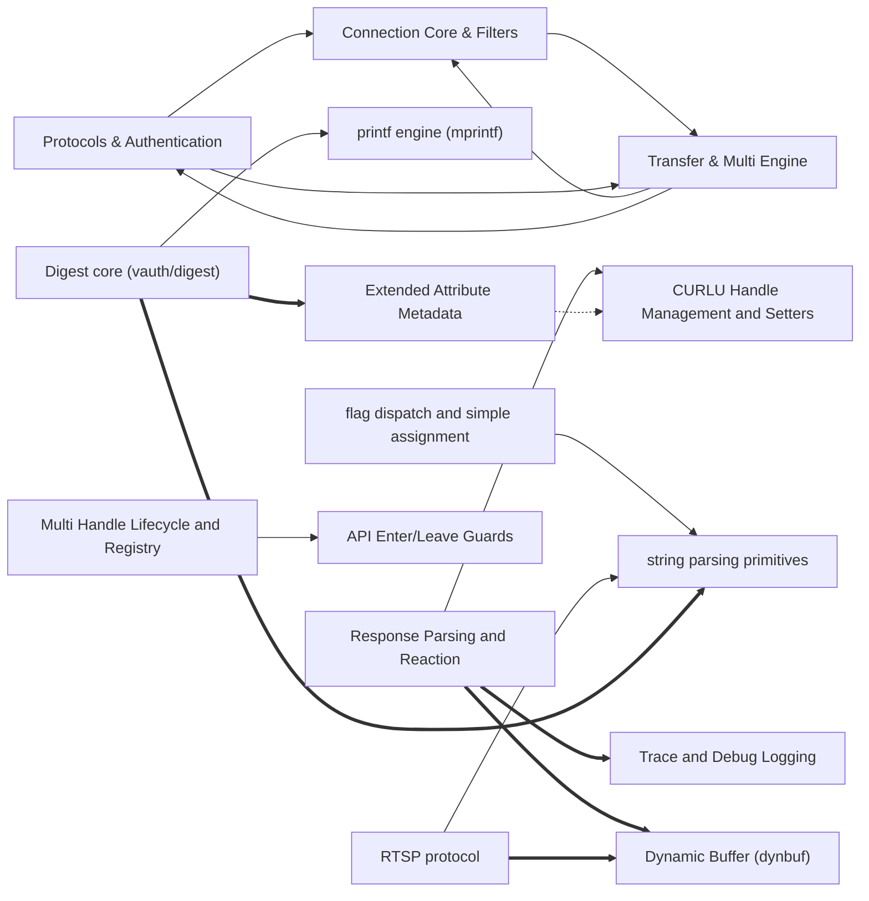

# Codebase Explorer

## How to read this report

Start with the responsibility tree in INDEX. Open a node page for your maintenance question, then choose a unit.
Node pages explain responsibilities. `catalog.json` stores full signatures, source ranges, folded members, relation evidence, and graph edges.
Set `RUN` to the absolute path of this run directory. Find an id, then read its explanation or frozen source.

```sh
cbe find --run-dir "$RUN" --term "SEARCH_TERM"
cbe query --run-dir "$RUN" --id "$ID"
cbe source --run-dir "$RUN" --id "$ID" --context 2
```

`ID` can be a unit id, symbol id, or file path. Commands return the content directly.
`source` reads frozen source and verifies its digest first.
The catalog also stores reverse graph edges, statuses, and raw evidence.

## Responsibility tree

- [curl Codebase](nodes/curl-codebase.md) (0 units)
  - [curl Codebase](nodes/r1-curl-codebase.md) (0 units)
    - [Connection Filter Framework](nodes/r1-connection-filters.md) (1 units)
      - [cf-haproxy-h](nodes/r1-connection-filters.md#u-a54d3b28220d) · Declares the HAProxy connection-filter interface: an insertion helper and the filter type.
      - [Happy Eyeballs IP Filter](nodes/r1-happy-eyeballs-filter.md) (15 units)
        - [cf-ip-happy.c-cf-ai-iter](nodes/r1-happy-eyeballs-filter.md#u-ab6997c6fdd8) · Cursor over resolved DNS addresses of one address family, used to hand out the next candidate address to a connect attempt.
      - [DNS Resolve Connection Filter](nodes/r1-dns-resolve-filter.md) (22 units)
        - [Curl_conn_dns_add_addr_resolve](nodes/r1-dns-resolve-filter.md#u-7de883f36618) · Public wrapper that adds an address-only (A/AAAA) resolve for the peer, masking off any non-address query bits.
    - [Trace and Debug Logging](nodes/r1-trace-logging.md) (22 units)
      - [curl-trc-c-disabled-stubs](nodes/r1-trace-logging.md#u-5004ebbb6b5a) · When CURL_DISABLE_VERBOSE_STRINGS is defined, the entire tracing machinery is replaced by no-op stubs: Curl_trc_init returns CURLE_OK, and Curl_infof, Curl_trc_cf_infof, Curl_trc_multi, Curl_trc_write, Curl_trc_dns, Curl_trc_timer, Curl_trc_read, and the protocol-specific tracers (ftp, smtp, ws, ssh, ssls, under their feature guards) discard all arguments and produce no output and no state changes.
    - [FTP Protocol Implementation](nodes/r1-ftp-protocol.md) (0 units)
      - [FTP Transfer Lifecycle](nodes/r1-ftp-lifecycle.md) (24 units)
        - [Curl_ftp_conns_match](nodes/r1-ftp-lifecycle.md#u-de1465f07e9f) · Connection-reuse compatibility check for FTP.
      - [FTP Login and Response States](nodes/r1-ftp-login-states.md) (17 units)
        - [lib/ftp.c-prequote-states](nodes/r1-ftp-login-states.md#u-9735c61b73c7) · Three thin wrappers that forward to ftp_state_quote with init=TRUE and the corresponding instate: FTP_LIST_PREQUOTE, FTP_RETR_PREQUOTE and FTP_STOR_PREQUOTE.
      - [FTP Transfer Command States](nodes/r1-ftp-transfer-states.md) (35 units)
        - [client_write_header](nodes/r1-ftp-transfer-states.md#u-7986bbe05a8e) · Writes synthesized HTTP-style headers (Content-Length, Last-Modified, Accept-ranges) to the client.
      - [FTP Path and Data-Channel Helpers](nodes/r1-ftp-path-data-helpers.md) (7 units)
        - [lib/ftp.c-ftp-destructors](nodes/r1-ftp-path-data-helpers.md#u-83832c7561d4) · Two metadata destructors.
      - [FTP Wildcard Transfer](nodes/r1-ftp-wildcard-transfer.md) (2 units)
        - [init_wc_data](nodes/r1-ftp-wildcard-transfer.md#u-c9819aa7692a) · Prepares wildcard matching by splitting the URL into directory prefix and trailing pattern.
    - [TLS Configuration Management](nodes/r1-tls-configuration.md) (15 units)
      - [openssl.c-ctx-init](nodes/r1-tls-configuration.md#u-35293302c4e9) · placeholder
    - [Platform and Auth Utilities](nodes/r1-platform-utilities.md) (6 units)
      - [curl-sasl.h-state-and-contract](nodes/r1-platform-utilities.md#u-bff7d9a8b550) · Header defining the SASL vocabulary shared by curl_sasl.c and the IMAP/POP3/SMTP clients.
    - [curl Command-Line Tool](nodes/r1-curl-tool.md) (4 units)
      - [typecheck-gcc-h-warning-functions](nodes/r1-curl-tool.md#u-a9378c7134a8) · Declares all compile-time warning functions via CURLWARNING(id, message), which expands to a static, unused, noinline void function whose body is empty inline assembly and which carries __attribute__((__warning__(message))).
      - [Tool Operation Configuration](nodes/r1-tool-operation-config.md) (3 units)
        - [tool-cfgable-h-global-config](nodes/r1-tool-operation-config.md#u-0ddebfc61157) · On Windows, termout buffers a wide-character output segment (buf plus DWORD len).
      - [--libcurl Code Generation](nodes/r1-libcurl-codegen.md) (15 units)
        - [c_escape](nodes/r1-libcurl-codegen.md#u-1ffc4858605d) · c_escape converts a string into a C-escaped literal body, returning NULL on memory failure.
      - [Windows/DOS Tool Support](nodes/r1-windows-tool-support.md) (17 units)
        - [FindWin32CACert](nodes/r1-windows-tool-support.md#u-5b92e9e3e094) · Searches the Windows SearchPath order (application dir, CWD, system dirs, %PATH%) for a CA bundle and stores its UTF-8 path in config->cacert, freeing any previous value.
      - [Upload Read Callbacks](nodes/r1-stdin-read-callbacks.md) (4 units)
        - [tool_cb_rea-c-module-regions](nodes/r1-stdin-read-callbacks.md#u-9e81b5491269) · Non-behavioral regions of tool_cb_rea.c: license header, platform-conditional includes for select/poll, and includes of tool_cfgable.h, tool_cb_rea.h, tool_operate.h, tool_msgs.h, plus the whole file is guarded by #ifndef _WIN32 for waitfd.
  - [curl source tree](nodes/r4-curl.md) (0 units)
    - [Client data transfer](nodes/r4-client-data-transfer.md) (4 units)
      - [sendf.c-client-teardown](nodes/r4-client-data-transfer.md#u-0ef611c87438) · Static helpers that tear down the client writer and reader stacks.
      - [Upload reader stack](nodes/r4-client-reader-stack.md) (28 units)
        - [sendf.c-cr-buf-support](nodes/r4-client-reader-stack.md#u-ab339709140d) · Non-read operations of the fixed-buffer client reader.
      - [Download writer stack](nodes/r4-client-writer-stack.md) (15 units)
        - [sendf.c-cwriter-defaults](nodes/r4-client-writer-stack.md#u-baa997b379b9) · Default writer callbacks for types adding no processing.
        - [Content-Encoding decoding](nodes/r4-content-encoding-decode.md) (11 units)
          - [content-encoding-c-brotli-handler](nodes/r4-content-encoding-decode.md#u-611e6d640f82) · Implements the 'br' content decoder over BrotliDecoderState.
        - [Pause-buffering writer](nodes/r4-cw-pause-writer.md) (9 units)
          - [cw_pause_buf_create](nodes/r4-cw-pause-writer.md#u-650da3f7ee9e) · Allocates a zeroed cw_pause_buf node via curlx_calloc and stores the write type.
      - [Token-bucket rate limiting](nodes/r4-transfer-rate-limiting.md) (13 units)
        - [ratelimit-c-statics](nodes/r4-transfer-rate-limiting.md#u-359e78725beb) · Static helpers of the token-bucket rate limiter: rlimit_update accrues tokens for elapsed time and caps them by burst, while rlimit_tune_steps pre-scales step duration and per-step rate so the final step of a known-size transfer is small.
    - [Multi socket events](nodes/r4-multi-event.md) (23 units)
      - [multi-ev-pollset-meta-helpers](nodes/r4-multi-event.md#u-679f4a61d16b) · Per-easy/per-connection pollset storage helpers.
    - [Generic hash and list containers](nodes/r4-generic-containers.md) (29 units)
      - [Curl_hash_add2](nodes/r4-generic-containers.md#u-8441449b9d19) · Inserts or replaces a value for a key with an optional per-element destructor.
    - [Asynchronous name resolution](nodes/r4-name-resolution.md) (23 units)
      - [curl_addrinfo.h module code (L1–L51)](nodes/r4-name-resolution.md#u-58e577bf5703) · Header guard, license, platform includes, and forward declaration.
    - [TLS and QUIC connections](nodes/r4-tls-quic.md) (0 units)
      - [Schannel TLS backend](nodes/r4-schannel-tls.md) (1 units)
        - [schannel.c-backend-struct](nodes/r4-schannel-tls.md#u-284e1016f28e) · The trailing region defines Curl_ssl_schannel, the backend vtable wiring every function in this file to the generic TLS layer, advertising support for certinfo, CAINFO blob, pinned public key, CA caching, HTTPS proxy, and cipher lists, with NULL slots for engines, channel binding, and close_all.
        - [Schannel handshake and credentials](nodes/r4-schannel-handshake.md) (19 units)
          - [schannel.c-algo-table](nodes/r4-schannel-handshake.md#u-d55606af8257) · The CIPHEROPTION-driven algs[] lookup table and its struct algo entry type, mapping algorithm name strings to CryptoAPI ALG_ID values; conditional entries (CALG_ECMQV, CALG_ECDH_EPHEM) appear only when the SDK defines them, and a NULL terminator ends the table.
        - [Schannel record I/O](nodes/r4-schannel-record-io.md) (8 units)
          - [schannel.c-renegotiation-decls](nodes/r4-schannel-record-io.md#u-f1fc6266a96a) · The schannel_renegotiate_caller_t enum distinguishing recv-initiated from send-initiated renegotiation, the MAX_RENEG_BLOCK_TIME constant (60 seconds in milliseconds), and its explanatory comment about DecryptMessage returning SEC_I_RENEGOTIATE.
        - [Schannel certificates and caching](nodes/r4-schannel-certs-cache.md) (6 units)
          - [schannel.c-certinfo-support](nodes/r4-schannel-certs-cache.md#u-761fa9168afc) · Residual declarations around the certificate-traversal helpers: the Read_crt_func callback typedef and the Adder_args struct carrying the Curl_easy pointer, current index, total count, and first error for add_cert_to_certinfo.
      - [QUIC/HTTP3 proxy filter stack](nodes/r4-quic-proxy-stack.md) (4 units)
        - [cf-capsule-h](nodes/r4-quic-proxy-stack.md#u-bfb4dcf0ac9b) · Declares the capsule connection-filter factory.
        - [H3 proxy connection filter](nodes/r4-quic-connection-filter.md) (13 units)
          - [cf-ngtcp2-proxy-cft-vtable](nodes/r4-quic-connection-filter.md#u-235a696250d8) · The Curl_cftype instance 'H3-PROXY' for this filter, typed IP_CONNECT|PROXY|SSL at log level NONE.
        - [HTTP/3 CONNECT tunnel](nodes/r4-h3-proxy-tunnel.md) (21 units)
          - [cf-ngtcp2-proxy-h3-callbacks-table](nodes/r4-h3-proxy-tunnel.md#u-c82dfb0ca0cb) · Static nghttp3_callbacks instance wiring the tunnel callbacks: acked data, stream close, recv data, deferred consume, recv header, end headers (also as trailer end), stop sending, and reset stream; begin_headers, begin/end_trailers, end_stream, shutdown, and settings callbacks are NULL, so those nghttp3 events carry no action here.
    - [Authentication and crypto primitives](nodes/r4-auth-crypto.md) (0 units)
      - [GSSAPI wrapper and debug stub](nodes/r4-gssapi-wrapper.md) (17 units)
        - [lib-curl-gssapi-stub-types](nodes/r4-gssapi-wrapper.md#u-4ede8ee6790e) · Type definitions used only by the CURL_GSS_STUB debug implementation.
      - [Kerberos V5 GSSAPI auth](nodes/r4-krb5-gssapi-auth.md) (9 units)
        - [Curl_auth_cleanup_gssapi](nodes/r4-krb5-gssapi-auth.md#u-033e177d6f8c) · Releases the Kerberos V5 GSSAPI state: deletes the security context and releases the SPN name, resetting both to their GSS empty sentinels.
      - [MD4 digest backends](nodes/r4-md4-digest.md) (8 units)
        - [md4-commoncrypto-backend](nodes/r4-md4-digest.md#u-3e2e4d27e9c6) · CommonCrypto-backed MD4 primitives for Apple builds matching the macOS or iOS version ranges in the surrounding preprocessor condition.
      - [Ed25519 signing](nodes/r4-ed25519-signing.md) (5 units)
        - [curl-ed25519-gnutls](nodes/r4-ed25519-signing.md#u-a7335a5890e7) · GnuTLS/nettle variant.
    - [Protocol module interfaces](nodes/r4-protocol-interfaces.md) (1 units)
      - [ws.h module code (L1–L44)](nodes/r4-protocol-interfaces.md#u-e3bd20a1b617) · Declares the WebSocket protocol entry points for curl's HTTP stack.
      - [FTP state and wildcard interface](nodes/r4-ftp-protocol-state.md) (7 units)
        - [ftplistparser-h-ftp-parser-and-wildcard-interface](nodes/r4-ftp-protocol-state.md#u-832049bb4d14) · Declares the FTP directory-listing parser and wildcard-download interface.
    - [Portable utilities and platform shims](nodes/r4-portable-utils.md) (6 units)
      - [warnless-h-conversion-helpers](nodes/r4-portable-utils.md#u-f4727a9d0d02) · Header of warning-suppressing numeric conversion helpers plus a function-cast macro.
      - [Base64 codec](nodes/r4-base64-codec.md) (5 units)
        - [base64-h-interfaces](nodes/r4-base64-codec.md#u-5a5d1f7c650e) · Header declaring base64 encoding/decoding entry points: curlx_base64_encode, curlx_base64url_encode (URL-safe alphabet), and curlx_base64_decode, each taking an input buffer and returning a CURLcode with outputs via out pointer and length.
      - [Address to text formatting](nodes/r4-address-formatting.md) (3 units)
        - [curlx_inet_ntop](nodes/r4-address-formatting.md#u-4a1e424cecdf) · Converts a network-format address to presentation text by address family: AF_INET forwards to inet_ntop4, AF_INET6 to inet_ntop6, returning that function's CURLcode unchanged.
      - [Windows API helpers](nodes/r4-windows-helpers.md) (3 units)
        - [curlx_get_winapi_error](nodes/r4-windows-helpers.md#u-00f29fa5f988) · Converts a Windows API error code (GetLastError-style) into a message in a caller buffer, returning the buffer pointer or NULL when no message exists.
    - [Public API headers and build config](nodes/r4-public-api-config.md) (5 units)
      - [curlver-h-version-macros](nodes/r4-public-api-config.md#u-45c8b7ea3c9c) · Defines libcurl release-version constants and comparison macros in a script-generated header.
    - [Command-line tool support](nodes/r4-command-line-tool.md) (4 units)
      - [tool-operate-h-per-transfer](nodes/r4-command-line-tool.md#u-59db547b7116) · per_transfer is the per-transfer runtime record used as userdata by callbacks (e.g. tool_header_cb, tool_seek_cb).
  - [Connection Core & Filters](nodes/connection-core.md) (0 units)
    - [curl Library and Tool](nodes/r5-curl-codebase.md) (0 units)
      - [Connection Name Resolution](nodes/r5-connection-resolution.md) (0 units)
        - [Addrinfo Conversion Helpers](nodes/r5-addrinfo-core.md) (14 units)
          - [curl_addrinfo-module-regions](nodes/r5-addrinfo-core.md#u-4218febd7dcf) · Non-behavioral regions of curl_addrinfo.c: the license header, conditional system includes, the vqualifier macro selecting volatile only for the icc 9.1 optimizer workaround, and feature-conditional compilation guards around individual functions.
        - [Async DNS Resolver](nodes/r5-dns-resolver.md) (31 units)
          - [hostip.c-https-helpers](nodes/r5-dns-resolver.md#u-b93d8516ec19) · Three HTTPS-record helpers over the async resolve state.
      - [Event and Concurrency Infrastructure](nodes/r5-async-event-infrastructure.md) (0 units)
        - [Polling and Pollsets](nodes/r5-poll-waiting.md) (30 units)
          - [Curl_poll](nodes/r5-poll-waiting.md#u-23ac2d5b40d4) · Polls ufds for timeout_ms, using poll() when available and select() otherwise; returns -1 on error, 0 on timeout, or the count of entries with nonzero revents.
        - [Wakeup Socket Pair](nodes/r5-wakeup-pair.md) (8 units)
          - [Curl_wakeup_consume](nodes/r5-wakeup-pair.md#u-206f56c660d8) · Drains pending wakeup data from socks[0] in 64-byte reads.
        - [Splay Tree and Timeouts](nodes/r5-splay-timeouts.md) (6 units)
          - [Curl_timeouts_next_ms](nodes/r5-splay-timeouts.md#u-0fc50fc76810) · Reports the next pending timeout in milliseconds, updating the tree in place and writing side-channel outputs.
        - [Thread and Condition Primitives](nodes/r5-thread-primitives.md) (17 units)
          - [Curl_cond_signal](nodes/r5-thread-primitives.md#u-32fec0c11c29) · Windows condition-variable signal: forwards to WakeConditionVariable; the CONDITION_VARIABLE API has no failure report, so the function is void and cannot fail observably.
      - [Easy Handle API and Transfer Info](nodes/r5-easy-handle-api.md) (17 units)
        - [easy-h](nodes/r5-easy-handle-api.md#u-1697244ca3a2) · Declares the libcurl easy (single-session) API: a POD for binary blobs plus extern prototypes for creating, configuring, driving, inspecting, cloning, resetting, and tearing down CURL handles; no runtime bodies here.
      - [Protocol and Filter Implementations](nodes/r5-protocol-implementations.md) (0 units)
        - [DICT Protocol](nodes/r5-dict-protocol.md) (4 units)
          - [dict_do](nodes/r5-dict-protocol.md#u-ffd161c5d44f) · Builds and sends a DICT protocol request derived from the URL path, selecting MATCH, DEFINE, or free-form command modes, then arms the receive path; always sets done TRUE.
        - [TFTP Protocol](nodes/r5-tftp-protocol.md) (22 units)
          - [tftp.c-packet-accessors](nodes/r5-tftp-protocol.md#u-1f8e84abd5a0) · Tiny helpers encode and decode the four header bytes of a TFTP packet and parse option strings inside a received packet.
        - [LDAP Protocol \(OpenLDAP\)](nodes/r5-ldap-protocol.md) (29 units)
          - [openldap-c-ldapsb-tls-io](nodes/r5-ldap-protocol.md#u-9d4f98deffaf) · Sockbuf IO layer plugging libcurl's send/recv handlers into OpenLDAP's Sockbuf so OpenLDAP-driven TLS runs over libcurl filters.
        - [HAProxy PROXY Filter](nodes/r5-haproxy-filter.md) (14 units)
          - [lib/cf-haproxy.c:<enum>](nodes/r5-haproxy-filter.md#u-e1c48496acdc) · Filter state machine values: HAPROXY_INIT (no header built), HAPROXY_SEND (header partially sent), HAPROXY_DONE (all work complete).
        - [HTTP Message Signatures \(RFC 9421\)](nodes/r5-http-message-signatures.md) (13 units)
          - [Curl_output_httpsig](nodes/r5-http-message-signatures.md#u-2a0767884055) · Produces the RFC 9421 Signature and Signature-Input headers for an outgoing request, storing them in data->req.hd_auth and marking host auth done.
        - [Internal Protocol Declarations](nodes/r5-protocol-headers.md) (11 units)
          - [formdata.h-FormInfo-struct](nodes/r5-protocol-headers.md#u-bcc5b29c4f8f) · Temporary per-form storage used while parsing curl_formadd options.
      - [TLS Session Cache](nodes/r5-tls-session-cache.md) (29 units)
        - [vtls_scache-export](nodes/r5-tls-session-cache.md#u-332701712a46) · Session-ticket export/import under USE_SSLS_EXPORT: per-peer salt+HMAC generation, HMAC-based peer lookup, ticket unpack/add on import, and iteration of exportable peers calling the user export callback.
      - [curl Command-Line Tool](nodes/r5-command-line-tool.md) (0 units)
        - [Tool Messaging and Parameter Helpers](nodes/r5-tool-messaging.md) (9 units)
          - [tool_msgs-c-module-regions](nodes/r5-tool-messaging.md#u-c59223ee2807) · Non-behavioral regions of tool_msgs.c: license header, includes, and the WARN_PREFIX/NOTE_PREFIX/ERROR_PREFIX macro definitions.
        - [Tool Transfer Callbacks](nodes/r5-tool-callbacks.md) (8 units)
          - [tool_cb_prg-h-progress-data-and-constants](nodes/r5-tool-callbacks.md#u-fba9ff8c0baf) · Header for the curl tool's progress-bar callback.
        - [Tool Output Directories and SSL Sessions](nodes/r5-tool-output.md) (13 units)
          - [tool-dirhie-c-unittest-mkdir-hooks](nodes/r5-tool-output.md#u-c44876498bad) · Unit-test shims for directory creation: under UNITTESTS, toolx_mkdir maps to a recorder that appends each directory name plus "|" to a static dynbuf and returns -1 on failure or NULL dir, while create_dir_hierarchy_trace_dynres exposes that dynbuf to tests; without UNITTESTS toolx_mkdir maps directly to curlx_mkdir.
    - [curl codebase](nodes/r7-curl-codebase.md) (0 units)
      - [Platform build configuration](nodes/r7-platform-build-config.md) (6 units)
        - [curl_setup-h-platform-configuration](nodes/r7-platform-build-config.md#u-e259768b37df) · Build-time configuration header that normalizes platform, compiler, and feature differences for the whole libcurl library before any code is compiled.
      - [Public API and option contracts](nodes/r7-public-api-contracts.md) (10 units)
        - [multi-h](nodes/r7-public-api-contracts.md#u-dc584fa25c82) · Declares the libcurl multi (pull-style, many-transfers) API.
      - [Shared infrastructure utilities](nodes/r7-shared-infra.md) (0 units)
        - [String escaping and encoding](nodes/r7-string-escape-utils.md) (9 units)
          - [Curl_hexbyte](nodes/r7-string-escape-utils.md#u-dfd3e53b2fbc) · Writes one byte as exactly two uppercase hex characters into dest, using Curl_udigits for each nibble; dest must have room for two bytes and no terminator is added.
        - [Filename pattern matching](nodes/r7-fnmatch-pattern.md) (9 units)
          - [curl_fnmatch-c-preprocessor-blocks](nodes/r7-fnmatch-pattern.md#u-3452178878d0) · Preprocessor region of the fallback fnmatch implementation.
        - [SHA-512/256 hashing](nodes/r7-sha512-256.md) (14 units)
          - [lib-curl_sha512_256-backend-dispatch](nodes/r7-sha512-256.md#u-57e69fc65d16) · Selects one SHA-512/256 backend at compile time in priority order OpenSSL, wolfSSL, GnuTLS, then a bundled FIPS 180-4 implementation.
        - [Internationalized domain names](nodes/r7-idn-hostnames.md) (13 units)
          - [Curl_idn_decode](nodes/r7-idn-hostnames.md#u-aea0f67ab7d1) · Public wrapper decoding an A-label hostname to Unicode, returning an allocated string or NULL on error.
        - [Memory and socket debug tracing](nodes/r7-memdebug-tracing.md) (28 units)
          - [countcheck](nodes/r7-memdebug-tracing.md#u-91fc7ec03b23) · Gate checked by every traced allocator; returns TRUE when the simulated allocation limit is exhausted, FALSE to proceed.
        - [Buffered receive connection filter](nodes/r7-recvbuf-filter.md) (6 units)
          - [cf-recvbuf-c-filter-table-and-region](nodes/r7-recvbuf-filter.md#u-8ec7d310b715) · Module scaffolding.
        - [Legacy HTTP form \(multipart\) API](nodes/r7-httppost-form.md) (16 units)
          - [Curl_getformdata](nodes/r7-httppost-form.md#u-9ad0bce2d42b) · Converts an HttpPost chain into a mime structure under *finalform.
      - [Connection and credential core](nodes/r7-conn-core.md) (0 units)
        - [Refcounted credential store](nodes/r7-credential-store.md) (8 units)
          - [creds-h-struct-and-macros](nodes/r7-credential-store.md#u-299deff85f99) · Defines the shared, refcounted credential representation and its accessors.
        - [Easy handle lifecycle](nodes/r7-easy-handle-lifecycle.md) (10 units)
          - [Curl_1st_fatal](nodes/r7-easy-handle-lifecycle.md#u-cc0f1c461c52) · Chooses the first fatal error of two CURLcodes: a non-NULL error other than CURLE_AGAIN is fatal.
        - [Transfer URL and credential resolution](nodes/r7-url-and-credentials.md) (9 units)
          - [Curl_parse_login_details](nodes/r7-url-and-credentials.md#u-f6421ec70808) · Splits a login string of the given length into user, password and options parts separated by ':' and ';', supporting all orderings of the separators (user, user:password, user:password;options, user;options, user;options:password, :password, :password;options, ;options, ;options:password).
        - [Connection pool: find, match, create](nodes/r7-connection-pool.md) (13 units)
          - [url.c-conn-match-predicates](nodes/r7-connection-pool.md#u-d8a0809d8bee) · Connection-reuse predicates that individually test whether a pooled connection can serve a new transfer described by a 'needle', given the shared url_conn_match context (data, needle, timestamp, ssl/proxy ssl configs and flag bits).
        - [Connection metadata and scheme descriptors](nodes/r7-connection-metadata.md) (9 units)
          - [Curl_protocol](nodes/r7-connection-metadata.md#u-db0cbc6d24eb) · Declares the vtable of callback entry points a protocol implementation must (or may) provide; each URI scheme's ->run points at a const instance.
        - [Proxy resolution and NO\_PROXY](nodes/r7-proxy-resolution.md) (9 units)
          - [Curl_proxy_init_conn](nodes/r7-proxy-resolution.md#u-fbd4dde38f2e) · Initializes proxy state for a connection: decides whether any proxy applies and populates conn->socks_proxy and conn->http_proxy.
      - [SMTP protocol engine](nodes/r7-smtp-protocol.md) (27 units)
        - [pingpong](nodes/r7-smtp-protocol.md#u-1593f70aa971) · Holds the per-connection pingpong conversation state shared by FTP, IMAP, POP3 and SMTP.
      - [Command-line tool](nodes/r7-tool-cli.md) (0 units)
        - [Transfer preparation](nodes/r7-tool-transfer-prep.md) (22 units)
          - [add_per_transfer](nodes/r7-tool-transfer-prep.md#u-e987c4e2ea53) · Appends a zeroed per_transfer node to the module-level doubly linked list (transfers/transfersl): on first entry both head and tail point to it, otherwise it links after the tail.
        - [Transfer execution and retry](nodes/r7-tool-execution.md) (19 units)
          - [operate](nodes/r7-tool-execution.md#u-473cd07837bf) · Main entry point.
        - [libuv event-loop driver](nodes/r7-tool-libuv-driver.md) (10 units)
          - [contextuv](nodes/r7-tool-libuv-driver.md#u-1eefa0abddd3) · libuv debug-build per-socket context: the uv poll handle, the socket it watches, and a back-pointer to the datauv state.
        - [Tool platform support](nodes/r7-tool-platform-support.md) (6 units)
          - [src/tool_operate.c:VmsSpecialSize](nodes/r7-tool-platform-support.md#u-53b42f2e5751) · VMS-only: for variable-record formats (FAB$C_VAR/VFC) whose st_size is unreliable it returns vms_realfilesize(name); otherwise the stat st_size.
        - [Tool environment and libcurl info](nodes/r7-tool-support.md) (4 units)
          - [findfile](nodes/r7-tool-support.md#u-6b92e249f0be) · Locates a config-style file by searching home directories from environment variables in conf_list order, returning the first existing path (caller frees with curl_free) or NULL.
    - [curl Codebase](nodes/r8-curl-codebase.md) (0 units)
      - [Connection Filter Core](nodes/r8-conn-filter-core.md) (0 units)
        - [Filter Chain Lifecycle](nodes/r8-cfilters-chain-mgmt.md) (12 units)
          - [lib-cfilters-c-chain-management](nodes/r8-cfilters-chain-mgmt.md#u-f10f9ecb03f8) · Maintain doubly-reachable filter chains anchored at conn->cfilter[sockindex].
        - [Filter I/O Dispatch](nodes/r8-cfilters-io.md) (5 units)
          - [lib-cfilters-c-dispatch-wrappers](nodes/r8-cfilters-io.md#u-4223d3ac73f1) · Invoke one filter's connect/send/recv operation with a NULL guard.
        - [Filter Events, State and Queries](nodes/r8-cfilters-events-state.md) (12 units)
          - [lib-cfilters-c-chain-state-queries](nodes/r8-cfilters-events-state.md#u-b752791790cf) · Answer connection-state questions by inspecting filter chains.
      - [Asynchronous Connection Shutdown](nodes/r8-conn-shutdown.md) (12 units)
        - [cshutdn.c-add](nodes/r8-conn-shutdown.md#u-649ff17c65cb) · Enqueue a connection for asynchronous shutdown.
      - [Proxy Tunneling](nodes/r8-proxy-tunneling.md) (0 units)
        - [HTTP/HTTPS Proxy Filter](nodes/r8-http-proxy-filter.md) (13 units)
          - [Curl_cf_http_proxy_insert_after](nodes/r8-http-proxy-filter.md#u-9906cddf885b) · Creates and inserts an HTTP-PROXY filter after cf_at.
        - [SOCKS Proxy Filter](nodes/r8-socks-proxy-filter.md) (0 units)
          - [SOCKS4/5 Handshake State Machine](nodes/r8-socks-handshake.md) (26 units)
            - [socks_state_t](nodes/r8-socks-handshake.md#u-247f2e542a85) · Defines the SOCKS handshake state machine states shared by the SOCKS4 and SOCKS5 filters: INIT, per-version START/RESOLVING/SEND/RECV stages plus SOCKS5 auth and request stages, and terminal SUCCESS and FAILED states.
          - [SOCKS Filter Wiring](nodes/r8-socks-filter-wiring.md) (11 units)
            - [Curl_cf_socks_proxy_insert_after](nodes/r8-socks-filter-wiring.md#u-53c09c3f7ba2) · Creates and inserts a SOCKS proxy connection filter after cf_at for the given destination, credentials, and proxy type.
      - [QUIC via ngtcp2](nodes/r8-quic-ngtcp2.md) (0 units)
        - [QUIC Connection Lifecycle](nodes/r8-ngtcp2-conn-lifecycle.md) (15 units)
          - [Curl_cf_ngtcp2_ctx_init](nodes/r8-ngtcp2-conn-lifecycle.md#u-fbeb99efcf14) · Initializes a QUIC connection filter context.
        - [QUIC Packet Ingress/Egress](nodes/r8-ngtcp2-packet-io.md) (6 units)
          - [Curl_cf_ngtcp2_progress_ingress](nodes/r8-ngtcp2-packet-io.md#u-902c04ea16f7) · Reads and processes incoming QUIC packets, from a direct UDP socket or a tunnel.
        - [HTTP/3 Stream Management](nodes/r8-ngtcp2-h3-streams.md) (10 units)
          - [Curl_cf_ngtcp2_h3_init_ctrls](nodes/r8-ngtcp2-h3-streams.md#u-0f5296e113b1) · Opens and binds the HTTP/3 mandatory unidirectional streams.
        - [ngtcp2 Event Callbacks](nodes/r8-ngtcp2-event-callbacks.md) (13 units)
          - [cb_acked_stream_data_offset](nodes/r8-ngtcp2-event-callbacks.md#u-8c3bc4406a79) · ngtcp2 callback notifying nghttp3 that stream data was acknowledged.
        - [QUIC Errors, TLS Sessions and Diagnostics](nodes/r8-ngtcp2-errors-tls.md) (11 units)
          - [Curl_cf_ngtcp2_cmn_err_set](nodes/r8-ngtcp2-errors-tls.md#u-5cbaff237170) · Records an ngtcp2-level error in the connection's last_error, first-writer wins.
      - [HTTP Datagram Capsules](nodes/r8-http-datagram-capsules.md) (7 units)
        - [Curl_capsule_encap_udp_datagram](nodes/r8-http-datagram-capsules.md#u-3d10c43d5bf7) · Appends a complete UDP datagram capsule (header + payload) to a send bufq.
      - [HTTP Headers Store and API](nodes/r8-http-headers-api.md) (12 units)
        - [Curl_headers_init](nodes/r8-http-headers-api.md#u-460b65c6d47a) · Installs the 'hds-collect' client writer so header data flowing through the transfer is captured.
      - [Authentication \(vauth\)](nodes/r8-authentication.md) (0 units)
        - [Auth Core Helpers](nodes/r8-auth-core.md) (6 units)
          - [vauth.c-conn-meta-helpers](nodes/r8-auth-core.md#u-e80142ce45ab) · Connection-scoped authentication state helpers for NTLM, Kerberos5, GSASL and SPNEGO, all following the same pattern.
        - [SSPI DIGEST](nodes/r8-auth-sspi-digest.md) (6 units)
          - [lib/vauth/digest_sspi.c:Curl_auth_is_digest_supported](nodes/r8-auth-sspi-digest.md#u-0c7085980362) · Probes whether the Windows SSPI Digest package is available.
        - [SSPI NTLM](nodes/r8-auth-sspi-ntlm.md) (5 units)
          - [lib/vauth/ntlm_sspi.c:Curl_auth_is_ntlm_supported](nodes/r8-auth-sspi-ntlm.md#u-7ad8b69acd4a) · Reports whether the Windows SSPI security library exposes an NTLM package.
      - [netrc Credentials](nodes/r8-netrc-credentials.md) (2 units)
        - [curl_getenv](nodes/r8-netrc-credentials.md#u-88fda3b63c5f) · Reads an environment variable and returns its value as a heap-allocated string, or NULL when unset or empty.
        - [netrc Lexer](nodes/r8-netrc-lexer.md) (4 units)
          - [netrc.c-lexer-support](nodes/r8-netrc-lexer.md#u-dbed5d3def58) · Lexer state and helpers.
        - [netrc Scanner and File Loading](nodes/r8-netrc-scanner.md) (14 units)
          - [netrc.c-scanner-support](nodes/r8-netrc-scanner.md#u-8e9ca673aced) · Scanner state and lifecycle.
      - [Host Address Resolution](nodes/r8-host-resolution.md) (5 units)
        - [lib/vdns/hostip6.c:Curl_sync_getaddrinfo](nodes/r8-host-resolution.md#u-4a9844b248d0) · Resolves a hostname synchronously via the system getaddrinfo for IPv6-enabled, synchronous (non-threaded, non-ares) builds, returning a Curl_addrinfo list that the caller must free with Curl_freeaddrinfo.
      - [Command-Line Tool Output](nodes/r8-tooling.md) (0 units)
        - [Tool Header Callback](nodes/r8-tool-header-callback.md) (9 units)
          - [tool-cb-hdr-c-residuals](nodes/r8-tool-header-callback.md#u-a6f245cd477f) · Non-behavioral regions of tool_cb_hdr.c: the license header and includes, the BOLD/BOLDOFF/LINK escape-sequence macros (Windows defines BOLDOFF as \x1b[22m elsewhere-style differences; non-Windows uses \x1b[0m and defines OSC 8 hyperlink macros that gate write_linked_location), and small separators between functions.
        - [--write-out Expansion](nodes/r8-tool-writeout.md) (15 units)
          - [tool_writeout.c module code (L1–L29)](nodes/r8-tool-writeout.md#u-88ac54d4cadf) · Include prelude of tool_writeout.c pulling in tool_cfgable.h, tool_writeout.h and tool_writeout_json.h; non-behavioral.
        - [Tool Platform Utilities](nodes/r8-tool-platform-util.md) (7 units)
          - [tvrealnow](nodes/r8-tool-platform-util.md#u-5c50ce1c44a3) · Windows implementation returning the real wall-clock time as a struct timeval.
      - [Core Utilities and Portability](nodes/r8-core-utilities.md) (0 units)
        - [Poll/Select and Waiting](nodes/r8-poll-wait-api.md) (10 units)
          - [select.h module code (L1–L46)](nodes/r8-poll-wait-api.md#u-979ce3b20d38) · Header guard, includes, and conditional definitions of poll constants and struct pollfd for platforms lacking them; POLLRDNORM/POLLWRNORM/POLLRDBAND fall back to POLLIN/POLLOUT/POLLPRI when undefined.
        - [Container Types](nodes/r8-container-types.md) (14 units)
          - [hash.h module code (L1–L33)](nodes/r8-container-types.md#u-1bb3a0849a4f) · Include guard and curl_setup.h include.
        - [Public Header Portability](nodes/r8-portable-headers.md) (6 units)
          - [system-h](nodes/r8-portable-headers.md#u-b93e4a8c778e) · Fixes the platform-dependent typedefs curl_off_t and curl_socklen_t purely via preprocessor dispatch.
  - [Transfer & Multi Engine](nodes/transfer-engine.md) (0 units)
    - [libcurl Transfer Runtime](nodes/r2-libcurl-runtime.md) (0 units)
      - [Buffer Queue Model](nodes/r2-bufq-buffer-queues.md) (1 units)
        - [bufq-h-types-and-options](nodes/r2-bufq-buffer-queues.md#u-38643227279d) · Header defining the bufq data model.
      - [Connection Filter Protocol Stacks](nodes/r2-protocol-filters.md) (1 units)
        - [cf-h1-proxy.h module code (L1–L43)](nodes/r2-protocol-filters.md#u-5d6affd67752) · Header declaring the H1-PROXY connect filter API: the Curl_cf_h1_proxy_insert_after function and the extern Curl_cft_h1_proxy type table, guarded by the proxy/HTTP disable macros.
        - [ngtcp2 QUIC Filter Declaration](nodes/r2-cf-ngtcp2-decl.md) (1 units)
          - [cf-ngtcp2-h](nodes/r2-cf-ngtcp2-decl.md#u-5c0159624a1b) · Declares the ngtcp2 QUIC connection-filter factories, active when HTTP is enabled and both USE_NGTCP2 and USE_NGHTTP3 are defined.
        - [HTTP/2 Connection Filter \(nghttp2\)](nodes/r2-h2-connection-filter.md) (0 units)
          - [H2 Session & Window Management](nodes/r2-h2-session-lifecycle.md) (20 units)
            - [http2.c-nghttp2-mem](nodes/r2-h2-session-lifecycle.md#u-54939eb3638f) · Memory allocator adapters handed to nghttp2 as a custom nghttp2_mem set.
          - [H2 Frame Event Handling](nodes/r2-h2-frame-processing.md) (17 units)
            - [on_frame_recv](nodes/r2-h2-frame-processing.md#u-f61b4f47df6c) · nghttp2 frame-received callback.
          - [H2 Per-Stream Data Flow](nodes/r2-h2-stream-xfer.md) (13 units)
            - [h2_stream_ctx](nodes/r2-h2-stream-xfer.md#u-805bd4cef358) · Per-stream HTTP/2 state: request sendbuf and h1 request parser, response trailers and header byte count, owning transfer id/mid, received DATA counter, push-header array bookkeeping, the h2 stream id, stream error code, transfer write result, local receive window, status code, and flags for complete response headers, closed/reset/reset_by_server, close already handled, body started, entire body queued, and write pause.
          - [H2 Filter Vtable, Upgrade & Push](nodes/r2-h2-filter-upgrade.md) (24 units)
            - [cf_h2_ctx](nodes/r2-h2-filter-upgrade.md#u-e3ed9d1e22b4) · Per-connection filter context holding the nghttp2 client session and its I/O buffers.
        - [HTTP/2 Proxy CONNECT Tunnel](nodes/r2-h2-proxy-connect.md) (0 units)
          - [CONNECT Tunnel State Machine](nodes/r2-h2-proxy-tunnel.md) (17 units)
            - [lib/cf-h2-proxy.c:<enum>](nodes/r2-h2-proxy-tunnel.md#u-7c9acefeaf6b) · Declares the h2_tunnel_state enum (INIT, CONNECT, RESPONSE, ESTABLISHED, FAILED) driving the CONNECT lifecycle, and struct tunnel_stream holding the response, recv/send buffer queues, authority string, stream id, error code, state, and flags for final response, closed, and reset.
          - [H2-PROXY Filter & Session Plumbing](nodes/r2-h2-proxy-filter.md) (29 units)
            - [cf-h2-proxy.c module code (L1–L58)](nodes/r2-h2-proxy-filter.md#u-bff8fa227557) · Preprocessor-gated compilation unit for the HTTP/2 proxy CONNECT filter, active only when HTTP, proxy support, and nghttp2 are enabled.
        - [Quiche H3 Connection Lifecycle](nodes/r2-quiche-connection.md) (10 units)
          - [cf-quiche.c-ctx-lifecycle](nodes/r2-quiche-connection.md#u-5d1b8ed9a8f6) · Manages the lifetime of the quiche connection-filter context and its per-stream records.
        - [Quiche H3 Transfer I/O](nodes/r2-quiche-transfer-io.md) (15 units)
          - [cf-quiche.c-body-receive](nodes/r2-quiche-transfer-io.md#u-f761d2d13850) · Moves HTTP/3 response body data from quiche into the transfer.
      - [mbedTLS vTLS Backend](nodes/r2-tls-mbedtls.md) (0 units)
        - [mbedTLS Handshake & Session](nodes/r2-mbedtls-handshake.md) (27 units)
          - [mbed_ssl_backend_data](nodes/r2-mbedtls-handshake.md#u-45f3f1a98555) · Per-connection mbedTLS backend state, allocated by the backend factory size.
        - [mbedTLS Credentials & Verification](nodes/r2-mbedtls-certs.md) (7 units)
          - [mbed_load_cacert](nodes/r2-mbedtls-certs.md#u-d1c88e34358e) · Loads CA material into backend->cacert for peer verification.
      - [MIME Multipart Engine](nodes/r2-mime-engine.md) (0 units)
        - [MIME Assembly API](nodes/r2-mime-api.md) (24 units)
          - [mime.c-string-setters](nodes/r2-mime-api.md#u-b91d12f78915) · Setters that copy a string field into a part.
        - [MIME Readback & Encoders](nodes/r2-mime-readback.md) (19 units)
          - [mime.c-encoders-simple](nodes/r2-mime-readback.md#u-45862d7539a4) · Encoder-state reset and the trivial content encoders.
        - [MIME Client Reader](nodes/r2-mime-creader.md) (2 units)
          - [mime.c-creader-mime](nodes/r2-mime-creader.md#u-606837eedc32) · Client-reader wrapper presenting a mime structure through the Curl_creader interface.
      - [Client Write Buffering \(cw-out\)](nodes/r2-cw-out-writer.md) (20 units)
        - [cw-out.c module code (L1–L66)](nodes/r2-cw-out-writer.md#u-59901fd19430) · Holds the includes plus the OVERALL DESIGN comment: the cw-out writer is the last writer in a transfer's stack, delivering BODY and HEADER bytes to client callbacks, buffering on callback PAUSE with replay on unpause, and capping buffered bytes at DYN_PAUSE_BUFFER with CURLE_TOO_LARGE.
      - [Easy Handle Option Setting](nodes/r2-easy-setopt.md) (0 units)
        - [Setopt Dispatch & Storage](nodes/r2-setopt-core.md) (15 units)
          - [Curl_setstropt](nodes/r2-setopt-core.md#u-82b62740d48c) · Stores a string option into the easy handle's string set, validating length before storage.
        - [Setopt Domain Handlers](nodes/r2-setopt-domains.md) (29 units)
          - [cookiefile](nodes/r2-setopt-domains.md#u-fae53546d861) · Manages the list of cookie filenames to read later, and clears the cookie engine when given NULL.
      - [Tracing & Logging](nodes/r2-tracing.md) (3 units)
        - [curl_trc.h module code (L1–L98)](nodes/r2-tracing.md#u-f5dc47baad97) · Declarations of the tracing subsystem: Curl_trc_init, Curl_trc_opt (comma-separated case-insensitive component names, 'all', +/- en/disable prefixes; later calls may not take effect), Curl_debug, failf/Curl_failf and Curl_reset_fail, info-style loggers per component, log level macros, and the trailing extern declarations for feature objects guarded by build macros.
      - [Tool-Side Diagnostics & Config](nodes/r2-tool-side.md) (6 units)
        - [config2setopts.h module code (L1–L32)](nodes/r2-tool-side.md#u-e9686c7384df) · Header guard and declaration of config2setopts, which converts parsed OperationConfig state into libcurl options on a per-transfer handle given the easy handle and share object.
    - [curl Codebase](nodes/r10-curl-source.md) (1 units)
      - [tool_sdecls.h-structs-and-enums](nodes/r10-curl-source.md#u-8f03428f39fb) · Header defining the tool's shared value types, all data declarations without behavior.
      - [Connection Filter Setup](nodes/r10-connection-filters.md) (14 units)
        - [cf-recvbuf-h](nodes/r10-connection-filters.md#u-26bd7939e17d) · Declares a receive-buffer connection filter used to push buffered bytes back into a connection's receive path.
      - [QUIC / HTTP-3 Transport](nodes/r10-quic-transport.md) (0 units)
        - [QUIC Filter Lifecycle](nodes/r10-quic-filter-lifecycle.md) (18 units)
          - [cf-quiche-h](nodes/r10-quic-filter-lifecycle.md#u-f69cef14bfc8) · Declares the quiche QUIC connection-filter interface, compiled when HTTP is enabled and USE_QUICHE is defined.
        - [QUIC UDP Packet I/O](nodes/r10-quic-packet-io.md) (15 units)
          - [Curl_vquic_flush](nodes/r10-quic-packet-io.md#u-c4d902c6d36d) · Drains the context's sendbuf, sending buffered QUIC data either directly on the UDP socket or through a lower filter for tunneled QUIC.
        - [QUIC TLS Bridge](nodes/r10-quic-tls-bridge.md) (7 units)
          - [Curl_vquic_report_handshake](nodes/r10-quic-tls-bridge.md#u-1ed61522bb04) · Reports a completed handshake to transfer statistics via the backend-specific helper: Curl_ossl_report_handshake, Curl_gtls_report_handshake, or Curl_wssl_report_handshake; a no-op with unused-parameter casts when no supported backend is compiled.
      - [wolfSSL TLS Backend](nodes/r10-tls-wolfssl.md) (1 units)
        - [wolfssl.c module code (L2277–L2324)](nodes/r10-tls-wolfssl.md#u-92c6b8268e1e) · Defines the Curl_ssl_wolfssl vtable: backend id/name, feature flags conditioned on build options (pinned pubkey with KEEP_PEER_CERT, HTTPS proxy with USE_BIO_CHAIN, ECH, TLS 1.3 cipher suites, CA cache, cipher list, EC curves, SSL_CTX, CA path, CAINFO blob), sizeof(struct wssl_ctx), and function pointers to the wssl_* implementations; engine, cert status, channel binding, and close_all slots are NULL.
        - [wolfSSL Context Setup](nodes/r10-wolfssl-context-setup.md) (19 units)
          - [Curl_wssl_ctx_init](nodes/r10-wolfssl-context-setup.md#u-87753aa47fb6) · Builds the wolfSSL client context: method, CTX, TLS versions, ciphers, curves, client certificate, verification mode, SNI, session callback, and ECH, then creates the SSL handle.
        - [wolfSSL Connect and Data I/O](nodes/r10-wolfssl-connect-io.md) (16 units)
          - [wssl_connect_step1](nodes/r10-wolfssl-connect-io.md#u-fb17bd332a54) · First connect step: creates the SSL context and handle and attaches I/O.
        - [wolfSSL Session Reuse](nodes/r10-wolfssl-session-cache.md) (4 units)
          - [Curl_wssl_cache_session](nodes/r10-wolfssl-session-cache.md#u-9213b8833ca8) · Serializes a wolfSSL session and stores it in the TLS session cache.
        - [wolfSSL Backend Support](nodes/r10-wolfssl-support.md) (11 units)
          - [wssl_init](nodes/r10-wolfssl-support.md#u-46e6a3e1937a) · Global init: opens the TLS key log when built with OPENSSL_EXTRA, then initializes wolfSSL; on success also creates the BIO method table.
        - [TLS Session Serializer](nodes/r10-tls-session-packer.md) (3 units)
          - [vtls_spack-width-helpers](nodes/r10-tls-session-packer.md#u-399646ccd2af) · Byte-order packing primitives used by the session serializer.
      - [Request and Transfer Engine](nodes/r10-transfer-engine.md) (0 units)
        - [Request State and Predicates](nodes/r10-request-state.md) (13 units)
          - [Curl_rlimit](nodes/r10-request-state.md#u-fd530a06dd0e) · Defines struct Curl_rlimit, a token-bucket rate limiter state: per-second and per-step rate and burst values, step_us spacing between token increases, the current token count, spare microseconds within a step, the last-update timestamp, and a blocked BIT flag.
        - [Request Send Path](nodes/r10-request-send-path.md) (8 units)
          - [Curl_req_send](nodes/r10-request-send-path.md#u-4a6982939b27) · Sends complete request headers (from a dynbuf, no body) and records the HTTP version sent.
        - [Transfer Loop and Lifecycle](nodes/r10-transfer-loop.md) (12 units)
          - [Curl_pretransfer](nodes/r10-transfer-loop.md#u-0a1763a1e3d6) · Prepares a handle once per perform(), before any transfer including redirects and authentication passes.
        - [Transfer Direction API](nodes/r10-xfer-direction-api.md) (22 units)
          - [xfer_setup](nodes/r10-xfer-direction-api.md#u-ac233bfb6863) · Configures the transfer's send/receive directions before data flows.
      - [HTTP Domain Policy Caches](nodes/r10-url-policy.md) (0 units)
        - [HSTS Cache](nodes/r10-hsts-cache.md) (19 units)
          - [Curl_hsts_applies](nodes/r10-hsts-cache.md#u-a29314c17796) · Returns true when the peer's hostname matches an HSTS entry, enabling subdomain matching via hsts_check; the pointer is normalized with !!.
        - [Public Suffix List Access](nodes/r10-psl-cache.md) (4 units)
          - [Curl_psl_destroy](nodes/r10-psl-cache.md#u-e72d21696864) · Releases a PSL cache's context: if pslcache->psl is set, it frees the context with psl_free only when the dynamic flag says it was loaded via psl_latest, then clears the pointer and the dynamic flag.
      - [Dynamic Header Array \(dynhds\)](nodes/r10-dynamic-headers.md) (17 units)
        - [dynhds-c-unittest-helpers](nodes/r10-dynamic-headers.md#u-3ac0ab019cf8) · Unit-test-only helpers (compiled under UNITTESTS) that wrap the public API for test 2602: dynhds_contains/dynhds_ccontains report whether any header matches a name case-insensitively (via Curl_dynhds_get, true as !!
      - [Date Parsing](nodes/r10-parsedate.md) (29 units)
        - [Curl_getdate_capped](nodes/r10-parsedate.md#u-c19bb098429e) · Curl_getdate_capped parses via parsedate into *tp and returns 0 on success; it returns non-zero only for PARSEDATE_FAIL.
      - [NTLM Core Crypto](nodes/r10-ntlm-crypto.md) (15 units)
        - [lib-curl-ntlm-core-c-des-backend-abstraction](nodes/r10-ntlm-crypto.md#u-f8dfaced64b5) · Groups the backend-conditioned DES primitives of curl_ntlm_core.c: odd-parity fixing, 56-to-64-bit key expansion, per-backend key scheduling, and per-backend single-block encryption, all static within this file.
      - [Small Shared Utilities](nodes/r10-misc-utilities.md) (11 units)
        - [Curl_rand_alnum](nodes/r10-misc-utilities.md#u-fc97999f6848) · Fills a buffer with random alphanumeric characters from a 62-character alphabet plus a terminating null.
      - [Public WebSocket API](nodes/r10-websockets-api.md) (2 units)
        - [websockets-h-ws-api](nodes/r10-websockets-api.md#u-9b8a682628b8) · Declares curl's WebSocket send/receive API for connections established via curl_easy_perform with CURLOPT_CONNECT_ONLY.
      - [curl Tool](nodes/r10-curl-tool.md) (0 units)
        - [URL Globbing](nodes/r10-tool-urlglob.md) (16 units)
          - [add_glob](nodes/r10-tool-urlglob.md#u-67c00da216d0) · Advances the pattern count after a pattern was filled, growing the pattern array by doubling when pnum reaches palloc.
        - [Tool Setup and I/O Support](nodes/r10-tool-support.md) (7 units)
          - [tool_setopt.h module code (L43–L150)](nodes/r10-tool-support.md#u-711ee2591c67) · Header residue: prototypes for the tool_setopt_* wrapper family and the my_setopt_* / MY_SETOPT_STR convenience macros that stringify the option name and select the right wrapper.
    - [curl Library Responsibilities](nodes/r13-curl-library-core.md) (0 units)
      - [Multi Interface Engine](nodes/r13-multi-engine.md) (11 units)
        - [multi-c-connchanged](nodes/r13-multi-engine.md#u-b9c7ed9393f9) · Connection-availability change signalling.
        - [Multi Handle Lifecycle and Registry](nodes/r13-multi-lifecycle.md) (12 units)
          - [multi-c-public-api-wrappers](nodes/r13-multi-lifecycle.md#u-09230e564764) · Thin public API wrappers that serialize access through CURL_MAPI_ENTER/CURL_MAPI_LEAVE guards and delegate to the internal implementation.
        - [Per-Transfer State Machine](nodes/r13-multi-statemachine.md) (29 units)
          - [multi-c-do-delegators](nodes/r13-multi-statemachine.md#u-06bd7bc014c8) · Thin dispatch to scheme callbacks.
        - [Multi Drive, Wait and Timers](nodes/r13-multi-timers-wait.md) (19 units)
          - [multi-c-per-handle-timeouts](nodes/r13-multi-timers-wait.md#u-c7db6e5b4783) · Per-handle timeout list management.
      - [API Enter/Leave Guards](nodes/r13-api-guards.md) (14 units)
        - [api-c-cbapi-fn-props](nodes/r13-api-guards.md#u-d3196f78196f) · Property table for callback API ids, indexed from CURL_CBAPI_FN_START.
      - [Socket Connect Filters](nodes/r13-socket-filters.md) (53 units)
        - [cf-socket.c-tcpkeepalive](nodes/r13-socket-filters.md#u-b074914ecf01) · Configures SO_KEEPALIVE per data->set.tcp_keepalive and, only when enabling it succeeded, applies platform-specific idle/interval/count options, logging each setsockopt failure as a trace message without failing the caller.
      - [QUIC Shared Header Contracts](nodes/r13-vquic-headers.md) (5 units)
        - [vquic-tls-h](nodes/r13-vquic-headers.md#u-763b731d8fcd) · Declares the shared QUIC TLS layer used by all HTTP/3 backends under USE_HTTP3 with OpenSSL, GnuTLS, or wolfSSL.
      - [SSH via libssh2](nodes/r13-ssh-libssh2.md) (25 units)
        - [libssh2-api](nodes/r13-ssh-libssh2.md#u-4ca77ac22157) · Shared SSH API functions.
      - [Tool Config to Easy Options](nodes/r13-tool-config-to-setopts.md) (27 units)
        - [buffersize](nodes/r13-tool-config-to-setopts.md#u-9e44a8e94dc1) · Chooses CURLOPT_BUFFERSIZE.
      - [Platform and MIME Header Contracts](nodes/r13-platform-mime-headers.md) (2 units)
        - [amigaos.h module code (L1–L41)](nodes/r13-platform-mime-headers.md#u-826851526e42) · Header guard plus conditional declarations of Curl_amiga_init and Curl_amiga_cleanup, declared as functions only for __AMIGA__ builds with bsdsocket headers where either AmiSSL is off or the target is amigaos4; all other builds get macros mapping the calls to CURLE_OK and Curl_nop_stmt so callers need no ifdef.
  - [Protocols & Authentication](nodes/protocols-and-auth.md) (0 units)
    - [curl Codebase](nodes/r6-curl-codebase.md) (0 units)
      - [Public API Headers](nodes/r6-public-headers.md) (4 units)
        - [mprintf-h-printf-format-contract](nodes/r6-public-headers.md#u-58c06e0a3a3f) · Declares curl's printf-family wrappers with compile-time format-string checking.
      - [Build and Platform Configuration](nodes/r6-build-and-platform-config.md) (3 units)
        - [config-win32-h-build-macros](nodes/r6-build-and-platform-config.md#u-014b4d242fb9) · Handcrafted configuration header that predefines curl build settings for Visual Studio IDE project builds instead of a generated config.
      - [Connection Setup and Control](nodes/r6-connection-management.md) (14 units)
        - [Curl_conn_connect](nodes/r6-connection-management.md#u-6f9c8a958761) · Drives the connect filter chain for a connection's socket index until connected, with optional blocking polling.
      - [Share API](nodes/r6-share-api.md) (10 units)
        - [curl_share_init](nodes/r6-share-api.md#u-7082f7e51415) · Allocates and initializes a new empty share handle, or returns NULL on allocation failure.
      - [FTP Wildcard LIST Parsing](nodes/r6-ftp-list-parsing.md) (18 units)
        - [Curl_ftp_listmode](nodes/r6-ftp-list-parsing.md#u-b61fe04fea7b) · Reports whether the transfer is currently in FTP wildcard LIST-matching mode.
      - [HTTP Protocol Engine](nodes/r6-http-engine.md) (0 units)
        - [Request Construction and Send](nodes/r6-http-request-build.md) (18 units)
          - [Curl_http](nodes/r6-http-request-build.md#u-eed3269af713) · Builds and sends the complete HTTP request for the DO phase.
        - [Response Parsing and Reaction](nodes/r6-http-response-processing.md) (30 units)
          - [http_parse_headers](nodes/r6-http-response-processing.md#u-252e5c7db34e) · Increments through the receive buffer extracting header lines, accumulating into state.headerb.
        - [Auth Emission and Expect-100](nodes/r6-http-auth-and-expect.md) (6 units)
          - [Curl_http_output_auth](nodes/r6-http-auth-and-expect.md#u-192bec66feb1) · Entry point for emitting authentication headers before a request.
        - [Shared HTTP Header Utilities](nodes/r6-http-shared-header-utils.md) (2 units)
          - [Curl_compareheader](nodes/r6-http-shared-header-utils.md#u-4a483dec7872) · Tests whether a header line named 'header' (with colon, length hlen) contains 'content' (length clen) as a whole token in a comma-separated value list.
        - [HTTP Request/Response Objects](nodes/r6-http-req-resp-objects.md) (3 units)
          - [http-c-httpreq-lifecycle](nodes/r6-http-req-resp-objects.md#u-4a9c07117d37) · Allocation and destruction of the generic httpreq structure.
      - [URL API \(urlapi\)](nodes/r6-url-api.md) (0 units)
        - [URL Parse Pipeline](nodes/r6-url-parse-pipeline.md) (14 units)
          - [parseurl](nodes/r6-url-parse-pipeline.md#u-00c4b188e415) · Core URL parser filling a Curl_URL from a string.
        - [Authority and Host Handling](nodes/r6-url-host-authority.md) (11 units)
          - [parse_authority](nodes/r6-url-host-authority.md#u-eed9a82d861f) · Parses one authority string into user/password/options and a validated host dynbuf.
        - [URL Encoding and Retrieval](nodes/r6-url-encoding-and-getters.md) (14 units)
          - [urlencode_str](nodes/r6-url-encoding-and-getters.md#u-e04ced770fa0) · Copies a URL part into an output dynbuf while percent-encoding only bytes that must be encoded.
        - [CURLU Handle Management and Setters](nodes/r6-url-handle-api.md) (8 units)
          - [curl_url](nodes/r6-url-handle-api.md#u-c69ca9bdf3f3) · Allocates a zeroed Curl_URL handle; NULL on allocation failure.
      - [Command-Line Tool Support](nodes/r6-tool-side.md) (0 units)
        - [Tool URL and Operation Helpers](nodes/r6-tool-operation-helpers.md) (6 units)
          - [add_file_name_to_url](nodes/r6-tool-operation-helpers.md#u-a488a00bab10) · Appends a local file name to a URL path lacking a filename part, replacing *inurlp with the rebuilt URL.
        - [IPFS URL Rewriting](nodes/r6-tool-ipfs-rewrite.md) (2 units)
          - [ipfs_url_rewrite](nodes/r6-tool-ipfs-rewrite.md#u-1576b15ada23) · Rewrites an ipfs:// or ipns:// URL in a CURLU handle into an HTTP(S) gateway URL, updating *url with the serialized result.
        - [Extended Attribute Metadata](nodes/r6-tool-xattr-metadata.md) (4 units)
          - [fwrite_xattr](nodes/r6-tool-xattr-metadata.md#u-3b151a738586) · Stores request metadata alongside a downloaded file, using extended attributes on POSIX-like systems or an NTFS alternate data stream on Windows.
        - [Tool Variable Store and Expansion](nodes/r6-tool-variable-store.md) (4 units)
          - [setvariable](nodes/r6-tool-variable-store.md#u-bcc60386083a) · Parses a --variable specification and stores the resulting variable, returning PARAM_OK for recoverable syntax problems after a warning (they skip the assignment).
    - [curl codebase](nodes/r12-curl-codebase.md) (0 units)
      - [Protocol engines](nodes/r12-protocol-engines.md) (0 units)
        - [Pingpong command/response transport](nodes/r12-pingpong-transport.md) (9 units)
          - [Curl_pp_init](nodes/r12-pingpong-transport.md#u-2bd21cb068dd) · Prepares a pingpong struct for a fresh response cycle: zeroes nread_resp, starts the response deadline from the caller-supplied timestamp, sets pending_resp, initializes sendbuf and recvbuf dynbufs with the DYN_PINGPPONG_CMD limit, and marks initialized.
        - [POP3 client](nodes/r12-pop3-client.md) (0 units)
          - [POP3 state machine and transfer](nodes/r12-pop3-state-machine.md) (31 units)
            - [pop3.c-lifecycle](nodes/r12-pop3-state-machine.md#u-c47efccf635b) · Allocation and destruction of POP3 handle state.
          - [POP3 authentication](nodes/r12-pop3-authentication.md) (11 units)
            - [pop3_parse_url_options](nodes/r12-pop3-authentication.md#u-380ef274f681) · Parses the URL login options string into the connection's authentication preference.
        - [SSH/SFTP/SCP shared client](nodes/r12-ssh-client.md) (8 units)
          - [ssh-h-header](nodes/r12-ssh-client.md#u-7a72fa9e0e4f) · Declares the shared SSH/SFTP/SCP data types and interface for curl's SSH backends.
        - [HTTP protocol semantics](nodes/r12-http-protocol.md) (3 units)
          - [http1-h-parser-declarations](nodes/r12-http-protocol.md#u-e2df557e91ef) · Header for the HTTP/1 request parser.
          - [Chunked transfer codec](nodes/r12-http-chunked-transfer.md) (10 units)
            - [http-chunks-c-chunked-reader-lifecycle](nodes/r12-http-chunked-transfer.md#u-c31eb4cb5ed9) · Lifecycle helpers of the chunked-encoding reader: init sizes and allocates the chunkbuf (CURL_CHUNKED_MAXLEN, 2 segments, soft limit), close frees it, and total_length returns -1 because chunked encoding changes the body length unpredictably.
          - [Cookie jar](nodes/r12-cookie-jar.md) (0 units)
            - [Cookie line parsing and matching](nodes/r12-cookie-parsing.md) (13 units)
              - [parse_cookie_header](nodes/r12-cookie-parsing.md#u-db38517279ed) · Parses a full Set-Cookie header line into a Cookie struct, attribute by attribute.
            - [Cookie jar storage and lifecycle](nodes/r12-cookie-jar-core.md) (26 units)
              - [cookie.c-module-residuals](nodes/r12-cookie-jar-core.md#u-1f55e4a70337) · Non-behavioral regions of lib/cookie.c: the license header, build guards (#if !CURL_DISABLE_HTTP && !CURL_DISABLE_COOKIES) wrapping the whole file, include list, and small constants/macros (COOKIES_MAXAGE, MAX_DATE_LENGTH, COOKIE_NAME/VALUE/DOMAIN/PATH/PIECES).
        - [QUIC datagram capsule filter](nodes/r12-quic-capsule-filter.md) (11 units)
          - [capsule-h](nodes/r12-quic-capsule-filter.md#u-f4c17f4eea52) · Declares the HTTP Datagram capsule (RFC 9297) codec interface, compiled only when proxy and HTTP are enabled.
      - [Name resolution](nodes/r12-name-resolution.md) (0 units)
        - [Async DNS interface and caches](nodes/r12-async-dns-interface.md) (4 units)
          - [asyn-h-generic-interface](nodes/r12-async-dns-interface.md#u-57f8e6c30126) · Declares the internal asynchronous DNS resolver contract that every async backend must implement, plus backend-specific context structs.
        - [Synchronous IPv4 resolver](nodes/r12-sync-ipv4-resolver.md) (2 units)
          - [lib/vdns/hostip4.c:Curl_ipv4_resolve_r](nodes/r12-sync-ipv4-resolver.md#u-bf1b72b117f2) · Thread-safe IPv4 hostname resolver that selects the platform's best API at compile time and converts the result to Curl_addrinfo.
        - [HTTPS RR records](nodes/r12-https-rr.md) (11 units)
          - [alpnid](nodes/r12-https-rr.md#u-3489cfbcd69b) · alpnid enum mapping ALPN identifiers to CURLALTSVC_H1/H2/H3 values.
      - [TLS infrastructure](nodes/r12-tls-infrastructure.md) (0 units)
        - [GnuTLS backend](nodes/r12-gtls-backend.md) (0 units)
          - [GnuTLS trust store and shared credentials](nodes/r12-gtls-trust-creds.md) (11 units)
            - [Curl_gtls_client_trust_setup](nodes/r12-gtls-trust-creds.md#u-f2861cb7fcb3) · Establishes the client trust store for a GnuTLS session, using a cache when eligible.
          - [GnuTLS session reuse](nodes/r12-gtls-session-cache.md) (6 units)
            - [Curl_gtls_cache_session](nodes/r12-gtls-session-cache.md#u-80857b3f697a) · Serializes the current GnuTLS session into the TLS session cache.
          - [GnuTLS connect and record IO](nodes/r12-gtls-connect-io.md) (25 units)
            - [Curl_gtls_ctx_init](nodes/r12-gtls-connect-io.md#u-6466d2546a1f) · Builds the GnuTLS context for a connection filter, preferring a cached session.
          - [GnuTLS server verification](nodes/r12-gtls-verification.md) (10 units)
            - [Curl_gtls_verifyserver](nodes/r12-gtls-verification.md#u-c2c16f8caa1e) · Full server verification pipeline; all failures jump to a common cleanup that deinits the peer and issuer X.509 objects.
        - [Cipher-suite name registry](nodes/r12-cipher-suite-registry.md) (7 units)
          - [cipher_suite.c-compressed-table](nodes/r12-cipher-suite-registry.md#u-ef3ee1bd7f3e) · Provides a compile-time compressed table mapping cipher-suite names (OpenSSL and IANA spellings) to IANA 16-bit ids, for SSL backends lacking native name support.
        - [Apple SecTrust verification](nodes/r12-apple-sectrust.md) (2 units)
          - [apple.c module code (L1–L316)](nodes/r12-apple-sectrust.md#u-443724e5a00b) · Implements TLS peer certificate verification using Apple's Security/SecTrust framework, gated behind USE_APPLE_SECTRUST.
      - [MD5 digest service](nodes/r12-md5-digest.md) (12 units)
        - [md5-c-builtin-backend](nodes/r12-md5-digest.md#u-1008c6c0d928) · Public-domain fallback MD5 implementation (RFC 1321, Openwall style) compiled when no crypto library backend applies.
      - [Multi-handle core](nodes/r12-multi-core.md) (0 units)
        - [Multi handle state](nodes/r12-multihandle-state.md) (7 units)
          - [lib/multihandle.h:<enum>](nodes/r12-multihandle-state.md#u-b9591b5aabaf) · Defines CURLMstate, the multi state machine states from MSTATE_INIT through SETUP, CONNECT(ING), PROTOCONNECT(ING), DO/DOING/DOING_MORE/DID, PERFORMING, RATELIMITING, DONE, COMPLETED, MSGSENT, with MSTATE_LAST as sentinel; the comment requires adding new names to statenames[] in curl_trc.c.
        - [Multi event assessment and notifications](nodes/r12-multi-event.md) (4 units)
          - [multi_ev.h module code (L1–L35)](nodes/r12-multi-event.md#u-6e607e07b91d) · Guard, license, includes of hash.h and forward declarations of Curl_easy, Curl_multi, easy_pollset, uint32_bset, plus the CURL_META_MEV_POLLSET meta key definition.
        - [Connection identity](nodes/r12-connection-identity.md) (3 units)
          - [peer.h module code (L1–L32)](nodes/r12-connection-identity.md#u-84982795ba49) · Header preamble, guard, and API declarations for peer handling.
      - [Portable utilities](nodes/r12-portable-utils.md) (0 units)
        - [String and time utilities](nodes/r12-string-time-utils.md) (6 units)
          - [curlx_strcopy](nodes/r12-string-time-utils.md#u-902a4ccc6a41) · Safe strcpy replacement that copies slen bytes of src into dest when slen is strictly less than the destination size dsize, appending a null terminator.
        - [Windows file IO wrappers](nodes/r12-win32-file-io.md) (11 units)
          - [curlx_CreateFile](nodes/r12-win32-file-io.md#u-d5970565ae02) · UTF-8-friendly CreateFile wrapper (excluded from UWP builds).
        - [Windows portability headers](nodes/r12-windows-portability-headers.md) (2 units)
          - [multibyte-h-tchar-abstraction](nodes/r12-windows-portability-headers.md#u-f1dd56553f6b) · Windows-only header providing a tchar abstraction to minimize #ifdef UNICODE in callers.
        - [Socket, buffer, and integer utilities](nodes/r12-socket-and-buffer-utils.md) (3 units)
          - [curlx_nonblock](nodes/r12-socket-and-buffer-utils.md#u-3b381dd4a464) · Sets a socket to blocking or non-blocking mode, portable across platforms via compile-time selection.
      - [Platform adaptation](nodes/r12-platform-adaptation.md) (0 units)
        - [AmigaOS support](nodes/r12-amigaos-support.md) (4 units)
          - [amigaos-c-curl-amiga-init](nodes/r12-amigaos-support.md#u-3534f60386c8) · Opens the Amiga bsdsocket library and prepares the socket interface used by the rest of the module, returning CURLE_OK on success and CURLE_FAILED_INIT on any failure.
        - [VMS support](nodes/r12-vms-support.md) (4 units)
          - [tool_vms-c-module-regions](nodes/r12-vms-support.md#u-a7b177c13267) · Non-behavioral and supporting regions of tool_vms.c: license header, __VMS-guarded includes and declarations of decc$__posix_exit/decc$exit, the vms_shell static, the decc_feat_t struct and decc_feat_array/decc_init_done definitions, and the LIB$INITIALIZE PSECT pragma blocks.
      - [Command-line tool](nodes/r12-cli-tool.md) (0 units)
        - [Tool startup](nodes/r12-tool-startup.md) (3 units)
          - [src/tool_main.c:main](nodes/r12-tool-startup.md#u-65abc3222a2e) · Tool entry point (main or wmain under _UNICODE).
        - [Progress meter](nodes/r12-progress-meter.md) (7 units)
          - [tool_progress-c-speed-history](nodes/r12-progress-meter.md#u-05447db8b63d) · Module-level aggregate state for the multi-transfer progress meter: running totals of all downloaded/uploaded bytes and of bytes already completed before the meter started (the all_* statics, updated by progress_finalize), and a circular history buffer speedstore of 10 {dl, ul, stamp} samples with speedindex and indexwrapped used to compute recent speed.
        - [Write-out output](nodes/r12-writeout-output.md) (10 units)
          - [src/tool_writeout.h:<enum>](nodes/r12-writeout-output.md#u-35a2e89a5a73) · Defines writeoutid, the enum of all --write-out variable ids from VAR_NONE through VAR_NUM_OF_VARS, with the URL* (request URL) ids listed before the URLE* (effective URL) ids; VAR_INPUT_URLESCHEME is documented as the first URLE* entry, which urlpart relies on for its >= comparison.
        - [Help text](nodes/r12-help-text.md) (2 units)
          - [tool-listhelp-c-helptext](nodes/r12-help-text.md#u-ab372d2ced1a) · Defines the generated helptext[] lookup table consumed by the tool's help system: an array of struct helptxt entries pairing each command-line option string with a one-line description and a bitmask of CURLHELP_* category flags.
    - [curl codebase](nodes/r15-curl-codebase.md) (0 units)
      - [Buffered I/O \(bufq\)](nodes/r15-buffered-io.md) (0 units)
        - [Chunk engine and pool](nodes/r15-bufq-chunk-engine.md) (5 units)
          - [bufq-c-chunk-helpers](nodes/r15-bufq-chunk-engine.md#u-173df7248361) · Implements the per-chunk primitives behind bufq: emptiness/fullness/length checks, reset, append, read, slurp, peek, peek-at and skip on a single buf_chunk.
        - [Bufq public API](nodes/r15-bufq-stream-api.md) (14 units)
          - [Curl_bufq_read](nodes/r15-bufq-stream-api.md#u-aec66eaec7fc) · Copies bytes from the head of the queue into buf, accumulating into *pnread.
      - [WebSocket support](nodes/r15-ws-protocol.md) (0 units)
        - [WS frame codec](nodes/r15-ws-frame-codec.md) (17 units)
          - [ws_decoder](nodes/r15-ws-frame-codec.md#u-712c25cf97f9) · Holds client-side WS frame decoder state that parses headers and payload incrementally across input chunks.
        - [WS transfer API and filters](nodes/r15-ws-transfer.md) (22 units)
          - [ws_cntrl_frame](nodes/r15-ws-transfer.md#u-e4a7dd95f716) · Stores one pending outgoing control frame: its CURLWS type and up to 125 payload bytes.
      - [Generic SASL authentication](nodes/r15-sasl-auth.md) (12 units)
        - [curl-sasl.c-mechanism-choosers](nodes/r15-sasl-auth.md#u-a6cb78154ebb) · A family of sasl_choose_* helpers that, given an sasl_ctx with enabledmechs (offered ∩ preferred mechanisms), test whether one specific mechanism is selectable and, if so, fill the context with the mechanism string, the state-machine entry states, mark sasl->authused, and optionally build an initial response when sasl->force_ir or data->set.sasl_ir is set.
      - [HTTP NTLM authentication](nodes/r15-http-ntlm-auth.md) (2 units)
        - [Curl_input_ntlm](nodes/r15-http-ntlm-auth.md#u-d3ec333abb90) · Parses an incoming WWW-/Proxy-Authenticate: NTLM header and advances the per-connection NTLM state, choosing http or proxy state by the proxy flag.
      - [IMAP protocol implementation](nodes/r15-imap-protocol.md) (0 units)
        - [IMAP core, types and framing](nodes/r15-imap-core.md) (9 units)
          - [imap.c-type-definitions](nodes/r15-imap-core.md#u-fd09854ff32b) · Defines the IMAP protocol state enum and the per-connection and per-easy-handle data structures used throughout lib/imap.c.
        - [IMAP commands and URL parsing](nodes/r15-imap-commands.md) (12 units)
          - [imap_perform](nodes/r15-imap-commands.md#u-d94c3119caaf) · The DO-phase entry: chooses and sends the first IMAP command, then runs the state machine.
        - [IMAP authentication and TLS upgrade](nodes/r15-imap-auth.md) (10 units)
          - [imap_perform_authenticate](nodes/r15-imap-auth.md#u-5a4e54eb6478) · Sends the SASL AUTHENTICATE command for the given mechanism, with or without an initial response.
        - [IMAP response handlers](nodes/r15-imap-resp-handlers.md) (11 units)
          - [imap_pp_statemachine](nodes/r15-imap-resp-handlers.md#u-5ec99d75dbd1) · Drives the IMAP pingpong state machine: it reads server responses and dispatches them to the per-state handlers.
        - [IMAP transfer driver](nodes/r15-imap-transfer-driver.md) (6 units)
          - [imap_connect](nodes/r15-imap-transfer-driver.md#u-6866954b2f64) · Starts the protocol connect phase: parse URL options, then wait for the server greeting.
      - [TLS layer \(vtls\)](nodes/r15-tls-layer.md) (0 units)
        - [Backend selection and delegates](nodes/r15-tls-backend-selection.md) (5 units)
          - [vtls.c-multissl](nodes/r15-tls-backend-selection.md#u-4fb380d2385e) · Implements lazy backend selection for multi-SSL builds.
        - [SSL connection filter](nodes/r15-tls-cfilter.md) (14 units)
          - [vtls.c-cfilter-creation](nodes/r15-tls-cfilter.md#u-cba3d0322e17) · Factories that create and install SSL connection filters.
        - [ALPN and session reuse](nodes/r15-tls-alpn-session.md) (4 units)
          - [vtls.c-alpn-helpers](nodes/r15-tls-alpn-session.md#u-7a4c2fc555fa) · ALPN wire-format and spec utilities.
        - [Generic TLS verification utilities](nodes/r15-tls-verify-generic.md) (2 units)
          - [vtls.c-pinned-pubkey](nodes/r15-tls-verify-generic.md#u-15793be97ff2) · Implements generic pinned public key verification.
      - [FILE protocol and safe file writing](nodes/r15-file-protocol.md) (15 units)
        - [file-c-module-header](nodes/r15-file-protocol.md#u-25909b8aeffd) · Non-behavioral file region: license header, platform-conditional includes, DOS_FILESYSTEM/AMIGA_FILESYSTEM feature defines, the CURL_META_FILE_EASY meta key constant, and DIRSEP selection ('\\' on DOS_FILESYSTEM, '/' otherwise).
      - [Network interface helpers](nodes/r15-net-platform-helpers.md) (2 units)
        - [if2ip.c-curl_if2ip](nodes/r15-net-platform-helpers.md#u-a63d70f925b1) · Returns the IP address of a named network interface, compiled in one of three mutually exclusive platform variants selected by preprocessor: getifaddrs, ioctl SIOCGIFADDR, or a stub.
      - [Protocol support declarations](nodes/r15-protocol-support-headers.md) (7 units)
        - [arpa_telnet.h module code (L1–L116)](nodes/r15-protocol-support-headers.md#u-57e3287919ed) · Header of Telnet protocol constants for curl's telnet support: option codes, command codes, negotiation qualifiers, range-check macros, and name lookup macros.
      - [Core transfer data model](nodes/r15-core-data-model.md) (6 units)
        - [urldata-h-connectdata](nodes/r15-core-data-model.md#u-2ade944005ca) · Groups the struct connectdata declaration: the per-connection state record holding identity, peers, sockets, filters, and per-connection flags.
      - [Integer-keyed containers](nodes/r15-uint-containers.md) (14 units)
        - [uint-table-c-trivial-accessors-and-lookup](nodes/r15-uint-containers.md#u-23d737ab764a) · This group covers the table's stateless accessors: capacity and count report nrows and nentries; get returns the entry at key or NULL when key exceeds nrows; contains returns TRUE only when a row at key is non-NULL.
      - [Command-line tool support](nodes/r15-tool-cli.md) (0 units)
        - [Tool configuration](nodes/r15-cli-config.md) (14 units)
          - [config_alloc](nodes/r15-cli-config.md#u-8cfa955199bd) · Allocates and initializes one per-transfer OperationConfig with defaults.
        - [Tool libcurl callbacks](nodes/r15-cli-callbacks.md) (5 units)
          - [tool-cb-see-c-module](nodes/r15-cli-callbacks.md#u-ed2f9beb227f) · License header and includes of tool_cb_see.c; no behavior.
        - [Terminal password input](nodes/r15-cli-terminal-input.md) (9 units)
          - [tool_getpass.c module code (L1–L55)](nodes/r15-cli-terminal-input.md#u-dccdf913c398) · Includes and platform guards: undefines HAVE_TERMIOS_H on classic Amiga, includes termios/termio, VMS, Windows conio, and unistd headers per platform, and the whole file compiles only when HAVE_GETPASS_R is undefined.
  - [TLS Backends & Name Resolution](nodes/security-and-resolution.md) (0 units)
    - [curl codebase](nodes/r11-curl-codebase.md) (0 units)
      - [curlx shared utilities](nodes/r11-curlx-utilities.md) (0 units)
        - [string parsing primitives](nodes/r11-strparse-word-scanning.md) (7 units)
          - [strparse.c-wrappers](nodes/r11-strparse-word-scanning.md#u-04060759ad16) · Small strparse helpers and thin wrappers.
        - [allocation and Windows text conversion](nodes/r11-buffer-alloc-convert.md) (4 units)
          - [strdup.c-allocation-and-zeroing-helpers](nodes/r11-buffer-alloc-convert.md#u-c74b7ad5f6c4) · Allocation and zeroing helpers for byte buffers and strings.
        - [u8 string set](nodes/r11-u8-strset.md) (14 units)
          - [Curl_u8_strset_init](nodes/r11-u8-strset.md#u-8d42139e9194) · Resets a set to its empty initial state using the embedded arrays.
      - [DNS resolution](nodes/r11-dns-resolution.md) (0 units)
        - [DNS cache](nodes/r11-dnscache.md) (13 units)
          - [dnscache.c-cache-lifecycle](nodes/r11-dnscache.md#u-14e97f54664f) · Manages cache selection, locking and entry lifetime.
        - [c-ares getaddrinfo shim](nodes/r11-fake-resolver.md) (5 units)
          - [fake_addrinfo-module-regions](nodes/r11-fake-resolver.md#u-32f2853c95f0) · Non-behavioral regions of fake_addrinfo.c: license header, curl_setup/fake_addrinfo includes, the USE_FAKE_GETADDRINFO and ares.h conditional includes, and the struct context definition (a two-field holder for the ares result pointer and status) plus the file's closing conditional guard.
      - [TLS backends \(OpenSSL-based\)](nodes/r11-tls-security.md) (0 units)
        - [OpenSSL connection lifecycle](nodes/r11-ossl-conn-lifecycle.md) (23 units)
          - [openssl.c-bio-cf](nodes/r11-ossl-conn-lifecycle.md#u-28521ed418ed) · Custom BIO method that tunnels OpenSSL's I/O through curl's connection filter chain.
        - [peer certificate verification](nodes/r11-ossl-cert-verify.md) (17 units)
          - [Curl_cert_hostcheck](nodes/r11-ossl-cert-verify.md#u-cdda1b811bcf) · Public entry returning TRUE only when both the certificate match pattern and the hostname are non-empty, delegating to hostmatch; otherwise FALSE.
        - [client cert, key, engine and provider config](nodes/r11-ossl-cert-key-config.md) (17 units)
          - [openssl.c-seed-filetype](nodes/r11-ossl-cert-key-config.md#u-866389fbea65) · Randomness seeding and certificate file-type parsing.
        - [trust store management](nodes/r11-ossl-trust-store.md) (12 units)
          - [openssl.c-load-cacert](nodes/r11-ossl-trust-store.md#u-31071a2ced40) · placeholder
        - [TLS session reuse](nodes/r11-ossl-session-cache.md) (5 units)
          - [Curl_ossl_add_session](nodes/r11-ossl-session-cache.md#u-b745131ae858) · Serializes an accepted SSL_SESSION and stores it in curl's session cache.
        - [OpenSSL backend miscellany](nodes/r11-ossl-misc-primitives.md) (5 units)
          - [Curl_ossl_version](nodes/r11-ossl-misc-primitives.md#u-8b6b7e00fd40) · Formats the TLS backend identity string into the caller buffer.
        - [TLS key logging](nodes/r11-tls-keylog.md) (6 units)
          - [openssl.c-keylog](nodes/r11-tls-keylog.md#u-5a49afefe6bd) · TLS key material logging for the SSLKEYLOGFILE feature.
      - [authentication mechanisms](nodes/r11-auth-mechanisms.md) (7 units)
        - [vauth-h-auth-state-structs-and-prototypes](nodes/r11-auth-mechanisms.md#u-e36bf8160fde) · Header declaring the SASL/authentication state structs (gsasldata, ntlmdata, kerberos5data, negotiatedata) and prototypes for all auth message builders, decoders, support checks, and cleanup functions, with conditional compilation per mechanism.
      - [protocol implementations](nodes/r11-protocol-layer.md) (0 units)
        - [scheme registry and lookup](nodes/r11-protocol-registry.md) (9 units)
          - [protocol-c-scheme-table](nodes/r11-protocol-registry.md#u-c09f27daaf85) · Defines the static table of all URI schemes libcurl knows, each as a const struct Curl_scheme with name, protocol handler pointer, protocol/family bits, PROTOPT_* flags, and default port.
        - [HTTP model and HTTP/1 codec](nodes/r11-http-model.md) (16 units)
          - [dynhds_entry](nodes/r11-http-model.md#u-83faa480290d) · Represents one stored header.
        - [Alt-Svc cache](nodes/r11-alt-svc-cache.md) (20 units)
          - [Curl_alpnid2str](nodes/r11-alt-svc-cache.md#u-df37eb31c241) · Maps an ALPN id enum to its name string: h1, h2, or the h3 version constant; any other id returns an empty string, which callers treat as a bad id.
        - [RTSP protocol](nodes/r11-rtsp-protocol.md) (18 units)
          - [rtsp.c-data-structures](nodes/r11-rtsp-protocol.md#u-c89e97ab7762) · Declares the RTSP protocol's state containers.
        - [Gopher protocol](nodes/r11-gopher-protocol.md) (4 units)
          - [gopher_connect](nodes/r11-gopher-protocol.md#u-8723ce90c0d3) · TLS-phase stub for gophers under USE_SSL: does nothing and reports CURLE_OK without setting done.
        - [LDAP protocol](nodes/r11-ldap-protocol.md) (15 units)
          - [ldap_urldesc](nodes/r11-ldap-protocol.md#u-ec35af28cb73) · Local replacement for the library LDAPURLDesc, active only when HAVE_LDAP_URL_PARSE is undefined.
      - [concurrency and platform infrastructure](nodes/r11-concurrency-platform.md) (31 units)
        - [lib-thrdpool-c-header-and-structs](nodes/r11-concurrency-platform.md#u-c4e8b2fc6f50) · File-scope declarations of the thread pool: license/include block, the worker slot descriptor thrdslot, and the pool descriptor curl_thrdpool.
      - [command-line option processing](nodes/r11-cli-options.md) (0 units)
        - [option table lookup](nodes/r11-option-table-lookup.md) (7 units)
          - [easygetopt-c-lookup](nodes/r11-option-table-lookup.md#u-a9fb8ac977e2) · Searches the static Curl_easyopts table at runtime for an easy setopt option by case-insensitive name or by option id, returning the matching entry or NULL.
        - [flag dispatch and simple assignment](nodes/r11-arg-dispatch.md) (18 units)
          - [getstr](nodes/r11-arg-dispatch.md#u-7d7347e28a1d) · Stores a duplicated copy of a string value into an out-parameter, freeing any previous value first.
        - [complex option value parsers](nodes/r11-option-value-parsers.md) (25 units)
          - [parse_cert_parameter](nodes/r11-option-value-parsers.md#u-773e8c0d30f0) · Splits a --cert/-E argument into certificate name and optional passphrase separated by the first unescaped colon, honoring backslash escapes for ':' and '\'.
    - [curl Codebase](nodes/r14-curl-codebase.md) (0 units)
      - [API Guard Contract](nodes/r14-api-guard-contract.md) (1 units)
        - [api-h-api-contract](nodes/r14-api-guard-contract.md#u-ac802f8909ea) · Header defining the internal API-guard contract shared by api.c callers.
      - [Easy Handle Lifecycle & Transfers](nodes/r14-core-easy-lifecycle.md) (28 units)
        - [easy-c-meta-helpers](nodes/r14-core-easy-lifecycle.md#u-69ee40775caa) · Thin wrappers over the per-handle meta hash keyed by string plus NUL (strlen(key)+1 bytes).
      - [Bufref Utility](nodes/r14-bufref-buffers.md) (5 units)
        - [bufref-c-accessors](nodes/r14-bufref-buffers.md#u-ac8cad6d65f5) · Three read-only accessors over an initialized bufref: Curl_bufref_uptr returns the referenced data as an unsigned-char pointer, Curl_bufref_ptr returns it as a char pointer (no NUL termination guaranteed), and Curl_bufref_len returns the byte length.
      - [HTTPS Connect Filter \(Happy Eyeballs\)](nodes/r14-https-connect-baller.md) (23 units)
        - [cf-https-connect-state-types](nodes/r14-https-connect-baller.md#u-f9cf3764fdeb) · Defines the happy-eyeballs HTTPS connect state machine: a cf_hc_state enum and two structs, cf_hc_baller (one parallel connection attempt) and cf_hc_ctx (shared filter context).
      - [MQTT Protocol Handler](nodes/r14-mqtt-protocol.md) (30 units)
        - [mqtt-c-header-and-types](nodes/r14-mqtt-protocol.md#u-2010b909753a) · This module region holds the license header, includes, MQTT packet-type and length macros, the meta-handle keys, the mqttstate enum, the per-connection struct mqtt_conn, and the per-transfer struct MQTT.
      - [Thread Pool & Threaded Queue](nodes/r14-thread-queue-infra.md) (21 units)
        - [thrdpool.h module code (L1–L106)](nodes/r14-thread-queue-infra.md#u-6d18543bc73c) · Public header for the thread pool, active when USE_THREADS.
      - [Integer/String Set Containers](nodes/r14-uint-set-containers.md) (20 units)
        - [u32_ptrset.h module code (L1–L34)](nodes/r14-uint-set-containers.md#u-006d00705cf7) · Header declaring the u32_ptrset API: a destructor type taking (id, ptr) and prototypes for init, clear, count, get, set, unset, and visit, plus the visit callback typedef.
      - [SASL / Web Auth Message Builders](nodes/r14-sasl-auth.md) (9 units)
        - [cleartext-c-plain-login-external-messages](nodes/r14-sasl-auth.md#u-eb2d42a29507) · Builds the SASL PLAIN, LOGIN, and EXTERNAL client messages for cleartext authentication.
      - [Threaded DNS Resolver](nodes/r14-threaded-dns.md) (28 units)
        - [lib/vdns/asyn-thrdd.c:Curl_async_await](nodes/r14-threaded-dns.md#u-b89ab19c68ed) · Blocking wait for a resolve to finish; the comment warns it risks hanging the multi interface.
      - [QUIC / HTTP/3 Filter \(ngtcp2\)](nodes/r14-quic-http3.md) (27 units)
        - [cf-ngtcp2-proxy-h](nodes/r14-quic-http3.md#u-d45e1c5e45d2) · Declares factories for the ngtcp2-based HTTP/3-proxy (tunnel) connection filter, compiled only when HTTP, proxy, HTTP3 proxy, nghttp3, ngtcp2, and OpenSSL are all enabled.
      - [rustls TLS Backend](nodes/r14-tls-rustls.md) (0 units)
        - [rustls Connection Transport](nodes/r14-tls-rustls-transport.md) (17 units)
          - [cr_connect](nodes/r14-tls-rustls-transport.md#u-5034945dd123) · Performs the TLS handshake on an established connection, non-blocking, driven by repeated calls; *done is set only, never read.
        - [rustls Client Config Builder](nodes/r14-tls-rustls-config.md) (15 units)
          - [cr_init_backend](nodes/r14-tls-rustls-config.md#u-69fe9ed37f89) · Builds the rustls client config and connection for the filter's backend.
        - [rustls Backend Registration & Misc](nodes/r14-tls-rustls-backend.md) (11 units)
          - [openssl-h](nodes/r14-tls-rustls-backend.md#u-ab1ef2a07bc5) · Internal header for curl's OpenSSL TLS backend, guarded by USE_OPENSSL.
      - [Tool Help, Version & Debug Output](nodes/r14-tool-help-debug.md) (24 units)
        - [get_categories](nodes/r14-tool-help-debug.md#u-efdf024501a4) · Prints every help category name and its description in fixed-width columns.
      - [Tool Metadata & Data Helpers](nodes/r14-tool-data-helpers.md) (12 units)
        - [getfiletime](nodes/r14-tool-data-helpers.md#u-950404227f5a) · Retrieves a file's modification time as a curl_off_t Unix timestamp, returning 0 on success and 1 on failure.
      - [Portable Platform & Time Helpers](nodes/r14-platform-helpers.md) (4 units)
        - [curlx_verify_windows_init](nodes/r14-platform-helpers.md#u-8e8e479dbb90) · Non-UWP Windows initialization resolving RtlVerifyVersionInfo from ntdll for later use by version checks.
  - [Shared Infrastructure & Public API](nodes/shared-infra-and-api.md) (0 units)
    - [curl Codebase](nodes/r3-curl-codebase.md) (0 units)
      - [Public libcurl API Header](nodes/r3-public-curl-api.md) (13 units)
        - [curlh-portability-preamble](nodes/r3-public-curl-api.md#u-1df90ddf7b9a) · Defines the portability and linkage preamble of the public libcurl header.
      - [Connection & Proxy Infrastructure](nodes/r3-connection-infra.md) (0 units)
        - [HTTP/1 CONNECT Proxy Filter](nodes/r3-h1-proxy-tunnel.md) (17 units)
          - [cf-h1-proxy-c-tunnel-state-and-context](nodes/r3-h1-proxy-tunnel.md#u-6f3152838942) · Module-level data types for the HTTP/1 CONNECT proxy filter: the tunnel state enum, the per-tunnel state struct, and the filter's persistent context.
        - [Peer Identity & Refcounting](nodes/r3-peer-identity.md) (23 units)
          - [peer.c module code (L1–L79)](nodes/r3-peer-identity.md#u-cf3251af2add) · License header and platform/system includes for peer.c.
        - [SOCKS Proxy & GSS-API Negotiation](nodes/r3-socks-proxy.md) (9 units)
          - [socks-h](nodes/r3-socks-proxy.md#u-68b45d64db5e) · Declares the SOCKS proxy interface: a deliberately blocking read helper that loops until exactly blen bytes are read, an optional GSS-API SOCKS5 negotiation available only with GSSAPI or Windows SSPI, an insertion helper for a SOCKS proxy filter (credentials passed by reference, not duplicated, and must outlive the connect phase), and the filter type.
      - [Asynchronous Name Resolution](nodes/r3-dns-resolution.md) (0 units)
        - [Async Resolve Base](nodes/r3-async-resolve-base.md) (7 units)
          - [Curl_async_timeleft_ms](nodes/r3-async-resolve-base.md#u-e48157895cba) · Returns the remaining time for an asynchronous resolve.
        - [DNS-over-HTTPS Resolver](nodes/r3-doh-resolver.md) (25 units)
          - [doh_strerror](nodes/r3-doh-resolver.md#u-78982702aaaf) · Returns a static human-readable string for a DOHcode value.
      - [Crypto Primitives & HTTP Authentication](nodes/r3-crypto-auth.md) (0 units)
        - [SHA-256 & HMAC Primitives](nodes/r3-hash-primitives.md) (13 units)
          - [sha256-c-openssl-backend](nodes/r3-hash-primitives.md#u-c70725335377) · Implements the SHA-256 init/update/final interface using OpenSSL's EVP API.
        - [AWS SigV4 Request Signing](nodes/r3-aws-sigv4.md) (22 units)
          - [http_aws_sigv4-c-trivial-helpers](nodes/r3-aws-sigv4.md#u-f012d93b6646) · Groups small file-local helpers in http_aws_sigv4.c whose behavior is a single call or a simple loop over dynbufs.
        - [SPNEGO/Negotiate Auth Providers](nodes/r3-spnego-negotiation.md) (8 units)
          - [Curl_auth_is_spnego_supported](nodes/r3-spnego-negotiation.md#u-b11331b2a1ca) · Unconditionally returns TRUE; with GSS-API compiled in, SPNEGO is always reported as available.
      - [TLS Certificate Handling](nodes/r3-tls-certificates.md) (0 units)
        - [Schannel Certificate Verification](nodes/r3-schannel-verify.md) (8 units)
          - [c_memmem](nodes/r3-schannel-verify.md#u-fa3ff9f29a86) · Searches for the first occurrence of a byte substring in a possibly non-null-terminated buffer, mimicking memmem for platforms lacking it.
        - [ASN.1 / X.509 Parsing](nodes/r3-x509-parsing.md) (24 units)
          - [x509asn1.c module code (L1–L55)](nodes/r3-x509-parsing.md#u-f371ece802ee) · Compilation prologue: copyright header, includes, and feature macros.
      - [Shared Core Utilities](nodes/r3-core-utilities.md) (0 units)
        - [Dynamic Buffer \(dynbuf\)](nodes/r3-dynbuf.md) (10 units)
          - [curlx_dyn_init](nodes/r3-dynbuf.md#u-dba8ba103985) · Initializes a dynbuf struct to an empty state with a caller-supplied maximum size limit.
        - [Integer-Keyed Containers](nodes/r3-int-containers.md) (27 units)
          - [u32_ptrset.c module code (L1–L62)](nodes/r3-int-containers.md#u-a4aad014b36b) · Implements a Robin Hood hash set mapping uint32_t ids to pointers.
        - [String Helpers & Error Messages](nodes/r3-string-error-utils.md) (10 units)
          - [Curl_strntoupper](nodes/r3-string-error-utils.md#u-b78a6fa5b905) · Copies an uppercase version of src into dest, converting at most n characters via Curl_raw_toupper (plain ASCII, table-based).
        - [Internal Support Headers](nodes/r3-internal-headers.md) (10 units)
          - [parsedate.h module code (L1–L35)](nodes/r3-internal-headers.md#u-f4df8a69b72e) · Header guard, license, and declarations: extern arrays Curl_wkday[7] and Curl_month[12], and the prototype for Curl_getdate_capped with a comment noting it returns TIME_T_MAX on oversized values instead of erroring (the implementation returns the extreme in *tp with a 0 return).
      - [Version & Feature Reporting](nodes/r3-version-info.md) (5 units)
        - [version-c-third-party-version-helpers](nodes/r3-version-info.md#u-e59bb6f46d91) · This region gathers the small static helpers that format third-party library versions into caller-provided buffers for inclusion in curl's version strings, plus the USE_IDN feature macro.
      - [curl Command-Line Tool Support](nodes/r3-cli-tool.md) (0 units)
        - [Transfer Output Writing](nodes/r3-output-writing.md) (4 units)
          - [clobber_name](nodes/r3-output-writing.md#u-6d51a7f4ef23) · Builds a non-clobbering alternate filename 'name-N.ext' in a dynbuf.
        - [Form/Multipart Argument Parsing](nodes/r3-form-parsing.md) (28 units)
          - [tool_formparse.c module code (L1–L32)](nodes/r3-form-parsing.md#u-d8ed0bd087d0) · License text and includes of tool_cfgable.h, tool_msgs.h, tool_paramhlp.h, tool_formparse.h, and tool_parsecfg.h; non-behavioral preamble.
    - [curl codebase](nodes/r9-curl-source.md) (0 units)
      - [Connection pool \(cpool\)](nodes/r9-conn-pool.md) (22 units)
        - [conncache-c-bundle-helpers](nodes/r9-conn-pool.md#u-53126aceb576) · Manages cpool_bundle objects: refcounted sets of per-destination connection pool ids.
      - [Time utilities](nodes/r9-time-utils.md) (7 units)
        - [timeval.c-pnow](nodes/r9-time-utils.md#u-001b742a8ba1) · Platform variants of curlx_pnow, filling a struct curltime with a monotonic-preferred timestamp; exactly one is compiled per configuration.
      - [Shared core infrastructure](nodes/r9-core-infra.md) (0 units)
        - [printf engine \(mprintf\)](nodes/r9-mprintf.md) (0 units)
          - [Format parsing and emission](nodes/r9-mprintf-format-engine.md) (13 units)
            - [lib-mprintf-c-format-data-structures](nodes/r9-mprintf-format-engine.md#u-46012175d62f) · Defines the type and flag vocabulary shared by the format parser and formatters.
          - [Formatter API families](nodes/r9-mprintf-formatter-families.md) (3 units)
            - [lib-mprintf-c-buffer-stdio-family](nodes/r9-mprintf-formatter-families.md#u-780e9db0224b) · Covers the unbounded-buffer and stdio formatters.
        - [Case-insensitive strings](nodes/r9-caseless-strings.md) (4 units)
          - [strcase-h-region](nodes/r9-caseless-strings.md#u-b9b2a5e4d935) · The header's surrounding material: include guard and declarations for Curl_strntoupper/Curl_strntolower, Curl_safecmp, and Curl_timestrcmp defined in strcase.c, the checkprefix macro expanding to curl_strnequal(b, STRCONST(a)) for literal prefixes, and the mapping-table externs enabling inlined case conversion at call sites.
        - [Doubly linked list \(llist\)](nodes/r9-linked-list.md) (14 units)
          - [Curl_llist_append](nodes/r9-linked-list.md#u-5e8651140cc1) · Appends a payload node at the list tail by delegating to llist_insert_next with the current tail as anchor; the size==0 branch inside insertion handles empty lists.
      - [Transfer progress](nodes/r9-progress.md) (0 units)
        - [Progress timing, counters and policy](nodes/r9-progress-timing-and-policy.md) (15 units)
          - [progress-c-state-reset-and-counters](nodes/r9-progress-timing-and-policy.md#u-f8d97fbe4396) · Small state accessors and reset entry points on data->progress.
        - [Progress meter rendering and delivery](nodes/r9-progress-meter.md) (9 units)
          - [progress-c-meter-formatting-helpers](nodes/r9-progress-meter.md#u-e4a91edbceae) · Formatting helpers for the human-readable progress meter: time2str renders a duration into a fixed-width string and max6out renders a byte count into at most six columns.
      - [HTTP/SOCKS authentication](nodes/r9-http-auth.md) (0 units)
        - [HTTP Digest](nodes/r9-digest-http.md) (4 units)
          - [Curl_http_auth_cleanup_digest](nodes/r9-digest-http.md#u-09a6ca481652) · Clears both host and proxy Digest state of an easy handle by invoking Curl_auth_digest_cleanup on data->state.digest and data->state.proxydigest.
        - [Digest core \(vauth/digest\)](nodes/r9-digest-core.md) (13 units)
          - [Curl_auth_create_digest_http_message](nodes/r9-digest-core.md#u-e3cd8f61a7a9) · Dispatches HTTP Digest response generation to auth_create_digest_http_message with the hash/format pair matching digest->algo: algorithms up to ALGO_MD5SESS use MD5 with auth_digest_md5_to_ascii, up to ALGO_SHA256SESS use SHA-256, and up to ALGO_SHA512_256SESS use SHA-512/256 when built with CURL_HAVE_SHA512_256.
        - [Negotiate/SPNEGO \(HTTP\)](nodes/r9-negotiate-auth.md) (4 units)
          - [http-negotiate-c-residual](nodes/r9-negotiate-auth.md#u-908968ebff23) · Trailing closing region of lib/http_negotiate.c containing only the #endif for the !CURL_DISABLE_HTTP && USE_SPNEGO guard; no executable behavior.
        - [CRAM-MD5 \(SASL\)](nodes/r9-cram-auth.md) (4 units)
          - [auth-fallback-helpers](nodes/r9-cram-auth.md#u-8d9492691923) · Auth method fallback helpers.
        - [SOCKS5 GSS-API/SSPI](nodes/r9-socks-sspi.md) (7 units)
          - [lib/socks_sspi.c:Curl_SOCKS5_gssapi_negotiate](nodes/r9-socks-sspi.md#u-e9b33c069530) · Public entry point performing full SOCKS5 GSS-API/SSPI negotiation over the proxy connection: setup, handshake loop, credential-attribute username query, and protection-level negotiation.
      - [Telnet protocol backend](nodes/r9-telnet.md) (0 units)
        - [Telnet state, options and negotiation](nodes/r9-telnet-state-and-options.md) (10 units)
          - [telnet-c-state-and-options](nodes/r9-telnet-state-and-options.md#u-64a7f9a32628) · Groups the telnet module's compile-time state: suboption buffer macros, RFC 1143 Q-state constants (CURL_NO/CURL_YES/CURL_WANTYES/CURL_WANTNO and queue values CURL_EMPTY/CURL_OPPOSITE), the easy-handle meta key, the FSM state enum, and struct TELNET which holds per-transfer negotiation tables (us/usq/him/himq/preferred arrays of 256), suboption strings (TTYPE, XDISPLOC, NAWS sizes), the receiver FSM state, the environment-variable slist, an output dynbuf, and the 512-byte suboption accumulation buffer with subpointer/subend.
        - [Telnet transfer loop and data path](nodes/r9-telnet-transfer-fsm.md) (12 units)
          - [telnet-c-protocol-table](nodes/r9-telnet-transfer-fsm.md#u-22b56216d671) · Module tail defining the Curl_protocol_telnet handler struct: only do_it (telnet_do) and done (telnet_done) are populated; every other callback including setup_connection, disconnect, and all pollset hooks is NULL, reflecting that telnet performs its whole exchange inside do.
        - [Telnet verbose logging](nodes/r9-telnet-verbose-logging.md) (2 units)
          - [printoption](nodes/r9-telnet-verbose-logging.md#u-26a6f9558fd0) · Logs a sent or received telnet command/option pair when verbose mode is on; compiled to a no-op without CURLVERBOSE.
      - [SSH backend \(libssh\)](nodes/r9-ssh-backend.md) (0 units)
        - [SSH connection, auth and lifecycle](nodes/r9-ssh-conn-auth.md) (32 units)
          - [Curl_ssh_cleanup](nodes/r9-ssh-conn-auth.md#u-43f4b054cd66) · Global libssh teardown: calls ssh_finalize and discards its result.
        - [SFTP and SCP transfer states](nodes/r9-ssh-transfers.md) (55 units)
          - [myssh_SSH_SCP_DOWNLOAD](nodes/r9-ssh-transfers.md#u-c02b9d98131a) · Handles an SCP download request: ssh_scp_pull_request must return SSH_SCP_REQUEST_NEWFILE, otherwise the libssh error is logged and the machine fails with CURLE_REMOTE_FILE_NOT_FOUND.
        - [SFTP quote commands](nodes/r9-ssh-quotes.md) (8 units)
          - [myssh-in-sftp-quote-stat](nodes/r9-ssh-quotes.md#u-9fa8d9685a41) · Attribute-modifying quote execution.
      - [Connection filter framework \(cfilters.h\)](nodes/r9-cfilter-framework.md) (6 units)
        - [cfilters.h module code (L1–L216)](nodes/r9-cfilter-framework.md#u-3760c0a974eb) · Header for curl's connection filter (cfilter) framework: it declares callback typedefs for filter operations (destroy, shutdown, connect, adjust_pollset, data_pending, send, recv, conn_is_alive, keep_alive, cntrl, query), the CF_CTRL_* event codes with their return-code policies (first-fail aborts distribution; ignored events propagate to all filters and yield CURLE_OK), CF_QUERY_* query ids with per-query res1/res2 semantics, and CF_TYPE_* capability flags (IP connect, SSL, multiplex, proxy, HTTP, setup-only, DNS).
      - [Public URL API header](nodes/r9-public-headers.md) (3 units)
        - [urlapi-h-url-parsing-api](nodes/r9-public-headers.md#u-68222fde0c6a) · Declares curl's URL parsing API.
      - [Tool parameter helpers](nodes/r9-tool-paramhlp.md) (15 units)
        - [tool-paramhlp-enum-selectors](nodes/r9-tool-paramhlp.md#u-9c237590e8c4) · Keyword-to-enum selectors used for FTP and GSS options, each comparing case-insensitively with curl_strequal and warning on no match.
      - [Tool --libcurl source generation](nodes/r9-tool-easysrc.md) (8 units)
        - [dumpeasysrc](nodes/r9-tool-easysrc.md#u-9200a0c7ed25) · Writes the complete generated sample program to the file named by global->libcurl, or to stdout when that is "-".
      - [Chunked transfer decoding header](nodes/r9-http-chunks-header.md) (1 units)
        - [http-chunks-header](nodes/r9-http-chunks-header.md#u-7985db0528b7) · Declares the state machine vocabulary for decoding HTTP/1.1 chunked transfer encoding.

## Reading stats

- units: 3863 · semantic nodes: 400 · dispositioned inventory ids: 7741
- source ranges are program-derived from the inventory, never model-written

## Graph coverage

Source: static analysis graph. Resolved relations are graph-confirmed; this does not guarantee semantic correctness. External targets are outside the repository; ambiguous targets have multiple candidates. Unresolved or unsupported relations, and languages or relation kinds without coverage, rely on model inference and may be inaccurate.
Import and call status ratios use the edge count of each kind. CFG and dataflow are structural edges; only their counts are shown, without status ratios.
c import: resolved 2387/2964 (81%), unresolved 3/2964 (0%), external 574/2964 (19%) · c call: resolved 10999/24398 (45%), unresolved 9945/24398 (41%), external 3454/24398 (14%).
c structural edges: cfg=261663, dataflow=50000.
Incomplete capabilities: c/call partial; c/dataflow partial; c/import partial.
Program checks: dangling edges 0; nodes outside manifest 0; nodes with missing files 0.

## Overview

This is the curl project: the libcurl transfer library plus the curl command-line tool. The responsibility tree splits into major areas: (1) Connection Core & Filters — connection-filter chains, proxy tunnels (HTTP/1 CONNECT, H2, H3, SOCKS), connection pooling, DNS resolution, and Happy Eyeballs racing; (2) Protocols & Authentication — HTTP, IMAP, SMTP, POP3, FTP, RTSP, LDAP, WebSocket, MQTT, telnet, SSH, DICT/TFTP, plus shared SASL/NTLM/Digest engines; (3) TLS Backends & Name Resolution — OpenSSL/GnuTLS/wolfSSL/rustls/mbedTLS/Schannel/rustls behind the generic vtls layer, certificate verification, session caching, threaded and c-ares DNS; (4) Transfer & Multi Engine — the multi-handle scheduler with API guards, per-transfer state machines, request send/receive paths, client reader/writer stacks, MIME bodies, QUIC/HTTP-3 transports; and (5) Shared Infrastructure & Public API — curl.h contract, bufq/dynbuf/containers, mprintf, date parsing, crypto primitives, and tool-side option handling. The overall flow is: the tool parses options into an OperationConfig, converts them to easy-handle options, the multi engine drives each easy handle through its state machine, connection setup builds a filter chain (TCP → DNS → proxy → TLS), and the request/transfer loop moves bytes through xfer and client reader/writer APIs to the application.

## Maintenance navigation

Start at 'curl-codebase' and descend into the area matching your concern. Connection establishment questions: 'connection-core' → 'r8-conn-filter-core' for the filter framework, 'r10-connection-filters' for chain assembly, 'r1-connection-filters'/'r1-happy-eyeballs-filter' for parallel connect racing, 'r9-conn-pool' for reuse/eviction, 'r7-proxy-resolution' for proxy and NO_PROXY decisions, 'r8-proxy-tunneling' for CONNECT/SOCKS tunnels. Protocol work: enter 'protocols-and-auth' and pick the scheme subtree (e.g. 'r6-http-engine' for HTTP request/response, 'r1-ftp-protocol' for FTP states, 'r15-imap-protocol' for IMAP+SASL, 'r12-pop3-client' for POP3 over pingpong). Transfer driving and scheduling: 'transfer-engine' → 'r13-multi-engine' (lifecycle, state machine, timers/wait), 'r10-transfer-engine' for the per-request send/receive loop, 'r4-client-data-transfer' for reader/writer stacks and rate limiting, 'r2-mime-engine' for MIME bodies. TLS: 'security-and-resolution' → 'r15-tls-layer' for the generic filter and backend selection, then the specific backend subtree (r11 OpenSSL, r12 GnuTLS, r10 wolfSSL, r14 rustls, r4 Schannel); certificate verification in 'r11-ossl-cert-verify' or 'r3-tls-certificates'. Name resolution: 'r5-connection-resolution' (async resolver), 'r3-doh-resolver' (DoH), 'r11-dnscache' (cache/CURLOPT_RESOLVE), 'r14-threaded-dns' (threaded backend). Tool side: 'r11-cli-options' for argv→config dispatch, 'r13-tool-config-to-setopts' for config→CURLOPT conversion, 'r8-tooling' for header callback and --write-out, 'r12-cli-tool' for progress meter and output. Cross-cutting infrastructure changes (bufq, dynbuf, containers, mprintf, string helpers) live under 'shared-infra-and-api' and are leaf dependencies — consumers never call back. Trace/diagnostic questions start at 'r1-trace-logging'. API-guard/reentrancy questions go to 'r13-api-guards'.

## Dependency view

Arrows point from a user to its dependency. Containment is structural, not a dependency. Graph-confirmed pairs appear in both the tree and resolved call/import edges. Model-inferred pairs appear only in the tree. Graph-only pairs appear only in the graph.
Graph-confirmed and model-inferred pairs count edges between two subtrees. Graph-only pairs count edges between direct node owners. Containment rows show resolved edges between ancestor direct units and a descendant subtree in both directions. Within containment rows count direct owner pairs separately. Neither kind of containment row appears in Mermaid or the three dependency totals.



Selected 15 nodes by connection count. Legend: `-->` graph-confirmed; `-.->` model-inferred; `==>` graph-only.

## Dependency list

- [Connection Core & Filters](nodes/connection-core.md) → [Shared Infrastructure & Public API](nodes/shared-infra-and-api.md) · graph-confirmed · 396 edge(s) · Connection-core code calls shared infrastructure utilities (buffers, containers, formatting) while building and driving connections.
- [Connection Core & Filters](nodes/connection-core.md) → [Transfer & Multi Engine](nodes/transfer-engine.md) · graph-confirmed · 150 edge(s) · Connection shutdown and poll integration re-enter the multi and transfer drive loops when connections wind down.
- [Protocols & Authentication](nodes/protocols-and-auth.md) → [Connection Core & Filters](nodes/connection-core.md) · graph-confirmed · 208 edge(s) · Protocol engines invoke connection control (close hooks, connection setup) via the connection core.
- [Protocols & Authentication](nodes/protocols-and-auth.md) → [TLS Backends & Name Resolution](nodes/security-and-resolution.md) · graph-confirmed · 222 edge(s) · Protocol implementations resolve peer names and attach TLS through the security-and-resolution layer.
- [Protocols & Authentication](nodes/protocols-and-auth.md) → [Shared Infrastructure & Public API](nodes/shared-infra-and-api.md) · graph-confirmed · 564 edge(s)
- [Protocols & Authentication](nodes/protocols-and-auth.md) → [Transfer & Multi Engine](nodes/transfer-engine.md) · graph-confirmed · 125 edge(s) · Protocol engines (e.g. the HTTP engine) consume the transfer/xfer API to send requests and receive responses.
- [Connection Filter Framework](nodes/r1-connection-filters.md) → [Trace and Debug Logging](nodes/r1-trace-logging.md) · graph-confirmed · 34 edge(s)
- [curl Command-Line Tool](nodes/r1-curl-tool.md) → [Platform and Auth Utilities](nodes/r1-platform-utilities.md) · model-inferred · 0 edge(s)
- [DNS Resolve Connection Filter](nodes/r1-dns-resolve-filter.md) → [Trace and Debug Logging](nodes/r1-trace-logging.md) · graph-confirmed · 13 edge(s)
- [FTP Transfer Lifecycle](nodes/r1-ftp-lifecycle.md) → [FTP Login and Response States](nodes/r1-ftp-login-states.md) · graph-confirmed · 6 edge(s)
- [FTP Transfer Lifecycle](nodes/r1-ftp-lifecycle.md) → [FTP Path and Data-Channel Helpers](nodes/r1-ftp-path-data-helpers.md) · graph-confirmed · 5 edge(s)
- [FTP Transfer Lifecycle](nodes/r1-ftp-lifecycle.md) → [FTP Transfer Command States](nodes/r1-ftp-transfer-states.md) · graph-confirmed · 7 edge(s)
- [FTP Login and Response States](nodes/r1-ftp-login-states.md) → [Trace and Debug Logging](nodes/r1-trace-logging.md) · graph-confirmed · 24 edge(s)
- [FTP Transfer Command States](nodes/r1-ftp-transfer-states.md) → [FTP Login and Response States](nodes/r1-ftp-login-states.md) · graph-confirmed · 36 edge(s) · Transfer state handlers advance protocol state through ftp_state_low in the login/response-states node.
- [FTP Transfer Command States](nodes/r1-ftp-transfer-states.md) → [FTP Path and Data-Channel Helpers](nodes/r1-ftp-path-data-helpers.md) · graph-confirmed · 3 edge(s)
- [FTP Transfer Command States](nodes/r1-ftp-transfer-states.md) → [Trace and Debug Logging](nodes/r1-trace-logging.md) · graph-confirmed · 53 edge(s)
- [FTP Wildcard Transfer](nodes/r1-ftp-wildcard-transfer.md) → [FTP Transfer Lifecycle](nodes/r1-ftp-lifecycle.md) · model-inferred · 0 edge(s)
- [FTP Wildcard Transfer](nodes/r1-ftp-wildcard-transfer.md) → [FTP Path and Data-Channel Helpers](nodes/r1-ftp-path-data-helpers.md) · graph-confirmed · 4 edge(s)
- [Happy Eyeballs IP Filter](nodes/r1-happy-eyeballs-filter.md) → [Connection Filter Framework](nodes/r1-connection-filters.md) · containment · → 0 / ← 0 edge(s) (ancestor direct units and descendant subtree; → follows ` r1-happy-eyeballs-filter ` → ` r1-connection-filters `)
- [Happy Eyeballs IP Filter](nodes/r1-happy-eyeballs-filter.md) → [DNS Resolve Connection Filter](nodes/r1-dns-resolve-filter.md) · graph-confirmed · 3 edge(s) · The Happy Eyeballs filter obtains resolved addresses from the DNS resolve filter to start its parallel connect attempts.
- [Happy Eyeballs IP Filter](nodes/r1-happy-eyeballs-filter.md) → [Trace and Debug Logging](nodes/r1-trace-logging.md) · graph-confirmed · 21 edge(s)
- [--libcurl Code Generation](nodes/r1-libcurl-codegen.md) → [Tool Operation Configuration](nodes/r1-tool-operation-config.md) · model-inferred · 0 edge(s)
- [Upload Read Callbacks](nodes/r1-stdin-read-callbacks.md) → [Tool Operation Configuration](nodes/r1-tool-operation-config.md) · model-inferred · 0 edge(s)
- [Windows/DOS Tool Support](nodes/r1-windows-tool-support.md) → [Tool Operation Configuration](nodes/r1-tool-operation-config.md) · model-inferred · 0 edge(s)
- [HSTS Cache](nodes/r10-hsts-cache.md) → [Date Parsing](nodes/r10-parsedate.md) · graph-confirmed · 1 edge(s) · HSTS entry creation parses expiry stamps using the capped date parser.
- [QUIC TLS Bridge](nodes/r10-quic-tls-bridge.md) → [wolfSSL TLS Backend](nodes/r10-tls-wolfssl.md) · model-inferred · 0 edge(s)
- [Request Send Path](nodes/r10-request-send-path.md) → [Transfer Direction API](nodes/r10-xfer-direction-api.md) · graph-confirmed · 6 edge(s)
- [Request State and Predicates](nodes/r10-request-state.md) → [Transfer Direction API](nodes/r10-xfer-direction-api.md) · graph-confirmed · 1 edge(s)
- [Transfer Loop and Lifecycle](nodes/r10-transfer-loop.md) → [HSTS Cache](nodes/r10-hsts-cache.md) · graph-confirmed · 2 edge(s)
- [Transfer Loop and Lifecycle](nodes/r10-transfer-loop.md) → [Request Send Path](nodes/r10-request-send-path.md) · graph-confirmed · 1 edge(s)
- [Transfer Loop and Lifecycle](nodes/r10-transfer-loop.md) → [Request State and Predicates](nodes/r10-request-state.md) · graph-confirmed · 4 edge(s) · The transfer loop consults request-state predicates (abort/stop send-recv) while driving each direction.
- [Transfer Loop and Lifecycle](nodes/r10-transfer-loop.md) → [Transfer Direction API](nodes/r10-xfer-direction-api.md) · graph-confirmed · 3 edge(s) · The per-socket-event transfer loop sends and receives bytes through the connection-facing xfer direction API.
- [wolfSSL Session Reuse](nodes/r10-wolfssl-session-cache.md) → [TLS Session Serializer](nodes/r10-tls-session-packer.md) · model-inferred · 0 edge(s)
- [Alt-Svc cache](nodes/r11-alt-svc-cache.md) → [string parsing primitives](nodes/r11-strparse-word-scanning.md) · graph-confirmed · 51 edge(s) · Alt-Svc header and cache-file parsing uses the cursor-based word/number scanning primitives.
- [flag dispatch and simple assignment](nodes/r11-arg-dispatch.md) → [allocation and Windows text conversion](nodes/r11-buffer-alloc-convert.md) · graph-confirmed · 1 edge(s)
- [flag dispatch and simple assignment](nodes/r11-arg-dispatch.md) → [option table lookup](nodes/r11-option-table-lookup.md) · graph-confirmed · 3 edge(s)
- [flag dispatch and simple assignment](nodes/r11-arg-dispatch.md) → [complex option value parsers](nodes/r11-option-value-parsers.md) · graph-confirmed · 27 edge(s) · Flag dispatch hands complex option values (URLs, ranges, headers, sizes) to the dedicated value parsers.
- [flag dispatch and simple assignment](nodes/r11-arg-dispatch.md) → [string parsing primitives](nodes/r11-strparse-word-scanning.md) · graph-confirmed · 2 edge(s)
- [DNS cache](nodes/r11-dnscache.md) → [string parsing primitives](nodes/r11-strparse-word-scanning.md) · graph-confirmed · 25 edge(s)
- [DNS cache](nodes/r11-dnscache.md) → [u8 string set](nodes/r11-u8-strset.md) · model-inferred · 0 edge(s)
- [c-ares getaddrinfo shim](nodes/r11-fake-resolver.md) → [DNS cache](nodes/r11-dnscache.md) · model-inferred · 0 edge(s)
- [LDAP protocol](nodes/r11-ldap-protocol.md) → [string parsing primitives](nodes/r11-strparse-word-scanning.md) · graph-confirmed · 2 edge(s)
- [complex option value parsers](nodes/r11-option-value-parsers.md) → [string parsing primitives](nodes/r11-strparse-word-scanning.md) · graph-confirmed · 8 edge(s)
- [OpenSSL connection lifecycle](nodes/r11-ossl-conn-lifecycle.md) → [peer certificate verification](nodes/r11-ossl-cert-verify.md) · model-inferred · 0 edge(s)
- [OpenSSL connection lifecycle](nodes/r11-ossl-conn-lifecycle.md) → [TLS session reuse](nodes/r11-ossl-session-cache.md) · model-inferred · 0 edge(s)
- [OpenSSL connection lifecycle](nodes/r11-ossl-conn-lifecycle.md) → [TLS key logging](nodes/r11-tls-keylog.md) · model-inferred · 0 edge(s)
- [trust store management](nodes/r11-ossl-trust-store.md) → [client cert, key, engine and provider config](nodes/r11-ossl-cert-key-config.md) · model-inferred · 0 edge(s)
- [RTSP protocol](nodes/r11-rtsp-protocol.md) → [allocation and Windows text conversion](nodes/r11-buffer-alloc-convert.md) · graph-confirmed · 1 edge(s)
- [RTSP protocol](nodes/r11-rtsp-protocol.md) → [HTTP model and HTTP/1 codec](nodes/r11-http-model.md) · model-inferred · 0 edge(s)
- [RTSP protocol](nodes/r11-rtsp-protocol.md) → [string parsing primitives](nodes/r11-strparse-word-scanning.md) · graph-confirmed · 7 edge(s)
- [RTSP protocol](nodes/r11-rtsp-protocol.md) → [u8 string set](nodes/r11-u8-strset.md) · graph-confirmed · 10 edge(s)
- [AmigaOS support](nodes/r12-amigaos-support.md) → [Synchronous IPv4 resolver](nodes/r12-sync-ipv4-resolver.md) · model-inferred · 0 edge(s)
- [GnuTLS connect and record IO](nodes/r12-gtls-connect-io.md) → [GnuTLS session reuse](nodes/r12-gtls-session-cache.md) · model-inferred · 0 edge(s)
- [GnuTLS connect and record IO](nodes/r12-gtls-connect-io.md) → [GnuTLS trust store and shared credentials](nodes/r12-gtls-trust-creds.md) · model-inferred · 0 edge(s)
- [GnuTLS server verification](nodes/r12-gtls-verification.md) → [GnuTLS connect and record IO](nodes/r12-gtls-connect-io.md) · model-inferred · 0 edge(s)
- [Chunked transfer codec](nodes/r12-http-chunked-transfer.md) → [Socket, buffer, and integer utilities](nodes/r12-socket-and-buffer-utils.md) · graph-confirmed · 1 edge(s)
- [HTTP protocol semantics](nodes/r12-http-protocol.md) → [Cookie jar](nodes/r12-cookie-jar.md) · containment · → 0 / ← 0 edge(s) (ancestor direct units and descendant subtree; → follows ` r12-http-protocol ` → ` r12-cookie-jar `)
- [HTTPS RR records](nodes/r12-https-rr.md) → [Async DNS interface and caches](nodes/r12-async-dns-interface.md) · model-inferred · 0 edge(s) · HTTPS-RR record parsing consumes the async DNS interface types; the exact linkage is uncertain.
- [MD5 digest service](nodes/r12-md5-digest.md) → [Socket, buffer, and integer utilities](nodes/r12-socket-and-buffer-utils.md) · graph-confirmed · 24 edge(s)
- [Multi handle state](nodes/r12-multihandle-state.md) → [Multi event assessment and notifications](nodes/r12-multi-event.md) · model-inferred · 0 edge(s)
- [POP3 authentication](nodes/r12-pop3-authentication.md) → [MD5 digest service](nodes/r12-md5-digest.md) · graph-confirmed · 4 edge(s) · POP3 APOP authentication computes its timestamp-plus-password digest with the MD5 service.
- [POP3 client](nodes/r12-pop3-client.md) → [Pingpong command/response transport](nodes/r12-pingpong-transport.md) · graph-confirmed · 22 edge(s) · The POP3 engine drives its command/response dialog through the shared pingpong transport.
- [POP3 state machine and transfer](nodes/r12-pop3-state-machine.md) → [MD5 digest service](nodes/r12-md5-digest.md) · model-inferred · 0 edge(s)
- [Progress meter](nodes/r12-progress-meter.md) → [String and time utilities](nodes/r12-string-time-utils.md) · graph-confirmed · 1 edge(s)
- [SSH/SFTP/SCP shared client](nodes/r12-ssh-client.md) → [Multi-handle core](nodes/r12-multi-core.md) · model-inferred · 0 edge(s)
- [Synchronous IPv4 resolver](nodes/r12-sync-ipv4-resolver.md) → [AmigaOS support](nodes/r12-amigaos-support.md) · graph-confirmed · 1 edge(s)
- [Write-out output](nodes/r12-writeout-output.md) → [Socket, buffer, and integer utilities](nodes/r12-socket-and-buffer-utils.md) · model-inferred · 0 edge(s)
- [Multi Interface Engine](nodes/r13-multi-engine.md) → [API Enter/Leave Guards](nodes/r13-api-guards.md) · graph-confirmed · 42 edge(s)
- [Multi Handle Lifecycle and Registry](nodes/r13-multi-lifecycle.md) → [API Enter/Leave Guards](nodes/r13-api-guards.md) · graph-confirmed · 26 edge(s)
- [Per-Transfer State Machine](nodes/r13-multi-statemachine.md) → [API Enter/Leave Guards](nodes/r13-api-guards.md) · graph-confirmed · 2 edge(s) · State-machine dispatch enters and leaves the callback-API guards when invoking internals.
- [Per-Transfer State Machine](nodes/r13-multi-statemachine.md) → [Multi Handle Lifecycle and Registry](nodes/r13-multi-lifecycle.md) · graph-confirmed · 8 edge(s)
- [Multi Drive, Wait and Timers](nodes/r13-multi-timers-wait.md) → [API Enter/Leave Guards](nodes/r13-api-guards.md) · graph-confirmed · 14 edge(s)
- [Multi Drive, Wait and Timers](nodes/r13-multi-timers-wait.md) → [Multi Handle Lifecycle and Registry](nodes/r13-multi-lifecycle.md) · graph-confirmed · 14 edge(s)
- [Multi Drive, Wait and Timers](nodes/r13-multi-timers-wait.md) → [Per-Transfer State Machine](nodes/r13-multi-statemachine.md) · graph-confirmed · 10 edge(s)
- [Socket Connect Filters](nodes/r13-socket-filters.md) → [API Enter/Leave Guards](nodes/r13-api-guards.md) · graph-confirmed · 8 edge(s)
- [Socket Connect Filters](nodes/r13-socket-filters.md) → [Multi Interface Engine](nodes/r13-multi-engine.md) · graph-confirmed · 2 edge(s)
- [SSH via libssh2](nodes/r13-ssh-libssh2.md) → [Multi Interface Engine](nodes/r13-multi-engine.md) · model-inferred · 0 edge(s)
- [Tool Config to Easy Options](nodes/r13-tool-config-to-setopts.md) → [curl Library Responsibilities](nodes/r13-curl-library-core.md) · containment · → 0 / ← 0 edge(s) (ancestor direct units and descendant subtree; → follows ` r13-tool-config-to-setopts ` → ` r13-curl-library-core `)
- [QUIC Shared Header Contracts](nodes/r13-vquic-headers.md) → [Socket Connect Filters](nodes/r13-socket-filters.md) · model-inferred · 0 edge(s)
- [Easy Handle Lifecycle & Transfers](nodes/r14-core-easy-lifecycle.md) → [Bufref Utility](nodes/r14-bufref-buffers.md) · graph-confirmed · 10 edge(s) · Easy-handle duplication clones buffer-held state through the bufref API.
- [MQTT Protocol Handler](nodes/r14-mqtt-protocol.md) → [Easy Handle Lifecycle & Transfers](nodes/r14-core-easy-lifecycle.md) · graph-confirmed · 13 edge(s)
- [QUIC / HTTP/3 Filter \(ngtcp2\)](nodes/r14-quic-http3.md) → [rustls Backend Registration & Misc](nodes/r14-tls-rustls-backend.md) · model-inferred · 0 edge(s)
- [SASL / Web Auth Message Builders](nodes/r14-sasl-auth.md) → [Bufref Utility](nodes/r14-bufref-buffers.md) · graph-confirmed · 2 edge(s)
- [Threaded DNS Resolver](nodes/r14-threaded-dns.md) → [Thread Pool & Threaded Queue](nodes/r14-thread-queue-infra.md) · model-inferred · 0 edge(s)
- [rustls Connection Transport](nodes/r14-tls-rustls-transport.md) → [rustls Client Config Builder](nodes/r14-tls-rustls-config.md) · model-inferred · 0 edge(s)
- [Tool Help, Version & Debug Output](nodes/r14-tool-help-debug.md) → [Easy Handle Lifecycle & Transfers](nodes/r14-core-easy-lifecycle.md) · graph-confirmed · 5 edge(s)
- [Tool Help, Version & Debug Output](nodes/r14-tool-help-debug.md) → [Portable Platform & Time Helpers](nodes/r14-platform-helpers.md) · graph-confirmed · 1 edge(s)
- [Tool configuration](nodes/r15-cli-config.md) → [Core transfer data model](nodes/r15-core-data-model.md) · model-inferred · 0 edge(s)
- [FILE protocol and safe file writing](nodes/r15-file-protocol.md) → [Network interface helpers](nodes/r15-net-platform-helpers.md) · graph-confirmed · 4 edge(s)
- [IMAP authentication and TLS upgrade](nodes/r15-imap-auth.md) → [IMAP core, types and framing](nodes/r15-imap-core.md) · graph-confirmed · 13 edge(s)
- [IMAP authentication and TLS upgrade](nodes/r15-imap-auth.md) → [Generic SASL authentication](nodes/r15-sasl-auth.md) · graph-confirmed · 4 edge(s)
- [IMAP commands and URL parsing](nodes/r15-imap-commands.md) → [IMAP core, types and framing](nodes/r15-imap-core.md) · graph-confirmed · 20 edge(s)
- [IMAP commands and URL parsing](nodes/r15-imap-commands.md) → [Generic SASL authentication](nodes/r15-sasl-auth.md) · graph-confirmed · 1 edge(s)
- [IMAP response handlers](nodes/r15-imap-resp-handlers.md) → [IMAP authentication and TLS upgrade](nodes/r15-imap-auth.md) · graph-confirmed · 6 edge(s)
- [IMAP response handlers](nodes/r15-imap-resp-handlers.md) → [IMAP commands and URL parsing](nodes/r15-imap-commands.md) · graph-confirmed · 5 edge(s)
- [IMAP response handlers](nodes/r15-imap-resp-handlers.md) → [IMAP core, types and framing](nodes/r15-imap-core.md) · graph-confirmed · 12 edge(s)
- [IMAP response handlers](nodes/r15-imap-resp-handlers.md) → [Generic SASL authentication](nodes/r15-sasl-auth.md) · graph-confirmed · 1 edge(s)
- [IMAP transfer driver](nodes/r15-imap-transfer-driver.md) → [IMAP commands and URL parsing](nodes/r15-imap-commands.md) · graph-confirmed · 5 edge(s)
- [IMAP transfer driver](nodes/r15-imap-transfer-driver.md) → [IMAP core, types and framing](nodes/r15-imap-core.md) · graph-confirmed · 4 edge(s)
- [IMAP transfer driver](nodes/r15-imap-transfer-driver.md) → [IMAP response handlers](nodes/r15-imap-resp-handlers.md) · graph-confirmed · 4 edge(s)
- [SSL connection filter](nodes/r15-tls-cfilter.md) → [ALPN and session reuse](nodes/r15-tls-alpn-session.md) · model-inferred · 0 edge(s)
- [SSL connection filter](nodes/r15-tls-cfilter.md) → [Backend selection and delegates](nodes/r15-tls-backend-selection.md) · model-inferred · 0 edge(s)
- [SSL connection filter](nodes/r15-tls-cfilter.md) → [Generic TLS verification utilities](nodes/r15-tls-verify-generic.md) · model-inferred · 0 edge(s)
- [WS frame codec](nodes/r15-ws-frame-codec.md) → [Bufq public API](nodes/r15-bufq-stream-api.md) · graph-confirmed · 16 edge(s)
- [WS transfer API and filters](nodes/r15-ws-transfer.md) → [Bufq public API](nodes/r15-bufq-stream-api.md) · graph-confirmed · 17 edge(s)
- [HTTP/2 Connection Filter \(nghttp2\)](nodes/r2-h2-connection-filter.md) → [Buffer Queue Model](nodes/r2-bufq-buffer-queues.md) · model-inferred · 0 edge(s)
- [H2-PROXY Filter & Session Plumbing](nodes/r2-h2-proxy-filter.md) → [Buffer Queue Model](nodes/r2-bufq-buffer-queues.md) · model-inferred · 0 edge(s)
- [CONNECT Tunnel State Machine](nodes/r2-h2-proxy-tunnel.md) → [H2-PROXY Filter & Session Plumbing](nodes/r2-h2-proxy-filter.md) · model-inferred · 0 edge(s)
- [mbedTLS Handshake & Session](nodes/r2-mbedtls-handshake.md) → [mbedTLS Credentials & Verification](nodes/r2-mbedtls-certs.md) · model-inferred · 0 edge(s)
- [MIME Client Reader](nodes/r2-mime-creader.md) → [MIME Readback & Encoders](nodes/r2-mime-readback.md) · graph-confirmed · 7 edge(s)
- [MIME Readback & Encoders](nodes/r2-mime-readback.md) → [MIME Assembly API](nodes/r2-mime-api.md) · graph-confirmed · 2 edge(s)
- [Quiche H3 Connection Lifecycle](nodes/r2-quiche-connection.md) → [Quiche H3 Transfer I/O](nodes/r2-quiche-transfer-io.md) · model-inferred · 0 edge(s)
- [Quiche H3 Transfer I/O](nodes/r2-quiche-transfer-io.md) → [Quiche H3 Connection Lifecycle](nodes/r2-quiche-connection.md) · model-inferred · 0 edge(s)
- [Setopt Domain Handlers](nodes/r2-setopt-domains.md) → [MIME Assembly API](nodes/r2-mime-api.md) · graph-confirmed · 3 edge(s)
- [Setopt Domain Handlers](nodes/r2-setopt-domains.md) → [Setopt Dispatch & Storage](nodes/r2-setopt-core.md) · graph-confirmed · 73 edge(s)
- [Tool-Side Diagnostics & Config](nodes/r2-tool-side.md) → [Setopt Dispatch & Storage](nodes/r2-setopt-core.md) · model-inferred · 0 edge(s)
- [Async Resolve Base](nodes/r3-async-resolve-base.md) → [DNS-over-HTTPS Resolver](nodes/r3-doh-resolver.md) · graph-confirmed · 2 edge(s)
- [AWS SigV4 Request Signing](nodes/r3-aws-sigv4.md) → [Dynamic Buffer \(dynbuf\)](nodes/r3-dynbuf.md) · graph-confirmed · 59 edge(s)
- [AWS SigV4 Request Signing](nodes/r3-aws-sigv4.md) → [SHA-256 & HMAC Primitives](nodes/r3-hash-primitives.md) · graph-confirmed · 7 edge(s)
- [AWS SigV4 Request Signing](nodes/r3-aws-sigv4.md) → [String Helpers & Error Messages](nodes/r3-string-error-utils.md) · graph-confirmed · 7 edge(s)
- [DNS-over-HTTPS Resolver](nodes/r3-doh-resolver.md) → [Async Resolve Base](nodes/r3-async-resolve-base.md) · model-inferred · 0 edge(s)
- [DNS-over-HTTPS Resolver](nodes/r3-doh-resolver.md) → [Dynamic Buffer \(dynbuf\)](nodes/r3-dynbuf.md) · graph-confirmed · 5 edge(s)
- [DNS-over-HTTPS Resolver](nodes/r3-doh-resolver.md) → [String Helpers & Error Messages](nodes/r3-string-error-utils.md) · graph-confirmed · 2 edge(s)
- [Form/Multipart Argument Parsing](nodes/r3-form-parsing.md) → [Dynamic Buffer \(dynbuf\)](nodes/r3-dynbuf.md) · graph-confirmed · 10 edge(s)
- [HTTP/1 CONNECT Proxy Filter](nodes/r3-h1-proxy-tunnel.md) → [Dynamic Buffer \(dynbuf\)](nodes/r3-dynbuf.md) · graph-confirmed · 21 edge(s)
- [HTTP/1 CONNECT Proxy Filter](nodes/r3-h1-proxy-tunnel.md) → [Peer Identity & Refcounting](nodes/r3-peer-identity.md) · graph-confirmed · 5 edge(s)
- [Transfer Output Writing](nodes/r3-output-writing.md) → [Dynamic Buffer \(dynbuf\)](nodes/r3-dynbuf.md) · graph-confirmed · 6 edge(s)
- [Peer Identity & Refcounting](nodes/r3-peer-identity.md) → [Internal Support Headers](nodes/r3-internal-headers.md) · model-inferred · 0 edge(s)
- [SOCKS Proxy & GSS-API Negotiation](nodes/r3-socks-proxy.md) → [Connection & Proxy Infrastructure](nodes/r3-connection-infra.md) · containment · → 0 / ← 0 edge(s) (ancestor direct units and descendant subtree; → follows ` r3-socks-proxy ` → ` r3-connection-infra `)
- [ASN.1 / X.509 Parsing](nodes/r3-x509-parsing.md) → [Dynamic Buffer \(dynbuf\)](nodes/r3-dynbuf.md) · model-inferred · 0 edge(s)
- [Upload reader stack](nodes/r4-client-reader-stack.md) → [Token-bucket rate limiting](nodes/r4-transfer-rate-limiting.md) · graph-confirmed · 3 edge(s)
- [Download writer stack](nodes/r4-client-writer-stack.md) → [Pause-buffering writer](nodes/r4-cw-pause-writer.md) · containment · → 0 / ← 0 edge(s) (ancestor direct units and descendant subtree; → follows ` r4-client-writer-stack ` → ` r4-cw-pause-writer `)
- [Download writer stack](nodes/r4-client-writer-stack.md) → [Token-bucket rate limiting](nodes/r4-transfer-rate-limiting.md) · graph-confirmed · 1 edge(s)
- [Content-Encoding decoding](nodes/r4-content-encoding-decode.md) → [Download writer stack](nodes/r4-client-writer-stack.md) · containment · → 6 / ← 0 edge(s) (ancestor direct units and descendant subtree; → follows ` r4-content-encoding-decode ` → ` r4-client-writer-stack `)
- [HTTP/3 CONNECT tunnel](nodes/r4-h3-proxy-tunnel.md) → [H3 proxy connection filter](nodes/r4-quic-connection-filter.md) · model-inferred · 0 edge(s)
- [Kerberos V5 GSSAPI auth](nodes/r4-krb5-gssapi-auth.md) → [GSSAPI wrapper and debug stub](nodes/r4-gssapi-wrapper.md) · model-inferred · 0 edge(s)
- [Multi socket events](nodes/r4-multi-event.md) → [Generic hash and list containers](nodes/r4-generic-containers.md) · graph-confirmed · 5 edge(s)
- [H3 proxy connection filter](nodes/r4-quic-connection-filter.md) → [HTTP/3 CONNECT tunnel](nodes/r4-h3-proxy-tunnel.md) · model-inferred · 0 edge(s)
- [QUIC/HTTP3 proxy filter stack](nodes/r4-quic-proxy-stack.md) → [H3 proxy connection filter](nodes/r4-quic-connection-filter.md) · containment · → 0 / ← 0 edge(s) (ancestor direct units and descendant subtree; → follows ` r4-quic-proxy-stack ` → ` r4-quic-connection-filter `)
- [Schannel certificates and caching](nodes/r4-schannel-certs-cache.md) → [Schannel handshake and credentials](nodes/r4-schannel-handshake.md) · model-inferred · 0 edge(s)
- [Schannel handshake and credentials](nodes/r4-schannel-handshake.md) → [Schannel record I/O](nodes/r4-schannel-record-io.md) · model-inferred · 0 edge(s)
- [Schannel record I/O](nodes/r4-schannel-record-io.md) → [Schannel handshake and credentials](nodes/r4-schannel-handshake.md) · model-inferred · 0 edge(s)
- [DICT Protocol](nodes/r5-dict-protocol.md) → [Polling and Pollsets](nodes/r5-poll-waiting.md) · graph-confirmed · 1 edge(s)
- [Async DNS Resolver](nodes/r5-dns-resolver.md) → [Addrinfo Conversion Helpers](nodes/r5-addrinfo-core.md) · graph-confirmed · 7 edge(s)
- [HAProxy PROXY Filter](nodes/r5-haproxy-filter.md) → [Polling and Pollsets](nodes/r5-poll-waiting.md) · graph-confirmed · 1 edge(s)
- [LDAP Protocol \(OpenLDAP\)](nodes/r5-ldap-protocol.md) → [Easy Handle API and Transfer Info](nodes/r5-easy-handle-api.md) · model-inferred · 0 edge(s)
- [TFTP Protocol](nodes/r5-tftp-protocol.md) → [Polling and Pollsets](nodes/r5-poll-waiting.md) · graph-confirmed · 2 edge(s)
- [Tool Output Directories and SSL Sessions](nodes/r5-tool-output.md) → [Easy Handle API and Transfer Info](nodes/r5-easy-handle-api.md) · model-inferred · 0 edge(s)
- [Tool Output Directories and SSL Sessions](nodes/r5-tool-output.md) → [Tool Messaging and Parameter Helpers](nodes/r5-tool-messaging.md) · graph-confirmed · 8 edge(s)
- [Wakeup Socket Pair](nodes/r5-wakeup-pair.md) → [Polling and Pollsets](nodes/r5-poll-waiting.md) · graph-confirmed · 2 edge(s)
- [Connection Setup and Control](nodes/r6-connection-management.md) → [Share API](nodes/r6-share-api.md) · model-inferred · 0 edge(s)
- [FTP Wildcard LIST Parsing](nodes/r6-ftp-list-parsing.md) → [Extended Attribute Metadata](nodes/r6-tool-xattr-metadata.md) · graph-confirmed · 5 edge(s)
- [Auth Emission and Expect-100](nodes/r6-http-auth-and-expect.md) → [Share API](nodes/r6-share-api.md) · model-inferred · 0 edge(s)
- [Request Construction and Send](nodes/r6-http-request-build.md) → [Connection Setup and Control](nodes/r6-connection-management.md) · graph-confirmed · 1 edge(s)
- [Request Construction and Send](nodes/r6-http-request-build.md) → [Auth Emission and Expect-100](nodes/r6-http-auth-and-expect.md) · graph-confirmed · 2 edge(s)
- [Request Construction and Send](nodes/r6-http-request-build.md) → [Shared HTTP Header Utilities](nodes/r6-http-shared-header-utils.md) · graph-confirmed · 7 edge(s)
- [Request Construction and Send](nodes/r6-http-request-build.md) → [CURLU Handle Management and Setters](nodes/r6-url-handle-api.md) · graph-confirmed · 14 edge(s)
- [Response Parsing and Reaction](nodes/r6-http-response-processing.md) → [Connection Setup and Control](nodes/r6-connection-management.md) · graph-confirmed · 17 edge(s)
- [Response Parsing and Reaction](nodes/r6-http-response-processing.md) → [Auth Emission and Expect-100](nodes/r6-http-auth-and-expect.md) · graph-confirmed · 6 edge(s)
- [Response Parsing and Reaction](nodes/r6-http-response-processing.md) → [HTTP Request/Response Objects](nodes/r6-http-req-resp-objects.md) · model-inferred · 0 edge(s)
- [Response Parsing and Reaction](nodes/r6-http-response-processing.md) → [Shared HTTP Header Utilities](nodes/r6-http-shared-header-utils.md) · graph-confirmed · 8 edge(s)
- [Response Parsing and Reaction](nodes/r6-http-response-processing.md) → [Share API](nodes/r6-share-api.md) · graph-confirmed · 2 edge(s)
- [Response Parsing and Reaction](nodes/r6-http-response-processing.md) → [CURLU Handle Management and Setters](nodes/r6-url-handle-api.md) · graph-confirmed · 16 edge(s)
- [Share API](nodes/r6-share-api.md) → [Extended Attribute Metadata](nodes/r6-tool-xattr-metadata.md) · graph-confirmed · 1 edge(s)
- [IPFS URL Rewriting](nodes/r6-tool-ipfs-rewrite.md) → [CURLU Handle Management and Setters](nodes/r6-url-handle-api.md) · graph-confirmed · 8 edge(s)
- [Tool URL and Operation Helpers](nodes/r6-tool-operation-helpers.md) → [CURLU Handle Management and Setters](nodes/r6-url-handle-api.md) · graph-confirmed · 8 edge(s)
- [Tool Variable Store and Expansion](nodes/r6-tool-variable-store.md) → [Extended Attribute Metadata](nodes/r6-tool-xattr-metadata.md) · graph-confirmed · 9 edge(s)
- [Extended Attribute Metadata](nodes/r6-tool-xattr-metadata.md) → [CURLU Handle Management and Setters](nodes/r6-url-handle-api.md) · model-inferred · 0 edge(s)
- [URL Encoding and Retrieval](nodes/r6-url-encoding-and-getters.md) → [CURLU Handle Management and Setters](nodes/r6-url-handle-api.md) · model-inferred · 0 edge(s)
- [CURLU Handle Management and Setters](nodes/r6-url-handle-api.md) → [URL Parse Pipeline](nodes/r6-url-parse-pipeline.md) · graph-confirmed · 1 edge(s)
- [URL Parse Pipeline](nodes/r6-url-parse-pipeline.md) → [URL Encoding and Retrieval](nodes/r6-url-encoding-and-getters.md) · graph-confirmed · 6 edge(s)
- [URL Parse Pipeline](nodes/r6-url-parse-pipeline.md) → [Authority and Host Handling](nodes/r6-url-host-authority.md) · graph-confirmed · 4 edge(s)
- [Connection metadata and scheme descriptors](nodes/r7-connection-metadata.md) → [Refcounted credential store](nodes/r7-credential-store.md) · graph-confirmed · 3 edge(s)
- [Connection pool: find, match, create](nodes/r7-connection-pool.md) → [Connection metadata and scheme descriptors](nodes/r7-connection-metadata.md) · graph-confirmed · 6 edge(s)
- [Connection pool: find, match, create](nodes/r7-connection-pool.md) → [Refcounted credential store](nodes/r7-credential-store.md) · graph-confirmed · 9 edge(s)
- [Connection pool: find, match, create](nodes/r7-connection-pool.md) → [Proxy resolution and NO\_PROXY](nodes/r7-proxy-resolution.md) · graph-confirmed · 1 edge(s)
- [Connection pool: find, match, create](nodes/r7-connection-pool.md) → [Transfer URL and credential resolution](nodes/r7-url-and-credentials.md) · graph-confirmed · 3 edge(s)
- [Easy handle lifecycle](nodes/r7-easy-handle-lifecycle.md) → [Refcounted credential store](nodes/r7-credential-store.md) · graph-confirmed · 1 edge(s)
- [Easy handle lifecycle](nodes/r7-easy-handle-lifecycle.md) → [Transfer URL and credential resolution](nodes/r7-url-and-credentials.md) · model-inferred · 0 edge(s)
- [Proxy resolution and NO\_PROXY](nodes/r7-proxy-resolution.md) → [Connection metadata and scheme descriptors](nodes/r7-connection-metadata.md) · model-inferred · 0 edge(s)
- [Proxy resolution and NO\_PROXY](nodes/r7-proxy-resolution.md) → [Refcounted credential store](nodes/r7-credential-store.md) · graph-confirmed · 3 edge(s)
- [SMTP protocol engine](nodes/r7-smtp-protocol.md) → [Connection metadata and scheme descriptors](nodes/r7-connection-metadata.md) · graph-confirmed · 13 edge(s)
- [SMTP protocol engine](nodes/r7-smtp-protocol.md) → [Internationalized domain names](nodes/r7-idn-hostnames.md) · graph-confirmed · 8 edge(s)
- [SMTP protocol engine](nodes/r7-smtp-protocol.md) → [String escaping and encoding](nodes/r7-string-escape-utils.md) · graph-confirmed · 2 edge(s)
- [Transfer execution and retry](nodes/r7-tool-execution.md) → [libuv event-loop driver](nodes/r7-tool-libuv-driver.md) · model-inferred · 0 edge(s)
- [Transfer execution and retry](nodes/r7-tool-execution.md) → [Tool environment and libcurl info](nodes/r7-tool-support.md) · graph-confirmed · 3 edge(s)
- [Transfer execution and retry](nodes/r7-tool-execution.md) → [Transfer preparation](nodes/r7-tool-transfer-prep.md) · graph-confirmed · 10 edge(s)
- [Transfer preparation](nodes/r7-tool-transfer-prep.md) → [String escaping and encoding](nodes/r7-string-escape-utils.md) · graph-confirmed · 3 edge(s)
- [Transfer preparation](nodes/r7-tool-transfer-prep.md) → [Tool platform support](nodes/r7-tool-platform-support.md) · graph-confirmed · 5 edge(s)
- [Transfer URL and credential resolution](nodes/r7-url-and-credentials.md) → [Refcounted credential store](nodes/r7-credential-store.md) · graph-confirmed · 8 edge(s)
- [Filter Chain Lifecycle](nodes/r8-cfilters-chain-mgmt.md) → [Filter I/O Dispatch](nodes/r8-cfilters-io.md) · model-inferred · 0 edge(s)
- [Filter I/O Dispatch](nodes/r8-cfilters-io.md) → [Filter Chain Lifecycle](nodes/r8-cfilters-chain-mgmt.md) · model-inferred · 0 edge(s)
- [Asynchronous Connection Shutdown](nodes/r8-conn-shutdown.md) → [Filter Chain Lifecycle](nodes/r8-cfilters-chain-mgmt.md) · graph-confirmed · 2 edge(s)
- [Asynchronous Connection Shutdown](nodes/r8-conn-shutdown.md) → [Filter Events, State and Queries](nodes/r8-cfilters-events-state.md) · graph-confirmed · 5 edge(s)
- [HTTP Datagram Capsules](nodes/r8-http-datagram-capsules.md) → [Poll/Select and Waiting](nodes/r8-poll-wait-api.md) · model-inferred · 0 edge(s)
- [HTTP/HTTPS Proxy Filter](nodes/r8-http-proxy-filter.md) → [Auth Core Helpers](nodes/r8-auth-core.md) · graph-confirmed · 1 edge(s)
- [HTTP/HTTPS Proxy Filter](nodes/r8-http-proxy-filter.md) → [Filter Chain Lifecycle](nodes/r8-cfilters-chain-mgmt.md) · graph-confirmed · 2 edge(s)
- [HTTP/HTTPS Proxy Filter](nodes/r8-http-proxy-filter.md) → [Filter Events, State and Queries](nodes/r8-cfilters-events-state.md) · graph-confirmed · 1 edge(s)
- [netrc Scanner and File Loading](nodes/r8-netrc-scanner.md) → [netrc Credentials](nodes/r8-netrc-credentials.md) · containment · → 2 / ← 0 edge(s) (ancestor direct units and descendant subtree; → follows ` r8-netrc-scanner ` → ` r8-netrc-credentials `)
- [netrc Scanner and File Loading](nodes/r8-netrc-scanner.md) → [netrc Lexer](nodes/r8-netrc-lexer.md) · graph-confirmed · 8 edge(s)
- [QUIC Connection Lifecycle](nodes/r8-ngtcp2-conn-lifecycle.md) → [Filter Events, State and Queries](nodes/r8-cfilters-events-state.md) · model-inferred · 0 edge(s)
- [SOCKS Filter Wiring](nodes/r8-socks-filter-wiring.md) → [SOCKS4/5 Handshake State Machine](nodes/r8-socks-handshake.md) · graph-confirmed · 2 edge(s)
- [SOCKS4/5 Handshake State Machine](nodes/r8-socks-handshake.md) → [Host Address Resolution](nodes/r8-host-resolution.md) · graph-confirmed · 1 edge(s)
- [SOCKS Proxy Filter](nodes/r8-socks-proxy-filter.md) → [Filter Chain Lifecycle](nodes/r8-cfilters-chain-mgmt.md) · graph-confirmed · 2 edge(s)
- [SOCKS Proxy Filter](nodes/r8-socks-proxy-filter.md) → [Filter Events, State and Queries](nodes/r8-cfilters-events-state.md) · graph-confirmed · 2 edge(s)
- [SOCKS Proxy Filter](nodes/r8-socks-proxy-filter.md) → [Filter I/O Dispatch](nodes/r8-cfilters-io.md) · graph-confirmed · 2 edge(s)
- [Tool Header Callback](nodes/r8-tool-header-callback.md) → [Container Types](nodes/r8-container-types.md) · graph-confirmed · 4 edge(s)
- [--write-out Expansion](nodes/r8-tool-writeout.md) → [HTTP Headers Store and API](nodes/r8-http-headers-api.md) · graph-confirmed · 2 edge(s)
- [Connection pool \(cpool\)](nodes/r9-conn-pool.md) → [Transfer progress](nodes/r9-progress.md) · graph-confirmed · 1 edge(s)
- [Connection pool \(cpool\)](nodes/r9-conn-pool.md) → [Time utilities](nodes/r9-time-utils.md) · graph-confirmed · 12 edge(s)
- [CRAM-MD5 \(SASL\)](nodes/r9-cram-auth.md) → [printf engine \(mprintf\)](nodes/r9-mprintf.md) · graph-confirmed · 1 edge(s)
- [Digest core \(vauth/digest\)](nodes/r9-digest-core.md) → [Case-insensitive strings](nodes/r9-caseless-strings.md) · graph-confirmed · 9 edge(s)
- [Digest core \(vauth/digest\)](nodes/r9-digest-core.md) → [printf engine \(mprintf\)](nodes/r9-mprintf.md) · graph-confirmed · 13 edge(s)
- [HTTP Digest](nodes/r9-digest-http.md) → [Digest core \(vauth/digest\)](nodes/r9-digest-core.md) · graph-confirmed · 6 edge(s)
- [HTTP Digest](nodes/r9-digest-http.md) → [printf engine \(mprintf\)](nodes/r9-mprintf.md) · graph-confirmed · 1 edge(s)
- [Negotiate/SPNEGO \(HTTP\)](nodes/r9-negotiate-auth.md) → [Case-insensitive strings](nodes/r9-caseless-strings.md) · model-inferred · 0 edge(s)
- [Transfer progress](nodes/r9-progress.md) → [printf engine \(mprintf\)](nodes/r9-mprintf.md) · graph-confirmed · 2 edge(s)
- [Transfer progress](nodes/r9-progress.md) → [Time utilities](nodes/r9-time-utils.md) · graph-confirmed · 11 edge(s)
- [Progress meter rendering and delivery](nodes/r9-progress-meter.md) → [Case-insensitive strings](nodes/r9-caseless-strings.md) · model-inferred · 0 edge(s)
- [SOCKS5 GSS-API/SSPI](nodes/r9-socks-sspi.md) → [HTTP/SOCKS authentication](nodes/r9-http-auth.md) · containment · → 0 / ← 0 edge(s) (ancestor direct units and descendant subtree; → follows ` r9-socks-sspi ` → ` r9-http-auth `)
- [SSH connection, auth and lifecycle](nodes/r9-ssh-conn-auth.md) → [SFTP and SCP transfer states](nodes/r9-ssh-transfers.md) · model-inferred · 0 edge(s)
- [SFTP quote commands](nodes/r9-ssh-quotes.md) → [SFTP and SCP transfer states](nodes/r9-ssh-transfers.md) · model-inferred · 0 edge(s)
- [SFTP and SCP transfer states](nodes/r9-ssh-transfers.md) → [SSH connection, auth and lifecycle](nodes/r9-ssh-conn-auth.md) · model-inferred · 0 edge(s)
- [SFTP and SCP transfer states](nodes/r9-ssh-transfers.md) → [SFTP quote commands](nodes/r9-ssh-quotes.md) · model-inferred · 0 edge(s)
- [Telnet transfer loop and data path](nodes/r9-telnet-transfer-fsm.md) → [Case-insensitive strings](nodes/r9-caseless-strings.md) · graph-confirmed · 5 edge(s)
- [Telnet transfer loop and data path](nodes/r9-telnet-transfer-fsm.md) → [printf engine \(mprintf\)](nodes/r9-mprintf.md) · graph-confirmed · 7 edge(s)
- [Telnet transfer loop and data path](nodes/r9-telnet-transfer-fsm.md) → [Transfer progress](nodes/r9-progress.md) · graph-confirmed · 3 edge(s)
- [Telnet transfer loop and data path](nodes/r9-telnet-transfer-fsm.md) → [Telnet state, options and negotiation](nodes/r9-telnet-state-and-options.md) · graph-confirmed · 8 edge(s)
- [Telnet transfer loop and data path](nodes/r9-telnet-transfer-fsm.md) → [Telnet verbose logging](nodes/r9-telnet-verbose-logging.md) · graph-confirmed · 10 edge(s)
- [Tool --libcurl source generation](nodes/r9-tool-easysrc.md) → [printf engine \(mprintf\)](nodes/r9-mprintf.md) · graph-confirmed · 10 edge(s)
- [Tool parameter helpers](nodes/r9-tool-paramhlp.md) → [Case-insensitive strings](nodes/r9-caseless-strings.md) · graph-confirmed · 10 edge(s)
- [Tool parameter helpers](nodes/r9-tool-paramhlp.md) → [printf engine \(mprintf\)](nodes/r9-mprintf.md) · graph-confirmed · 3 edge(s)
- [TLS Backends & Name Resolution](nodes/security-and-resolution.md) → [Connection Core & Filters](nodes/connection-core.md) · graph-confirmed · 113 edge(s)
- [TLS Backends & Name Resolution](nodes/security-and-resolution.md) → [Protocols & Authentication](nodes/protocols-and-auth.md) · graph-confirmed · 105 edge(s)
- [TLS Backends & Name Resolution](nodes/security-and-resolution.md) → [Shared Infrastructure & Public API](nodes/shared-infra-and-api.md) · graph-confirmed · 263 edge(s)
- [Shared Infrastructure & Public API](nodes/shared-infra-and-api.md) → [Transfer & Multi Engine](nodes/transfer-engine.md) · graph-confirmed · 77 edge(s)
- [Transfer & Multi Engine](nodes/transfer-engine.md) → [Connection Core & Filters](nodes/connection-core.md) · graph-confirmed · 167 edge(s)
- [Transfer & Multi Engine](nodes/transfer-engine.md) → [Protocols & Authentication](nodes/protocols-and-auth.md) · graph-confirmed · 249 edge(s)
- [Transfer & Multi Engine](nodes/transfer-engine.md) → [Shared Infrastructure & Public API](nodes/shared-infra-and-api.md) · graph-confirmed · 276 edge(s)
- [Tool Config to Easy Options](nodes/r13-tool-config-to-setopts.md) → [--libcurl Code Generation](nodes/r1-libcurl-codegen.md) · graph-only · 213 edge(s)
- [Tool configuration](nodes/r15-cli-config.md) → [Extended Attribute Metadata](nodes/r6-tool-xattr-metadata.md) · graph-only · 94 edge(s)
- [HTTP Message Signatures \(RFC 9421\)](nodes/r5-http-message-signatures.md) → [Dynamic Buffer \(dynbuf\)](nodes/r3-dynbuf.md) · graph-only · 56 edge(s)
- [Response Parsing and Reaction](nodes/r6-http-response-processing.md) → [Trace and Debug Logging](nodes/r1-trace-logging.md) · graph-only · 56 edge(s)
- [Request Construction and Send](nodes/r6-http-request-build.md) → [Dynamic Buffer \(dynbuf\)](nodes/r3-dynbuf.md) · graph-only · 50 edge(s)
- [Socket Connect Filters](nodes/r13-socket-filters.md) → [Trace and Debug Logging](nodes/r1-trace-logging.md) · graph-only · 46 edge(s)
- [HTTP/1 CONNECT Proxy Filter](nodes/r3-h1-proxy-tunnel.md) → [Trace and Debug Logging](nodes/r1-trace-logging.md) · graph-only · 45 edge(s)
- [SOCKS4/5 Handshake State Machine](nodes/r8-socks-handshake.md) → [Trace and Debug Logging](nodes/r1-trace-logging.md) · graph-only · 43 edge(s)
- [Legacy HTTP form \(multipart\) API](nodes/r7-httppost-form.md) → [Bufref Utility](nodes/r14-bufref-buffers.md) · graph-only · 42 edge(s)
- [WS transfer API and filters](nodes/r15-ws-transfer.md) → [Trace and Debug Logging](nodes/r1-trace-logging.md) · graph-only · 41 edge(s)
- [--libcurl Code Generation](nodes/r1-libcurl-codegen.md) → [Tool --libcurl source generation](nodes/r9-tool-easysrc.md) · graph-only · 39 edge(s)
- [WS frame codec](nodes/r15-ws-frame-codec.md) → [Trace and Debug Logging](nodes/r1-trace-logging.md) · graph-only · 38 edge(s)
- [TFTP Protocol](nodes/r5-tftp-protocol.md) → [Trace and Debug Logging](nodes/r1-trace-logging.md) · graph-only · 38 edge(s)
- [Cookie jar storage and lifecycle](nodes/r12-cookie-jar-core.md) → [Doubly linked list \(llist\)](nodes/r9-linked-list.md) · graph-only · 37 edge(s)
- [Authority and Host Handling](nodes/r6-url-host-authority.md) → [Dynamic Buffer \(dynbuf\)](nodes/r3-dynbuf.md) · graph-only · 36 edge(s)
- [Multi Handle Lifecycle and Registry](nodes/r13-multi-lifecycle.md) → [Integer-Keyed Containers](nodes/r3-int-containers.md) · graph-only · 34 edge(s)
- [Multi Drive, Wait and Timers](nodes/r13-multi-timers-wait.md) → [Integer-Keyed Containers](nodes/r3-int-containers.md) · graph-only · 32 edge(s)
- [Digest core \(vauth/digest\)](nodes/r9-digest-core.md) → [MD5 digest service](nodes/r12-md5-digest.md) · graph-only · 32 edge(s)
- [Digest core \(vauth/digest\)](nodes/r9-digest-core.md) → [Extended Attribute Metadata](nodes/r6-tool-xattr-metadata.md) · graph-only · 31 edge(s)
- [SOCKS4/5 Handshake State Machine](nodes/r8-socks-handshake.md) → [Bufq public API](nodes/r15-bufq-stream-api.md) · graph-only · 30 edge(s)
- [Digest core \(vauth/digest\)](nodes/r9-digest-core.md) → [string parsing primitives](nodes/r11-strparse-word-scanning.md) · graph-only · 30 edge(s)
- [Response Parsing and Reaction](nodes/r6-http-response-processing.md) → [Dynamic Buffer \(dynbuf\)](nodes/r3-dynbuf.md) · graph-only · 29 edge(s)
- [Telnet verbose logging](nodes/r9-telnet-verbose-logging.md) → [Trace and Debug Logging](nodes/r1-trace-logging.md) · graph-only · 29 edge(s)
- [flag dispatch and simple assignment](nodes/r11-arg-dispatch.md) → [Tool Messaging and Parameter Helpers](nodes/r5-tool-messaging.md) · graph-only · 28 edge(s)
- [MQTT Protocol Handler](nodes/r14-mqtt-protocol.md) → [Trace and Debug Logging](nodes/r1-trace-logging.md) · graph-only · 28 edge(s)
- [MQTT Protocol Handler](nodes/r14-mqtt-protocol.md) → [Dynamic Buffer \(dynbuf\)](nodes/r3-dynbuf.md) · graph-only · 27 edge(s)
- [DNS-over-HTTPS Resolver](nodes/r3-doh-resolver.md) → [Setopt Dispatch & Storage](nodes/r2-setopt-core.md) · graph-only · 27 edge(s)
- [Tool Help, Version & Debug Output](nodes/r14-tool-help-debug.md) → [Formatter API families](nodes/r9-mprintf-formatter-families.md) · graph-only · 26 edge(s)
- [Tool Variable Store and Expansion](nodes/r6-tool-variable-store.md) → [Dynamic Buffer \(dynbuf\)](nodes/r3-dynbuf.md) · graph-only · 26 edge(s)
- [SMTP protocol engine](nodes/r7-smtp-protocol.md) → [Trace and Debug Logging](nodes/r1-trace-logging.md) · graph-only · 26 edge(s)
- [FTP Login and Response States](nodes/r1-ftp-login-states.md) → [Pingpong command/response transport](nodes/r12-pingpong-transport.md) · graph-only · 25 edge(s)
- [URL Globbing](nodes/r10-tool-urlglob.md) → [Dynamic Buffer \(dynbuf\)](nodes/r3-dynbuf.md) · graph-only · 25 edge(s)
- [RTSP protocol](nodes/r11-rtsp-protocol.md) → [Dynamic Buffer \(dynbuf\)](nodes/r3-dynbuf.md) · graph-only · 25 edge(s)
- [FTP Wildcard LIST Parsing](nodes/r6-ftp-list-parsing.md) → [Dynamic Buffer \(dynbuf\)](nodes/r3-dynbuf.md) · graph-only · 25 edge(s)
- [URL Encoding and Retrieval](nodes/r6-url-encoding-and-getters.md) → [Dynamic Buffer \(dynbuf\)](nodes/r3-dynbuf.md) · graph-only · 25 edge(s)
- [URL Parse Pipeline](nodes/r6-url-parse-pipeline.md) → [Dynamic Buffer \(dynbuf\)](nodes/r3-dynbuf.md) · graph-only · 25 edge(s)
- [HTTP Headers Store and API](nodes/r8-http-headers-api.md) → [Doubly linked list \(llist\)](nodes/r9-linked-list.md) · graph-only · 25 edge(s)
- [HSTS Cache](nodes/r10-hsts-cache.md) → [Doubly linked list \(llist\)](nodes/r9-linked-list.md) · graph-only · 24 edge(s)
- [Multi Handle Lifecycle and Registry](nodes/r13-multi-lifecycle.md) → [Integer-keyed containers](nodes/r15-uint-containers.md) · graph-only · 24 edge(s)
- [SMTP protocol engine](nodes/r7-smtp-protocol.md) → [Pingpong command/response transport](nodes/r12-pingpong-transport.md) · graph-only · 24 edge(s)

Graph-only pairs are ranked by edge count; 1444 omitted.

### Within containment

- [Per-Transfer State Machine](nodes/r13-multi-statemachine.md) → [Multi Interface Engine](nodes/r13-multi-engine.md) · within containment · 10 edge(s)
- [Multi Handle Lifecycle and Registry](nodes/r13-multi-lifecycle.md) → [Multi Interface Engine](nodes/r13-multi-engine.md) · within containment · 4 edge(s)
- [Upload reader stack](nodes/r4-client-reader-stack.md) → [Client data transfer](nodes/r4-client-data-transfer.md) · within containment · 4 edge(s)
- [Multi Drive, Wait and Timers](nodes/r13-multi-timers-wait.md) → [Multi Interface Engine](nodes/r13-multi-engine.md) · within containment · 3 edge(s)

Within containment: 4 pairs, ranked by edge count; 0 omitted. Each graph list keeps at most 40 pairs independently.

## Key flows

- **FTP pingpong command send** · The FTP pingpong state machine sends a command line, building it in a dynbuf and writing it through the connection-filter I/O entry points.
  [ftp\_pp\_statemachine](nodes/r1-ftp-login-states.md#u-fc5cbe118df0) → [Curl\_pp\_vsendf](nodes/r12-pingpong-transport.md#u-38c5e1d73b67) → [dynbuf.c-accessors](nodes/r3-dynbuf.md#u-5e7007dbb9e6) → (model-inferred) → [lib-cfilters-c-conn-io-entry](nodes/r8-cfilters-io.md#u-688833f4c38c)
- **FTP trace logging path** · FTP state changes emit verbose diagnostics: trc_infof composes the line via simple tracers, ending in buffer/print helpers.
  [ftp\_pp\_statemachine](nodes/r1-ftp-login-states.md#u-fc5cbe118df0) → [ftp\_state\_low](nodes/r1-ftp-login-states.md#u-f9bf7fcbe802) → [curl-trc-c-simple-tracers](nodes/r1-trace-logging.md#u-added0315fa4) → [trc\_infof](nodes/r1-trace-logging.md#u-a491b1a11574) → [trc\_end\_buf](nodes/r1-trace-logging.md#u-99d8daf4b4cd)
- **FTP debug output via mprintf** · Sending an FTP command triggers Curl_debug, which formats message content through the mprintf format engine before output.
  [ftp\_pp\_statemachine](nodes/r1-ftp-login-states.md#u-fc5cbe118df0) → [Curl\_pp\_vsendf](nodes/r12-pingpong-transport.md#u-38c5e1d73b67) → [Curl\_debug](nodes/r1-trace-logging.md#u-20b8ae9f02d8) → [lib-mprintf-c-nsprintf-family](nodes/r9-mprintf-formatter-families.md#u-e17299de2a1f) → [formatf](nodes/r9-mprintf-format-engine.md#u-7022ea537fbf) → [out\_string](nodes/r9-mprintf-format-engine.md#u-6a592c0bff9a)
- **Command line to dynbuf formatting** · The dynbuf vaddf formatter builds strings for pingpong sends by running the mprintf dynbuf-alloc family and appending via dyn_nappend.
  [ftp\_pp\_statemachine](nodes/r1-ftp-login-states.md#u-fc5cbe118df0) → [Curl\_pp\_vsendf](nodes/r12-pingpong-transport.md#u-38c5e1d73b67) → [curlx\_dyn\_vaddf](nodes/r3-dynbuf.md#u-e48d243dc15d) → [lib-mprintf-c-dynbuf-alloc-family](nodes/r9-mprintf-formatter-families.md#u-ce09737881fa) → [curlx\_dyn\_addn](nodes/r3-dynbuf.md#u-f1c899173947) → [dyn\_nappend](nodes/r3-dynbuf.md#u-e0f530e6b2b9)

## Generation notes

- Normalized after the final invalid answer (facts kept, shape fixed): module_10, module_111, module_117, module_156, module_160, module_161, module_45, module_95, repair_175, tree_region-0009, tree_region-0010, tree_region-0012.
- answer_fallback: module_10: accepted attempt 2 after final attempt 3 failed validation.
- answer_fallback: module_156: accepted attempt 2 after final attempt 3 failed validation.
- answer_fallback: module_160: accepted attempt 2 after final attempt 3 failed validation.
- answer_fallback: repair_175: accepted attempt 2 after final attempt 3 failed validation.
- module_117: CBE assigned 1 inventory symbol(s) to index_only because the model answer omitted or supplied invalid dispositions.
- module_160: CBE assigned 1 inventory symbol(s) to index_only because the model answer omitted or supplied invalid dispositions.

## Aggregation principle checks

Program diagnostics only; they do not prove semantic correctness or trigger rewrites.

### P1 · pass

```json
{"empty_or_duplicate_capabilities": [], "ok": true, "principle": "P1"}
```

### P2 · observe

```json
{"modules": {"connection-core": {"external": 0, "internal": 0, "internal_external_ratio": null}, "curl-codebase": {"external": 0, "internal": 0, "internal_external_ratio": null}, "protocols-and-auth": {"external": 0, "internal": 0, "internal_external_ratio": null}, "r1-connection-filters": {"external": 0, "internal": 0, "internal_external_ratio": null}, "r1-curl-codebase": {"external": 0, "internal": 0, "internal_external_ratio": null}, "r1-curl-tool": {"external": 18, "internal": 0, "internal_external_ratio": 0.0}, "r1-dns-resolve-filter": {"external": 83, "internal": 25, "internal_external_ratio": 0.30120481927710846}, "r1-ftp-lifecycle": {"external": 110, "internal": 23, "internal_external_ratio": 0.20909090909090908}, "r1-ftp-login-states": {"external": 151, "internal": 51, "internal_external_ratio": 0.33774834437086093}, "r1-ftp-path-data-helpers": {"external": 39, "internal": 4, "internal_external_ratio": 0.10256410256410256}, "r1-ftp-protocol": {"external": 0, "internal": 0, "internal_external_ratio": null}, "r1-ftp-transfer-states": {"external": 216, "internal": 41, "internal_external_ratio": 0.18981481481481483}, "r1-ftp-wildcard-transfer": {"external": 34, "internal": 1, "internal_external_ratio": 0.029411764705882353}, "r1-happy-eyeballs-filter": {"external": 67, "internal": 34, "internal_external_ratio": 0.5074626865671642}, "r1-libcurl-codegen": {"external": 305, "internal": 19, "internal_external_ratio": 0.06229508196721312}, "r1-platform-utilities": {"external": 7, "internal": 0, "internal_external_ratio": 0.0}, "r1-stdin-read-callbacks": {"external": 5, "internal": 5, "internal_external_ratio": 1.0}, "r1-tls-configuration": {"external": 54, "internal": 48, "internal_external_ratio": 0.8888888888888888}, "r1-tool-operation-config": {"external": 1, "internal": 1, "internal_external_ratio": 1.0}, "r1-trace-logging": {"external": 1109, "internal": 44, "internal_external_ratio": 0.03967538322813345}, "r1-windows-tool-support": {"external": 0, "internal": 18, "internal_external_ratio": null}, "r10-connection-filters": {"external": 48, "internal": 17, "internal_external_ratio": 0.3541666666666667}, "r10-curl-source": {"external": 0, "internal": 0, "internal_external_ratio": null}, "r10-curl-tool": {"external": 0, "internal": 0, "internal_external_ratio": null}, "r10-dynamic-headers": {"external": 58, "internal": 19, "internal_external_ratio": 0.3275862068965517}, "r10-hsts-cache": {"external": 115, "internal": 27, "internal_external_ratio": 0.23478260869565218}, "r10-misc-utilities": {"external": 34, "internal": 8, "internal_external_ratio": 0.23529411764705882}, "r10-ntlm-crypto": {"external": 0, "internal": 13, "internal_external_ratio": null}, "r10-parsedate": {"external": 13, "internal": 17, "internal_external_ratio": 1.3076923076923077}, "r10-psl-cache": {"external": 1, "internal": 1, "internal_external_ratio": 1.0}, "r10-quic-filter-lifecycle": {"external": 5, "internal": 5, "internal_external_ratio": 1.0}, "r10-quic-packet-io": {"external": 1, "internal": 18, "internal_external_ratio": 18.0}, "r10-quic-tls-bridge": {"external": 0, "internal": 0, "internal_external_ratio": null}, "r10-quic-transport": {"external": 0, "internal": 0, "internal_external_ratio": null}, "r10-request-send-path": {"external": 53, "internal": 19, "internal_external_ratio": 0.3584905660377358}, "r10-request-state": {"external": 75, "internal": 8, "internal_external_ratio": 0.10666666666666667}, "r10-tls-session-packer": {"external": 0, "internal": 0, "internal_external_ratio": null}, "r10-tls-wolfssl": {"external": 0, "internal": 0, "internal_external_ratio": null}, "r10-tool-support": {"external": 7, "internal": 0, "internal_external_ratio": 0.0}, "r10-tool-urlglob": {"external": 76, "internal": 60, "internal_external_ratio": 0.7894736842105263}, "r10-transfer-engine": {"external": 0, "internal": 0, "internal_external_ratio": null}, "r10-transfer-loop": {"external": 161, "internal": 11, "internal_external_ratio": 0.06832298136645963}, "r10-url-policy": {"external": 0, "internal": 0, "internal_external_ratio": null}, "r10-websockets-api": {"external": 0, "internal": 1, "internal_external_ratio": null}, "r10-wolfssl-connect-io": {"external": 6, "internal": 3, "internal_external_ratio": 0.5}, "r10-wolfssl-context-setup": {"external": 6, "internal": 11, "internal_external_ratio": 1.8333333333333333}, "r10-wolfssl-session-cache": {"external": 3, "internal": 2, "internal_external_ratio": 0.6666666666666666}, "r10-wolfssl-support": {"external": 3, "internal": 1, "internal_external_ratio": 0.3333333333333333}, "r10-xfer-direction-api": {"external": 147, "internal": 16, "internal_external_ratio": 0.10884353741496598}, "r11-alt-svc-cache": {"external": 124, "internal": 38, "internal_external_ratio": 0.3064516129032258}, "r11-arg-dispatch": {"external": 148, "internal": 129, "internal_external_ratio": 0.8716216216216216}, "r11-auth-mechanisms": {"external": 12, "internal": 1, "internal_external_ratio": 0.08333333333333333}, "r11-buffer-alloc-convert": {"external": 67, "internal": 0, "internal_external_ratio": 0.0}, "r11-cli-options": {"external": 0, "internal": 0, "internal_external_ratio": null}, "r11-concurrency-platform": {"external": 29, "internal": 36, "internal_external_ratio": 1.2413793103448276}, "r11-curl-codebase": {"external": 0, "internal": 0, "internal_external_ratio": null}, "r11-curlx-utilities": {"external": 0, "internal": 0, "internal_external_ratio": null}, "r11-dns-resolution": {"external": 0, "internal": 0, "internal_external_ratio": null}, "r11-dnscache": {"external": 128, "internal": 66, "internal_external_ratio": 0.515625}, "r11-fake-resolver": {"external": 2, "internal": 3, "internal_external_ratio": 1.5}, "r11-gopher-protocol": {"external": 18, "internal": 3, "internal_external_ratio": 0.16666666666666666}, "r11-http-model": {"external": 36, "internal": 8, "internal_external_ratio": 0.2222222222222222}, "r11-ldap-protocol": {"external": 65, "internal": 27, "internal_external_ratio": 0.4153846153846154}, "r11-option-table-lookup": {"external": 9, "internal": 4, "internal_external_ratio": 0.4444444444444444}, "r11-option-value-parsers": {"external": 161, "internal": 15, "internal_external_ratio": 0.09316770186335403}, "r11-ossl-cert-key-config": {"external": 1, "internal": 18, "internal_external_ratio": 18.0}, "r11-ossl-cert-verify": {"external": 0, "internal": 9, "internal_external_ratio": null}, "r11-ossl-conn-lifecycle": {"external": 3, "internal": 4, "internal_external_ratio": 1.3333333333333333}, "r11-ossl-misc-primitives": {"external": 0, "internal": 0, "internal_external_ratio": null}, "r11-ossl-session-cache": {"external": 2, "internal": 2, "internal_external_ratio": 1.0}, "r11-ossl-trust-store": {"external": 0, "internal": 6, "internal_external_ratio": null}, "r11-protocol-layer": {"external": 0, "internal": 0, "internal_external_ratio": null}, "r11-protocol-registry": {"external": 48, "internal": 14, "internal_external_ratio": 0.2916666666666667}, "r11-rtsp-protocol": {"external": 114, "internal": 32, "internal_external_ratio": 0.2807017543859649}, "r11-strparse-word-scanning": {"external": 380, "internal": 10, "internal_external_ratio": 0.02631578947368421}, "r11-tls-keylog": {"external": 0, "internal": 0, "internal_external_ratio": null}, "r11-tls-security": {"external": 0, "internal": 0, "internal_external_ratio": null}, "r11-u8-strset": {"external": 143, "internal": 28, "internal_external_ratio": 0.1958041958041958}, "r12-amigaos-support": {"external": 2, "internal": 4, "internal_external_ratio": 2.0}, "r12-apple-sectrust": {"external": 0, "internal": 0, "internal_external_ratio": null}, "r12-async-dns-interface": {"external": 6, "internal": 0, "internal_external_ratio": 0.0}, "r12-cipher-suite-registry": {"external": 0, "internal": 9, "internal_external_ratio": null}, "r12-cli-tool": {"external": 0, "internal": 0, "internal_external_ratio": null}, "r12-connection-identity": {"external": 2, "internal": 0, "internal_external_ratio": 0.0}, "r12-cookie-jar": {"external": 0, "internal": 0, "internal_external_ratio": null}, "r12-cookie-jar-core": {"external": 137, "internal": 31, "internal_external_ratio": 0.22627737226277372}, "r12-cookie-parsing": {"external": 41, "internal": 13, "internal_external_ratio": 0.3170731707317073}, "r12-curl-codebase": {"external": 0, "internal": 0, "internal_external_ratio": null}, "r12-gtls-backend": {"external": 0, "internal": 0, "internal_external_ratio": null}, "r12-gtls-connect-io": {"external": 9, "internal": 14, "internal_external_ratio": 1.5555555555555556}, "r12-gtls-session-cache": {"external": 4, "internal": 1, "internal_external_ratio": 0.25}, "r12-gtls-trust-creds": {"external": 6, "internal": 6, "internal_external_ratio": 1.0}, "r12-gtls-verification": {"external": 3, "internal": 6, "internal_external_ratio": 2.0}, "r12-help-text": {"external": 0, "internal": 0, "internal_external_ratio": null}, "r12-http-chunked-transfer": {"external": 79, "internal": 14, "internal_external_ratio": 0.17721518987341772}, "r12-http-protocol": {"external": 0, "internal": 0, "internal_external_ratio": null}, "r12-https-rr": {"external": 1, "internal": 7, "internal_external_ratio": 7.0}, "r12-md5-digest": {"external": 78, "internal": 6, "internal_external_ratio": 0.07692307692307693}, "r12-multi-core": {"external": 0, "internal": 0, "internal_external_ratio": null}, "r12-multi-event": {"external": 2, "internal": 1, "internal_external_ratio": 0.5}, "r12-multihandle-state": {"external": 2, "internal": 0, "internal_external_ratio": 0.0}, "r12-name-resolution": {"external": 0, "internal": 0, "internal_external_ratio": null}, "r12-pingpong-transport": {"external": 188, "internal": 2, "internal_external_ratio": 0.010638297872340425}, "r12-platform-adaptation": {"external": 0, "internal": 0, "internal_external_ratio": null}, "r12-pop3-authentication": {"external": 60, "internal": 7, "internal_external_ratio": 0.11666666666666667}, "r12-pop3-client": {"external": 0, "internal": 0, "internal_external_ratio": null}, "r12-pop3-state-machine": {"external": 110, "internal": 44, "internal_external_ratio": 0.4}, "r12-portable-utils": {"external": 0, "internal": 0, "internal_external_ratio": null}, "r12-progress-meter": {"external": 15, "internal": 19, "internal_external_ratio": 1.2666666666666666}, "r12-protocol-engines": {"external": 0, "internal": 0, "internal_external_ratio": null}, "r12-quic-capsule-filter": {"external": 40, "internal": 7, "internal_external_ratio": 0.175}, "r12-socket-and-buffer-utils": {"external": 94, "internal": 0, "internal_external_ratio": 0.0}, "r12-ssh-client": {"external": 0, "internal": 3, "internal_external_ratio": null}, "r12-string-time-utils": {"external": 57, "internal": 2, "internal_external_ratio": 0.03508771929824561}, "r12-sync-ipv4-resolver": {"external": 8, "internal": 1, "internal_external_ratio": 0.125}, "r12-tls-infrastructure": {"external": 0, "internal": 0, "internal_external_ratio": null}, "r12-tool-startup": {"external": 5, "internal": 5, "internal_external_ratio": 1.0}, "r12-vms-support": {"external": 0, "internal": 2, "internal_external_ratio": null}, "r12-win32-file-io": {"external": 5, "internal": 6, "internal_external_ratio": 1.2}, "r12-windows-portability-headers": {"external": 0, "internal": 0, "internal_external_ratio": null}, "r12-writeout-output": {"external": 29, "internal": 6, "internal_external_ratio": 0.20689655172413793}, "r13-api-guards": {"external": 145, "internal": 14, "internal_external_ratio": 0.09655172413793103}, "r13-curl-library-core": {"external": 0, "internal": 0, "internal_external_ratio": null}, "r13-multi-engine": {"external": 60, "internal": 0, "internal_external_ratio": 0.0}, "r13-multi-lifecycle": {"external": 254, "internal": 12, "internal_external_ratio": 0.047244094488188976}, "r13-multi-statemachine": {"external": 168, "internal": 105, "internal_external_ratio": 0.625}, "r13-multi-timers-wait": {"external": 191, "internal": 14, "internal_external_ratio": 0.07329842931937172}, "r13-platform-mime-headers": {"external": 0, "internal": 0, "internal_external_ratio": null}, "r13-socket-filters": {"external": 148, "internal": 63, "internal_external_ratio": 0.42567567567567566}, "r13-ssh-libssh2": {"external": 0, "internal": 35, "internal_external_ratio": null}, "r13-tool-config-to-setopts": {"external": 287, "internal": 144, "internal_external_ratio": 0.5017421602787456}, "r13-vquic-headers": {"external": 0, "internal": 5, "internal_external_ratio": null}, "r14-api-guard-contract": {"external": 0, "internal": 0, "internal_external_ratio": null}, "r14-bufref-buffers": {"external": 154, "internal": 4, "internal_external_ratio": 0.025974025974025976}, "r14-core-easy-lifecycle": {"external": 254, "internal": 36, "internal_external_ratio": 0.14173228346456693}, "r14-curl-codebase": {"external": 0, "internal": 0, "internal_external_ratio": null}, "r14-https-connect-baller": {"external": 51, "internal": 54, "internal_external_ratio": 1.0588235294117647}, "r14-mqtt-protocol": {"external": 107, "internal": 85, "internal_external_ratio": 0.794392523364486}, "r14-platform-helpers": {"external": 3, "internal": 2, "internal_external_ratio": 0.6666666666666666}, "r14-quic-http3": {"external": 0, "internal": 11, "internal_external_ratio": null}, "r14-sasl-auth": {"external": 14, "internal": 4, "internal_external_ratio": 0.2857142857142857}, "r14-thread-queue-infra": {"external": 9, "internal": 3, "internal_external_ratio": 0.3333333333333333}, "r14-threaded-dns": {"external": 1, "internal": 16, "internal_external_ratio": 16.0}, "r14-tls-rustls": {"external": 0, "internal": 0, "internal_external_ratio": null}, "r14-tls-rustls-backend": {"external": 6, "internal": 1, "internal_external_ratio": 0.16666666666666666}, "r14-tls-rustls-config": {"external": 3, "internal": 5, "internal_external_ratio": 1.6666666666666667}, "r14-tls-rustls-transport": {"external": 5, "internal": 10, "internal_external_ratio": 2.0}, "r14-tool-data-helpers": {"external": 10, "internal": 0, "internal_external_ratio": 0.0}, "r14-tool-help-debug": {"external": 66, "internal": 23, "internal_external_ratio": 0.3484848484848485}, "r14-uint-set-containers": {"external": 45, "internal": 28, "internal_external_ratio": 0.6222222222222222}, "r15-buffered-io": {"external": 0, "internal": 0, "internal_external_ratio": null}, "r15-bufq-chunk-engine": {"external": 80, "internal": 14, "internal_external_ratio": 0.175}, "r15-bufq-stream-api": {"external": 192, "internal": 14, "internal_external_ratio": 0.07291666666666667}, "r15-cli-callbacks": {"external": 0, "internal": 0, "internal_external_ratio": null}, "r15-cli-config": {"external": 169, "internal": 22, "internal_external_ratio": 0.1301775147928994}, "r15-cli-terminal-input": {"external": 2, "internal": 6, "internal_external_ratio": 3.0}, "r15-core-data-model": {"external": 0, "internal": 1, "internal_external_ratio": null}, "r15-curl-codebase": {"external": 0, "internal": 0, "internal_external_ratio": null}, "r15-file-protocol": {"external": 82, "internal": 13, "internal_external_ratio": 0.15853658536585366}, "r15-http-ntlm-auth": {"external": 0, "internal": 1, "internal_external_ratio": null}, "r15-imap-auth": {"external": 52, "internal": 6, "internal_external_ratio": 0.11538461538461539}, "r15-imap-commands": {"external": 115, "internal": 8, "internal_external_ratio": 0.06956521739130435}, "r15-imap-core": {"external": 116, "internal": 9, "internal_external_ratio": 0.07758620689655173}, "r15-imap-protocol": {"external": 0, "internal": 0, "internal_external_ratio": null}, "r15-imap-resp-handlers": {"external": 110, "internal": 10, "internal_external_ratio": 0.09090909090909091}, "r15-imap-transfer-driver": {"external": 37, "internal": 3, "internal_external_ratio": 0.08108108108108109}, "r15-net-platform-helpers": {"external": 23, "internal": 1, "internal_external_ratio": 0.043478260869565216}, "r15-protocol-support-headers": {"external": 15, "internal": 1, "internal_external_ratio": 0.06666666666666667}, "r15-sasl-auth": {"external": 87, "internal": 35, "internal_external_ratio": 0.40229885057471265}, "r15-tls-alpn-session": {"external": 2, "internal": 1, "internal_external_ratio": 0.5}, "r15-tls-backend-selection": {"external": 8, "internal": 5, "internal_external_ratio": 0.625}, "r15-tls-cfilter": {"external": 5, "internal": 7, "internal_external_ratio": 1.4}, "r15-tls-layer": {"external": 0, "internal": 0, "internal_external_ratio": null}, "r15-tls-verify-generic": {"external": 0, "internal": 0, "internal_external_ratio": null}, "r15-tool-cli": {"external": 0, "internal": 0, "internal_external_ratio": null}, "r15-uint-containers": {"external": 56, "internal": 10, "internal_external_ratio": 0.17857142857142858}, "r15-ws-frame-codec": {"external": 91, "internal": 27, "internal_external_ratio": 0.2967032967032967}, "r15-ws-protocol": {"external": 0, "internal": 0, "internal_external_ratio": null}, "r15-ws-transfer": {"external": 150, "internal": 13, "internal_external_ratio": 0.08666666666666667}, "r2-bufq-buffer-queues": {"external": 0, "internal": 0, "internal_external_ratio": null}, "r2-cf-ngtcp2-decl": {"external": 0, "internal": 0, "internal_external_ratio": null}, "r2-cw-out-writer": {"external": 36, "internal": 33, "internal_external_ratio": 0.9166666666666666}, "r2-easy-setopt": {"external": 0, "internal": 0, "internal_external_ratio": null}, "r2-h2-connection-filter": {"external": 0, "internal": 0, "internal_external_ratio": null}, "r2-h2-filter-upgrade": {"external": 1, "internal": 1, "internal_external_ratio": 1.0}, "r2-h2-frame-processing": {"external": 1, "internal": 2, "internal_external_ratio": 2.0}, "r2-h2-proxy-connect": {"external": 0, "internal": 0, "internal_external_ratio": null}, "r2-h2-proxy-filter": {"external": 8, "internal": 9, "internal_external_ratio": 1.125}, "r2-h2-proxy-tunnel": {"external": 8, "internal": 7, "internal_external_ratio": 0.875}, "r2-h2-session-lifecycle": {"external": 2, "internal": 3, "internal_external_ratio": 1.5}, "r2-h2-stream-xfer": {"external": 0, "internal": 0, "internal_external_ratio": null}, "r2-libcurl-runtime": {"external": 0, "internal": 0, "internal_external_ratio": null}, "r2-mbedtls-certs": {"external": 5, "internal": 3, "internal_external_ratio": 0.6}, "r2-mbedtls-handshake": {"external": 5, "internal": 12, "internal_external_ratio": 2.4}, "r2-mime-api": {"external": 109, "internal": 38, "internal_external_ratio": 0.3486238532110092}, "r2-mime-creader": {"external": 33, "internal": 0, "internal_external_ratio": 0.0}, "r2-mime-engine": {"external": 0, "internal": 0, "internal_external_ratio": null}, "r2-mime-readback": {"external": 25, "internal": 39, "internal_external_ratio": 1.56}, "r2-protocol-filters": {"external": 0, "internal": 0, "internal_external_ratio": null}, "r2-quiche-connection": {"external": 6, "internal": 3, "internal_external_ratio": 0.5}, "r2-quiche-transfer-io": {"external": 6, "internal": 16, "internal_external_ratio": 2.6666666666666665}, "r2-setopt-core": {"external": 176, "internal": 16, "internal_external_ratio": 0.09090909090909091}, "r2-setopt-domains": {"external": 223, "internal": 31, "internal_external_ratio": 0.13901345291479822}, "r2-tls-mbedtls": {"external": 0, "internal": 0, "internal_external_ratio": null}, "r2-tool-side": {"external": 12, "internal": 1, "internal_external_ratio": 0.08333333333333333}, "r2-tracing": {"external": 0, "internal": 0, "internal_external_ratio": null}, "r3-async-resolve-base": {"external": 30, "internal": 0, "internal_external_ratio": 0.0}, "r3-aws-sigv4": {"external": 148, "internal": 32, "internal_external_ratio": 0.21621621621621623}, "r3-cli-tool": {"external": 0, "internal": 0, "internal_external_ratio": null}, "r3-connection-infra": {"external": 0, "internal": 0, "internal_external_ratio": null}, "r3-core-utilities": {"external": 0, "internal": 0, "internal_external_ratio": null}, "r3-crypto-auth": {"external": 0, "internal": 0, "internal_external_ratio": null}, "r3-curl-codebase": {"external": 0, "internal": 0, "internal_external_ratio": null}, "r3-dns-resolution": {"external": 0, "internal": 0, "internal_external_ratio": null}, "r3-doh-resolver": {"external": 101, "internal": 57, "internal_external_ratio": 0.5643564356435643}, "r3-dynbuf": {"external": 877, "internal": 15, "internal_external_ratio": 0.01710376282782212}, "r3-form-parsing": {"external": 79, "internal": 56, "internal_external_ratio": 0.7088607594936709}, "r3-h1-proxy-tunnel": {"external": 123, "internal": 53, "internal_external_ratio": 0.43089430894308944}, "r3-hash-primitives": {"external": 18, "internal": 13, "internal_external_ratio": 0.7222222222222222}, "r3-int-containers": {"external": 109, "internal": 23, "internal_external_ratio": 0.21100917431192662}, "r3-internal-headers": {"external": 0, "internal": 0, "internal_external_ratio": null}, "r3-output-writing": {"external": 24, "internal": 5, "internal_external_ratio": 0.20833333333333334}, "r3-peer-identity": {"external": 179, "internal": 48, "internal_external_ratio": 0.2681564245810056}, "r3-public-curl-api": {"external": 0, "internal": 1, "internal_external_ratio": null}, "r3-schannel-verify": {"external": 0, "internal": 4, "internal_external_ratio": null}, "r3-socks-proxy": {"external": 4, "internal": 13, "internal_external_ratio": 3.25}, "r3-spnego-negotiation": {"external": 0, "internal": 1, "internal_external_ratio": null}, "r3-string-error-utils": {"external": 61, "internal": 0, "internal_external_ratio": 0.0}, "r3-tls-certificates": {"external": 0, "internal": 0, "internal_external_ratio": null}, "r3-version-info": {"external": 6, "internal": 11, "internal_external_ratio": 1.8333333333333333}, "r3-x509-parsing": {"external": 0, "internal": 12, "internal_external_ratio": null}, "r4-address-formatting": {"external": 15, "internal": 6, "internal_external_ratio": 0.4}, "r4-auth-crypto": {"external": 0, "internal": 0, "internal_external_ratio": null}, "r4-base64-codec": {"external": 23, "internal": 6, "internal_external_ratio": 0.2608695652173913}, "r4-client-data-transfer": {"external": 22, "internal": 8, "internal_external_ratio": 0.36363636363636365}, "r4-client-reader-stack": {"external": 133, "internal": 30, "internal_external_ratio": 0.22556390977443608}, "r4-client-writer-stack": {"external": 98, "internal": 26, "internal_external_ratio": 0.2653061224489796}, "r4-command-line-tool": {"external": 1, "internal": 0, "internal_external_ratio": 0.0}, "r4-content-encoding-decode": {"external": 35, "internal": 15, "internal_external_ratio": 0.42857142857142855}, "r4-curl": {"external": 0, "internal": 0, "internal_external_ratio": null}, "r4-cw-pause-writer": {"external": 19, "internal": 9, "internal_external_ratio": 0.47368421052631576}, "r4-ed25519-signing": {"external": 3, "internal": 4, "internal_external_ratio": 1.3333333333333333}, "r4-ftp-protocol-state": {"external": 0, "internal": 2, "internal_external_ratio": null}, "r4-generic-containers": {"external": 58, "internal": 50, "internal_external_ratio": 0.8620689655172413}, "r4-gssapi-wrapper": {"external": 0, "internal": 11, "internal_external_ratio": null}, "r4-h3-proxy-tunnel": {"external": 5, "internal": 13, "internal_external_ratio": 2.6}, "r4-krb5-gssapi-auth": {"external": 3, "internal": 0, "internal_external_ratio": 0.0}, "r4-md4-digest": {"external": 0, "internal": 5, "internal_external_ratio": null}, "r4-multi-event": {"external": 73, "internal": 54, "internal_external_ratio": 0.7397260273972602}, "r4-name-resolution": {"external": 8, "internal": 13, "internal_external_ratio": 1.625}, "r4-portable-utils": {"external": 16, "internal": 0, "internal_external_ratio": 0.0}, "r4-protocol-interfaces": {"external": 0, "internal": 0, "internal_external_ratio": null}, "r4-public-api-config": {"external": 0, "internal": 2, "internal_external_ratio": null}, "r4-quic-connection-filter": {"external": 5, "internal": 7, "internal_external_ratio": 1.4}, "r4-quic-proxy-stack": {"external": 1, "internal": 0, "internal_external_ratio": 0.0}, "r4-schannel-certs-cache": {"external": 2, "internal": 6, "internal_external_ratio": 3.0}, "r4-schannel-handshake": {"external": 6, "internal": 22, "internal_external_ratio": 3.6666666666666665}, "r4-schannel-record-io": {"external": 5, "internal": 9, "internal_external_ratio": 1.8}, "r4-schannel-tls": {"external": 3, "internal": 0, "internal_external_ratio": 0.0}, "r4-tls-quic": {"external": 0, "internal": 0, "internal_external_ratio": null}, "r4-transfer-rate-limiting": {"external": 48, "internal": 11, "internal_external_ratio": 0.22916666666666666}, "r4-windows-helpers": {"external": 0, "internal": 0, "internal_external_ratio": null}, "r5-addrinfo-core": {"external": 46, "internal": 8, "internal_external_ratio": 0.17391304347826086}, "r5-async-event-infrastructure": {"external": 0, "internal": 0, "internal_external_ratio": null}, "r5-command-line-tool": {"external": 0, "internal": 0, "internal_external_ratio": null}, "r5-connection-resolution": {"external": 0, "internal": 0, "internal_external_ratio": null}, "r5-curl-codebase": {"external": 0, "internal": 0, "internal_external_ratio": null}, "r5-dict-protocol": {"external": 39, "internal": 5, "internal_external_ratio": 0.1282051282051282}, "r5-dns-resolver": {"external": 128, "internal": 39, "internal_external_ratio": 0.3046875}, "r5-easy-handle-api": {"external": 31, "internal": 14, "internal_external_ratio": 0.45161290322580644}, "r5-haproxy-filter": {"external": 29, "internal": 7, "internal_external_ratio": 0.2413793103448276}, "r5-http-message-signatures": {"external": 106, "internal": 34, "internal_external_ratio": 0.32075471698113206}, "r5-ldap-protocol": {"external": 0, "internal": 44, "internal_external_ratio": null}, "r5-poll-waiting": {"external": 118, "internal": 20, "internal_external_ratio": 0.1694915254237288}, "r5-protocol-headers": {"external": 5, "internal": 1, "internal_external_ratio": 0.2}, "r5-protocol-implementations": {"external": 0, "internal": 0, "internal_external_ratio": null}, "r5-splay-timeouts": {"external": 24, "internal": 15, "internal_external_ratio": 0.625}, "r5-tftp-protocol": {"external": 86, "internal": 87, "internal_external_ratio": 1.0116279069767442}, "r5-thread-primitives": {"external": 1, "internal": 2, "internal_external_ratio": 2.0}, "r5-tls-session-cache": {"external": 0, "internal": 2, "internal_external_ratio": null}, "r5-tool-callbacks": {"external": 19, "internal": 8, "internal_external_ratio": 0.42105263157894735}, "r5-tool-messaging": {"external": 187, "internal": 15, "internal_external_ratio": 0.08021390374331551}, "r5-tool-output": {"external": 59, "internal": 7, "internal_external_ratio": 0.11864406779661017}, "r5-wakeup-pair": {"external": 28, "internal": 6, "internal_external_ratio": 0.21428571428571427}, "r6-build-and-platform-config": {"external": 0, "internal": 0, "internal_external_ratio": null}, "r6-connection-management": {"external": 159, "internal": 18, "internal_external_ratio": 0.11320754716981132}, "r6-curl-codebase": {"external": 0, "internal": 0, "internal_external_ratio": null}, "r6-ftp-list-parsing": {"external": 57, "internal": 42, "internal_external_ratio": 0.7368421052631579}, "r6-http-auth-and-expect": {"external": 45, "internal": 5, "internal_external_ratio": 0.1111111111111111}, "r6-http-engine": {"external": 0, "internal": 0, "internal_external_ratio": null}, "r6-http-req-resp-objects": {"external": 72, "internal": 0, "internal_external_ratio": 0.0}, "r6-http-request-build": {"external": 220, "internal": 20, "internal_external_ratio": 0.09090909090909091}, "r6-http-response-processing": {"external": 253, "internal": 71, "internal_external_ratio": 0.28063241106719367}, "r6-http-shared-header-utils": {"external": 42, "internal": 0, "internal_external_ratio": 0.0}, "r6-public-headers": {"external": 0, "internal": 2, "internal_external_ratio": null}, "r6-share-api": {"external": 84, "internal": 19, "internal_external_ratio": 0.2261904761904762}, "r6-tool-ipfs-rewrite": {"external": 49, "internal": 3, "internal_external_ratio": 0.061224489795918366}, "r6-tool-operation-helpers": {"external": 47, "internal": 8, "internal_external_ratio": 0.1702127659574468}, "r6-tool-side": {"external": 0, "internal": 0, "internal_external_ratio": null}, "r6-tool-variable-store": {"external": 70, "internal": 6, "internal_external_ratio": 0.08571428571428572}, "r6-tool-xattr-metadata": {"external": 773, "internal": 5, "internal_external_ratio": 0.00646830530401035}, "r6-url-api": {"external": 0, "internal": 0, "internal_external_ratio": null}, "r6-url-encoding-and-getters": {"external": 136, "internal": 17, "internal_external_ratio": 0.125}, "r6-url-handle-api": {"external": 139, "internal": 12, "internal_external_ratio": 0.08633093525179857}, "r6-url-host-authority": {"external": 68, "internal": 29, "internal_external_ratio": 0.4264705882352941}, "r6-url-parse-pipeline": {"external": 71, "internal": 35, "internal_external_ratio": 0.49295774647887325}, "r7-conn-core": {"external": 0, "internal": 0, "internal_external_ratio": null}, "r7-connection-metadata": {"external": 140, "internal": 4, "internal_external_ratio": 0.02857142857142857}, "r7-connection-pool": {"external": 105, "internal": 39, "internal_external_ratio": 0.37142857142857144}, "r7-credential-store": {"external": 60, "internal": 15, "internal_external_ratio": 0.25}, "r7-curl-codebase": {"external": 0, "internal": 0, "internal_external_ratio": null}, "r7-easy-handle-lifecycle": {"external": 102, "internal": 9, "internal_external_ratio": 0.08823529411764706}, "r7-fnmatch-pattern": {"external": 0, "internal": 16, "internal_external_ratio": null}, "r7-httppost-form": {"external": 79, "internal": 29, "internal_external_ratio": 0.3670886075949367}, "r7-idn-hostnames": {"external": 14, "internal": 16, "internal_external_ratio": 1.1428571428571428}, "r7-memdebug-tracing": {"external": 0, "internal": 30, "internal_external_ratio": null}, "r7-platform-build-config": {"external": 0, "internal": 5, "internal_external_ratio": null}, "r7-proxy-resolution": {"external": 86, "internal": 17, "internal_external_ratio": 0.19767441860465115}, "r7-public-api-contracts": {"external": 4, "internal": 2, "internal_external_ratio": 0.5}, "r7-recvbuf-filter": {"external": 13, "internal": 1, "internal_external_ratio": 0.07692307692307693}, "r7-sha512-256": {"external": 0, "internal": 42, "internal_external_ratio": null}, "r7-shared-infra": {"external": 0, "internal": 0, "internal_external_ratio": null}, "r7-smtp-protocol": {"external": 171, "internal": 82, "internal_external_ratio": 0.47953216374269003}, "r7-string-escape-utils": {"external": 108, "internal": 6, "internal_external_ratio": 0.05555555555555555}, "r7-tool-cli": {"external": 0, "internal": 0, "internal_external_ratio": null}, "r7-tool-execution": {"external": 121, "internal": 39, "internal_external_ratio": 0.32231404958677684}, "r7-tool-libuv-driver": {"external": 1, "internal": 0, "internal_external_ratio": 0.0}, "r7-tool-platform-support": {"external": 15, "internal": 1, "internal_external_ratio": 0.06666666666666667}, "r7-tool-support": {"external": 36, "internal": 3, "internal_external_ratio": 0.08333333333333333}, "r7-tool-transfer-prep": {"external": 113, "internal": 33, "internal_external_ratio": 0.2920353982300885}, "r7-url-and-credentials": {"external": 110, "internal": 26, "internal_external_ratio": 0.23636363636363636}, "r8-auth-core": {"external": 14, "internal": 3, "internal_external_ratio": 0.21428571428571427}, "r8-auth-sspi-digest": {"external": 0, "internal": 3, "internal_external_ratio": null}, "r8-auth-sspi-ntlm": {"external": 0, "internal": 3, "internal_external_ratio": null}, "r8-authentication": {"external": 0, "internal": 0, "internal_external_ratio": null}, "r8-cfilters-chain-mgmt": {"external": 65, "internal": 6, "internal_external_ratio": 0.09230769230769231}, "r8-cfilters-events-state": {"external": 133, "internal": 2, "internal_external_ratio": 0.015037593984962405}, "r8-cfilters-io": {"external": 49, "internal": 5, "internal_external_ratio": 0.10204081632653061}, "r8-conn-filter-core": {"external": 0, "internal": 0, "internal_external_ratio": null}, "r8-conn-shutdown": {"external": 97, "internal": 36, "internal_external_ratio": 0.3711340206185567}, "r8-container-types": {"external": 79, "internal": 13, "internal_external_ratio": 0.16455696202531644}, "r8-core-utilities": {"external": 0, "internal": 0, "internal_external_ratio": null}, "r8-curl-codebase": {"external": 0, "internal": 0, "internal_external_ratio": null}, "r8-host-resolution": {"external": 20, "internal": 7, "internal_external_ratio": 0.35}, "r8-http-datagram-capsules": {"external": 36, "internal": 11, "internal_external_ratio": 0.3055555555555556}, "r8-http-headers-api": {"external": 62, "internal": 12, "internal_external_ratio": 0.1935483870967742}, "r8-http-proxy-filter": {"external": 103, "internal": 13, "internal_external_ratio": 0.1262135922330097}, "r8-netrc-credentials": {"external": 23, "internal": 1, "internal_external_ratio": 0.043478260869565216}, "r8-netrc-lexer": {"external": 31, "internal": 3, "internal_external_ratio": 0.0967741935483871}, "r8-netrc-scanner": {"external": 71, "internal": 16, "internal_external_ratio": 0.22535211267605634}, "r8-ngtcp2-conn-lifecycle": {"external": 17, "internal": 6, "internal_external_ratio": 0.35294117647058826}, "r8-ngtcp2-errors-tls": {"external": 14, "internal": 4, "internal_external_ratio": 0.2857142857142857}, "r8-ngtcp2-event-callbacks": {"external": 7, "internal": 0, "internal_external_ratio": 0.0}, "r8-ngtcp2-h3-streams": {"external": 9, "internal": 1, "internal_external_ratio": 0.1111111111111111}, "r8-ngtcp2-packet-io": {"external": 11, "internal": 1, "internal_external_ratio": 0.09090909090909091}, "r8-poll-wait-api": {"external": 8, "internal": 0, "internal_external_ratio": 0.0}, "r8-portable-headers": {"external": 2, "internal": 2, "internal_external_ratio": 1.0}, "r8-proxy-tunneling": {"external": 0, "internal": 0, "internal_external_ratio": null}, "r8-quic-ngtcp2": {"external": 0, "internal": 0, "internal_external_ratio": null}, "r8-socks-filter-wiring": {"external": 25, "internal": 2, "internal_external_ratio": 0.08}, "r8-socks-handshake": {"external": 88, "internal": 69, "internal_external_ratio": 0.7840909090909091}, "r8-socks-proxy-filter": {"external": 0, "internal": 0, "internal_external_ratio": null}, "r8-tool-header-callback": {"external": 61, "internal": 19, "internal_external_ratio": 0.3114754098360656}, "r8-tool-platform-util": {"external": 3, "internal": 3, "internal_external_ratio": 1.0}, "r8-tool-writeout": {"external": 66, "internal": 12, "internal_external_ratio": 0.18181818181818182}, "r8-tooling": {"external": 0, "internal": 0, "internal_external_ratio": null}, "r9-caseless-strings": {"external": 314, "internal": 7, "internal_external_ratio": 0.022292993630573247}, "r9-cfilter-framework": {"external": 0, "internal": 0, "internal_external_ratio": null}, "r9-conn-pool": {"external": 153, "internal": 63, "internal_external_ratio": 0.4117647058823529}, "r9-core-infra": {"external": 0, "internal": 0, "internal_external_ratio": null}, "r9-cram-auth": {"external": 20, "internal": 0, "internal_external_ratio": 0.0}, "r9-curl-source": {"external": 0, "internal": 0, "internal_external_ratio": null}, "r9-digest-core": {"external": 192, "internal": 28, "internal_external_ratio": 0.14583333333333334}, "r9-digest-http": {"external": 36, "internal": 2, "internal_external_ratio": 0.05555555555555555}, "r9-http-auth": {"external": 0, "internal": 0, "internal_external_ratio": null}, "r9-http-chunks-header": {"external": 0, "internal": 0, "internal_external_ratio": null}, "r9-linked-list": {"external": 138, "internal": 11, "internal_external_ratio": 0.07971014492753623}, "r9-mprintf": {"external": 0, "internal": 0, "internal_external_ratio": null}, "r9-mprintf-format-engine": {"external": 19, "internal": 50, "internal_external_ratio": 2.6315789473684212}, "r9-mprintf-formatter-families": {"external": 249, "internal": 0, "internal_external_ratio": 0.0}, "r9-negotiate-auth": {"external": 0, "internal": 3, "internal_external_ratio": null}, "r9-progress": {"external": 0, "internal": 0, "internal_external_ratio": null}, "r9-progress-meter": {"external": 36, "internal": 21, "internal_external_ratio": 0.5833333333333334}, "r9-progress-timing-and-policy": {"external": 195, "internal": 20, "internal_external_ratio": 0.10256410256410256}, "r9-public-headers": {"external": 0, "internal": 2, "internal_external_ratio": null}, "r9-socks-sspi": {"external": 4, "internal": 10, "internal_external_ratio": 2.5}, "r9-ssh-backend": {"external": 0, "internal": 0, "internal_external_ratio": null}, "r9-ssh-conn-auth": {"external": 1, "internal": 3, "internal_external_ratio": 3.0}, "r9-ssh-quotes": {"external": 0, "internal": 0, "internal_external_ratio": null}, "r9-ssh-transfers": {"external": 1, "internal": 2, "internal_external_ratio": 2.0}, "r9-telnet": {"external": 0, "internal": 0, "internal_external_ratio": null}, "r9-telnet-state-and-options": {"external": 17, "internal": 19, "internal_external_ratio": 1.1176470588235294}, "r9-telnet-transfer-fsm": {"external": 93, "internal": 17, "internal_external_ratio": 0.1827956989247312}, "r9-telnet-verbose-logging": {"external": 40, "internal": 0, "internal_external_ratio": 0.0}, "r9-time-utils": {"external": 117, "internal": 4, "internal_external_ratio": 0.03418803418803419}, "r9-tool-easysrc": {"external": 76, "internal": 20, "internal_external_ratio": 0.2631578947368421}, "r9-tool-paramhlp": {"external": 94, "internal": 18, "internal_external_ratio": 0.19148936170212766}, "security-and-resolution": {"external": 0, "internal": 0, "internal_external_ratio": null}, "shared-infra-and-api": {"external": 0, "internal": 0, "internal_external_ratio": null}, "transfer-engine": {"external": 0, "internal": 0, "internal_external_ratio": null}}, "ok": false, "principle": "P2", "scope": "direct primary ownership; incident cross-module edges counted at each endpoint"}
```

### P3 · observe

```json
{"bounds": [5, 30], "ok": false, "out_of_bounds": {"r1-connection-filters": 1, "r1-curl-tool": 4, "r1-ftp-transfer-states": 35, "r1-ftp-wildcard-transfer": 2, "r1-stdin-read-callbacks": 4, "r1-tool-operation-config": 3, "r10-curl-source": 1, "r10-psl-cache": 4, "r10-tls-session-packer": 3, "r10-tls-wolfssl": 1, "r10-websockets-api": 2, "r10-wolfssl-session-cache": 4, "r11-buffer-alloc-convert": 4, "r11-concurrency-platform": 31, "r11-gopher-protocol": 4, "r12-amigaos-support": 4, "r12-apple-sectrust": 2, "r12-async-dns-interface": 4, "r12-connection-identity": 3, "r12-help-text": 2, "r12-http-protocol": 3, "r12-multi-event": 4, "r12-pop3-state-machine": 31, "r12-socket-and-buffer-utils": 3, "r12-sync-ipv4-resolver": 2, "r12-tool-startup": 3, "r12-vms-support": 4, "r12-windows-portability-headers": 2, "r13-platform-mime-headers": 2, "r13-socket-filters": 53, "r14-api-guard-contract": 1, "r14-platform-helpers": 4, "r15-http-ntlm-auth": 2, "r15-net-platform-helpers": 2, "r15-tls-alpn-session": 4, "r15-tls-verify-generic": 2, "r2-bufq-buffer-queues": 1, "r2-cf-ngtcp2-decl": 1, "r2-mime-creader": 2, "r2-protocol-filters": 1, "r2-tracing": 3, "r3-output-writing": 4, "r4-address-formatting": 3, "r4-client-data-transfer": 4, "r4-command-line-tool": 4, "r4-protocol-interfaces": 1, "r4-quic-proxy-stack": 4, "r4-schannel-tls": 1, "r4-windows-helpers": 3, "r5-dict-protocol": 4, "r5-dns-resolver": 31, "r6-build-and-platform-config": 3, "r6-http-req-resp-objects": 3, "r6-http-shared-header-utils": 2, "r6-public-headers": 4, "r6-tool-ipfs-rewrite": 2, "r6-tool-variable-store": 4, "r6-tool-xattr-metadata": 4, "r7-tool-support": 4, "r8-netrc-credentials": 2, "r8-netrc-lexer": 4, "r9-caseless-strings": 4, "r9-cram-auth": 4, "r9-digest-http": 4, "r9-http-chunks-header": 1, "r9-mprintf-formatter-families": 3, "r9-negotiate-auth": 4, "r9-public-headers": 3, "r9-ssh-conn-auth": 32, "r9-ssh-transfers": 55, "r9-telnet-verbose-logging": 2}, "principle": "P3", "scope": "nodes with directly owned units; structural ancestors excluded"}
```

### P4 · pass

```json
{"ok": true, "ownership_violations": {}, "principle": "P4"}
```

### P5 · observe

```json
{"min_dependent_modules": 2, "min_edges_per_dependent_module": 3, "note": "dependency signal only, including utilities already separated; no automatic reassignment", "ok": false, "principle": "P5", "shared_units": {"grp:bufq-c-init-free": {"r10-request-send-path": 1, "r10-request-state": 13, "r12-http-chunked-transfer": 4, "r12-quic-capsule-filter": 8, "r15-ws-transfer": 9, "r2-mime-creader": 2, "r4-client-reader-stack": 2, "r4-cw-pause-writer": 6, "r7-recvbuf-filter": 3, "r7-smtp-protocol": 4, "r8-socks-filter-wiring": 2, "r8-socks-handshake": 1}, "grp:bufref-c-accessors": {"r10-transfer-loop": 2, "r11-ldap-protocol": 1, "r11-rtsp-protocol": 2, "r12-pop3-authentication": 2, "r13-multi-statemachine": 1, "r14-core-easy-lifecycle": 6, "r14-sasl-auth": 1, "r15-imap-auth": 2, "r15-sasl-auth": 8, "r5-easy-handle-api": 2, "r6-http-request-build": 2, "r6-http-response-processing": 5, "r7-httppost-form": 22, "r7-smtp-protocol": 2, "r7-url-and-credentials": 4, "r9-cram-auth": 5, "r9-digest-core": 3}, "grp:curl-trc-c-simple-tracers": {"r1-dns-resolve-filter": 2, "r1-ftp-lifecycle": 12, "r1-ftp-login-states": 6, "r1-ftp-path-data-helpers": 1, "r1-ftp-transfer-states": 5, "r10-xfer-direction-api": 2, "r11-dnscache": 6, "r12-http-chunked-transfer": 6, "r15-ws-frame-codec": 9, "r15-ws-transfer": 15, "r2-cw-out-writer": 5, "r2-mime-creader": 5, "r3-async-resolve-base": 2, "r3-doh-resolver": 3, "r4-client-data-transfer": 3, "r4-client-reader-stack": 10, "r4-client-writer-stack": 5, "r4-content-encoding-decode": 4, "r4-cw-pause-writer": 3, "r5-dns-resolver": 6, "r7-smtp-protocol": 12, "r8-http-headers-api": 1}, "grp:dnscache.c-cache-lifecycle": {"r13-multi-lifecycle": 3, "r13-multi-timers-wait": 1, "r6-share-api": 4}, "grp:dynbuf.c-accessors": {"r1-dns-resolve-filter": 2, "r1-ftp-login-states": 6, "r1-ftp-transfer-states": 9, "r1-libcurl-codegen": 2, "r10-hsts-cache": 1, "r10-request-send-path": 2, "r10-tool-urlglob": 8, "r11-alt-svc-cache": 1, "r11-arg-dispatch": 1, "r11-http-model": 3, "r11-option-value-parsers": 7, "r11-rtsp-protocol": 5, "r12-cookie-jar-core": 1, "r12-http-chunked-transfer": 3, "r12-pingpong-transport": 11, "r12-pop3-state-machine": 5, "r12-writeout-output": 2, "r13-tool-config-to-setopts": 7, "r14-mqtt-protocol": 14, "r15-cli-config": 9, "r15-file-protocol": 1, "r15-imap-auth": 1, "r15-imap-commands": 1, "r15-imap-core": 1, "r15-imap-resp-handlers": 8, "r2-cw-out-writer": 8, "r2-mime-api": 1, "r3-aws-sigv4": 21, "r3-doh-resolver": 2, "r3-form-parsing": 4, "r3-h1-proxy-tunnel": 6, "r3-output-writing": 2, "r4-content-encoding-decode": 3, "r4-portable-utils": 4, "r5-dict-protocol": 1, "r5-haproxy-filter": 3, "r5-http-message-signatures": 15, "r5-tool-output": 3, "r6-ftp-list-parsing": 21, "r6-http-req-resp-objects": 2, "r6-http-request-build": 3, "r6-http-response-processing": 17, "r6-tool-ipfs-rewrite": 2, "r6-tool-variable-store": 4, "r6-url-encoding-and-getters": 6, "r6-url-handle-api": 1, "r6-url-host-authority": 17, "r6-url-parse-pipeline": 12, "r7-smtp-protocol": 3, "r8-netrc-scanner": 6, "r8-tool-writeout": 6, "r9-digest-core": 3, "r9-mprintf-formatter-families": 4, "r9-telnet-transfer-fsm": 2, "r9-tool-paramhlp": 7}, "grp:easy-c-meta-helpers": {"r1-ftp-lifecycle": 5, "r1-ftp-login-states": 1, "r11-rtsp-protocol": 4, "r12-pop3-state-machine": 7, "r14-mqtt-protocol": 13, "r15-file-protocol": 4, "r15-imap-commands": 1, "r15-imap-core": 2, "r15-imap-resp-handlers": 2, "r15-imap-transfer-driver": 3, "r3-doh-resolver": 6, "r4-multi-event": 3, "r7-smtp-protocol": 5, "r9-telnet-transfer-fsm": 3}, "grp:http-c-exp100-reader": {"r6-http-request-build": 4, "r6-http-response-processing": 6}, "grp:http-c-header-value-helpers": {"r3-h1-proxy-tunnel": 1, "r6-http-request-build": 5, "r6-http-response-processing": 4}, "grp:http-c-httpreq-lifecycle": {"r11-http-model": 6, "r3-h1-proxy-tunnel": 1, "r8-http-proxy-filter": 8}, "grp:if2ip.c-curl_if2ip": {"r1-ftp-transfer-states": 1, "r13-socket-filters": 3, "r15-cli-terminal-input": 1, "r15-file-protocol": 4, "r3-output-writing": 1, "r5-wakeup-pair": 7, "r7-tool-execution": 1, "r7-tool-support": 1, "r7-tool-transfer-prep": 1}, "grp:lib-cfilters-c-chain-management": {"r1-dns-resolve-filter": 4, "r1-happy-eyeballs-filter": 1, "r10-connection-filters": 4, "r12-quic-capsule-filter": 2, "r13-socket-filters": 1, "r14-https-connect-baller": 2, "r3-h1-proxy-tunnel": 1, "r5-haproxy-filter": 2, "r7-recvbuf-filter": 1, "r8-http-proxy-filter": 2, "r8-socks-filter-wiring": 1}, "grp:lib-cfilters-c-chain-state-queries": {"r1-ftp-lifecycle": 4, "r1-ftp-login-states": 4, "r1-ftp-transfer-states": 3, "r10-transfer-loop": 2, "r11-ldap-protocol": 2, "r12-pop3-state-machine": 3, "r13-multi-lifecycle": 1, "r13-multi-statemachine": 3, "r14-https-connect-baller": 2, "r15-imap-commands": 1, "r15-imap-resp-handlers": 1, "r5-easy-handle-api": 1, "r6-connection-management": 4, "r6-http-request-build": 1, "r7-connection-pool": 4, "r7-recvbuf-filter": 1, "r7-smtp-protocol": 3, "r8-conn-shutdown": 2, "r9-conn-pool": 2}, "grp:lib-cfilters-c-cntrl-events": {"r10-xfer-direction-api": 6, "r13-multi-statemachine": 1, "r14-https-connect-baller": 4, "r6-connection-management": 7, "r7-connection-pool": 1}, "grp:lib-cfilters-c-conn-io-entry": {"r10-xfer-direction-api": 4, "r12-pingpong-transport": 5, "r14-core-easy-lifecycle": 4, "r3-h1-proxy-tunnel": 1}, "grp:lib-cfilters-c-pending-flush": {"r1-ftp-login-states": 1, "r10-transfer-loop": 3, "r10-xfer-direction-api": 2, "r12-pingpong-transport": 3, "r13-multi-statemachine": 2, "r14-https-connect-baller": 2, "r6-connection-management": 2}, "grp:lib-cfilters-c-pollset": {"r1-happy-eyeballs-filter": 1, "r13-multi-statemachine": 5, "r14-https-connect-baller": 2, "r4-multi-event": 1, "r6-connection-management": 2, "r8-conn-shutdown": 4}, "grp:lib-cfilters-c-transport-mapping": {"r1-ftp-transfer-states": 3, "r1-happy-eyeballs-filter": 1, "r11-ldap-protocol": 2, "r13-socket-filters": 4, "r5-haproxy-filter": 2, "r6-connection-management": 1, "r6-http-request-build": 3, "r7-connection-pool": 1, "r8-http-proxy-filter": 2, "r8-socks-filter-wiring": 1}, "grp:lib-mprintf-c-buffer-stdio-family": {"r10-hsts-cache": 2, "r10-tool-urlglob": 1, "r11-alt-svc-cache": 1, "r12-cookie-jar-core": 1, "r12-writeout-output": 2, "r14-tool-help-debug": 31, "r5-tool-callbacks": 2, "r5-tool-messaging": 3, "r7-tool-execution": 2, "r8-tool-header-callback": 2, "r8-tool-writeout": 11, "r9-progress-meter": 4, "r9-tool-easysrc": 9}, "grp:lib-mprintf-c-dynbuf-alloc-family": {"r1-ftp-transfer-states": 2, "r1-ftp-wildcard-transfer": 1, "r11-auth-mechanisms": 3, "r11-gopher-protocol": 1, "r11-option-value-parsers": 1, "r11-rtsp-protocol": 2, "r14-sasl-auth": 2, "r15-file-protocol": 2, "r2-mime-api": 1, "r3-aws-sigv4": 7, "r3-dynbuf": 1, "r3-form-parsing": 1, "r5-dict-protocol": 2, "r5-http-message-signatures": 1, "r6-http-auth-and-expect": 3, "r6-http-request-build": 2, "r6-tool-ipfs-rewrite": 3, "r6-tool-operation-helpers": 2, "r6-tool-xattr-metadata": 2, "r6-url-encoding-and-getters": 2, "r7-connection-pool": 3, "r7-smtp-protocol": 4, "r7-tool-support": 3, "r7-tool-transfer-prep": 2, "r7-url-and-credentials": 1, "r8-auth-core": 3, "r8-http-proxy-filter": 4, "r8-netrc-scanner": 2, "r8-tool-header-callback": 2, "r9-cram-auth": 2, "r9-digest-core": 8, "r9-digest-http": 2, "r9-tool-easysrc": 1}, "grp:lib-mprintf-c-nsprintf-family": {"r1-ftp-transfer-states": 3, "r1-happy-eyeballs-filter": 1, "r1-libcurl-codegen": 2, "r1-trace-logging": 10, "r10-hsts-cache": 1, "r10-tool-urlglob": 1, "r11-arg-dispatch": 1, "r11-ldap-protocol": 3, "r11-option-value-parsers": 1, "r12-http-chunked-transfer": 1, "r12-pop3-authentication": 1, "r12-string-time-utils": 3, "r13-tool-config-to-setopts": 1, "r14-tool-help-debug": 3, "r15-file-protocol": 2, "r15-imap-core": 1, "r3-aws-sigv4": 4, "r3-peer-identity": 2, "r4-address-formatting": 2, "r5-tftp-protocol": 3, "r5-tool-callbacks": 2, "r5-tool-messaging": 1, "r6-http-request-build": 1, "r6-url-encoding-and-getters": 5, "r7-proxy-resolution": 1, "r7-tool-execution": 1, "r8-cfilters-events-state": 2, "r9-digest-core": 7, "r9-mprintf-format-engine": 3, "r9-telnet-transfer-fsm": 7, "r9-tool-paramhlp": 3}, "grp:mime.c-string-setters": {"r3-form-parsing": 4, "r7-httppost-form": 5}, "grp:multi-c-easy-lookup": {"r1-dns-resolve-filter": 1, "r10-transfer-loop": 2, "r11-concurrency-platform": 2, "r13-api-guards": 2, "r13-multi-statemachine": 6, "r13-multi-timers-wait": 14, "r14-core-easy-lifecycle": 1, "r3-doh-resolver": 3, "r4-multi-event": 7, "r9-conn-pool": 1}, "grp:multi-c-xfer-bufs": {"r10-transfer-loop": 4, "r13-multi-statemachine": 1, "r15-file-protocol": 8}, "grp:progress-c-state-reset-and-counters": {"r1-ftp-lifecycle": 1, "r1-ftp-login-states": 1, "r1-ftp-transfer-states": 3, "r10-request-send-path": 2, "r10-transfer-loop": 2, "r10-xfer-direction-api": 6, "r11-ldap-protocol": 2, "r11-rtsp-protocol": 1, "r12-pop3-state-machine": 1, "r14-mqtt-protocol": 1, "r15-file-protocol": 7, "r15-imap-resp-handlers": 4, "r15-imap-transfer-driver": 2, "r3-h1-proxy-tunnel": 1, "r4-client-writer-stack": 1, "r5-tftp-protocol": 4, "r6-http-request-build": 1, "r6-http-response-processing": 2, "r7-connection-pool": 1, "r7-smtp-protocol": 2, "r9-telnet-transfer-fsm": 2}, "grp:strdup.c-allocation-and-zeroing-helpers": {"r1-ftp-lifecycle": 1, "r1-ftp-login-states": 1, "r10-tool-urlglob": 3, "r11-arg-dispatch": 1, "r11-rtsp-protocol": 1, "r11-u8-strset": 2, "r12-cookie-jar-core": 2, "r12-cookie-parsing": 4, "r12-pop3-state-machine": 1, "r13-multi-lifecycle": 1, "r13-socket-filters": 6, "r14-bufref-buffers": 2, "r14-core-easy-lifecycle": 1, "r14-mqtt-protocol": 1, "r15-cli-config": 3, "r15-imap-auth": 1, "r2-mime-api": 1, "r2-setopt-domains": 4, "r6-http-req-resp-objects": 3, "r6-http-shared-header-utils": 2, "r6-share-api": 1, "r6-tool-variable-store": 3, "r6-url-encoding-and-getters": 1, "r6-url-handle-api": 3, "r6-url-host-authority": 3, "r6-url-parse-pipeline": 3, "r7-credential-store": 1, "r7-easy-handle-lifecycle": 1, "r7-httppost-form": 1, "r7-url-and-credentials": 3, "r8-tool-header-callback": 6}, "grp:strequal-c-comparisons": {"r1-ftp-login-states": 1, "r1-tls-configuration": 6, "r10-dynamic-headers": 2, "r10-hsts-cache": 4, "r10-parsedate": 2, "r10-transfer-loop": 2, "r11-alt-svc-cache": 2, "r11-arg-dispatch": 3, "r11-dnscache": 2, "r11-ldap-protocol": 6, "r11-option-table-lookup": 2, "r11-option-value-parsers": 3, "r11-protocol-registry": 9, "r11-rtsp-protocol": 4, "r11-strparse-word-scanning": 2, "r12-cookie-jar-core": 4, "r12-cookie-parsing": 4, "r12-pop3-authentication": 2, "r12-pop3-state-machine": 4, "r13-tool-config-to-setopts": 6, "r14-tool-help-debug": 7, "r15-imap-commands": 12, "r15-imap-core": 11, "r15-imap-resp-handlers": 5, "r15-sasl-auth": 2, "r2-mime-api": 9, "r2-setopt-domains": 7, "r3-doh-resolver": 1, "r3-form-parsing": 4, "r3-h1-proxy-tunnel": 4, "r3-peer-identity": 10, "r4-content-encoding-decode": 7, "r5-dict-protocol": 7, "r5-dns-resolver": 5, "r5-http-message-signatures": 6, "r5-tftp-protocol": 2, "r5-tool-messaging": 2, "r6-http-req-resp-objects": 2, "r6-http-request-build": 4, "r6-http-response-processing": 21, "r6-http-shared-header-utils": 2, "r6-tool-operation-helpers": 2, "r6-url-encoding-and-getters": 4, "r6-url-parse-pipeline": 8, "r7-connection-metadata": 2, "r7-proxy-resolution": 3, "r7-smtp-protocol": 6, "r7-tool-platform-support": 1, "r7-tool-support": 5, "r7-url-and-credentials": 1, "r8-http-headers-api": 4, "r8-netrc-lexer": 7, "r8-netrc-scanner": 2, "r8-tool-header-callback": 4, "r8-tool-writeout": 1, "r9-digest-core": 10, "r9-digest-http": 2, "r9-telnet-transfer-fsm": 5, "r9-tool-paramhlp": 10}, "grp:strparse.c-wrappers": {"r1-ftp-login-states": 1, "r1-ftp-transfer-states": 9, "r1-trace-logging": 13, "r10-hsts-cache": 14, "r10-parsedate": 2, "r10-tool-urlglob": 16, "r11-alt-svc-cache": 47, "r11-arg-dispatch": 1, "r11-dnscache": 20, "r11-ldap-protocol": 1, "r11-option-value-parsers": 8, "r11-rtsp-protocol": 7, "r12-cookie-jar-core": 1, "r12-cookie-parsing": 16, "r12-http-chunked-transfer": 2, "r15-imap-commands": 1, "r15-imap-resp-handlers": 5, "r2-tool-side": 2, "r3-aws-sigv4": 15, "r3-h1-proxy-tunnel": 1, "r3-peer-identity": 5, "r5-http-message-signatures": 3, "r5-tftp-protocol": 2, "r6-ftp-list-parsing": 7, "r6-http-req-resp-objects": 3, "r6-http-request-build": 13, "r6-http-response-processing": 13, "r6-http-shared-header-utils": 12, "r6-tool-variable-store": 6, "r6-url-handle-api": 1, "r6-url-host-authority": 4, "r7-connection-metadata": 1, "r7-proxy-resolution": 5, "r7-smtp-protocol": 2, "r7-url-and-credentials": 5, "r8-http-proxy-filter": 13, "r8-netrc-lexer": 2, "r8-netrc-scanner": 2, "r8-tool-header-callback": 3, "r9-digest-core": 27, "r9-digest-http": 2, "r9-mprintf-format-engine": 7, "r9-telnet-transfer-fsm": 5, "r9-tool-paramhlp": 10}, "grp:timeval.c-pnow": {"r10-misc-utilities": 2, "r13-multi-lifecycle": 1, "r13-multi-timers-wait": 5, "r4-transfer-rate-limiting": 4, "r9-progress-timing-and-policy": 2}, "grp:timeval.c-timediff": {"r1-happy-eyeballs-filter": 3, "r1-stdin-read-callbacks": 1, "r11-dnscache": 2, "r12-pingpong-transport": 1, "r12-progress-meter": 5, "r13-socket-filters": 3, "r14-https-connect-baller": 2, "r14-mqtt-protocol": 1, "r4-transfer-rate-limiting": 7, "r5-dns-resolver": 1, "r5-splay-timeouts": 4, "r5-tool-callbacks": 3, "r5-wakeup-pair": 2, "r6-http-auth-and-expect": 1, "r7-tool-execution": 3, "r8-conn-shutdown": 4, "r9-conn-pool": 12, "r9-progress-timing-and-policy": 15}, "grp:tool-paramhlp-numeric-parsers": {"r11-arg-dispatch": 4, "r11-option-value-parsers": 3}, "grp:uint-table-c-trivial-accessors-and-lookup": {"r13-multi-lifecycle": 10, "r13-multi-timers-wait": 2, "r9-conn-pool": 14}, "grp:url.c-conn-meta-helpers": {"r1-ftp-lifecycle": 14, "r1-ftp-login-states": 2, "r1-ftp-path-data-helpers": 2, "r11-rtsp-protocol": 4, "r12-pop3-authentication": 9, "r12-pop3-state-machine": 19, "r14-mqtt-protocol": 8, "r15-imap-auth": 4, "r15-imap-commands": 1, "r15-imap-core": 3, "r15-imap-resp-handlers": 3, "r15-imap-transfer-driver": 3, "r15-ws-transfer": 10, "r4-multi-event": 3, "r5-tftp-protocol": 6, "r7-smtp-protocol": 13}, "grp:warnless.c-narrowing-conversions": {"r1-ftp-transfer-states": 1, "r10-transfer-loop": 2, "r10-xfer-direction-api": 3, "r12-http-chunked-transfer": 1, "r12-md5-digest": 25, "r12-pop3-authentication": 2, "r13-multi-lifecycle": 2, "r13-multi-timers-wait": 1, "r13-socket-filters": 2, "r14-core-easy-lifecycle": 1, "r14-mqtt-protocol": 1, "r15-file-protocol": 3, "r15-imap-core": 1, "r15-ws-frame-codec": 4, "r15-ws-transfer": 1, "r2-mime-creader": 1, "r2-mime-readback": 3, "r2-setopt-domains": 4, "r3-form-parsing": 2, "r3-hash-primitives": 2, "r4-client-reader-stack": 3, "r4-client-writer-stack": 1, "r6-http-request-build": 1, "r7-string-escape-utils": 2, "r9-cram-auth": 3, "r9-digest-core": 11}, "lib/api.c::function::Curl_cbapi_enter::14117": {"r1-ftp-lifecycle": 1, "r1-ftp-transfer-states": 1, "r1-ftp-wildcard-transfer": 2, "r1-trace-logging": 5, "r11-concurrency-platform": 2, "r11-rtsp-protocol": 1, "r12-http-chunked-transfer": 1, "r13-multi-statemachine": 1, "r13-multi-timers-wait": 1, "r13-socket-filters": 4, "r2-cw-out-writer": 1, "r4-client-reader-stack": 5, "r4-multi-event": 2, "r5-dns-resolver": 1, "r6-ftp-list-parsing": 1, "r9-progress-meter": 3}, "lib/api.c::function::Curl_cbapi_leave::15008": {"r1-ftp-lifecycle": 1, "r1-ftp-transfer-states": 1, "r1-ftp-wildcard-transfer": 2, "r1-trace-logging": 5, "r11-concurrency-platform": 2, "r11-rtsp-protocol": 1, "r12-http-chunked-transfer": 1, "r13-multi-statemachine": 1, "r13-multi-timers-wait": 1, "r13-socket-filters": 4, "r2-cw-out-writer": 1, "r4-client-reader-stack": 5, "r4-multi-event": 2, "r5-dns-resolver": 1, "r6-ftp-list-parsing": 1, "r9-progress-meter": 3}, "lib/api.c::function::Curl_eapi_enter::7296": {"r14-core-easy-lifecycle": 9, "r15-ws-transfer": 3, "r2-setopt-core": 1, "r8-http-headers-api": 2}, "lib/api.c::function::Curl_eapi_leave::10547": {"r14-core-easy-lifecycle": 10, "r15-ws-transfer": 3, "r2-setopt-core": 1, "r8-http-headers-api": 2}, "lib/api.c::function::Curl_mapi_enter::11629": {"r13-multi-lifecycle": 13, "r13-multi-timers-wait": 6}, "lib/api.c::function::Curl_mapi_leave::13504": {"r13-multi-lifecycle": 13, "r13-multi-timers-wait": 6}, "lib/bufq.c::function::Curl_bufq_cwrite::9578": {"r10-request-send-path": 2, "r12-http-chunked-transfer": 10, "r4-client-reader-stack": 3, "r4-cw-pause-writer": 3, "r7-smtp-protocol": 5, "r8-socks-handshake": 4}, "lib/bufq.c::function::Curl_bufq_is_empty::6703": {"r10-request-send-path": 5, "r10-request-state": 2, "r12-http-chunked-transfer": 4, "r12-quic-capsule-filter": 9, "r15-ws-frame-codec": 3, "r15-ws-transfer": 9, "r2-mime-creader": 1, "r4-client-reader-stack": 2, "r4-cw-pause-writer": 2, "r7-recvbuf-filter": 2, "r7-smtp-protocol": 3, "r8-http-datagram-capsules": 2, "r8-socks-handshake": 1}, "lib/bufq.c::function::Curl_bufq_len::6505": {"r10-request-send-path": 1, "r12-quic-capsule-filter": 1, "r15-ws-frame-codec": 4, "r15-ws-transfer": 3, "r8-http-datagram-capsules": 3, "r8-socks-handshake": 3}, "lib/bufq.c::function::Curl_bufq_skip::11034": {"r10-request-send-path": 2, "r15-ws-frame-codec": 4, "r15-ws-transfer": 1, "r4-cw-pause-writer": 2, "r8-http-datagram-capsules": 6, "r8-socks-handshake": 3}, "lib/bufq.c::function::Curl_bufq_write::8919": {"r15-bufq-chunk-engine": 1, "r15-ws-frame-codec": 2, "r15-ws-transfer": 1, "r2-mime-creader": 1, "r7-recvbuf-filter": 1, "r8-http-datagram-capsules": 3, "r8-socks-handshake": 14}, "lib/bufref.c::function::Curl_bufref_free::1571": {"r10-transfer-loop": 3, "r15-sasl-auth": 4, "r2-setopt-core": 2, "r2-setopt-domains": 2, "r6-http-response-processing": 1, "r7-easy-handle-lifecycle": 3, "r7-httppost-form": 4, "r7-url-and-credentials": 1}, "lib/bufref.c::function::Curl_bufref_init::1249": {"r14-core-easy-lifecycle": 2, "r15-sasl-auth": 3, "r7-easy-handle-lifecycle": 2, "r7-httppost-form": 4}, "lib/bufref.c::function::Curl_bufref_set::1949": {"r10-transfer-loop": 4, "r11-auth-mechanisms": 3, "r12-pop3-state-machine": 2, "r14-core-easy-lifecycle": 2, "r14-sasl-auth": 4, "r15-imap-auth": 3, "r15-sasl-auth": 6, "r2-setopt-domains": 2, "r6-http-response-processing": 2, "r7-httppost-form": 4, "r7-smtp-protocol": 3, "r7-url-and-credentials": 2, "r9-cram-auth": 2, "r9-digest-core": 2}, "lib/connect.c::function::Curl_conn_connect::7822": {"r1-ftp-lifecycle": 3, "r1-ftp-login-states": 1, "r1-ftp-transfer-states": 4, "r13-multi-statemachine": 1}, "lib/connect.c::function::Curl_conncontrol::4332": {"r1-ftp-lifecycle": 6, "r10-transfer-loop": 2, "r11-ldap-protocol": 1, "r12-pop3-state-machine": 1, "r13-multi-lifecycle": 4, "r13-multi-statemachine": 5, "r15-imap-transfer-driver": 1, "r4-client-writer-stack": 2, "r5-tftp-protocol": 1, "r6-http-response-processing": 17, "r7-smtp-protocol": 1}, "lib/creds.c::function::Curl_creds_unlink::4566": {"r14-mqtt-protocol": 1, "r7-connection-pool": 3, "r7-easy-handle-lifecycle": 1, "r7-proxy-resolution": 2, "r7-url-and-credentials": 2, "r8-netrc-scanner": 7, "r8-socks-filter-wiring": 2, "r8-socks-handshake": 1, "r9-digest-core": 2}, "lib/curl_addrinfo.c::function::Curl_freeaddrinfo::2098": {"r11-dnscache": 7, "r3-async-resolve-base": 2, "r3-doh-resolver": 4, "r5-dns-resolver": 1}, "lib/curl_share.c::function::Curl_share_lock_share::9149": {"r10-hsts-cache": 2, "r11-dnscache": 2, "r12-cookie-jar-core": 4, "r2-setopt-domains": 3, "r6-http-request-build": 1, "r6-http-response-processing": 1, "r9-conn-pool": 9}, "lib/curl_share.c::function::Curl_share_unlock_share::9882": {"r10-hsts-cache": 2, "r11-dnscache": 2, "r12-cookie-jar-core": 4, "r2-setopt-domains": 3, "r6-http-request-build": 1, "r6-http-response-processing": 1, "r9-conn-pool": 9}, "lib/curl_trc.c::function::Curl_debug::3821": {"r10-request-send-path": 3, "r12-pingpong-transport": 4, "r14-mqtt-protocol": 6, "r3-h1-proxy-tunnel": 2, "r4-client-writer-stack": 1, "r5-dict-protocol": 2, "r6-http-response-processing": 2}, "lib/curl_trc.c::function::Curl_failf::5453": {"r1-dns-resolve-filter": 2, "r1-ftp-lifecycle": 6, "r1-ftp-login-states": 15, "r1-ftp-path-data-helpers": 2, "r1-ftp-transfer-states": 26, "r1-happy-eyeballs-filter": 2, "r10-connection-filters": 2, "r10-transfer-loop": 6, "r11-dnscache": 2, "r11-gopher-protocol": 2, "r11-ldap-protocol": 6, "r11-rtsp-protocol": 12, "r12-http-chunked-transfer": 7, "r12-pingpong-transport": 4, "r12-pop3-authentication": 4, "r12-pop3-state-machine": 3, "r13-multi-lifecycle": 10, "r13-multi-statemachine": 4, "r13-socket-filters": 11, "r14-core-easy-lifecycle": 2, "r14-mqtt-protocol": 13, "r15-file-protocol": 9, "r15-imap-auth": 2, "r15-imap-commands": 6, "r15-imap-core": 1, "r15-imap-resp-handlers": 6, "r15-sasl-auth": 2, "r15-ws-frame-codec": 28, "r15-ws-transfer": 23, "r2-cw-out-writer": 4, "r2-mime-creader": 5, "r2-setopt-core": 2, "r3-async-resolve-base": 1, "r3-aws-sigv4": 4, "r3-doh-resolver": 4, "r3-h1-proxy-tunnel": 13, "r3-peer-identity": 14, "r4-client-data-transfer": 1, "r4-client-reader-stack": 8, "r4-content-encoding-decode": 6, "r5-dict-protocol": 4, "r5-dns-resolver": 6, "r5-http-message-signatures": 17, "r5-tftp-protocol": 27, "r6-connection-management": 2, "r6-http-request-build": 4, "r6-http-response-processing": 25, "r7-connection-metadata": 2, "r7-proxy-resolution": 8, "r7-smtp-protocol": 13, "r7-url-and-credentials": 6, "r8-cfilters-io": 2, "r8-http-headers-api": 3, "r8-http-proxy-filter": 3, "r8-socks-filter-wiring": 1, "r8-socks-handshake": 35, "r9-progress-meter": 3, "r9-progress-timing-and-policy": 2, "r9-telnet-state-and-options": 1, "r9-telnet-transfer-fsm": 13}, "lib/curl_trc.c::function::Curl_infof::7973": {"r1-dns-resolve-filter": 3, "r1-ftp-lifecycle": 3, "r1-ftp-login-states": 3, "r1-ftp-path-data-helpers": 1, "r1-ftp-transfer-states": 22, "r1-ftp-wildcard-transfer": 3, "r10-misc-utilities": 2, "r10-request-send-path": 1, "r10-transfer-loop": 9, "r10-xfer-direction-api": 1, "r11-alt-svc-cache": 5, "r11-dnscache": 6, "r11-ldap-protocol": 4, "r11-rtsp-protocol": 3, "r12-cookie-jar-core": 5, "r12-cookie-parsing": 6, "r12-http-chunked-transfer": 2, "r12-sync-ipv4-resolver": 1, "r13-multi-statemachine": 1, "r13-multi-timers-wait": 1, "r13-socket-filters": 9, "r14-mqtt-protocol": 9, "r15-imap-resp-handlers": 1, "r15-sasl-auth": 8, "r15-ws-frame-codec": 1, "r15-ws-transfer": 3, "r2-setopt-domains": 3, "r3-aws-sigv4": 4, "r3-doh-resolver": 5, "r3-h1-proxy-tunnel": 9, "r5-dict-protocol": 3, "r5-dns-resolver": 4, "r5-http-message-signatures": 4, "r5-tftp-protocol": 11, "r6-connection-management": 1, "r6-http-auth-and-expect": 2, "r6-http-req-resp-objects": 1, "r6-http-request-build": 3, "r6-http-response-processing": 28, "r7-connection-metadata": 1, "r7-connection-pool": 6, "r7-proxy-resolution": 4, "r7-url-and-credentials": 3, "r8-conn-shutdown": 1, "r8-http-datagram-capsules": 7, "r8-http-proxy-filter": 9, "r8-socks-filter-wiring": 2, "r8-socks-handshake": 1, "r9-conn-pool": 4, "r9-telnet-verbose-logging": 29}, "lib/curl_trc.c::function::Curl_trc_cf_infof::8225": {"r1-dns-resolve-filter": 6, "r1-happy-eyeballs-filter": 17, "r10-connection-filters": 11, "r12-quic-capsule-filter": 1, "r13-socket-filters": 26, "r14-https-connect-baller": 11, "r3-h1-proxy-tunnel": 21, "r5-haproxy-filter": 2, "r6-connection-management": 4, "r8-cfilters-chain-mgmt": 2, "r8-cfilters-events-state": 1, "r8-conn-shutdown": 3, "r8-http-datagram-capsules": 1, "r8-http-proxy-filter": 5, "r8-socks-filter-wiring": 2, "r8-socks-handshake": 7}, "lib/curl_trc.c::function::Curl_trc_multi::10716": {"r10-transfer-loop": 2, "r10-xfer-direction-api": 2, "r11-concurrency-platform": 3, "r12-pop3-state-machine": 1, "r13-multi-engine": 1, "r13-multi-lifecycle": 7, "r13-multi-statemachine": 12, "r13-multi-timers-wait": 9, "r15-imap-transfer-driver": 1, "r3-peer-identity": 2, "r4-multi-event": 8, "r5-poll-waiting": 2, "r6-http-response-processing": 1, "r7-connection-pool": 1, "r7-credential-store": 3, "r7-smtp-protocol": 1, "r7-url-and-credentials": 1, "r8-cfilters-events-state": 2, "r8-conn-shutdown": 10, "r8-netrc-scanner": 2, "r9-conn-pool": 1, "r9-digest-http": 3, "r9-progress-timing-and-policy": 3}, "lib/curlx/base64.c::function::curlx_base64_encode::8410": {"r11-ldap-protocol": 3, "r15-sasl-auth": 2, "r15-ws-transfer": 1, "r5-http-message-signatures": 1, "r5-tool-output": 3, "r6-http-auth-and-expect": 1, "r6-tool-variable-store": 2, "r9-digest-core": 2}, "lib/curlx/dynbuf.c::function::curlx_dyn_add::4283": {"r10-tool-urlglob": 2, "r11-option-value-parsers": 1, "r12-pingpong-transport": 1, "r13-tool-config-to-setopts": 2, "r15-imap-commands": 6, "r2-mime-api": 1, "r3-aws-sigv4": 8, "r3-form-parsing": 1, "r4-content-encoding-decode": 2, "r5-http-message-signatures": 4, "r6-http-req-resp-objects": 2, "r6-http-request-build": 11, "r6-tool-variable-store": 3, "r6-url-encoding-and-getters": 2, "r6-url-parse-pipeline": 1, "r8-netrc-scanner": 2, "r8-tool-writeout": 2, "r9-digest-core": 1}, "lib/curlx/dynbuf.c::function::curlx_dyn_addf::5358": {"r1-dns-resolve-filter": 1, "r1-libcurl-codegen": 2, "r11-http-model": 2, "r11-option-value-parsers": 1, "r11-rtsp-protocol": 5, "r12-writeout-output": 1, "r13-tool-config-to-setopts": 2, "r15-ws-transfer": 1, "r3-aws-sigv4": 4, "r3-output-writing": 3, "r5-haproxy-filter": 1, "r5-http-message-signatures": 7, "r6-http-req-resp-objects": 2, "r6-http-request-build": 19, "r6-url-encoding-and-getters": 1, "r6-url-host-authority": 4, "r8-tool-writeout": 1, "r9-digest-core": 5, "r9-tool-paramhlp": 2}, "lib/curlx/dynbuf.c::function::curlx_dyn_addn::4029": {"r1-ftp-login-states": 2, "r1-libcurl-codegen": 5, "r10-dynamic-headers": 5, "r10-tool-urlglob": 7, "r11-http-model": 5, "r11-option-value-parsers": 4, "r11-rtsp-protocol": 8, "r12-http-chunked-transfer": 3, "r12-pingpong-transport": 3, "r12-writeout-output": 8, "r14-mqtt-protocol": 2, "r15-cli-config": 5, "r15-file-protocol": 3, "r15-imap-core": 5, "r2-cw-out-writer": 1, "r2-mime-api": 2, "r3-aws-sigv4": 9, "r3-doh-resolver": 2, "r3-form-parsing": 1, "r3-h1-proxy-tunnel": 2, "r4-content-encoding-decode": 1, "r4-portable-utils": 3, "r5-dict-protocol": 3, "r5-http-message-signatures": 13, "r5-tool-output": 2, "r6-ftp-list-parsing": 1, "r6-http-request-build": 13, "r6-http-response-processing": 4, "r6-tool-ipfs-rewrite": 1, "r6-tool-variable-store": 9, "r6-url-encoding-and-getters": 11, "r6-url-handle-api": 1, "r6-url-host-authority": 4, "r6-url-parse-pipeline": 4, "r8-netrc-lexer": 5, "r8-tool-writeout": 7, "r9-digest-core": 5, "r9-mprintf-formatter-families": 3, "r9-telnet-transfer-fsm": 2, "r9-tool-paramhlp": 2}, "lib/curlx/dynbuf.c::function::curlx_dyn_free::1693": {"r1-dns-resolve-filter": 1, "r1-ftp-login-states": 4, "r10-hsts-cache": 1, "r10-tool-urlglob": 3, "r11-alt-svc-cache": 1, "r11-arg-dispatch": 1, "r11-http-model": 2, "r11-option-value-parsers": 2, "r11-rtsp-protocol": 5, "r12-cookie-jar-core": 1, "r12-http-chunked-transfer": 2, "r12-pingpong-transport": 3, "r12-writeout-output": 1, "r13-tool-config-to-setopts": 1, "r14-core-easy-lifecycle": 1, "r14-mqtt-protocol": 5, "r15-cli-config": 4, "r15-imap-commands": 1, "r2-cw-out-writer": 2, "r3-aws-sigv4": 7, "r3-doh-resolver": 3, "r3-form-parsing": 2, "r3-h1-proxy-tunnel": 2, "r5-haproxy-filter": 3, "r5-http-message-signatures": 9, "r5-tool-output": 3, "r6-ftp-list-parsing": 2, "r6-http-req-resp-objects": 2, "r6-http-request-build": 2, "r6-http-response-processing": 3, "r6-tool-variable-store": 3, "r6-url-encoding-and-getters": 2, "r6-url-host-authority": 3, "r6-url-parse-pipeline": 2, "r7-easy-handle-lifecycle": 1, "r8-netrc-lexer": 2, "r8-netrc-scanner": 4, "r8-tool-writeout": 3, "r9-digest-core": 1, "r9-mprintf-formatter-families": 3, "r9-telnet-transfer-fsm": 1, "r9-tool-paramhlp": 3}, "lib/curlx/dynbuf.c::function::curlx_dyn_init::1254": {"r1-dns-resolve-filter": 1, "r1-ftp-login-states": 1, "r1-libcurl-codegen": 1, "r10-hsts-cache": 1, "r10-tool-urlglob": 2, "r11-alt-svc-cache": 1, "r11-http-model": 2, "r11-option-value-parsers": 4, "r11-rtsp-protocol": 2, "r12-cookie-jar-core": 1, "r12-http-chunked-transfer": 2, "r12-pingpong-transport": 3, "r12-writeout-output": 1, "r13-tool-config-to-setopts": 2, "r14-core-easy-lifecycle": 1, "r14-mqtt-protocol": 2, "r15-cli-config": 4, "r15-file-protocol": 1, "r15-imap-commands": 1, "r15-imap-core": 1, "r2-cw-out-writer": 1, "r2-mime-api": 1, "r3-aws-sigv4": 10, "r3-doh-resolver": 1, "r3-form-parsing": 2, "r3-h1-proxy-tunnel": 4, "r3-output-writing": 1, "r4-content-encoding-decode": 1, "r5-dict-protocol": 2, "r5-haproxy-filter": 1, "r5-http-message-signatures": 7, "r5-tool-output": 2, "r6-ftp-list-parsing": 1, "r6-http-req-resp-objects": 2, "r6-http-request-build": 2, "r6-http-response-processing": 1, "r6-tool-ipfs-rewrite": 1, "r6-tool-variable-store": 2, "r6-url-encoding-and-getters": 3, "r6-url-handle-api": 1, "r6-url-host-authority": 2, "r6-url-parse-pipeline": 6, "r7-easy-handle-lifecycle": 1, "r8-netrc-lexer": 2, "r8-netrc-scanner": 2, "r8-tool-writeout": 3, "r9-digest-core": 2, "r9-mprintf-formatter-families": 2, "r9-telnet-transfer-fsm": 1, "r9-tool-paramhlp": 4}, "lib/curlx/dynbuf.c::function::curlx_dyn_reset::3242": {"r1-dns-resolve-filter": 1, "r10-tool-urlglob": 3, "r11-http-model": 3, "r12-http-chunked-transfer": 3, "r12-pingpong-transport": 2, "r12-pop3-state-machine": 1, "r14-mqtt-protocol": 3, "r15-cli-config": 2, "r15-imap-resp-handlers": 2, "r3-h1-proxy-tunnel": 7, "r3-output-writing": 2, "r4-portable-utils": 2, "r5-http-message-signatures": 1, "r6-ftp-list-parsing": 1, "r6-http-request-build": 1, "r6-http-response-processing": 4, "r6-tool-variable-store": 5, "r6-url-host-authority": 6, "r8-netrc-lexer": 2, "r8-netrc-scanner": 2, "r8-tool-writeout": 1, "r9-telnet-transfer-fsm": 2}, "lib/curlx/dynbuf.c::function::curlx_dyn_tail::3541": {"r12-pingpong-transport": 3, "r12-pop3-state-machine": 1, "r14-mqtt-protocol": 2, "r15-imap-resp-handlers": 4, "r2-cw-out-writer": 1, "r5-haproxy-filter": 2}, "lib/curlx/inet_pton.c::function::curlx_inet_pton::5242": {"r13-socket-filters": 1, "r5-addrinfo-core": 4, "r5-dns-resolver": 3, "r6-url-host-authority": 1, "r7-proxy-resolution": 6, "r8-socks-handshake": 1}, "lib/curlx/nonblock.c::function::curlx_nonblock::1424": {"r13-socket-filters": 4, "r5-wakeup-pair": 6, "r7-tool-transfer-prep": 1}, "lib/curlx/strerr.c::function::curlx_strerror::6430": {"r1-ftp-transfer-states": 7, "r13-socket-filters": 11, "r14-tool-data-helpers": 2, "r3-form-parsing": 2, "r3-output-writing": 1, "r5-tftp-protocol": 9, "r6-tool-variable-store": 1, "r7-tool-execution": 1, "r7-tool-transfer-prep": 2}, "lib/curlx/strparse.c::function::curlx_str_until::1658": {"r1-trace-logging": 2, "r10-tool-urlglob": 2, "r11-alt-svc-cache": 4, "r11-arg-dispatch": 1, "r11-dnscache": 6, "r11-ldap-protocol": 1, "r3-aws-sigv4": 6, "r3-peer-identity": 1, "r6-http-request-build": 2, "r6-http-response-processing": 1, "r6-http-shared-header-utils": 2, "r9-digest-core": 6}, "lib/curlx/timeval.c::function::curlx_now::5067": {"r1-stdin-read-callbacks": 1, "r12-progress-meter": 2, "r5-splay-timeouts": 2, "r5-tool-callbacks": 2, "r5-wakeup-pair": 3, "r7-tool-execution": 5, "r7-tool-transfer-prep": 2}, "lib/easy.c::function::curl_easy_cleanup::23343": {"r14-tool-help-debug": 2, "r5-tool-output": 3, "r7-tool-transfer-prep": 3}, "lib/easy.c::function::curl_easy_getinfo::23844": {"r14-tool-help-debug": 5, "r7-tool-execution": 13, "r8-tool-header-callback": 4, "r8-tool-writeout": 7}, "lib/escape.c::function::Curl_urldecode::8403": {"r1-ftp-path-data-helpers": 2, "r11-gopher-protocol": 2, "r11-ldap-protocol": 4, "r12-pop3-state-machine": 3, "r14-mqtt-protocol": 2, "r15-file-protocol": 2, "r15-imap-commands": 6, "r2-setopt-domains": 3, "r5-dict-protocol": 2, "r5-tftp-protocol": 1, "r6-url-encoding-and-getters": 1, "r6-url-host-authority": 2, "r7-smtp-protocol": 4, "r7-url-and-credentials": 2}, "lib/escape.c::function::curl_free::11250": {"r1-ftp-wildcard-transfer": 1, "r11-option-value-parsers": 4, "r13-tool-config-to-setopts": 2, "r2-tool-side": 2, "r3-dynbuf": 1, "r3-form-parsing": 1, "r5-easy-handle-api": 1, "r6-tool-ipfs-rewrite": 12, "r6-tool-operation-helpers": 6, "r6-tool-variable-store": 1, "r7-tool-platform-support": 3, "r7-tool-support": 6, "r7-tool-transfer-prep": 3, "r7-url-and-credentials": 2, "r8-tool-header-callback": 4, "r8-tool-writeout": 1, "r9-tool-easysrc": 1}, "lib/ftp.c::function::ftp_state_low::3190": {"r1-ftp-lifecycle": 3, "r1-ftp-transfer-states": 30}, "lib/getenv.c::function::curl_getenv::1069": {"r2-tool-side": 2, "r6-tool-ipfs-rewrite": 2, "r7-proxy-resolution": 11, "r7-tool-platform-support": 3, "r7-tool-support": 2, "r8-netrc-scanner": 3}, "lib/hsts.c::function::Curl_hsts_cleanup::2385": {"r14-core-easy-lifecycle": 1, "r2-setopt-domains": 4, "r6-share-api": 6, "r7-easy-handle-lifecycle": 1}, "lib/http.c::function::Curl_compareheader::44453": {"r3-h1-proxy-tunnel": 4, "r6-http-request-build": 5, "r6-http-response-processing": 4}, "lib/idn.c::function::Curl_is_ASCII_name::6806": {"r6-url-encoding-and-getters": 4, "r7-smtp-protocol": 8}, "lib/imap.c::function::imap_atom::6183": {"r15-imap-auth": 3, "r15-imap-commands": 5}, "lib/imap.c::function::imap_sendf::5328": {"r15-imap-auth": 7, "r15-imap-commands": 17}, "lib/imap.c::function::imap_state::12991": {"r15-imap-auth": 8, "r15-imap-commands": 8, "r15-imap-resp-handlers": 13, "r15-imap-transfer-driver": 3}, "lib/llist.c::function::Curl_llist_count::5632": {"r1-ftp-wildcard-transfer": 4, "r10-hsts-cache": 3, "r11-alt-svc-cache": 2, "r12-cookie-jar-core": 1, "r8-http-headers-api": 3}, "lib/llist.c::function::Curl_llist_head::5004": {"r1-ftp-wildcard-transfer": 3, "r10-hsts-cache": 7, "r11-alt-svc-cache": 6, "r12-cookie-jar-core": 8, "r6-http-request-build": 1, "r8-http-headers-api": 6}, "lib/llist.c::function::Curl_node_elem::5846": {"r1-ftp-wildcard-transfer": 1, "r10-hsts-cache": 7, "r11-alt-svc-cache": 5, "r12-cookie-jar-core": 9, "r6-http-request-build": 1, "r8-http-headers-api": 7}, "lib/llist.c::function::Curl_node_next::6068": {"r10-hsts-cache": 6, "r11-alt-svc-cache": 4, "r12-cookie-jar-core": 8, "r6-http-request-build": 1, "r8-http-headers-api": 7}, "lib/llist.c::function::Curl_node_remove::4640": {"r1-ftp-wildcard-transfer": 2, "r10-hsts-cache": 5, "r11-alt-svc-cache": 3, "r12-cookie-jar-core": 4}, "lib/multi.c::function::Curl_attach_connection::30626": {"r13-multi-lifecycle": 1, "r14-core-easy-lifecycle": 4, "r7-connection-pool": 3, "r8-conn-shutdown": 6, "r9-conn-pool": 3}, "lib/multi.c::function::Curl_detach_connection::29992": {"r13-multi-lifecycle": 1, "r13-multi-statemachine": 3, "r14-core-easy-lifecycle": 1, "r6-share-api": 2, "r7-connection-pool": 1, "r7-easy-handle-lifecycle": 1, "r8-conn-shutdown": 6, "r9-conn-pool": 3}, "lib/multi.c::function::Curl_expire_set::117440": {"r1-dns-resolve-filter": 2, "r1-ftp-transfer-states": 1, "r1-happy-eyeballs-filter": 2, "r12-pingpong-transport": 2, "r13-multi-statemachine": 4, "r14-https-connect-baller": 4, "r6-http-auth-and-expect": 1, "r8-conn-shutdown": 2, "r9-progress-timing-and-policy": 2}, "lib/peer.c::function::Curl_peer_link::7949": {"r1-dns-resolve-filter": 2, "r1-happy-eyeballs-filter": 6, "r11-rtsp-protocol": 1, "r13-socket-filters": 2, "r14-https-connect-baller": 2, "r3-h1-proxy-tunnel": 2, "r5-dns-resolver": 2, "r7-connection-metadata": 3, "r7-connection-pool": 4, "r7-proxy-resolution": 2, "r7-url-and-credentials": 1, "r8-http-proxy-filter": 3, "r8-socks-filter-wiring": 1, "r9-digest-http": 4}, "lib/peer.c::function::Curl_peer_same_destination::9443": {"r1-dns-resolve-filter": 5, "r7-connection-pool": 3}, "lib/peer.c::function::Curl_peer_unlink::8186": {"r1-dns-resolve-filter": 2, "r1-ftp-transfer-states": 2, "r1-happy-eyeballs-filter": 6, "r10-transfer-loop": 3, "r13-socket-filters": 2, "r14-https-connect-baller": 2, "r2-setopt-domains": 2, "r3-async-resolve-base": 1, "r3-h1-proxy-tunnel": 3, "r5-dns-resolver": 1, "r7-connection-metadata": 1, "r7-connection-pool": 8, "r7-easy-handle-lifecycle": 3, "r8-http-proxy-filter": 3, "r8-socks-filter-wiring": 1, "r9-digest-core": 2}, "lib/pingpong.c::function::Curl_pp_statemach::2106": {"r1-ftp-lifecycle": 2, "r12-pop3-state-machine": 4, "r15-imap-resp-handlers": 3, "r7-smtp-protocol": 3}, "lib/pingpong.c::function::Curl_pp_vsendf::4336": {"r1-ftp-lifecycle": 2, "r1-ftp-login-states": 19, "r1-ftp-transfer-states": 18, "r12-pop3-authentication": 7, "r12-pop3-state-machine": 6, "r15-imap-auth": 4, "r15-imap-core": 2, "r15-imap-transfer-driver": 1, "r7-smtp-protocol": 16}, "lib/progress.c::function::Curl_pgrs_now::5587": {"r1-dns-resolve-filter": 1, "r1-ftp-lifecycle": 2, "r1-ftp-login-states": 1, "r1-happy-eyeballs-filter": 3, "r1-trace-logging": 2, "r10-psl-cache": 1, "r10-request-state": 2, "r10-transfer-loop": 2, "r10-xfer-direction-api": 4, "r11-dnscache": 4, "r12-pingpong-transport": 4, "r12-pop3-state-machine": 1, "r13-multi-statemachine": 6, "r13-multi-timers-wait": 3, "r13-socket-filters": 7, "r14-https-connect-baller": 3, "r14-mqtt-protocol": 6, "r15-imap-core": 1, "r2-setopt-core": 3, "r4-client-reader-stack": 1, "r4-client-writer-stack": 1, "r5-dns-resolver": 2, "r5-tftp-protocol": 1, "r6-connection-management": 3, "r6-http-auth-and-expect": 2, "r7-connection-pool": 2, "r7-smtp-protocol": 1, "r8-conn-shutdown": 4, "r9-conn-pool": 1, "r9-progress-meter": 2}, "lib/protocol.c::function::Curl_get_scheme::18719": {"r3-peer-identity": 4, "r6-url-encoding-and-getters": 5, "r6-url-handle-api": 1, "r6-url-host-authority": 1}, "lib/ratelimit.c::function::Curl_rlimit_block::8805": {"r10-request-state": 3, "r10-xfer-direction-api": 4}, "lib/ratelimit.c::function::Curl_rlimit_is_blocked::6693": {"r10-request-state": 4, "r10-xfer-direction-api": 4}, "lib/select.c::function::Curl_pollset_change::15887": {"r1-ftp-lifecycle": 1, "r11-rtsp-protocol": 1, "r12-pingpong-transport": 2, "r12-quic-capsule-filter": 1, "r13-multi-statemachine": 8, "r13-socket-filters": 4, "r14-mqtt-protocol": 2, "r3-h1-proxy-tunnel": 3, "r5-haproxy-filter": 1, "r5-tftp-protocol": 1, "r6-connection-management": 1, "r6-http-request-build": 3, "r8-socks-filter-wiring": 2}, "lib/select.c::function::Curl_pollset_cleanup::14758": {"r13-multi-timers-wait": 3, "r4-multi-event": 2, "r6-connection-management": 1, "r8-cfilters-events-state": 1, "r8-conn-shutdown": 4}, "lib/select.c::function::Curl_pollset_init::14331": {"r13-multi-timers-wait": 3, "r4-multi-event": 1, "r6-connection-management": 1, "r8-cfilters-events-state": 1, "r8-conn-shutdown": 3}, "lib/sendf.c::function::Curl_client_write::10780": {"r1-ftp-transfer-states": 1, "r10-xfer-direction-api": 2, "r11-gopher-protocol": 3, "r11-ldap-protocol": 15, "r11-rtsp-protocol": 2, "r12-http-chunked-transfer": 4, "r12-pingpong-transport": 2, "r12-pop3-state-machine": 5, "r14-mqtt-protocol": 1, "r15-file-protocol": 6, "r15-imap-resp-handlers": 5, "r15-ws-transfer": 1, "r3-h1-proxy-tunnel": 1, "r5-tftp-protocol": 1, "r6-http-response-processing": 6, "r7-smtp-protocol": 1, "r9-telnet-transfer-fsm": 3}, "lib/setopt.c::function::curl_easy_setopt::85136": {"r1-libcurl-codegen": 20, "r13-tool-config-to-setopts": 3, "r3-doh-resolver": 27, "r5-tool-output": 2, "r7-tool-execution": 8}, "lib/slist.c::function::curl_slist_free_all::3651": {"r1-curl-tool": 3, "r12-cookie-jar-core": 2, "r12-http-chunked-transfer": 2, "r14-tool-help-debug": 2, "r15-cli-config": 12, "r2-mime-api": 5, "r2-setopt-domains": 7, "r3-aws-sigv4": 1, "r3-doh-resolver": 2, "r3-form-parsing": 5, "r7-easy-handle-lifecycle": 2, "r7-tool-execution": 1, "r8-tool-header-callback": 4, "r9-telnet-transfer-fsm": 3}, "lib/transfer.c::function::Curl_checkheaders::2247": {"r11-rtsp-protocol": 11, "r15-imap-commands": 1, "r15-ws-transfer": 1, "r3-aws-sigv4": 5, "r5-http-message-signatures": 2, "r6-http-auth-and-expect": 2, "r6-http-req-resp-objects": 1, "r6-http-request-build": 17, "r7-smtp-protocol": 1}, "lib/u8_strset.c::function::Curl_u8_strset_get::6221": {"r1-ftp-lifecycle": 4, "r1-ftp-login-states": 2, "r1-ftp-transfer-states": 5, "r1-tls-configuration": 1, "r10-transfer-loop": 5, "r11-rtsp-protocol": 9, "r12-cookie-jar-core": 1, "r12-pop3-state-machine": 1, "r14-core-easy-lifecycle": 3, "r15-imap-commands": 1, "r2-setopt-domains": 6, "r3-aws-sigv4": 1, "r3-doh-resolver": 9, "r5-easy-handle-api": 2, "r5-haproxy-filter": 1, "r5-http-message-signatures": 3, "r6-http-request-build": 10, "r6-http-response-processing": 3, "r7-connection-metadata": 2, "r7-connection-pool": 2, "r7-easy-handle-lifecycle": 2, "r7-proxy-resolution": 10, "r7-smtp-protocol": 3, "r7-url-and-credentials": 18, "r8-http-proxy-filter": 2}, "lib/uint-bset.c::function::Curl_uint32_bset_remove::3244": {"r13-multi-lifecycle": 5, "r13-multi-statemachine": 11, "r13-multi-timers-wait": 11, "r9-conn-pool": 2}, "lib/url.c::function::Curl_close::4997": {"r13-multi-lifecycle": 3, "r14-core-easy-lifecycle": 2, "r3-doh-resolver": 4, "r6-share-api": 2}, "lib/urlapi.c::function::curl_url::40125": {"r10-tool-urlglob": 1, "r11-http-model": 2, "r13-tool-config-to-setopts": 1, "r5-easy-handle-api": 1, "r6-http-response-processing": 3, "r6-tool-ipfs-rewrite": 1, "r6-tool-operation-helpers": 4, "r7-proxy-resolution": 2, "r7-tool-transfer-prep": 1, "r7-url-and-credentials": 1, "r8-tool-header-callback": 2, "r8-tool-writeout": 1}, "lib/urlapi.c::function::curl_url_cleanup::40203": {"r10-tool-urlglob": 1, "r11-http-model": 2, "r13-tool-config-to-setopts": 1, "r5-easy-handle-api": 1, "r6-http-request-build": 7, "r6-http-response-processing": 4, "r6-tool-ipfs-rewrite": 1, "r6-tool-operation-helpers": 3, "r7-easy-handle-lifecycle": 1, "r7-proxy-resolution": 2, "r7-tool-transfer-prep": 1, "r8-tool-header-callback": 1, "r8-tool-writeout": 1}, "lib/urlapi.c::function::curl_url_get::47930": {"r10-transfer-loop": 2, "r13-tool-config-to-setopts": 2, "r15-imap-commands": 2, "r3-peer-identity": 9, "r5-easy-handle-api": 1, "r6-http-req-resp-objects": 5, "r6-http-request-build": 1, "r6-http-response-processing": 3, "r6-tool-ipfs-rewrite": 9, "r6-tool-operation-helpers": 6, "r6-url-parse-pipeline": 3, "r7-proxy-resolution": 4, "r7-tool-transfer-prep": 1, "r7-url-and-credentials": 8, "r8-tool-header-callback": 2, "r8-tool-writeout": 1}, "lib/urlapi.c::function::curl_url_set::59136": {"r10-tool-urlglob": 1, "r11-http-model": 2, "r13-tool-config-to-setopts": 1, "r3-peer-identity": 2, "r5-easy-handle-api": 3, "r6-http-request-build": 6, "r6-http-response-processing": 9, "r6-tool-ipfs-rewrite": 7, "r6-tool-operation-helpers": 5, "r7-proxy-resolution": 2, "r7-tool-transfer-prep": 2, "r7-url-and-credentials": 5, "r8-tool-header-callback": 2, "r8-tool-writeout": 1}, "lib/vdns/dnscache.c::function::Curl_dns_entry_unlink::24134": {"r1-dns-resolve-filter": 4, "r1-ftp-transfer-states": 1, "r13-socket-filters": 1, "r5-dns-resolver": 4}, "lib/vdns/hostip.c::function::Curl_resolv_query_str::4424": {"r1-dns-resolve-filter": 7, "r11-dnscache": 4}, "src/tool_libinfo.c::function::proto_token::7100": {"r13-tool-config-to-setopts": 3, "r7-tool-execution": 3, "r8-tool-header-callback": 2, "r9-tool-paramhlp": 3}, "src/tool_msgs.c::function::errorf::3581": {"r11-arg-dispatch": 8, "r11-option-value-parsers": 12, "r12-tool-startup": 1, "r13-tool-config-to-setopts": 11, "r15-cli-config": 7, "r3-form-parsing": 3, "r5-tool-output": 2, "r6-tool-variable-store": 4, "r7-tool-execution": 7, "r7-tool-transfer-prep": 6, "r8-tool-header-callback": 2, "r9-tool-paramhlp": 1}, "src/tool_msgs.c::function::warnf::2680": {"r1-stdin-read-callbacks": 1, "r10-tool-support": 2, "r11-arg-dispatch": 15, "r11-option-value-parsers": 6, "r13-tool-config-to-setopts": 8, "r14-tool-data-helpers": 2, "r14-tool-help-debug": 2, "r15-cli-config": 3, "r3-form-parsing": 13, "r3-output-writing": 4, "r5-tool-output": 9, "r6-tool-operation-helpers": 2, "r6-tool-variable-store": 5, "r7-tool-execution": 6, "r7-tool-transfer-prep": 8, "r9-tool-easysrc": 2, "r9-tool-paramhlp": 3}, "src/tool_paramhlp.c::function::add2list::15720": {"r11-arg-dispatch": 6, "r11-option-value-parsers": 6, "r7-tool-transfer-prep": 1}, "src/tool_xattr.c::function::fwrite_xattr::3756": {"r1-curl-tool": 1, "r1-dns-resolve-filter": 1, "r1-ftp-lifecycle": 3, "r1-ftp-login-states": 5, "r1-ftp-path-data-helpers": 10, "r1-ftp-transfer-states": 2, "r1-ftp-wildcard-transfer": 4, "r1-happy-eyeballs-filter": 3, "r1-libcurl-codegen": 8, "r1-tls-configuration": 18, "r10-connection-filters": 2, "r10-dynamic-headers": 4, "r10-hsts-cache": 10, "r10-misc-utilities": 2, "r10-request-state": 9, "r10-tool-support": 1, "r10-tool-urlglob": 7, "r10-transfer-loop": 4, "r11-alt-svc-cache": 10, "r11-arg-dispatch": 7, "r11-concurrency-platform": 1, "r11-dnscache": 3, "r11-gopher-protocol": 4, "r11-ldap-protocol": 10, "r11-option-value-parsers": 16, "r11-rtsp-protocol": 6, "r11-u8-strset": 6, "r12-cookie-jar-core": 17, "r12-md5-digest": 5, "r12-pop3-state-machine": 8, "r12-quic-capsule-filter": 2, "r12-sync-ipv4-resolver": 1, "r13-multi-lifecycle": 10, "r13-multi-statemachine": 6, "r13-socket-filters": 10, "r13-tool-config-to-setopts": 6, "r14-core-easy-lifecycle": 2, "r14-https-connect-baller": 1, "r14-mqtt-protocol": 7, "r14-tool-help-debug": 1, "r14-uint-set-containers": 1, "r15-bufq-chunk-engine": 3, "r15-cli-config": 95, "r15-file-protocol": 7, "r15-imap-auth": 2, "r15-imap-commands": 10, "r15-imap-core": 11, "r15-uint-containers": 2, "r15-ws-transfer": 3, "r2-cw-out-writer": 1, "r2-mime-api": 14, "r2-mime-readback": 4, "r2-setopt-core": 3, "r2-setopt-domains": 11, "r3-async-resolve-base": 1, "r3-aws-sigv4": 18, "r3-doh-resolver": 2, "r3-dynbuf": 1, "r3-form-parsing": 14, "r3-h1-proxy-tunnel": 9, "r3-hash-primitives": 2, "r3-int-containers": 4, "r3-peer-identity": 9, "r4-base64-codec": 1, "r4-client-data-transfer": 2, "r4-client-reader-stack": 2, "r4-client-writer-stack": 2, "r4-cw-pause-writer": 1, "r4-generic-containers": 2, "r4-multi-event": 2, "r5-addrinfo-core": 2, "r5-dict-protocol": 3, "r5-easy-handle-api": 4, "r5-haproxy-filter": 1, "r5-http-message-signatures": 5, "r5-poll-waiting": 8, "r5-tftp-protocol": 5, "r5-tool-output": 8, "r6-ftp-list-parsing": 5, "r6-http-auth-and-expect": 4, "r6-http-req-resp-objects": 10, "r6-http-request-build": 8, "r6-http-response-processing": 9, "r6-share-api": 1, "r6-tool-ipfs-rewrite": 4, "r6-tool-operation-helpers": 5, "r6-tool-variable-store": 9, "r6-url-encoding-and-getters": 7, "r6-url-handle-api": 21, "r6-url-host-authority": 12, "r6-url-parse-pipeline": 4, "r7-connection-pool": 6, "r7-credential-store": 1, "r7-easy-handle-lifecycle": 17, "r7-httppost-form": 10, "r7-proxy-resolution": 7, "r7-recvbuf-filter": 2, "r7-smtp-protocol": 11, "r7-string-escape-utils": 3, "r7-tool-execution": 7, "r7-tool-platform-support": 2, "r7-tool-transfer-prep": 16, "r7-url-and-credentials": 7, "r8-cfilters-chain-mgmt": 2, "r8-container-types": 3, "r8-http-headers-api": 3, "r8-http-proxy-filter": 6, "r8-netrc-scanner": 9, "r8-socks-filter-wiring": 1, "r8-tool-header-callback": 9, "r8-tool-writeout": 4, "r9-conn-pool": 1, "r9-digest-core": 31, "r9-digest-http": 2, "r9-telnet-transfer-fsm": 1, "r9-tool-easysrc": 1, "r9-tool-paramhlp": 2}}}
```

### P6 · observe

```json
{"modules": {"connection-core": {}, "curl-codebase": {}, "protocols-and-auth": {}, "r1-connection-filters": {"c": 1}, "r1-curl-codebase": {}, "r1-curl-tool": {"c": 3, "unknown": 1}, "r1-dns-resolve-filter": {"c": 22}, "r1-ftp-lifecycle": {"c": 24}, "r1-ftp-login-states": {"c": 17}, "r1-ftp-path-data-helpers": {"c": 7}, "r1-ftp-protocol": {}, "r1-ftp-transfer-states": {"c": 35}, "r1-ftp-wildcard-transfer": {"c": 2}, "r1-happy-eyeballs-filter": {"c": 15}, "r1-libcurl-codegen": {"c": 15}, "r1-platform-utilities": {"c": 6}, "r1-stdin-read-callbacks": {"c": 4}, "r1-tls-configuration": {"c": 14, "unknown": 1}, "r1-tool-operation-config": {"c": 3}, "r1-trace-logging": {"c": 22}, "r1-windows-tool-support": {"c": 17}, "r10-connection-filters": {"c": 14}, "r10-curl-source": {"c": 1}, "r10-curl-tool": {}, "r10-dynamic-headers": {"c": 17}, "r10-hsts-cache": {"c": 19}, "r10-misc-utilities": {"c": 11}, "r10-ntlm-crypto": {"c": 15}, "r10-parsedate": {"c": 29}, "r10-psl-cache": {"c": 4}, "r10-quic-filter-lifecycle": {"c": 18}, "r10-quic-packet-io": {"c": 15}, "r10-quic-tls-bridge": {"c": 7}, "r10-quic-transport": {}, "r10-request-send-path": {"c": 8}, "r10-request-state": {"c": 13}, "r10-tls-session-packer": {"c": 3}, "r10-tls-wolfssl": {"c": 1}, "r10-tool-support": {"c": 7}, "r10-tool-urlglob": {"c": 16}, "r10-transfer-engine": {}, "r10-transfer-loop": {"c": 12}, "r10-url-policy": {}, "r10-websockets-api": {"c": 2}, "r10-wolfssl-connect-io": {"c": 16}, "r10-wolfssl-context-setup": {"c": 19}, "r10-wolfssl-session-cache": {"c": 4}, "r10-wolfssl-support": {"c": 11}, "r10-xfer-direction-api": {"c": 22}, "r11-alt-svc-cache": {"c": 20}, "r11-arg-dispatch": {"c": 18}, "r11-auth-mechanisms": {"c": 7}, "r11-buffer-alloc-convert": {"c": 4}, "r11-cli-options": {}, "r11-concurrency-platform": {"c": 31}, "r11-curl-codebase": {}, "r11-curlx-utilities": {}, "r11-dns-resolution": {}, "r11-dnscache": {"c": 13}, "r11-fake-resolver": {"c": 5}, "r11-gopher-protocol": {"c": 4}, "r11-http-model": {"c": 16}, "r11-ldap-protocol": {"c": 15}, "r11-option-table-lookup": {"c": 7}, "r11-option-value-parsers": {"c": 25}, "r11-ossl-cert-key-config": {"c": 17}, "r11-ossl-cert-verify": {"c": 17}, "r11-ossl-conn-lifecycle": {"c": 23}, "r11-ossl-misc-primitives": {"c": 5}, "r11-ossl-session-cache": {"c": 5}, "r11-ossl-trust-store": {"c": 12}, "r11-protocol-layer": {}, "r11-protocol-registry": {"c": 9}, "r11-rtsp-protocol": {"c": 18}, "r11-strparse-word-scanning": {"c": 7}, "r11-tls-keylog": {"c": 6}, "r11-tls-security": {}, "r11-u8-strset": {"c": 14}, "r12-amigaos-support": {"c": 4}, "r12-apple-sectrust": {"c": 2}, "r12-async-dns-interface": {"c": 4}, "r12-cipher-suite-registry": {"c": 7}, "r12-cli-tool": {}, "r12-connection-identity": {"c": 3}, "r12-cookie-jar": {}, "r12-cookie-jar-core": {"c": 26}, "r12-cookie-parsing": {"c": 13}, "r12-curl-codebase": {}, "r12-gtls-backend": {}, "r12-gtls-connect-io": {"c": 25}, "r12-gtls-session-cache": {"c": 6}, "r12-gtls-trust-creds": {"c": 11}, "r12-gtls-verification": {"c": 10}, "r12-help-text": {"c": 2}, "r12-http-chunked-transfer": {"c": 10}, "r12-http-protocol": {"c": 3}, "r12-https-rr": {"c": 11}, "r12-md5-digest": {"c": 12}, "r12-multi-core": {}, "r12-multi-event": {"c": 4}, "r12-multihandle-state": {"c": 7}, "r12-name-resolution": {}, "r12-pingpong-transport": {"c": 9}, "r12-platform-adaptation": {}, "r12-pop3-authentication": {"c": 11}, "r12-pop3-client": {}, "r12-pop3-state-machine": {"c": 31}, "r12-portable-utils": {}, "r12-progress-meter": {"c": 7}, "r12-protocol-engines": {}, "r12-quic-capsule-filter": {"c": 11}, "r12-socket-and-buffer-utils": {"c": 3}, "r12-ssh-client": {"c": 8}, "r12-string-time-utils": {"c": 6}, "r12-sync-ipv4-resolver": {"c": 2}, "r12-tls-infrastructure": {}, "r12-tool-startup": {"c": 3}, "r12-vms-support": {"c": 4}, "r12-win32-file-io": {"c": 11}, "r12-windows-portability-headers": {"c": 2}, "r12-writeout-output": {"c": 10}, "r13-api-guards": {"c": 14}, "r13-curl-library-core": {}, "r13-multi-engine": {"c": 11}, "r13-multi-lifecycle": {"c": 12}, "r13-multi-statemachine": {"c": 29}, "r13-multi-timers-wait": {"c": 19}, "r13-platform-mime-headers": {"c": 2}, "r13-socket-filters": {"c": 53}, "r13-ssh-libssh2": {"c": 25}, "r13-tool-config-to-setopts": {"c": 27}, "r13-vquic-headers": {"c": 5}, "r14-api-guard-contract": {"c": 1}, "r14-bufref-buffers": {"c": 5}, "r14-core-easy-lifecycle": {"c": 28}, "r14-curl-codebase": {}, "r14-https-connect-baller": {"c": 23}, "r14-mqtt-protocol": {"c": 30}, "r14-platform-helpers": {"c": 4}, "r14-quic-http3": {"c": 27}, "r14-sasl-auth": {"c": 9}, "r14-thread-queue-infra": {"c": 21}, "r14-threaded-dns": {"c": 28}, "r14-tls-rustls": {}, "r14-tls-rustls-backend": {"c": 11}, "r14-tls-rustls-config": {"c": 15}, "r14-tls-rustls-transport": {"c": 17}, "r14-tool-data-helpers": {"c": 12}, "r14-tool-help-debug": {"c": 24}, "r14-uint-set-containers": {"c": 20}, "r15-buffered-io": {}, "r15-bufq-chunk-engine": {"c": 5}, "r15-bufq-stream-api": {"c": 14}, "r15-cli-callbacks": {"c": 5}, "r15-cli-config": {"c": 14}, "r15-cli-terminal-input": {"c": 9}, "r15-core-data-model": {"c": 6}, "r15-curl-codebase": {}, "r15-file-protocol": {"c": 15}, "r15-http-ntlm-auth": {"c": 2}, "r15-imap-auth": {"c": 10}, "r15-imap-commands": {"c": 12}, "r15-imap-core": {"c": 9}, "r15-imap-protocol": {}, "r15-imap-resp-handlers": {"c": 11}, "r15-imap-transfer-driver": {"c": 6}, "r15-net-platform-helpers": {"c": 2}, "r15-protocol-support-headers": {"c": 7}, "r15-sasl-auth": {"c": 12}, "r15-tls-alpn-session": {"c": 4}, "r15-tls-backend-selection": {"c": 5}, "r15-tls-cfilter": {"c": 14}, "r15-tls-layer": {}, "r15-tls-verify-generic": {"c": 2}, "r15-tool-cli": {}, "r15-uint-containers": {"c": 14}, "r15-ws-frame-codec": {"c": 17}, "r15-ws-protocol": {}, "r15-ws-transfer": {"c": 22}, "r2-bufq-buffer-queues": {"c": 1}, "r2-cf-ngtcp2-decl": {"c": 1}, "r2-cw-out-writer": {"c": 20}, "r2-easy-setopt": {}, "r2-h2-connection-filter": {}, "r2-h2-filter-upgrade": {"c": 24}, "r2-h2-frame-processing": {"c": 17}, "r2-h2-proxy-connect": {}, "r2-h2-proxy-filter": {"c": 29}, "r2-h2-proxy-tunnel": {"c": 17}, "r2-h2-session-lifecycle": {"c": 20}, "r2-h2-stream-xfer": {"c": 13}, "r2-libcurl-runtime": {}, "r2-mbedtls-certs": {"c": 7}, "r2-mbedtls-handshake": {"c": 27}, "r2-mime-api": {"c": 24}, "r2-mime-creader": {"c": 2}, "r2-mime-engine": {}, "r2-mime-readback": {"c": 19}, "r2-protocol-filters": {"c": 1}, "r2-quiche-connection": {"c": 10}, "r2-quiche-transfer-io": {"c": 15}, "r2-setopt-core": {"c": 15}, "r2-setopt-domains": {"c": 29}, "r2-tls-mbedtls": {}, "r2-tool-side": {"c": 5, "unknown": 1}, "r2-tracing": {"c": 3}, "r3-async-resolve-base": {"c": 7}, "r3-aws-sigv4": {"c": 22}, "r3-cli-tool": {}, "r3-connection-infra": {}, "r3-core-utilities": {}, "r3-crypto-auth": {}, "r3-curl-codebase": {}, "r3-dns-resolution": {}, "r3-doh-resolver": {"c": 25}, "r3-dynbuf": {"c": 10}, "r3-form-parsing": {"c": 28}, "r3-h1-proxy-tunnel": {"c": 17}, "r3-hash-primitives": {"c": 13}, "r3-int-containers": {"c": 27}, "r3-internal-headers": {"c": 10}, "r3-output-writing": {"c": 4}, "r3-peer-identity": {"c": 23}, "r3-public-curl-api": {"c": 13}, "r3-schannel-verify": {"c": 8}, "r3-socks-proxy": {"c": 9}, "r3-spnego-negotiation": {"c": 8}, "r3-string-error-utils": {"c": 10}, "r3-tls-certificates": {}, "r3-version-info": {"c": 5}, "r3-x509-parsing": {"c": 24}, "r4-address-formatting": {"c": 3}, "r4-auth-crypto": {}, "r4-base64-codec": {"c": 5}, "r4-client-data-transfer": {"c": 4}, "r4-client-reader-stack": {"c": 28}, "r4-client-writer-stack": {"c": 15}, "r4-command-line-tool": {"c": 4}, "r4-content-encoding-decode": {"c": 11}, "r4-curl": {}, "r4-cw-pause-writer": {"c": 9}, "r4-ed25519-signing": {"c": 5}, "r4-ftp-protocol-state": {"c": 7}, "r4-generic-containers": {"c": 29}, "r4-gssapi-wrapper": {"c": 17}, "r4-h3-proxy-tunnel": {"c": 21}, "r4-krb5-gssapi-auth": {"c": 9}, "r4-md4-digest": {"c": 8}, "r4-multi-event": {"c": 23}, "r4-name-resolution": {"c": 23}, "r4-portable-utils": {"c": 6}, "r4-protocol-interfaces": {"c": 1}, "r4-public-api-config": {"c": 5}, "r4-quic-connection-filter": {"c": 13}, "r4-quic-proxy-stack": {"c": 4}, "r4-schannel-certs-cache": {"c": 6}, "r4-schannel-handshake": {"c": 19}, "r4-schannel-record-io": {"c": 8}, "r4-schannel-tls": {"c": 1}, "r4-tls-quic": {}, "r4-transfer-rate-limiting": {"c": 13}, "r4-windows-helpers": {"c": 3}, "r5-addrinfo-core": {"c": 14}, "r5-async-event-infrastructure": {}, "r5-command-line-tool": {}, "r5-connection-resolution": {}, "r5-curl-codebase": {}, "r5-dict-protocol": {"c": 4}, "r5-dns-resolver": {"c": 31}, "r5-easy-handle-api": {"c": 17}, "r5-haproxy-filter": {"c": 14}, "r5-http-message-signatures": {"c": 13}, "r5-ldap-protocol": {"c": 29}, "r5-poll-waiting": {"c": 30}, "r5-protocol-headers": {"c": 11}, "r5-protocol-implementations": {}, "r5-splay-timeouts": {"c": 6}, "r5-tftp-protocol": {"c": 22}, "r5-thread-primitives": {"c": 17}, "r5-tls-session-cache": {"c": 29}, "r5-tool-callbacks": {"c": 8}, "r5-tool-messaging": {"c": 9}, "r5-tool-output": {"c": 13}, "r5-wakeup-pair": {"c": 8}, "r6-build-and-platform-config": {"c": 3}, "r6-connection-management": {"c": 14}, "r6-curl-codebase": {}, "r6-ftp-list-parsing": {"c": 18}, "r6-http-auth-and-expect": {"c": 6}, "r6-http-engine": {}, "r6-http-req-resp-objects": {"c": 3}, "r6-http-request-build": {"c": 18}, "r6-http-response-processing": {"c": 30}, "r6-http-shared-header-utils": {"c": 2}, "r6-public-headers": {"c": 4}, "r6-share-api": {"c": 10}, "r6-tool-ipfs-rewrite": {"c": 2}, "r6-tool-operation-helpers": {"c": 6}, "r6-tool-side": {}, "r6-tool-variable-store": {"c": 4}, "r6-tool-xattr-metadata": {"c": 4}, "r6-url-api": {}, "r6-url-encoding-and-getters": {"c": 14}, "r6-url-handle-api": {"c": 8}, "r6-url-host-authority": {"c": 11}, "r6-url-parse-pipeline": {"c": 14}, "r7-conn-core": {}, "r7-connection-metadata": {"c": 9}, "r7-connection-pool": {"c": 13}, "r7-credential-store": {"c": 8}, "r7-curl-codebase": {}, "r7-easy-handle-lifecycle": {"c": 10}, "r7-fnmatch-pattern": {"c": 9}, "r7-httppost-form": {"c": 16}, "r7-idn-hostnames": {"c": 13}, "r7-memdebug-tracing": {"c": 28}, "r7-platform-build-config": {"c": 6}, "r7-proxy-resolution": {"c": 9}, "r7-public-api-contracts": {"c": 10}, "r7-recvbuf-filter": {"c": 6}, "r7-sha512-256": {"c": 14}, "r7-shared-infra": {}, "r7-smtp-protocol": {"c": 27}, "r7-string-escape-utils": {"c": 9}, "r7-tool-cli": {}, "r7-tool-execution": {"c": 19}, "r7-tool-libuv-driver": {"c": 10}, "r7-tool-platform-support": {"c": 6}, "r7-tool-support": {"c": 4}, "r7-tool-transfer-prep": {"c": 22}, "r7-url-and-credentials": {"c": 9}, "r8-auth-core": {"c": 6}, "r8-auth-sspi-digest": {"c": 6}, "r8-auth-sspi-ntlm": {"c": 5}, "r8-authentication": {}, "r8-cfilters-chain-mgmt": {"c": 12}, "r8-cfilters-events-state": {"c": 12}, "r8-cfilters-io": {"c": 5}, "r8-conn-filter-core": {}, "r8-conn-shutdown": {"c": 12}, "r8-container-types": {"c": 14}, "r8-core-utilities": {}, "r8-curl-codebase": {}, "r8-host-resolution": {"c": 5}, "r8-http-datagram-capsules": {"c": 7}, "r8-http-headers-api": {"c": 12}, "r8-http-proxy-filter": {"c": 13}, "r8-netrc-credentials": {"c": 2}, "r8-netrc-lexer": {"c": 4}, "r8-netrc-scanner": {"c": 14}, "r8-ngtcp2-conn-lifecycle": {"c": 15}, "r8-ngtcp2-errors-tls": {"c": 11}, "r8-ngtcp2-event-callbacks": {"c": 13}, "r8-ngtcp2-h3-streams": {"c": 10}, "r8-ngtcp2-packet-io": {"c": 6}, "r8-poll-wait-api": {"c": 10}, "r8-portable-headers": {"c": 6}, "r8-proxy-tunneling": {}, "r8-quic-ngtcp2": {}, "r8-socks-filter-wiring": {"c": 11}, "r8-socks-handshake": {"c": 26}, "r8-socks-proxy-filter": {}, "r8-tool-header-callback": {"c": 9}, "r8-tool-platform-util": {"c": 7}, "r8-tool-writeout": {"c": 15}, "r8-tooling": {}, "r9-caseless-strings": {"c": 4}, "r9-cfilter-framework": {"c": 6}, "r9-conn-pool": {"c": 22}, "r9-core-infra": {}, "r9-cram-auth": {"c": 4}, "r9-curl-source": {}, "r9-digest-core": {"c": 13}, "r9-digest-http": {"c": 4}, "r9-http-auth": {}, "r9-http-chunks-header": {"c": 1}, "r9-linked-list": {"c": 14}, "r9-mprintf": {}, "r9-mprintf-format-engine": {"c": 13}, "r9-mprintf-formatter-families": {"c": 3}, "r9-negotiate-auth": {"c": 4}, "r9-progress": {}, "r9-progress-meter": {"c": 9}, "r9-progress-timing-and-policy": {"c": 15}, "r9-public-headers": {"c": 3}, "r9-socks-sspi": {"c": 7}, "r9-ssh-backend": {}, "r9-ssh-conn-auth": {"c": 32}, "r9-ssh-quotes": {"c": 8}, "r9-ssh-transfers": {"c": 55}, "r9-telnet": {}, "r9-telnet-state-and-options": {"c": 10}, "r9-telnet-transfer-fsm": {"c": 12}, "r9-telnet-verbose-logging": {"c": 2}, "r9-time-utils": {"c": 7}, "r9-tool-easysrc": {"c": 8}, "r9-tool-paramhlp": {"c": 15}, "security-and-resolution": {}, "shared-infra-and-api": {}, "transfer-engine": {}}, "ok": false, "principle": "P6", "scope": "unit counts by language; a multi-language unit contributes once per language"}
```

### P7 · re-render identical

```json
{"identical": true, "ok": null, "principle": "P7", "scope": "same run, same detail answers; cross-run stability requires replay scripts", "status": "re-render identical"}
```

Hierarchy and introduction length:

```json
{"hierarchy": {"ok": true, "requires_intermediate_above_units": 30}, "introduction_length": {"ok": false, "overlong": {"r12-sync-ipv4-resolver": {"introduction_chars": 279, "detail_chars": 226}}, "scope": "capability+summary characters versus descendant explain characters"}}
```
