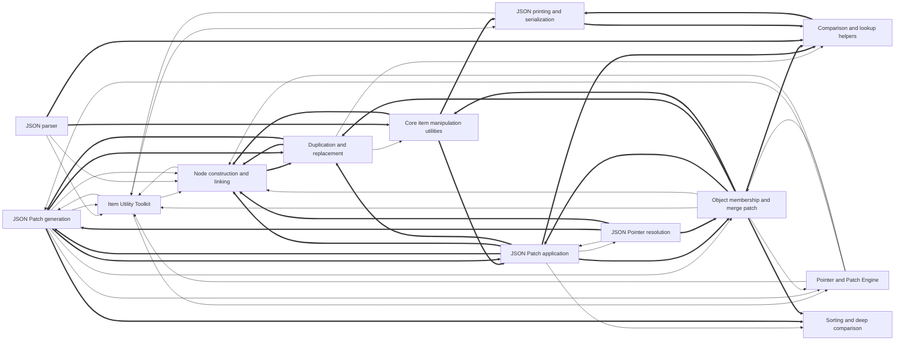

# Dependencies

Arrows point from a user to its dependency. Containment is structural, not a dependency. Graph-confirmed pairs appear in both the tree and resolved call/import edges. Model-inferred pairs appear only in the tree. Graph-only pairs appear only in the graph.
Graph-confirmed and model-inferred pairs count edges between two subtrees. Graph-only pairs count edges between direct node owners. Containment rows show resolved edges between ancestor direct units and a descendant subtree in both directions. Within containment rows count direct owner pairs separately. Neither kind of containment row appears in Mermaid or the three dependency totals.

Selected 13 nodes by connection count. Legend: `-->` graph-confirmed; `-.->` model-inferred; `==>` graph-only.

## Dependency list

- [Duplication and replacement](nodes/duplication-and-replacement.md) → [Comparison and lookup helpers](nodes/comparison-and-lookup-helpers.md) · graph-confirmed · 1 edge(s)
- [Duplication and replacement](nodes/duplication-and-replacement.md) → [Core item manipulation utilities](nodes/core-item-manipulation-utilities.md) · graph-confirmed · 1 edge(s) · Tree duplication and replacement build on core structural manipulation routines.
- [Item Utility Toolkit](nodes/item-utility-toolkit.md) → [JSON Patch generation](nodes/json-patch-generation.md) · graph-confirmed · 2 edge(s)
- [Item Utility Toolkit](nodes/item-utility-toolkit.md) → [JSON printing and serialization](nodes/json-printing-and-serialization.md) · graph-confirmed · 3 edge(s)
- [Item Utility Toolkit](nodes/item-utility-toolkit.md) → [Node construction and linking](nodes/node-construction-and-linking.md) · graph-confirmed · 5 edge(s) · Item utilities such as duplication and array growth depend on node constructors and linking helpers.
- [Item Utility Toolkit](nodes/item-utility-toolkit.md) → [Pointer and Patch Engine](nodes/pointer-and-patch-engine.md) · graph-confirmed · 2 edge(s)
- [JSON parser](nodes/json-parser.md) → [Item Utility Toolkit](nodes/item-utility-toolkit.md) · graph-confirmed · 2 edge(s)
- [JSON parser](nodes/json-parser.md) → [Node construction and linking](nodes/node-construction-and-linking.md) · graph-confirmed · 6 edge(s) · The parser builds trees by calling the typed node constructors and linking helpers.
- [JSON Patch application](nodes/json-patch-application.md) → [JSON Pointer resolution](nodes/json-pointer-resolution.md) · graph-confirmed · 8 edge(s) · Patch application resolves each operation's JSON Pointer path to locate its target.
- [JSON Patch application](nodes/json-patch-application.md) → [Sorting and deep comparison](nodes/sorting-and-deep-comparison.md) · graph-confirmed · 1 edge(s) · Patch application uses deep comparison to evaluate test operations.
- [JSON Patch generation](nodes/json-patch-generation.md) → [Item Utility Toolkit](nodes/item-utility-toolkit.md) · graph-confirmed · 1 edge(s)
- [JSON Patch generation](nodes/json-patch-generation.md) → [Node construction and linking](nodes/node-construction-and-linking.md) · graph-confirmed · 7 edge(s)
- [JSON Patch generation](nodes/json-patch-generation.md) → [Object membership and merge patch](nodes/object-membership-and-merge-patch.md) · graph-confirmed · 4 edge(s)
- [JSON Patch generation](nodes/json-patch-generation.md) → [Pointer and Patch Engine](nodes/pointer-and-patch-engine.md) · graph-confirmed · 6 edge(s) · Patch generation computes pointer paths and reuses engine helpers when emitting diff operations.
- [JSON Pointer resolution](nodes/json-pointer-resolution.md) → [JSON Patch application](nodes/json-patch-application.md) · graph-confirmed · 4 edge(s)
- [JSON printing and serialization](nodes/json-printing-and-serialization.md) → [Item Utility Toolkit](nodes/item-utility-toolkit.md) · graph-confirmed · 1 edge(s) · Serialization uses shared item utilities while walking and rendering trees.
- [Node construction and linking](nodes/node-construction-and-linking.md) → [Item Utility Toolkit](nodes/item-utility-toolkit.md) · graph-confirmed · 3 edge(s)
- [Object membership and merge patch](nodes/object-membership-and-merge-patch.md) → [Item Utility Toolkit](nodes/item-utility-toolkit.md) · graph-confirmed · 7 edge(s)
- [Object membership and merge patch](nodes/object-membership-and-merge-patch.md) → [Node construction and linking](nodes/node-construction-and-linking.md) · graph-confirmed · 12 edge(s) · Membership edits and merge patch allocate and link new nodes via the constructors.
- [Object membership and merge patch](nodes/object-membership-and-merge-patch.md) → [Pointer and Patch Engine](nodes/pointer-and-patch-engine.md) · graph-confirmed · 8 edge(s)
- [Pointer and Patch Engine](nodes/pointer-and-patch-engine.md) → [Item Utility Toolkit](nodes/item-utility-toolkit.md) · graph-confirmed · 5 edge(s)
- [Pointer and Patch Engine](nodes/pointer-and-patch-engine.md) → [JSON Patch generation](nodes/json-patch-generation.md) · graph-confirmed · 8 edge(s)
- [Pointer and Patch Engine](nodes/pointer-and-patch-engine.md) → [Node construction and linking](nodes/node-construction-and-linking.md) · graph-confirmed · 5 edge(s)
- [Pointer and Patch Engine](nodes/pointer-and-patch-engine.md) → [Object membership and merge patch](nodes/object-membership-and-merge-patch.md) · graph-confirmed · 4 edge(s)
- [JSON Patch application](nodes/json-patch-application.md) → [JSON Patch generation](nodes/json-patch-generation.md) · graph-only · 6 edge(s)
- [Object membership and merge patch](nodes/object-membership-and-merge-patch.md) → [JSON Patch application](nodes/json-patch-application.md) · graph-only · 5 edge(s)
- [JSON Patch application](nodes/json-patch-application.md) → [Node construction and linking](nodes/node-construction-and-linking.md) · graph-only · 4 edge(s)
- [JSON Patch generation](nodes/json-patch-generation.md) → [Sorting and deep comparison](nodes/sorting-and-deep-comparison.md) · graph-only · 4 edge(s)
- [Duplication and replacement](nodes/duplication-and-replacement.md) → [Node construction and linking](nodes/node-construction-and-linking.md) · graph-only · 3 edge(s)
- [JSON Patch application](nodes/json-patch-application.md) → [Duplication and replacement](nodes/duplication-and-replacement.md) · graph-only · 3 edge(s)
- [JSON Patch application](nodes/json-patch-application.md) → [Object membership and merge patch](nodes/object-membership-and-merge-patch.md) · graph-only · 3 edge(s)
- [Node construction and linking](nodes/node-construction-and-linking.md) → [Duplication and replacement](nodes/duplication-and-replacement.md) · graph-only · 3 edge(s)
- [Object membership and merge patch](nodes/object-membership-and-merge-patch.md) → [Duplication and replacement](nodes/duplication-and-replacement.md) · graph-only · 3 edge(s)
- [Object membership and merge patch](nodes/object-membership-and-merge-patch.md) → [Sorting and deep comparison](nodes/sorting-and-deep-comparison.md) · graph-only · 3 edge(s)
- [Core item manipulation utilities](nodes/core-item-manipulation-utilities.md) → [JSON Patch application](nodes/json-patch-application.md) · graph-only · 2 edge(s)
- [Core item manipulation utilities](nodes/core-item-manipulation-utilities.md) → [JSON printing and serialization](nodes/json-printing-and-serialization.md) · graph-only · 2 edge(s)
- [Core item manipulation utilities](nodes/core-item-manipulation-utilities.md) → [Node construction and linking](nodes/node-construction-and-linking.md) · graph-only · 2 edge(s)
- [Duplication and replacement](nodes/duplication-and-replacement.md) → [JSON Patch generation](nodes/json-patch-generation.md) · graph-only · 2 edge(s)
- [JSON Patch application](nodes/json-patch-application.md) → [Comparison and lookup helpers](nodes/comparison-and-lookup-helpers.md) · graph-only · 2 edge(s)
- [JSON Patch generation](nodes/json-patch-generation.md) → [JSON Patch application](nodes/json-patch-application.md) · graph-only · 2 edge(s)
- [JSON Pointer resolution](nodes/json-pointer-resolution.md) → [JSON Patch generation](nodes/json-patch-generation.md) · graph-only · 2 edge(s)
- [Object membership and merge patch](nodes/object-membership-and-merge-patch.md) → [Comparison and lookup helpers](nodes/comparison-and-lookup-helpers.md) · graph-only · 2 edge(s)
- [Object membership and merge patch](nodes/object-membership-and-merge-patch.md) → [Core item manipulation utilities](nodes/core-item-manipulation-utilities.md) · graph-only · 2 edge(s)
- [Comparison and lookup helpers](nodes/comparison-and-lookup-helpers.md) → [JSON printing and serialization](nodes/json-printing-and-serialization.md) · graph-only · 1 edge(s)
- [JSON parser](nodes/json-parser.md) → [Comparison and lookup helpers](nodes/comparison-and-lookup-helpers.md) · graph-only · 1 edge(s)
- [JSON parser](nodes/json-parser.md) → [Core item manipulation utilities](nodes/core-item-manipulation-utilities.md) · graph-only · 1 edge(s)
- [JSON Patch generation](nodes/json-patch-generation.md) → [Duplication and replacement](nodes/duplication-and-replacement.md) · graph-only · 1 edge(s)
- [JSON Pointer resolution](nodes/json-pointer-resolution.md) → [Node construction and linking](nodes/node-construction-and-linking.md) · graph-only · 1 edge(s)
- [JSON Pointer resolution](nodes/json-pointer-resolution.md) → [Object membership and merge patch](nodes/object-membership-and-merge-patch.md) · graph-only · 1 edge(s)
- [JSON printing and serialization](nodes/json-printing-and-serialization.md) → [Comparison and lookup helpers](nodes/comparison-and-lookup-helpers.md) · graph-only · 1 edge(s)

Graph-only pairs are ranked by edge count; 0 omitted.

### Within containment

Within containment: 0 pairs, ranked by edge count; 0 omitted. Each graph list keeps at most 40 pairs independently.
