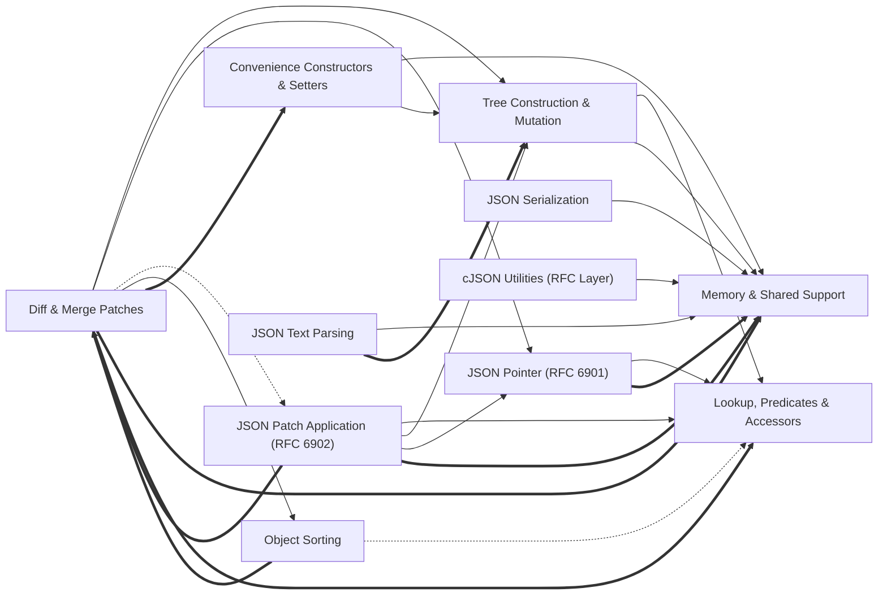

# Codebase Explorer

## How to read this report

Start with the responsibility tree in INDEX. Open a node page for your maintenance question, then choose a unit.
Node pages explain responsibilities. `catalog.json` stores full signatures, source ranges, folded members, relation evidence, and graph edges.
Set `RUN` to the absolute path of this run directory. Find an id, then read its explanation or frozen source.

```sh
cbe find --run-dir "$RUN" --term "SEARCH_TERM"
cbe query --run-dir "$RUN" --id "$ID"
cbe source --run-dir "$RUN" --id "$ID" --context 2
```

`ID` can be a unit id, symbol id, or file path. Commands return the content directly.
`source` reads frozen source and verifies its digest first.
The catalog also stores reverse graph edges, statuses, and raw evidence.

## Responsibility tree

- [cJSON Library](nodes/cjson.md) (0 units)
  - [Core cJSON Engine](nodes/core-json.md) (0 units)
    - [Public API & Data Model](nodes/core-public-interface.md) (4 units)
      - [cJSON.h module code (L1–L103)](nodes/core-public-interface.md#u-77d92a7a23a2) · Preprocessor setup for the cJSON header: MIT license text, include guard cJSON__h, C linkage for C++, Windows detection, calling-convention macros (CJSON_CDECL/CJSON_STDCALL), symbol-export selection via CJSON_HIDE/EXPORT/IMPORT_SYMBOLS, GNU visibility option, and version macros (1.7.19) before including stddef.h.
    - [Memory & Shared Support](nodes/core-memory-support.md) (6 units)
      - [cJSON_InitHooks](nodes/core-memory-support.md#u-339dd175eeaa) · Installs custom allocation hooks into global_hooks.
    - [JSON Text Parsing](nodes/core-parsing.md) (13 units)
      - [cJSON_ParseWithLengthOpts](nodes/core-parsing.md#u-eb694a324479) · Core parser entry: builds a parse_buffer over value/buffer_length and returns a parsed tree or NULL.
    - [JSON Serialization](nodes/core-printing.md) (8 units)
      - [cJSON.c-print-apis](nodes/core-printing.md#u-f7cfd6dcdea2) · Public printing entries over the internal print/printbuffer machinery.
    - [Tree Construction & Mutation](nodes/core-tree-mutation.md) (12 units)
      - [add_item_to_array](nodes/core-tree-mutation.md#u-16f393dc2dba) · Appends item to an array/object child list in amortized constant time using child->prev as the tail pointer.
    - [Lookup, Predicates & Accessors](nodes/core-accessors.md) (6 units)
      - [cJSON.c-array-accessors](nodes/core-accessors.md#u-64a0d9ed33a8) · Array lookup helpers.
    - [Convenience Constructors & Setters](nodes/core-constructors.md) (5 units)
      - [cJSON.c-create-basic](nodes/core-constructors.md#u-1b58c53937c3) · Basic item constructors.
  - [cJSON Utilities \(RFC Layer\)](nodes/json-utils.md) (3 units)
    - [cJSON_Utils.c module code (L1–L65)](nodes/json-utils.md#u-9f4e1e60f210) · File header: MIT license text, MSVC warning suppression, GCC visibility pragmas, standard-library includes, the cJSON_Utils.h include, and the true/false boolean macro definitions.
    - [JSON Pointer \(RFC 6901\)](nodes/utils-json-pointer.md) (10 units)
      - [get_item_from_pointer](nodes/utils-json-pointer.md#u-1ab29902a15f) · Resolves a JSON pointer against a cJSON tree, returning the designated node.
    - [JSON Patch Application \(RFC 6902\)](nodes/utils-patching.md) (10 units)
      - [patch_operation](nodes/utils-patching.md#u-d542cfe663d7) · Declares enum patch_operation { INVALID, ADD, REMOVE, REPLACE, MOVE, COPY, TEST } used to classify patch 'op' strings.
    - [Diff & Merge Patches](nodes/utils-diff-merge.md) (14 units)
      - [compare_json](nodes/utils-diff-merge.md#u-5316b1a86a7c) · Deep structural comparison of two cJSON trees.
    - [Object Sorting](nodes/utils-sorting.md) (4 units)
      - [sort_object](nodes/utils-sorting.md#u-6547cae15f80) · Sorts an object's children by replacing object->child with sort_list's result; NULL objects are ignored.

## Reading stats

- units: 95 · semantic nodes: 14 · dispositioned inventory ids: 226
- source ranges are program-derived from the inventory, never model-written

## Graph coverage

Source: static analysis graph. Resolved relations are graph-confirmed; this does not guarantee semantic correctness. External targets are outside the repository; ambiguous targets have multiple candidates. Unresolved or unsupported relations, and languages or relation kinds without coverage, rely on model inference and may be inaccurate.
Import and call status ratios use the edge count of each kind. CFG and dataflow are structural edges; only their counts are shown, without status ratios.
c import: resolved 3/20 (15%), external 17/20 (85%) · c call: resolved 350/741 (47%), unresolved 307/741 (41%), external 84/741 (11%).
c structural edges: cfg=10630, dataflow=21773.
Incomplete capabilities: c/call partial.
Program checks: dangling edges 0; nodes outside manifest 0; nodes with missing files 0.

## Overview

This repository is the cJSON library: a two-part C codebase for JSON. The core engine (core-json subtree, centered on cJSON.c and its public header cJSON.h) owns the doubly linked tree data model and its full lifecycle: parsing text into trees (core-parsing), rendering trees back to text (core-printing), structural construction/mutation/deletion (core-tree-mutation), read-side lookup and type predicates (core-accessors), convenience constructors (core-constructors), and a swappable memory layer (core-memory-support) through which all node allocation, string duplication, and freeing funnel. The optional utilities layer (json-utils subtree, cJSON_Utils.c) implements RFC 6901 JSON Pointers (utils-json-pointer), RFC 6902 patch application (utils-patching), diff/merge-patch generation (utils-diff-merge, RFC 7396), and object sorting (utils-sorting). It consumes only the core's public API: it resolves targets via pointer decoding plus core accessors, mutates documents via core add/detach/delete/duplicate primitives, and allocates through the core's public allocators. Sorting feeds diff stability: diff and merge-patch generation sort objects before comparing, so ordering semantics shape patch output. Cross-cutting seams for maintenance: memory policy lives only in core-memory-support hooks; output buffer growth lives only in the printbuffer ensure machinery; case-insensitivity is threaded as a parameter from utility wrappers down through lookups and sorting.

## Maintenance navigation

Navigation by maintenance question: - API contract or struct layout: start at core-public-interface (cJSON.h) and check which capability node owns touched code. - Memory leaks, allocation policy, custom hooks: core-memory-support; all other core nodes call its new-item/strdup/delete helpers, and utilities allocate via the public allocators. - Parser bugs (numbers, strings/UTF-16, whitespace/comments, minify): core-parsing; failure paths free partial trees via cJSON_Delete. - Output formatting or buffer growth/preallocation: core-printing; ensure is the only place buffers grow. - Node linking/unlinking, replacement, duplication, deletion, compare: core-tree-mutation; constructors and the utilities layer rest on add_item_to_object/add_item_to_array, cJSON_Delete, and cJSON_Duplicate_rec here. - Lookups, type predicates, typed getters: core-accessors; utilities call these directly, so changes affect RFC operations. - Convenient item creation APIs: core-constructors, pure composition over mutation and memory nodes. - Pointer parsing/formatting, path resolution: utils-json-pointer; patch application resolves every target through it, so pointer bugs surface as patch failures. - Patch ops (add/remove/replace/move/copy/test): utils-patching, whose apply_patch dispatches to core mutation. - Diff output, RFC 7396 merge patches: utils-diff-merge, which sorts objects first (utils-sorting) and encodes emitted paths via pointer helpers. - Deterministic member ordering: utils-sorting. The dependency descriptions below identify who uses whom for what.

## Dependency view

Arrows point from a user to its dependency. Containment is structural, not a dependency. Graph-confirmed pairs appear in both the tree and resolved call/import edges. Model-inferred pairs appear only in the tree. Graph-only pairs appear only in the graph.
Graph-confirmed and model-inferred pairs count edges between two subtrees. Graph-only pairs count edges between direct node owners. Containment rows show resolved edges between ancestor direct units and a descendant subtree in both directions. Within containment rows count direct owner pairs separately. Neither kind of containment row appears in Mermaid or the three dependency totals.



Selected 11 nodes by connection count. Legend: `-->` graph-confirmed; `-.->` model-inferred; `==>` graph-only.

## Dependency list

- [Convenience Constructors & Setters](nodes/core-constructors.md) → [Memory & Shared Support](nodes/core-memory-support.md) · graph-confirmed · 16 edge(s) · Convenience constructors allocate new items and duplicate strings via the central memory/new-item helpers.
- [Convenience Constructors & Setters](nodes/core-constructors.md) → [Tree Construction & Mutation](nodes/core-tree-mutation.md) · graph-confirmed · 31 edge(s) · Typed Add helpers install created items into trees through add_item_to_object/add_item_to_array and free on failure via cJSON_Delete.
- [JSON Text Parsing](nodes/core-parsing.md) → [Memory & Shared Support](nodes/core-memory-support.md) · graph-confirmed · 4 edge(s) · Parsing allocates nodes and frees partially built trees on parse failure through the memory layer.
- [JSON Serialization](nodes/core-printing.md) → [Memory & Shared Support](nodes/core-memory-support.md) · graph-confirmed · 6 edge(s) · Printers use the shared internal utilities and allocate output buffers through the memory layer.
- [Tree Construction & Mutation](nodes/core-tree-mutation.md) → [Lookup, Predicates & Accessors](nodes/core-accessors.md) · graph-confirmed · 8 edge(s) · Mutation reads existing members: replace and compare resolve targets via object lookup and shared utilities.
- [Tree Construction & Mutation](nodes/core-tree-mutation.md) → [Memory & Shared Support](nodes/core-memory-support.md) · graph-confirmed · 8 edge(s) · Deep duplication and object installation allocate via new-item/strdup and free replaced items via cJSON_Delete.
- [cJSON Utilities \(RFC Layer\)](nodes/json-utils.md) → [Memory & Shared Support](nodes/core-memory-support.md) · graph-confirmed · 22 edge(s) · The utilities layer performs its allocations through cJSON's public malloc/free wrappers.
- [Diff & Merge Patches](nodes/utils-diff-merge.md) → [Tree Construction & Mutation](nodes/core-tree-mutation.md) · graph-confirmed · 21 edge(s) · Merge-patch generation and application deep-copy and free subtrees via the core mutation primitives.
- [Diff & Merge Patches](nodes/utils-diff-merge.md) → [JSON Pointer \(RFC 6901\)](nodes/utils-json-pointer.md) · graph-confirmed · 4 edge(s) · Diff encodes emitted patch paths using pointer-encoding and length helpers.
- [Diff & Merge Patches](nodes/utils-diff-merge.md) → [JSON Patch Application \(RFC 6902\)](nodes/utils-patching.md) · model-inferred · 0 edge(s)
- [Diff & Merge Patches](nodes/utils-diff-merge.md) → [Object Sorting](nodes/utils-sorting.md) · graph-confirmed · 6 edge(s) · Comparison and patch generation sort objects first so diff output is deterministic.
- [JSON Pointer \(RFC 6901\)](nodes/utils-json-pointer.md) → [Lookup, Predicates & Accessors](nodes/core-accessors.md) · graph-confirmed · 4 edge(s) · Pointer resolution inspects node types and fetches object members via core lookup wrappers and predicates.
- [JSON Patch Application \(RFC 6902\)](nodes/utils-patching.md) → [Lookup, Predicates & Accessors](nodes/core-accessors.md) · graph-confirmed · 11 edge(s) · Patch classification and dispatch test operation types through core type predicates.
- [JSON Patch Application \(RFC 6902\)](nodes/utils-patching.md) → [Tree Construction & Mutation](nodes/core-tree-mutation.md) · graph-confirmed · 12 edge(s) · apply_patch mutates documents via core add/detach/delete/duplicate primitives.
- [JSON Patch Application \(RFC 6902\)](nodes/utils-patching.md) → [JSON Pointer \(RFC 6901\)](nodes/utils-json-pointer.md) · graph-confirmed · 8 edge(s) · Every patch operation resolves its target path through pointer decoding and get_item_from_pointer.
- [Object Sorting](nodes/utils-sorting.md) → [Lookup, Predicates & Accessors](nodes/core-accessors.md) · model-inferred · 0 edge(s)
- [Diff & Merge Patches](nodes/utils-diff-merge.md) → [Convenience Constructors & Setters](nodes/core-constructors.md) · graph-only · 10 edge(s)
- [Diff & Merge Patches](nodes/utils-diff-merge.md) → [Memory & Shared Support](nodes/core-memory-support.md) · graph-only · 8 edge(s)
- [JSON Pointer \(RFC 6901\)](nodes/utils-json-pointer.md) → [Memory & Shared Support](nodes/core-memory-support.md) · graph-only · 7 edge(s)
- [JSON Patch Application \(RFC 6902\)](nodes/utils-patching.md) → [Memory & Shared Support](nodes/core-memory-support.md) · graph-only · 6 edge(s)
- [Diff & Merge Patches](nodes/utils-diff-merge.md) → [Lookup, Predicates & Accessors](nodes/core-accessors.md) · graph-only · 5 edge(s)
- [JSON Text Parsing](nodes/core-parsing.md) → [Tree Construction & Mutation](nodes/core-tree-mutation.md) · graph-only · 3 edge(s)
- [Object Sorting](nodes/utils-sorting.md) → [Diff & Merge Patches](nodes/utils-diff-merge.md) · graph-only · 2 edge(s)
- [JSON Patch Application \(RFC 6902\)](nodes/utils-patching.md) → [Diff & Merge Patches](nodes/utils-diff-merge.md) · graph-only · 1 edge(s)

Graph-only pairs are ranked by edge count; 0 omitted.

### Within containment

- [JSON Patch Application \(RFC 6902\)](nodes/utils-patching.md) → [cJSON Utilities \(RFC Layer\)](nodes/json-utils.md) · within containment · 2 edge(s) · Patching units are contained within the json-utils subtree and use its internal helpers directly.
- [JSON Pointer \(RFC 6901\)](nodes/utils-json-pointer.md) → [cJSON Utilities \(RFC Layer\)](nodes/json-utils.md) · within containment · 1 edge(s) · Pointer units are contained within the json-utils subtree and use its internal helpers directly.

Within containment: 2 pairs, ranked by edge count; 0 omitted. Each graph list keeps at most 40 pairs independently.

## Key flows

- **Typed item construction** · Typed Add helpers create an item, duplicate its key string, and install it into an object or array via the mutation primitives.
  [cJSON.c-add-typed-helpers](nodes/core-constructors.md#u-92ff4a7bc971) → [add\_item\_to\_object](nodes/core-tree-mutation.md#u-14e9c6b81163) → [add\_item\_to\_array](nodes/core-tree-mutation.md#u-16f393dc2dba)
- **Constructor over create-and-add** · Higher-level builders compose basic constructors, which allocate fresh items, with object installation.
  [cJSON.c-add-typed-helpers](nodes/core-constructors.md#u-92ff4a7bc971) → [cJSON.c-create-basic](nodes/core-constructors.md#u-1b58c53937c3) → [cJSON\_New\_Item](nodes/core-memory-support.md#u-0840a192aac8)
- **Array building** · Array constructors create items via the basic constructors and append them with add_item_to_array.
  [cJSON.c-create-arrays](nodes/core-constructors.md#u-89d2c24c3f1b) → [cJSON.c-create-basic](nodes/core-constructors.md#u-1b58c53937c3) → [add\_item\_to\_object](nodes/core-tree-mutation.md#u-14e9c6b81163) → [add\_item\_to\_array](nodes/core-tree-mutation.md#u-16f393dc2dba)
- **Pointer string creation** · FindPointerFromObjectTo measures and encodes key segments into a JSON Pointer, allocating the result string through core public allocators.
  [cJSONUtils\_FindPointerFromObjectTo](nodes/utils-json-pointer.md#u-394cc13a634e) → [pointer\_encoded\_length](nodes/utils-json-pointer.md#u-4023d70cec38) → (model-inferred) → [encode\_string\_as\_pointer](nodes/utils-json-pointer.md#u-090f135fbb3f) → (model-inferred) → [cJSONUtils\_strdup](nodes/json-utils.md#u-d0535f9d8f45) → [cJSON.c-public-allocators](nodes/core-memory-support.md#u-185de959721c)
- **Key-based replacement** · replace_item_in_object looks up the existing member case-insensitively and swaps it via cJSON_ReplaceItemViaPointer, freeing the old node.
  [replace\_item\_in\_object](nodes/core-tree-mutation.md#u-71a5552634af) → [get\_object\_item](nodes/core-accessors.md#u-a500ccd1b1a7) → (model-inferred) → [cJSON\_ReplaceItemViaPointer](nodes/core-tree-mutation.md#u-c02d50dcaae9) → [cJSON\_Delete](nodes/core-tree-mutation.md#u-5ca539d2c8db)
- **Create with string duplication** · Typed add helpers build items whose string values and keys are duplicated through the shared strdup helper.
  [cJSON.c-add-typed-helpers](nodes/core-constructors.md#u-92ff4a7bc971) → [cJSON.c-create-basic](nodes/core-constructors.md#u-1b58c53937c3) → [add\_item\_to\_object](nodes/core-tree-mutation.md#u-14e9c6b81163) → [cJSON\_strdup](nodes/core-memory-support.md#u-e8a9f7d7fb70)

## Generation notes

- Normalized after the final invalid answer (facts kept, shape fixed): repair_4.
- repair_4: CBE assigned 1 inventory symbol(s) to index_only because the model answer omitted or supplied invalid dispositions.

## Aggregation principle checks

Program diagnostics only; they do not prove semantic correctness or trigger rewrites.

### P1 · pass

```json
{"empty_or_duplicate_capabilities": [], "ok": true, "principle": "P1"}
```

### P2 · observe

```json
{"modules": {"cjson": {"external": 0, "internal": 0, "internal_external_ratio": null}, "core-accessors": {"external": 37, "internal": 8, "internal_external_ratio": 0.21621621621621623}, "core-constructors": {"external": 63, "internal": 19, "internal_external_ratio": 0.30158730158730157}, "core-json": {"external": 0, "internal": 0, "internal_external_ratio": null}, "core-memory-support": {"external": 66, "internal": 1, "internal_external_ratio": 0.015151515151515152}, "core-parsing": {"external": 10, "internal": 41, "internal_external_ratio": 4.1}, "core-printing": {"external": 7, "internal": 35, "internal_external_ratio": 5.0}, "core-public-interface": {"external": 0, "internal": 0, "internal_external_ratio": null}, "core-tree-mutation": {"external": 105, "internal": 27, "internal_external_ratio": 0.2571428571428571}, "json-utils": {"external": 8, "internal": 0, "internal_external_ratio": 0.0}, "utils-diff-merge": {"external": 76, "internal": 34, "internal_external_ratio": 0.4473684210526316}, "utils-json-pointer": {"external": 38, "internal": 14, "internal_external_ratio": 0.3684210526315789}, "utils-patching": {"external": 56, "internal": 23, "internal_external_ratio": 0.4107142857142857}, "utils-sorting": {"external": 12, "internal": 6, "internal_external_ratio": 0.5}}, "ok": false, "principle": "P2", "scope": "direct primary ownership; incident cross-module edges counted at each endpoint"}
```

### P3 · observe

```json
{"bounds": [5, 30], "ok": false, "out_of_bounds": {"core-public-interface": 4, "json-utils": 3, "utils-sorting": 4}, "principle": "P3", "scope": "nodes with directly owned units; structural ancestors excluded"}
```

### P4 · pass

```json
{"ok": true, "ownership_violations": {}, "principle": "P4"}
```

### P5 · observe

```json
{"min_dependent_modules": 2, "min_edges_per_dependent_module": 3, "note": "dependency signal only, including utilities already separated; no automatic reassignment", "ok": false, "principle": "P5", "shared_units": {"cJSON.c::function::add_item_to_object::55010": {"core-constructors": 13, "utils-diff-merge": 2, "utils-patching": 4}, "cJSON.c::function::cJSON_Delete::6306": {"core-constructors": 15, "core-parsing": 5, "utils-diff-merge": 5, "utils-patching": 4}, "cJSON.c::function::cJSON_Duplicate_rec::71234": {"utils-diff-merge": 7, "utils-patching": 4}, "cJSON.c::function::cJSON_New_Item::6059": {"core-constructors": 13, "core-parsing": 4, "core-tree-mutation": 4}, "cJSON.c::function::cJSON_strdup::4842": {"core-constructors": 4, "core-tree-mutation": 6}, "grp:cJSON.c-detach-delete-wrappers": {"utils-diff-merge": 4, "utils-patching": 4}, "grp:cJSON.c-public-allocators": {"core-constructors": 1, "core-tree-mutation": 1, "json-utils": 2, "utils-diff-merge": 8, "utils-json-pointer": 7, "utils-patching": 6}, "grp:cJSON.c-type-predicates": {"utils-diff-merge": 6, "utils-json-pointer": 8, "utils-patching": 11}}}
```

### P6 · pass

```json
{"modules": {"cjson": {}, "core-accessors": {"c": 6}, "core-constructors": {"c": 5}, "core-json": {}, "core-memory-support": {"c": 6}, "core-parsing": {"c": 13}, "core-printing": {"c": 8}, "core-public-interface": {"c": 4}, "core-tree-mutation": {"c": 12}, "json-utils": {"c": 3}, "utils-diff-merge": {"c": 14}, "utils-json-pointer": {"c": 10}, "utils-patching": {"c": 10}, "utils-sorting": {"c": 4}}, "ok": true, "principle": "P6", "scope": "unit counts by language; a multi-language unit contributes once per language"}
```

### P7 · not_checked

```json
{"ok": null, "principle": "P7", "reason": "no prior tree for the same detail input", "status": "not_checked"}
```

Hierarchy and introduction length:

```json
{"hierarchy": {"ok": true, "requires_intermediate_above_units": 30}, "introduction_length": {"ok": true, "overlong": {}, "scope": "capability+summary characters versus descendant explain characters"}}
```
