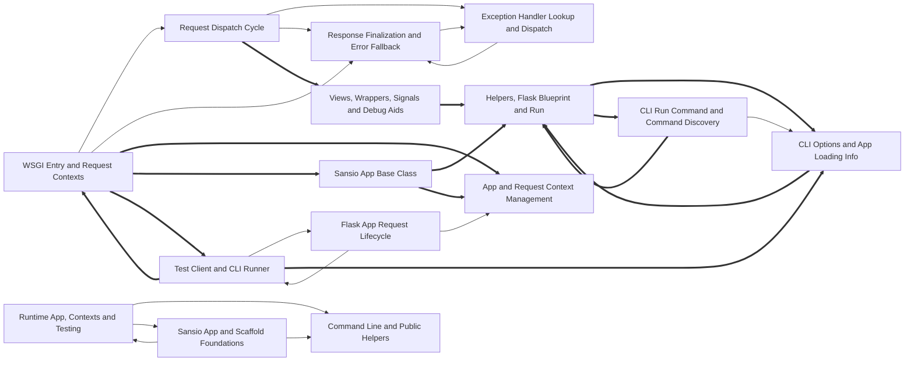

# Dependencies

Arrows point from a user to its dependency. Containment is structural, not a dependency. Graph-confirmed pairs appear in both the tree and resolved call/import edges. Model-inferred pairs appear only in the tree. Graph-only pairs appear only in the graph.
Graph-confirmed and model-inferred pairs count edges between two subtrees. Graph-only pairs count edges between direct node owners. Containment rows show resolved edges between ancestor direct units and a descendant subtree in both directions. Within containment rows count direct owner pairs separately. Neither kind of containment row appears in Mermaid or the three dependency totals.

Selected 15 nodes by connection count. Legend: `-->` graph-confirmed; `-.->` model-inferred; `==>` graph-only.

## Dependency list

- [Blueprint Deferred Registration](nodes/blueprint-deferred-registration.md) → [Scaffold Base and Setup Decorators](nodes/scaffold-base-and-setup-decorators.md) · graph-confirmed · 19 edge(s) · 2 inferred relation(s) · The sansio Blueprint uses the Scaffold setup decorators and setup-finished checks to guard and record its deferred registrations.
- [CLI Groups and Built-in Commands](nodes/cli-groups-and-built-in-commands.md) → [CLI Run Command and Command Discovery](nodes/cli-run-command-and-command-discovery.md) · model-inferred · 2 inferred relation(s)
- [CLI Run Command and Command Discovery](nodes/cli-run-command-and-command-discovery.md) → [CLI App Import and Discovery](nodes/cli-app-import-and-discovery.md) · model-inferred · 1 inferred relation(s)
- [CLI Run Command and Command Discovery](nodes/cli-run-command-and-command-discovery.md) → [CLI Options and App Loading Info](nodes/cli-options-and-app-loading-info.md) · graph-confirmed · 1 edge(s) · The run command and command discovery use ScriptInfo and the CLI options to load the application.
- [Exception Handler Lookup and Dispatch](nodes/exception-handler-lookup-and-dispatch.md) → [Response Finalization and Error Fallback](nodes/response-finalization-and-error-fallback.md) · graph-confirmed · 2 edge(s)
- [Flask App Class and Utilities](nodes/flask-app-class-and-utilities.md) → [Response Finalization and Error Fallback](nodes/response-finalization-and-error-fallback.md) · graph-confirmed · 3 edge(s)
- [Flask App Request Lifecycle](nodes/flask-app-request-lifecycle.md) → [App and Request Context Management](nodes/app-and-request-context-management.md) · graph-confirmed · 1 edge(s) · The request lifecycle uses the app and request context classes to bind per-request state.
- [Flask App Request Lifecycle](nodes/flask-app-request-lifecycle.md) → [Test Client and CLI Runner](nodes/test-client-and-cli-runner.md) · graph-confirmed · 1 edge(s)
- [Flask CLI Implementation](nodes/flask-cli-implementation.md) → [Helpers, Flask Blueprint and Run](nodes/helpers-flask-blueprint-and-run.md) · graph-confirmed · 3 edge(s) · 3 inferred relation(s) · The CLI implementation uses helpers such as debug-flag checks and the app run method.
- [Helpers, Flask Blueprint and Run](nodes/helpers-flask-blueprint-and-run.md) → [Flask CLI Implementation](nodes/flask-cli-implementation.md) · graph-confirmed · 2 edge(s)
- [Request Dispatch Cycle](nodes/request-dispatch-cycle.md) → [Exception Handler Lookup and Dispatch](nodes/exception-handler-lookup-and-dispatch.md) · graph-confirmed · 1 edge(s) · The dispatch cycle uses handler lookup to decide how exceptions raised during dispatch are handled.
- [Request Dispatch Cycle](nodes/request-dispatch-cycle.md) → [Response Finalization and Error Fallback](nodes/response-finalization-and-error-fallback.md) · graph-confirmed · 3 edge(s) · The dispatch cycle hands view return values and unhandled errors to response finalization and the error fallback.
- [Response Finalization and Error Fallback](nodes/response-finalization-and-error-fallback.md) → [Exception Handler Lookup and Dispatch](nodes/exception-handler-lookup-and-dispatch.md) · graph-confirmed · 1 edge(s)
- [Runtime App, Contexts and Testing](nodes/runtime-app-contexts-and-testing.md) → [Command Line and Public Helpers](nodes/command-line-and-public-helpers.md) · graph-confirmed · 2 edge(s) · 1 inferred relation(s)
- [Runtime App, Contexts and Testing](nodes/runtime-app-contexts-and-testing.md) → [Sansio App and Scaffold Foundations](nodes/sansio-app-and-scaffold-foundations.md) · graph-confirmed · 1 edge(s) · 1 inferred relation(s)
- [Runtime App, Contexts and Testing](nodes/runtime-app-contexts-and-testing.md) → [Session Interface and Cookies](nodes/session-interface-and-cookies.md) · graph-confirmed · 1 edge(s) · The runtime and testing modules use the session interface to open and save sessions.
- [Runtime App, Contexts and Testing](nodes/runtime-app-contexts-and-testing.md) → [Templates, Views and Wrappers](nodes/templates-views-and-wrappers.md) · graph-confirmed · 1 edge(s)
- [Sansio App and Scaffold Foundations](nodes/sansio-app-and-scaffold-foundations.md) → [Command Line and Public Helpers](nodes/command-line-and-public-helpers.md) · graph-confirmed · 3 edge(s)
- [Sansio App and Scaffold Foundations](nodes/sansio-app-and-scaffold-foundations.md) → [Runtime App, Contexts and Testing](nodes/runtime-app-contexts-and-testing.md) · graph-confirmed · 1 edge(s)
- [Sansio App Base and Logging](nodes/sansio-app-base-and-logging.md) → [Scaffold and Blueprint Registration](nodes/scaffold-and-blueprint-registration.md) · graph-confirmed · 9 edge(s) · The App base class uses the scaffold and blueprint registration logic to declare routes, handlers and callbacks.
- [Template Rendering and Loading](nodes/template-rendering-and-loading.md) → [Views, Wrappers, Signals and Debug Aids](nodes/views-wrappers-signals-and-debug-aids.md) · graph-confirmed · 1 edge(s)
- [Templates, Views and Wrappers](nodes/templates-views-and-wrappers.md) → [Command Line and Public Helpers](nodes/command-line-and-public-helpers.md) · graph-confirmed · 2 edge(s)
- [Test Client and CLI Runner](nodes/test-client-and-cli-runner.md) → [Flask App Request Lifecycle](nodes/flask-app-request-lifecycle.md) · graph-confirmed · 1 edge(s) · The test client sends requests through the app's request lifecycle.
- [WSGI Entry and Request Contexts](nodes/wsgi-entry-and-request-contexts.md) → [Request Dispatch Cycle](nodes/request-dispatch-cycle.md) · graph-confirmed · 1 edge(s) · The WSGI entry point runs the dispatch cycle for each request once a request context has been pushed.
- [WSGI Entry and Request Contexts](nodes/wsgi-entry-and-request-contexts.md) → [Response Finalization and Error Fallback](nodes/response-finalization-and-error-fallback.md) · graph-confirmed · 1 edge(s)
- [Sansio App Base Class](nodes/sansio-app-base-class.md) → [Scaffold Base and Setup Decorators](nodes/scaffold-base-and-setup-decorators.md) · graph-only · 9 edge(s)
- [CLI Run Command and Command Discovery](nodes/cli-run-command-and-command-discovery.md) → [Helpers, Flask Blueprint and Run](nodes/helpers-flask-blueprint-and-run.md) · graph-only · 2 edge(s)
- [Sansio App Base Class](nodes/sansio-app-base-class.md) → [Helpers, Flask Blueprint and Run](nodes/helpers-flask-blueprint-and-run.md) · graph-only · 2 edge(s)
- [CLI Options and App Loading Info](nodes/cli-options-and-app-loading-info.md) → [Helpers, Flask Blueprint and Run](nodes/helpers-flask-blueprint-and-run.md) · graph-only · 1 edge(s)
- [Flask App Class and Utilities](nodes/flask-app-class-and-utilities.md) → [Helpers, Flask Blueprint and Run](nodes/helpers-flask-blueprint-and-run.md) · graph-only · 1 edge(s)
- [Helpers, Flask Blueprint and Run](nodes/helpers-flask-blueprint-and-run.md) → [CLI Options and App Loading Info](nodes/cli-options-and-app-loading-info.md) · graph-only · 1 edge(s)
- [Helpers, Flask Blueprint and Run](nodes/helpers-flask-blueprint-and-run.md) → [CLI Run Command and Command Discovery](nodes/cli-run-command-and-command-discovery.md) · graph-only · 1 edge(s)
- [Request Dispatch Cycle](nodes/request-dispatch-cycle.md) → [Views, Wrappers, Signals and Debug Aids](nodes/views-wrappers-signals-and-debug-aids.md) · graph-only · 1 edge(s)
- [Response Finalization and Error Fallback](nodes/response-finalization-and-error-fallback.md) → [Session Interface and Cookies](nodes/session-interface-and-cookies.md) · graph-only · 1 edge(s)
- [Sansio App Base Class](nodes/sansio-app-base-class.md) → [App and Request Context Management](nodes/app-and-request-context-management.md) · graph-only · 1 edge(s)
- [Scaffold Base and Setup Decorators](nodes/scaffold-base-and-setup-decorators.md) → [Helpers, Flask Blueprint and Run](nodes/helpers-flask-blueprint-and-run.md) · graph-only · 1 edge(s)
- [Test Client and CLI Runner](nodes/test-client-and-cli-runner.md) → [CLI Options and App Loading Info](nodes/cli-options-and-app-loading-info.md) · graph-only · 1 edge(s)
- [Test Client and CLI Runner](nodes/test-client-and-cli-runner.md) → [WSGI Entry and Request Contexts](nodes/wsgi-entry-and-request-contexts.md) · graph-only · 1 edge(s)
- [Views, Wrappers, Signals and Debug Aids](nodes/views-wrappers-signals-and-debug-aids.md) → [CLI Groups and Built-in Commands](nodes/cli-groups-and-built-in-commands.md) · graph-only · 1 edge(s)
- [Views, Wrappers, Signals and Debug Aids](nodes/views-wrappers-signals-and-debug-aids.md) → [Helpers, Flask Blueprint and Run](nodes/helpers-flask-blueprint-and-run.md) · graph-only · 1 edge(s)
- [WSGI Entry and Request Contexts](nodes/wsgi-entry-and-request-contexts.md) → [App and Request Context Management](nodes/app-and-request-context-management.md) · graph-only · 1 edge(s)
- [WSGI Entry and Request Contexts](nodes/wsgi-entry-and-request-contexts.md) → [Sansio App Base Class](nodes/sansio-app-base-class.md) · graph-only · 1 edge(s)
- [WSGI Entry and Request Contexts](nodes/wsgi-entry-and-request-contexts.md) → [Test Client and CLI Runner](nodes/test-client-and-cli-runner.md) · graph-only · 1 edge(s)

Graph-only pairs are ranked by edge count; 0 omitted.

### Within containment

Within containment: 0 pairs, ranked by edge count; 0 omitted. Each graph list keeps at most 40 pairs independently.
