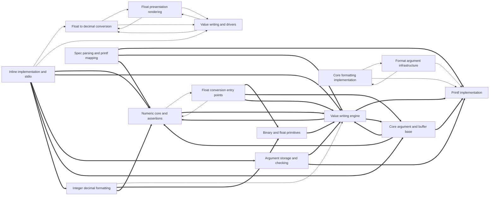

# Dependencies

Arrows point from a user to its dependency. Containment is structural, not a dependency. Graph-confirmed pairs appear in both the tree and resolved call/import edges. Model-inferred pairs appear only in the tree. Graph-only pairs appear only in the graph.
Graph-confirmed and model-inferred pairs count edges between two subtrees. Graph-only pairs count edges between direct node owners. Containment rows show resolved edges between ancestor direct units and a descendant subtree in both directions. Within containment rows count direct owner pairs separately. Neither kind of containment row appears in Mermaid or the three dependency totals.

Selected 15 nodes by connection count. Legend: `-->` graph-confirmed; `-.->` model-inferred; `==>` graph-only.

## Dependency list

- [Bigint fallback algorithm](nodes/bigint-fallback-algorithm.md) → [Numeric core and assertions](nodes/numeric-core-and-assertions.md) · graph-confirmed · 9 edge(s) · The bigint fallback uses the numeric core's arithmetic helpers and assertion handler for exact float formatting.
- [Chrono and time formatting](nodes/chrono-and-time-formatting.md) → [Core formatting implementation](nodes/core-formatting-implementation.md) · graph-confirmed · 14 edge(s) · Chrono formatting delegates to the core formatting implementation for writing parsed duration and time values.
- [Core formatting implementation](nodes/core-formatting-implementation.md) → [Format argument infrastructure](nodes/format-argument-infrastructure.md) · graph-confirmed · 7 edge(s) · The core formatting layer uses the argument infrastructure's parsing and buffer abstractions to drive value output.
- [Core formatting implementation](nodes/core-formatting-implementation.md) → [Printf implementation](nodes/printf-implementation.md) · graph-confirmed · 12 edge(s)
- [Dynamic args, enums, ostream](nodes/dynamic-args-enums-ostream.md) → [Core formatting implementation](nodes/core-formatting-implementation.md) · graph-confirmed · 1 edge(s)
- [Float conversion entry points](nodes/float-conversion-entry-points.md) → [Bigint fallback algorithm](nodes/bigint-fallback-algorithm.md) · graph-confirmed · 1 edge(s)
- [Float conversion entry points](nodes/float-conversion-entry-points.md) → [Numeric core and assertions](nodes/numeric-core-and-assertions.md) · graph-confirmed · 7 edge(s) · Float conversion entry points rely on the shared numeric core for 128-bit arithmetic, pow10 caches, and assertions.
- [Float presentation rendering](nodes/float-presentation-rendering.md) → [Float to decimal conversion](nodes/float-to-decimal-conversion.md) · graph-confirmed · 1 edge(s)
- [Float presentation rendering](nodes/float-presentation-rendering.md) → [Value writing and drivers](nodes/value-writing-and-drivers.md) · graph-confirmed · 5 edge(s)
- [Float to decimal conversion](nodes/float-to-decimal-conversion.md) → [Float presentation rendering](nodes/float-presentation-rendering.md) · graph-confirmed · 8 edge(s) · Decimal conversion results feed the presentation rendering layer that lays out digits per format specs.
- [Float to decimal conversion](nodes/float-to-decimal-conversion.md) → [Value writing and drivers](nodes/value-writing-and-drivers.md) · graph-confirmed · 2 edge(s)
- [Format argument infrastructure](nodes/format-argument-infrastructure.md) → [Core formatting implementation](nodes/core-formatting-implementation.md) · graph-confirmed · 10 edge(s)
- [Format argument infrastructure](nodes/format-argument-infrastructure.md) → [Printf implementation](nodes/printf-implementation.md) · graph-confirmed · 19 edge(s) · The argument infrastructure supplies the argument model and error reporting that the printf engine consumes.
- [Inline implementation and stdio](nodes/inline-implementation-and-stdio.md) → [Float to decimal conversion](nodes/float-to-decimal-conversion.md) · graph-confirmed · 4 edge(s) · The out-of-line stdio implementation calls float conversion when producing compiled output.
- [Inline implementation and stdio](nodes/inline-implementation-and-stdio.md) → [Value writing and drivers](nodes/value-writing-and-drivers.md) · graph-confirmed · 4 edge(s)
- [Integer decimal formatting](nodes/integer-decimal-formatting.md) → [Value writing engine](nodes/value-writing-engine.md) · graph-confirmed · 3 edge(s)
- [Localized tm writer](nodes/localized-tm-writer.md) → [Primitive tm emitters](nodes/primitive-tm-emitters.md) · model-inferred · 1 inferred relation(s) · The localized tm writer routes field output through the primitive emitters for digits and name tables.
- [Numeric core and assertions](nodes/numeric-core-and-assertions.md) → [Float conversion entry points](nodes/float-conversion-entry-points.md) · graph-confirmed · 1 edge(s)
- [OS file and C API](nodes/os-file-and-c-api.md) → [Format argument infrastructure](nodes/format-argument-infrastructure.md) · graph-confirmed · 1 edge(s) · The OS/C API layer uses the argument infrastructure to pack arguments for its formatting entry points.
- [Ranges and tuples formatting](nodes/ranges-and-tuples-formatting.md) → [Printf implementation](nodes/printf-implementation.md) · graph-confirmed · 5 edge(s) · Range and tuple formatting shares the printf module's error reporting helper.
- [Value writing and drivers](nodes/value-writing-and-drivers.md) → [Float presentation rendering](nodes/float-presentation-rendering.md) · graph-confirmed · 2 edge(s)
- [Value writing and drivers](nodes/value-writing-and-drivers.md) → [Float to decimal conversion](nodes/float-to-decimal-conversion.md) · graph-confirmed · 9 edge(s) · The value writing layer invokes float-to-decimal conversion when formatting floating-point arguments.
- [Wide text and styling](nodes/wide-text-and-styling.md) → [Core formatting implementation](nodes/core-formatting-implementation.md) · graph-confirmed · 3 edge(s) · Wide and styled formatting reuse the core implementation's writing routines for their output paths.
- [Wide text and styling](nodes/wide-text-and-styling.md) → [Format argument infrastructure](nodes/format-argument-infrastructure.md) · graph-confirmed · 1 edge(s)
- [Wide text and styling](nodes/wide-text-and-styling.md) → [Printf implementation](nodes/printf-implementation.md) · graph-confirmed · 1 edge(s)
- [Spec parsing and printf mapping](nodes/spec-parsing-and-printf-mapping.md) → [Printf implementation](nodes/printf-implementation.md) · graph-only · 13 edge(s)
- [Chrono formatting internals](nodes/chrono-formatting-internals.md) → [Numeric core and assertions](nodes/numeric-core-and-assertions.md) · graph-only · 9 edge(s)
- [Float conversion entry points](nodes/float-conversion-entry-points.md) → [Binary and float primitives](nodes/binary-and-float-primitives.md) · graph-only · 7 edge(s)
- [Float presentation writers](nodes/float-presentation-writers.md) → [Value writing engine](nodes/value-writing-engine.md) · graph-only · 4 edge(s)
- [Formatting driver and contexts](nodes/formatting-driver-and-contexts.md) → [Printf implementation](nodes/printf-implementation.md) · graph-only · 4 edge(s)
- [Inline implementation and stdio](nodes/inline-implementation-and-stdio.md) → [Numeric core and assertions](nodes/numeric-core-and-assertions.md) · graph-only · 4 edge(s)
- [Value writing engine](nodes/value-writing-engine.md) → [Numeric core and assertions](nodes/numeric-core-and-assertions.md) · graph-only · 4 edge(s)
- [Argument storage and checking](nodes/argument-storage-and-checking.md) → [Value writing engine](nodes/value-writing-engine.md) · graph-only · 3 edge(s)
- [Chrono formatting internals](nodes/chrono-formatting-internals.md) → [Binary and float primitives](nodes/binary-and-float-primitives.md) · graph-only · 3 edge(s)
- [Core argument and buffer base](nodes/core-argument-and-buffer-base.md) → [Printf implementation](nodes/printf-implementation.md) · graph-only · 3 edge(s)
- [Inline implementation and stdio](nodes/inline-implementation-and-stdio.md) → [Value writing engine](nodes/value-writing-engine.md) · graph-only · 3 edge(s)
- [Locale and dynamic specs](nodes/locale-and-dynamic-specs.md) → [Printf implementation](nodes/printf-implementation.md) · graph-only · 3 edge(s)
- [Text styling and colors](nodes/text-styling-and-colors.md) → [Numeric core and assertions](nodes/numeric-core-and-assertions.md) · graph-only · 3 edge(s)
- [Value writing engine](nodes/value-writing-engine.md) → [Printf implementation](nodes/printf-implementation.md) · graph-only · 3 edge(s)
- [Argument storage and checking](nodes/argument-storage-and-checking.md) → [Printf implementation](nodes/printf-implementation.md) · graph-only · 2 edge(s)
- [Core argument and buffer base](nodes/core-argument-and-buffer-base.md) → [Numeric core and assertions](nodes/numeric-core-and-assertions.md) · graph-only · 2 edge(s)
- [Formatting driver and contexts](nodes/formatting-driver-and-contexts.md) → [Numeric core and assertions](nodes/numeric-core-and-assertions.md) · graph-only · 2 edge(s)
- [Inline implementation and stdio](nodes/inline-implementation-and-stdio.md) → [Argument storage and checking](nodes/argument-storage-and-checking.md) · graph-only · 2 edge(s)
- [Localized tm writer](nodes/localized-tm-writer.md) → [Value writing engine](nodes/value-writing-engine.md) · graph-only · 2 edge(s)
- [Spec parsing and printf mapping](nodes/spec-parsing-and-printf-mapping.md) → [Value writing engine](nodes/value-writing-engine.md) · graph-only · 2 edge(s)
- [Value writing engine](nodes/value-writing-engine.md) → [Core argument and buffer base](nodes/core-argument-and-buffer-base.md) · graph-only · 2 edge(s)
- [Bigint fallback algorithm](nodes/bigint-fallback-algorithm.md) → [Binary and float primitives](nodes/binary-and-float-primitives.md) · graph-only · 1 edge(s)
- [Binary and float primitives](nodes/binary-and-float-primitives.md) → [Value writing engine](nodes/value-writing-engine.md) · graph-only · 1 edge(s)
- [Character and pointer writers](nodes/character-and-pointer-writers.md) → [Numeric core and assertions](nodes/numeric-core-and-assertions.md) · graph-only · 1 edge(s)
- [Character and pointer writers](nodes/character-and-pointer-writers.md) → [Printf implementation](nodes/printf-implementation.md) · graph-only · 1 edge(s)
- [Core argument and buffer base](nodes/core-argument-and-buffer-base.md) → [Value writing engine](nodes/value-writing-engine.md) · graph-only · 1 edge(s)
- [Core formatting utilities](nodes/core-formatting-utilities.md) → [Numeric core and assertions](nodes/numeric-core-and-assertions.md) · graph-only · 1 edge(s)
- [Dynamic args, enums, ostream](nodes/dynamic-args-enums-ostream.md) → [Numeric core and assertions](nodes/numeric-core-and-assertions.md) · graph-only · 1 edge(s)
- [Float conversion entry points](nodes/float-conversion-entry-points.md) → [Core argument and buffer base](nodes/core-argument-and-buffer-base.md) · graph-only · 1 edge(s)
- [Float conversion entry points](nodes/float-conversion-entry-points.md) → [Value writing engine](nodes/value-writing-engine.md) · graph-only · 1 edge(s)
- [Float presentation writers](nodes/float-presentation-writers.md) → [Numeric core and assertions](nodes/numeric-core-and-assertions.md) · graph-only · 1 edge(s)
- [Float presentation writers](nodes/float-presentation-writers.md) → [Printf implementation](nodes/printf-implementation.md) · graph-only · 1 edge(s)
- [Inline implementation and stdio](nodes/inline-implementation-and-stdio.md) → [Core argument and buffer base](nodes/core-argument-and-buffer-base.md) · graph-only · 1 edge(s)
- [Inline implementation and stdio](nodes/inline-implementation-and-stdio.md) → [Integer decimal formatting](nodes/integer-decimal-formatting.md) · graph-only · 1 edge(s)
- [Integer decimal formatting](nodes/integer-decimal-formatting.md) → [Binary and float primitives](nodes/binary-and-float-primitives.md) · graph-only · 1 edge(s)
- [Integer decimal formatting](nodes/integer-decimal-formatting.md) → [Numeric core and assertions](nodes/numeric-core-and-assertions.md) · graph-only · 1 edge(s)
- [Numeric core and assertions](nodes/numeric-core-and-assertions.md) → [Value writing engine](nodes/value-writing-engine.md) · graph-only · 1 edge(s)
- [OS file and C API](nodes/os-file-and-c-api.md) → [Spec parsing and printf mapping](nodes/spec-parsing-and-printf-mapping.md) · graph-only · 1 edge(s)
- [Packed format specs](nodes/packed-format-specs.md) → [Numeric core and assertions](nodes/numeric-core-and-assertions.md) · graph-only · 1 edge(s)
- [Spec parsing and printf mapping](nodes/spec-parsing-and-printf-mapping.md) → [Numeric core and assertions](nodes/numeric-core-and-assertions.md) · graph-only · 1 edge(s)

Graph-only pairs are ranked by edge count; 5 omitted.

### Within containment

Within containment: 0 pairs, ranked by edge count; 0 omitted. Each graph list keeps at most 40 pairs independently.
