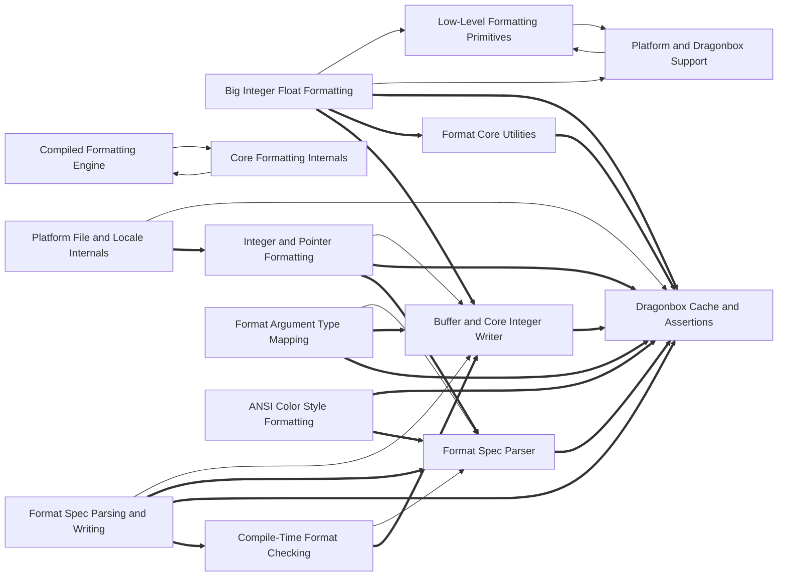

# Dependencies

Arrows point from a user to its dependency. Containment is structural, not a dependency. Graph-confirmed pairs appear in both the tree and resolved call/import edges. Model-inferred pairs appear only in the tree. Graph-only pairs appear only in the graph.
Graph-confirmed and model-inferred pairs count edges between two subtrees. Graph-only pairs count edges between direct node owners. Containment rows show resolved edges between ancestor direct units and a descendant subtree in both directions. Within containment rows count direct owner pairs separately. Neither kind of containment row appears in Mermaid or the three dependency totals.

Selected 15 nodes by connection count. Legend: `-->` graph-confirmed; `-.->` model-inferred; `==>` graph-only.

## Dependency list

- [Big Integer Float Formatting](nodes/big-integer-float-formatting.md) → [Low-Level Formatting Primitives](nodes/low-level-formatting-primitives.md) · graph-confirmed · 3 edge(s)
- [Big Integer Float Formatting](nodes/big-integer-float-formatting.md) → [Platform and Dragonbox Support](nodes/platform-and-dragonbox-support.md) · graph-confirmed · 12 edge(s) · big-integer-float-formatting depends on platform-and-dragonbox-support for Dragonbox and platform support.
- [Character and Style Formatting](nodes/character-and-style-formatting.md) → [Compiled Formatting Engine](nodes/compiled-formatting-engine.md) · graph-confirmed · 1 edge(s)
- [Character and Style Formatting](nodes/character-and-style-formatting.md) → [Core Formatting Internals](nodes/core-formatting-internals.md) · graph-confirmed · 3 edge(s)
- [Chrono Formatting Support](nodes/chrono-formatting-support.md) → [Core Formatting Internals](nodes/core-formatting-internals.md) · graph-confirmed · 10 edge(s)
- [Compile-Time Format Checking](nodes/compile-time-format-checking.md) → [Format Spec Parser](nodes/format-spec-parser.md) · graph-confirmed · 7 edge(s) · compile-time-format-checking depends on format-spec-parser for parsing and validating format specs.
- [Compiled Formatting Engine](nodes/compiled-formatting-engine.md) → [Core Formatting Internals](nodes/core-formatting-internals.md) · graph-confirmed · 11 edge(s) · compiled-formatting-engine depends on core-formatting-internals for shared formatting primitives and internals.
- [Core Formatting Internals](nodes/core-formatting-internals.md) → [Compiled Formatting Engine](nodes/compiled-formatting-engine.md) · graph-confirmed · 12 edge(s)
- [Dynamic Arguments, Enums, and C API](nodes/dynamic-arguments-enums-and-c-api.md) → [Core Formatting Internals](nodes/core-formatting-internals.md) · graph-confirmed · 1 edge(s)
- [Floating-Point Formatting Core](nodes/floating-point-formatting-core.md) → [Buffer and Core Integer Writer](nodes/buffer-and-core-integer-writer.md) · graph-confirmed · 1 edge(s)
- [Format Argument Type Mapping](nodes/format-argument-type-mapping.md) → [Format Spec Parser](nodes/format-spec-parser.md) · graph-confirmed · 2 edge(s)
- [Format Core Utilities](nodes/format-core-utilities.md) → [Floating-Point Formatting Core](nodes/floating-point-formatting-core.md) · graph-confirmed · 7 edge(s)
- [Format Spec Parsing and Writing](nodes/format-spec-parsing-and-writing.md) → [Buffer and Core Integer Writer](nodes/buffer-and-core-integer-writer.md) · graph-confirmed · 5 edge(s)
- [Integer and Pointer Formatting](nodes/integer-and-pointer-formatting.md) → [Buffer and Core Integer Writer](nodes/buffer-and-core-integer-writer.md) · graph-confirmed · 2 edge(s)
- [Low-Level Formatting Primitives](nodes/low-level-formatting-primitives.md) → [Platform and Dragonbox Support](nodes/platform-and-dragonbox-support.md) · graph-confirmed · 13 edge(s)
- [Platform and Dragonbox Support](nodes/platform-and-dragonbox-support.md) → [Low-Level Formatting Primitives](nodes/low-level-formatting-primitives.md) · graph-confirmed · 1 edge(s)
- [Platform File and Locale Internals](nodes/platform-file-and-locale-internals.md) → [Dragonbox Cache and Assertions](nodes/dragonbox-cache-and-assertions.md) · graph-confirmed · 1 edge(s)
- [Printf-Style Formatting Engine](nodes/printf-style-formatting-engine.md) → [Compiled Formatting Engine](nodes/compiled-formatting-engine.md) · graph-confirmed · 13 edge(s) · printf-style-formatting-engine depends on compiled-formatting-engine for formatting output.
- [Range and Tuple Formatting](nodes/range-and-tuple-formatting.md) → [Compiled Formatting Engine](nodes/compiled-formatting-engine.md) · graph-confirmed · 5 edge(s) · range-and-tuple-formatting depends on compiled-formatting-engine for formatting range and tuple elements.
- [Printf-Style Formatting Engine](nodes/printf-style-formatting-engine.md) → [Format Spec Parser](nodes/format-spec-parser.md) · graph-only · 13 edge(s)
- [Big Integer Float Formatting](nodes/big-integer-float-formatting.md) → [Dragonbox Cache and Assertions](nodes/dragonbox-cache-and-assertions.md) · graph-only · 12 edge(s)
- [Format Spec Parsing and Writing](nodes/format-spec-parsing-and-writing.md) → [Format Spec Parser](nodes/format-spec-parser.md) · graph-only · 9 edge(s)
- [Chrono Format Handlers](nodes/chrono-format-handlers.md) → [Dragonbox Cache and Assertions](nodes/dragonbox-cache-and-assertions.md) · graph-only · 7 edge(s)
- [Buffer and Core Integer Writer](nodes/buffer-and-core-integer-writer.md) → [Dragonbox Cache and Assertions](nodes/dragonbox-cache-and-assertions.md) · graph-only · 4 edge(s)
- [Format Argument Type Mapping](nodes/format-argument-type-mapping.md) → [Buffer and Core Integer Writer](nodes/buffer-and-core-integer-writer.md) · graph-only · 4 edge(s)
- [Format Core Utilities](nodes/format-core-utilities.md) → [Dragonbox Cache and Assertions](nodes/dragonbox-cache-and-assertions.md) · graph-only · 4 edge(s)
- [Range Formatter Specializations](nodes/range-formatter-specializations.md) → [Format Spec Parser](nodes/format-spec-parser.md) · graph-only · 4 edge(s)
- [ANSI Color Style Formatting](nodes/ansi-color-style-formatting.md) → [Dragonbox Cache and Assertions](nodes/dragonbox-cache-and-assertions.md) · graph-only · 3 edge(s)
- [Format Spec Parser](nodes/format-spec-parser.md) → [Dragonbox Cache and Assertions](nodes/dragonbox-cache-and-assertions.md) · graph-only · 3 edge(s)
- [Format Spec Parsing and Writing](nodes/format-spec-parsing-and-writing.md) → [Dragonbox Cache and Assertions](nodes/dragonbox-cache-and-assertions.md) · graph-only · 3 edge(s)
- [Big Integer Float Formatting](nodes/big-integer-float-formatting.md) → [Format Core Utilities](nodes/format-core-utilities.md) · graph-only · 2 edge(s)
- [Chrono Duration and Time Formatting](nodes/chrono-duration-and-time-formatting.md) → [Dragonbox Cache and Assertions](nodes/dragonbox-cache-and-assertions.md) · graph-only · 2 edge(s)
- [Compile-Time Format Checking](nodes/compile-time-format-checking.md) → [Buffer and Core Integer Writer](nodes/buffer-and-core-integer-writer.md) · graph-only · 2 edge(s)
- [Format Argument Type Mapping](nodes/format-argument-type-mapping.md) → [Dragonbox Cache and Assertions](nodes/dragonbox-cache-and-assertions.md) · graph-only · 2 edge(s)
- [Integer and Pointer Formatting](nodes/integer-and-pointer-formatting.md) → [Dragonbox Cache and Assertions](nodes/dragonbox-cache-and-assertions.md) · graph-only · 2 edge(s)
- [ANSI Color Style Formatting](nodes/ansi-color-style-formatting.md) → [Format Spec Parser](nodes/format-spec-parser.md) · graph-only · 1 edge(s)
- [Big Integer Float Formatting](nodes/big-integer-float-formatting.md) → [Buffer and Core Integer Writer](nodes/buffer-and-core-integer-writer.md) · graph-only · 1 edge(s)
- [Chrono Duration and Time Formatting](nodes/chrono-duration-and-time-formatting.md) → [Format Core Utilities](nodes/format-core-utilities.md) · graph-only · 1 edge(s)
- [Dynamic Arguments, Enums, and C API](nodes/dynamic-arguments-enums-and-c-api.md) → [Dragonbox Cache and Assertions](nodes/dragonbox-cache-and-assertions.md) · graph-only · 1 edge(s)
- [Format Spec Parsing and Writing](nodes/format-spec-parsing-and-writing.md) → [Compile-Time Format Checking](nodes/compile-time-format-checking.md) · graph-only · 1 edge(s)
- [Integer and Pointer Formatting](nodes/integer-and-pointer-formatting.md) → [Format Spec Parser](nodes/format-spec-parser.md) · graph-only · 1 edge(s)
- [Platform File and Locale Internals](nodes/platform-file-and-locale-internals.md) → [Integer and Pointer Formatting](nodes/integer-and-pointer-formatting.md) · graph-only · 1 edge(s)
- [Platform File and Locale Internals](nodes/platform-file-and-locale-internals.md) → [Type-Erased Argument Context](nodes/type-erased-argument-context.md) · graph-only · 1 edge(s)
- [Range and Tuple Formatting Infrastructure](nodes/range-and-tuple-formatting-infrastructure.md) → [Format Spec Parser](nodes/format-spec-parser.md) · graph-only · 1 edge(s)

Graph-only pairs are ranked by edge count; 0 omitted.

### Within containment

Within containment: 0 pairs, ranked by edge count; 0 omitted. Each graph list keeps at most 40 pairs independently.
