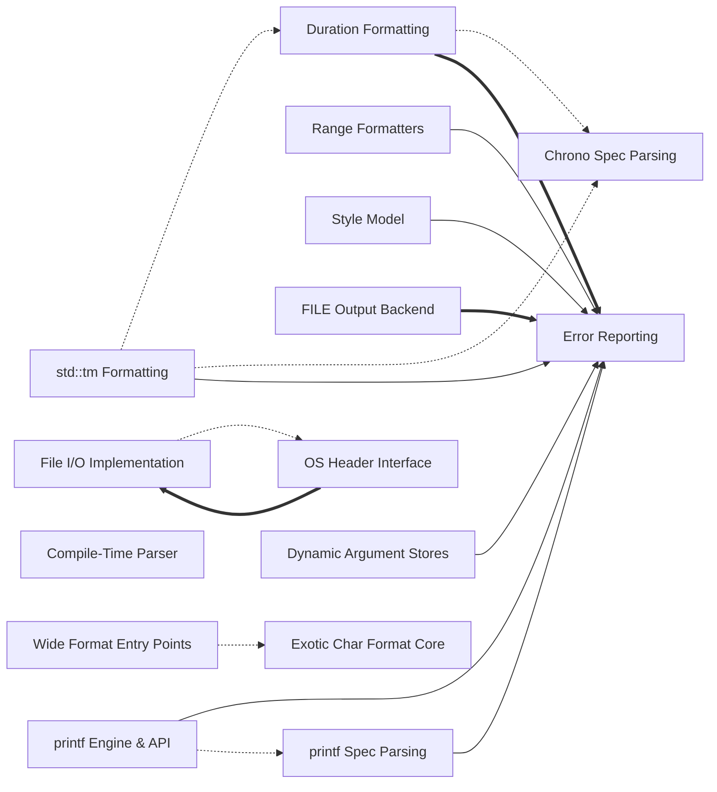

# Codebase Explorer

## How to read this report

Start with the responsibility tree in INDEX. Open a node page for your maintenance question, then choose a unit.
Node pages explain responsibilities. `catalog.json` stores full signatures, source ranges, folded members, relation evidence, and graph edges.
Set `RUN` to the absolute path of this run directory. Find an id, then read its explanation or frozen source.

```sh
cbe find --run-dir "$RUN" --term "SEARCH_TERM"
cbe query --run-dir "$RUN" --id "$ID"
cbe source --run-dir "$RUN" --id "$ID" --context 2
```

`ID` can be a unit id, symbol id, or file path. Commands return the content directly.
`source` reads frozen source and verifies its digest first.
The catalog also stores reverse graph edges, statuses, and raw evidence.

## Responsibility tree

- [fmt Formatting Library](nodes/fmt-lib.md) (0 units)
  - [Core Runtime & Engine](nodes/core-runtime.md) (2 units)
    - [src/format.cc:detail](nodes/core-runtime.md#u-c6c33bedd668) · Provides explicit API-instantiation points so library symbols are emitted once in this translation unit.
    - [Core Format Engine](nodes/core-format-engine.md) (4 units)
      - [include/fmt/format-inl.h:vformat_to](nodes/core-format-engine.md#u-faeaf1e01f8b) · Fills a buffer<char> by interpreting the format string with the given args and optional locale.
    - [Error Reporting](nodes/core-errors.md) (7 units)
      - [assert_fail](nodes/core-errors.md#u-51c7265a0ebb) · Reports a failed assertion by writing file, line, and message to stderr, then aborts.
    - [Floating-Point Shortest Formatting](nodes/core-float.md) (8 units)
      - [to_decimal](nodes/core-float.md#u-2185fecae653) · Core Dragonbox conversion of a floating-point value x into its shortest decimal (significand and decimal exponent), noexcept.
    - [FILE Output Backend](nodes/core-file-output.md) (11 units)
      - [format-inl.h-glibc-file](nodes/core-file-output.md#u-8a2be7e7e190) · FILE wrapper specialized for glibc's internal FILE layout, inheriting get/unget/flush from file_base.
    - [Locale Support](nodes/core-locale.md) (4 units)
      - [format-inl.h-locale-facet-accessors](nodes/core-locale.md#u-3082fa11c74c) · Retrieve locale-dependent numeric punctuation through the numpunct facet.
  - [Dynamic Argument Stores](nodes/args-h.md) (12 units)
    - [args.h-dynamic-arg-list](nodes/args-h.md#u-88deca88db84) · Linked list that owns copied argument values so their addresses stay stable while the store's vector of format args may reallocate.
  - [Compile-Time Format Strings](nodes/compile-h.md) (0 units)
    - [Compiled Piece Representation](nodes/compile-repr.md) (6 units)
      - [compile.h-text](nodes/compile-repr.md#u-07be70836afb) · Represents literal text segments of a compiled format string.
    - [Compile-Time Parser](nodes/compile-parser.md) (3 units)
      - [compile_format_string](nodes/compile-parser.md#u-cde0d6536aec) · Parses one element of a non-empty format string at position POS and returns the compiled piece for it, dispatching on the character at POS.
    - [Compiled Format Entry Points](nodes/compile-entry.md) (6 units)
      - [compile.h-compiled-string-entry](nodes/compile-entry.md#u-e2f00286a2b6) · Defines the compile-time string machinery that lets a string literal be parsed into efficient formatting code: the marker class compiled_string, the is_compiled_string trait (true only for types derived from compiled_string), and the user-facing conversion paths.
  - [Chrono Formatting](nodes/chrono-h.md) (0 units)
    - [Chrono Spec Parsing](nodes/chrono-parse.md) (5 units)
      - [chrono-null-chrono-spec-handler](nodes/chrono-parse.md#u-6fd583aecf8f) · CRTP base giving chrono-format handlers a default reaction for every conversion spec: each on_* forwards to unsupported(), which by default calls the derived class's unsupported() — typically a throw — so derived handlers only override the specs they accept.
    - [Duration Formatting](nodes/chrono-duration.md) (12 units)
      - [chrono-safe-duration-cast](nodes/chrono-duration.md#u-404dbc12e204) · Converts std::chrono durations and scalars without overflow or undefined behavior, reporting failure via an int error code.
    - [std::tm Formatting](nodes/chrono-tm.md) (12 units)
      - [chrono-locale-writer](nodes/chrono-tm.md#u-a64f82e80e7b) · Compile-time gate between localized and locale-free tm formatting.
    - [Calendar & Time-Point Formatters](nodes/chrono-calendar.md) (3 units)
      - [chrono-calendar-formatters](nodes/chrono-calendar.md#u-048a8bc6bb6a) · Formatters for weekday, day, month, year and year_month_day, each privately inheriting formatter<std::tm, Char>.
  - [Terminal Color & Styling](nodes/color-h.md) (0 units)
    - [Style Model](nodes/color-model.md) (7 units)
      - [color.h-color-type](nodes/color-model.md#u-f31594561564) · Bit-packed variant of unset, RGB, or terminal color used inside text_style.
    - [Styled Formatting API](nodes/color-format-api.md) (11 units)
      - [color.h-styled-arg-vformat-to](nodes/color-format-api.md#u-4a5972dc6d05) · Core styled formatting.
  - [Enum Formatting](nodes/enum-h.md) (0 units)
    - [Enumerator Identifier Lookup](nodes/enum-lookup.md) (8 units)
      - [identifier_of](nodes/enum-lookup.md#u-1a9d33300db0) · Runtime lookup of the identifier for an enum value, returning an empty string_view when unmatched.
    - [Enum Formatter Dispatch](nodes/enum-dispatch.md) (5 units)
      - [is_annotated](nodes/enum-dispatch.md#u-1df930fe79a2) · Reports at compile time whether a type carries an annotation of a given type.
  - [C API](nodes/fmt-c.md) (0 units)
    - [C ABI Surface](nodes/fmt-c-interface.md) (3 units)
      - [fmt-c-h-exported-c-interface](nodes/fmt-c-interface.md#u-8d41297c3c3a) · Defines the stable C ABI surface: a type-tag enum, a tagged-union argument struct, negative error codes, and declarations of two variadic-by-array entry points.
    - [C ABI Implementation](nodes/fmt-c-impl.md) (3 units)
      - [convert_c_format_args](nodes/fmt-c-impl.md#u-a6a4b5f8fb66) · Converts a C-style fmt_arg array into fmt basic_format_arg entries for the C API.
  - [OS & File I/O](nodes/os.md) (0 units)
    - [OS Header Interface](nodes/os-interface.md) (7 units)
      - [os.h-macros-and-include-selection](nodes/os-interface.md#u-73520771d026) · Builds the OS layer's platform configuration.
    - [File I/O Implementation](nodes/os-impl-file.md) (23 units)
      - [os.cc-pipe](nodes/os-impl-file.md#u-c8edc3962b63) · Creates a connected pipe as a pair of file objects.
    - [OS Error Reporting](nodes/os-impl-error.md) (6 units)
      - [os.cc-system-message](nodes/os-impl-error.md#u-b2055b3f53ae) · Windows-only RAII wrapper around a FormatMessageW result for one error code.
  - [std::ostream Support](nodes/ostream-h.md) (6 units)
    - [ostream-h-detail-support](nodes/ostream-h.md#u-dc9e029219fb) · Supplies internal helpers that let fmt reach a std::ostream's underlying FILE* and carry a by-reference value for ostream-based formatting.
  - [printf Compatibility](nodes/printf-h.md) (0 units)
    - [printf Arg Visitors](nodes/printf-support.md) (8 units)
      - [printf.h-arg-converter](nodes/printf-support.md#u-e998dc5b36e1) · arg_converter<T, Context> is a visitor that rewrites the referenced format arg in place to a printf-appropriate integer type.
    - [printf Spec Parsing](nodes/printf-spec.md) (5 units)
      - [parse_flags](nodes/printf-spec.md#u-ecb96ed933b2) · Consumes leading printf flag characters from [it, end), mutating specs, until a non-flag or end is reached.
    - [printf Engine & API](nodes/printf-engine.md) (10 units)
      - [printf.h-basic-printf-context](nodes/printf-engine.md#u-6e00c8bae8bf) · Defines basic_printf_context, the formatting context used by the printf-style engine for char and wchar_t.
  - [Range Formatting](nodes/ranges-h.md) (0 units)
    - [Range Detection Traits](nodes/ranges-traits.md) (1 units)
      - [ranges-h-detection-traits](nodes/ranges-traits.md#u-c4ccbfc94538) · Compile-time machinery that classifies types and walks tuples/ranges.
    - [Range Formatters](nodes/ranges-formatters.md) (6 units)
      - [ranges-h-range-formatter](nodes/ranges-formatters.md#u-772ed30c82e0) · Primary sequence/set element formatter for a type T that is the same after cv-ref removal and is formattable.
    - [Join Formatting](nodes/ranges-join.md) (3 units)
      - [ranges-h-join-functions](nodes/ranges-join.md#u-03c63f3c29c1) · Public join factory overloads producing join or tuple_join views.
  - [std Type Formatters](nodes/std-h.md) (0 units)
    - [Vocabulary Alternative Formatters](nodes/std-vocab-alt.md) (6 units)
      - [std-h-optional-formatter](nodes/std-vocab-alt.md#u-f9d5bbb8699e) · Formats std::optional<T> as 'optional(value)' or 'none', enabled only when T is formattable.
    - [Type Name Formatting](nodes/std-type-name.md) (4 units)
      - [std-h-type-info-formatter](nodes/std-type-name.md#u-67e48241f0cd) · Formats std::type_info by writing its demangled name; compiled only when FMT_USE_RTTI.
    - [Error & Exception Formatters](nodes/std-error-exception.md) (4 units)
      - [std-h-error-code-formatter](nodes/std-error-exception.md#u-ccf3d4253abe) · Formats std::error_code with align, width, optional '?' escaping, and an 's' presentation.
    - [Value & Utility Formatters](nodes/std-values.md) (8 units)
      - [std-h-bitset-formatter](nodes/std-values.md#u-3f673c46a2a7) · Formats std::bitset<N> by inheriting nested_formatter so fill/align/width nesting applies.
  - [Wide & Exotic Char Support](nodes/xchar-h.md) (0 units)
    - [Wide Format Strings & Args](nodes/xchar-fstring.md) (6 units)
      - [xchar.h-basic-fstring](nodes/xchar-fstring.md#u-c91ec548f8ca) · basic_fstring<Char, T...> is the wide/exotic-char format-string wrapper (basic_format_string): it stores a basic_string_view<Char> and compile-time-checks the format.
    - [Exotic Char Format Core](nodes/xchar-core.md) (8 units)
      - [include/fmt/xchar.h:vformat_to](nodes/xchar-core.md#u-1543a9ab5af2) · Detail-level formatting into a buffer for non-char character types: static_asserts against Char == char, wraps the buffer in a basic_appender, and runs parse_format_string with a format_handler holding a fresh parse_context and a context bundling the appender, args, and optional locale.
    - [Wide Format Entry Points](nodes/xchar-entry.md) (15 units)
      - [include/fmt/xchar.h:format (2)](nodes/xchar-entry.md#u-c25121bdc76a) · Wide-string format entry point: takes a compile-time-checked wformat_string, packs arguments with make_wformat_args, and returns vformat's std::wstring.

## Reading stats

- units: 258 · semantic nodes: 48 · dispositioned inventory ids: 1583
- source ranges are program-derived from the inventory, never model-written

## Graph coverage

Source: static analysis graph. Resolved relations are graph-confirmed; this does not guarantee semantic correctness. External targets are outside the repository; ambiguous targets have multiple candidates. Unresolved or unsupported relations, and languages or relation kinds without coverage, rely on model inference and may be inaccurate.
Import and call status ratios use the edge count of each kind. CFG and dataflow are structural edges; only their counts are shown, without status ratios.
cpp import: resolved 38/183 (21%), external 145/183 (79%) · cpp call: resolved 464/3378 (14%), unresolved 156/3378 (5%), external 2758/3378 (82%).
cpp structural edges: cfg=32409, dataflow=50000.
Incomplete capabilities: cpp/call partial; cpp/dataflow partial.
Program checks: dangling edges 0; nodes outside manifest 0; nodes with missing files 0.

## Overview

This repository is the fmt C++ formatting library: a compiled core engine (core-runtime subtree) plus feature headers layered over it. The core engine (core-format-engine) parses format strings and fills buffers; core-errors provides the shared report_error/assert_fail paths; core-float implements Dragonbox shortest float output; core-file-output and core-locale supply FILE/console and locale support. Feature headers include dynamic argument stores (args-h), compile-time format strings (compile-h with repr/parser/entry layers), chrono formatting (parse/duration/tm/calendar layers), terminal color (color-model representation rendered by color-format-api), enum formatting (dispatch plus identifier lookup), a C ABI (fmt-c-interface implemented by fmt-c-impl), OS file I/O (os-interface implemented in os-impl-file/os-impl-error), std::ostream support, printf compatibility (spec parsing, arg visitors, engine), range formatting (detection traits feeding per-kind formatters and join utilities), std type formatters (vocab/error/type-name/value groups), and wide/exotic-character support (xchar-fstring feeding xchar-entry funnelling into xchar-core). Nearly every extension reports malformed input through core-errors and delegates actual byte production to the core format pipeline or its per-char-type mirror in xchar-core.

## Maintenance navigation

For error-handling changes, start at core-errors; chrono-tm, color-model, printf-engine, printf-spec, args-h, ranges-formatters, and core-float all route failures there, so verify call sites when altering report_error or assert_fail signatures. For core formatting behavior, open core-format-engine; wide-character changes require parallel edits in xchar-core, whose public surface is xchar-entry built on xchar-fstring. For float output, core-float contains to_decimal and its per-type cache accessors; cache accessor bugs are localized there. For chrono: chrono-parse validates specs; chrono-duration and chrono-tm implement writers; chrono-calendar formatters reuse formatter<std::tm>, so tm changes ripple into calendar/time-point output. For color, understand the packed representation in color-model before touching color-format-api. For printf, printf-spec parses headers (reporting errors via core-errors), printf-support visitors normalize args, and printf-engine produces output. For ranges, ranges-traits decides classification; ranges-formatters render per kind, and ranges-join reuses their element formatters. For the C API, keep fmt-c-interface declarations and fmt-c-impl implementations in sync. For OS I/O, os-interface types are implemented in os-impl-file (syscalls, EINTR retry) and os-impl-error (Windows messages). For compile-time formats, compile-entry drives compile-parser which builds compile-repr nodes. Enum formatting splits into enum-dispatch (selection) and enum-lookup (name tables). std-h subtrees are independent per type family; type-name normalization is platform-specific in std-type-name.

## Dependency view

Arrows point from a user to its dependency. Containment is structural, not a dependency. Graph-confirmed pairs appear in both the tree and resolved call/import edges. Model-inferred pairs appear only in the tree. Graph-only pairs appear only in the graph.
Graph-confirmed and model-inferred pairs count edges between two subtrees. Graph-only pairs count edges between direct node owners. Containment rows show resolved edges between ancestor direct units and a descendant subtree in both directions. Within containment rows count direct owner pairs separately. Neither kind of containment row appears in Mermaid or the three dependency totals.



Selected 15 nodes by connection count. Legend: `-->` graph-confirmed; `-.->` model-inferred; `==>` graph-only.

## Dependency list

- [Dynamic Argument Stores](nodes/args-h.md) → [Error Reporting](nodes/core-errors.md) · graph-confirmed · 1 edge(s) · Dynamic argument store code reports failures through the shared assert_fail path.
- [Calendar & Time-Point Formatters](nodes/chrono-calendar.md) → [std::tm Formatting](nodes/chrono-tm.md) · model-inferred · 0 edge(s) · Calendar and time-point formatters reuse the formatter<std::tm> pipeline instead of their own writers.
- [Duration Formatting](nodes/chrono-duration.md) → [Chrono Spec Parsing](nodes/chrono-parse.md) · model-inferred · 0 edge(s) · The duration formatter validates specs with parse_chrono_format and its checker before writing.
- [std::tm Formatting](nodes/chrono-tm.md) → [Duration Formatting](nodes/chrono-duration.md) · model-inferred · 0 edge(s)
- [std::tm Formatting](nodes/chrono-tm.md) → [Chrono Spec Parsing](nodes/chrono-parse.md) · model-inferred · 0 edge(s) · formatter<std::tm> parses specs via parse_chrono_format with the tm_format_checker.
- [std::tm Formatting](nodes/chrono-tm.md) → [Error Reporting](nodes/core-errors.md) · graph-confirmed · 7 edge(s) · tm_writer reports invalid std::tm output situations via assert_fail.
- [Styled Formatting API](nodes/color-format-api.md) → [Style Model](nodes/color-model.md) · graph-confirmed · 6 edge(s) · The styled formatting API renders the packed style representation and its pre-built ANSI escape buffer.
- [Style Model](nodes/color-model.md) → [Error Reporting](nodes/core-errors.md) · graph-confirmed · 4 edge(s) · Style constructors validate color values via assert_fail and report_error.
- [Compiled Format Entry Points](nodes/compile-entry.md) → [Compile-Time Parser](nodes/compile-parser.md) · model-inferred · 0 edge(s) · The compile driver runs compile_format_string to build the piece tree from a format literal.
- [Compile-Time Parser](nodes/compile-parser.md) → [Compiled Piece Representation](nodes/compile-repr.md) · model-inferred · 0 edge(s) · The parser constructs field, spec, and text nodes of the compiled piece representation.
- [Enum Formatter Dispatch](nodes/enum-dispatch.md) → [Enumerator Identifier Lookup](nodes/enum-lookup.md) · model-inferred · 0 edge(s) · The identifier-name formatter resolves enumerator names via identifier_of lookup tables.
- [C ABI Implementation](nodes/fmt-c-impl.md) → [C ABI Surface](nodes/fmt-c-interface.md) · model-inferred · 0 edge(s) · The implementation defines the C entry points declared in the header interface, converting fmt_arg unions.
- [File I/O Implementation](nodes/os-impl-file.md) → [OS Header Interface](nodes/os-interface.md) · model-inferred · 0 edge(s) · The file implementation provides the syscall-backed methods behind the os.h RAII types.
- [std::ostream Support](nodes/ostream-h.md) → [FILE Output Backend](nodes/core-file-output.md) · model-inferred · 0 edge(s) · ostream print's Windows console fast path mirrors the core print implementation's approach.
- [printf Engine & API](nodes/printf-engine.md) → [Error Reporting](nodes/core-errors.md) · graph-confirmed · 6 edge(s) · The printf engine reports malformed format strings through report_error.
- [printf Engine & API](nodes/printf-engine.md) → [printf Spec Parsing](nodes/printf-spec.md) · model-inferred · 0 edge(s) · The vprintf loop consumes headers and presentation types parsed by printf spec parsing.
- [printf Engine & API](nodes/printf-engine.md) → [printf Arg Visitors](nodes/printf-support.md) · model-inferred · 0 edge(s)
- [printf Spec Parsing](nodes/printf-spec.md) → [Error Reporting](nodes/core-errors.md) · graph-confirmed · 7 edge(s) · Header parsing and the width handler reject malformed printf specs via report_error.
- [Range Formatters](nodes/ranges-formatters.md) → [Error Reporting](nodes/core-errors.md) · graph-confirmed · 5 edge(s) · Range and tuple formatters report malformed range specs via report_error.
- [Range Formatters](nodes/ranges-formatters.md) → [Range Detection Traits](nodes/ranges-traits.md) · model-inferred · 0 edge(s) · Each range formatter gates on the detection traits' classification of the type.
- [Join Formatting](nodes/ranges-join.md) → [Range Formatters](nodes/ranges-formatters.md) · model-inferred · 0 edge(s) · Join view and tuple-join formatters reuse the same element-formatter machinery as the range formatters.
- [Exotic Char Format Core](nodes/xchar-core.md) → [Core Format Engine](nodes/core-format-engine.md) · model-inferred · 0 edge(s)
- [Wide Format Entry Points](nodes/xchar-entry.md) → [Exotic Char Format Core](nodes/xchar-core.md) · model-inferred · 0 edge(s) · Wide format/print entry points funnel into the exotic-char vformat_to pipeline.
- [Wide Format Strings & Args](nodes/xchar-fstring.md) → [Wide Format Entry Points](nodes/xchar-entry.md) · model-inferred · 0 edge(s) · Wide format strings and make_wformat_args feed the public wide entry points.
- [Floating-Point Shortest Formatting](nodes/core-float.md) → [Error Reporting](nodes/core-errors.md) · graph-only · 11 edge(s) · Float conversion helpers assert on invalid states via assert_fail.
- [Duration Formatting](nodes/chrono-duration.md) → [Error Reporting](nodes/core-errors.md) · graph-only · 2 edge(s)
- [FILE Output Backend](nodes/core-file-output.md) → [Error Reporting](nodes/core-errors.md) · graph-only · 1 edge(s) · FILE output plumbing reports failures through the shared error path.
- [OS Header Interface](nodes/os-interface.md) → [File I/O Implementation](nodes/os-impl-file.md) · graph-only · 1 edge(s) · os.h file and buffered_file types delegate their operations to the src/os.cc implementation.

Graph-only pairs are ranked by edge count; 0 omitted.

### Within containment


Within containment: 0 pairs, ranked by edge count; 0 omitted. Each graph list keeps at most 40 pairs independently.

## Key flows

- **Color styled output** · The styled formatting API applies a style's ANSI escapes around formatted text, with the style model validating colors through the shared error path.
  [color.h-styled-arg-vformat-to](nodes/color-format-api.md#u-4a5972dc6d05) → [color.h-text-style](nodes/color-model.md#u-fcba1e5ed7b9) → [assert\_fail](nodes/core-errors.md#u-51c7265a0ebb)
- **Styled error reporting** · Styled formatting validates the style via the text-style group and reports problems through report_error.
  [color.h-styled-arg-vformat-to](nodes/color-format-api.md#u-4a5972dc6d05) → [color.h-text-style](nodes/color-model.md#u-fcba1e5ed7b9) → [report\_error](nodes/core-errors.md#u-4fe75221d1d1)
- **printf spec error path** · printf header parsing rejects malformed flags, width, or precision through the central report_error function.
  [parse\_header](nodes/printf-spec.md#u-d385bf5e5f30) → [report\_error](nodes/core-errors.md#u-4fe75221d1d1)
- **printf engine errors** · The core printf loop reports format-level problems via the shared error reporting entry point.
  [vprintf](nodes/printf-engine.md#u-0f7d73d0497e) → [report\_error](nodes/core-errors.md#u-4fe75221d1d1)
- **Range spec validation** · The primary range formatter reports malformed range format specs through report_error.
  [ranges-h-range-formatter](nodes/ranges-formatters.md#u-772ed30c82e0) → [report\_error](nodes/core-errors.md#u-4fe75221d1d1)
- **Float cache access** · The float cache accessor relies on internal consistency checks enforced by assert_fail.
  [format-inl.h-cache-accessor-float](nodes/core-float.md#u-ff2e2675f82c) → [assert\_fail](nodes/core-errors.md#u-51c7265a0ebb)
- **tm writer assertions** · The std::tm writer verifies field invariants with assert_fail while rendering strftime-like specs.
  [tm\_writer](nodes/chrono-tm.md#u-39b546d6bcc2) → [assert\_fail](nodes/core-errors.md#u-51c7265a0ebb)

## Generation notes

- 2 module page(s) are pending: module_1, module_3.

## Aggregation principle checks

Program diagnostics only; they do not prove semantic correctness or trigger rewrites.

### P1 · pass

```json
{"empty_or_duplicate_capabilities": [], "ok": true, "principle": "P1"}
```

### P2 · observe

```json
{"modules": {"args-h": {"external": 2, "internal": 10, "internal_external_ratio": 5.0}, "chrono-calendar": {"external": 4, "internal": 4, "internal_external_ratio": 1.0}, "chrono-duration": {"external": 9, "internal": 18, "internal_external_ratio": 2.0}, "chrono-h": {"external": 0, "internal": 0, "internal_external_ratio": null}, "chrono-parse": {"external": 5, "internal": 4, "internal_external_ratio": 0.8}, "chrono-tm": {"external": 19, "internal": 16, "internal_external_ratio": 0.8421052631578947}, "color-format-api": {"external": 8, "internal": 10, "internal_external_ratio": 1.25}, "color-h": {"external": 0, "internal": 0, "internal_external_ratio": null}, "color-model": {"external": 14, "internal": 7, "internal_external_ratio": 0.5}, "compile-entry": {"external": 3, "internal": 5, "internal_external_ratio": 1.6666666666666667}, "compile-h": {"external": 0, "internal": 0, "internal_external_ratio": null}, "compile-parser": {"external": 6, "internal": 4, "internal_external_ratio": 0.6666666666666666}, "compile-repr": {"external": 7, "internal": 3, "internal_external_ratio": 0.42857142857142855}, "core-errors": {"external": 57, "internal": 6, "internal_external_ratio": 0.10526315789473684}, "core-file-output": {"external": 1, "internal": 1, "internal_external_ratio": 1.0}, "core-float": {"external": 11, "internal": 5, "internal_external_ratio": 0.45454545454545453}, "core-format-engine": {"external": 2, "internal": 1, "internal_external_ratio": 0.5}, "core-locale": {"external": 0, "internal": 2, "internal_external_ratio": null}, "core-runtime": {"external": 0, "internal": 0, "internal_external_ratio": null}, "enum-dispatch": {"external": 1, "internal": 5, "internal_external_ratio": 5.0}, "enum-h": {"external": 0, "internal": 0, "internal_external_ratio": null}, "enum-lookup": {"external": 1, "internal": 8, "internal_external_ratio": 8.0}, "fmt-c": {"external": 0, "internal": 0, "internal_external_ratio": null}, "fmt-c-impl": {"external": 0, "internal": 4, "internal_external_ratio": null}, "fmt-c-interface": {"external": 0, "internal": 0, "internal_external_ratio": null}, "fmt-lib": {"external": 0, "internal": 0, "internal_external_ratio": null}, "os": {"external": 0, "internal": 0, "internal_external_ratio": null}, "os-impl-error": {"external": 0, "internal": 6, "internal_external_ratio": null}, "os-impl-file": {"external": 1, "internal": 3, "internal_external_ratio": 3.0}, "os-interface": {"external": 1, "internal": 6, "internal_external_ratio": 6.0}, "ostream-h": {"external": 0, "internal": 7, "internal_external_ratio": null}, "printf-engine": {"external": 11, "internal": 9, "internal_external_ratio": 0.8181818181818182}, "printf-h": {"external": 0, "internal": 0, "internal_external_ratio": null}, "printf-spec": {"external": 13, "internal": 2, "internal_external_ratio": 0.15384615384615385}, "printf-support": {"external": 3, "internal": 1, "internal_external_ratio": 0.3333333333333333}, "ranges-formatters": {"external": 13, "internal": 2, "internal_external_ratio": 0.15384615384615385}, "ranges-h": {"external": 0, "internal": 0, "internal_external_ratio": null}, "ranges-join": {"external": 3, "internal": 2, "internal_external_ratio": 0.6666666666666666}, "ranges-traits": {"external": 7, "internal": 0, "internal_external_ratio": 0.0}, "std-error-exception": {"external": 0, "internal": 2, "internal_external_ratio": null}, "std-h": {"external": 0, "internal": 0, "internal_external_ratio": null}, "std-type-name": {"external": 0, "internal": 3, "internal_external_ratio": null}, "std-values": {"external": 0, "internal": 1, "internal_external_ratio": null}, "std-vocab-alt": {"external": 0, "internal": 5, "internal_external_ratio": null}, "xchar-core": {"external": 11, "internal": 6, "internal_external_ratio": 0.5454545454545454}, "xchar-entry": {"external": 11, "internal": 3, "internal_external_ratio": 0.2727272727272727}, "xchar-fstring": {"external": 0, "internal": 2, "internal_external_ratio": null}, "xchar-h": {"external": 0, "internal": 0, "internal_external_ratio": null}}, "ok": false, "principle": "P2", "scope": "direct primary ownership; incident cross-module edges counted at each endpoint"}
```

### P3 · observe

```json
{"bounds": [5, 30], "ok": false, "out_of_bounds": {"chrono-calendar": 3, "compile-parser": 3, "core-format-engine": 4, "core-locale": 4, "core-runtime": 2, "fmt-c-impl": 3, "fmt-c-interface": 3, "ranges-join": 3, "ranges-traits": 1, "std-error-exception": 4, "std-type-name": 4}, "principle": "P3", "scope": "nodes with directly owned units; structural ancestors excluded"}
```

### P4 · pass

```json
{"ok": true, "ownership_violations": {}, "principle": "P4"}
```

### P5 · observe

```json
{"min_dependent_modules": 2, "min_edges_per_dependent_module": 3, "note": "dependency signal only, including utilities already separated; no automatic reassignment", "ok": false, "principle": "P5", "shared_units": {"include/fmt/format-inl.h::function::assert_fail::1007": {"args-h": 2, "chrono-duration": 2, "chrono-tm": 7, "color-model": 4, "core-file-output": 1, "core-float": 11}, "include/fmt/format-inl.h::function::report_error::4933": {"color-model": 2, "core-format-engine": 1, "printf-engine": 7, "printf-spec": 10, "ranges-formatters": 8, "ranges-join": 1}}}
```

### P6 · pass

```json
{"modules": {"args-h": {"cpp": 12}, "chrono-calendar": {"cpp": 3}, "chrono-duration": {"cpp": 12}, "chrono-h": {}, "chrono-parse": {"cpp": 5}, "chrono-tm": {"cpp": 12}, "color-format-api": {"cpp": 11}, "color-h": {}, "color-model": {"cpp": 7}, "compile-entry": {"cpp": 6}, "compile-h": {}, "compile-parser": {"cpp": 3}, "compile-repr": {"cpp": 6}, "core-errors": {"cpp": 7}, "core-file-output": {"cpp": 11}, "core-float": {"cpp": 8}, "core-format-engine": {"cpp": 4}, "core-locale": {"cpp": 4}, "core-runtime": {"cpp": 2}, "enum-dispatch": {"cpp": 5}, "enum-h": {}, "enum-lookup": {"cpp": 8}, "fmt-c": {}, "fmt-c-impl": {"cpp": 3}, "fmt-c-interface": {"cpp": 3}, "fmt-lib": {}, "os": {}, "os-impl-error": {"cpp": 6}, "os-impl-file": {"cpp": 23}, "os-interface": {"cpp": 7}, "ostream-h": {"cpp": 6}, "printf-engine": {"cpp": 10}, "printf-h": {}, "printf-spec": {"cpp": 5}, "printf-support": {"cpp": 8}, "ranges-formatters": {"cpp": 6}, "ranges-h": {}, "ranges-join": {"cpp": 3}, "ranges-traits": {"cpp": 1}, "std-error-exception": {"cpp": 4}, "std-h": {}, "std-type-name": {"cpp": 4}, "std-values": {"cpp": 8}, "std-vocab-alt": {"cpp": 6}, "xchar-core": {"cpp": 8}, "xchar-entry": {"cpp": 15}, "xchar-fstring": {"cpp": 6}, "xchar-h": {}}, "ok": true, "principle": "P6", "scope": "unit counts by language; a multi-language unit contributes once per language"}
```

### P7 · not_checked

```json
{"ok": null, "principle": "P7", "reason": "no prior tree for the same detail input", "status": "not_checked"}
```

Hierarchy and introduction length:

```json
{"hierarchy": {"ok": true, "requires_intermediate_above_units": 30}, "introduction_length": {"ok": true, "overlong": {}, "scope": "capability+summary characters versus descendant explain characters"}}
```
