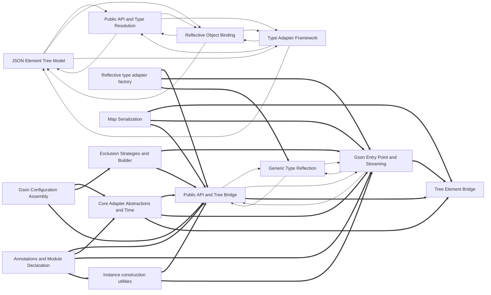

# Dependencies

Arrows point from a user to its dependency. Containment is structural, not a dependency. Graph-confirmed pairs appear in both the tree and resolved call/import edges. Model-inferred pairs appear only in the tree. Graph-only pairs appear only in the graph.
Graph-confirmed and model-inferred pairs count edges between two subtrees. Graph-only pairs count edges between direct node owners. Containment rows show resolved edges between ancestor direct units and a descendant subtree in both directions. Within containment rows count direct owner pairs separately. Neither kind of containment row appears in Mermaid or the three dependency totals.

Selected 15 nodes by connection count. Legend: `-->` graph-confirmed; `-.->` model-inferred; `==>` graph-only.

## Dependency list

- [Adapter Abstractions and Dates](nodes/adapter-abstractions-and-dates.md) → [Adapter Configuration and Policies](nodes/adapter-configuration-and-policies.md) · graph-confirmed · 1 edge(s)
- [Adapter Configuration and Policies](nodes/adapter-configuration-and-policies.md) → [Adapter Abstractions and Dates](nodes/adapter-abstractions-and-dates.md) · graph-confirmed · 3 edge(s)
- [Adapter Configuration and Policies](nodes/adapter-configuration-and-policies.md) → [Enum, Number Policy, Runtime Dispatch](nodes/enum-number-policy-runtime-dispatch.md) · graph-confirmed · 1 edge(s)
- [Annotations and Module Declaration](nodes/annotations-and-module-declaration.md) → [Core Gson Contracts and Facade](nodes/core-gson-contracts-and-facade.md) · graph-confirmed · 5 edge(s)
- [Arrays and Stream Bridge](nodes/arrays-and-stream-bridge.md) → [Primitives and Map Adapters](nodes/primitives-and-map-adapters.md) · graph-confirmed · 2 edge(s)
- [Built-in Adapter Implementations](nodes/built-in-adapter-implementations.md) → [Exclusion Strategies and Builder](nodes/exclusion-strategies-and-builder.md) · graph-confirmed · 2 edge(s)
- [Core Gson Contracts and Facade](nodes/core-gson-contracts-and-facade.md) → [Annotations and Module Declaration](nodes/annotations-and-module-declaration.md) · graph-confirmed · 1 edge(s)
- [Element Tree Adapter](nodes/element-tree-adapter.md) → [JSON Array Model](nodes/json-array-model.md) · graph-confirmed · 1 edge(s)
- [Element Types and Tree Adapters](nodes/element-types-and-tree-adapters.md) → [JSON Object and Ordered Map](nodes/json-object-and-ordered-map.md) · graph-confirmed · 2 edge(s)
- [Enum, Number Policy, Runtime Dispatch](nodes/enum-number-policy-runtime-dispatch.md) → [Adapter Abstractions and Dates](nodes/adapter-abstractions-and-dates.md) · graph-confirmed · 1 edge(s)
- [Exclusion Strategies and Builder](nodes/exclusion-strategies-and-builder.md) → [Built-in Adapter Implementations](nodes/built-in-adapter-implementations.md) · graph-confirmed · 2 edge(s) · The builder and excluder assemble configuration that selects among the built-in adapter implementations.
- [Field Binding and Introspection](nodes/field-binding-and-introspection.md) → [Instance Creation and Access Control](nodes/instance-creation-and-access-control.md) · graph-confirmed · 4 edge(s)
- [Generic Type Reflection](nodes/generic-type-reflection.md) → [Gson Entry Point and Streaming](nodes/gson-entry-point-and-streaming.md) · graph-confirmed · 2 edge(s)
- [Generic Type Reflection](nodes/generic-type-reflection.md) → [Public API and Tree Bridge](nodes/public-api-and-tree-bridge.md) · graph-confirmed · 2 edge(s)
- [Gson Configuration Assembly](nodes/gson-configuration-assembly.md) → [Number and Object Adapters](nodes/number-and-object-adapters.md) · graph-confirmed · 2 edge(s)
- [Gson Entry Point and Streaming](nodes/gson-entry-point-and-streaming.md) → [Generic Type Reflection](nodes/generic-type-reflection.md) · graph-confirmed · 5 edge(s) · The Gson facade resolves generic types via TypeToken and GsonTypes utilities to look up adapters.
- [Gson Entry Point and Streaming](nodes/gson-entry-point-and-streaming.md) → [Public API and Tree Bridge](nodes/public-api-and-tree-bridge.md) · graph-confirmed · 2 edge(s)
- [In-memory tree reader](nodes/in-memory-tree-reader.md) → [Streaming JsonReader](nodes/streaming-jsonreader.md) · graph-confirmed · 1 edge(s)
- [Instance construction utilities](nodes/instance-construction-utilities.md) → [Reflection access filtering](nodes/reflection-access-filtering.md) · graph-confirmed · 2 edge(s) · Instance construction consults access filters to decide whether reflective instantiation is permitted.
- [Instance Creation and Access Control](nodes/instance-creation-and-access-control.md) → [Field Binding and Introspection](nodes/field-binding-and-introspection.md) · graph-confirmed · 4 edge(s)
- [JSON Array Model](nodes/json-array-model.md) → [Tree Element Bridge](nodes/tree-element-bridge.md) · graph-confirmed · 1 edge(s)
- [JSON Element Tree Model](nodes/json-element-tree-model.md) → [JSON Reading Infrastructure](nodes/json-reading-infrastructure.md) · graph-confirmed · 1 edge(s)
- [JSON Element Tree Model](nodes/json-element-tree-model.md) → [Public API and Type Resolution](nodes/public-api-and-type-resolution.md) · graph-confirmed · 8 edge(s)
- [JSON Element Tree Model](nodes/json-element-tree-model.md) → [Reflective Object Binding](nodes/reflective-object-binding.md) · graph-confirmed · 1 edge(s)
- [JSON Element Tree Model](nodes/json-element-tree-model.md) → [Type Adapter Framework](nodes/type-adapter-framework.md) · graph-confirmed · 3 edge(s)
- [JSON Object and Ordered Map](nodes/json-object-and-ordered-map.md) → [Element Types and Tree Adapters](nodes/element-types-and-tree-adapters.md) · graph-confirmed · 1 edge(s)
- [JSON Parsing Facades](nodes/json-parsing-facades.md) → [Core Gson Contracts and Facade](nodes/core-gson-contracts-and-facade.md) · graph-confirmed · 3 edge(s) · JsonParser facades use the core Gson contracts to turn text into element trees.
- [JSON Reading Infrastructure](nodes/json-reading-infrastructure.md) → [JSON Element Tree Model](nodes/json-element-tree-model.md) · graph-confirmed · 5 edge(s) · The reading infrastructure materializes parsed input as JsonElement tree nodes.
- [JSON Reading Infrastructure](nodes/json-reading-infrastructure.md) → [Public API and Type Resolution](nodes/public-api-and-type-resolution.md) · graph-confirmed · 1 edge(s)
- [JSON Reading Infrastructure](nodes/json-reading-infrastructure.md) → [Type Adapter Framework](nodes/type-adapter-framework.md) · graph-confirmed · 2 edge(s)
- [JSON Writing Infrastructure](nodes/json-writing-infrastructure.md) → [JSON Element Tree Model](nodes/json-element-tree-model.md) · graph-confirmed · 3 edge(s) · The writing infrastructure emits JsonElement tree values as JSON output.
- [JSON Writing Infrastructure](nodes/json-writing-infrastructure.md) → [Public API and Type Resolution](nodes/public-api-and-type-resolution.md) · graph-confirmed · 4 edge(s)
- [JsonReader public API and docs](nodes/jsonreader-public-api-and-docs.md) → [Lexing and buffer lookahead](nodes/lexing-and-buffer-lookahead.md) · graph-confirmed · 1 edge(s)
- [JsonReader public API and docs](nodes/jsonreader-public-api-and-docs.md) → [Token consumption and value decoding](nodes/token-consumption-and-value-decoding.md) · graph-confirmed · 1 edge(s)
- [Lexing and buffer lookahead](nodes/lexing-and-buffer-lookahead.md) → [Token consumption and value decoding](nodes/token-consumption-and-value-decoding.md) · graph-confirmed · 9 edge(s) · Value decoding builds on the lexer's buffer filling and token peeking machinery.
- [Map Serialization](nodes/map-serialization.md) → [Internal Reflection Utilities](nodes/internal-reflection-utilities.md) · graph-confirmed · 1 edge(s)
- [Map Serialization](nodes/map-serialization.md) → [JSON Primitive Values](nodes/json-primitive-values.md) · graph-confirmed · 3 edge(s)
- [Primitives and Map Adapters](nodes/primitives-and-map-adapters.md) → [Arrays and Stream Bridge](nodes/arrays-and-stream-bridge.md) · graph-confirmed · 6 edge(s)
- [Public API and Tree Bridge](nodes/public-api-and-tree-bridge.md) → [Generic Type Reflection](nodes/generic-type-reflection.md) · graph-confirmed · 1 edge(s)
- [Public API and Tree Bridge](nodes/public-api-and-tree-bridge.md) → [Gson Entry Point and Streaming](nodes/gson-entry-point-and-streaming.md) · graph-confirmed · 3 edge(s)
- [Public API and Type Resolution](nodes/public-api-and-type-resolution.md) → [JSON Element Tree Model](nodes/json-element-tree-model.md) · graph-confirmed · 10 edge(s)
- [Public API and Type Resolution](nodes/public-api-and-type-resolution.md) → [JSON Writing Infrastructure](nodes/json-writing-infrastructure.md) · graph-confirmed · 2 edge(s)
- [Public API and Type Resolution](nodes/public-api-and-type-resolution.md) → [Reflective Object Binding](nodes/reflective-object-binding.md) · graph-confirmed · 1 edge(s)
- [Public API and Type Resolution](nodes/public-api-and-type-resolution.md) → [Type Adapter Framework](nodes/type-adapter-framework.md) · graph-confirmed · 3 edge(s) · 1 inferred relation(s)
- [Reflection and record support](nodes/reflection-and-record-support.md) → [Reflective type adapter factory](nodes/reflective-type-adapter-factory.md) · graph-confirmed · 2 edge(s)
- [Reflective Object Binding](nodes/reflective-object-binding.md) → [JSON Element Tree Model](nodes/json-element-tree-model.md) · graph-confirmed · 1 edge(s)
- [Reflective Object Binding](nodes/reflective-object-binding.md) → [Public API and Type Resolution](nodes/public-api-and-type-resolution.md) · graph-confirmed · 19 edge(s) · Reflective binding relies on the public API and type resolution to obtain adapters for field types.
- [Reflective Object Binding](nodes/reflective-object-binding.md) → [Type Adapter Framework](nodes/type-adapter-framework.md) · graph-confirmed · 4 edge(s)
- [Reflective type adapter factory](nodes/reflective-type-adapter-factory.md) → [Reflection and record support](nodes/reflection-and-record-support.md) · graph-confirmed · 13 edge(s) · The reflective factory uses reflection utilities and record introspection to bind fields.
- [Streaming JsonReader](nodes/streaming-jsonreader.md) → [In-memory tree reader](nodes/in-memory-tree-reader.md) · graph-confirmed · 1 edge(s)
- [Structural navigation and skipping](nodes/structural-navigation-and-skipping.md) → [Lexing and buffer lookahead](nodes/lexing-and-buffer-lookahead.md) · graph-confirmed · 8 edge(s)
- [Structural navigation and skipping](nodes/structural-navigation-and-skipping.md) → [Token consumption and value decoding](nodes/token-consumption-and-value-decoding.md) · graph-confirmed · 7 edge(s)
- [Token consumption and value decoding](nodes/token-consumption-and-value-decoding.md) → [Lexing and buffer lookahead](nodes/lexing-and-buffer-lookahead.md) · graph-confirmed · 14 edge(s)
- [Tree Element Bridge](nodes/tree-element-bridge.md) → [Element Tree Adapter](nodes/element-tree-adapter.md) · graph-confirmed · 1 edge(s)
- [Tree Element Bridge](nodes/tree-element-bridge.md) → [JSON Array Model](nodes/json-array-model.md) · graph-confirmed · 1 edge(s)
- [Type Adapter Framework](nodes/type-adapter-framework.md) → [JSON Element Tree Model](nodes/json-element-tree-model.md) · graph-confirmed · 1 edge(s)
- [Type Adapter Framework](nodes/type-adapter-framework.md) → [JSON Writing Infrastructure](nodes/json-writing-infrastructure.md) · graph-confirmed · 1 edge(s)
- [Type Adapter Framework](nodes/type-adapter-framework.md) → [Public API and Type Resolution](nodes/public-api-and-type-resolution.md) · graph-confirmed · 23 edge(s) · Adapter machinery calls into the public API and type-resolution layer for adapter lookup and type tokens.
- [Type Adapter Framework](nodes/type-adapter-framework.md) → [Reflective Object Binding](nodes/reflective-object-binding.md) · graph-confirmed · 2 edge(s)
- [Map Serialization](nodes/map-serialization.md) → [Tree Element Bridge](nodes/tree-element-bridge.md) · graph-only · 6 edge(s)
- [Reflective type adapter factory](nodes/reflective-type-adapter-factory.md) → [Public API and Tree Bridge](nodes/public-api-and-tree-bridge.md) · graph-only · 6 edge(s)
- [Annotations and Module Declaration](nodes/annotations-and-module-declaration.md) → [Public API and Tree Bridge](nodes/public-api-and-tree-bridge.md) · graph-only · 4 edge(s)
- [Core Adapter Abstractions and Time](nodes/core-adapter-abstractions-and-time.md) → [Public API and Tree Bridge](nodes/public-api-and-tree-bridge.md) · graph-only · 4 edge(s)
- [In-memory tree writer](nodes/in-memory-tree-writer.md) → [Gson Entry Point and Streaming](nodes/gson-entry-point-and-streaming.md) · graph-only · 4 edge(s)
- [Instance construction utilities](nodes/instance-construction-utilities.md) → [Public API and Tree Bridge](nodes/public-api-and-tree-bridge.md) · graph-only · 4 edge(s)
- [Instance construction utilities](nodes/instance-construction-utilities.md) → [Reflection and record support](nodes/reflection-and-record-support.md) · graph-only · 4 edge(s)
- [Map Serialization](nodes/map-serialization.md) → [Gson Entry Point and Streaming](nodes/gson-entry-point-and-streaming.md) · graph-only · 4 edge(s)
- [Built-in JDK Type Adapters](nodes/built-in-jdk-type-adapters.md) → [Public API and Tree Bridge](nodes/public-api-and-tree-bridge.md) · graph-only · 3 edge(s)
- [Exclusion Strategies and Builder](nodes/exclusion-strategies-and-builder.md) → [Gson Entry Point and Streaming](nodes/gson-entry-point-and-streaming.md) · graph-only · 3 edge(s)
- [Exclusion Strategies and Builder](nodes/exclusion-strategies-and-builder.md) → [Public API and Tree Bridge](nodes/public-api-and-tree-bridge.md) · graph-only · 3 edge(s)
- [Gson Entry Point and Streaming](nodes/gson-entry-point-and-streaming.md) → [Tree Element Bridge](nodes/tree-element-bridge.md) · graph-only · 3 edge(s)
- [In-memory tree reader](nodes/in-memory-tree-reader.md) → [JSON Primitive Values](nodes/json-primitive-values.md) · graph-only · 3 edge(s)
- [JSON Parsing Facades](nodes/json-parsing-facades.md) → [Gson Entry Point and Streaming](nodes/gson-entry-point-and-streaming.md) · graph-only · 3 edge(s)
- [JSON Parsing Facades](nodes/json-parsing-facades.md) → [Tree Element Bridge](nodes/tree-element-bridge.md) · graph-only · 3 edge(s)
- [Public API and Tree Bridge](nodes/public-api-and-tree-bridge.md) → [Tree Element Bridge](nodes/tree-element-bridge.md) · graph-only · 3 edge(s)
- [Reflective type adapter factory](nodes/reflective-type-adapter-factory.md) → [Gson Entry Point and Streaming](nodes/gson-entry-point-and-streaming.md) · graph-only · 3 edge(s)
- [Reflective type adapter factory](nodes/reflective-type-adapter-factory.md) → [Reflection access filtering](nodes/reflection-access-filtering.md) · graph-only · 3 edge(s)
- [Core Adapter Abstractions and Time](nodes/core-adapter-abstractions-and-time.md) → [Gson Entry Point and Streaming](nodes/gson-entry-point-and-streaming.md) · graph-only · 2 edge(s)
- [Enum, Number Policy, Runtime Dispatch](nodes/enum-number-policy-runtime-dispatch.md) → [Gson Entry Point and Streaming](nodes/gson-entry-point-and-streaming.md) · graph-only · 2 edge(s)
- [Exclusion Strategies and Builder](nodes/exclusion-strategies-and-builder.md) → [Built-in JDK Type Adapters](nodes/built-in-jdk-type-adapters.md) · graph-only · 2 edge(s)
- [Exclusion Strategies and Builder](nodes/exclusion-strategies-and-builder.md) → [Reflection and record support](nodes/reflection-and-record-support.md) · graph-only · 2 edge(s)
- [Generic Type Reflection](nodes/generic-type-reflection.md) → [Built-in JDK Type Adapters](nodes/built-in-jdk-type-adapters.md) · graph-only · 2 edge(s)
- [Gson Configuration Assembly](nodes/gson-configuration-assembly.md) → [Core Adapter Abstractions and Time](nodes/core-adapter-abstractions-and-time.md) · graph-only · 2 edge(s)
- [Gson Configuration Assembly](nodes/gson-configuration-assembly.md) → [Exclusion Strategies and Builder](nodes/exclusion-strategies-and-builder.md) · graph-only · 2 edge(s)
- [Gson Configuration Assembly](nodes/gson-configuration-assembly.md) → [Public API and Tree Bridge](nodes/public-api-and-tree-bridge.md) · graph-only · 2 edge(s)
- [Instance construction utilities](nodes/instance-construction-utilities.md) → [Gson Entry Point and Streaming](nodes/gson-entry-point-and-streaming.md) · graph-only · 2 edge(s)
- [JSON Primitive Values](nodes/json-primitive-values.md) → [Lazy Number Handling](nodes/lazy-number-handling.md) · graph-only · 2 edge(s)
- [Map Serialization](nodes/map-serialization.md) → [Public API and Tree Bridge](nodes/public-api-and-tree-bridge.md) · graph-only · 2 edge(s)
- [Number and Object Adapters](nodes/number-and-object-adapters.md) → [Public API and Tree Bridge](nodes/public-api-and-tree-bridge.md) · graph-only · 2 edge(s)
- [Reflective type adapter factory](nodes/reflective-type-adapter-factory.md) → [Generic Type Reflection](nodes/generic-type-reflection.md) · graph-only · 2 edge(s)
- [Token consumption and value decoding](nodes/token-consumption-and-value-decoding.md) → [Built-in JDK Type Adapters](nodes/built-in-jdk-type-adapters.md) · graph-only · 2 edge(s)
- [Tree Element Bridge](nodes/tree-element-bridge.md) → [JSON Primitive Values](nodes/json-primitive-values.md) · graph-only · 2 edge(s)
- [Annotations and Module Declaration](nodes/annotations-and-module-declaration.md) → [Core Adapter Abstractions and Time](nodes/core-adapter-abstractions-and-time.md) · graph-only · 1 edge(s)
- [Annotations and Module Declaration](nodes/annotations-and-module-declaration.md) → [Gson Entry Point and Streaming](nodes/gson-entry-point-and-streaming.md) · graph-only · 1 edge(s)
- [Annotations and Module Declaration](nodes/annotations-and-module-declaration.md) → [Instance construction utilities](nodes/instance-construction-utilities.md) · graph-only · 1 edge(s)
- [Core Adapter Abstractions and Time](nodes/core-adapter-abstractions-and-time.md) → [In-memory tree writer](nodes/in-memory-tree-writer.md) · graph-only · 1 edge(s)
- [Core Adapter Abstractions and Time](nodes/core-adapter-abstractions-and-time.md) → [Tree Element Bridge](nodes/tree-element-bridge.md) · graph-only · 1 edge(s)
- [Date Formatting and Parsing](nodes/date-formatting-and-parsing.md) → [Gson Configuration Assembly](nodes/gson-configuration-assembly.md) · graph-only · 1 edge(s)
- [Date Formatting and Parsing](nodes/date-formatting-and-parsing.md) → [Public API and Tree Bridge](nodes/public-api-and-tree-bridge.md) · graph-only · 1 edge(s)

Graph-only pairs are ranked by edge count; 32 omitted.

### Within containment

Within containment: 0 pairs, ranked by edge count; 0 omitted. Each graph list keeps at most 40 pairs independently.
