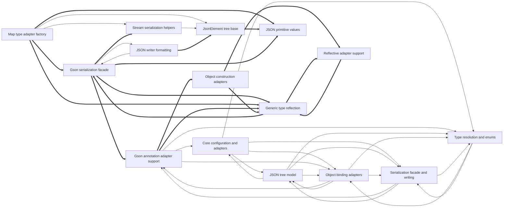

# Dependencies

Arrows point from a user to its dependency. Containment is structural, not a dependency. Graph-confirmed pairs appear in both the tree and resolved call/import edges. Model-inferred pairs appear only in the tree. Graph-only pairs appear only in the graph.
Graph-confirmed and model-inferred pairs count edges between two subtrees. Graph-only pairs count edges between direct node owners. Containment rows show resolved edges between ancestor direct units and a descendant subtree in both directions. Within containment rows count direct owner pairs separately. Neither kind of containment row appears in Mermaid or the three dependency totals.

Selected 15 nodes by connection count. Legend: `-->` graph-confirmed; `-.->` model-inferred; `==>` graph-only.

## Dependency list

- [Core configuration and adapters](nodes/core-configuration-and-adapters.md) → [JSON tree model](nodes/json-tree-model.md) · graph-confirmed · 6 edge(s)
- [Core configuration and adapters](nodes/core-configuration-and-adapters.md) → [Object binding adapters](nodes/object-binding-adapters.md) · graph-confirmed · 2 edge(s)
- [Core configuration and adapters](nodes/core-configuration-and-adapters.md) → [Public utilities and dates](nodes/public-utilities-and-dates.md) · graph-confirmed · 1 edge(s)
- [Core configuration and adapters](nodes/core-configuration-and-adapters.md) → [Serialization facade and writing](nodes/serialization-facade-and-writing.md) · graph-confirmed · 3 edge(s)
- [Core configuration and adapters](nodes/core-configuration-and-adapters.md) → [Type resolution and enums](nodes/type-resolution-and-enums.md) · graph-confirmed · 4 edge(s)
- [Enum runtime adapter selection](nodes/enum-runtime-adapter-selection.md) → [Generic type reflection](nodes/generic-type-reflection.md) · graph-confirmed · 1 edge(s)
- [Gson annotation adapter support](nodes/gson-annotation-adapter-support.md) → [Core configuration and adapters](nodes/core-configuration-and-adapters.md) · graph-confirmed · 1 edge(s)
- [Gson annotation adapter support](nodes/gson-annotation-adapter-support.md) → [Object binding adapters](nodes/object-binding-adapters.md) · graph-confirmed · 1 edge(s)
- [Gson annotation adapter support](nodes/gson-annotation-adapter-support.md) → [Type resolution and enums](nodes/type-resolution-and-enums.md) · graph-confirmed · 2 edge(s)
- [Gson serialization facade](nodes/gson-serialization-facade.md) → [JSON writer formatting](nodes/json-writer-formatting.md) · graph-confirmed · 2 edge(s) · The Gson serialization facade uses JSON writer formatting to emit serialized output.
- [Gson setup and defaults](nodes/gson-setup-and-defaults.md) → [Built-in Java type adapters](nodes/built-in-java-type-adapters.md) · graph-confirmed · 3 edge(s) · Gson setup and defaults use built-in Java type adapters for standard adapter registrations.
- [Java time and SQL adapters](nodes/java-time-and-sql-adapters.md) → [Core configuration and adapters](nodes/core-configuration-and-adapters.md) · graph-confirmed · 4 edge(s)
- [Java time and SQL adapters](nodes/java-time-and-sql-adapters.md) → [Serialization facade and writing](nodes/serialization-facade-and-writing.md) · graph-confirmed · 8 edge(s)
- [JSON element tree components](nodes/json-element-tree-components.md) → [Ordered JSON object map](nodes/ordered-json-object-map.md) · graph-confirmed · 2 edge(s)
- [JSON element tree components](nodes/json-element-tree-components.md) → [Primitive values and utilities](nodes/primitive-values-and-utilities.md) · graph-confirmed · 5 edge(s)
- [JSON primitive values](nodes/json-primitive-values.md) → [Internal Java utilities](nodes/internal-java-utilities.md) · graph-confirmed · 2 edge(s)
- [JSON structure navigation](nodes/json-structure-navigation.md) → [JSON token scanning](nodes/json-token-scanning.md) · graph-confirmed · 10 edge(s) · JSON structure navigation uses token scanning to consume structural tokens and skip nested values.
- [JSON structure navigation](nodes/json-structure-navigation.md) → [JSON value consumption](nodes/json-value-consumption.md) · graph-confirmed · 5 edge(s)
- [JSON tree model](nodes/json-tree-model.md) → [Core configuration and adapters](nodes/core-configuration-and-adapters.md) · graph-confirmed · 1 edge(s)
- [JSON tree model](nodes/json-tree-model.md) → [Object binding adapters](nodes/object-binding-adapters.md) · graph-confirmed · 1 edge(s)
- [JSON tree model](nodes/json-tree-model.md) → [Serialization facade and writing](nodes/serialization-facade-and-writing.md) · graph-confirmed · 3 edge(s)
- [JSON tree model](nodes/json-tree-model.md) → [Streaming and tree reading](nodes/streaming-and-tree-reading.md) · graph-confirmed · 1 edge(s)
- [JSON tree model](nodes/json-tree-model.md) → [Type resolution and enums](nodes/type-resolution-and-enums.md) · graph-confirmed · 3 edge(s)
- [JSON value consumption](nodes/json-value-consumption.md) → [JSON token scanning](nodes/json-token-scanning.md) · graph-confirmed · 16 edge(s) · JSON value consumption uses token scanning to parse scalar values, strings, and property names.
- [JSON writer formatting](nodes/json-writer-formatting.md) → [Gson serialization facade](nodes/gson-serialization-facade.md) · graph-confirmed · 4 edge(s)
- [JsonElement tree adapter](nodes/jsonelement-tree-adapter.md) → [Ordered JSON array](nodes/ordered-json-array.md) · graph-confirmed · 1 edge(s)
- [JsonElement tree base](nodes/jsonelement-tree-base.md) → [Ordered JSON array](nodes/ordered-json-array.md) · graph-confirmed · 1 edge(s)
- [JsonElement tree reader](nodes/jsonelement-tree-reader.md) → [Streaming JSON reader internals](nodes/streaming-json-reader-internals.md) · graph-confirmed · 1 edge(s)
- [Map type adapter factory](nodes/map-type-adapter-factory.md) → [JsonElement tree base](nodes/jsonelement-tree-base.md) · graph-confirmed · 5 edge(s)
- [Map type adapter factory](nodes/map-type-adapter-factory.md) → [Stream serialization helpers](nodes/stream-serialization-helpers.md) · graph-confirmed · 2 edge(s)
- [Object binding adapters](nodes/object-binding-adapters.md) → [Gson annotation adapter support](nodes/gson-annotation-adapter-support.md) · graph-confirmed · 1 edge(s)
- [Object binding adapters](nodes/object-binding-adapters.md) → [JSON tree model](nodes/json-tree-model.md) · graph-confirmed · 1 edge(s)
- [Object binding adapters](nodes/object-binding-adapters.md) → [Serialization facade and writing](nodes/serialization-facade-and-writing.md) · graph-confirmed · 3 edge(s)
- [Object binding adapters](nodes/object-binding-adapters.md) → [Type resolution and enums](nodes/type-resolution-and-enums.md) · graph-confirmed · 6 edge(s) · Object binding adapters use type resolution and enum handling when constructing and binding Java objects.
- [Object construction adapters](nodes/object-construction-adapters.md) → [Reflection and exclusion rules](nodes/reflection-and-exclusion-rules.md) · graph-confirmed · 7 edge(s)
- [Ordered JSON array](nodes/ordered-json-array.md) → [JsonElement tree base](nodes/jsonelement-tree-base.md) · graph-confirmed · 1 edge(s)
- [Ordered JSON object map](nodes/ordered-json-object-map.md) → [JSON element tree components](nodes/json-element-tree-components.md) · graph-confirmed · 1 edge(s)
- [Public utilities and dates](nodes/public-utilities-and-dates.md) → [JSON tree model](nodes/json-tree-model.md) · graph-confirmed · 3 edge(s)
- [Public utilities and dates](nodes/public-utilities-and-dates.md) → [Serialization facade and writing](nodes/serialization-facade-and-writing.md) · graph-confirmed · 3 edge(s)
- [Reflection and exclusion rules](nodes/reflection-and-exclusion-rules.md) → [Object construction adapters](nodes/object-construction-adapters.md) · graph-confirmed · 1 edge(s)
- [Reflective adapter support](nodes/reflective-adapter-support.md) → [Serialization exclusion policy](nodes/serialization-exclusion-policy.md) · graph-confirmed · 1 edge(s)
- [Serialization exclusion policy](nodes/serialization-exclusion-policy.md) → [Reflective adapter support](nodes/reflective-adapter-support.md) · graph-confirmed · 2 edge(s)
- [Serialization facade and writing](nodes/serialization-facade-and-writing.md) → [Gson annotation adapter support](nodes/gson-annotation-adapter-support.md) · graph-confirmed · 1 edge(s)
- [Serialization facade and writing](nodes/serialization-facade-and-writing.md) → [JSON tree model](nodes/json-tree-model.md) · graph-confirmed · 7 edge(s)
- [Serialization facade and writing](nodes/serialization-facade-and-writing.md) → [Type resolution and enums](nodes/type-resolution-and-enums.md) · graph-confirmed · 9 edge(s)
- [Stream serialization helpers](nodes/stream-serialization-helpers.md) → [JsonElement tree adapter](nodes/jsonelement-tree-adapter.md) · graph-confirmed · 1 edge(s)
- [Stream serialization helpers](nodes/stream-serialization-helpers.md) → [JsonElement tree base](nodes/jsonelement-tree-base.md) · graph-confirmed · 1 edge(s)
- [Streaming and tree reading](nodes/streaming-and-tree-reading.md) → [JSON tree model](nodes/json-tree-model.md) · graph-confirmed · 5 edge(s) · Streaming and tree reading use the JSON tree model to read JsonElement trees.
- [Streaming and tree reading](nodes/streaming-and-tree-reading.md) → [Object binding adapters](nodes/object-binding-adapters.md) · graph-confirmed · 2 edge(s)
- [Streaming and tree reading](nodes/streaming-and-tree-reading.md) → [Serialization facade and writing](nodes/serialization-facade-and-writing.md) · graph-confirmed · 1 edge(s)
- [Streaming JSON reader core](nodes/streaming-json-reader-core.md) → [JSON token scanning](nodes/json-token-scanning.md) · graph-confirmed · 3 edge(s)
- [Streaming JSON reader internals](nodes/streaming-json-reader-internals.md) → [JsonElement tree reader](nodes/jsonelement-tree-reader.md) · graph-confirmed · 1 edge(s)
- [Type resolution and enums](nodes/type-resolution-and-enums.md) → [Object binding adapters](nodes/object-binding-adapters.md) · graph-confirmed · 2 edge(s)
- [Type resolution and enums](nodes/type-resolution-and-enums.md) → [Serialization facade and writing](nodes/serialization-facade-and-writing.md) · graph-confirmed · 2 edge(s)
- [Gson serialization facade](nodes/gson-serialization-facade.md) → [Generic type reflection](nodes/generic-type-reflection.md) · graph-only · 9 edge(s)
- [Java time and SQL adapters](nodes/java-time-and-sql-adapters.md) → [Gson serialization facade](nodes/gson-serialization-facade.md) · graph-only · 8 edge(s)
- [Object construction adapters](nodes/object-construction-adapters.md) → [Reflective adapter support](nodes/reflective-adapter-support.md) · graph-only · 7 edge(s)
- [Gson builder configuration](nodes/gson-builder-configuration.md) → [Generic type reflection](nodes/generic-type-reflection.md) · graph-only · 4 edge(s)
- [Java time and SQL adapters](nodes/java-time-and-sql-adapters.md) → [Null-safe atomic adapters](nodes/null-safe-atomic-adapters.md) · graph-only · 4 edge(s)
- [Reflective adapter support](nodes/reflective-adapter-support.md) → [Generic type reflection](nodes/generic-type-reflection.md) · graph-only · 4 edge(s)
- [Gson serialization facade](nodes/gson-serialization-facade.md) → [Stream serialization helpers](nodes/stream-serialization-helpers.md) · graph-only · 3 edge(s)
- [JsonElement tree reader](nodes/jsonelement-tree-reader.md) → [JSON primitive values](nodes/json-primitive-values.md) · graph-only · 3 edge(s)
- [Map type adapter factory](nodes/map-type-adapter-factory.md) → [Generic type reflection](nodes/generic-type-reflection.md) · graph-only · 3 edge(s)
- [Map type adapter factory](nodes/map-type-adapter-factory.md) → [JSON primitive values](nodes/json-primitive-values.md) · graph-only · 3 edge(s)
- [Public API utility classes](nodes/public-api-utility-classes.md) → [Gson serialization facade](nodes/gson-serialization-facade.md) · graph-only · 3 edge(s)
- [Basic Java type adapters](nodes/basic-java-type-adapters.md) → [Internal Java utilities](nodes/internal-java-utilities.md) · graph-only · 2 edge(s)
- [Core Gson default adapters](nodes/core-gson-default-adapters.md) → [Null-safe atomic adapters](nodes/null-safe-atomic-adapters.md) · graph-only · 2 edge(s)
- [Generic type reflection](nodes/generic-type-reflection.md) → [Reflective adapter support](nodes/reflective-adapter-support.md) · graph-only · 2 edge(s)
- [Gson annotation adapter support](nodes/gson-annotation-adapter-support.md) → [Generic type reflection](nodes/generic-type-reflection.md) · graph-only · 2 edge(s)
- [Gson builder configuration](nodes/gson-builder-configuration.md) → [Stream serialization helpers](nodes/stream-serialization-helpers.md) · graph-only · 2 edge(s)
- [JsonElement tree base](nodes/jsonelement-tree-base.md) → [JSON primitive values](nodes/json-primitive-values.md) · graph-only · 2 edge(s)
- [Map type adapter factory](nodes/map-type-adapter-factory.md) → [Gson serialization facade](nodes/gson-serialization-facade.md) · graph-only · 2 edge(s)
- [Null-safe atomic adapters](nodes/null-safe-atomic-adapters.md) → [Reflective adapter support](nodes/reflective-adapter-support.md) · graph-only · 2 edge(s)
- [Object construction adapters](nodes/object-construction-adapters.md) → [Generic type reflection](nodes/generic-type-reflection.md) · graph-only · 2 edge(s)
- [Public API utility classes](nodes/public-api-utility-classes.md) → [Stream serialization helpers](nodes/stream-serialization-helpers.md) · graph-only · 2 edge(s)
- [Core Gson default adapters](nodes/core-gson-default-adapters.md) → [Basic Java type adapters](nodes/basic-java-type-adapters.md) · graph-only · 1 edge(s)
- [Core Gson default adapters](nodes/core-gson-default-adapters.md) → [Gson serialization facade](nodes/gson-serialization-facade.md) · graph-only · 1 edge(s)
- [Core Gson default adapters](nodes/core-gson-default-adapters.md) → [ISO-8601 date utility](nodes/iso-8601-date-utility.md) · graph-only · 1 edge(s)
- [Enum runtime adapter selection](nodes/enum-runtime-adapter-selection.md) → [Gson serialization facade](nodes/gson-serialization-facade.md) · graph-only · 1 edge(s)
- [Generic type reflection](nodes/generic-type-reflection.md) → [Gson serialization facade](nodes/gson-serialization-facade.md) · graph-only · 1 edge(s)
- [Gson annotation adapter support](nodes/gson-annotation-adapter-support.md) → [Null-safe atomic adapters](nodes/null-safe-atomic-adapters.md) · graph-only · 1 edge(s)
- [Gson annotation adapter support](nodes/gson-annotation-adapter-support.md) → [Object construction adapters](nodes/object-construction-adapters.md) · graph-only · 1 edge(s)
- [Gson builder configuration](nodes/gson-builder-configuration.md) → [Gson serialization facade](nodes/gson-serialization-facade.md) · graph-only · 1 edge(s)
- [Gson builder configuration](nodes/gson-builder-configuration.md) → [JsonElement tree base](nodes/jsonelement-tree-base.md) · graph-only · 1 edge(s)
- [Gson serialization facade](nodes/gson-serialization-facade.md) → [Gson annotation adapter support](nodes/gson-annotation-adapter-support.md) · graph-only · 1 edge(s)
- [Gson serialization facade](nodes/gson-serialization-facade.md) → [JSON primitive values](nodes/json-primitive-values.md) · graph-only · 1 edge(s)
- [JSON token scanning](nodes/json-token-scanning.md) → [Reflective adapter support](nodes/reflective-adapter-support.md) · graph-only · 1 edge(s)
- [JSON value consumption](nodes/json-value-consumption.md) → [Reflective adapter support](nodes/reflective-adapter-support.md) · graph-only · 1 edge(s)
- [JSON writer formatting](nodes/json-writer-formatting.md) → [JsonElement tree base](nodes/jsonelement-tree-base.md) · graph-only · 1 edge(s)
- [JSON writer formatting](nodes/json-writer-formatting.md) → [Ordered JSON array](nodes/ordered-json-array.md) · graph-only · 1 edge(s)
- [JSON writer formatting](nodes/json-writer-formatting.md) → [Ordered JSON object map](nodes/ordered-json-object-map.md) · graph-only · 1 edge(s)
- [JsonElement tree adapter](nodes/jsonelement-tree-adapter.md) → [JsonElement tree reader](nodes/jsonelement-tree-reader.md) · graph-only · 1 edge(s)
- [JsonElement tree adapter](nodes/jsonelement-tree-adapter.md) → [Ordered JSON object map](nodes/ordered-json-object-map.md) · graph-only · 1 edge(s)
- [JsonElement tree base](nodes/jsonelement-tree-base.md) → [Ordered JSON object map](nodes/ordered-json-object-map.md) · graph-only · 1 edge(s)

Graph-only pairs are ranked by edge count; 18 omitted.

### Within containment

Within containment: 0 pairs, ranked by edge count; 0 omitted. Each graph list keeps at most 40 pairs independently.
