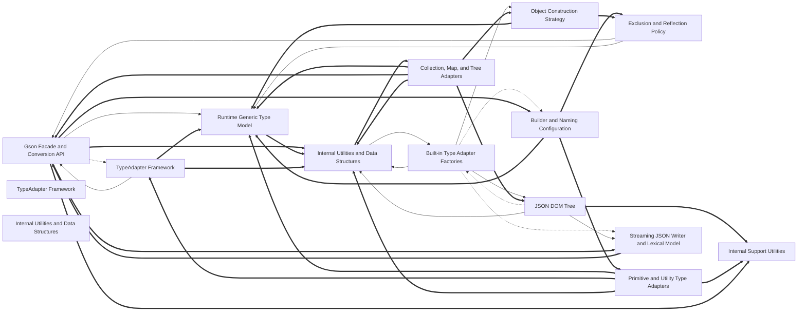

# Codebase Explorer

## How to read this report

Start with the responsibility tree in INDEX. Open a node page for your maintenance question, then choose a unit.
Node pages explain responsibilities. `catalog.json` stores full signatures, source ranges, folded members, relation evidence, and graph edges.
Set `RUN` to the absolute path of this run directory. Find an id, then read its explanation or frozen source.

```sh
cbe find --run-dir "$RUN" --term "SEARCH_TERM"
cbe query --run-dir "$RUN" --id "$ID"
cbe source --run-dir "$RUN" --id "$ID" --context 2
```

`ID` can be a unit id, symbol id, or file path. Commands return the content directly.
`source` reads frozen source and verifies its digest first.
The catalog also stores reverse graph edges, statuses, and raw evidence.

## Responsibility tree

- [Gson JSON Library](nodes/gson-json-library.md) (0 units)
  - [Gson JSON Binding Library](nodes/r1-gson-root.md) (0 units)
    - [Gson Facade and Conversion API](nodes/r1-facade-api.md) (17 units)
      - [Gson](nodes/r1-facade-api.md#u-e84909a2abed) · Main Gson facade converting Java objects to JSON and back, holding immutable builder configuration and a type-adapter cache.
    - [Runtime Generic Type Model](nodes/r1-type-model.md) (19 units)
      - [type-token-class](nodes/r1-type-model.md#u-55a9c25d6eea) · Represents a generic type T at runtime by capturing the type argument of an anonymous subclass despite erasure.
    - [TypeAdapter Framework](nodes/r1-adapter-framework.md) (13 units)
      - [TypeAdapter](nodes/r1-adapter-framework.md#u-98025607c27a) · Abstract base class converting Java objects of type T to and from JSON; subclasses implement write(JsonWriter, T) and read(JsonReader), which must each handle exactly one JSON value (and must tolerate nulls unless wrapped with nullSafe).
      - [Tree-Style Serializer Bridge](nodes/r1-tree-adapter-bridge.md) (13 units)
        - [TreeTypeAdapter](nodes/r1-tree-adapter-bridge.md#u-bfcdf89b8b0c) · Bridges Gson 1.x tree-style JsonSerializer/JsonDeserializer into the streaming TypeAdapter world.
    - [Built-in Type Adapters](nodes/r1-builtin-adapters.md) (25 units)
      - [arraytypeadapter.java-class](nodes/r1-builtin-adapters.md#u-bd31bdfb1fd0) · ArrayTypeAdapter is a final TypeAdapter<Object> converting between Java arrays (primitive or Object arrays) and JSON arrays.
      - [java.time Adapters](nodes/r1-java-time-adapters.md) (9 units)
        - [javaTimeTypeAdapters-integer-field-adapters](nodes/r1-java-time-adapters.md#u-0a49ab62d7bc) · Defines eight TypeAdapter constants for Duration, Instant, LocalDate, LocalTime, MonthDay, Period, Year and YearMonth, each extending the (external) IntegerFieldsTypeAdapter base so the value is written as a JSON object of named integer fields matching the JDK 21 reflective field layout.
    - [Streaming JSON Reading](nodes/r1-streaming-json.md) (69 units)
      - [JsonReader](nodes/r1-streaming-json.md#u-92ec22311967) · A streaming RFC 8259 JSON token reader over a java.io.Reader, with configurable strictness and nesting limit.
    - [Exclusion and Reflection Policy](nodes/r1-reflection-policy.md) (26 units)
      - [exclusionstrategy-java](nodes/r1-reflection-policy.md#u-9e4317139aec) · Defines a serialization/deserialization exclusion policy implemented as a two-method interface.
    - [JSON Element Model and Exceptions](nodes/r1-json-element-model.md) (4 units)
      - [JsonNull](nodes/r1-json-element-model.md#u-e36f9a760083) · Represents the JSON null value as an immutable, final JsonElement.
    - [Internal Support Utilities](nodes/r1-internal-support.md) (10 units)
      - [ISO8601Utils](nodes/r1-internal-support.md#u-19d078fce755) · Stateless utility class for formatting and parsing ISO-8601 dates, avoiding SimpleDateFormat for speed and GC friendliness.
  - [Gson JSON Library](nodes/r2-gson.md) (0 units)
    - [Public Contracts and Annotations](nodes/r2-public-api.md) (18 units)
      - [fieldattributes-java](nodes/r2-public-api.md#u-72f87f0ef005) · Immutable wrapper exposing annotation, type, and modifier information about a single reflected field, used by ExclusionStrategy implementations.
    - [Builder and Naming Configuration](nodes/r2-configuration.md) (11 units)
      - [GsonBuilder](nodes/r2-configuration.md#u-01c61f219079) · Configures and builds immutable Gson instances: it holds mutable configuration state and fluent setters, then assembles a factory pipeline in create().
    - [JSON DOM Tree](nodes/r2-dom-tree.md) (8 units)
      - [jsonelement-class](nodes/r2-dom-tree.md#u-103ba2beeebe) · Abstract base of all JSON tree nodes (JsonObject, JsonArray, JsonPrimitive, JsonNull).
      - [Tree-Bound Writer](nodes/r2-tree-writer.md) (22 units)
        - [jsontreewriter-java-residual](nodes/r2-tree-writer.md#u-7c8be5507949) · License header, package, and imports for JsonTreeWriter; non-behavioral material.
    - [Streaming JSON Writer and Lexical Model](nodes/r2-streaming.md) (22 units)
      - [JsonWriter](nodes/r2-streaming.md#u-d122b2c80531) · Streaming writer that emits RFC 8259 JSON to a Writer token by token, tracking nesting with an int scope stack seeded to EMPTY_DOCUMENT by an instance initializer.
    - [Internal Utilities and Data Structures](nodes/r2-infrastructure.md) (8 units)
      - [Streams](nodes/r2-infrastructure.md#u-931987e48ef4) · Static helpers for reading and writing Gson parse trees over streams; instantiation is blocked by a constructor throwing UnsupportedOperationException.
      - [Insertion-Ordered AVL Map](nodes/r2-linkedtreemap.md) (10 units)
        - [LinkedTreeMap](nodes/r2-linkedtreemap.md#u-603f4565d5fe) · Map of comparable keys to values that iterates in insertion order while using key comparison only to structure an AVL tree for efficient put/get/remove.
    - [Object Construction Strategy](nodes/r2-object-construction.md) (12 units)
      - [ConstructorConstructor](nodes/r2-object-construction.md#u-7b2651c48b48) · Chooses and caches-free construction strategy for requested types, returning an ObjectConstructor selected among registered InstanceCreators, special collections, no-args constructors, JDK default implementations, or Unsafe.
    - [Built-in Type Adapter Factories](nodes/r2-default-adapters.md) (0 units)
      - [Primitive and Utility Type Adapters](nodes/r2-primitive-adapters.md) (8 units)
        - [typeadapters-big-numbers](nodes/r2-primitive-adapters.md#u-5bbd44975629) · Groups the arbitrary-precision and deferred number adapters.
      - [Collection, Map, and Tree Adapters](nodes/r2-collection-map-adapters.md) (15 units)
        - [collectiontypeadapterfactory.java-class](nodes/r2-collection-map-adapters.md#u-cc66736ed77d) · CollectionTypeAdapterFactory is a final TypeAdapterFactory that adapts homogeneous collections.
      - [Date and Time Adapters](nodes/r2-date-time-adapters.md) (15 units)
        - [DefaultDateTypeAdapter](nodes/r2-date-time-adapters.md#u-c62e215f5965) · Serializes and deserializes Date subclasses via a configurable list of DateFormat objects, per a DateType strategy.
    - [Reflection-Based Object Binding](nodes/r2-reflective-binding.md) (0 units)
      - [ReflectiveTypeAdapterFactory](nodes/r2-reflective-type-adapter-factory.md) (14 units)
        - [reflectiveTypeAdapterFactory-class-header](nodes/r2-reflective-type-adapter-factory.md#u-8440716539c2) · Declares ReflectiveTypeAdapterFactory and its five collaborators injected by the constructor: ConstructorConstructor for instance creation, FieldNamingStrategy for name translation, Excluder for field filtering, JsonAdapterAnnotationTypeAdapterFactory for @JsonAdapter handling, and the list of ReflectionAccessFilter.
      - [@JsonAdapter Annotation Handling](nodes/r2-jsonadapter-annotation-factory.md) (8 units)
        - [gson/src/main/java/com/google/gson/internal/bind/JsonAdapterAnnotationTypeAdapterFactory.java:JsonAdapterAnnotationTypeAdapterFactory](nodes/r2-jsonadapter-annotation-factory.md#u-637578f857dc) · Implements the handling of @JsonAdapter: given a target type, it looks up the annotation and builds an adapter from the annotated class.
  - [Public API, Facade and Builder Configuration](nodes/conversion-api.md) (0 units)
    - [Gson Facade and Conversion API](nodes/facade-api.md) (0 units)
    - [Public Contracts and Annotations](nodes/public-api.md) (0 units)
    - [Builder and Naming Configuration](nodes/configuration.md) (0 units)
  - [Runtime Generic Type Model](nodes/type-model.md) (0 units)
  - [Type Adapter Pipeline and Object Construction](nodes/adapter-pipeline.md) (0 units)
    - [TypeAdapter Framework](nodes/adapter-framework.md) (0 units)
    - [Built-in Type Adapters](nodes/builtin-adapters.md) (0 units)
    - [Built-in Type Adapter Factories](nodes/default-adapters.md) (0 units)
    - [Object Construction Strategy](nodes/object-construction.md) (0 units)
  - [JSON Streaming and DOM Representation](nodes/json-representation.md) (0 units)
    - [Streaming JSON Reading](nodes/streaming-json.md) (0 units)
    - [Streaming JSON Writer and Lexical Model](nodes/streaming.md) (0 units)
    - [JSON DOM Tree](nodes/dom-tree.md) (0 units)
    - [JSON Element Exceptions](nodes/json-element-model.md) (0 units)
  - [Reflection Policy and Object Binding](nodes/reflective-binding.md) (0 units)
    - [Exclusion and Reflection Policy](nodes/reflection-policy.md) (0 units)
    - [Reflection-Based Object Binding](nodes/reflective-type-adapter-factory.md) (0 units)
  - [Internal Utilities and Data Structures](nodes/internal-infrastructure.md) (0 units)
    - [Internal Utilities and Data Structures](nodes/infrastructure.md) (0 units)
    - [Internal Support Utilities](nodes/internal-support.md) (0 units)

## Reading stats

- units: 376 · semantic nodes: 49 · dispositioned inventory ids: 1754
- source ranges are program-derived from the inventory, never model-written

## Graph coverage

Source: static analysis graph. Resolved relations are graph-confirmed; this does not guarantee semantic correctness. External targets are outside the repository; ambiguous targets have multiple candidates. Unresolved or unsupported relations, and languages or relation kinds without coverage, rely on model inference and may be inaccurate.
Import and call status ratios use the edge count of each kind. CFG and dataflow are structural edges; only their counts are shown, without status ratios.
java import: resolved 304/685 (44%), external 381/685 (56%) · java call: resolved 1111/3122 (36%), ambiguous 515/3122 (16%), external 1496/3122 (48%).
java structural edges: cfg=27509, dataflow=50000.
unknown call: resolved 92/109 (84%), external 17/109 (16%).
Incomplete capabilities: java/call partial; java/dataflow partial.
Program checks: dangling edges 0; nodes outside manifest 35; nodes with missing files 35.

## Overview

This repository is the Gson library, which converts between Java objects and JSON. Two region subtrees describe the same library from complementary angles (r1-... and r2-... ids) plus a merged cross-region view. Entry points live in the facade (r1-facade-api / facade-api: toJson, fromJson, toJsonTree, adapter lookup and caching) and in GsonBuilder configuration (r2-configuration / configuration), which freezes custom adapters and strategies into an ordered factory list consumed by the adapter pipeline. The runtime generic type model (r1-type-model / type-model) supplies TypeToken and GsonTypes so every adapter claims and resolves types despite erasure. The TypeAdapter framework (r1-adapter-framework / adapter-framework) defines the adapter contract, delegation, and runtime-type wrapper; built-in adapters cover arrays, enums, numbers/objects, java.time, dates, collections, maps, primitives, and JsonElement itself (r1-builtin-adapters, r1-java-time-adapters, r2-default-adapters and children). JSON itself exists in two representations: the immutable DOM (r2-dom-tree / dom-tree, JsonObject backed by LinkedTreeMap) and token-level streaming (r1-streaming-json for reading, r2-streaming for writing, sharing JsonScope/Strictness/JsonToken); Streams and the tree-bound reader/writer bridge the two. Reflection-based binding (r2-reflective-type-adapter-factory plus r1-reflection-policy / reflective-binding) turns arbitrary classes and records into adapters, honoring exclusion strategies, naming, access filters, and @JsonAdapter. Object construction (r2-object-construction / object-construction) decides in strict priority how instances are created. Internal infrastructure (LinkedTreeMap, LazilyParsedNumber, JavaVersion, date utilities) supports all layers without being public API. Maintenance should start at gson-json-library, then follow the region subtree relevant to the question.

## Maintenance navigation

Navigation by maintenance question: - 'How does a toJson/fromJson call flow?' Open r1-facade-api (facade-api); it shows adapter lookup/caching and how strictness and FormattingStyle propagate to JsonReader/JsonWriter (r2-streaming, r1-streaming-json). - 'Why is my custom adapter not used / how do adapters register?' Open r2-configuration (configuration) for GsonBuilder's factory list assembly, and r2-public-api (public-api) for the SPI contracts users implement; the tree-style legacy bridge is r1-tree-adapter-bridge, @JsonAdapter handling is r2-jsonadapter-annotation-factory. - 'Where is the default mapping for type X?' Open r2-default-adapters and its children: r2-primitive-adapters (scalars/utilities), r2-collection-map-adapters (collections, maps, JsonElement), r2-date-time-adapters (Date, java.sql, optional java.time), and r1-builtin-adapters / r1-java-time-adapters for arrays, enums, Number/Object, and java.time composites. - 'Which constructor instantiates my class?' Open r2-object-construction (object-construction); ConstructorConstructor.get is the single priority-ordered decision point all factories use. - 'Why is a field omitted or renamed / how are records bound?' Open r2-reflective-type-adapter-factory for BoundField collection and record handling, and r1-reflection-policy (reflection-policy) for Excluder, FieldNamingStrategy, and ReflectionAccessFilter. - 'Parsing errors, leniency, or tokenization?' Open r1-streaming-json (JsonReader, JsonTreeReader, JsonParser) and r2-streaming for writer-side state (JsonScope, Strictness, MalformedJsonException). - 'Tree equality, ordering, or JsonObject internals?' Open r2-dom-tree (dom-tree) and r2-linkedtreemap (insertion-ordered AVL map; note its serialization caveat). - 'Generic type resolution failures (TypeToken, wildcards, type variables)?' Open r1-type-model (type-model). - 'Numbers, dates, parse limits?' Open r1-internal-support and r2-infrastructure (infrastructure) for shared utilities like LazilyParsedNumber, NumberLimits, and date formatting. For writer-level questions (formatting, indentation, escaping), open r2-streaming and its JsonWriter units such as grp:jsonwriter-value-overloads and grp:jsonwriter-stack-helpers. Note uncertainty: dependencies marked model-inferred describe responsibility-based relationships, so verify exact call sites in the units before refactoring; the r1/r2 region pair intentionally overlaps, so prefer the region whose units contain the concrete class you are changing.

## Dependency view

Arrows point from a user to its dependency. Containment is structural, not a dependency. Graph-confirmed pairs appear in both the tree and resolved call/import edges. Model-inferred pairs appear only in the tree. Graph-only pairs appear only in the graph.
Graph-confirmed and model-inferred pairs count edges between two subtrees. Graph-only pairs count edges between direct node owners. Containment rows show resolved edges between ancestor direct units and a descendant subtree in both directions. Within containment rows count direct owner pairs separately. Neither kind of containment row appears in Mermaid or the three dependency totals.



Selected 15 nodes by connection count. Legend: `-->` graph-confirmed; `-.->` model-inferred; `==>` graph-only.

## Dependency list

- [TypeAdapter Framework](nodes/adapter-framework.md) → [JSON Streaming and DOM Representation](nodes/json-representation.md) · model-inferred · 0 edge(s) · Adapters read and write via JsonReader/JsonWriter and produce JsonElement trees via toJsonTree.
- [TypeAdapter Framework](nodes/adapter-framework.md) → [Runtime Generic Type Model](nodes/type-model.md) · model-inferred · 0 edge(s) · Adapter factories claim and match types using TypeToken and the GsonTypes type model.
- [Type Adapter Pipeline and Object Construction](nodes/adapter-pipeline.md) → [Internal Utilities and Data Structures](nodes/internal-infrastructure.md) · model-inferred · 0 edge(s) · Adapters rely on JavaVersion, date utilities, and Streams bridging trees and streams.
- [Built-in Type Adapters](nodes/builtin-adapters.md) → [Internal Utilities and Data Structures](nodes/internal-infrastructure.md) · model-inferred · 0 edge(s)
- [Builder and Naming Configuration](nodes/configuration.md) → [TypeAdapter Framework](nodes/adapter-framework.md) · model-inferred · 0 edge(s) · GsonBuilder freezes custom adapters into an ordered factory list that the adapter pipeline consumes.
- [Public API, Facade and Builder Configuration](nodes/conversion-api.md) → [Runtime Generic Type Model](nodes/type-model.md) · model-inferred · 0 edge(s)
- [Built-in Type Adapter Factories](nodes/default-adapters.md) → [Internal Utilities and Data Structures](nodes/internal-infrastructure.md) · model-inferred · 0 edge(s)
- [JSON DOM Tree](nodes/dom-tree.md) → [Internal Utilities and Data Structures](nodes/internal-infrastructure.md) · model-inferred · 0 edge(s)
- [Gson Facade and Conversion API](nodes/facade-api.md) → [TypeAdapter Framework](nodes/adapter-framework.md) · model-inferred · 0 edge(s)
- [Gson Facade and Conversion API](nodes/facade-api.md) → [JSON Streaming and DOM Representation](nodes/json-representation.md) · model-inferred · 0 edge(s)
- [Object Construction Strategy](nodes/object-construction.md) → [Runtime Generic Type Model](nodes/type-model.md) · model-inferred · 0 edge(s)
- [TypeAdapter Framework](nodes/r1-adapter-framework.md) → [Gson Facade and Conversion API](nodes/r1-facade-api.md) · graph-confirmed · 5 edge(s)
- [Built-in Type Adapters](nodes/r1-builtin-adapters.md) → [TypeAdapter Framework](nodes/r1-adapter-framework.md) · graph-confirmed · 4 edge(s) · Built-in adapters compose through TypeAdapter.nullSafe and the runtime-type wrapper of the framework.
- [Built-in Type Adapters](nodes/r1-builtin-adapters.md) → [Gson Facade and Conversion API](nodes/r1-facade-api.md) · graph-confirmed · 9 edge(s)
- [Built-in Type Adapters](nodes/r1-builtin-adapters.md) → [Runtime Generic Type Model](nodes/r1-type-model.md) · graph-confirmed · 8 edge(s)
- [Gson Facade and Conversion API](nodes/r1-facade-api.md) → [TypeAdapter Framework](nodes/r1-adapter-framework.md) · model-inferred · 0 edge(s) · The facade performs adapter lookup, caching, and delegate resolution through the TypeAdapter framework when running conversions.
- [Gson Facade and Conversion API](nodes/r1-facade-api.md) → [Streaming JSON Reading](nodes/r1-streaming-json.md) · graph-confirmed · 6 edge(s) · The facade creates and configures JsonReader instances that parsing facades and conversions read through.
- [Gson Facade and Conversion API](nodes/r1-facade-api.md) → [Runtime Generic Type Model](nodes/r1-type-model.md) · graph-confirmed · 11 edge(s) · fromJson/toJson/getAdapter resolve user-supplied generic types via TypeToken and GsonTypes.
- [java.time Adapters](nodes/r1-java-time-adapters.md) → [TypeAdapter Framework](nodes/r1-adapter-framework.md) · graph-confirmed · 4 edge(s)
- [java.time Adapters](nodes/r1-java-time-adapters.md) → [Built-in Type Adapters](nodes/r1-builtin-adapters.md) · containment · → 0 / ← 0 edge(s) (ancestor direct units and descendant subtree; → follows ` r1-java-time-adapters ` → ` r1-builtin-adapters `)
- [java.time Adapters](nodes/r1-java-time-adapters.md) → [Gson Facade and Conversion API](nodes/r1-facade-api.md) · graph-confirmed · 7 edge(s) · Composite java.time adapters resolve their sub-adapters via Gson.getAdapter.
- [Exclusion and Reflection Policy](nodes/r1-reflection-policy.md) → [Gson Facade and Conversion API](nodes/r1-facade-api.md) · graph-confirmed · 1 edge(s) · Excluder.create delegates to Gson.getDelegateAdapter when wiring into the factory chain.
- [Exclusion and Reflection Policy](nodes/r1-reflection-policy.md) → [Runtime Generic Type Model](nodes/r1-type-model.md) · graph-confirmed · 1 edge(s)
- [Streaming JSON Reading](nodes/r1-streaming-json.md) → [Internal Support Utilities](nodes/r1-internal-support.md) · model-inferred · 0 edge(s)
- [Tree-Style Serializer Bridge](nodes/r1-tree-adapter-bridge.md) → [Gson Facade and Conversion API](nodes/r1-facade-api.md) · graph-confirmed · 4 edge(s) · TreeTypeAdapter's GsonContextImpl forwards nested serialize/deserialize requests to the Gson facade overloads.
- [Builder and Naming Configuration](nodes/r2-configuration.md) → [Date and Time Adapters](nodes/r2-date-time-adapters.md) · graph-confirmed · 7 edge(s) · GsonBuilder.addDateTypeAdapters installs DefaultDateTypeAdapter factories during configuration.
- [Builder and Naming Configuration](nodes/r2-configuration.md) → [Public Contracts and Annotations](nodes/r2-public-api.md) · model-inferred · 0 edge(s)
- [Built-in Type Adapter Factories](nodes/r2-default-adapters.md) → [Builder and Naming Configuration](nodes/r2-configuration.md) · model-inferred · 0 edge(s)
- [Built-in Type Adapter Factories](nodes/r2-default-adapters.md) → [JSON DOM Tree](nodes/r2-dom-tree.md) · graph-confirmed · 21 edge(s)
- [Built-in Type Adapter Factories](nodes/r2-default-adapters.md) → [Internal Utilities and Data Structures](nodes/r2-infrastructure.md) · graph-confirmed · 5 edge(s)
- [Built-in Type Adapter Factories](nodes/r2-default-adapters.md) → [Object Construction Strategy](nodes/r2-object-construction.md) · graph-confirmed · 2 edge(s) · Collection, map, and @JsonAdapter factories create their container instances through ConstructorConstructor.get.
- [Built-in Type Adapter Factories](nodes/r2-default-adapters.md) → [Streaming JSON Writer and Lexical Model](nodes/r2-streaming.md) · model-inferred · 0 edge(s)
- [JSON DOM Tree](nodes/r2-dom-tree.md) → [Built-in Type Adapter Factories](nodes/r2-default-adapters.md) · model-inferred · 0 edge(s)
- [JSON DOM Tree](nodes/r2-dom-tree.md) → [Internal Utilities and Data Structures](nodes/r2-infrastructure.md) · graph-confirmed · 13 edge(s) · JsonObject stores its members insertion-ordered in LinkedTreeMap and elements use Streams for bridging.
- [JSON DOM Tree](nodes/r2-dom-tree.md) → [Streaming JSON Writer and Lexical Model](nodes/r2-streaming.md) · graph-confirmed · 6 edge(s)
- [Internal Utilities and Data Structures](nodes/r2-infrastructure.md) → [Built-in Type Adapter Factories](nodes/r2-default-adapters.md) · graph-confirmed · 2 edge(s) · Streams.parse and Streams.write convert between JsonElement trees and streams via JsonElementTypeAdapter.
- [@JsonAdapter Annotation Handling](nodes/r2-jsonadapter-annotation-factory.md) → [Public Contracts and Annotations](nodes/r2-public-api.md) · model-inferred · 0 edge(s)
- [Object Construction Strategy](nodes/r2-object-construction.md) → [Public Contracts and Annotations](nodes/r2-public-api.md) · graph-confirmed · 1 edge(s) · ConstructorConstructor delegates instance creation to user-registered InstanceCreator implementations.
- [ReflectiveTypeAdapterFactory](nodes/r2-reflective-type-adapter-factory.md) → [@JsonAdapter Annotation Handling](nodes/r2-jsonadapter-annotation-factory.md) · graph-confirmed · 1 edge(s) · createBoundField resolves @JsonAdapter-annotated fields through JsonAdapterAnnotationTypeAdapterFactory.getTypeAdapter.
- [ReflectiveTypeAdapterFactory](nodes/r2-reflective-type-adapter-factory.md) → [Object Construction Strategy](nodes/r2-object-construction.md) · graph-confirmed · 1 edge(s) · ReflectiveTypeAdapterFactory obtains ObjectConstructors from ConstructorConstructor to instantiate target objects.
- [Tree-Bound Writer](nodes/r2-tree-writer.md) → [JSON DOM Tree](nodes/r2-dom-tree.md) · containment · → 3 / ← 0 edge(s) (ancestor direct units and descendant subtree; → follows ` r2-tree-writer ` → ` r2-dom-tree `) · JsonTreeWriter assembles JsonElement, JsonArray, and JsonObject nodes instead of emitting characters.
- [Tree-Bound Writer](nodes/r2-tree-writer.md) → [Streaming JSON Writer and Lexical Model](nodes/r2-streaming.md) · graph-confirmed · 5 edge(s) · JsonTreeWriter mirrors the streaming JsonWriter structural contract while building a tree.
- [Reflection Policy and Object Binding](nodes/reflective-binding.md) → [Runtime Generic Type Model](nodes/type-model.md) · model-inferred · 0 edge(s)
- [Reflection-Based Object Binding](nodes/reflective-type-adapter-factory.md) → [Type Adapter Pipeline and Object Construction](nodes/adapter-pipeline.md) · model-inferred · 0 edge(s)
- [Reflection-Based Object Binding](nodes/reflective-type-adapter-factory.md) → [Exclusion and Reflection Policy](nodes/reflection-policy.md) · model-inferred · 0 edge(s)
- [Streaming JSON Writer and Lexical Model](nodes/streaming.md) → [JSON DOM Tree](nodes/dom-tree.md) · model-inferred · 0 edge(s)
- [Streaming JSON Reading](nodes/streaming-json.md) → [JSON DOM Tree](nodes/dom-tree.md) · model-inferred · 0 edge(s) · JsonTreeReader reimplements the reader contract over an in-memory JsonElement tree.
- [Gson Facade and Conversion API](nodes/r1-facade-api.md) → [Streaming JSON Writer and Lexical Model](nodes/r2-streaming.md) · graph-only · 26 edge(s)
- [ReflectiveTypeAdapterFactory](nodes/r2-reflective-type-adapter-factory.md) → [Exclusion and Reflection Policy](nodes/r1-reflection-policy.md) · graph-only · 26 edge(s) · Reflective binding resolves field names, exclusion, and accessibility via the Excluder and reflection policy contracts.
- [Collection, Map, and Tree Adapters](nodes/r2-collection-map-adapters.md) → [JSON DOM Tree](nodes/r2-dom-tree.md) · graph-only · 21 edge(s)
- [JSON DOM Tree](nodes/r2-dom-tree.md) → [Insertion-Ordered AVL Map](nodes/r2-linkedtreemap.md) · graph-only · 11 edge(s)
- [ReflectiveTypeAdapterFactory](nodes/r2-reflective-type-adapter-factory.md) → [Runtime Generic Type Model](nodes/r1-type-model.md) · graph-only · 10 edge(s)
- [Collection, Map, and Tree Adapters](nodes/r2-collection-map-adapters.md) → [Runtime Generic Type Model](nodes/r1-type-model.md) · graph-only · 9 edge(s)
- [Builder and Naming Configuration](nodes/r2-configuration.md) → [Primitive and Utility Type Adapters](nodes/r2-primitive-adapters.md) · graph-only · 9 edge(s)
- [Tree-Style Serializer Bridge](nodes/r1-tree-adapter-bridge.md) → [Runtime Generic Type Model](nodes/r1-type-model.md) · graph-only · 8 edge(s)
- [Builder and Naming Configuration](nodes/r2-configuration.md) → [Exclusion and Reflection Policy](nodes/r1-reflection-policy.md) · graph-only · 7 edge(s)
- [Streaming JSON Writer and Lexical Model](nodes/r2-streaming.md) → [Gson Facade and Conversion API](nodes/r1-facade-api.md) · graph-only · 7 edge(s)
- [Streaming JSON Reading](nodes/r1-streaming-json.md) → [JSON DOM Tree](nodes/r2-dom-tree.md) · graph-only · 6 edge(s)
- [Object Construction Strategy](nodes/r2-object-construction.md) → [Exclusion and Reflection Policy](nodes/r1-reflection-policy.md) · graph-only · 6 edge(s)
- [@JsonAdapter Annotation Handling](nodes/r2-jsonadapter-annotation-factory.md) → [Runtime Generic Type Model](nodes/r1-type-model.md) · graph-only · 5 edge(s)
- [Primitive and Utility Type Adapters](nodes/r2-primitive-adapters.md) → [Runtime Generic Type Model](nodes/r1-type-model.md) · graph-only · 5 edge(s)
- [Gson Facade and Conversion API](nodes/r1-facade-api.md) → [Builder and Naming Configuration](nodes/r2-configuration.md) · graph-only · 4 edge(s)
- [Streaming JSON Reading](nodes/r1-streaming-json.md) → [Internal Utilities and Data Structures](nodes/r2-infrastructure.md) · graph-only · 4 edge(s)
- [Date and Time Adapters](nodes/r2-date-time-adapters.md) → [Runtime Generic Type Model](nodes/r1-type-model.md) · graph-only · 4 edge(s)
- [Gson Facade and Conversion API](nodes/r1-facade-api.md) → [Internal Utilities and Data Structures](nodes/r2-infrastructure.md) · graph-only · 3 edge(s)
- [Collection, Map, and Tree Adapters](nodes/r2-collection-map-adapters.md) → [Gson Facade and Conversion API](nodes/r1-facade-api.md) · graph-only · 3 edge(s)
- [Public Contracts and Annotations](nodes/r2-public-api.md) → [JSON Element Model and Exceptions](nodes/r1-json-element-model.md) · graph-only · 3 edge(s)
- [Tree-Style Serializer Bridge](nodes/r1-tree-adapter-bridge.md) → [Internal Utilities and Data Structures](nodes/r2-infrastructure.md) · graph-only · 2 edge(s)
- [Runtime Generic Type Model](nodes/r1-type-model.md) → [Internal Utilities and Data Structures](nodes/r2-infrastructure.md) · graph-only · 2 edge(s)
- [Collection, Map, and Tree Adapters](nodes/r2-collection-map-adapters.md) → [Internal Utilities and Data Structures](nodes/r2-infrastructure.md) · graph-only · 2 edge(s)
- [Collection, Map, and Tree Adapters](nodes/r2-collection-map-adapters.md) → [Object Construction Strategy](nodes/r2-object-construction.md) · graph-only · 2 edge(s)
- [Builder and Naming Configuration](nodes/r2-configuration.md) → [Built-in Type Adapters](nodes/r1-builtin-adapters.md) · graph-only · 2 edge(s)
- [Builder and Naming Configuration](nodes/r2-configuration.md) → [Tree-Style Serializer Bridge](nodes/r1-tree-adapter-bridge.md) · graph-only · 2 edge(s)
- [Builder and Naming Configuration](nodes/r2-configuration.md) → [Runtime Generic Type Model](nodes/r1-type-model.md) · graph-only · 2 edge(s)
- [Date and Time Adapters](nodes/r2-date-time-adapters.md) → [Internal Support Utilities](nodes/r1-internal-support.md) · graph-only · 2 edge(s)
- [JSON DOM Tree](nodes/r2-dom-tree.md) → [Internal Support Utilities](nodes/r1-internal-support.md) · graph-only · 2 edge(s)
- [Internal Utilities and Data Structures](nodes/r2-infrastructure.md) → [Collection, Map, and Tree Adapters](nodes/r2-collection-map-adapters.md) · graph-only · 2 edge(s)
- [Object Construction Strategy](nodes/r2-object-construction.md) → [Runtime Generic Type Model](nodes/r1-type-model.md) · graph-only · 2 edge(s)
- [Primitive and Utility Type Adapters](nodes/r2-primitive-adapters.md) → [TypeAdapter Framework](nodes/r1-adapter-framework.md) · graph-only · 2 edge(s)
- [Primitive and Utility Type Adapters](nodes/r2-primitive-adapters.md) → [Internal Support Utilities](nodes/r1-internal-support.md) · graph-only · 2 edge(s)
- [Primitive and Utility Type Adapters](nodes/r2-primitive-adapters.md) → [Internal Utilities and Data Structures](nodes/r2-infrastructure.md) · graph-only · 2 edge(s)
- [TypeAdapter Framework](nodes/r1-adapter-framework.md) → [Runtime Generic Type Model](nodes/r1-type-model.md) · graph-only · 1 edge(s)
- [TypeAdapter Framework](nodes/r1-adapter-framework.md) → [Internal Utilities and Data Structures](nodes/r2-infrastructure.md) · graph-only · 1 edge(s)
- [TypeAdapter Framework](nodes/r1-adapter-framework.md) → [Tree-Bound Writer](nodes/r2-tree-writer.md) · graph-only · 1 edge(s)
- [Gson Facade and Conversion API](nodes/r1-facade-api.md) → [Internal Support Utilities](nodes/r1-internal-support.md) · graph-only · 1 edge(s)
- [Gson Facade and Conversion API](nodes/r1-facade-api.md) → [@JsonAdapter Annotation Handling](nodes/r2-jsonadapter-annotation-factory.md) · graph-only · 1 edge(s)
- [Gson Facade and Conversion API](nodes/r1-facade-api.md) → [Tree-Bound Writer](nodes/r2-tree-writer.md) · graph-only · 1 edge(s)

Graph-only pairs are ranked by edge count; 18 omitted.

### Within containment


Within containment: 0 pairs, ranked by edge count; 0 omitted. Each graph list keeps at most 40 pairs independently.

## Key flows

- **JsonWriter value emission** · Value overloads gate each write through beforeValue, which pushes scope state via the stack helpers before characters are emitted.
  [jsonwriter-value-overloads](nodes/r2-streaming.md#u-776591f6d945) → [JsonWriter.beforeValue](nodes/r2-streaming.md#u-ad1b67731900) → [jsonwriter-stack-helpers](nodes/r2-streaming.md#u-6c7c3ae29103)
- **Deferred name and string writing** · writeDeferredName resolves a pending name via beforeName (using stack helpers), then escapes and emits the value through the string encoder.
  [jsonwriter-value-overloads](nodes/r2-streaming.md#u-776591f6d945) → [JsonWriter.writeDeferredName](nodes/r2-streaming.md#u-6a980e648500) → [JsonWriter.beforeName](nodes/r2-streaming.md#u-d0ef08a1ce43) → [jsonwriter-stack-helpers](nodes/r2-streaming.md#u-6c7c3ae29103)
- **String escaping path** · Value overloads funnel raw string content through JsonWriter.string, where escaping of the emitted characters happens.
  [jsonwriter-value-overloads](nodes/r2-streaming.md#u-776591f6d945) → [JsonWriter.writeDeferredName](nodes/r2-streaming.md#u-6a980e648500) → [JsonWriter.string](nodes/r2-streaming.md#u-7ae7c2f67a79)
- **JsonReader skipValue dispatch** · skipValue inspects the next token via doPeek, consumes structural tokens through nextNonWhitespace, and fills the buffer as the underlying source drains.
  [JsonReader.skipValue](nodes/r1-streaming-json.md#u-0f6dd79edc39) → [JsonReader.doPeek](nodes/r1-streaming-json.md#u-3b54c0cc7f1f) → [JsonReader.nextNonWhitespace](nodes/r1-streaming-json.md#u-69e493fd77d3) → [JsonReader.fillBuffer](nodes/r1-streaming-json.md#u-4016252b3ee8)
- **Lenient skip and error reporting** · Skipping an unquoted value enforces leniency via checkLenient, raises syntaxError on violations, and the failure surfaces the troubleshooting guide.
  [JsonReader.skipValue](nodes/r1-streaming-json.md#u-0f6dd79edc39) → [JsonReader.skipUnquotedValue](nodes/r1-streaming-json.md#u-64add9d78a58) → [JsonReader.checkLenient](nodes/r1-streaming-json.md#u-d1a160a67c89) → [JsonReader.syntaxError](nodes/r1-streaming-json.md#u-35b40f9e0a3f) → [TroubleshootingGuide](nodes/r2-infrastructure.md#u-9bcd073a2728)
- **Quoted value escape handling** · skipQuotedValue consumes a quoted string, decoding escape sequences via readEscapeCharacter and pulling more input through fillBuffer as needed.
  [JsonReader.skipValue](nodes/r1-streaming-json.md#u-0f6dd79edc39) → [JsonReader.skipQuotedValue](nodes/r1-streaming-json.md#u-7153c19980d9) → [JsonReader.readEscapeCharacter](nodes/r1-streaming-json.md#u-8e7b6659bda7) → [JsonReader.fillBuffer](nodes/r1-streaming-json.md#u-4016252b3ee8)
- **GsonTypes parameterized type construction** · The parameterized-type implementation normalizes its type arguments through GsonTypes.canonicalize before being handed to consumers.
  [gson-internal-gsontypes-parameterized-type-impl](nodes/r1-type-model.md#u-e6e72949c746) → [GsonTypes.canonicalize](nodes/r1-type-model.md#u-39eea521af00)

## Aggregation principle checks

Program diagnostics only; they do not prove semantic correctness or trigger rewrites.

### P1 · observe

```json
{"empty_or_duplicate_capabilities": ["r1-facade-api", "r1-type-model", "r1-builtin-adapters", "r1-streaming-json", "r1-internal-support", "r2-configuration", "r2-dom-tree", "r2-streaming", "r2-infrastructure", "r2-default-adapters", "r2-reflective-binding", "facade-api", "configuration", "type-model", "builtin-adapters", "default-adapters", "streaming-json", "streaming", "dom-tree", "reflective-type-adapter-factory", "infrastructure", "internal-support"], "ok": false, "principle": "P1"}
```

### P2 · observe

```json
{"modules": {"adapter-framework": {"external": 0, "internal": 0, "internal_external_ratio": null}, "adapter-pipeline": {"external": 0, "internal": 0, "internal_external_ratio": null}, "builtin-adapters": {"external": 0, "internal": 0, "internal_external_ratio": null}, "configuration": {"external": 0, "internal": 0, "internal_external_ratio": null}, "conversion-api": {"external": 0, "internal": 0, "internal_external_ratio": null}, "default-adapters": {"external": 0, "internal": 0, "internal_external_ratio": null}, "dom-tree": {"external": 0, "internal": 0, "internal_external_ratio": null}, "facade-api": {"external": 0, "internal": 0, "internal_external_ratio": null}, "gson-json-library": {"external": 0, "internal": 0, "internal_external_ratio": null}, "infrastructure": {"external": 0, "internal": 0, "internal_external_ratio": null}, "internal-infrastructure": {"external": 0, "internal": 0, "internal_external_ratio": null}, "internal-support": {"external": 0, "internal": 0, "internal_external_ratio": null}, "json-element-model": {"external": 0, "internal": 0, "internal_external_ratio": null}, "json-representation": {"external": 0, "internal": 0, "internal_external_ratio": null}, "object-construction": {"external": 0, "internal": 0, "internal_external_ratio": null}, "public-api": {"external": 0, "internal": 0, "internal_external_ratio": null}, "r1-adapter-framework": {"external": 18, "internal": 5, "internal_external_ratio": 0.2777777777777778}, "r1-builtin-adapters": {"external": 21, "internal": 28, "internal_external_ratio": 1.3333333333333333}, "r1-facade-api": {"external": 106, "internal": 27, "internal_external_ratio": 0.25471698113207547}, "r1-gson-root": {"external": 0, "internal": 0, "internal_external_ratio": null}, "r1-internal-support": {"external": 17, "internal": 30, "internal_external_ratio": 1.7647058823529411}, "r1-java-time-adapters": {"external": 13, "internal": 27, "internal_external_ratio": 2.076923076923077}, "r1-json-element-model": {"external": 5, "internal": 4, "internal_external_ratio": 0.8}, "r1-reflection-policy": {"external": 56, "internal": 45, "internal_external_ratio": 0.8035714285714286}, "r1-streaming-json": {"external": 30, "internal": 206, "internal_external_ratio": 6.866666666666666}, "r1-tree-adapter-bridge": {"external": 26, "internal": 8, "internal_external_ratio": 0.3076923076923077}, "r1-type-model": {"external": 86, "internal": 70, "internal_external_ratio": 0.813953488372093}, "r2-collection-map-adapters": {"external": 56, "internal": 12, "internal_external_ratio": 0.21428571428571427}, "r2-configuration": {"external": 49, "internal": 4, "internal_external_ratio": 0.08163265306122448}, "r2-date-time-adapters": {"external": 28, "internal": 6, "internal_external_ratio": 0.21428571428571427}, "r2-default-adapters": {"external": 0, "internal": 0, "internal_external_ratio": null}, "r2-dom-tree": {"external": 70, "internal": 14, "internal_external_ratio": 0.2}, "r2-gson": {"external": 0, "internal": 0, "internal_external_ratio": null}, "r2-infrastructure": {"external": 42, "internal": 1, "internal_external_ratio": 0.023809523809523808}, "r2-jsonadapter-annotation-factory": {"external": 16, "internal": 10, "internal_external_ratio": 0.625}, "r2-linkedtreemap": {"external": 18, "internal": 27, "internal_external_ratio": 1.5}, "r2-object-construction": {"external": 30, "internal": 17, "internal_external_ratio": 0.5666666666666667}, "r2-primitive-adapters": {"external": 32, "internal": 0, "internal_external_ratio": 0.0}, "r2-public-api": {"external": 12, "internal": 4, "internal_external_ratio": 0.3333333333333333}, "r2-reflective-binding": {"external": 0, "internal": 0, "internal_external_ratio": null}, "r2-reflective-type-adapter-factory": {"external": 50, "internal": 18, "internal_external_ratio": 0.36}, "r2-streaming": {"external": 50, "internal": 49, "internal_external_ratio": 0.98}, "r2-tree-writer": {"external": 17, "internal": 15, "internal_external_ratio": 0.8823529411764706}, "reflection-policy": {"external": 0, "internal": 0, "internal_external_ratio": null}, "reflective-binding": {"external": 0, "internal": 0, "internal_external_ratio": null}, "reflective-type-adapter-factory": {"external": 0, "internal": 0, "internal_external_ratio": null}, "streaming": {"external": 0, "internal": 0, "internal_external_ratio": null}, "streaming-json": {"external": 0, "internal": 0, "internal_external_ratio": null}, "type-model": {"external": 0, "internal": 0, "internal_external_ratio": null}}, "ok": false, "principle": "P2", "scope": "direct primary ownership; incident cross-module edges counted at each endpoint"}
```

### P3 · observe

```json
{"bounds": [5, 30], "ok": false, "out_of_bounds": {"r1-json-element-model": 4, "r1-streaming-json": 69}, "principle": "P3", "scope": "nodes with directly owned units; structural ancestors excluded"}
```

### P4 · pass

```json
{"ok": true, "ownership_violations": {}, "principle": "P4"}
```

### P5 · observe

```json
{"min_dependent_modules": 2, "min_edges_per_dependent_module": 3, "note": "dependency signal only, including utilities already separated; no automatic reassignment", "ok": false, "principle": "P5", "shared_units": {"grp:jsonwriter-config-accessors": {"r1-facade-api": 26, "r2-dom-tree": 2, "r2-tree-writer": 8}, "grp:reflectionhelper-tostring-helpers": {"r2-object-construction": 3, "r2-reflective-type-adapter-factory": 5}, "grp:type-token-class": {"r1-adapter-framework": 1, "r1-builtin-adapters": 8, "r1-facade-api": 12, "r1-java-time-adapters": 2, "r1-reflection-policy": 1, "r1-tree-adapter-bridge": 9, "r2-collection-map-adapters": 7, "r2-configuration": 3, "r2-date-time-adapters": 7, "r2-jsonadapter-annotation-factory": 8, "r2-object-construction": 2, "r2-primitive-adapters": 6, "r2-reflective-type-adapter-factory": 9}, "grp:typeadapters-factory-helpers": {"r2-configuration": 9, "r2-date-time-adapters": 3}, "gson/src/main/java/com/google/gson/Gson.java::method::Gson.getAdapter::16136": {"r1-adapter-framework": 2, "r1-builtin-adapters": 4, "r1-java-time-adapters": 7, "r2-collection-map-adapters": 6, "r2-date-time-adapters": 2, "r2-reflective-type-adapter-factory": 2}, "gson/src/main/java/com/google/gson/JsonPrimitive.java::class::JsonPrimitive::1169::s0": {"r1-streaming-json": 6, "r2-collection-map-adapters": 5}, "gson/src/main/java/com/google/gson/TypeAdapter.java::method::TypeAdapter.nullSafe::11203": {"r1-java-time-adapters": 4, "r2-jsonadapter-annotation-factory": 2, "r2-primitive-adapters": 3}, "gson/src/main/java/com/google/gson/internal/Streams.java::class::Streams::1281::s0": {"r1-adapter-framework": 2, "r1-facade-api": 5, "r1-tree-adapter-bridge": 1, "r2-collection-map-adapters": 2, "r2-dom-tree": 4}, "gson/src/main/java/com/google/gson/internal/TroubleshootingGuide.java::class::TroubleshootingGuide::35::s0": {"r1-reflection-policy": 2, "r1-streaming-json": 4, "r1-type-model": 3, "r2-object-construction": 2, "r2-primitive-adapters": 3, "r2-reflective-type-adapter-factory": 1}}}
```

### P6 · observe

```json
{"modules": {"adapter-framework": {}, "adapter-pipeline": {}, "builtin-adapters": {}, "configuration": {}, "conversion-api": {}, "default-adapters": {}, "dom-tree": {}, "facade-api": {}, "gson-json-library": {}, "infrastructure": {}, "internal-infrastructure": {}, "internal-support": {}, "json-element-model": {}, "json-representation": {}, "object-construction": {}, "public-api": {}, "r1-adapter-framework": {"java": 12, "unknown": 1}, "r1-builtin-adapters": {"java": 25}, "r1-facade-api": {"java": 17}, "r1-gson-root": {}, "r1-internal-support": {"java": 10}, "r1-java-time-adapters": {"java": 9}, "r1-json-element-model": {"java": 4}, "r1-reflection-policy": {"java": 26}, "r1-streaming-json": {"java": 69}, "r1-tree-adapter-bridge": {"java": 12, "unknown": 1}, "r1-type-model": {"java": 19}, "r2-collection-map-adapters": {"java": 15}, "r2-configuration": {"java": 11}, "r2-date-time-adapters": {"java": 15}, "r2-default-adapters": {}, "r2-dom-tree": {"java": 8}, "r2-gson": {}, "r2-infrastructure": {"java": 8}, "r2-jsonadapter-annotation-factory": {"java": 8}, "r2-linkedtreemap": {"java": 10}, "r2-object-construction": {"java": 12}, "r2-primitive-adapters": {"java": 8}, "r2-public-api": {"java": 18}, "r2-reflective-binding": {}, "r2-reflective-type-adapter-factory": {"java": 14}, "r2-streaming": {"java": 22}, "r2-tree-writer": {"java": 20, "unknown": 2}, "reflection-policy": {}, "reflective-binding": {}, "reflective-type-adapter-factory": {}, "streaming": {}, "streaming-json": {}, "type-model": {}}, "ok": false, "principle": "P6", "scope": "unit counts by language; a multi-language unit contributes once per language"}
```

### P7 · not_checked

```json
{"ok": null, "principle": "P7", "reason": "no prior tree for the same detail input", "status": "not_checked"}
```

Hierarchy and introduction length:

```json
{"hierarchy": {"ok": true, "requires_intermediate_above_units": 30}, "introduction_length": {"ok": false, "overlong": {"conversion-api": {"introduction_chars": 599, "detail_chars": 0}, "facade-api": {"introduction_chars": 468, "detail_chars": 0}, "public-api": {"introduction_chars": 411, "detail_chars": 0}, "configuration": {"introduction_chars": 305, "detail_chars": 0}, "type-model": {"introduction_chars": 512, "detail_chars": 0}, "adapter-pipeline": {"introduction_chars": 502, "detail_chars": 0}, "adapter-framework": {"introduction_chars": 354, "detail_chars": 0}, "builtin-adapters": {"introduction_chars": 357, "detail_chars": 0}, "default-adapters": {"introduction_chars": 397, "detail_chars": 0}, "object-construction": {"introduction_chars": 462, "detail_chars": 0}, "json-representation": {"introduction_chars": 488, "detail_chars": 0}, "streaming-json": {"introduction_chars": 436, "detail_chars": 0}, "streaming": {"introduction_chars": 367, "detail_chars": 0}, "dom-tree": {"introduction_chars": 401, "detail_chars": 0}, "json-element-model": {"introduction_chars": 372, "detail_chars": 0}, "reflective-binding": {"introduction_chars": 429, "detail_chars": 0}, "reflection-policy": {"introduction_chars": 478, "detail_chars": 0}, "reflective-type-adapter-factory": {"introduction_chars": 443, "detail_chars": 0}, "internal-infrastructure": {"introduction_chars": 493, "detail_chars": 0}, "infrastructure": {"introduction_chars": 431, "detail_chars": 0}, "internal-support": {"introduction_chars": 345, "detail_chars": 0}}, "scope": "capability+summary characters versus descendant explain characters"}}
```
