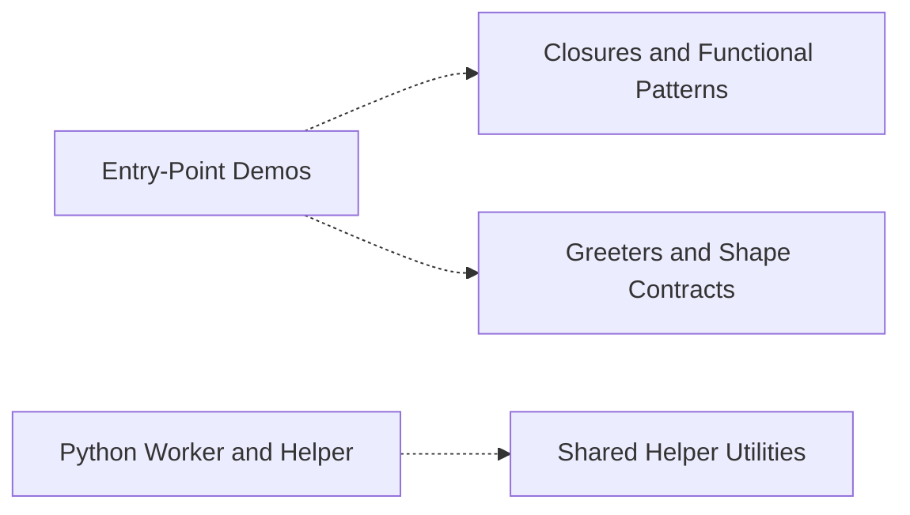

# Codebase Explorer

## How to read this report

Start with the responsibility tree in INDEX. Open a node page for your maintenance question, then choose a unit.
Node pages explain responsibilities. `catalog.json` stores full signatures, source ranges, folded members, relation evidence, and graph edges.
Set `RUN` to the absolute path of this run directory. Find an id, then read its explanation or frozen source.

```sh
cbe find --run-dir "$RUN" --term "SEARCH_TERM"
cbe query --run-dir "$RUN" --id "$ID"
cbe source --run-dir "$RUN" --id "$ID" --context 2
```

`ID` can be a unit id, symbol id, or file path. Commands return the content directly.
`source` reads frozen source and verifies its digest first.
The catalog also stores reverse graph edges, statuses, and raw evidence.

## Responsibility tree

- [Polyglot Sample Corpus](nodes/sample-corpus.md) (0 units)
  - [Entry-Point Demos](nodes/entrypoint-demos.md) (5 units)
    - [sample-c-point](nodes/entrypoint-demos.md#u-d8e0c7a2e6ba) · Point is a plain C struct aggregating two ints, x and y.
  - [Greeters and Shape Contracts](nodes/greeting-shape-contracts.md) (13 units)
    - [sample-cs-greeter](nodes/greeting-shape-contracts.md#u-127588affba2) · Greeter stores a name and produces greetings plus a trivial increment.
    - [Java Main and Nested Class](nodes/java-main-and-nested.md) (2 units)
      - [sample-java-main](nodes/java-main-and-nested.md#u-4be266edaf73) · Main holds a private int count set by its constructor and adds it to arguments.
  - [Closures and Functional Patterns](nodes/closure-functional-patterns.md) (12 units)
    - [src/sample.py:top](nodes/closure-functional-patterns.md#u-f5851e990e65) · top returns inner(a) + b, where inner adds math.pi to its argument, so the result is a + math.pi + b with b defaulting to 1.
  - [Shared Helper Utilities](nodes/shared-helpers.md) (9 units)
    - [src/sample.rs:helper](nodes/shared-helpers.md#u-a4f022aefbd9) · helper is a public function inside the util module returning the constant 1.
  - [Value Types with Sum Methods](nodes/value-type-methods.md) (2 units)
    - [Sum](nodes/value-type-methods.md#u-5ccfb6636f17) · Sum is a value-receiver method on Point returning X+Y as an int.
  - [Job Queue and Job Mapping](nodes/job-queue.md) (4 units)
    - [Queue](nodes/job-queue.md#u-fc7c358b2164) · Generic in-memory FIFO queue of Job<T> items backed by a private array.
  - [Python Worker and Helper](nodes/python-worker.md) (3 units)
    - [Worker](nodes/python-worker.md#u-c1601eaff1aa) · Holds a single integer state field and exposes run to parse a JSON payload and format a result, plus close to reset state.
  - [Encoding and Parser Fixtures](nodes/fixtures-and-edgecases.md) (6 units)
    - [crlf-py-wrap](nodes/fixtures-and-edgecases.md#u-694cd62c19f1) · Wrap's only behavior is the method one, which returns the constant string "ok".

## Reading stats

- units: 56 · semantic nodes: 10 · dispositioned inventory ids: 158
- source ranges are program-derived from the inventory, never model-written

## Graph coverage

Source: static analysis graph. Resolved relations are graph-confirmed; this does not guarantee semantic correctness. External targets are outside the repository; ambiguous targets have multiple candidates. Unresolved or unsupported relations, and languages or relation kinds without coverage, rely on model inference and may be inaccurate.
Import and call status ratios use the edge count of each kind. CFG and dataflow are structural edges; only their counts are shown, without status ratios.
c import: external 1/1 (100%) · c call: resolved 1/2 (50%), external 1/2 (50%).
c structural edges: cfg=19, dataflow=42.
c_sharp import: external 1/1 (100%) · c_sharp call: resolved 1/3 (33%), external 2/3 (67%).
c_sharp structural edges: cfg=12, dataflow=38.
cpp import: external 1/1 (100%) · cpp call: no edges.
cpp structural edges: cfg=13, dataflow=38.
go import: external 1/1 (100%) · go call: resolved 1/2 (50%), external 1/2 (50%).
go structural edges: cfg=15, dataflow=33.
java import: external 1/1 (100%) · java call: no edges.
java structural edges: cfg=9, dataflow=38.
javascript import: unresolved 2/2 (100%) · javascript call: resolved 1/4 (25%), unresolved 2/4 (50%), external 1/4 (25%).
javascript structural edges: cfg=103, dataflow=208.
kotlin import: no edges · kotlin call: external 1/1 (100%).
kotlin structural edges: cfg=21, dataflow=51.
php import: no edges · php call: no edges.
php structural edges: cfg=0, dataflow=0.
python import: external 3/3 (100%) · python call: resolved 16/29 (55%), unresolved 8/29 (28%), external 5/29 (17%).
python structural edges: cfg=288, dataflow=571.
ruby import: no edges · ruby call: resolved 3/6 (50%), unresolved 2/6 (33%), external 1/6 (17%).
ruby structural edges: cfg=69, dataflow=143.
rust import: no edges · rust call: no edges.
rust structural edges: cfg=0, dataflow=0.
swift import: external 1/1 (100%) · swift call: resolved 1/1 (100%).
swift structural edges: cfg=18, dataflow=56.
typescript import: no edges · typescript call: unresolved 1/4 (25%), external 3/4 (75%).
typescript structural edges: cfg=95, dataflow=188.
unknown import: unresolved 1/1 (100%).
Incomplete capabilities: javascript/call partial; kotlin/call partial; php/call failed; php/cfg failed; php/dataflow failed; php/import failed; python/call partial; ruby/call partial; rust/call failed; rust/cfg failed; rust/dataflow failed; rust/import failed; typescript/call partial.
Program checks: dangling edges 0; nodes outside manifest 0; nodes with missing files 0; frontend failed; see graph diagnostics.

## Overview

The repository is a polyglot sample corpus of small programs across C, C#, Rust, Java, Kotlin, Go, Ruby, PHP, Swift, Python, JS, and TS, organized by responsibility rather than language. Entry-Point Demos are the executable surfaces: the C main drives Point/add, C# Main constructs Greeter, Rust main demonstrates top. Greeters and Shape Contracts gathers cross-language Greeter implementations and abstract Area/IShape/Shape/protocol contracts; the Java Main and Nested class sit under this subtree. Closures and Functional Patterns documents per-language higher-order idioms (Python top/inner/decorate, Go outer, Ruby lambda, PHP arrow fn, JS makeCounter). Shared Helper Utilities are stateless dependency targets (constant-1 helpers, C++ maximum/Box, TS apply). Value Types with Sum Methods covers the Point aggregate plus derived sum in Go and Rust. Job Queue and Job Mapping is the only async stateful container (Queue<Job<T>>, mapJobs). Python Worker and Helper forms a stateful JSON-processing capability around a shared increment helper. Fixtures validate encodings and parser tolerance. Overall: consumers (entry points) compose providers (contracts, closures, helpers) into small demonstrations.

## Maintenance navigation

For 'how does a language's program run end to end', open entrypoint-demos. To compare greeting state or interface/implementation shapes across languages, open greeting-shape-contracts; whether Java Main calls Greeter is uncertain, so check java-main-and-nested before asserting it. For closure/lambda/decorator idiom questions, open closure-functional-patterns (Python top→decorate and top→inner are resolved calls). When tracing a caller of a small utility, open shared-helpers; note JS compute relies on an external helper.js absent from the corpus, so its full behavior is not observable. For aggregate-plus-derived-value questions, open value-type-methods. For the only async/stateful pipeline, open job-queue (enqueue mutates, take is async returning undefined when empty; Queue-to-array relations are model inferred). For Python JSON processing, open python-worker, where Worker.run and the module tail both resolved-call helper. Open fixtures-and-edgecases only when validating encoding, line endings, or parser error tolerance; broken.c has no attributable behavior.

## Dependency view

Arrows point from a user to its dependency. Containment is structural, not a dependency. Graph-confirmed pairs appear in both the tree and resolved call/import edges. Model-inferred pairs appear only in the tree. Graph-only pairs appear only in the graph.
Graph-confirmed and model-inferred pairs count edges between two subtrees. Graph-only pairs count edges between direct node owners. Containment rows show resolved edges between ancestor direct units and a descendant subtree in both directions. Within containment rows count direct owner pairs separately. Neither kind of containment row appears in Mermaid or the three dependency totals.



Selected 5 nodes by connection count. Legend: `-->` graph-confirmed; `-.->` model-inferred; `==>` graph-only.

## Dependency list

- [Entry-Point Demos](nodes/entrypoint-demos.md) → [Closures and Functional Patterns](nodes/closure-functional-patterns.md) · model-inferred · 0 edge(s) · The Rust entry point demonstrates the top function owned by the closures subtree.
- [Entry-Point Demos](nodes/entrypoint-demos.md) → [Greeters and Shape Contracts](nodes/greeting-shape-contracts.md) · model-inferred · 0 edge(s) · C# Main constructs Greeter and calls Greet from the greeters subtree.
- [Java Main and Nested Class](nodes/java-main-and-nested.md) → [Greeters and Shape Contracts](nodes/greeting-shape-contracts.md) · containment · → 0 / ← 0 edge(s) (ancestor direct units and descendant subtree; → follows ` java-main-and-nested ` → ` greeting-shape-contracts `) · The Java Main/Nested units are contained under the greeters-and-shapes subtree, co-located with its interface contracts.
- [Python Worker and Helper](nodes/python-worker.md) → [Shared Helper Utilities](nodes/shared-helpers.md) · model-inferred · 0 edge(s)

Graph-only pairs are ranked by edge count; 0 omitted.

### Within containment


Within containment: 0 pairs, ranked by edge count; 0 omitted. Each graph list keeps at most 40 pairs independently.

## Key flows

- **C main computes sum** · The C entry point wires a Point to the static add helper to produce output.
  [main](nodes/entrypoint-demos.md#u-69596f14b24e) → [add](nodes/entrypoint-demos.md#u-cef680402725)
- **Python closure demo** · Python top drives the decorate and inner nested functions as resolved calls.
  [src/sample.py:top](nodes/closure-functional-patterns.md#u-f5851e990e65) → [decorate](nodes/closure-functional-patterns.md#u-b716c1de2d31) → (model-inferred) → [src/sample.py:inner](nodes/closure-functional-patterns.md#u-d794f21c77b1)
- **Python worker processing** · Worker and the module tail both call helper for validation and increment logic.
  [Worker](nodes/python-worker.md#u-c1601eaff1aa) → [helper](nodes/python-worker.md#u-95536cf0fe0e)
- **Module tail helper use** · The residual module region's anon lambda path also consumes helper.
  [python\_case.py module code \(L32–L37\)](nodes/python-worker.md#u-7a0ceae3a864) → [helper](nodes/python-worker.md#u-95536cf0fe0e)
- **Top calls inner** · The Python top function invokes its nested inner function as part of the closure demonstration.
  [src/sample.py:top](nodes/closure-functional-patterns.md#u-f5851e990e65) → [src/sample.py:inner](nodes/closure-functional-patterns.md#u-d794f21c77b1)

## Generation notes

- Known-empty files (no source text, no inventory id, no unit, no model call): src/empty.py.
- Normalized after the final invalid answer (facts kept, shape fixed): module_1.
- module_1: CBE assigned 1 inventory symbol(s) to index_only because the model answer omitted or supplied invalid dispositions.

## Aggregation principle checks

Program diagnostics only; they do not prove semantic correctness or trigger rewrites.

### P1 · pass

```json
{"empty_or_duplicate_capabilities": [], "ok": true, "principle": "P1"}
```

### P2 · observe

```json
{"modules": {"closure-functional-patterns": {"external": 1, "internal": 4, "internal_external_ratio": 4.0}, "entrypoint-demos": {"external": 3, "internal": 2, "internal_external_ratio": 0.6666666666666666}, "fixtures-and-edgecases": {"external": 0, "internal": 0, "internal_external_ratio": null}, "greeting-shape-contracts": {"external": 2, "internal": 0, "internal_external_ratio": 0.0}, "java-main-and-nested": {"external": 0, "internal": 0, "internal_external_ratio": null}, "job-queue": {"external": 0, "internal": 2, "internal_external_ratio": null}, "python-worker": {"external": 0, "internal": 3, "internal_external_ratio": null}, "sample-corpus": {"external": 0, "internal": 0, "internal_external_ratio": null}, "shared-helpers": {"external": 0, "internal": 0, "internal_external_ratio": null}, "value-type-methods": {"external": 0, "internal": 0, "internal_external_ratio": null}}, "ok": false, "principle": "P2", "scope": "direct primary ownership; incident cross-module edges counted at each endpoint"}
```

### P3 · observe

```json
{"bounds": [5, 30], "ok": false, "out_of_bounds": {"java-main-and-nested": 2, "job-queue": 4, "python-worker": 3, "value-type-methods": 2}, "principle": "P3", "scope": "nodes with directly owned units; structural ancestors excluded"}
```

### P4 · pass

```json
{"ok": true, "ownership_violations": {}, "principle": "P4"}
```

### P5 · pass

```json
{"min_dependent_modules": 2, "min_edges_per_dependent_module": 3, "note": "dependency signal only, including utilities already separated; no automatic reassignment", "ok": true, "principle": "P5", "shared_units": {}}
```

### P6 · pass

```json
{"modules": {"closure-functional-patterns": {"go": 1, "javascript": 3, "kotlin": 1, "php": 1, "python": 3, "ruby": 1, "rust": 1, "swift": 1}, "entrypoint-demos": {"c": 3, "c_sharp": 1, "rust": 1}, "fixtures-and-edgecases": {"c": 1, "python": 5}, "greeting-shape-contracts": {"c_sharp": 2, "java": 1, "javascript": 1, "kotlin": 1, "php": 2, "python": 1, "ruby": 1, "swift": 2, "typescript": 2}, "java-main-and-nested": {"java": 2}, "job-queue": {"typescript": 4}, "python-worker": {"python": 3}, "sample-corpus": {}, "shared-helpers": {"cpp": 2, "javascript": 3, "kotlin": 1, "ruby": 1, "rust": 1, "typescript": 1}, "value-type-methods": {"go": 1, "rust": 1}}, "ok": true, "principle": "P6", "scope": "unit counts by language; a multi-language unit contributes once per language"}
```

### P7 · not_checked

```json
{"ok": null, "principle": "P7", "reason": "no prior tree for the same detail input", "status": "not_checked"}
```

Hierarchy and introduction length:

```json
{"hierarchy": {"ok": true, "requires_intermediate_above_units": 30}, "introduction_length": {"ok": false, "overlong": {"java-main-and-nested": {"introduction_chars": 539, "detail_chars": 451}, "value-type-methods": {"introduction_chars": 494, "detail_chars": 383}}, "scope": "capability+summary characters versus descendant explain characters"}}
```
