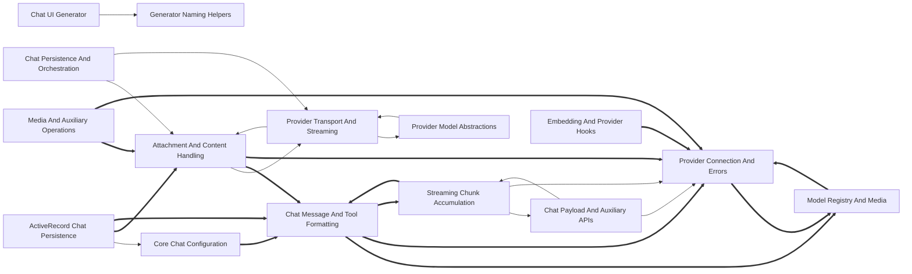

# Dependencies

Arrows point from a user to its dependency. Containment is structural, not a dependency. Graph-confirmed pairs appear in both the tree and resolved call/import edges. Model-inferred pairs appear only in the tree. Graph-only pairs appear only in the graph.
Graph-confirmed and model-inferred pairs count edges between two subtrees. Graph-only pairs count edges between direct node owners. Containment rows show resolved edges between ancestor direct units and a descendant subtree in both directions. Within containment rows count direct owner pairs separately. Neither kind of containment row appears in Mermaid or the three dependency totals.

Selected 15 nodes by connection count. Legend: `-->` graph-confirmed; `-.->` model-inferred; `==>` graph-only.

## Dependency list

- [ActiveRecord Chat Persistence](nodes/activerecord-chat-persistence.md) → [Core Chat Configuration](nodes/core-chat-configuration.md) · graph-confirmed · 2 edge(s) · ActiveRecord chat persistence uses core chat configuration for chat setup and orchestration.
- [Attachment And Content Handling](nodes/attachment-and-content-handling.md) → [Provider Transport And Streaming](nodes/provider-transport-and-streaming.md) · graph-confirmed · 2 edge(s) · Attachment and content handling uses provider transport and streaming for provider-facing content handling.
- [Chat Payload And Auxiliary APIs](nodes/chat-payload-and-auxiliary-apis.md) → [Provider Connection And Errors](nodes/provider-connection-and-errors.md) · graph-confirmed · 3 edge(s) · Chat payload and auxiliary APIs use provider connection and errors for request dispatch and error handling.
- [Chat Payload And Auxiliary APIs](nodes/chat-payload-and-auxiliary-apis.md) → [Streaming Chunk Accumulation](nodes/streaming-chunk-accumulation.md) · graph-confirmed · 1 edge(s)
- [Chat Persistence And Orchestration](nodes/chat-persistence-and-orchestration.md) → [Attachment And Content Handling](nodes/attachment-and-content-handling.md) · graph-confirmed · 4 edge(s) · Chat persistence and orchestration uses attachment and content handling to normalize chat content and attachments.
- [Chat Persistence And Orchestration](nodes/chat-persistence-and-orchestration.md) → [Provider Transport And Streaming](nodes/provider-transport-and-streaming.md) · graph-confirmed · 3 edge(s) · Chat persistence and orchestration uses provider transport and streaming to send chat requests and consume streamed responses.
- [Chat UI Generator](nodes/chat-ui-generator.md) → [Generator Naming Helpers](nodes/generator-naming-helpers.md) · graph-confirmed · 3 edge(s) · Chat UI generator uses generator naming helpers to derive model names, namespaces, and routes.
- [Provider Model Abstractions](nodes/provider-model-abstractions.md) → [Provider Transport And Streaming](nodes/provider-transport-and-streaming.md) · graph-confirmed · 6 edge(s) · Provider model abstractions use provider transport and streaming to connect model operations to provider requests.
- [Provider Transport And Streaming](nodes/provider-transport-and-streaming.md) → [Attachment And Content Handling](nodes/attachment-and-content-handling.md) · graph-confirmed · 2 edge(s) · 1 inferred relation(s)
- [Provider Transport And Streaming](nodes/provider-transport-and-streaming.md) → [Provider Model Abstractions](nodes/provider-model-abstractions.md) · graph-confirmed · 2 edge(s)
- [RubyLLM Install Generator](nodes/rubyllm-install-generator.md) → [Generator Naming Helpers](nodes/generator-naming-helpers.md) · graph-confirmed · 1 edge(s)
- [Streaming Chunk Accumulation](nodes/streaming-chunk-accumulation.md) → [Chat Payload And Auxiliary APIs](nodes/chat-payload-and-auxiliary-apis.md) · graph-confirmed · 3 edge(s) · 1 inferred relation(s) · Streaming chunk accumulation uses chat payload and auxiliary APIs to turn accumulated chunks into chat messages.
- [Streaming Chunk Accumulation](nodes/streaming-chunk-accumulation.md) → [Provider Connection And Errors](nodes/provider-connection-and-errors.md) · graph-confirmed · 2 edge(s)
- [Upgrade Migration Generators](nodes/upgrade-migration-generators.md) → [Generator Naming Helpers](nodes/generator-naming-helpers.md) · graph-confirmed · 4 edge(s) · Upgrade migration generators use generator naming helpers for migration naming and model mappings.
- [V1.7 Upgrade Generator](nodes/v1-7-upgrade-generator.md) → [Generator Naming Helpers](nodes/generator-naming-helpers.md) · graph-confirmed · 4 edge(s)
- [ActiveRecord Chat Persistence](nodes/activerecord-chat-persistence.md) → [Attachment And Content Handling](nodes/attachment-and-content-handling.md) · graph-only · 4 edge(s)
- [Streaming Chunk Accumulation](nodes/streaming-chunk-accumulation.md) → [Chat Message And Tool Formatting](nodes/chat-message-and-tool-formatting.md) · graph-only · 3 edge(s)
- [ActiveRecord Chat Persistence](nodes/activerecord-chat-persistence.md) → [Chat Message And Tool Formatting](nodes/chat-message-and-tool-formatting.md) · graph-only · 2 edge(s)
- [Embedding And Provider Hooks](nodes/embedding-and-provider-hooks.md) → [Provider Connection And Errors](nodes/provider-connection-and-errors.md) · graph-only · 2 edge(s)
- [Media And Auxiliary Operations](nodes/media-and-auxiliary-operations.md) → [Attachment And Content Handling](nodes/attachment-and-content-handling.md) · graph-only · 2 edge(s)
- [Media And Auxiliary Operations](nodes/media-and-auxiliary-operations.md) → [Provider Connection And Errors](nodes/provider-connection-and-errors.md) · graph-only · 2 edge(s)
- [Model Metadata Value Objects](nodes/model-metadata-value-objects.md) → [Chat Message And Tool Formatting](nodes/chat-message-and-tool-formatting.md) · graph-only · 2 edge(s)
- [Attachment And Content Handling](nodes/attachment-and-content-handling.md) → [Chat Message And Tool Formatting](nodes/chat-message-and-tool-formatting.md) · graph-only · 1 edge(s)
- [Attachment And Content Handling](nodes/attachment-and-content-handling.md) → [Provider Connection And Errors](nodes/provider-connection-and-errors.md) · graph-only · 1 edge(s)
- [Chat Message And Tool Formatting](nodes/chat-message-and-tool-formatting.md) → [Model Registry And Media](nodes/model-registry-and-media.md) · graph-only · 1 edge(s)
- [Chat Message And Tool Formatting](nodes/chat-message-and-tool-formatting.md) → [Provider Connection And Errors](nodes/provider-connection-and-errors.md) · graph-only · 1 edge(s)
- [Chat Message And Tool Formatting](nodes/chat-message-and-tool-formatting.md) → [Streaming Chunk Accumulation](nodes/streaming-chunk-accumulation.md) · graph-only · 1 edge(s)
- [Core Chat Configuration](nodes/core-chat-configuration.md) → [Chat Message And Tool Formatting](nodes/chat-message-and-tool-formatting.md) · graph-only · 1 edge(s)
- [Model Registry And Media](nodes/model-registry-and-media.md) → [Provider Connection And Errors](nodes/provider-connection-and-errors.md) · graph-only · 1 edge(s)
- [Provider Connection And Errors](nodes/provider-connection-and-errors.md) → [Model Registry And Media](nodes/model-registry-and-media.md) · graph-only · 1 edge(s)
- [Provider Integration Compositions](nodes/provider-integration-compositions.md) → [Provider Connection And Errors](nodes/provider-connection-and-errors.md) · graph-only · 1 edge(s)

Graph-only pairs are ranked by edge count; 0 omitted.

### Within containment

Within containment: 0 pairs, ranked by edge count; 0 omitted. Each graph list keeps at most 40 pairs independently.
