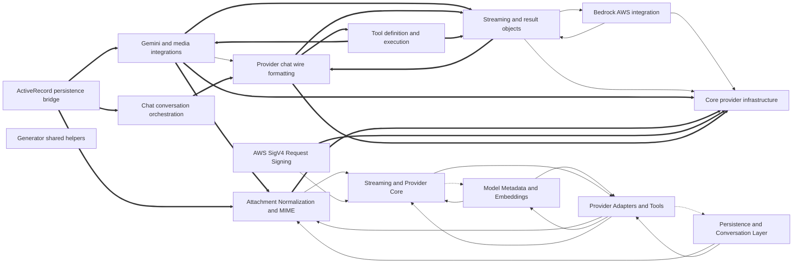

# Dependencies

Arrows point from a user to its dependency. Containment is structural, not a dependency. Graph-confirmed pairs appear in both the tree and resolved call/import edges. Model-inferred pairs appear only in the tree. Graph-only pairs appear only in the graph.
Graph-confirmed and model-inferred pairs count edges between two subtrees. Graph-only pairs count edges between direct node owners. Containment rows show resolved edges between ancestor direct units and a descendant subtree in both directions. Within containment rows count direct owner pairs separately. Neither kind of containment row appears in Mermaid or the three dependency totals.

Selected 15 nodes by connection count. Legend: `-->` graph-confirmed; `-.->` model-inferred; `==>` graph-only.

## Dependency list

- [ActiveRecord persistence bridge](nodes/activerecord-persistence-bridge.md) → [Chat Orchestration and Gem Facade](nodes/chat-orchestration-and-gem-facade.md) · graph-confirmed · 2 edge(s) · The ActiveRecord bridge builds and drives Chat objects from persisted records.
- [Attachment Normalization and MIME](nodes/attachment-normalization-and-mime.md) → [Streaming and Provider Core](nodes/streaming-and-provider-core.md) · graph-confirmed · 1 edge(s) · Attachment normalization prepares file content for rendering into provider requests.
- [AWS SigV4 Request Signing](nodes/aws-sigv4-request-signing.md) → [Streaming and Provider Core](nodes/streaming-and-provider-core.md) · graph-confirmed · 1 edge(s) · SigV4 signing authenticates Bedrock requests issued through the provider core.
- [Bedrock AWS integration](nodes/bedrock-aws-integration.md) → [Core provider infrastructure](nodes/core-provider-infrastructure.md) · graph-confirmed · 1 edge(s) · Bedrock integration builds on the abstract provider base and connection management.
- [Bedrock AWS integration](nodes/bedrock-aws-integration.md) → [Streaming and result objects](nodes/streaming-and-result-objects.md) · graph-confirmed · 1 edge(s)
- [Chat UI scaffolding generator](nodes/chat-ui-scaffolding-generator.md) → [Generator shared helpers](nodes/generator-shared-helpers.md) · graph-confirmed · 3 edge(s) · The chat UI generator uses shared helpers for naming, model mappings, and acts_as declarations.
- [Chat Wire and Media Formats](nodes/chat-wire-and-media-formats.md) → [Tool definition and execution](nodes/tool-definition-and-execution.md) · graph-confirmed · 1 edge(s)
- [Gem entry and configuration](nodes/gem-entry-and-configuration.md) → [Chat conversation orchestration](nodes/chat-conversation-orchestration.md) · graph-confirmed · 2 edge(s)
- [Gemini and media integrations](nodes/gemini-and-media-integrations.md) → [Provider chat wire formatting](nodes/provider-chat-wire-formatting.md) · graph-confirmed · 1 edge(s)
- [Install generator](nodes/install-generator.md) → [Generator shared helpers](nodes/generator-shared-helpers.md) · graph-confirmed · 1 edge(s)
- [Migration numbering and v1.9](nodes/migration-numbering-and-v1-9.md) → [Generator shared helpers](nodes/generator-shared-helpers.md) · graph-confirmed · 2 edge(s)
- [Model Metadata and Embeddings](nodes/model-metadata-and-embeddings.md) → [Provider Adapters and Tools](nodes/provider-adapters-and-tools.md) · graph-confirmed · 2 edge(s) · Model metadata and embedding support feed capability lookups into the provider adapters.
- [Model Metadata and Embeddings](nodes/model-metadata-and-embeddings.md) → [Streaming and Provider Core](nodes/streaming-and-provider-core.md) · graph-confirmed · 2 edge(s)
- [Persistence and Conversation Layer](nodes/persistence-and-conversation-layer.md) → [Attachment Normalization and MIME](nodes/attachment-normalization-and-mime.md) · graph-confirmed · 1 edge(s)
- [Persistence and Conversation Layer](nodes/persistence-and-conversation-layer.md) → [Provider Adapters and Tools](nodes/provider-adapters-and-tools.md) · graph-confirmed · 4 edge(s) · 2 inferred relation(s) · The persistence layer uses provider adapters and tool machinery when converting stored records into live chats.
- [Provider Adapters and Tools](nodes/provider-adapters-and-tools.md) → [Attachment Normalization and MIME](nodes/attachment-normalization-and-mime.md) · graph-confirmed · 2 edge(s)
- [Provider Adapters and Tools](nodes/provider-adapters-and-tools.md) → [Model Metadata and Embeddings](nodes/model-metadata-and-embeddings.md) · graph-confirmed · 1 edge(s)
- [Provider Adapters and Tools](nodes/provider-adapters-and-tools.md) → [Persistence and Conversation Layer](nodes/persistence-and-conversation-layer.md) · model-inferred · 1 inferred relation(s)
- [Provider Adapters and Tools](nodes/provider-adapters-and-tools.md) → [Streaming and Provider Core](nodes/streaming-and-provider-core.md) · graph-confirmed · 9 edge(s) · Provider adapters rely on the shared provider base, connections, and streaming machinery to execute requests.
- [Streaming and Provider Core](nodes/streaming-and-provider-core.md) → [Model Metadata and Embeddings](nodes/model-metadata-and-embeddings.md) · model-inferred · 1 inferred relation(s)
- [Streaming and Provider Core](nodes/streaming-and-provider-core.md) → [Provider Adapters and Tools](nodes/provider-adapters-and-tools.md) · graph-confirmed · 1 edge(s)
- [Streaming and result objects](nodes/streaming-and-result-objects.md) → [Bedrock AWS integration](nodes/bedrock-aws-integration.md) · graph-confirmed · 1 edge(s) · 1 inferred relation(s)
- [Streaming and result objects](nodes/streaming-and-result-objects.md) → [Core provider infrastructure](nodes/core-provider-infrastructure.md) · graph-confirmed · 2 edge(s)
- [Tool definition and execution](nodes/tool-definition-and-execution.md) → [Chat Wire and Media Formats](nodes/chat-wire-and-media-formats.md) · graph-confirmed · 3 edge(s) · Tool definitions are converted into provider-specific tool declarations for chat requests.
- [v1.7 upgrade generator](nodes/v1-7-upgrade-generator.md) → [Generator shared helpers](nodes/generator-shared-helpers.md) · graph-confirmed · 4 edge(s)
- [ActiveRecord persistence bridge](nodes/activerecord-persistence-bridge.md) → [Gemini and media integrations](nodes/gemini-and-media-integrations.md) · graph-only · 3 edge(s)
- [Tool definition and execution](nodes/tool-definition-and-execution.md) → [Gemini and media integrations](nodes/gemini-and-media-integrations.md) · graph-only · 3 edge(s)
- [ActiveRecord persistence bridge](nodes/activerecord-persistence-bridge.md) → [Chat conversation orchestration](nodes/chat-conversation-orchestration.md) · graph-only · 2 edge(s)
- [Gemini and media integrations](nodes/gemini-and-media-integrations.md) → [Attachment Normalization and MIME](nodes/attachment-normalization-and-mime.md) · graph-only · 2 edge(s)
- [Gemini and media integrations](nodes/gemini-and-media-integrations.md) → [Core provider infrastructure](nodes/core-provider-infrastructure.md) · graph-only · 2 edge(s)
- [Gemini and media integrations](nodes/gemini-and-media-integrations.md) → [Streaming and result objects](nodes/streaming-and-result-objects.md) · graph-only · 2 edge(s)
- [Model info value objects](nodes/model-info-value-objects.md) → [Gemini and media integrations](nodes/gemini-and-media-integrations.md) · graph-only · 2 edge(s)
- [Provider chat wire formatting](nodes/provider-chat-wire-formatting.md) → [Streaming and result objects](nodes/streaming-and-result-objects.md) · graph-only · 2 edge(s)
- [ActiveRecord persistence bridge](nodes/activerecord-persistence-bridge.md) → [Attachment Normalization and MIME](nodes/attachment-normalization-and-mime.md) · graph-only · 1 edge(s)
- [Attachment Normalization and MIME](nodes/attachment-normalization-and-mime.md) → [Core provider infrastructure](nodes/core-provider-infrastructure.md) · graph-only · 1 edge(s)
- [AWS SigV4 Request Signing](nodes/aws-sigv4-request-signing.md) → [Core provider infrastructure](nodes/core-provider-infrastructure.md) · graph-only · 1 edge(s)
- [Bedrock model capabilities](nodes/bedrock-model-capabilities.md) → [Core provider infrastructure](nodes/core-provider-infrastructure.md) · graph-only · 1 edge(s)
- [Chat conversation orchestration](nodes/chat-conversation-orchestration.md) → [Provider chat wire formatting](nodes/provider-chat-wire-formatting.md) · graph-only · 1 edge(s) · Chat orchestration renders conversation state into provider-specific chat payloads.
- [Embeddings and Mistral support](nodes/embeddings-and-mistral-support.md) → [Core provider infrastructure](nodes/core-provider-infrastructure.md) · graph-only · 1 edge(s)
- [Provider chat wire formatting](nodes/provider-chat-wire-formatting.md) → [Core provider infrastructure](nodes/core-provider-infrastructure.md) · graph-only · 1 edge(s)
- [Provider chat wire formatting](nodes/provider-chat-wire-formatting.md) → [Tool definition and execution](nodes/tool-definition-and-execution.md) · graph-only · 1 edge(s)
- [Provider class composition](nodes/provider-class-composition.md) → [Core provider infrastructure](nodes/core-provider-infrastructure.md) · graph-only · 1 edge(s)
- [Provider class composition](nodes/provider-class-composition.md) → [OpenAI model capabilities](nodes/openai-model-capabilities.md) · graph-only · 1 edge(s)
- [Streaming and result objects](nodes/streaming-and-result-objects.md) → [Provider chat wire formatting](nodes/provider-chat-wire-formatting.md) · graph-only · 1 edge(s)
- [Tool definition and execution](nodes/tool-definition-and-execution.md) → [Streaming and result objects](nodes/streaming-and-result-objects.md) · graph-only · 1 edge(s)

Graph-only pairs are ranked by edge count; 0 omitted.

### Within containment

Within containment: 0 pairs, ranked by edge count; 0 omitted. Each graph list keeps at most 40 pairs independently.
