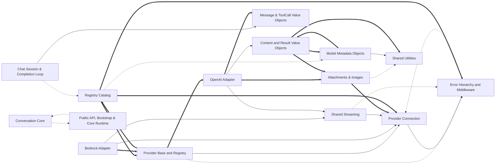

# Codebase Explorer

## How to read this report

Start with the responsibility tree in INDEX. Open a node page for your maintenance question, then choose a unit.
Node pages explain responsibilities. `catalog.json` stores full signatures, source ranges, folded members, relation evidence, and graph edges.
Set `RUN` to the absolute path of this run directory. Find an id, then read its explanation or frozen source.

```sh
cbe find --run-dir "$RUN" --term "SEARCH_TERM"
cbe query --run-dir "$RUN" --id "$ID"
cbe source --run-dir "$RUN" --id "$ID" --context 2
```

`ID` can be a unit id, symbol id, or file path. Commands return the content directly.
`source` reads frozen source and verifies its digest first.
The catalog also stores reverse graph edges, statuses, and raw evidence.

## Responsibility tree

- [RubyLLM](nodes/ruby-llm.md) (0 units)
  - [RubyLLM Gem](nodes/r1-ruby-llm-gem.md) (0 units)
    - [Public API & Bootstrap](nodes/r1-public-api-bootstrap.md) (5 units)
      - [ruby_llm.rb-module-facade](nodes/r1-public-api-bootstrap.md#u-fb85d6d61ce4) · Singleton-class facade methods that delegate one-to-one to library components.
    - [Shared Utilities](nodes/r1-shared-utilities.md) (1 units)
      - [utils-utils-helpers](nodes/r1-shared-utilities.md#u-add7cf7f30e5) · Module-function data helpers used across the library.
    - [Conversation Core](nodes/r1-conversation-core.md) (0 units)
      - [Chat Session & Completion Loop](nodes/r1-chat-session.md) (4 units)
        - [chat.rb-configuration](nodes/r1-chat-session.md#u-eaa27ccbda2c) · Configures a Chat conversation and supplies its Enumerable and message plumbing.
      - [Message & ToolCall Value Objects](nodes/r1-messaging-primitives.md) (2 units)
        - [Message](nodes/r1-messaging-primitives.md#u-cb349e033cb3) · One chat-conversation message with a role restricted to the frozen ROLES list (system, user, assistant, tool).
      - [Tool Definition DSL](nodes/r1-tool-dsl.md) (1 units)
        - [tool.rb-tool-and-parameter](nodes/r1-tool-dsl.md#u-00e41a176da0) · Tool definition DSL and schema construction.
      - [Stream Accumulation](nodes/r1-streaming-accumulation.md) (3 units)
        - [RubyLLM.StreamAccumulator.add](nodes/r1-streaming-accumulation.md#u-4ce14f98c91b) · Ingests one streamed chunk into running state, optionally debug-logging the chunk and the accumulator when config.log_stream_debug is on.
      - [Attachments & Images](nodes/r1-content-media.md) (3 units)
        - [attachment.rb-attachment](nodes/r1-content-media.md#u-f217f75f8a07) · Loads and classifies a user-supplied file path, URL, IO-like object, or ActiveStorage attachment and renders it for LLM consumption.
    - [Model Registry](nodes/r1-model-registry.md) (0 units)
      - [Registry Catalog](nodes/r1-registry-catalog.md) (3 units)
        - [models.rb-registry-singleton](nodes/r1-registry-catalog.md#u-c1aaaef7b94e) · Class-level registry operations for the model catalog.
      - [Model Metadata Objects](nodes/r1-model-metadata.md) (2 units)
        - [Info](nodes/r1-model-metadata.md#u-ae4caa9aa506) · initialize reads a symbol-keyed hash: created_at and knowledge_cutoff pass through Utils.to_time and Utils.to_date; missing modalities, capabilities, pricing, and metadata become an empty Modalities, [], Pricing, and {}.
      - [Model Aliases](nodes/r1-aliases.md) (1 units)
        - [Aliases](nodes/r1-aliases.md#u-53bd7c18c313) · Maps generic model aliases to provider-specific model ids loaded from a bundled JSON file, all as class-level singleton methods.
    - [ActiveRecord & Rails Integration](nodes/r1-active-record-integration.md) (1 units)
      - [Railtie](nodes/r1-active-record-integration.md#u-acb5d0270dbf) · Rails integration hook, defined only when `Rails::Railtie` is already loaded (the whole file body is guarded by `if defined?(Rails::Railtie)`).
      - [Legacy acts\_as Support](nodes/r1-legacy-acts-as.md) (8 units)
        - [acts_as_legacy-acts-as-declarations](nodes/r1-legacy-acts-as.md#u-49418c9ac7e7) · Legacy declaration macros storing configuration in instance variables on the declaring class rather than class attributes.
      - [Message Conversion](nodes/r1-message-methods.md) (2 units)
        - [lib/ruby_llm/active_record/message_methods.rb:to_llm](nodes/r1-message-methods.md#u-f8aea5d5092c) · Converts a persisted message row into an in-memory RubyLLM::Message.
      - [Registry Record Sync](nodes/r1-model-registry-sync.md) (2 units)
        - [lib/ruby_llm/active_record/model_methods.rb:to_llm](nodes/r1-model-registry-sync.md#u-20f33157d371) · Converts a registry row into a RubyLLM::Model::Info, passing id/name/provider/family/tokens/knowledge_cutoff through and building created_at from model_created_at; modalities, pricing and metadata are deep-symbolized with {} fallbacks and capabilities passed as stored.
    - [Provider Framework](nodes/r1-provider-framework.md) (0 units)
      - [OpenAI Family](nodes/r1-openai-family.md) (0 units)
        - [OpenAI Adapter](nodes/r1-openai-core.md) (11 units)
          - [OpenAI](nodes/r1-openai-core.md#u-cbb3f359bee0) · OpenAI subclasses Provider and includes Chat, Embeddings, Models, Moderation, Streaming, Tools, Images, Media, and Transcription.
        - [OpenAI Tools](nodes/r1-openai-tools.md) (4 units)
          - [RubyLLM.Providers.OpenAI.Tools.format_tool_calls](nodes/r1-openai-tools.md#u-01c607ea44ab) · Serializes outgoing tool calls for the OpenAI API.
        - [DeepSeek Adapter](nodes/r1-deepseek-adapter.md) (6 units)
          - [DeepSeek](nodes/r1-deepseek-adapter.md#u-72a37c66707b) · DeepSeek subclasses OpenAI (inheriting OpenAI's mixins and request behavior) and includes DeepSeek::Chat.
        - [Mistral Adapter](nodes/r1-mistral-adapter.md) (4 units)
          - [Mistral](nodes/r1-mistral-adapter.md#u-5897395444ae) · Mistral subclasses OpenAI and includes Mistral::Chat, Models, and Embeddings.
        - [Perplexity Adapter](nodes/r1-perplexity-adapter.md) (6 units)
          - [Perplexity](nodes/r1-perplexity-adapter.md#u-c4e49a066541) · Perplexity subclasses OpenAI and includes Perplexity::Chat and Models.
      - [Anthropic Adapter](nodes/r1-anthropic-adapter.md) (18 units)
        - [Anthropic](nodes/r1-anthropic-adapter.md#u-3366212c86dc) · Anthropic subclasses Provider and mixins Chat, Embeddings, Media, Models, Streaming, and Tools from the Anthropic namespace.
      - [Gemini Adapter](nodes/r1-gemini-adapter.md) (1 units)
        - [Gemini](nodes/r1-gemini-adapter.md#u-0ee8ddba6d0e) · Gemini subclasses Provider and includes Gemini::Chat, Embeddings, Images, Models, Transcription, Streaming, Tools, and Media.
        - [Gemini Chat & Schema](nodes/r1-gemini-chat.md) (8 units)
          - [chat-request-building](nodes/r1-gemini-chat.md#u-7eb1a8c76a9e) · Groups request construction for chat completions.
        - [Gemini Media](nodes/r1-gemini-media.md) (6 units)
          - [RubyLLM.Providers.Gemini.Media.format_content](nodes/r1-gemini-media.md#u-f090cebf0dbd) · Converts message content into Gemini parts.
        - [Gemini Tools](nodes/r1-gemini-tools.md) (9 units)
          - [RubyLLM.Providers.Gemini.Tools.format_tools](nodes/r1-gemini-tools.md#u-f0e603b782c1) · Wraps all tools under a single Gemini functionDeclarations entry.
        - [Gemini Embeddings & Images](nodes/r1-gemini-embeddings-images.md) (4 units)
          - [embeddings-request](nodes/r1-gemini-embeddings-images.md#u-223f7bd81ebf) · Groups embedding request construction.
      - [Bedrock Adapter](nodes/r1-bedrock-adapter.md) (1 units)
        - [RubyLLM.Providers.Bedrock.Media.format_content](nodes/r1-bedrock-adapter.md#u-15d22633b933) · Converts RubyLLM message content into Bedrock-compatible content parts, with a branch per input shape.
        - [SigV4 Signing](nodes/r1-bedrock-signing.md) (7 units)
          - [signing-rb-signer](nodes/r1-bedrock-signing.md#u-ef4167d839ba) · Wires and operates the public SigV4 Signer.
        - [Bedrock Models & Capabilities](nodes/r1-bedrock-models-capabilities.md) (8 units)
          - [RubyLLM.Providers.Bedrock.Models.list_models](nodes/r1-bedrock-models-capabilities.md#u-f7193af023e2) · Fetches the Bedrock foundation-model catalog: it constructs the regional management endpoint https://bedrock.<bedrock_region>.amazonaws.com/foundation-models, signs the full URL for GET, performs @connection.get merging the signature's headers into the request, then parses via parse_list_models_response(response, slug, capabilities).
        - [Bedrock Event-Stream Streaming](nodes/r1-bedrock-streaming.md) (5 units)
          - [prelude-handling-rb-prelude-reading](nodes/r1-bedrock-streaming.md#u-ce096607b18b) · Reading and validating the 12-byte event prelude of the Bedrock event-stream framing.
      - [Ollama Adapter](nodes/r1-ollama-adapter.md) (3 units)
        - [RubyLLM.Providers.Ollama.Chat.format_messages](nodes/r1-ollama-adapter.md#u-a03d9fc91e34) · Converts message objects into Ollama request hashes.
    - [Developer Tooling](nodes/r1-developer-tooling.md) (0 units)
      - [Rails Generators](nodes/r1-generators.md) (3 units)
        - [InstallGenerator](nodes/r1-generators.md#u-276ef705fe3b) · Install generator creating RubyLLM models, migrations, and initializer.
      - [Model Maintenance Rake Tasks](nodes/r1-model-maintenance-tasks.md) (18 units)
        - [models.rake module code (L1–L39)](nodes/r1-model-maintenance-tasks.md#u-8a567ea1f9f5) · Defines the rake entry points for the models workflow: the `models` task chains models:update, models:docs, and models:aliases; models:update configures RubyLLM from environment, refreshes models, and prints stats; models:docs creates docs/_reference and writes the generated markdown there; models:aliases calls generate_aliases; a legacy aliases:generate namespace forwards to models:aliases for backwards compatibility.
  - [RubyLLM](nodes/r2-ruby-llm.md) (0 units)
    - [Core Runtime](nodes/r2-core-runtime.md) (0 units)
      - [Configuration and Context](nodes/r2-config-context.md) (2 units)
        - [Configuration](nodes/r2-config-context.md#u-5df427d3c359) · Holds every provider credential/endpoint, default model, retry/timeout, registry, Rails-integration, and logging setting as attr_accessors, so values can be overridden after construction.
      - [Content and Result Value Objects](nodes/r2-content-value-objects.md) (8 units)
        - [Content](nodes/r2-content-value-objects.md#u-fb6f20b3ce1b) · Wraps message text plus optional attachments exchanged with an LLM.
      - [Error Hierarchy and Middleware](nodes/r2-error-handling.md) (4 units)
        - [lib/ruby_llm/error.rb:Error](nodes/r2-error-handling.md#u-39e787c00a73) · Base error carrying the raw provider response; initialize stores response and passes message, defaulting to response&.body when no message is given.
    - [HTTP Transport and Provider Base](nodes/r2-transport.md) (0 units)
      - [Provider Connection](nodes/r2-connection.md) (1 units)
        - [connection.rb-connection](nodes/r2-connection.md#u-53be52e4979e) · Wraps Faraday setup for one provider's API, enforcing configuration and applying logging, retries, and error mapping.
      - [Provider Base and Registry](nodes/r2-provider-base.md) (2 units)
        - [provider.rb-provider-class](nodes/r2-provider-base.md#u-528dbec87490) · Class-level provider metadata and registry.
      - [Shared Streaming](nodes/r2-streaming-shared.md) (4 units)
        - [streaming.rb-processing](nodes/r2-streaming-shared.md#u-1662928ce9be) · SSE parsing and error handling shared by streaming, with Faraday 1/2 differences.
    - [Provider Adapters](nodes/r2-providers.md) (0 units)
      - [OpenAI Adapter](nodes/r2-provider-openai.md) (14 units)
        - [RubyLLM.Providers.OpenAI.Chat.render_payload](nodes/r2-provider-openai.md#u-dd4454ea38ce) · Assembles the OpenAI chat completion request body.
        - [OpenAI-Derived Providers](nodes/r2-openai-derived-providers.md) (13 units)
          - [Ollama](nodes/r2-openai-derived-providers.md#u-154f857359b4) · Ollama subclasses OpenAI and includes Ollama::Chat, Media, and Models.
      - [Anthropic Adapter](nodes/r2-provider-anthropic.md) (13 units)
        - [RubyLLM.Providers.Anthropic.Chat.render_payload](nodes/r2-provider-anthropic.md#u-93453b561b20) · Assembles the Anthropic request payload: partitions messages via separate_messages, converts the system messages through build_system_content, builds the base payload from the chat messages, then in a tap mutates it via add_optional_fields to attach system content, tool declarations, and temperature.
      - [Bedrock Adapter](nodes/r2-provider-bedrock.md) (15 units)
        - [Bedrock](nodes/r2-provider-bedrock.md#u-1433f99a11c5) · Bedrock subclasses Provider and mixes in Bedrock::Chat, Streaming, Models, Signing, Media, and Anthropic::Tools.
      - [Gemini Adapter](nodes/r2-provider-gemini.md) (22 units)
        - [RubyLLM.Providers.Gemini.Capabilities.context_window_for](nodes/r2-provider-gemini.md#u-88ddd80133ac) · Maps a Gemini model id to its context window size via ordered regex case match.
        - [VertexAI Adapter](nodes/r2-provider-vertexai.md) (8 units)
          - [VertexAI](nodes/r2-provider-vertexai.md#u-06d560296bcd) · VertexAI subclasses Gemini, includes VertexAI::Chat, Streaming, Embeddings, Models, and Transcription, and inherits Gemini's remaining mixins.
      - [Mistral Capabilities](nodes/r2-provider-mistral-capabilities.md) (6 units)
        - [mistral-capabilities-rb-predicates](nodes/r2-provider-mistral-capabilities.md#u-a7db4c902b7f) · Capability predicates on model-id patterns.
    - [ActiveRecord Integration](nodes/r2-active-record-integration.md) (0 units)
      - [acts\_as Declarations](nodes/r2-acts-as-declarations.md) (5 units)
        - [acts_as_chat](nodes/r2-acts-as-declarations.md#u-ce86173f9605) · Declares the calling class a chat model: includes ChatMethods, records messages_association_name and model_association_name as class attributes, and derives message_class/model_class by classifying the association names when not given.
      - [ChatMethods Persistence](nodes/r2-chat-persistence.md) (9 units)
        - [chat_methods-callback-config-wrappers](nodes/r2-chat-persistence.md#u-65ef3fdf9d92) · Configuration and callback wrappers on modern chat models.
    - [Rails Generators](nodes/r2-generators.md) (0 units)
      - [GeneratorHelpers](nodes/r2-generator-helpers.md) (6 units)
        - [parse_model_mappings](nodes/r2-generator-helpers.md#u-5c99c008abdc) · Parses the generator's model_mappings argument into @model_names, the cached source of all derived names.
      - [Chat UI Generator](nodes/r2-chat-ui-generator.md) (6 units)
        - [ChatUIGenerator](nodes/r2-chat-ui-generator.md#u-76a8deef4fa6) · Rails generator class that scaffolds a Turbo-streaming chat UI from templates.
      - [v1.7 Upgrade Generator](nodes/r2-upgrade-generator.md) (3 units)
        - [UpgradeToV17Generator](nodes/r2-upgrade-generator.md#u-2ee28acea205) · Upgrade generator migrating pre-1.7 apps to the acts_as API.
    - [Rake Tasks](nodes/r2-rake-tasks.md) (9 units)
      - [release.rake module code (L1–L67)](nodes/r2-rake-tasks.md#u-8a9da7de6813) · Defines three release rake tasks.
  - [Public API, Bootstrap & Core Runtime](nodes/public-api-bootstrap.md) (0 units)
  - [Shared Utilities](nodes/shared-utilities.md) (0 units)
  - [Conversation Core](nodes/conversation-core.md) (0 units)
  - [Model Registry](nodes/model-registry.md) (0 units)
  - [HTTP Transport & Provider Base](nodes/transport.md) (0 units)
  - [Provider Adapters](nodes/provider-framework.md) (0 units)
  - [ActiveRecord & Rails Integration](nodes/active-record-integration.md) (0 units)
  - [Developer Tooling](nodes/developer-tooling.md) (0 units)

## Reading stats

- units: 310 · semantic nodes: 72 · dispositioned inventory ids: 2023
- source ranges are program-derived from the inventory, never model-written

## Graph coverage

Source: static analysis graph. Resolved relations are graph-confirmed; this does not guarantee semantic correctness. External targets are outside the repository; ambiguous targets have multiple candidates. Unresolved or unsupported relations, and languages or relation kinds without coverage, rely on model inference and may be inaccurate.
Import and call status ratios use the edge count of each kind. CFG and dataflow are structural edges; only their counts are shown, without status ratios.
ruby import: no edges · ruby call: resolved 1275/3572 (36%), ambiguous 309/3572 (9%), unresolved 1399/3572 (39%), external 589/3572 (16%).
ruby structural edges: cfg=53285, dataflow=50000.
unknown import: unresolved 46/46 (100%).
Incomplete capabilities: ruby/call partial; ruby/dataflow partial.
Program checks: dangling edges 0; nodes outside manifest 0; nodes with missing files 0.

## Overview

RubyLLM is a unified Ruby interface to many LLM providers, organized around a root module (ruby-llm) that rolls up one subtree per concern. The public facade and bootstrap (public-api-bootstrap, with unit-level detail in r1-public-api-bootstrap) assembles the gem via Zeitwerk, registers providers, exposes RubyLLM.context for isolated configuration, and defines the base Error type. Provider-independent conversation machinery lives in conversation-core: Chat sessions drive the completion/tool-call loop (r1-chat-session), Message/ToolCall value objects (r1-messaging-primitives), a provider-neutral tool DSL (r1-tool-dsl), StreamAccumulator for chunk merging (r1-streaming-accumulation), and Attachment/Image content types (r1-content-media). The model-registry subtree catalogs model metadata: the registry catalog with Models.resolve, Model::Info/PricingTier metadata objects (r1-model-metadata), and generic alias lookup (r1-aliases). HTTP transport (transport; r2-connection, r2-provider-base, r2-streaming-shared, r2-error-handling) provides the shared Faraday pipeline, provider base class/registry, SSE streaming, and status-to-error mapping. Provider adapters (provider-framework) translate everything into vendor wire formats: an OpenAI family (OpenAI core plus DeepSeek, Mistral, Perplexity subclasses), Gemini (with VertexAI built on it), Anthropic, AWS Bedrock (with its own SigV4 signing and binary event-stream decoding), and Ollama. ActiveRecord integration bridges database rows and in-memory objects via acts_as declarations (r2-acts-as-declarations), ChatMethods persistence (r2-chat-persistence), message/registry-row conversion, and legacy acts_as support (r1-legacy-acts-as). Developer tooling provides Rails generators built on GeneratorHelpers and rake tasks that refresh the model registry, regenerate docs and aliases, and re-record VCR cassettes.

## Maintenance navigation

Open the ruby-llm root node first; it only aggregates and each child owns one concern. For 'how the library boots and what its entry points are', open public-api-bootstrap (unit detail: r1-public-api-bootstrap). For configuration defaults or scoped per-call overrides, open r2-config-context; for HTTP plumbing shared by all providers, open r2-connection, with the abstract request pipeline in r2-provider-base and SSE handling in r2-streaming-shared; error mapping by HTTP status is in r2-error-handling. For a chat-completion bug or the tool-call loop, open r1-chat-session (Chat#complete, handle_tool_calls) and the value objects in r1-messaging-primitives; tool schema definition is provider-neutral in r1-tool-dsl. For streaming bugs, providers supply build_chunk on top of r2-streaming-shared, and chunk-to-Message finalization is in r1-streaming-accumulation. For attachment/MIME handling, open r1-content-media. For 'resolve model X for provider Y', start at r1-registry-catalog (Models.resolve), then r1-model-metadata for the Info records and r1-aliases for friendly-name lookup; ActiveRecord-backed registry rows are synced in r1-model-registry-sync. Provider-specific wire formats: OpenAI and its subclasses under r1-openai-family (core r1-openai-core, tools r1-openai-tools, deltas in r1-deepseek-adapter/r1-mistral-adapter/r1-perplexity-adapter); Gemini in r1-gemini-adapter with chat/schema in r1-gemini-chat, media in r1-gemini-media, tools in r1-gemini-tools, and VertexAI deltas in r2-provider-vertexai; Anthropic in r1-anthropic-adapter/r2-provider-anthropic; Bedrock signing in r1-bedrock-signing, catalog in r1-bedrock-models-capabilities, byte-level streaming in r1-bedrock-streaming, and the full adapter in r2-provider-bedrock (note it reuses Anthropic tool formatting). For persisted-chat behavior, open r2-acts-as-declarations to see what each acts_as_* sets up, then r2-chat-persistence for to_llm/complete/persist_message_completion; legacy apps use r1-legacy-acts-as and row hydration is r1-message-methods. For generator changes, open r2-generator-helpers (shared name/declaration logic) plus r2-chat-ui-generator or r2-upgrade-generator, or r1-generators for install/v1.9 migrations. For registry refresh and docs/aliases regeneration, open r1-model-maintenance-tasks; release automation and cassette re-recording are in r2-rake-tasks. Cross-cutting data-shape helpers (a leaf dependency of most subtrees) are in shared-utilities/r1-shared-utilities.

## Dependency view

Arrows point from a user to its dependency. Containment is structural, not a dependency. Graph-confirmed pairs appear in both the tree and resolved call/import edges. Model-inferred pairs appear only in the tree. Graph-only pairs appear only in the graph.
Graph-confirmed and model-inferred pairs count edges between two subtrees. Graph-only pairs count edges between direct node owners. Containment rows show resolved edges between ancestor direct units and a descendant subtree in both directions. Within containment rows count direct owner pairs separately. Neither kind of containment row appears in Mermaid or the three dependency totals.



Selected 15 nodes by connection count. Legend: `-->` graph-confirmed; `-.->` model-inferred; `==>` graph-only.

## Dependency list

- [ActiveRecord & Rails Integration](nodes/active-record-integration.md) → [Conversation Core](nodes/conversation-core.md) · model-inferred · 0 edge(s)
- [ActiveRecord & Rails Integration](nodes/active-record-integration.md) → [Model Registry](nodes/model-registry.md) · model-inferred · 0 edge(s)
- [ActiveRecord & Rails Integration](nodes/active-record-integration.md) → [Shared Utilities](nodes/shared-utilities.md) · model-inferred · 0 edge(s)
- [Conversation Core](nodes/conversation-core.md) → [Public API, Bootstrap & Core Runtime](nodes/public-api-bootstrap.md) · model-inferred · 0 edge(s)
- [Conversation Core](nodes/conversation-core.md) → [Shared Utilities](nodes/shared-utilities.md) · model-inferred · 0 edge(s)
- [Developer Tooling](nodes/developer-tooling.md) → [ActiveRecord & Rails Integration](nodes/active-record-integration.md) · model-inferred · 0 edge(s)
- [Developer Tooling](nodes/developer-tooling.md) → [Model Registry](nodes/model-registry.md) · model-inferred · 0 edge(s)
- [Model Registry](nodes/model-registry.md) → [Shared Utilities](nodes/shared-utilities.md) · model-inferred · 0 edge(s)
- [Provider Adapters](nodes/provider-framework.md) → [Conversation Core](nodes/conversation-core.md) · model-inferred · 0 edge(s)
- [Provider Adapters](nodes/provider-framework.md) → [Shared Utilities](nodes/shared-utilities.md) · model-inferred · 0 edge(s)
- [Provider Adapters](nodes/provider-framework.md) → [HTTP Transport & Provider Base](nodes/transport.md) · model-inferred · 0 edge(s)
- [Public API, Bootstrap & Core Runtime](nodes/public-api-bootstrap.md) → [Conversation Core](nodes/conversation-core.md) · model-inferred · 0 edge(s)
- [Public API, Bootstrap & Core Runtime](nodes/public-api-bootstrap.md) → [Model Registry](nodes/model-registry.md) · model-inferred · 0 edge(s)
- [Public API, Bootstrap & Core Runtime](nodes/public-api-bootstrap.md) → [Shared Utilities](nodes/shared-utilities.md) · model-inferred · 0 edge(s)
- [Anthropic Adapter](nodes/r1-anthropic-adapter.md) → [Model Metadata Objects](nodes/r1-model-metadata.md) · model-inferred · 0 edge(s)
- [Bedrock Models & Capabilities](nodes/r1-bedrock-models-capabilities.md) → [SigV4 Signing](nodes/r1-bedrock-signing.md) · model-inferred · 0 edge(s)
- [Bedrock Event-Stream Streaming](nodes/r1-bedrock-streaming.md) → [Message & ToolCall Value Objects](nodes/r1-messaging-primitives.md) · model-inferred · 0 edge(s)
- [Chat Session & Completion Loop](nodes/r1-chat-session.md) → [Message & ToolCall Value Objects](nodes/r1-messaging-primitives.md) · graph-confirmed · 1 edge(s) · Chat constructs Message objects when composing and completing conversations.
- [Chat Session & Completion Loop](nodes/r1-chat-session.md) → [Registry Catalog](nodes/r1-registry-catalog.md) · model-inferred · 0 edge(s) · Chat uses Models.resolve to pick a model and provider from the registry catalog.
- [Chat Session & Completion Loop](nodes/r1-chat-session.md) → [Tool Definition DSL](nodes/r1-tool-dsl.md) · model-inferred · 0 edge(s) · Chat executes tool calls whose schemas are declared via the tool DSL.
- [Attachments & Images](nodes/r1-content-media.md) → [Shared Utilities](nodes/r1-shared-utilities.md) · model-inferred · 0 edge(s)
- [DeepSeek Adapter](nodes/r1-deepseek-adapter.md) → [OpenAI Adapter](nodes/r1-openai-core.md) · model-inferred · 0 edge(s)
- [Gemini Chat & Schema](nodes/r1-gemini-chat.md) → [Gemini Media](nodes/r1-gemini-media.md) · graph-confirmed · 1 edge(s)
- [Gemini Chat & Schema](nodes/r1-gemini-chat.md) → [Gemini Tools](nodes/r1-gemini-tools.md) · graph-confirmed · 1 edge(s) · Gemini request building formats tools via Gemini.Tools before sending requests.
- [Gemini Chat & Schema](nodes/r1-gemini-chat.md) → [Message & ToolCall Value Objects](nodes/r1-messaging-primitives.md) · graph-confirmed · 1 edge(s)
- [Gemini Chat & Schema](nodes/r1-gemini-chat.md) → [Shared Utilities](nodes/r1-shared-utilities.md) · graph-confirmed · 8 edge(s)
- [Gemini Embeddings & Images](nodes/r1-gemini-embeddings-images.md) → [Attachments & Images](nodes/r1-content-media.md) · graph-confirmed · 1 edge(s)
- [Gemini Tools](nodes/r1-gemini-tools.md) → [Gemini Media](nodes/r1-gemini-media.md) · model-inferred · 0 edge(s)
- [Gemini Tools](nodes/r1-gemini-tools.md) → [Tool Definition DSL](nodes/r1-tool-dsl.md) · graph-confirmed · 1 edge(s)
- [Legacy acts\_as Support](nodes/r1-legacy-acts-as.md) → [Chat Session & Completion Loop](nodes/r1-chat-session.md) · graph-confirmed · 1 edge(s) · Legacy ChatLegacyMethods.to_llm builds an in-memory Chat from persisted rows and delegates complete to it.
- [Legacy acts\_as Support](nodes/r1-legacy-acts-as.md) → [Shared Utilities](nodes/r1-shared-utilities.md) · graph-confirmed · 1 edge(s)
- [Mistral Adapter](nodes/r1-mistral-adapter.md) → [OpenAI Adapter](nodes/r1-openai-core.md) · model-inferred · 0 edge(s)
- [Model Maintenance Rake Tasks](nodes/r1-model-maintenance-tasks.md) → [Model Aliases](nodes/r1-aliases.md) · model-inferred · 0 edge(s)
- [Model Maintenance Rake Tasks](nodes/r1-model-maintenance-tasks.md) → [Registry Catalog](nodes/r1-registry-catalog.md) · model-inferred · 0 edge(s) · Rake tasks refresh the registry catalog and regenerate docs and aliases from it.
- [Model Metadata Objects](nodes/r1-model-metadata.md) → [Shared Utilities](nodes/r1-shared-utilities.md) · graph-confirmed · 2 edge(s)
- [Registry Record Sync](nodes/r1-model-registry-sync.md) → [Model Metadata Objects](nodes/r1-model-metadata.md) · model-inferred · 0 edge(s)
- [OpenAI Tools](nodes/r1-openai-tools.md) → [Shared Utilities](nodes/r1-shared-utilities.md) · graph-confirmed · 1 edge(s)
- [OpenAI Tools](nodes/r1-openai-tools.md) → [Tool Definition DSL](nodes/r1-tool-dsl.md) · graph-confirmed · 1 edge(s)
- [Perplexity Adapter](nodes/r1-perplexity-adapter.md) → [OpenAI Adapter](nodes/r1-openai-core.md) · model-inferred · 0 edge(s)
- [Public API & Bootstrap](nodes/r1-public-api-bootstrap.md) → [Chat Session & Completion Loop](nodes/r1-chat-session.md) · graph-confirmed · 1 edge(s) · The RubyLLM facade delegates to Chat, constructing a chat session for callers.
- [Registry Catalog](nodes/r1-registry-catalog.md) → [Model Metadata Objects](nodes/r1-model-metadata.md) · model-inferred · 0 edge(s)
- [Stream Accumulation](nodes/r1-streaming-accumulation.md) → [Message & ToolCall Value Objects](nodes/r1-messaging-primitives.md) · graph-confirmed · 3 edge(s) · StreamAccumulator finalizes accumulated chunks into Message and ToolCall objects.
- [Tool Definition DSL](nodes/r1-tool-dsl.md) → [Shared Utilities](nodes/r1-shared-utilities.md) · graph-confirmed · 3 edge(s)
- [acts\_as Declarations](nodes/r2-acts-as-declarations.md) → [Gemini Adapter](nodes/r2-provider-gemini.md) · model-inferred · 0 edge(s)
- [ChatMethods Persistence](nodes/r2-chat-persistence.md) → [acts\_as Declarations](nodes/r2-acts-as-declarations.md) · model-inferred · 0 edge(s)
- [Chat UI Generator](nodes/r2-chat-ui-generator.md) → [GeneratorHelpers](nodes/r2-generator-helpers.md) · graph-confirmed · 3 edge(s) · The chat UI generator derives names and adapter settings through GeneratorHelpers.
- [Configuration and Context](nodes/r2-config-context.md) → [Provider Connection](nodes/r2-connection.md) · model-inferred · 0 edge(s)
- [Provider Connection](nodes/r2-connection.md) → [Error Hierarchy and Middleware](nodes/r2-error-handling.md) · graph-confirmed · 4 edge(s) · Connection installs the error middleware that maps HTTP statuses to RubyLLM errors.
- [Error Hierarchy and Middleware](nodes/r2-error-handling.md) → [Provider Connection](nodes/r2-connection.md) · model-inferred · 0 edge(s)
- [OpenAI-Derived Providers](nodes/r2-openai-derived-providers.md) → [Provider Connection](nodes/r2-connection.md) · model-inferred · 0 edge(s)
- [OpenAI-Derived Providers](nodes/r2-openai-derived-providers.md) → [OpenAI Adapter](nodes/r2-provider-openai.md) · containment · → 0 / ← 0 edge(s) (ancestor direct units and descendant subtree; → follows ` r2-openai-derived-providers ` → ` r2-provider-openai `) · GPUStack, Ollama, and OpenRouter subclass the OpenAI adapter and override only deltas.
- [Anthropic Adapter](nodes/r2-provider-anthropic.md) → [Content and Result Value Objects](nodes/r2-content-value-objects.md) · model-inferred · 0 edge(s)
- [Anthropic Adapter](nodes/r2-provider-anthropic.md) → [Shared Streaming](nodes/r2-streaming-shared.md) · model-inferred · 0 edge(s)
- [Provider Base and Registry](nodes/r2-provider-base.md) → [Provider Connection](nodes/r2-connection.md) · graph-confirmed · 7 edge(s) · The provider base class issues every request through its per-provider Connection.
- [Provider Base and Registry](nodes/r2-provider-base.md) → [Error Hierarchy and Middleware](nodes/r2-error-handling.md) · model-inferred · 0 edge(s)
- [Bedrock Adapter](nodes/r2-provider-bedrock.md) → [Provider Connection](nodes/r2-connection.md) · graph-confirmed · 2 edge(s)
- [Bedrock Adapter](nodes/r2-provider-bedrock.md) → [Anthropic Adapter](nodes/r2-provider-anthropic.md) · model-inferred · 0 edge(s) · Bedrock reuses Anthropic tool formatting mixins for messages and tool calls.
- [Bedrock Adapter](nodes/r2-provider-bedrock.md) → [Shared Streaming](nodes/r2-streaming-shared.md) · graph-confirmed · 1 edge(s)
- [Gemini Adapter](nodes/r2-provider-gemini.md) → [Provider Connection](nodes/r2-connection.md) · graph-confirmed · 2 edge(s)
- [Gemini Adapter](nodes/r2-provider-gemini.md) → [Content and Result Value Objects](nodes/r2-content-value-objects.md) · graph-confirmed · 1 edge(s)
- [OpenAI Adapter](nodes/r2-provider-openai.md) → [Content and Result Value Objects](nodes/r2-content-value-objects.md) · graph-confirmed · 1 edge(s)
- [OpenAI Adapter](nodes/r2-provider-openai.md) → [Shared Streaming](nodes/r2-streaming-shared.md) · graph-confirmed · 1 edge(s)
- [VertexAI Adapter](nodes/r2-provider-vertexai.md) → [Provider Connection](nodes/r2-connection.md) · graph-confirmed · 1 edge(s)
- [VertexAI Adapter](nodes/r2-provider-vertexai.md) → [Content and Result Value Objects](nodes/r2-content-value-objects.md) · graph-confirmed · 1 edge(s)
- [VertexAI Adapter](nodes/r2-provider-vertexai.md) → [Error Hierarchy and Middleware](nodes/r2-error-handling.md) · graph-confirmed · 1 edge(s)
- [VertexAI Adapter](nodes/r2-provider-vertexai.md) → [Gemini Adapter](nodes/r2-provider-gemini.md) · containment · → 0 / ← 0 edge(s) (ancestor direct units and descendant subtree; → follows ` r2-provider-vertexai ` → ` r2-provider-gemini `) · VertexAI subclasses Gemini, reusing its mixins and changing URLs and embeddings.
- [Rake Tasks](nodes/r2-rake-tasks.md) → [acts\_as Declarations](nodes/r2-acts-as-declarations.md) · model-inferred · 0 edge(s)
- [Shared Streaming](nodes/r2-streaming-shared.md) → [Provider Connection](nodes/r2-connection.md) · graph-confirmed · 1 edge(s)
- [Shared Streaming](nodes/r2-streaming-shared.md) → [Error Hierarchy and Middleware](nodes/r2-error-handling.md) · model-inferred · 0 edge(s)
- [v1.7 Upgrade Generator](nodes/r2-upgrade-generator.md) → [acts\_as Declarations](nodes/r2-acts-as-declarations.md) · model-inferred · 0 edge(s)
- [v1.7 Upgrade Generator](nodes/r2-upgrade-generator.md) → [GeneratorHelpers](nodes/r2-generator-helpers.md) · graph-confirmed · 9 edge(s) · The v1.7 upgrade generator renders acts_as declarations via GeneratorHelpers.
- [RubyLLM](nodes/ruby-llm.md) → [Public API, Bootstrap & Core Runtime](nodes/public-api-bootstrap.md) · containment · → 0 / ← 0 edge(s) (ancestor direct units and descendant subtree; → follows ` ruby-llm ` → ` public-api-bootstrap `)
- [HTTP Transport & Provider Base](nodes/transport.md) → [Public API, Bootstrap & Core Runtime](nodes/public-api-bootstrap.md) · model-inferred · 0 edge(s)
- [Bedrock Adapter](nodes/r2-provider-bedrock.md) → [Bedrock Event-Stream Streaming](nodes/r1-bedrock-streaming.md) · graph-only · 8 edge(s)
- [Gemini Tools](nodes/r1-gemini-tools.md) → [Shared Utilities](nodes/r1-shared-utilities.md) · graph-only · 4 edge(s)
- [Shared Streaming](nodes/r2-streaming-shared.md) → [Stream Accumulation](nodes/r1-streaming-accumulation.md) · graph-only · 4 edge(s)
- [Rails Generators](nodes/r1-generators.md) → [GeneratorHelpers](nodes/r2-generator-helpers.md) · graph-only · 3 edge(s)
- [Anthropic Adapter](nodes/r2-provider-anthropic.md) → [Message & ToolCall Value Objects](nodes/r1-messaging-primitives.md) · graph-only · 3 edge(s)
- [Bedrock Adapter](nodes/r2-provider-bedrock.md) → [Stream Accumulation](nodes/r1-streaming-accumulation.md) · graph-only · 3 edge(s)
- [Attachments & Images](nodes/r1-content-media.md) → [Provider Connection](nodes/r2-connection.md) · graph-only · 2 edge(s)
- [Legacy acts\_as Support](nodes/r1-legacy-acts-as.md) → [Content and Result Value Objects](nodes/r2-content-value-objects.md) · graph-only · 2 edge(s)
- [Message Conversion](nodes/r1-message-methods.md) → [Content and Result Value Objects](nodes/r2-content-value-objects.md) · graph-only · 2 edge(s)
- [Model Metadata Objects](nodes/r1-model-metadata.md) → [Content and Result Value Objects](nodes/r2-content-value-objects.md) · graph-only · 2 edge(s)
- [Public API & Bootstrap](nodes/r1-public-api-bootstrap.md) → [Configuration and Context](nodes/r2-config-context.md) · graph-only · 2 edge(s)
- [Registry Catalog](nodes/r1-registry-catalog.md) → [Provider Connection](nodes/r2-connection.md) · graph-only · 2 edge(s)
- [Registry Catalog](nodes/r1-registry-catalog.md) → [Provider Base and Registry](nodes/r2-provider-base.md) · graph-only · 2 edge(s)
- [Content and Result Value Objects](nodes/r2-content-value-objects.md) → [Model Metadata Objects](nodes/r1-model-metadata.md) · graph-only · 2 edge(s)
- [Provider Base and Registry](nodes/r2-provider-base.md) → [OpenAI Adapter](nodes/r2-provider-openai.md) · graph-only · 2 edge(s)
- [OpenAI Adapter](nodes/r2-provider-openai.md) → [Attachments & Images](nodes/r1-content-media.md) · graph-only · 2 edge(s)
- [Anthropic Adapter](nodes/r1-anthropic-adapter.md) → [Shared Streaming](nodes/r2-streaming-shared.md) · graph-only · 1 edge(s)
- [Bedrock Models & Capabilities](nodes/r1-bedrock-models-capabilities.md) → [Registry Catalog](nodes/r1-registry-catalog.md) · graph-only · 1 edge(s)
- [Bedrock Models & Capabilities](nodes/r1-bedrock-models-capabilities.md) → [Provider Connection](nodes/r2-connection.md) · graph-only · 1 edge(s)
- [Bedrock Event-Stream Streaming](nodes/r1-bedrock-streaming.md) → [Bedrock Adapter](nodes/r2-provider-bedrock.md) · graph-only · 1 edge(s)
- [Bedrock Event-Stream Streaming](nodes/r1-bedrock-streaming.md) → [Shared Streaming](nodes/r2-streaming-shared.md) · graph-only · 1 edge(s)
- [Gemini Chat & Schema](nodes/r1-gemini-chat.md) → [Stream Accumulation](nodes/r1-streaming-accumulation.md) · graph-only · 1 edge(s)
- [Gemini Embeddings & Images](nodes/r1-gemini-embeddings-images.md) → [Content and Result Value Objects](nodes/r2-content-value-objects.md) · graph-only · 1 edge(s)
- [Gemini Tools](nodes/r1-gemini-tools.md) → [Message & ToolCall Value Objects](nodes/r1-messaging-primitives.md) · graph-only · 1 edge(s)
- [Mistral Adapter](nodes/r1-mistral-adapter.md) → [Content and Result Value Objects](nodes/r2-content-value-objects.md) · graph-only · 1 edge(s)
- [Mistral Adapter](nodes/r1-mistral-adapter.md) → [Mistral Capabilities](nodes/r2-provider-mistral-capabilities.md) · graph-only · 1 edge(s)
- [OpenAI Tools](nodes/r1-openai-tools.md) → [Message & ToolCall Value Objects](nodes/r1-messaging-primitives.md) · graph-only · 1 edge(s)
- [Registry Catalog](nodes/r1-registry-catalog.md) → [Error Hierarchy and Middleware](nodes/r2-error-handling.md) · graph-only · 1 edge(s)
- [ChatMethods Persistence](nodes/r2-chat-persistence.md) → [Chat Session & Completion Loop](nodes/r1-chat-session.md) · graph-only · 1 edge(s)
- [ChatMethods Persistence](nodes/r2-chat-persistence.md) → [Shared Utilities](nodes/r1-shared-utilities.md) · graph-only · 1 edge(s)
- [Configuration and Context](nodes/r2-config-context.md) → [Chat Session & Completion Loop](nodes/r1-chat-session.md) · graph-only · 1 edge(s)
- [Content and Result Value Objects](nodes/r2-content-value-objects.md) → [Attachments & Images](nodes/r1-content-media.md) · graph-only · 1 edge(s)
- [Content and Result Value Objects](nodes/r2-content-value-objects.md) → [Shared Utilities](nodes/r1-shared-utilities.md) · graph-only · 1 edge(s)
- [Anthropic Adapter](nodes/r2-provider-anthropic.md) → [Shared Utilities](nodes/r1-shared-utilities.md) · graph-only · 1 edge(s)
- [Provider Base and Registry](nodes/r2-provider-base.md) → [Registry Catalog](nodes/r1-registry-catalog.md) · graph-only · 1 edge(s)
- [Bedrock Adapter](nodes/r2-provider-bedrock.md) → [Provider Base and Registry](nodes/r2-provider-base.md) · graph-only · 1 edge(s)
- [Gemini Adapter](nodes/r2-provider-gemini.md) → [Attachments & Images](nodes/r1-content-media.md) · graph-only · 1 edge(s)
- [Gemini Adapter](nodes/r2-provider-gemini.md) → [Shared Streaming](nodes/r2-streaming-shared.md) · graph-only · 1 edge(s)
- [OpenAI Adapter](nodes/r2-provider-openai.md) → [Message & ToolCall Value Objects](nodes/r1-messaging-primitives.md) · graph-only · 1 edge(s)
- [OpenAI Adapter](nodes/r2-provider-openai.md) → [OpenAI Tools](nodes/r1-openai-tools.md) · graph-only · 1 edge(s)

Graph-only pairs are ranked by edge count; 0 omitted.

### Within containment


Within containment: 0 pairs, ranked by edge count; 0 omitted. Each graph list keeps at most 40 pairs independently.

## Key flows

- **Chat completion and tool-call loop** · Chat#complete drives the provider request and re-enters itself to execute any requested tool calls.
  [chat.rb-configuration](nodes/r1-chat-session.md#u-eaa27ccbda2c) → [RubyLLM.Chat.complete](nodes/r1-chat-session.md#u-115f6c6ea65d) → [RubyLLM.Chat.handle\_tool\_calls](nodes/r1-chat-session.md#u-1b19f1a82466)
- **Persisted chat to LLM round-trip** · ChatMethods bridges an ActiveRecord chat model to the in-memory Chat and back through completion and tool calls.
  [chat\_methods-callback-config-wrappers](nodes/r2-chat-persistence.md#u-65ef3fdf9d92) → [lib/ruby\_llm/active\_record/chat\_methods.rb:to\_llm](nodes/r2-chat-persistence.md#u-59d9b4cae453) → [chat.rb-configuration](nodes/r1-chat-session.md#u-eaa27ccbda2c) → [RubyLLM.Chat.complete](nodes/r1-chat-session.md#u-115f6c6ea65d) → [RubyLLM.Chat.handle\_tool\_calls](nodes/r1-chat-session.md#u-1b19f1a82466)
- **Persisting a completion** · After a completion, persistence helpers materialize assistant messages into stored rows, splitting content for storage.
  [chat\_methods-callback-config-wrappers](nodes/r2-chat-persistence.md#u-65ef3fdf9d92) → [chat\_methods-persistence-helpers](nodes/r2-chat-persistence.md#u-e64cd93b45bb) → [lib/ruby\_llm/active\_record/chat\_methods.rb:persist\_message\_completion](nodes/r2-chat-persistence.md#u-235366884f29) → [prepare\_content\_for\_storage](nodes/r2-chat-persistence.md#u-634edf43853f)
- **Legacy acts\_as chat flow** · Legacy wrappers rebuild a memoized in-memory chat from persisted rows and delegate completion, wiring persistence callbacks.
  [acts\_as\_legacy-chat-legacy-wrappers](nodes/r1-legacy-acts-as.md#u-f7a92d16b4ef) → [complete](nodes/r1-legacy-acts-as.md#u-3266c2e8afe4) → [to\_llm](nodes/r1-legacy-acts-as.md#u-01549a902085) → [acts\_as\_legacy-chat-legacy-persistence](nodes/r1-legacy-acts-as.md#u-0b7cbfbc22b5) → [utils-utils-helpers](nodes/r1-shared-utilities.md#u-add7cf7f30e5)
- **SigV4 request signing** · The Bedrock Signer wires request preparation, canonical construction, and signature math over shared credentials and crypto helpers.
  [signing-rb-signer](nodes/r1-bedrock-signing.md#u-ef4167d839ba) → [signing-rb-request-pipeline](nodes/r1-bedrock-signing.md#u-fc75b3de872c) → [signing-rb-signature-credentials](nodes/r1-bedrock-signing.md#u-815e5577a125)
- **Legacy message row hydration** · Legacy message rows are converted to RubyLLM::Message via to_llm with shared normalization helpers.
  [acts\_as\_legacy-chat-legacy-wrappers](nodes/r1-legacy-acts-as.md#u-f7a92d16b4ef) → [to\_llm](nodes/r1-legacy-acts-as.md#u-01549a902085) → [acts\_as\_legacy-chat-legacy-persistence](nodes/r1-legacy-acts-as.md#u-0b7cbfbc22b5) → [utils-utils-helpers](nodes/r1-shared-utilities.md#u-add7cf7f30e5)

## Aggregation principle checks

Program diagnostics only; they do not prove semantic correctness or trigger rewrites.

### P1 · observe

```json
{"empty_or_duplicate_capabilities": ["r1-conversation-core", "r1-model-registry", "conversation-core", "model-registry"], "ok": false, "principle": "P1"}
```

### P2 · observe

```json
{"modules": {"active-record-integration": {"external": 0, "internal": 0, "internal_external_ratio": null}, "conversation-core": {"external": 0, "internal": 0, "internal_external_ratio": null}, "developer-tooling": {"external": 0, "internal": 0, "internal_external_ratio": null}, "model-registry": {"external": 0, "internal": 0, "internal_external_ratio": null}, "provider-framework": {"external": 0, "internal": 0, "internal_external_ratio": null}, "public-api-bootstrap": {"external": 0, "internal": 0, "internal_external_ratio": null}, "r1-active-record-integration": {"external": 0, "internal": 0, "internal_external_ratio": null}, "r1-aliases": {"external": 0, "internal": 0, "internal_external_ratio": null}, "r1-anthropic-adapter": {"external": 3, "internal": 15, "internal_external_ratio": 5.0}, "r1-bedrock-adapter": {"external": 1, "internal": 0, "internal_external_ratio": 0.0}, "r1-bedrock-models-capabilities": {"external": 4, "internal": 9, "internal_external_ratio": 2.25}, "r1-bedrock-signing": {"external": 2, "internal": 25, "internal_external_ratio": 12.5}, "r1-bedrock-streaming": {"external": 12, "internal": 7, "internal_external_ratio": 0.5833333333333334}, "r1-chat-session": {"external": 7, "internal": 17, "internal_external_ratio": 2.4285714285714284}, "r1-content-media": {"external": 12, "internal": 0, "internal_external_ratio": 0.0}, "r1-conversation-core": {"external": 0, "internal": 0, "internal_external_ratio": null}, "r1-deepseek-adapter": {"external": 1, "internal": 8, "internal_external_ratio": 8.0}, "r1-developer-tooling": {"external": 0, "internal": 0, "internal_external_ratio": null}, "r1-gemini-adapter": {"external": 2, "internal": 0, "internal_external_ratio": 0.0}, "r1-gemini-chat": {"external": 14, "internal": 19, "internal_external_ratio": 1.3571428571428572}, "r1-gemini-embeddings-images": {"external": 4, "internal": 0, "internal_external_ratio": 0.0}, "r1-gemini-media": {"external": 2, "internal": 9, "internal_external_ratio": 4.5}, "r1-gemini-tools": {"external": 11, "internal": 12, "internal_external_ratio": 1.0909090909090908}, "r1-generators": {"external": 5, "internal": 0, "internal_external_ratio": 0.0}, "r1-legacy-acts-as": {"external": 6, "internal": 26, "internal_external_ratio": 4.333333333333333}, "r1-message-methods": {"external": 4, "internal": 4, "internal_external_ratio": 1.0}, "r1-messaging-primitives": {"external": 21, "internal": 0, "internal_external_ratio": 0.0}, "r1-mistral-adapter": {"external": 3, "internal": 0, "internal_external_ratio": 0.0}, "r1-model-maintenance-tasks": {"external": 0, "internal": 24, "internal_external_ratio": null}, "r1-model-metadata": {"external": 10, "internal": 0, "internal_external_ratio": 0.0}, "r1-model-registry": {"external": 0, "internal": 0, "internal_external_ratio": null}, "r1-model-registry-sync": {"external": 0, "internal": 0, "internal_external_ratio": null}, "r1-ollama-adapter": {"external": 0, "internal": 0, "internal_external_ratio": null}, "r1-openai-core": {"external": 8, "internal": 23, "internal_external_ratio": 2.875}, "r1-openai-family": {"external": 0, "internal": 0, "internal_external_ratio": null}, "r1-openai-tools": {"external": 10, "internal": 2, "internal_external_ratio": 0.2}, "r1-perplexity-adapter": {"external": 1, "internal": 6, "internal_external_ratio": 6.0}, "r1-provider-framework": {"external": 0, "internal": 0, "internal_external_ratio": null}, "r1-public-api-bootstrap": {"external": 9, "internal": 5, "internal_external_ratio": 0.5555555555555556}, "r1-registry-catalog": {"external": 11, "internal": 5, "internal_external_ratio": 0.45454545454545453}, "r1-ruby-llm-gem": {"external": 0, "internal": 0, "internal_external_ratio": null}, "r1-shared-utilities": {"external": 30, "internal": 0, "internal_external_ratio": 0.0}, "r1-streaming-accumulation": {"external": 13, "internal": 3, "internal_external_ratio": 0.23076923076923078}, "r1-tool-dsl": {"external": 9, "internal": 0, "internal_external_ratio": 0.0}, "r2-active-record-integration": {"external": 0, "internal": 0, "internal_external_ratio": null}, "r2-acts-as-declarations": {"external": 0, "internal": 0, "internal_external_ratio": null}, "r2-chat-persistence": {"external": 4, "internal": 32, "internal_external_ratio": 8.0}, "r2-chat-ui-generator": {"external": 4, "internal": 0, "internal_external_ratio": 0.0}, "r2-config-context": {"external": 5, "internal": 0, "internal_external_ratio": 0.0}, "r2-connection": {"external": 29, "internal": 0, "internal_external_ratio": 0.0}, "r2-content-value-objects": {"external": 26, "internal": 2, "internal_external_ratio": 0.07692307692307693}, "r2-core-runtime": {"external": 0, "internal": 0, "internal_external_ratio": null}, "r2-error-handling": {"external": 9, "internal": 9, "internal_external_ratio": 1.0}, "r2-generator-helpers": {"external": 20, "internal": 16, "internal_external_ratio": 0.8}, "r2-generators": {"external": 0, "internal": 0, "internal_external_ratio": null}, "r2-openai-derived-providers": {"external": 3, "internal": 8, "internal_external_ratio": 2.6666666666666665}, "r2-provider-anthropic": {"external": 8, "internal": 29, "internal_external_ratio": 3.625}, "r2-provider-base": {"external": 20, "internal": 2, "internal_external_ratio": 0.1}, "r2-provider-bedrock": {"external": 22, "internal": 20, "internal_external_ratio": 0.9090909090909091}, "r2-provider-gemini": {"external": 4, "internal": 40, "internal_external_ratio": 10.0}, "r2-provider-mistral-capabilities": {"external": 1, "internal": 5, "internal_external_ratio": 5.0}, "r2-provider-openai": {"external": 17, "internal": 8, "internal_external_ratio": 0.47058823529411764}, "r2-provider-vertexai": {"external": 6, "internal": 9, "internal_external_ratio": 1.5}, "r2-providers": {"external": 0, "internal": 0, "internal_external_ratio": null}, "r2-rake-tasks": {"external": 0, "internal": 6, "internal_external_ratio": null}, "r2-ruby-llm": {"external": 0, "internal": 0, "internal_external_ratio": null}, "r2-streaming-shared": {"external": 16, "internal": 5, "internal_external_ratio": 0.3125}, "r2-transport": {"external": 0, "internal": 0, "internal_external_ratio": null}, "r2-upgrade-generator": {"external": 11, "internal": 0, "internal_external_ratio": 0.0}, "ruby-llm": {"external": 0, "internal": 0, "internal_external_ratio": null}, "shared-utilities": {"external": 0, "internal": 0, "internal_external_ratio": null}, "transport": {"external": 0, "internal": 0, "internal_external_ratio": null}}, "ok": false, "principle": "P2", "scope": "direct primary ownership; incident cross-module edges counted at each endpoint"}
```

### P3 · observe

```json
{"bounds": [5, 30], "ok": false, "out_of_bounds": {"r1-active-record-integration": 1, "r1-aliases": 1, "r1-bedrock-adapter": 1, "r1-chat-session": 4, "r1-content-media": 3, "r1-gemini-adapter": 1, "r1-gemini-embeddings-images": 4, "r1-generators": 3, "r1-message-methods": 2, "r1-messaging-primitives": 2, "r1-mistral-adapter": 4, "r1-model-metadata": 2, "r1-model-registry-sync": 2, "r1-ollama-adapter": 3, "r1-openai-tools": 4, "r1-registry-catalog": 3, "r1-shared-utilities": 1, "r1-streaming-accumulation": 3, "r1-tool-dsl": 1, "r2-config-context": 2, "r2-connection": 1, "r2-error-handling": 4, "r2-provider-base": 2, "r2-streaming-shared": 4, "r2-upgrade-generator": 3}, "principle": "P3", "scope": "nodes with directly owned units; structural ancestors excluded"}
```

### P4 · pass

```json
{"ok": true, "ownership_violations": {}, "principle": "P4"}
```

### P5 · observe

```json
{"min_dependent_modules": 2, "min_edges_per_dependent_module": 3, "note": "dependency signal only, including utilities already separated; no automatic reassignment", "ok": false, "principle": "P5", "shared_units": {"grp:connection.rb-connection": {"r1-bedrock-models-capabilities": 2, "r1-content-media": 3, "r1-registry-catalog": 3, "r2-provider-base": 8, "r2-provider-bedrock": 3, "r2-provider-gemini": 2, "r2-provider-vertexai": 2, "r2-streaming-shared": 1}, "grp:generator_helpers-name-and-adapter-helpers": {"r1-generators": 1, "r2-chat-ui-generator": 3, "r2-upgrade-generator": 5}, "grp:utils-utils-helpers": {"r1-gemini-chat": 8, "r1-gemini-tools": 4, "r1-legacy-acts-as": 2, "r1-model-metadata": 3, "r1-openai-tools": 2, "r1-tool-dsl": 5, "r2-chat-persistence": 2, "r2-content-value-objects": 2, "r2-provider-anthropic": 2}, "lib/ruby_llm/content.rb::class::RubyLLM.Content::108::s0": {"r1-legacy-acts-as": 3, "r1-message-methods": 3, "r1-messaging-primitives": 1}, "lib/ruby_llm/tool_call.rb::class::RubyLLM.ToolCall::107::s0": {"r1-gemini-tools": 2, "r1-openai-tools": 2, "r1-streaming-accumulation": 3, "r2-provider-anthropic": 4}}}
```

### P6 · pass

```json
{"modules": {"active-record-integration": {}, "conversation-core": {}, "developer-tooling": {}, "model-registry": {}, "provider-framework": {}, "public-api-bootstrap": {}, "r1-active-record-integration": {"ruby": 1}, "r1-aliases": {"ruby": 1}, "r1-anthropic-adapter": {"ruby": 18}, "r1-bedrock-adapter": {"ruby": 1}, "r1-bedrock-models-capabilities": {"ruby": 8}, "r1-bedrock-signing": {"ruby": 7}, "r1-bedrock-streaming": {"ruby": 5}, "r1-chat-session": {"ruby": 4}, "r1-content-media": {"ruby": 3}, "r1-conversation-core": {}, "r1-deepseek-adapter": {"ruby": 6}, "r1-developer-tooling": {}, "r1-gemini-adapter": {"ruby": 1}, "r1-gemini-chat": {"ruby": 8}, "r1-gemini-embeddings-images": {"ruby": 4}, "r1-gemini-media": {"ruby": 6}, "r1-gemini-tools": {"ruby": 9}, "r1-generators": {"ruby": 3}, "r1-legacy-acts-as": {"ruby": 8}, "r1-message-methods": {"ruby": 2}, "r1-messaging-primitives": {"ruby": 2}, "r1-mistral-adapter": {"ruby": 4}, "r1-model-maintenance-tasks": {"ruby": 18}, "r1-model-metadata": {"ruby": 2}, "r1-model-registry": {}, "r1-model-registry-sync": {"ruby": 2}, "r1-ollama-adapter": {"ruby": 3}, "r1-openai-core": {"ruby": 11}, "r1-openai-family": {}, "r1-openai-tools": {"ruby": 4}, "r1-perplexity-adapter": {"ruby": 6}, "r1-provider-framework": {}, "r1-public-api-bootstrap": {"ruby": 5}, "r1-registry-catalog": {"ruby": 3}, "r1-ruby-llm-gem": {}, "r1-shared-utilities": {"ruby": 1}, "r1-streaming-accumulation": {"ruby": 3}, "r1-tool-dsl": {"ruby": 1}, "r2-active-record-integration": {}, "r2-acts-as-declarations": {"ruby": 5}, "r2-chat-persistence": {"ruby": 9}, "r2-chat-ui-generator": {"ruby": 6}, "r2-config-context": {"ruby": 2}, "r2-connection": {"ruby": 1}, "r2-content-value-objects": {"ruby": 8}, "r2-core-runtime": {}, "r2-error-handling": {"ruby": 4}, "r2-generator-helpers": {"ruby": 6}, "r2-generators": {}, "r2-openai-derived-providers": {"ruby": 13}, "r2-provider-anthropic": {"ruby": 13}, "r2-provider-base": {"ruby": 2}, "r2-provider-bedrock": {"ruby": 15}, "r2-provider-gemini": {"ruby": 22}, "r2-provider-mistral-capabilities": {"ruby": 6}, "r2-provider-openai": {"ruby": 14}, "r2-provider-vertexai": {"ruby": 8}, "r2-providers": {}, "r2-rake-tasks": {"ruby": 9}, "r2-ruby-llm": {}, "r2-streaming-shared": {"ruby": 4}, "r2-transport": {}, "r2-upgrade-generator": {"ruby": 3}, "ruby-llm": {}, "shared-utilities": {}, "transport": {}}, "ok": true, "principle": "P6", "scope": "unit counts by language; a multi-language unit contributes once per language"}
```

### P7 · not_checked

```json
{"ok": null, "principle": "P7", "reason": "no prior tree for the same detail input", "status": "not_checked"}
```

Hierarchy and introduction length:

```json
{"hierarchy": {"ok": true, "requires_intermediate_above_units": 30}, "introduction_length": {"ok": false, "overlong": {"public-api-bootstrap": {"introduction_chars": 521, "detail_chars": 0}, "shared-utilities": {"introduction_chars": 339, "detail_chars": 0}, "conversation-core": {"introduction_chars": 478, "detail_chars": 0}, "model-registry": {"introduction_chars": 389, "detail_chars": 0}, "transport": {"introduction_chars": 339, "detail_chars": 0}, "provider-framework": {"introduction_chars": 572, "detail_chars": 0}, "active-record-integration": {"introduction_chars": 578, "detail_chars": 0}, "developer-tooling": {"introduction_chars": 512, "detail_chars": 0}}, "scope": "capability+summary characters versus descendant explain characters"}}
```
