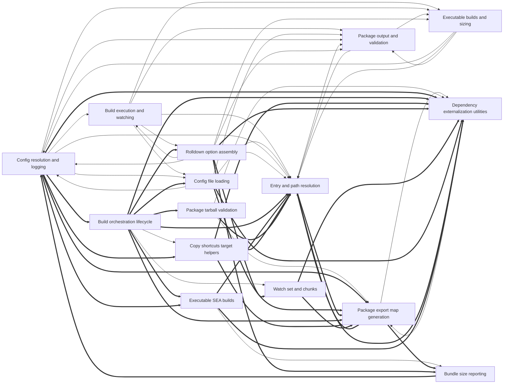

# Dependencies

Arrows point from a user to its dependency. Containment is structural, not a dependency. Graph-confirmed pairs appear in both the tree and resolved call/import edges. Model-inferred pairs appear only in the tree. Graph-only pairs appear only in the graph.
Graph-confirmed and model-inferred pairs count edges between two subtrees. Graph-only pairs count edges between direct node owners. Containment rows show resolved edges between ancestor direct units and a descendant subtree in both directions. Within containment rows count direct owner pairs separately. Neither kind of containment row appears in Mermaid or the three dependency totals.

Selected 15 nodes by connection count. Legend: `-->` graph-confirmed; `-.->` model-inferred; `==>` graph-only.

## Dependency list

- [Build execution and watching](nodes/build-execution-and-watching.md) → [Config file loading](nodes/config-file-loading.md) · graph-confirmed · 1 edge(s)
- [Build execution and watching](nodes/build-execution-and-watching.md) → [Entry and path resolution](nodes/entry-and-path-resolution.md) · graph-confirmed · 5 edge(s)
- [Build execution and watching](nodes/build-execution-and-watching.md) → [Executable builds and sizing](nodes/executable-builds-and-sizing.md) · graph-confirmed · 1 edge(s)
- [Build execution and watching](nodes/build-execution-and-watching.md) → [Package output and validation](nodes/package-output-and-validation.md) · graph-confirmed · 13 edge(s) · Build execution invokes package output and validation for post-build package artifacts and checks.
- [Build execution and watching](nodes/build-execution-and-watching.md) → [Rolldown option assembly](nodes/rolldown-option-assembly.md) · graph-confirmed · 2 edge(s)
- [Build orchestration lifecycle](nodes/build-orchestration-lifecycle.md) → [Copy shortcuts target helpers](nodes/copy-shortcuts-target-helpers.md) · graph-confirmed · 3 edge(s) · Build lifecycle calls copy, shortcut, and target helpers during orchestration.
- [Build orchestration lifecycle](nodes/build-orchestration-lifecycle.md) → [Watch set and chunks](nodes/watch-set-and-chunks.md) · graph-confirmed · 1 edge(s)
- [CLI entry and debug](nodes/cli-entry-and-debug.md) → [Package output and validation](nodes/package-output-and-validation.md) · graph-confirmed · 2 edge(s)
- [Config file loading](nodes/config-file-loading.md) → [Config resolution and logging](nodes/config-resolution-and-logging.md) · graph-confirmed · 1 edge(s)
- [Config file loading](nodes/config-file-loading.md) → [Entry and path resolution](nodes/entry-and-path-resolution.md) · graph-confirmed · 1 edge(s)
- [Config file loading](nodes/config-file-loading.md) → [Package output and validation](nodes/package-output-and-validation.md) · graph-confirmed · 3 edge(s)
- [Config resolution and logging](nodes/config-resolution-and-logging.md) → [Build execution and watching](nodes/build-execution-and-watching.md) · graph-confirmed · 2 edge(s) · Config resolution supplies resolved options and logging context to build execution and watching.
- [Config resolution and logging](nodes/config-resolution-and-logging.md) → [Config file loading](nodes/config-file-loading.md) · graph-confirmed · 1 edge(s)
- [Config resolution and logging](nodes/config-resolution-and-logging.md) → [Entry and path resolution](nodes/entry-and-path-resolution.md) · graph-confirmed · 3 edge(s)
- [Config resolution and logging](nodes/config-resolution-and-logging.md) → [Executable builds and sizing](nodes/executable-builds-and-sizing.md) · graph-confirmed · 1 edge(s)
- [Config resolution and logging](nodes/config-resolution-and-logging.md) → [Package output and validation](nodes/package-output-and-validation.md) · graph-confirmed · 9 edge(s)
- [Dependency externalization utilities](nodes/dependency-externalization-utilities.md) → [Package export map generation](nodes/package-export-map-generation.md) · graph-confirmed · 3 edge(s)
- [Entry and path resolution](nodes/entry-and-path-resolution.md) → [Package output and validation](nodes/package-output-and-validation.md) · graph-confirmed · 3 edge(s)
- [Executable builds and sizing](nodes/executable-builds-and-sizing.md) → [Config resolution and logging](nodes/config-resolution-and-logging.md) · graph-confirmed · 1 edge(s)
- [Executable builds and sizing](nodes/executable-builds-and-sizing.md) → [Entry and path resolution](nodes/entry-and-path-resolution.md) · graph-confirmed · 2 edge(s)
- [Executable builds and sizing](nodes/executable-builds-and-sizing.md) → [Package output and validation](nodes/package-output-and-validation.md) · graph-confirmed · 1 edge(s)
- [Executable SEA builds](nodes/executable-sea-builds.md) → [Bundle size reporting](nodes/bundle-size-reporting.md) · graph-confirmed · 1 edge(s)
- [Package export map generation](nodes/package-export-map-generation.md) → [Dependency externalization utilities](nodes/dependency-externalization-utilities.md) · graph-confirmed · 3 edge(s)
- [Package output and validation](nodes/package-output-and-validation.md) → [Entry and path resolution](nodes/entry-and-path-resolution.md) · graph-confirmed · 2 edge(s)
- [Package output and validation](nodes/package-output-and-validation.md) → [Executable builds and sizing](nodes/executable-builds-and-sizing.md) · graph-confirmed · 1 edge(s)
- [Package tarball validation](nodes/package-tarball-validation.md) → [Dependency externalization utilities](nodes/dependency-externalization-utilities.md) · graph-confirmed · 4 edge(s) · Tarball validation uses dependency externalization utilities when packing and checking packages.
- [Package tarball validation](nodes/package-tarball-validation.md) → [Package export map generation](nodes/package-export-map-generation.md) · graph-confirmed · 2 edge(s)
- [Rolldown option assembly](nodes/rolldown-option-assembly.md) → [Build execution and watching](nodes/build-execution-and-watching.md) · graph-confirmed · 1 edge(s)
- [Rolldown option assembly](nodes/rolldown-option-assembly.md) → [Config resolution and logging](nodes/config-resolution-and-logging.md) · graph-confirmed · 4 edge(s) · Rolldown option assembly uses config resolution and logging for resolved build options.
- [Rolldown option assembly](nodes/rolldown-option-assembly.md) → [Entry and path resolution](nodes/entry-and-path-resolution.md) · graph-confirmed · 1 edge(s)
- [Rolldown option assembly](nodes/rolldown-option-assembly.md) → [Executable builds and sizing](nodes/executable-builds-and-sizing.md) · graph-confirmed · 1 edge(s)
- [Rolldown option assembly](nodes/rolldown-option-assembly.md) → [Package output and validation](nodes/package-output-and-validation.md) · graph-confirmed · 3 edge(s)
- [Config resolution and logging](nodes/config-resolution-and-logging.md) → [Dependency externalization utilities](nodes/dependency-externalization-utilities.md) · graph-only · 6 edge(s)
- [Build orchestration lifecycle](nodes/build-orchestration-lifecycle.md) → [Entry and path resolution](nodes/entry-and-path-resolution.md) · graph-only · 4 edge(s)
- [Build orchestration lifecycle](nodes/build-orchestration-lifecycle.md) → [Dependency externalization utilities](nodes/dependency-externalization-utilities.md) · graph-only · 3 edge(s)
- [Config resolution and logging](nodes/config-resolution-and-logging.md) → [Package export map generation](nodes/package-export-map-generation.md) · graph-only · 3 edge(s)
- [Copy shortcuts target helpers](nodes/copy-shortcuts-target-helpers.md) → [Dependency externalization utilities](nodes/dependency-externalization-utilities.md) · graph-only · 3 edge(s)
- [Rolldown option assembly](nodes/rolldown-option-assembly.md) → [Dependency externalization utilities](nodes/dependency-externalization-utilities.md) · graph-only · 3 edge(s)
- [Build orchestration lifecycle](nodes/build-orchestration-lifecycle.md) → [Package tarball validation](nodes/package-tarball-validation.md) · graph-only · 2 edge(s)
- [Build orchestration lifecycle](nodes/build-orchestration-lifecycle.md) → [Rolldown option assembly](nodes/rolldown-option-assembly.md) · graph-only · 2 edge(s)
- [Config file loading](nodes/config-file-loading.md) → [Package export map generation](nodes/package-export-map-generation.md) · graph-only · 2 edge(s)
- [Entry and path resolution](nodes/entry-and-path-resolution.md) → [Package export map generation](nodes/package-export-map-generation.md) · graph-only · 2 edge(s)
- [Executable SEA builds](nodes/executable-sea-builds.md) → [Entry and path resolution](nodes/entry-and-path-resolution.md) · graph-only · 2 edge(s)
- [Watch set and chunks](nodes/watch-set-and-chunks.md) → [Dependency externalization utilities](nodes/dependency-externalization-utilities.md) · graph-only · 2 edge(s)
- [Build orchestration lifecycle](nodes/build-orchestration-lifecycle.md) → [Config file loading](nodes/config-file-loading.md) · graph-only · 1 edge(s)
- [Build orchestration lifecycle](nodes/build-orchestration-lifecycle.md) → [Executable SEA builds](nodes/executable-sea-builds.md) · graph-only · 1 edge(s)
- [Build orchestration lifecycle](nodes/build-orchestration-lifecycle.md) → [Package export map generation](nodes/package-export-map-generation.md) · graph-only · 1 edge(s)
- [Bundle size reporting](nodes/bundle-size-reporting.md) → [Config resolution and logging](nodes/config-resolution-and-logging.md) · graph-only · 1 edge(s)
- [CLI entry and debug](nodes/cli-entry-and-debug.md) → [Dependency externalization utilities](nodes/dependency-externalization-utilities.md) · graph-only · 1 edge(s)
- [CLI entry and debug](nodes/cli-entry-and-debug.md) → [Package export map generation](nodes/package-export-map-generation.md) · graph-only · 1 edge(s)
- [Config file loading](nodes/config-file-loading.md) → [Dependency externalization utilities](nodes/dependency-externalization-utilities.md) · graph-only · 1 edge(s)
- [Config resolution and logging](nodes/config-resolution-and-logging.md) → [Build orchestration lifecycle](nodes/build-orchestration-lifecycle.md) · graph-only · 1 edge(s)
- [Config resolution and logging](nodes/config-resolution-and-logging.md) → [Copy shortcuts target helpers](nodes/copy-shortcuts-target-helpers.md) · graph-only · 1 edge(s)
- [Config resolution and logging](nodes/config-resolution-and-logging.md) → [Executable SEA builds](nodes/executable-sea-builds.md) · graph-only · 1 edge(s)
- [Copy shortcuts target helpers](nodes/copy-shortcuts-target-helpers.md) → [Entry and path resolution](nodes/entry-and-path-resolution.md) · graph-only · 1 edge(s)
- [Copy shortcuts target helpers](nodes/copy-shortcuts-target-helpers.md) → [Package export map generation](nodes/package-export-map-generation.md) · graph-only · 1 edge(s)
- [Entry and path resolution](nodes/entry-and-path-resolution.md) → [Dependency externalization utilities](nodes/dependency-externalization-utilities.md) · graph-only · 1 edge(s)
- [Executable SEA builds](nodes/executable-sea-builds.md) → [Dependency externalization utilities](nodes/dependency-externalization-utilities.md) · graph-only · 1 edge(s)
- [Package export map generation](nodes/package-export-map-generation.md) → [Bundle size reporting](nodes/bundle-size-reporting.md) · graph-only · 1 edge(s)
- [Package export map generation](nodes/package-export-map-generation.md) → [Entry and path resolution](nodes/entry-and-path-resolution.md) · graph-only · 1 edge(s)
- [Package tarball validation](nodes/package-tarball-validation.md) → [Entry and path resolution](nodes/entry-and-path-resolution.md) · graph-only · 1 edge(s)
- [Rolldown option assembly](nodes/rolldown-option-assembly.md) → [Bundle size reporting](nodes/bundle-size-reporting.md) · graph-only · 1 edge(s)
- [Rolldown option assembly](nodes/rolldown-option-assembly.md) → [Watch set and chunks](nodes/watch-set-and-chunks.md) · graph-only · 1 edge(s)
- [Watch set and chunks](nodes/watch-set-and-chunks.md) → [Package export map generation](nodes/package-export-map-generation.md) · graph-only · 1 edge(s)

Graph-only pairs are ranked by edge count; 0 omitted.

### Within containment

Within containment: 0 pairs, ranked by edge count; 0 omitted. Each graph list keeps at most 40 pairs independently.
