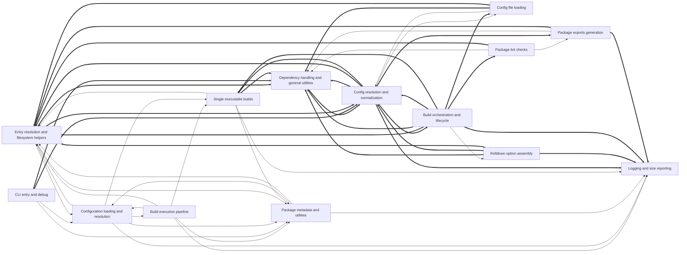

# Dependencies

Arrows point from a user to its dependency. Containment is structural, not a dependency. Graph-confirmed pairs appear in both the tree and resolved call/import edges. Model-inferred pairs appear only in the tree. Graph-only pairs appear only in the graph.
Graph-confirmed and model-inferred pairs count edges between two subtrees. Graph-only pairs count edges between direct node owners. Containment rows show resolved edges between ancestor direct units and a descendant subtree in both directions. Within containment rows count direct owner pairs separately. Neither kind of containment row appears in Mermaid or the three dependency totals.

Selected 14 nodes by connection count. Legend: `-->` graph-confirmed; `-.->` model-inferred; `==>` graph-only.

## Dependency list

- [Build execution pipeline](nodes/build-execution-pipeline.md) → [Configuration loading and resolution](nodes/configuration-loading-and-resolution.md) · graph-confirmed · 6 edge(s) · The build pipeline calls into configuration loading to obtain build-ready settings.
- [Build execution pipeline](nodes/build-execution-pipeline.md) → [Entry resolution and filesystem helpers](nodes/entry-resolution-and-filesystem-helpers.md) · graph-confirmed · 7 edge(s) · The build pipeline uses entry resolution and filesystem helpers to normalize entries and manage files.
- [Build execution pipeline](nodes/build-execution-pipeline.md) → [Logging and size reporting](nodes/logging-and-size-reporting.md) · graph-confirmed · 4 edge(s) · 1 inferred relation(s) · The build pipeline uses logging and size reporting to print build output and per-chunk sizes.
- [Build execution pipeline](nodes/build-execution-pipeline.md) → [Package metadata and utilities](nodes/package-metadata-and-utilities.md) · graph-confirmed · 9 edge(s) · 1 inferred relation(s) · The build pipeline relies on package metadata and utilities for exports generation, lint checks, and shared helpers.
- [Build execution pipeline](nodes/build-execution-pipeline.md) → [Single executable builds](nodes/single-executable-builds.md) · graph-confirmed · 1 edge(s) · The build pipeline invokes single-executable builds for the experimental exe feature.
- [Build orchestration and lifecycle](nodes/build-orchestration-and-lifecycle.md) → [Rolldown option assembly](nodes/rolldown-option-assembly.md) · graph-confirmed · 4 edge(s) · Build orchestration uses Rolldown option assembly to turn resolved configs into Rolldown build options.
- [CLI entry and debug](nodes/cli-entry-and-debug.md) → [Configuration loading and resolution](nodes/configuration-loading-and-resolution.md) · graph-confirmed · 1 edge(s) · The CLI entry loads and resolves the user's configuration before running builds.
- [CLI entry and debug](nodes/cli-entry-and-debug.md) → [Package metadata and utilities](nodes/package-metadata-and-utilities.md) · graph-confirmed · 1 edge(s)
- [Config file loading](nodes/config-file-loading.md) → [Config resolution and normalization](nodes/config-resolution-and-normalization.md) · graph-confirmed · 2 edge(s) · Config file loading hands parsed configs to resolution and normalization for defaults and per-format resolution.
- [Config resolution and normalization](nodes/config-resolution-and-normalization.md) → [Config file loading](nodes/config-file-loading.md) · graph-confirmed · 1 edge(s) · 1 inferred relation(s)
- [Configuration loading and resolution](nodes/configuration-loading-and-resolution.md) → [Build execution pipeline](nodes/build-execution-pipeline.md) · graph-confirmed · 1 edge(s) · Resolved configuration is passed into the build pipeline to execute builds.
- [Configuration loading and resolution](nodes/configuration-loading-and-resolution.md) → [Entry resolution and filesystem helpers](nodes/entry-resolution-and-filesystem-helpers.md) · graph-confirmed · 3 edge(s)
- [Configuration loading and resolution](nodes/configuration-loading-and-resolution.md) → [Logging and size reporting](nodes/logging-and-size-reporting.md) · graph-confirmed · 3 edge(s)
- [Configuration loading and resolution](nodes/configuration-loading-and-resolution.md) → [Package metadata and utilities](nodes/package-metadata-and-utilities.md) · graph-confirmed · 8 edge(s)
- [Configuration loading and resolution](nodes/configuration-loading-and-resolution.md) → [Single executable builds](nodes/single-executable-builds.md) · graph-confirmed · 1 edge(s)
- [Entry resolution and filesystem helpers](nodes/entry-resolution-and-filesystem-helpers.md) → [Configuration loading and resolution](nodes/configuration-loading-and-resolution.md) · graph-confirmed · 1 edge(s)
- [Entry resolution and filesystem helpers](nodes/entry-resolution-and-filesystem-helpers.md) → [Package metadata and utilities](nodes/package-metadata-and-utilities.md) · graph-confirmed · 2 edge(s)
- [Package exports generation](nodes/package-exports-generation.md) → [Dependency handling and general utilities](nodes/dependency-handling-and-general-utilities.md) · graph-confirmed · 7 edge(s) · Exports generation uses shared dependency and general utilities for path and pattern handling.
- [Package lint checks](nodes/package-lint-checks.md) → [Dependency handling and general utilities](nodes/dependency-handling-and-general-utilities.md) · graph-confirmed · 5 edge(s)
- [Package lint checks](nodes/package-lint-checks.md) → [Package exports generation](nodes/package-exports-generation.md) · graph-confirmed · 1 edge(s) · Package lint checks use exports generation while coordinating per-package post-build work.
- [Package metadata and utilities](nodes/package-metadata-and-utilities.md) → [Configuration loading and resolution](nodes/configuration-loading-and-resolution.md) · graph-confirmed · 2 edge(s)
- [Package metadata and utilities](nodes/package-metadata-and-utilities.md) → [Entry resolution and filesystem helpers](nodes/entry-resolution-and-filesystem-helpers.md) · graph-confirmed · 2 edge(s)
- [Package metadata and utilities](nodes/package-metadata-and-utilities.md) → [Logging and size reporting](nodes/logging-and-size-reporting.md) · graph-confirmed · 1 edge(s)
- [Single executable builds](nodes/single-executable-builds.md) → [Entry resolution and filesystem helpers](nodes/entry-resolution-and-filesystem-helpers.md) · graph-confirmed · 2 edge(s) · Single-executable builds use entry and filesystem helpers to locate chunks and compute output names.
- [Single executable builds](nodes/single-executable-builds.md) → [Logging and size reporting](nodes/logging-and-size-reporting.md) · graph-confirmed · 1 edge(s)
- [Single executable builds](nodes/single-executable-builds.md) → [Package metadata and utilities](nodes/package-metadata-and-utilities.md) · graph-confirmed · 1 edge(s)
- [Build orchestration and lifecycle](nodes/build-orchestration-and-lifecycle.md) → [Entry resolution and filesystem helpers](nodes/entry-resolution-and-filesystem-helpers.md) · graph-only · 5 edge(s)
- [Config resolution and normalization](nodes/config-resolution-and-normalization.md) → [Dependency handling and general utilities](nodes/dependency-handling-and-general-utilities.md) · graph-only · 5 edge(s)
- [Build orchestration and lifecycle](nodes/build-orchestration-and-lifecycle.md) → [Dependency handling and general utilities](nodes/dependency-handling-and-general-utilities.md) · graph-only · 4 edge(s)
- [Rolldown option assembly](nodes/rolldown-option-assembly.md) → [Dependency handling and general utilities](nodes/dependency-handling-and-general-utilities.md) · graph-only · 4 edge(s)
- [Config resolution and normalization](nodes/config-resolution-and-normalization.md) → [Logging and size reporting](nodes/logging-and-size-reporting.md) · graph-only · 3 edge(s)
- [Rolldown option assembly](nodes/rolldown-option-assembly.md) → [Config resolution and normalization](nodes/config-resolution-and-normalization.md) · graph-only · 3 edge(s)
- [Rolldown option assembly](nodes/rolldown-option-assembly.md) → [Logging and size reporting](nodes/logging-and-size-reporting.md) · graph-only · 3 edge(s)
- [Build orchestration and lifecycle](nodes/build-orchestration-and-lifecycle.md) → [Config resolution and normalization](nodes/config-resolution-and-normalization.md) · graph-only · 2 edge(s)
- [Config file loading](nodes/config-file-loading.md) → [Dependency handling and general utilities](nodes/dependency-handling-and-general-utilities.md) · graph-only · 2 edge(s)
- [Config resolution and normalization](nodes/config-resolution-and-normalization.md) → [Entry resolution and filesystem helpers](nodes/entry-resolution-and-filesystem-helpers.md) · graph-only · 2 edge(s)
- [Dependency handling and general utilities](nodes/dependency-handling-and-general-utilities.md) → [Config resolution and normalization](nodes/config-resolution-and-normalization.md) · graph-only · 2 edge(s)
- [Entry resolution and filesystem helpers](nodes/entry-resolution-and-filesystem-helpers.md) → [Dependency handling and general utilities](nodes/dependency-handling-and-general-utilities.md) · graph-only · 2 edge(s)
- [Rolldown option assembly](nodes/rolldown-option-assembly.md) → [Entry resolution and filesystem helpers](nodes/entry-resolution-and-filesystem-helpers.md) · graph-only · 2 edge(s)
- [Build orchestration and lifecycle](nodes/build-orchestration-and-lifecycle.md) → [Config file loading](nodes/config-file-loading.md) · graph-only · 1 edge(s)
- [Build orchestration and lifecycle](nodes/build-orchestration-and-lifecycle.md) → [Logging and size reporting](nodes/logging-and-size-reporting.md) · graph-only · 1 edge(s)
- [Build orchestration and lifecycle](nodes/build-orchestration-and-lifecycle.md) → [Package lint checks](nodes/package-lint-checks.md) · graph-only · 1 edge(s)
- [Build orchestration and lifecycle](nodes/build-orchestration-and-lifecycle.md) → [Single executable builds](nodes/single-executable-builds.md) · graph-only · 1 edge(s)
- [CLI entry and debug](nodes/cli-entry-and-debug.md) → [Config resolution and normalization](nodes/config-resolution-and-normalization.md) · graph-only · 1 edge(s)
- [CLI entry and debug](nodes/cli-entry-and-debug.md) → [Dependency handling and general utilities](nodes/dependency-handling-and-general-utilities.md) · graph-only · 1 edge(s)
- [Config file loading](nodes/config-file-loading.md) → [Entry resolution and filesystem helpers](nodes/entry-resolution-and-filesystem-helpers.md) · graph-only · 1 edge(s)
- [Config resolution and normalization](nodes/config-resolution-and-normalization.md) → [Build orchestration and lifecycle](nodes/build-orchestration-and-lifecycle.md) · graph-only · 1 edge(s)
- [Config resolution and normalization](nodes/config-resolution-and-normalization.md) → [Package exports generation](nodes/package-exports-generation.md) · graph-only · 1 edge(s)
- [Config resolution and normalization](nodes/config-resolution-and-normalization.md) → [Single executable builds](nodes/single-executable-builds.md) · graph-only · 1 edge(s)
- [Entry resolution and filesystem helpers](nodes/entry-resolution-and-filesystem-helpers.md) → [Config resolution and normalization](nodes/config-resolution-and-normalization.md) · graph-only · 1 edge(s)
- [Package exports generation](nodes/package-exports-generation.md) → [Entry resolution and filesystem helpers](nodes/entry-resolution-and-filesystem-helpers.md) · graph-only · 1 edge(s)
- [Package exports generation](nodes/package-exports-generation.md) → [Logging and size reporting](nodes/logging-and-size-reporting.md) · graph-only · 1 edge(s)
- [Package lint checks](nodes/package-lint-checks.md) → [Entry resolution and filesystem helpers](nodes/entry-resolution-and-filesystem-helpers.md) · graph-only · 1 edge(s)
- [Single executable builds](nodes/single-executable-builds.md) → [Dependency handling and general utilities](nodes/dependency-handling-and-general-utilities.md) · graph-only · 1 edge(s)

Graph-only pairs are ranked by edge count; 0 omitted.

### Within containment

Within containment: 0 pairs, ranked by edge count; 0 omitted. Each graph list keeps at most 40 pairs independently.
