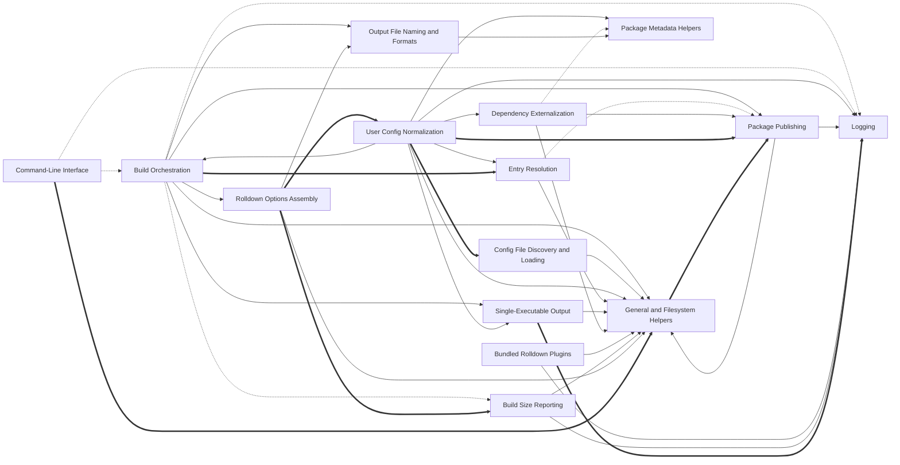

# Codebase Explorer

## How to read this report

Start with the responsibility tree in INDEX. Open a node page for your maintenance question, then choose a unit.
Node pages explain responsibilities. `catalog.json` stores full signatures, source ranges, folded members, relation evidence, and graph edges.
Set `RUN` to the absolute path of this run directory. Find an id, then read its explanation or frozen source.

```sh
cbe find --run-dir "$RUN" --term "SEARCH_TERM"
cbe query --run-dir "$RUN" --id "$ID"
cbe source --run-dir "$RUN" --id "$ID" --context 2
```

`ID` can be a unit id, symbol id, or file path. Commands return the content directly.
`source` reads frozen source and verifies its digest first.
The catalog also stores reverse graph edges, statuses, and raw evidence.

## Responsibility tree

- [tsdown Build Tool](nodes/tsdown.md) (0 units)
  - [Command-Line Interface](nodes/cli.md) (3 units)
    - [cli-ts-runcli](nodes/cli.md#u-7b169eb0ae3e) · Defines the tsdown command-line interface with cac and the entry that runs it.
  - [Build Orchestration](nodes/build-orchestration.md) (20 units)
    - [build](nodes/build-orchestration.md#u-20b3d0e57fe7) · Public entry point that builds from user-supplied inline config.
    - [Asset Copying](nodes/asset-copying.md) (8 units)
      - [copy](nodes/asset-copying.md#u-31dcb3fabb8a) · Copies files or glob matches declared in config.copy into the output directory.
  - [Configuration Resolution](nodes/config.md) (5 units)
    - [config-ts-defineconfig](nodes/config.md#u-36e982819374) · Public config helper: defineConfig is an identity function accepting a single UserConfig object, an array of configs, or a config function, and returning it unchanged; its value is purely the typed overloads that narrow the input to UserConfig, UserConfig[], UserConfigFn, or UserConfigExport.
    - [Config File Discovery and Loading](nodes/config-file-loading.md) (4 units)
      - [loadConfigFile](nodes/config-file-loading.md#u-60d630078245) · Discovers and loads the tsdown config file and normalizes the export into an array of UserConfig objects.
    - [User Config Normalization](nodes/config-merging.md) (3 units)
      - [resolveUserConfig](nodes/config-merging.md#u-9f27c28524ef) · Resolves one user config into one or more fully resolved per-format configs.
    - [Workspace Expansion](nodes/workspace-resolution.md) (1 units)
      - [resolveWorkspace](nodes/workspace-resolution.md#u-58cffcc57f13) · Expands workspace mode into per-package configs, or returns the single root config when workspace is not enabled.
    - [Entry Resolution](nodes/entry-resolution.md) (6 units)
      - [resolveEntry](nodes/entry-resolution.md#u-29c7af1463ba) · Resolves the configured entry into a map of entry names to absolute file paths.
    - [Target and Tsconfig Resolution](nodes/target-and-tsconfig.md) (6 units)
      - [resolveTarget](nodes/target-and-tsconfig.md#u-20e81acaf8a7) · Normalizes the build target into a list of target strings.
  - [Rolldown Options Assembly](nodes/rolldown-assembly.md) (7 units)
    - [getBuildOptions](nodes/rolldown-assembly.md#u-c7b946124458) · Assembles the full Rolldown BuildOptions for one format by combining resolveInputOptions and resolveOutputOptions.
    - [Bundled Rolldown Plugins](nodes/plugin-pipeline.md) (7 units)
      - [NodeProtocolPlugin](nodes/plugin-pipeline.md#u-0ba0d4cbad8c) · Normalizes Node builtin import specifiers per the nodeProtocol option via a pre-order resolveId plugin.
    - [Dependency Externalization](nodes/externalization.md) (9 units)
      - [deps-ts-dep-plugin](nodes/externalization.md#u-bb7e95b646eb) · Builds the 'tsdown:external' Rolldown plugin that decides which dependencies stay external and audits inlined ones.
  - [Output File Naming and Formats](nodes/output-shaping.md) (13 units)
    - [resolveChunkAddon](nodes/output-shaping.md#u-b521ce5719c7) · Wraps the banner/footer addon option into a Rolldown AddonFunction; undefined input returns undefined.
  - [Single-Executable Output](nodes/exe-output.md) (9 units)
    - [buildExe](nodes/exe-output.md#u-5ec03dd7b88c) · Builds single-executable applications from rolldown chunks when config.exe is set.
  - [Package Publishing](nodes/package-publishing.md) (17 units)
    - [bundleDone](nodes/package-publishing.md#u-a3955ba81d03) · Coordinates per-package completion: buffers bundles until all expected bundles for the package arrived, then emits exports, publint, and attw once.
  - [Build Size Reporting](nodes/reporting.md) (7 units)
    - [ReportPlugin](nodes/reporting.md#u-f9d0cf989188) · Creates the 'tsdown:report' plugin, which prints a size report after each bundle is written.
  - [Shared Utilities](nodes/shared-utils.md) (0 units)
    - [General and Filesystem Helpers](nodes/general-and-fs.md) (20 units)
      - [toArray](nodes/general-and-fs.md#u-1e9a5d8a9f7d) · Normalizes a value into an array.
    - [Logging](nodes/logging.md) (7 units)
      - [createLogger](nodes/logging.md#u-44145ce36528) · Builds a leveled, color-prefixed logger routed through a configurable console.
    - [Package Metadata Helpers](nodes/package-metadata.md) (3 units)
      - [readPackageJson](nodes/package-metadata.md#u-75e57eaf2966) · Finds the nearest package.json above a directory and parses it.

## Reading stats

- units: 155 · semantic nodes: 21 · dispositioned inventory ids: 294
- source ranges are program-derived from the inventory, never model-written

## Graph coverage

Source: static analysis graph. Resolved relations are graph-confirmed; this does not guarantee semantic correctness. External targets are outside the repository; ambiguous targets have multiple candidates. Unresolved or unsupported relations, and languages or relation kinds without coverage, rely on model inference and may be inaccurate.
Import and call status ratios use the edge count of each kind. CFG and dataflow are structural edges; only their counts are shown, without status ratios.
typescript import: resolved 142/532 (27%), unresolved 158/532 (30%), external 232/532 (44%) · typescript call: resolved 235/1630 (14%), ambiguous 1/1630 (0%), unresolved 815/1630 (50%), external 579/1630 (36%).
typescript structural edges: cfg=21516, dataflow=39253.
Incomplete capabilities: typescript/call partial.
Program checks: dangling edges 0; nodes outside manifest 0; nodes with missing files 0.

## Overview

tsdown is a library bundler CLI that converts user configuration (inline options or tsdown/Vite-compatible config files) into fully resolved per-format build configs and drives Rolldown to produce package-ready artifacts. The CLI subtree parses arguments and dispatches into Build Orchestration, which coordinates cleaning, per-config bundling in parallel, lifecycle hooks, watch handling, and post-build features. Configuration Resolution loads config files, expands monorepo workspaces, normalizes one user config per format (invoking feature resolvers for entries, targets, tsconfig, dependency externalization, and exe validation), and reuses shared helpers throughout. Rolldown Options Assembly turns resolved configs into Rolldown input/output options, injecting the bundled plugin pipeline (node: protocol, shebang, shims, watch tracking, CSS guard), the externalization plugin, output filename/addon shaping, and size reporting. After bundling, Asset Copying moves static assets, Single-Executable Output builds SEA binaries when enabled, and Package Publishing writes package.json exports and runs publint/attw per package. Shared Utilities supply tolerant fs primitives, normalization helpers, logging, and package.json access to every feature area. The maintenance navigation points each common question (missing assets, wrong entry names, unexpected externals, wrong output names, config not picked up) at the owning subtree.

## Maintenance navigation

For a question about how a build run is sequenced (clean, parallel bundles, hooks, watch), open build-orchestration. For config files not being found or parsed, open config-file-loading under config. For monorepo/workspace expansion, open workspace-resolution; for option normalization and which feature resolvers run per format, open config-merging. For wrong entry names or glob handling, open entry-resolution. For build target or tsconfig discovery, open target-and-tsconfig. For what gets inlined versus kept external, open externalization under rolldown-assembly. For how Rolldown input/output options and plugin ordering are produced, open rolldown-assembly, and for individual bundled plugins open plugin-pipeline. For emitted filenames, extensions, or banner/footer and CJS warnings, open output-shaping. For missing or misnamed copied assets, open asset-copying; for SEA/exe builds, open exe-output. For package.json exports, publint, and attw checks, open package-publishing. For size report output, open reporting. For low-level path, fs, normalization, or logging behavior, open shared-utils (general-and-fs, logging, package-metadata). For the CLI command surface and debug flags, open cli. The root tsdown node gives the top-level flow.

## Dependency view

Arrows point from a user to its dependency. Containment is structural, not a dependency. Graph-confirmed pairs appear in both the tree and resolved call/import edges. Model-inferred pairs appear only in the tree. Graph-only pairs appear only in the graph.
Graph-confirmed and model-inferred pairs count edges between two subtrees. Graph-only pairs count edges between direct node owners. Containment rows show resolved edges between ancestor direct units and a descendant subtree in both directions. Within containment rows count direct owner pairs separately. Neither kind of containment row appears in Mermaid or the three dependency totals.



Selected 15 nodes by connection count. Legend: `-->` graph-confirmed; `-.->` model-inferred; `==>` graph-only.

## Dependency list

- [Asset Copying](nodes/asset-copying.md) → [General and Filesystem Helpers](nodes/general-and-fs.md) · graph-confirmed · 3 edge(s) · Asset copying uses fs copy and array normalization helpers to perform the copies.
- [Build Orchestration](nodes/build-orchestration.md) → [Asset Copying](nodes/asset-copying.md) · containment · → 1 / ← 0 edge(s) (ancestor direct units and descendant subtree; → follows ` build-orchestration ` → ` asset-copying `) · Build orchestration invokes asset copying after bundling to place static assets in the output.
- [Build Orchestration](nodes/build-orchestration.md) → [Configuration Resolution](nodes/config.md) · graph-confirmed · 3 edge(s) · Build orchestration calls resolveConfig to obtain the fully resolved per-format configs before bundling.
- [Build Orchestration](nodes/build-orchestration.md) → [Single-Executable Output](nodes/exe-output.md) · graph-confirmed · 1 edge(s)
- [Build Orchestration](nodes/build-orchestration.md) → [General and Filesystem Helpers](nodes/general-and-fs.md) · graph-confirmed · 10 edge(s)
- [Build Orchestration](nodes/build-orchestration.md) → [Logging](nodes/logging.md) · model-inferred · 0 edge(s)
- [Build Orchestration](nodes/build-orchestration.md) → [Output File Naming and Formats](nodes/output-shaping.md) · graph-confirmed · 1 edge(s)
- [Build Orchestration](nodes/build-orchestration.md) → [Package Publishing](nodes/package-publishing.md) · graph-confirmed · 4 edge(s) · After all configs for a package finish, orchestration triggers package publishing (exports, publint, attw).
- [Build Orchestration](nodes/build-orchestration.md) → [Build Size Reporting](nodes/reporting.md) · model-inferred · 0 edge(s)
- [Build Orchestration](nodes/build-orchestration.md) → [Rolldown Options Assembly](nodes/rolldown-assembly.md) · graph-confirmed · 4 edge(s) · Per-config bundling uses rolldown option assembly to build input/output options and debug dumps.
- [Command-Line Interface](nodes/cli.md) → [Build Orchestration](nodes/build-orchestration.md) · model-inferred · 0 edge(s) · The CLI dispatches the parsed command into the build entry point.
- [Command-Line Interface](nodes/cli.md) → [Logging](nodes/logging.md) · model-inferred · 0 edge(s)
- [Configuration Resolution](nodes/config.md) → [Config File Discovery and Loading](nodes/config-file-loading.md) · containment · → 1 / ← 0 edge(s) (ancestor direct units and descendant subtree; → follows ` config ` → ` config-file-loading `) · resolveConfig loads user config files via the config file loader.
- [Configuration Resolution](nodes/config.md) → [User Config Normalization](nodes/config-merging.md) · containment · → 1 / ← 0 edge(s) (ancestor direct units and descendant subtree; → follows ` config ` → ` config-merging `)
- [Configuration Resolution](nodes/config.md) → [Entry Resolution](nodes/entry-resolution.md) · containment · → 0 / ← 0 edge(s) (ancestor direct units and descendant subtree; → follows ` config ` → ` entry-resolution `)
- [Configuration Resolution](nodes/config.md) → [Workspace Expansion](nodes/workspace-resolution.md) · containment · → 1 / ← 0 edge(s) (ancestor direct units and descendant subtree; → follows ` config ` → ` workspace-resolution `)
- [Config File Discovery and Loading](nodes/config-file-loading.md) → [General and Filesystem Helpers](nodes/general-and-fs.md) · graph-confirmed · 2 edge(s)
- [User Config Normalization](nodes/config-merging.md) → [Build Orchestration](nodes/build-orchestration.md) · graph-confirmed · 1 edge(s)
- [User Config Normalization](nodes/config-merging.md) → [Entry Resolution](nodes/entry-resolution.md) · graph-confirmed · 1 edge(s) · User config normalization invokes entry resolution to turn the entry option into resolved paths.
- [User Config Normalization](nodes/config-merging.md) → [Single-Executable Output](nodes/exe-output.md) · graph-confirmed · 1 edge(s)
- [User Config Normalization](nodes/config-merging.md) → [Dependency Externalization](nodes/externalization.md) · graph-confirmed · 1 edge(s)
- [User Config Normalization](nodes/config-merging.md) → [General and Filesystem Helpers](nodes/general-and-fs.md) · graph-confirmed · 7 edge(s)
- [User Config Normalization](nodes/config-merging.md) → [Logging](nodes/logging.md) · graph-confirmed · 3 edge(s)
- [User Config Normalization](nodes/config-merging.md) → [Package Metadata Helpers](nodes/package-metadata.md) · graph-confirmed · 2 edge(s)
- [User Config Normalization](nodes/config-merging.md) → [Target and Tsconfig Resolution](nodes/target-and-tsconfig.md) · graph-confirmed · 2 edge(s)
- [Entry Resolution](nodes/entry-resolution.md) → [General and Filesystem Helpers](nodes/general-and-fs.md) · graph-confirmed · 7 edge(s) · Entry resolution uses slash, existence checks, extension stripping, and array/pattern helpers.
- [Entry Resolution](nodes/entry-resolution.md) → [Package Publishing](nodes/package-publishing.md) · model-inferred · 0 edge(s)
- [Single-Executable Output](nodes/exe-output.md) → [General and Filesystem Helpers](nodes/general-and-fs.md) · graph-confirmed · 4 edge(s)
- [Dependency Externalization](nodes/externalization.md) → [General and Filesystem Helpers](nodes/general-and-fs.md) · graph-confirmed · 9 edge(s)
- [Dependency Externalization](nodes/externalization.md) → [Package Metadata Helpers](nodes/package-metadata.md) · model-inferred · 0 edge(s)
- [Dependency Externalization](nodes/externalization.md) → [Package Publishing](nodes/package-publishing.md) · graph-confirmed · 2 edge(s)
- [Output File Naming and Formats](nodes/output-shaping.md) → [Package Metadata Helpers](nodes/package-metadata.md) · graph-confirmed · 1 edge(s) · Chunk filename resolution reads the package module type to pick JS extensions.
- [Package Publishing](nodes/package-publishing.md) → [General and Filesystem Helpers](nodes/general-and-fs.md) · graph-confirmed · 15 edge(s) · Publishing uses fs removal, indentation detection, and path helpers when writing exports and packing tarballs.
- [Package Publishing](nodes/package-publishing.md) → [Logging](nodes/logging.md) · graph-confirmed · 2 edge(s)
- [Bundled Rolldown Plugins](nodes/plugin-pipeline.md) → [General and Filesystem Helpers](nodes/general-and-fs.md) · graph-confirmed · 5 edge(s)
- [Bundled Rolldown Plugins](nodes/plugin-pipeline.md) → [Logging](nodes/logging.md) · graph-confirmed · 1 edge(s)
- [Build Size Reporting](nodes/reporting.md) → [General and Filesystem Helpers](nodes/general-and-fs.md) · graph-confirmed · 4 edge(s)
- [Build Size Reporting](nodes/reporting.md) → [Logging](nodes/logging.md) · graph-confirmed · 1 edge(s)
- [Rolldown Options Assembly](nodes/rolldown-assembly.md) → [Dependency Externalization](nodes/externalization.md) · containment · → 1 / ← 0 edge(s) (ancestor direct units and descendant subtree; → follows ` rolldown-assembly ` → ` externalization `) · Input options assembly wires the dependency externalization plugin into the plugin pipeline.
- [Rolldown Options Assembly](nodes/rolldown-assembly.md) → [General and Filesystem Helpers](nodes/general-and-fs.md) · graph-confirmed · 17 edge(s)
- [Rolldown Options Assembly](nodes/rolldown-assembly.md) → [Output File Naming and Formats](nodes/output-shaping.md) · graph-confirmed · 3 edge(s) · resolveOutputOptions uses output shaping for chunk filename templates and banner/footer addons.
- [Rolldown Options Assembly](nodes/rolldown-assembly.md) → [Bundled Rolldown Plugins](nodes/plugin-pipeline.md) · containment · → 4 / ← 0 edge(s) (ancestor direct units and descendant subtree; → follows ` rolldown-assembly ` → ` plugin-pipeline `) · resolveInputOptions injects the bundled rolldown plugins into the input options.
- [Target and Tsconfig Resolution](nodes/target-and-tsconfig.md) → [General and Filesystem Helpers](nodes/general-and-fs.md) · graph-confirmed · 3 edge(s)
- [Workspace Expansion](nodes/workspace-resolution.md) → [Config File Discovery and Loading](nodes/config-file-loading.md) · graph-confirmed · 1 edge(s) · Workspace expansion reuses the config file loader to load per-package configs.
- [Build Orchestration](nodes/build-orchestration.md) → [Entry Resolution](nodes/entry-resolution.md) · graph-only · 2 edge(s)
- [Command-Line Interface](nodes/cli.md) → [General and Filesystem Helpers](nodes/general-and-fs.md) · graph-only · 2 edge(s)
- [Single-Executable Output](nodes/exe-output.md) → [Logging](nodes/logging.md) · graph-only · 2 edge(s)
- [Rolldown Options Assembly](nodes/rolldown-assembly.md) → [User Config Normalization](nodes/config-merging.md) · graph-only · 2 edge(s)
- [Workspace Expansion](nodes/workspace-resolution.md) → [General and Filesystem Helpers](nodes/general-and-fs.md) · graph-only · 2 edge(s)
- [User Config Normalization](nodes/config-merging.md) → [Config File Discovery and Loading](nodes/config-file-loading.md) · graph-only · 1 edge(s)
- [User Config Normalization](nodes/config-merging.md) → [Package Publishing](nodes/package-publishing.md) · graph-only · 1 edge(s)
- [General and Filesystem Helpers](nodes/general-and-fs.md) → [Package Publishing](nodes/package-publishing.md) · graph-only · 1 edge(s)
- [Rolldown Options Assembly](nodes/rolldown-assembly.md) → [Build Size Reporting](nodes/reporting.md) · graph-only · 1 edge(s)

Graph-only pairs are ranked by edge count; 0 omitted.

### Within containment


Within containment: 0 pairs, ranked by edge count; 0 omitted. Each graph list keeps at most 40 pairs independently.

## Key flows

- **Full build run** · build() resolves configs, runs each config's bundle, and finalizes each package with exports and publish checks.
  [build](nodes/build-orchestration.md#u-20b3d0e57fe7) → [build-ts-buildwithconfigs](nodes/build-orchestration.md#u-50217960b27f) → [build-ts-buildsingle](nodes/build-orchestration.md#u-3373284022b2) → [join](nodes/package-publishing.md#u-70c06da6dd04) → [slash](nodes/general-and-fs.md#u-9bf13c522663)
- **Rolldown input options with externalization** · Bundle setup assembles input options, injecting the dependency externalization plugin and other internal plugins.
  [build](nodes/build-orchestration.md#u-20b3d0e57fe7) → [build-ts-buildwithconfigs](nodes/build-orchestration.md#u-50217960b27f) → [build-ts-buildsingle](nodes/build-orchestration.md#u-3373284022b2) → [getBuildOptions](nodes/rolldown-assembly.md#u-c7b946124458) → [resolveInputOptions](nodes/rolldown-assembly.md#u-7fc5b178e947) → [deps-ts-dep-plugin](nodes/externalization.md#u-bb7e95b646eb)
- **Plugin injection into input options** · Input options assembly wires bundled plugins such as node: protocol normalization into the rolldown build.
  [build](nodes/build-orchestration.md#u-20b3d0e57fe7) → [build-ts-buildwithconfigs](nodes/build-orchestration.md#u-50217960b27f) → [build-ts-buildsingle](nodes/build-orchestration.md#u-3373284022b2) → [getBuildOptions](nodes/rolldown-assembly.md#u-c7b946124458) → [resolveInputOptions](nodes/rolldown-assembly.md#u-7fc5b178e947) → [NodeProtocolPlugin](nodes/plugin-pipeline.md#u-0ba0d4cbad8c)
- **Output naming shaping** · Output options resolution applies chunk filename templates and addons that determine emitted file names.
  [build](nodes/build-orchestration.md#u-20b3d0e57fe7) → [build-ts-buildwithconfigs](nodes/build-orchestration.md#u-50217960b27f) → [build-ts-buildsingle](nodes/build-orchestration.md#u-3373284022b2) → [getBuildOptions](nodes/rolldown-assembly.md#u-c7b946124458) → [resolveOutputOptions](nodes/rolldown-assembly.md#u-9b5ea05ef4d5) → [resolveChunkFilename](nodes/output-shaping.md#u-fa191ddae689)
- **Entry resolution path** · Entry option shapes are normalized to object entries and expanded into absolute paths with common-ancestor naming.
  [build-ts-buildsingle](nodes/build-orchestration.md#u-3373284022b2) → [toObjectEntry](nodes/entry-resolution.md#u-13f5fd0aa8fa) → [resolveArrayEntry](nodes/entry-resolution.md#u-047b87245e30) → [lowestCommonAncestor](nodes/general-and-fs.md#u-7dd4d279c25f)
- **Asset copying** · After bundling, copy entries are resolved with rename rules and files are copied into the output directory.
  [build-ts-buildsingle](nodes/build-orchestration.md#u-3373284022b2) → [copy](nodes/asset-copying.md#u-31dcb3fabb8a) → [resolveCopyEntry](nodes/asset-copying.md#u-ea985547c0c4) → [renameTarget](nodes/asset-copying.md#u-8c81f59037f5) → (model-inferred) → [fsCopy](nodes/general-and-fs.md#u-7c31711dacd3)
- **Output cleaning** · Per-config build cleans stale chunks from the output directory before emitting new files.
  [build](nodes/build-orchestration.md#u-20b3d0e57fe7) → [build-ts-buildwithconfigs](nodes/build-orchestration.md#u-50217960b27f) → [build-ts-buildsingle](nodes/build-orchestration.md#u-3373284022b2) → [cleanChunks](nodes/build-orchestration.md#u-1475c9e19d41) → [fsRemove](nodes/general-and-fs.md#u-55a789017e76)

## Generation notes

- Normalized after the final invalid answer (facts kept, shape fixed): module_4.

## Aggregation principle checks

Program diagnostics only; they do not prove semantic correctness or trigger rewrites.

### P1 · pass

```json
{"empty_or_duplicate_capabilities": [], "ok": true, "principle": "P1"}
```

### P2 · observe

```json
{"modules": {"asset-copying": {"external": 7, "internal": 2, "internal_external_ratio": 0.2857142857142857}, "build-orchestration": {"external": 41, "internal": 20, "internal_external_ratio": 0.4878048780487805}, "cli": {"external": 5, "internal": 2, "internal_external_ratio": 0.4}, "config": {"external": 8, "internal": 0, "internal_external_ratio": 0.0}, "config-file-loading": {"external": 9, "internal": 10, "internal_external_ratio": 1.1111111111111112}, "config-merging": {"external": 36, "internal": 15, "internal_external_ratio": 0.4166666666666667}, "entry-resolution": {"external": 19, "internal": 8, "internal_external_ratio": 0.42105263157894735}, "exe-output": {"external": 16, "internal": 6, "internal_external_ratio": 0.375}, "externalization": {"external": 21, "internal": 5, "internal_external_ratio": 0.23809523809523808}, "general-and-fs": {"external": 130, "internal": 3, "internal_external_ratio": 0.023076923076923078}, "logging": {"external": 14, "internal": 9, "internal_external_ratio": 0.6428571428571429}, "output-shaping": {"external": 9, "internal": 1, "internal_external_ratio": 0.1111111111111111}, "package-metadata": {"external": 6, "internal": 0, "internal_external_ratio": 0.0}, "package-publishing": {"external": 37, "internal": 35, "internal_external_ratio": 0.9459459459459459}, "plugin-pipeline": {"external": 19, "internal": 0, "internal_external_ratio": 0.0}, "reporting": {"external": 10, "internal": 4, "internal_external_ratio": 0.4}, "rolldown-assembly": {"external": 34, "internal": 6, "internal_external_ratio": 0.17647058823529413}, "shared-utils": {"external": 0, "internal": 0, "internal_external_ratio": null}, "target-and-tsconfig": {"external": 8, "internal": 6, "internal_external_ratio": 0.75}, "tsdown": {"external": 0, "internal": 0, "internal_external_ratio": null}, "workspace-resolution": {"external": 7, "internal": 0, "internal_external_ratio": 0.0}}, "ok": false, "principle": "P2", "scope": "direct primary ownership; incident cross-module edges counted at each endpoint"}
```

### P3 · observe

```json
{"bounds": [5, 30], "ok": false, "out_of_bounds": {"cli": 3, "config-file-loading": 4, "config-merging": 3, "package-metadata": 3, "workspace-resolution": 1}, "principle": "P3", "scope": "nodes with directly owned units; structural ancestors excluded"}
```

### P4 · pass

```json
{"ok": true, "ownership_violations": {}, "principle": "P4"}
```

### P5 · observe

```json
{"min_dependent_modules": 2, "min_edges_per_dependent_module": 3, "note": "dependency signal only, including utilities already separated; no automatic reassignment", "ok": false, "principle": "P5", "shared_units": {"src/utils/general.ts::function::slash::683": {"build-orchestration": 2, "entry-resolution": 4, "externalization": 2, "package-publishing": 7, "workspace-resolution": 3}, "src/utils/general.ts::function::toArray::76": {"asset-copying": 3, "cli": 2, "config-file-loading": 1, "config-merging": 6, "entry-resolution": 2, "externalization": 3, "plugin-pipeline": 3, "target-and-tsconfig": 2}}}
```

### P6 · pass

```json
{"modules": {"asset-copying": {"typescript": 8}, "build-orchestration": {"typescript": 20}, "cli": {"typescript": 3}, "config": {"typescript": 5}, "config-file-loading": {"typescript": 4}, "config-merging": {"typescript": 3}, "entry-resolution": {"typescript": 6}, "exe-output": {"typescript": 9}, "externalization": {"typescript": 9}, "general-and-fs": {"typescript": 20}, "logging": {"typescript": 7}, "output-shaping": {"typescript": 13}, "package-metadata": {"typescript": 3}, "package-publishing": {"typescript": 17}, "plugin-pipeline": {"typescript": 7}, "reporting": {"typescript": 7}, "rolldown-assembly": {"typescript": 7}, "shared-utils": {}, "target-and-tsconfig": {"typescript": 6}, "tsdown": {}, "workspace-resolution": {"typescript": 1}}, "ok": true, "principle": "P6", "scope": "unit counts by language; a multi-language unit contributes once per language"}
```

### P7 · not_checked

```json
{"ok": null, "principle": "P7", "reason": "no prior tree for the same detail input", "status": "not_checked"}
```

Hierarchy and introduction length:

```json
{"hierarchy": {"ok": true, "requires_intermediate_above_units": 30}, "introduction_length": {"ok": true, "overlong": {}, "scope": "capability+summary characters versus descendant explain characters"}}
```
